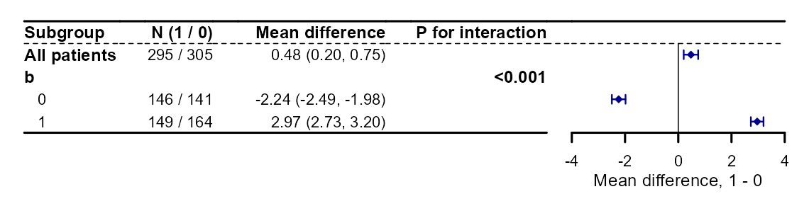
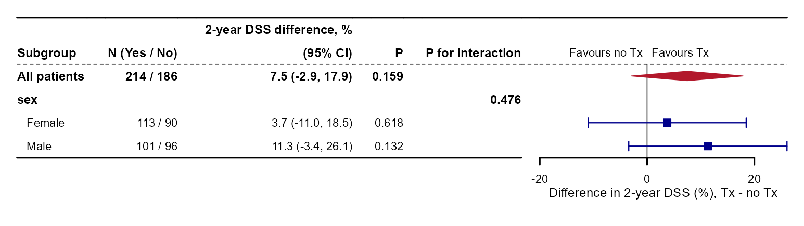
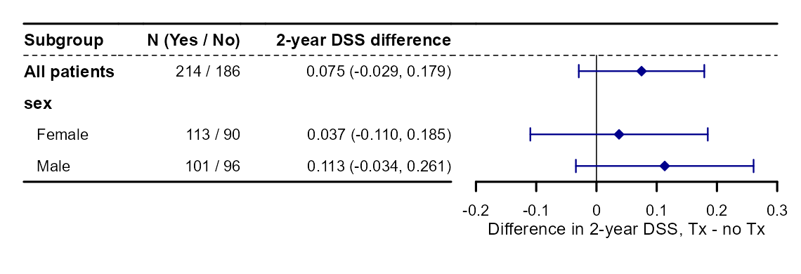
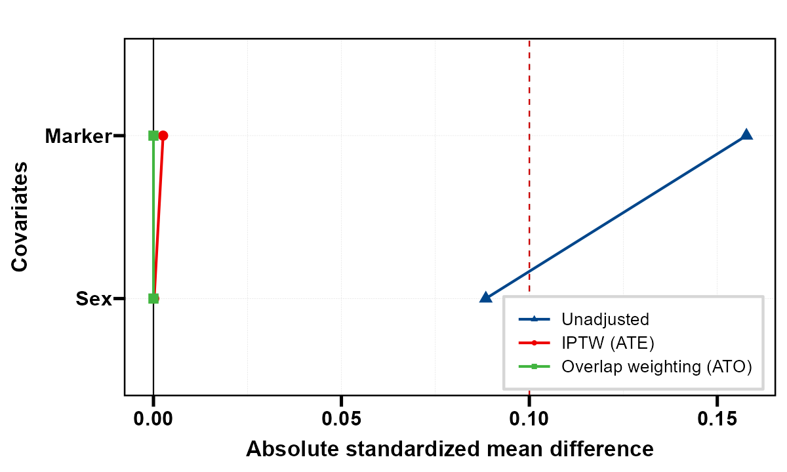
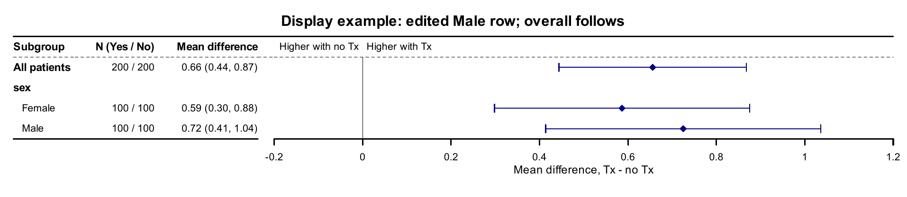

::: {.callout-note title="运行前核对树变量参数"}
2026-10-17 已核对 causalR 远端 `ceb2003`：select、unihtee、tree 和 icf 四个入口均已使用 `tree_var`。本站代码与已推送接口一致；旧安装若仍用 `candidate_var`，请按安装接口替换参数名或更新包。历史模型和图表保留原执行结果，详见 [发布状态](#release-20261016)。
:::

```{r}
#| label: setup-workflow
#| include: false
if (nzchar(Sys.getenv("CAUSALR_SOURCE"))) {
  pkgload::load_all(Sys.getenv("CAUSALR_SOURCE"), quiet = TRUE)
} else library(causalR)
library(ggplot2)
knitr::opts_chunk$set(collapse = TRUE, comment = "#>", message = FALSE)
```

工作流从研究问题和目标人群开始，再检查重叠与平衡、估计效应、探索异质性、做敏感性分析。
本页使用模拟连续结局；各步骤给出可运行代码与参数对照，不构成患者治疗建议。

## 每一步传什么对象 {#sec-workflow-map}

| 步骤 | 输入 → 输出 | 重点 |
|---|---|---|
| PS 设计 | 原队列 → `psm_res` / `psw_res` | 配对、权重、保留患者、目标人群 |
| 平衡比较 | 原队列 → `get_bal()` 的 `plt/balance/data` | 相同 SMD 分母上的不同方案 |
| 效应估计 | 设计后数据 → 合适的结局模型与方差 | PS 设计函数本身不估计结局效应 |
| HTE | 原队列和完整调整集合 → `hte_res` | 这是另一条建模路径；重叠权重不会自动传入森林 |
| 敏感性 | 明确的目标模型 → `sens_res` | 解释该模型的估计量，不替代 HTE 验证 |

## 队列与事先指定的调整集合 {#sec-workflow-data}

```{r}
#| label: workflow-data
set.seed(20261002)
n <- 1400
d <- data.frame(age = rnorm(n, 60, 10), sex = factor(rbinom(n, 1, 0.5)),
                stage = factor(sample(c("I", "II", "III"), n, TRUE)), marker = rnorm(n))
d$z <- rbinom(n, 1, plogis(-0.4 + 0.04 * (d$age - 60) + 0.7 * (d$stage == "III") + 0.2 * d$marker))
d$y <- 0.15 * (d$age - 60) + 1.5 * (d$stage == "III") + d$marker +
  d$z * (1 + 2 * (d$sex == "1") + d$marker) + rnorm(n, sd = 1.5)
adj <- c("age", "sex", "stage", "marker")
table(d$z)
```

因果识别仍需要调整集合充分、重叠、治疗一致性和合适的时间顺序。
不能按结局显著性删除混杂变量，也不能调整治疗后的中介来替代设计。

## PSW 与 PSM：重要计算参数 {#sec-workflow-design-args}

::: {.table-responsive}

| 参数 | PSW | PSM | 条件 |
|---|---|---|---|
| 治疗与协变量 | `treat`、`adj_var` | 同名 | 完整基线调整集合 |
| PS 来源 | `ps=NULL`、`method="glm"` | `ps=NULL`、`ps_method="glm"` | `ps` 指已有概率列；外部 PS 必须按行对齐 |
| 目标 | `estimand` 默认六种 | `estimand="ATT"` | 不同目标人群的结果不应直接当同一效应 |
| 匹配引擎 | — | `method="nearest"` | 也有 optimal/full/genetic/cem/exact/subclass，各自限制不同 |
| 匹配数量 | — | `ratio=1` | nearest/optimal/genetic 使用 |
| caliper | — | `NULL` | 本接口是 **PS 概率的 SD**，0.2 不能解释为 logit PS 的 0.2 SD |
| 重用对照 | — | `replace=FALSE` | TRUE 时患者可跨配对；方差与长格式数据要另外处理 |
| 稳定化 | `stabilize=FALSE` | — | 仅 ATE 权重；不能修复重叠不足 |
| 剔除患者 | `trim_args` | `match_args$discard` 等 | 改变实际分析人群，记录被剔除者 |
| 截断 PS | `trunc_args` | — | 保留患者但改变极端 PS 及权重 |
| 后端设置 | `ps_args=list()` | `ps_args`、`match_args` | 管理字段如 data/formula 不能重复传 |
| 平衡 | `balance=TRUE` | 同名 | 保存平衡表；否则 love 视图不可用 |

:::

| PSW 配置 | 默认 | 可选与影响 |
|---|---|---|
| `trim_args$method` | `"none"` | `ps` 绝对界、`pctl` 分位数、`cr` 对称 cutoff |
| `trim_args$lower/upper` | `NULL/NULL` | 按方法填默认；`cr` 不接受手工上下界 |
| `trim_args$refit` | `TRUE` | 剔除后重拟合 PS；已有外部 PS 无法重拟合，需显式 FALSE |
| `trunc_args$method` | `"none"` | `ps` 或 `pctl`，修改 PS 而非直接裁剪权重 |
| `trunc_args$lower/upper` | `0.01/0.99` | 绝对界或分位数；报告含义与取值 |

ATO 是重叠人群效应；ATT 是治疗者目标，匹配又可能丢掉未找到对照的治疗者。
ATM 与 EW 也有各自的目标权函数。方案不应仅因 SMD 更小或 p 更小就被选择。

```{r}
#| label: workflow-design
pw <- get_PSW(d, "z", adj_var = adj, estimand = c("ATE", "ATT", "ATO"))
pm <- get_PSM(d, "z", adj_var = adj, method = "nearest", estimand = "ATT",
               ratio = 1, caliper = 0.2, replace = FALSE)
pw$stats
pm$stats
stopifnot(all(c("w_ate", "w_att", "w_ato") %in% names(pw$data)),
          all(c("w_nearest", "s_nearest") %in% names(pm$data)))
```

## PSW 的四种视图与匹配对照 {#sec-workflow-design-plots}

`plt_PSW()` 的 `estimand=NULL` 画全部方案；`plt_PSM()` 用 `method=NULL` 选择方案。
两者共有 `type`、`threshold=0.1`、`bins=40L`、`title=NULL`、`save=list()`。
`threshold` 只画参考线，`bins` 只影响 PS 直方图；它们不改变设计。

::: {.panel-tabset}

### 平衡 {.unnumbered}

```{r}
#| label: fig-workflow-love
#| fig-alt: "同一原队列与三种权重的基线平衡。0.1 是常用描述阈值，不能证明无混杂。"
#| fig-width: 9
#| fig-height: 5
#| fig-cap: "同一原队列与三种权重的基线平衡。0.1 是常用描述阈值，不能证明无混杂。"
plt_PSW(pw, type = "love", threshold = 0.1)
```

### ESS {.unnumbered}

```{r}
#| label: fig-workflow-ess
#| fig-alt: "三种加权方案的两臂有效样本量对照，计算为权重和的平方除以权重平方和；有效样本量不是实际保留人数。"
#| fig-width: 9
#| fig-height: 5
#| fig-cap: "有效样本量为 (sum w)^2/sum(w^2)，分别看两臂；它不是实际保留人数。"
plt_PSW(pw, type = "ess")
```

### 权重 {.unnumbered}

```{r}
#| label: fig-workflow-weight
#| fig-alt: "权重分布帮助检查极端值，不能只比较各方案平均权重。"
#| fig-width: 10
#| fig-height: 5
#| fig-cap: "权重分布帮助检查极端值，不能只比较各方案平均权重。"
plt_PSW(pw, type = "weight")
```

### PS {.unnumbered}

```{r}
#| label: fig-workflow-ps
#| fig-alt: "bins=25：加权前后两臂的 PS 分布。重叠图与协变量平衡都应检查。"
#| fig-width: 10
#| fig-height: 5
#| fig-cap: "bins=25：加权前后两臂的 PS 分布。重叠图与协变量平衡都应检查。"
plt_PSW(pw, type = "ps", bins = 25)
```

### 匹配后的 PS {.unnumbered}

```{r}
#| label: fig-workflow-match
#| fig-alt: "1:1 无放回匹配的 PS 分布。匹配保留的人群与原队列不同。"
#| fig-width: 8
#| fig-height: 5
#| fig-cap: "1:1 无放回匹配的 PS 分布。匹配保留的人群与原队列不同。"
plt_PSM(pm, type = "ps", method = "nearest", bins = 25)
```

:::

## get_bal：在共同分母上比较方案 {#sec-workflow-bal}

```{r}
#| label: fig-workflow-balance
#| fig-alt: "多水平分期用整体 SMD 一行显示，所有方案使用共同未调整 pooled SD 分母。"
#| fig-width: 9
#| fig-height: 5
#| fig-cap: "多水平分期用整体 SMD 一行显示，所有方案使用共同未调整 pooled SD 分母。"
bal <- get_bal(d, "z", adj_var = adj, methods = c("PSM", "ATE", "ATO"),
                cat_smd = "overall", tbl = FALSE, var_names = NULL,
                love_args = list(threshold = 0.1, legend_position = "bottom", base_size = 12))
bal$plt
```

`methods` 可是缩写向量，也可是带名称的方案 list；PSM 缩写默认为 nearest、ATT、caliper=0.2。
`cat_smd="level"` 展开分类水平；`tbl=TRUE` 另外生成表，`cores` 控制表的工作进程。
`love_args` 支持 threshold、colors、shapes、size、line、var_order、base_size、ref_color、
legend_position、legend_justification。`save_plt` 保存图，`save_tbl` 保存 Word 表。
本页只运行绘图路径；方案的独立 halfmoon 平衡表与共同分母结果不应逐项要求相等。

## 设计后的效应估计：明确方差与人群 {#sec-workflow-estimate}

```{r}
#| label: workflow-estimate
f_ato <- lm(y ~ z, data = pw$data, weights = w_ato)
V_ato <- sandwich::vcovHC(f_ato, type = "HC0")
matched <- subset(pm$data, w_nearest > 0 & !is.na(s_nearest))
f_att <- lm(y ~ z, data = matched, weights = w_nearest)
V_att <- sandwich::vcovCL(f_att, cluster = matched$s_nearest, type = "HC1")
b <- c(coef(f_ato)[["z"]], coef(f_att)[["z"]])
se <- c(sqrt(V_ato["z", "z"]), sqrt(V_att["z", "z"]))
data.frame(analysis = c("ATO weighted mean contrast", "Matched ATT contrast"),
           estimate = b, std.error = se, conf.low = b - qnorm(.975) * se,
           conf.high = b + qnorm(.975) * se)
```

这里是连续结局的教学估计：加权路径用异方差稳健方差，匹配路径按配对聚类。
这些区间没有完整反映估计 PS、方案选择或匹配构造的不确定性，不能当成通用最终推断模板。
放回匹配、可变比例、缺失、多中心或生存结局需要相应的数据结构与推断方法。

## 原队列上的 HTE 是另一条路径 {#sec-workflow-hte}

```{r}
#| label: fig-workflow-hte
#| fig-alt: "原队列 ATE 与预设性别亚组。它与前面的 ATO 加权或匹配 ATT 目标不同。"
#| fig-width: 8
#| fig-height: 4.5
#| fig-cap: "原队列 ATE 与预设性别亚组。它与前面的 ATO 加权或匹配 ATT 目标不同。"
hte <- get_hte(d, "z", adj_var = adj, sub_var = "sex", surv = "y",
               grf_args = list(num.trees = 500, num.threads = 2, seed = 123))
plt_hte_sub(hte, fixed_size = FALSE, show_pinter = TRUE)
```

HTE 参数与诊断见 [总览](index.qmd)、[诊断页](hte-diagnostics-guide.qmd) 和
[规则选择](method-selection-guide.qmd)。不能把同一权重再次传入森林后就称为
“多做一层双稳健”；目标人群、PS、样本权重与得分构造必须一起论证。

## 未测量混杂敏感性：绑定到明确模型 {#sec-workflow-sens}

| 参数 | 默认 | 说明 |
|---|---|---|
| `method` | `"lm"` | sensemakr 的线性模型 partial R²；另有 cox/dml/iv，各自尺度不同 |
| `treat/outcome/adj_var` | 治疗、结局、调整列 | 本例是调整后的线性回归系数，不是森林 CATE 或 ATO |
| `bench_var` | `NULL` | 已调整基线变量作强度参照；不能放未调整变量 |
| `q` / `conf_level` | `1` / `0.95` | 希望混杂解释掉的估计比例、置信水平 |
| `bench_args$k_treat/k_out` | `1/NULL` | 相对 benchmark 的治疗端/结局端强度倍数；NULL 沿用治疗端 |
| `bench_args$bound/bound_label` | `NULL/"Manual bound"` | 另外的手工强度边界与标签 |
| 绘图 `type` | 按后端 | lm 为 contour/extreme；cox 为 tip/evalue；dml/iv 为 contour |
| 绘图 `threshold` | `0` | 需要跨越的效应或检验参照值 |
| 绘图 `lim` | `NULL` | contour 的两个 partial R² 轴上限，默认由分析范围决定 |
| `contour_args` | 见帮助页 | sensitivity_of、n_levels、grid_n、round；grid_n 仅 DML |
| `colors/save` | `NULL/list()` | 线色与 PDF 保存；标题只支持 tip/evalue 路径 |

```{r}
#| label: workflow-sensitivity
sens <- get_sens(d, treat = "z", outcome = "y", adj_var = adj,
                  bench_var = "age", method = "lm", q = 1,
                  bench_args = list(k_treat = c(1, 2)))
sens$stats
sens$bounds
```

```{r}
#| label: fig-workflow-sens
#| fig-alt: "相对于已调整年龄的混杂强度参照。横纵轴是 partial R²，不能理解为混杂患者比例。"
#| fig-width: 8
#| fig-height: 6
#| fig-cap: "相对于已调整年龄的混杂强度参照。横纵轴是 partial R²，不能理解为混杂患者比例。"
plt_sens(sens, type = "contour", contour_args = list(sensitivity_of = "estimate"))
```

敏感性结果描述“多强的未测量混杂可改变这个模型结论”，不能证明不存在未测量混杂。
年龄参照的合理性也需要研究背景；它不是自动生成的最坏情况上界。

## 报告与保存 {#sec-workflow-report}

报告原始人数、缺失处理、两臂 PS 支持、设计目标、保留人数与 ESS、平衡、极端权重、
结局模型、方差方法、HTE 发现/验证流程以及敏感性模型。各目标的单位和人群应贯穿图表。

```{r}
#| eval: false
plt_PSW(pw, type = "love", save = list(filename = "psw_balance.pdf", width = 9, height = 5))
plt_sens(sens, save = list(filename = "sensitivity.pdf", width = 8, height = 6))
```

```{r}
args(get_PSW)
args(get_PSM)
args(get_sens)
sessionInfo()
```

## 亚组森林表的固定行高 {#row-height-current}

2026-10-15在Windows R 4.4.3、UTF-8环境中按本机causalR `f39631a` 实际运行本节新例。2026-10-16复核：远端 `f3f7ecc` 已包含unihtee的hte字段、row_height及右角树边、结点/叶子配色；本节图片保留原 `f39631a` 执行快照。原代码块保留为原有完整流程，本轮不重新执行其历史分析。新例使用600人的固定种子连续结局模拟数据，与前面数据和结果分开。

::: {.panel-tabset}

### 按行高调整森林表密度

row_height默认0.3英寸，本例改为0.21；它调整固定尺寸森林表的行高，不修改效应或区间。fixed_size=FALSE时图会伸展，不能用行高代替patchwork比例布局。

```r
set.seed(20261015)
d_hte_new <- data.frame(b = rbinom(600, 1, 0.5), x = rnorm(600))
d_hte_new$z <- rbinom(600, 1, 0.5)
d_hte_new$y <- 0.5 * d_hte_new$x + d_hte_new$z * (-2 + 5 * d_hte_new$b) + rnorm(600)
uni_rows <- get_hte_unihtee(d_hte_new, "z", tree_var = c("b", "x"),
  adj_var = c("b", "x"), surv = "y", grf_args = list(num.trees = 200, num.threads = 1), seed = 123)
p_rows_default <- plt_hte_sub(uni_rows$hte, sub_var = "b", row_height = 0.3, show_pinter = TRUE)
p_rows_compact <- plt_hte_sub(uni_rows$hte, sub_var = "b", row_height = 0.21, show_pinter = TRUE)
p_rows_compact
```

{fig-alt="按行高调整森林表密度的固定输入参数对照实图。"}

:::


## 发布状态与树变量名称 {#release-20261016}

2026-10-16核对：树图样式及绘图环境整理已推送到causalR `f3f7ecc`。仅保存plt_hte_tree/plt_hte_icf的图对象时，绘图环境不再连带保存整个拟合；图仍含绘图所需数据，这不是匿名化功能。既有图片和数值保留各自执行日期，本轮没有重跑历史分析。

2026-10-17 核对的远端 `ceb2003` 已包含 `e389a75` 与 `f505185` 的改名，四个入口均使用 `tree_var`，不再是仅本机可用的接口。本站 `72d6139` 与 `b0f67c1` 的代码拼写已与之统一。当前源码已在 Windows R 4.4.3 核对四个签名，并实际执行 `get_hte_unihtee(method="glm", tree_var=...)`。旧安装可用 `names(formals(causalR::get_hte_tree))` 等检查；`candidate_var` 与 `tree_var` 应按安装接口选择，不同时传入。历史模型、表格与图片保持原执行快照，本轮没有重算历史森林。2026-10-18 已用 Windows R 4.4.3 与 causalR `e4b86c6` 重新执行本页全部代码块，结果缓存在 `_freeze/`。

## 当前亚组森林：表头、百分点与汇总菱形 {#subgroup-20261018}

2026-10-18 按已推送causalR `e4b86c66`，在Windows R 4.4.3实际执行本节。此前各节保留原计算与图片快照。本节另生成400条模拟生存记录，Tx为随机分配的No/Yes；仅展示当前接口，不作为治疗效果证据。

```r
library(causalR)
set.seed(20261018)
n <- 400L
d_hte <- data.frame(Tx = factor(sample(c("No", "Yes"), n, TRUE), levels = c("No", "Yes")),
  sex = factor(sample(c("Female", "Male"), n, TRUE)), x = rnorm(n))
event_time <- rexp(n, exp(-3.8 - 0.3 * (d_hte[["Tx"]] == "Yes") + 0.25 * d_hte[["x"]]))
censor_time <- rexp(n, 0.01)
d_hte[["time"]] <- pmin(event_time, censor_time)
d_hte[["DSS"]] <- as.integer(event_time <= censor_time)
hte_current <- get_hte(d_hte, "Tx", sub_var = "sex", adj_var = c("x", "sex"),
  surv = TRUE, time = 24, grf_args = list(num.trees = 400, num.threads = 1, seed = 20261018))
```

::: {.table-responsive}

| 控制项 | 当前写法 | 使用边界 |
|:--|:--|:--|
| 轴范围与刻度 | `axis_args=list(xlim=..., xticks=...)` | 仍用原始估计尺度；`0.2`表示20个百分点，不要写成20 |
| 百分比显示 | `axis_args=list(percent=TRUE)`，默认开启 | 概率差按百分点显示；不用于RMST、连续结局或比值 |
| 方向标签 | `axis_args=list(direction_labels=TRUE)` | 可关闭或传两个字符串；按结局及效应量确定方向 |
| 列头 | `header_list=list(label=..., count=..., effect=...)` | `effect`用换行可形成多行表头；默认表头不再自动附区间水平 |
| 点形 | `ci_shape=c("normal","summary")` | 亚组为按逆方差缩放的方块，总体为汇总菱形及加粗行 |
| 配色 | `box_col=c("blue4","#B2182B")` | 分别控制亚组和总体 |

:::

旧标量参数`xlim`、`ticks_at`应迁入`axis_args$xlim/xticks`。`est_label`只在一个兼容周期内保留并警告，改用`header_list$effect`；它们不是可以随意放进`...`的其他参数。

::: {.panel-tabset}

### 百分点与汇总行

```r
p_percent <- plt_hte_sub(hte_current, sub_var = "sex", show_pvalue = TRUE, show_pinter = TRUE,
  header_list = list(effect = "2-year DSS difference, %\n(95% CI)"),
  axis_args = list(xlim = c(-0.3, 0.3), xticks = c(-0.2, 0, 0.2)),
  ci_shape = c("normal", "summary"), box_col = c("blue4", "#B2182B"))
```

{fig-alt="400条模拟记录的两年DSS概率差森林图，总体为红色汇总菱形并加粗，女性男性为蓝色方块，方向标签位于参考线两侧。"}

### 原始比例与关闭方向标签

```r
p_proportion <- plt_hte_sub(hte_current, sub_var = "sex",
  axis_args = list(percent = FALSE, direction_labels = FALSE))
stopifnot(isTRUE(all.equal(attr(p_percent, "subgroup"),
  attr(p_proportion, "subgroup"), check.attributes = FALSE)))
```

{fig-alt="同一HTE结果改以0到1概率尺度显示差值，方向标签关闭，原始亚组估计保持一致。"}

:::

这里总体差约7.5个百分点对应原始概率差约0.075。改变`percent`、标题或点形不会改变模型结果。本图是同一队列的总体与亚组，**不是独立研究的荟萃分析**；汇总菱形只是显示样式。

### get_bal 的图内图例与名称映射 {#balance-legend-20261018}

沿用本节模拟数据，明确把右下角坐标与图例自身的右下锚点配对：

```r
balance_current <- get_bal(d_hte, "Tx", adj_var = c("x", "sex"), methods = c("ATE", "ATO"),
  var_names = c(x = "Marker", sex = "Sex"),
  love_args = list(legend_position = c(0.98, 0.02), legend_justification = c(1, 0)))
balance_current[["plt"]]
```

{fig-alt="未调整、ATE加权和ATO重叠加权的协变量绝对SMD，图例位于图内右下方，变量显示为Marker和Sex。"}

`get_bal()`及`plt_hte_unihtee()`的`var_names`默认现在为`character()`；RegR可用时仍合并它的名称映射，用户同名项优先。`NULL`保留原列名。图内定位使用`legend_justification`，不会更改平衡计算值。

## 当前替换亚组行：总体行随之更新 {#overall-edit-20261020}

2026-10-20 按已推送 causalR `7a983f1d`，在 Windows / WSL R 4.4.3 实际拟合和导出本节。这里另用 400 行模拟连续结局，**人工替换数值只用于演示显示接口，不是重新估计的结果，不能用于临床结论**。上方工作流保留各自的历史执行记录。

`plt_hte_sub(effect = ...)` 原本就支持替换已绘制的亚组估计或区间；现在若没有单独指定 `"All patients"`，总体行会跟随被改的亚组。对于差值，变化量是该组患者占比 × 该组估计变化量；有森林观测权重时用权重占比。仅给点估计保留其标准误；给区间则也按 delta 方法传播方差的变化。

<!-- refresh-20261020: hte_overall -->
```r
library(causalR)
set.seed(20261020)
d_edit <- data.frame(Tx = factor(rep(c("No", "Yes"), 200)),
  sex = factor(rep(c("Female", "Male"), each = 200)), x = rnorm(400))
d_edit[["y"]] <- 0.2 * d_edit[["x"]] +
  (0.4 + 0.2 * (d_edit[["sex"]] == "Male")) * (d_edit[["Tx"]] == "Yes") + rnorm(400)
hte_edit <- get_hte(d_edit, "Tx", sub_var = "sex", adj_var = c("sex", "x"), surv = "y",
  grf_args = list(num.trees = 400, num.threads = 1, seed = 20261020))
p_original <- plt_hte_sub(hte_edit, sub_var = "sex", axis_args = list(percent = FALSE))
original_rows <- attr(p_original, "subgroup")
male_row <- original_rows[original_rows[["level"]] == "Male", ]
replacement <- round(male_row[["estimate"]] + 0.1, 3)
edit_text <- sprintf("%.3f", replacement)
p_follow <- plt_hte_sub(hte_edit, sub_var = "sex", effect = list(sex = c(Male = edit_text)),
  axis_args = list(percent = FALSE), title = "Display example: edited Male row; overall follows",
  save = list(filename = file.path(tempdir(), "20261020-refresh-hte-follow.pdf")))
p_keep <- plt_hte_sub(hte_edit, sub_var = "sex",
  effect = list(sex = c(Male = edit_text), "All patients" = "conf_0.95"),
  axis_args = list(percent = FALSE), title = "Display example: edited Male row; original overall",
  save = list(filename = file.path(tempdir(), "20261020-refresh-hte-keep.pdf")))
ov <- hte_edit[["stats"]][hte_edit[["stats"]][["measure"]] == "diff", ]
expected_overall <- ov[["estimate"]] + mean(d_edit[["sex"]] == "Male") *
  (replacement - male_row[["estimate"]])
validation_values <- data.frame(original_overall = ov[["estimate"]],
  original_male = male_row[["estimate"]], replacement = replacement,
  expected_overall = expected_overall)
stopifnot(identical(attr(p_follow, "subgroup"), attr(p_keep, "subgroup")),
          isTRUE(all.equal(hte_edit[["stats"]][["estimate"]][1], ov[["estimate"]])))
validation_values
```
<!-- /refresh-20261020: hte_overall -->

本例男性占50%，估计从0.625066人工改为0.725，总体从0.605828随之变为0.655795；两端数值一致。图中按两位小数显示，第二张图明确保留原总体。这里只核对显示层的运算，不把人工数值当作模型推断。

::: {.panel-tabset}

### 总体跟随替换行 {.unnumbered}

{fig-alt="模拟连续结局的展示示例，标题明确标注男性亚组为人工替换，All patients按患者占比随之改变；不代表重新拟合森林。"}

[下载 PDF](images/clinical-workflow-guide/20261020-refresh-hte-follow.pdf)

### 明确保留原总体 {.unnumbered}

{fig-alt="相同人工替换示例另行传All patients conf_0.95，保留原始森林总体及区间；男性亚组显示值与另一图相同。"}

[下载 PDF](images/clinical-workflow-guide/20261020-refresh-hte-keep.pdf)

:::

`"conf_0.95"` 只改变该行的区间水平，不移动总体；同时替换两个分组变量的估计会有两套总体修正，必须也指定 `"All patients"`，例如上例保留原总体。比值和 OR 会保留该组对照臂均值，再调整处理臂，不使用上述简单差值公式；无效的总体或方差会报错。

函数不重新训练森林，原始 `hte_edit` 不变；其他变量的亚组行不变，`P for interaction` 和 `cate_mean` 也保留森林结果。应明确标注替换的来源与用途，不能把未重算的交互检验当作人工替换后的检验。
