::: {.callout-note title="运行前核对树变量参数"}
2026-10-17 已核对 causalR 远端 `ceb2003`：select、unihtee、tree 和 icf 四个入口均已使用 `tree_var`。本站代码与已推送接口一致；旧安装若仍用 `candidate_var`，请按安装接口替换参数名或更新包。历史模型和图表保留原执行结果，详见 [发布状态](#release-20261016)。
:::

```{r}
#| label: setup-workflow
#| include: false
if (nzchar(Sys.getenv("CAUSALR_SOURCE"))) {
  pkgload::load_all(Sys.getenv("CAUSALR_SOURCE"), quiet = TRUE)
} else library(causalR)
library(ggplot2)
knitr::opts_chunk$set(collapse = TRUE, comment = "#>", message = FALSE)
```

工作流从研究问题和目标人群开始，再检查重叠与平衡、估计效应、探索异质性、做敏感性分析。
本页使用模拟连续结局；各步骤给出可运行代码与参数对照，不构成患者治疗建议。

## 每一步传什么对象 {#sec-workflow-map}

| 步骤 | 输入 → 输出 | 重点 |
|---|---|---|
| PS 设计 | 原队列 → `psm_res` / `psw_res` | 配对、权重、保留患者、目标人群 |
| 平衡比较 | 原队列 → `get_bal()` 的 `plt/balance/data` | 相同 SMD 分母上的不同方案 |
| 效应估计 | 设计后数据 → 合适的结局模型与方差 | PS 设计函数本身不估计结局效应 |
| HTE | 原队列和完整调整集合 → `hte_res` | 这是另一条建模路径；重叠权重不会自动传入森林 |
| 敏感性 | 明确的目标模型 → `sens_res` | 解释该模型的估计量，不替代 HTE 验证 |

## 队列与事先指定的调整集合 {#sec-workflow-data}

```{r}
#| label: workflow-data
set.seed(20261002)
n <- 1400
d <- data.frame(age = rnorm(n, 60, 10), sex = factor(rbinom(n, 1, 0.5)),
                stage = factor(sample(c("I", "II", "III"), n, TRUE)), marker = rnorm(n))
d$z <- rbinom(n, 1, plogis(-0.4 + 0.04 * (d$age - 60) + 0.7 * (d$stage == "III") + 0.2 * d$marker))
d$y <- 0.15 * (d$age - 60) + 1.5 * (d$stage == "III") + d$marker +
  d$z * (1 + 2 * (d$sex == "1") + d$marker) + rnorm(n, sd = 1.5)
adj <- c("age", "sex", "stage", "marker")
table(d$z)
```

因果识别仍需要调整集合充分、重叠、治疗一致性和合适的时间顺序。
不能按结局显著性删除混杂变量，也不能调整治疗后的中介来替代设计。

## PSW 与 PSM：重要计算参数 {#sec-workflow-design-args}

::: {.table-responsive}

| 参数 | PSW | PSM | 条件 |
|---|---|---|---|
| 治疗与协变量 | `treat`、`adj_var` | 同名 | 完整基线调整集合 |
| PS 来源 | `ps=NULL`、`method="glm"` | `ps=NULL`、`ps_method="glm"` | `ps` 指已有概率列；外部 PS 必须按行对齐 |
| 目标 | `estimand` 默认六种 | `estimand="ATT"` | 不同目标人群的结果不应直接当同一效应 |
| 匹配引擎 | — | `method="nearest"` | 也有 optimal/full/genetic/cem/exact/subclass，各自限制不同 |
| 匹配数量 | — | `ratio=1` | nearest/optimal/genetic 使用 |
| caliper | — | `NULL` | 本接口是 **PS 概率的 SD**，0.2 不能解释为 logit PS 的 0.2 SD |
| 重用对照 | — | `replace=FALSE` | TRUE 时患者可跨配对；方差与长格式数据要另外处理 |
| 稳定化 | `stabilize=FALSE` | — | 仅 ATE 权重；不能修复重叠不足 |
| 剔除患者 | `trim_args` | `match_args$discard` 等 | 改变实际分析人群，记录被剔除者 |
| 截断 PS | `trunc_args` | — | 保留患者但改变极端 PS 及权重 |
| 后端设置 | `ps_args=list()` | `ps_args`、`match_args` | 管理字段如 data/formula 不能重复传 |
| 平衡 | `balance=TRUE` | 同名 | 保存平衡表；否则 love 视图不可用 |

:::

| PSW 配置 | 默认 | 可选与影响 |
|---|---|---|
| `trim_args$method` | `"none"` | `ps` 绝对界、`pctl` 分位数、`cr` 对称 cutoff |
| `trim_args$lower/upper` | `NULL/NULL` | 按方法填默认；`cr` 不接受手工上下界 |
| `trim_args$refit` | `TRUE` | 剔除后重拟合 PS；已有外部 PS 无法重拟合，需显式 FALSE |
| `trunc_args$method` | `"none"` | `ps` 或 `pctl`，修改 PS 而非直接裁剪权重 |
| `trunc_args$lower/upper` | `0.01/0.99` | 绝对界或分位数；报告含义与取值 |

ATO 是重叠人群效应；ATT 是治疗者目标，匹配又可能丢掉未找到对照的治疗者。
ATM 与 EW 也有各自的目标权函数。方案不应仅因 SMD 更小或 p 更小就被选择。

```{r}
#| label: workflow-design
pw <- get_PSW(d, "z", adj_var = adj, estimand = c("ATE", "ATT", "ATO"))
pm <- get_PSM(d, "z", adj_var = adj, method = "nearest", estimand = "ATT",
               ratio = 1, caliper = 0.2, replace = FALSE)
pw$stats
pm$stats
stopifnot(all(c("w_ate", "w_att", "w_ato") %in% names(pw$data)),
          all(c("w_nearest", "s_nearest") %in% names(pm$data)))
```

### PSM / PSW 先处理存储类型，再选完整行（2026-10-28） {#stored-design-20261028b}

<!-- update-20261028b: causal_stored_design -->

按已推送 causalR `6760092`，`get_PSM()`、`get_PSW()` 会先规范化参与分析的列：使用 labelled 的底层值，将 SPSS 用户缺失码及 factor 的显式 NA 水平还原为缺失，再选完整行。值标签名不作为分析水平；未参与分析的列不随之改写。研究字典和显示标签仍应独立保存，不以结果列属性代替。这样可避免把 `999` 当作真实年龄、把 NA 水平当作一个有效类别。

下面固定 120 行、已知倾向概率 0.5，其中六行 `x` 是 SPSS 用户缺失码。两种设计均在规范化后使用 114 行；PSM 的 ATT 匹配人数还应另看 `stats`，不能直接拿输入人数代替。概率 0.5 来自本例的随机分配设计，不可照搬到观察性队列。

```r
library(causalR)
stored_data28 <- data.frame(id = seq_len(120), z = rep(0:1, 60),
  x = rep(c(-5, -4, 0, 1, 2, 3), each = 20), p = .5)
stored_data28[["x"]][1:6] <- 999
stored_data28[["x"]] <- haven::labelled_spss(stored_data28[["x"]],
  na_values = 999, label = "Baseline score")
stored_psm28 <- get_PSM(stored_data28, "z", adj_var = "x", ps = "p",
  method = "nearest", estimand = "ATT", balance = FALSE)
stored_psw28 <- get_PSW(stored_data28, "z", adj_var = "x", ps = "p",
  estimand = "ATE", balance = FALSE)
stored_counts28 <- data.frame(method = c("PSM: ATT", "PSW: ATE"),
  input = nrow(stored_data28),
  analyzed = c(attr(stored_psm28, "analysis")[["n"]], attr(stored_psw28, "analysis")[["n"]]),
  control = c(sum(stored_psm28[["data"]][["z"]] == 0), sum(stored_psw28[["data"]][["z"]] == 0)),
  treated = c(sum(stored_psm28[["data"]][["z"]] == 1), sum(stored_psw28[["data"]][["z"]] == 1)))
gt::gtsave(gt::gt(stored_counts28), file.path(tempdir(), "20261028b-update-design-storage.html"))
```

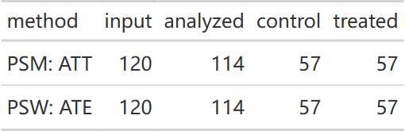{fig-alt="PSM ATT 和 PSW ATE 的完整分析队列均为 114 行，每组 57 行；这是匹配前的分析分母。"}

[原生 HTML](images/clinical-workflow-guide/20261028b-update-design-storage.html)

`integer64` 分析列只有在正负 2 的 53 次方范围内才能精确转成 double；超范围会拒绝。多列矩阵、数组、list、S4、复数及无限值也会先报错。分组数据框会转成普通 data.frame 参与分析，不能把外部 `group_by()` 理解为分层拟合指令。[敏感性分析的同类约定](#stored-sens-20261028b)另有单列矩阵兼容范围。

::: {.callout-note collapse="true" title="复核代码"}

```r
stored_plain28 <- stored_data28[-(1:6), ]
stored_plain28[["x"]] <- haven::zap_labels(stored_plain28[["x"]])
stored_ref28 <- list(
  get_PSM(stored_plain28, "z", adj_var = "x", ps = "p", method = "nearest", estimand = "ATT", balance = FALSE),
  get_PSW(stored_plain28, "z", adj_var = "x", ps = "p", estimand = "ATE", balance = FALSE))
stopifnot(all(stored_counts28[["analyzed"]] == 114), all(stored_counts28[["control"]] == 57),
  all(stored_counts28[["treated"]] == 57),
  isTRUE(all.equal(stored_psm28[["stats"]], stored_ref28[[1]][["stats"]])),
  isTRUE(all.equal(stored_psw28[["stats"]], stored_ref28[[2]][["stats"]])))
stored_int28 <- stored_plain28
stored_int28[["x"]] <- bit64::as.integer64(stored_int28[["x"]])
stored_i6428 <- get_PSW(stored_int28, "z", adj_var = "x", ps = "p", estimand = "ATE", balance = FALSE)
stopifnot(isTRUE(all.equal(stored_i6428[["stats"]], stored_ref28[[2]][["stats"]])))
stored_int28[["x"]][1] <- bit64::as.integer64("9007199254740993")
stored_error28 <- tryCatch(get_PSW(stored_int28, "z", adj_var = "x", ps = "p", balance = FALSE),
  error = conditionMessage)
stopifnot(is.character(stored_error28), grepl("exact double range", stored_error28, fixed = TRUE))
stored_factor28 <- stored_plain28
stored_factor28[["x"]] <- factor(rep(c("A", "B", NA), length.out = nrow(stored_factor28)), exclude = NULL)
stored_factor_ref28 <- stored_factor28
stored_factor_ref28[["x"]] <- factor(as.character(stored_factor_ref28[["x"]]))
stored_fac28 <- get_PSW(stored_factor28, "z", adj_var = "x", ps = "p", estimand = "ATE", balance = FALSE)
stored_fac_ref28 <- get_PSW(stored_factor_ref28, "z", adj_var = "x", ps = "p", estimand = "ATE", balance = FALSE)
stopifnot(isTRUE(all.equal(stored_fac28[["stats"]], stored_fac_ref28[["stats"]])))
validation_values <- list(counts = stored_counts28, normalized_matches = TRUE,
  exact_integer64_matches = TRUE, explicit_na_level_matches = TRUE,
  out_of_range_error = stored_error28, R = R.version.string,
  dependencies = vapply(c("MatchIt", "WeightIt", "haven", "bit64"), function(p) as.character(utils::packageVersion(p)), ""))
```
:::

本节为 2026-10-28 在 Windows R 4.4.3、causalR `6760092c8020fb3814bdb274ebba7a03e0703470` 固定源码上的新增运行；本页其他模型和图片保留原执行快照。

<!-- /update-20261028b: causal_stored_design -->

### 极端权重：数值稳定不等于共同支持良好（2026-10-28） {#extreme-weights-20261028b}

<!-- update-20261028b: causal_extreme_weights -->

收尾按已推送 causalR `475d200` 复核：极端但有限的权重使用缩放计算 ESS、标准差和变异系数，避免平方上溢 / 下溢。若保留行产生非有限权重，`get_PSW()` 直接报错并指出 estimand；不会删除这些行后继续给出一个看似正常的 ESS。

下面是刻意触发数值边界的 120 行人工输入，所有概率都设为 `1e-200`，并不代表可接受的临床设计。ATE 与 ATT 的总体 ESS 均为 60、每臂 ESS 各为 60；总体 ESS 不是两臂 ESS 相加。有限且可计算的摘要也不能证明共同支持足够。

```r
library(causalR)
extreme_ps28 <- data.frame(z = rep(0:1, 60), p = 1e-200)
extreme_weights28 <- get_PSW(extreme_ps28, "z", ps = "p", estimand = c("ATE", "ATT"), balance = FALSE)
extreme_stats28 <- extreme_weights28[["stats"]][, c("estimand", "n", "ess", "ess_treat", "ess_ctrl", "w_sd", "w_cv")]
extreme_gt28 <- gt::fmt_scientific(gt::gt(extreme_stats28), columns = "w_sd", decimals = 3)
gt::gtsave(gt::fmt_number(extreme_gt28, columns = "w_cv", decimals = 4),
  file.path(tempdir(), "20261028b-update-extreme-weight-summaries.html"))
extreme_ess_plot28 <- plt_PSW(extreme_weights28, type = "ess")
ggplot2::ggsave(file.path(tempdir(), "20261028b-update-extreme-weight-ess.pdf"), extreme_ess_plot28,
  width = 7, height = 4.5)
```

::: {.panel-tabset}

#### 有限的 ESS 与离散度 {.unnumbered}

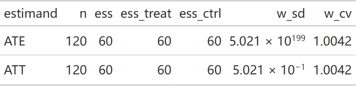{fig-alt="120 行极端概率诊断输入，ATE 与 ATT 的总体 ESS 都为 60，两臂 ESS 各为 60，权重标准差与变异系数保持有限。"}

[原生 HTML](images/clinical-workflow-guide/20261028b-update-extreme-weight-summaries.html)

#### ESS 视图 {.unnumbered}

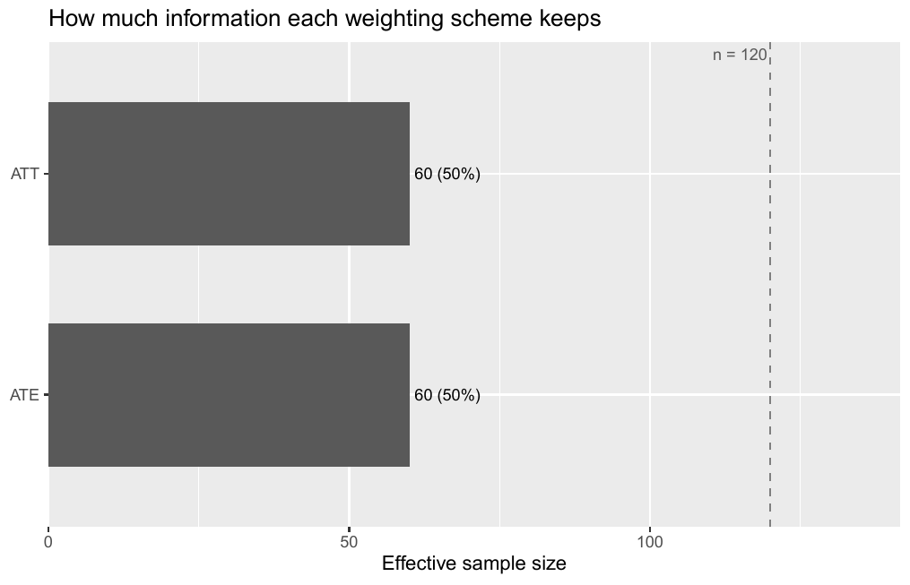{fig-alt="ATE 与 ATT 的 ESS 诊断图都显示 60，相对于输入 120 行为一半；这个算术结果不能替代共同支持判断。"}

[原生 PDF](images/clinical-workflow-guide/20261028b-update-extreme-weight-ess.pdf)

:::

::: {.callout-note collapse="true" title="复核代码"}

```r
stopifnot(all(extreme_stats28[["ess"]] == 60), all(extreme_stats28[["ess_treat"]] == 60),
  all(extreme_stats28[["ess_ctrl"]] == 60), all(is.finite(extreme_stats28[["w_sd"]])),
  all(is.finite(extreme_stats28[["w_cv"]])))
for (i in seq_len(nrow(extreme_stats28))) {
  w <- extreme_weights28[["data"]][[paste0("w_", tolower(extreme_stats28[["estimand"]][i]))]]
  normalized <- w / max(w)
  stopifnot(isTRUE(all.equal(extreme_stats28[["w_sd"]][i] / max(w), sd(normalized))),
    isTRUE(all.equal(extreme_stats28[["w_cv"]][i], sd(normalized) / mean(normalized))))
}
extreme_bad28 <- transform(extreme_ps28, p = 1e-320)
extreme_error28 <- tryCatch(get_PSW(extreme_bad28, "z", ps = "p", estimand = "ATE", balance = FALSE),
  error = conditionMessage)
stopifnot(grepl("Non-finite weights", extreme_error28, fixed = TRUE), grepl("ATE", extreme_error28, fixed = TRUE))
extreme_ato28 <- get_PSW(extreme_bad28, "z", ps = "p", estimand = "ATO", balance = FALSE)
stopifnot(all(is.finite(extreme_ato28[["data"]][["w_ato"]])), extreme_ato28[["stats"]][["ess_ctrl"]] == 60)
extreme_plot_path28 <- file.path(tempdir(), "psw-ess-plot.rds")
saveRDS(extreme_ess_plot28, extreme_plot_path28)
stopifnot(identical(ggplot2::ggplot_build(readRDS(extreme_plot_path28))[["data"]],
  ggplot2::ggplot_build(extreme_ess_plot28)[["data"]]))
validation_values <- list(n = 120L, summaries = extreme_stats28, nonfinite_error = extreme_error28,
  alternate_ato = extreme_ato28[["stats"]], plot_rds_layers_match = TRUE,
  source = "475d200c71bceb0b5e5cda327ddb39d8752e90eb", R = R.version.string)
```
:::

`p=1e-320` 的 ATE 权重已溢出，本例确认其停止；ATO 虽可得到有限权重，却改变目标人群，不能把它当作修复 ATE 的开关。实际分析应按研究方案处理 trimming / truncation 与共同支持，并重新报告人群。

这批源码也令 `plt_PSW()` / `plt_PSM()` 的图环境只持有所选视图的数据：ESS 用摘要、Love plot 用平衡表，权重 / PS 视图用所需列。上述实跑仅核对 PSW ESS 图及其 RDS 图层；没有新测内存降幅，也没有将图对象视为匿名化数据。本例在 Windows R 4.4.3 执行，其他小节保留其固定源码快照。

<!-- /update-20261028b: causal_extreme_weights -->

## PSW 的四种视图与匹配对照 {#sec-workflow-design-plots}

`plt_PSW()` 的 `estimand=NULL` 画全部方案；`plt_PSM()` 用 `method=NULL` 选择方案。
两者共有 `type`、`threshold=0.1`、`bins=40L`、`title=NULL`、`save=list()`。
`threshold` 只画参考线，`bins` 只影响 PS 直方图；它们不改变设计。

::: {.panel-tabset}

### 平衡 {.unnumbered}

```{r}
#| label: fig-workflow-love
#| fig-alt: "同一原队列与三种权重的基线平衡。0.1 是常用描述阈值，不能证明无混杂。"
#| fig-width: 9
#| fig-height: 5
#| fig-cap: "同一原队列与三种权重的基线平衡。0.1 是常用描述阈值，不能证明无混杂。"
plt_PSW(pw, type = "love", threshold = 0.1)
```

### ESS {.unnumbered}

```{r}
#| label: fig-workflow-ess
#| fig-alt: "三种加权方案的两臂有效样本量对照，计算为权重和的平方除以权重平方和；有效样本量不是实际保留人数。"
#| fig-width: 9
#| fig-height: 5
#| fig-cap: "有效样本量为 (sum w)^2/sum(w^2)，分别看两臂；它不是实际保留人数。"
plt_PSW(pw, type = "ess")
```

### 权重 {.unnumbered}

```{r}
#| label: fig-workflow-weight
#| fig-alt: "权重分布帮助检查极端值，不能只比较各方案平均权重。"
#| fig-width: 10
#| fig-height: 5
#| fig-cap: "权重分布帮助检查极端值，不能只比较各方案平均权重。"
plt_PSW(pw, type = "weight")
```

### PS {.unnumbered}

```{r}
#| label: fig-workflow-ps
#| fig-alt: "bins=25：加权前后两臂的 PS 分布。重叠图与协变量平衡都应检查。"
#| fig-width: 10
#| fig-height: 5
#| fig-cap: "bins=25：加权前后两臂的 PS 分布。重叠图与协变量平衡都应检查。"
plt_PSW(pw, type = "ps", bins = 25)
```

### 匹配后的 PS {.unnumbered}

```{r}
#| label: fig-workflow-match
#| fig-alt: "1:1 无放回匹配的 PS 分布。匹配保留的人群与原队列不同。"
#| fig-width: 8
#| fig-height: 5
#| fig-cap: "1:1 无放回匹配的 PS 分布。匹配保留的人群与原队列不同。"
plt_PSM(pm, type = "ps", method = "nearest", bins = 25)
```

:::

## get_bal：在共同分母上比较方案 {#sec-workflow-bal}

```{r}
#| label: fig-workflow-balance
#| fig-alt: "多水平分期用整体 SMD 一行显示，所有方案使用共同未调整 pooled SD 分母。"
#| fig-width: 9
#| fig-height: 5
#| fig-cap: "多水平分期用整体 SMD 一行显示，所有方案使用共同未调整 pooled SD 分母。"
bal <- get_bal(d, "z", adj_var = adj, methods = c("PSM", "ATE", "ATO"),
                cat_smd = "overall", tbl = FALSE, var_names = NULL,
                love_args = list(threshold = 0.1, legend_position = "bottom", base_size = 12))
bal$plt
```

`methods` 可是缩写向量，也可是带名称的方案 list；PSM 缩写默认为 nearest、ATT、caliper=0.2。
`cat_smd="level"` 展开分类水平；`tbl=TRUE` 另外生成表，`cores` 控制表的工作进程。
`love_args` 支持 threshold、colors、shapes、size、line、var_order、base_size、ref_color、
legend_position、legend_justification。`save_plt` 保存图，`save_tbl` 保存 Word 表。
本页只运行绘图路径；方案的独立 halfmoon 平衡表与共同分母结果不应逐项要求相等。

### 类别协方差奇异时，整体 SMD 不可用（2026-10-28） {#singular-balance-20261028}

<!-- update-20261028: causal_balance -->

已推送 causalR `9d26ba6` 修正 `get_bal(cat_smd="overall")`：多水平变量的 pooled 协方差若除固有冗余水平外仍缺秩，整体 SMD 会警告并返回 NA，不能把伪逆算出的零当成平衡。可以用 `cat_smd="level"` 查看各水平，但它不替代不可用的整体统计量。

这个 120 行诊断例刻意让对照臂只有 A、治疗臂只有 B/C，权重方案固定使用人为给定的 `p=.5`，只用于复现计算路径；它不能修复明显的协变量不重叠，也不构成可识别的治疗效果分析。

```r
library(causalR)
balance_data28 <- data.frame(z = rep(0:1, each = 60),
  f = factor(c(rep("A", 60), rep("B", 30), rep("C", 30))), p = .5)
balance_methods28 <- list(W = list(design = "weighting", estimand = "ATE", ps = "p"))
balance_overall28 <- get_bal(balance_data28, "z", "f", methods = balance_methods28, var_names = NULL)
balance_levels28 <- get_bal(balance_data28, "z", "f", methods = balance_methods28,
  cat_smd = "level", var_names = NULL)
balance_table28 <- rbind(transform(as.data.frame(balance_overall28[["balance"]]), display = "overall"),
  transform(as.data.frame(balance_levels28[["balance"]]), display = "level"))
gt::gtsave(gt::fmt_number(gt::gt(balance_table28[, c("display", "method", "variable", "smd")]),
  columns = "smd", decimals = 4), file.path(tempdir(), "20261028-update-balance-singular-values.html"))
ggplot2::ggsave(file.path(tempdir(), "20261028-update-balance-unavailable.pdf"), balance_overall28[["plt"]],
  width = 7, height = 4)
ggplot2::ggsave(file.path(tempdir(), "20261028-update-balance-levels.pdf"), balance_levels28[["plt"]],
  width = 7, height = 4)
```

::: {.panel-tabset}

#### 统计量的可用性 {.unnumbered}

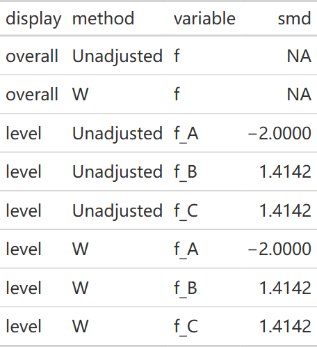{fig-alt="120 行诊断数据的整体类别 SMD 在未调整与 W 方案中均为 NA，逐水平 SMD 仍显示明显差异，不能把不可用统计量解释成零。"}

[原生 HTML](images/clinical-workflow-guide/20261028-update-balance-singular-values.html)

#### 整体不可用的面板 {.unnumbered}

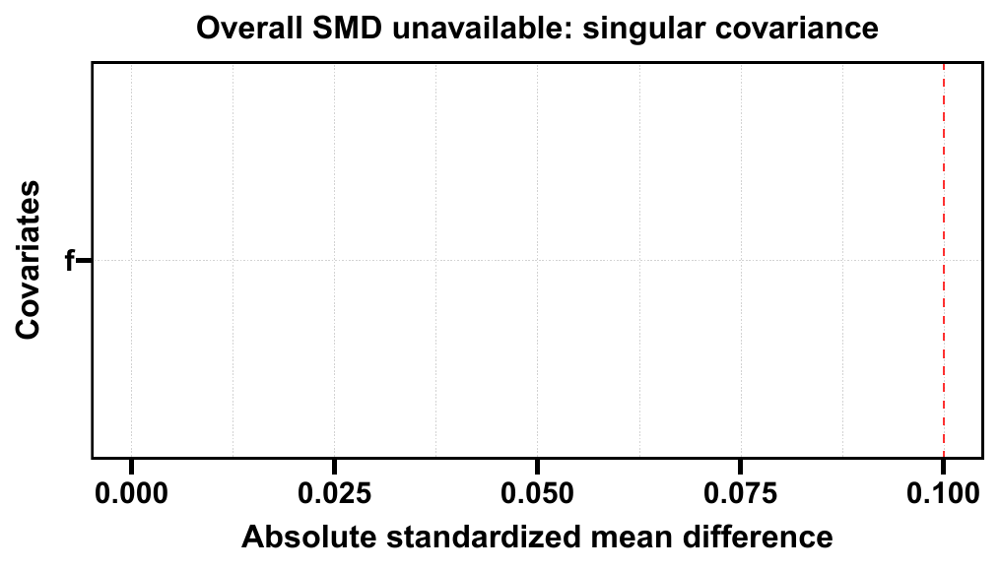{fig-alt="整体 SMD 全部不可用时，Love plot 保留变量 f 的标签并显示奇异协方差提示，不伪造位于零的平衡点。"}

[原生 PDF](images/clinical-workflow-guide/20261028-update-balance-unavailable.pdf)

#### 逐水平检视 {.unnumbered}

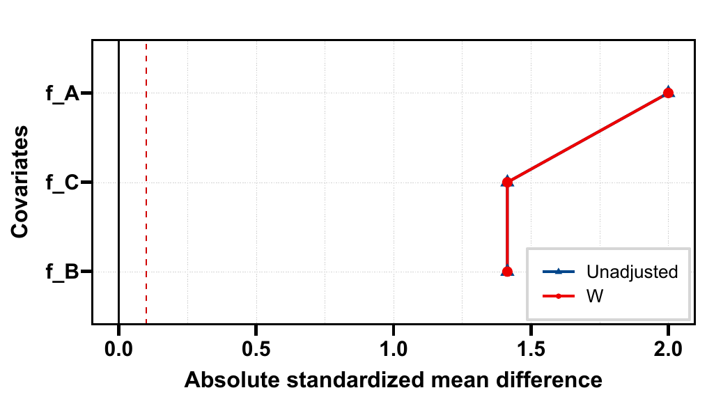{fig-alt="同一诊断数据按 A、B、C 分别展示绝对 SMD，未调整与人为恒定权重方案均有明显不平衡。"}

[原生 PDF](images/clinical-workflow-guide/20261028-update-balance-levels.pdf)

:::

::: {.callout-note collapse="true" title="复核代码"}

```r
stopifnot(all(is.na(balance_overall28[["balance"]][["smd"]])),
  max(abs(balance_levels28[["balance"]][["smd"]])) == 2)
invisible(ggplot2::ggplot_build(balance_overall28[["plt"]]))
balance_text28 <- capture.output(print(balance_overall28))
stopifnot(any(grepl("NA", balance_text28)), !any(grepl("Inf", balance_text28)))
balance_supported28 <- balance_data28
balance_supported28[["f"]] <- factor(rep(c("A", "B", "C"), 40))
balance_ok28 <- get_bal(balance_supported28, "z", "f", methods = balance_methods28, var_names = NULL)
stopifnot(all(balance_ok28[["balance"]][["smd"]] == 0))
validation_values <- list(n = 120L, overall_unavailable = TRUE,
  level_smd = balance_levels28[["balance"]][["smd"]], supported_smd = balance_ok28[["balance"]][["smd"]],
  no_infinite_print_summary = TRUE)
```
:::

全部统计量不可用时，打印的最大 SMD 和超过阈值数也为 NA，不再出现负无穷。常规可估计数据仍正常报告零或非零 SMD。本节在 Windows R 4.4.3 对 `9d26ba6` 运行，前面的其他例子继续按各自注明的源码快照阅读。

<!-- /update-20261028: causal_balance -->

### 平衡阈值、方案排序与倾向评分复用（2026-10-28） {#balance-policy-20261028b}

<!-- update-20261028b: causal_balance_policy -->

`love_args$threshold` 同时控制 Love plot 参考线和控制台 `over ...` 的计数与高亮。下面显式用 **0.2 作演示**；研究报告应事先确定阈值，不应为得到“通过”而放宽。`love_args$var_order` 也可指定唯一调整方案的标签，例如只保留 `A` 方案时仍可按 `"A"` 排序。

同一完整分析队列中的默认 GLM 倾向评分，可以在匹配比例不同的 PSM 和默认加权之间复用。复用的是相同的初始倾向概率，**不是同一套权重、同一 estimand 或匹配结果**；自定义 `ps_args`、不同模型及 trimming / refit 需求不能因此忽略。

```r
library(causalR)
set.seed(20260927)
policy_data28 <- data.frame(x1 = rnorm(120), x2 = rbinom(120, 1, .4), x3 = runif(120))
policy_data28[["z"]] <- rbinom(120, 1, plogis(-.9 - 1.1 * policy_data28[["x1"]] +
  .8 * policy_data28[["x2"]] - 1.2 * policy_data28[["x3"]]))
policy_methods28 <- list(M1 = list(design = "matching", ratio = 1),
  M2 = list(design = "matching", ratio = 2), A = list(design = "weighting", estimand = "ATE"))
policy_result28 <- get_bal(policy_data28, "z", c("x1", "x2", "x3"), methods = policy_methods28,
  var_names = NULL, love_args = list(threshold = .2, legend_position = "bottom"))
print(policy_result28)
ggplot2::ggsave(file.path(tempdir(), "20261028b-update-balance-threshold.pdf"), policy_result28[["plt"]],
  width = 7.5, height = 4.7)
```

::: {.panel-tabset}

#### 同一阈值的 Love plot {.unnumbered}

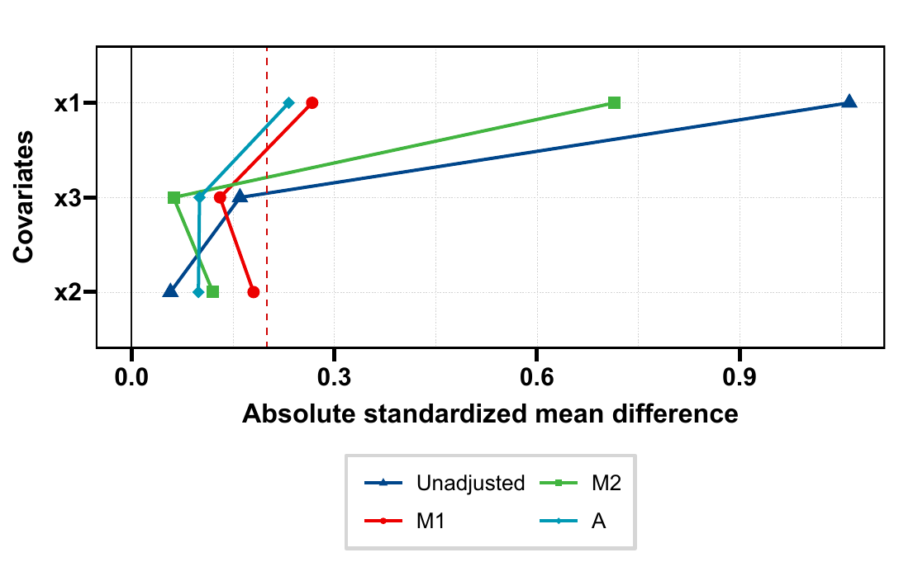{fig-alt="120 行合成数据比较未调整、1比1匹配 M1、1比2匹配 M2 和 ATE 加权 A 的绝对 SMD，统一参考线为 0.2。"}

[原生 PDF](images/clinical-workflow-guide/20261028b-update-balance-threshold.pdf)

#### 实际控制台摘要 {.unnumbered}

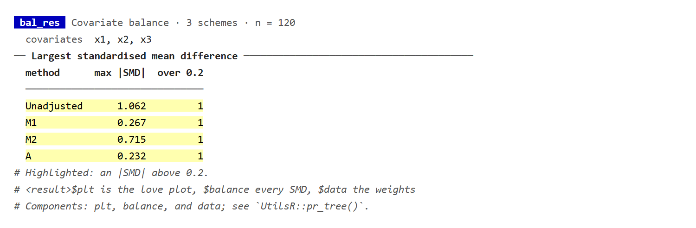{fig-alt="get_bal 的原生打印显示四个方案的最大 SMD 与超过 0.2 的变量数，与图中阈值一致。"}

[原生 HTML](images/clinical-workflow-guide/20261028b-update-balance-summary.html)

:::

::: {.callout-note collapse="true" title="复核代码"}

```r
policy_m1_28 <- get_PSM(policy_data28, "z", c("x1", "x2", "x3"), ratio = 1, balance = FALSE)
policy_m2_28 <- get_PSM(policy_data28, "z", c("x1", "x2", "x3"), ratio = 2, balance = FALSE)
policy_a28 <- get_PSW(policy_data28, "z", c("x1", "x2", "x3"), estimand = "ATE", balance = FALSE)
stopifnot(identical(policy_result28[["data"]][["M1"]], policy_m1_28[["data"]][["w_nearest"]]),
  identical(policy_result28[["data"]][["M2"]], policy_m2_28[["data"]][["w_nearest"]]),
  identical(policy_result28[["data"]][["A"]], policy_a28[["data"]][["w_ate"]]),
  identical(attr(policy_result28, "threshold"), .2))
policy_summary28 <- withr::with_options(list(cli.num_colors = 256), capture.output(print(policy_result28)))
stopifnot(any(grepl("over 0.2", cli::ansi_strip(policy_summary28), fixed = TRUE)))
policy_single28 <- get_bal(policy_data28, "z", c("x1", "x2", "x3"), methods = policy_methods28["A"],
  var_names = NULL, love_args = list(var_order = "A"))
stopifnot(inherits(ggplot2::ggplot_build(policy_single28[["plt"]]), "ggplot_built"))
policy_errors28 <- list(
  empty = tryCatch(get_bal(policy_data28, "z", character(), methods = "ATE"), error = conditionMessage),
  cores = tryCatch(get_bal(policy_data28, "z", "x1", methods = "ATE", cores = Inf), error = conditionMessage),
  threshold = tryCatch(get_bal(policy_data28, "z", "x1", methods = "ATE", love_args = list(threshold = Inf)), error = conditionMessage))
stopifnot(all(vapply(policy_errors28, is.character, logical(1))))
save_console28 <- function(lines, name) {
  body <- paste(fansi::sgr_to_html(htmltools::htmlEscape(lines)), collapse = "\n")
  chars <- strsplit(body, "", fixed = TRUE)[[1]]; cp <- utf8ToInt(body)
  for (i in which(cp > 127L & !(cp >= 0x2500L & cp <= 0x257fL))) {
    w <- cli::ansi_nchar(chars[i], type = "width")
    if (w %in% 1:2) chars[i] <- sprintf('<span class="w%d">%s</span>', w, chars[i])
  }
  html <- paste0('<!doctype html><meta charset="utf-8"><style>',
    'body{margin:0;background:white;color:#222}pre{margin:0;padding:20px;',
    'font:15px/1.6 Consolas,"DejaVu Sans Mono",monospace;white-space:pre}',
    '.w1,.w2{display:inline-block}.w1{width:1ch}.w2{width:2ch}',
    '</style><pre data-native-console>', paste(chars, collapse = ""), '</pre>')
  writeLines(html, file.path(tempdir(), paste0("20261028b-update-", name, ".html")), useBytes = TRUE)
}

save_console28(policy_summary28, "balance-summary")
validation_values <- list(n = nrow(policy_result28[["data"]]), threshold = attr(policy_result28, "threshold"),
  balance = policy_result28[["balance"]], separate_weights_match = TRUE, invalid_controls = policy_errors28,
  source = "6760092", R = R.version.string)
```
:::

本节用 Windows R 4.4.3、causalR `6760092c8020fb3814bdb274ebba7a03e0703470` 固定源码实跑 120 行。这里只验证结果等价和摘要阈值，没有测量提速倍数。保存 `$plt` 时绘图环境也避免携带无关分析列；这不表示整个 `$data` 或结果对象已删除这些列。

<!-- /update-20261028b: causal_balance_policy -->

### 小型基线表与未使用的治疗水平（2026-10-28） {#balance-table-20261028b}

<!-- update-20261028b: causal_balance_table -->

`get_bal(tbl=TRUE)` 的小表默认可直接串行构建：**只有一个调整方案、至多 1000 行、至多两个协变量**时不启动并行 worker；显式 `cores` 仍按用户设置处理。它减少小表的启动开销，不改变表中统计口径。更大或多方案表的自动策略另行决定。

治疗 factor 若还保留没有观测的第三水平，制表副本会先去掉这个空水平；返回 `$data` 仍保留原水平信息。下面 48 行数据仅有 `0/1` 两组，用一个已知概率为 0.5 的 ATE 方案，避免把空的 `2` 当成第三组。

```r
library(causalR)
set.seed(2822)
small_bal28 <- data.frame(z = factor(rep(0:1, 24), levels = c(0, 1, 2)), x = rnorm(48), p = .5)
small_method28 <- list(W = list(design = "weighting", estimand = "ATE", ps = "p"))
small_auto28 <- get_bal(small_bal28, "z", "x", methods = small_method28, var_names = NULL, tbl = TRUE)
small_gt28 <- gt::tab_options(gtsummary::as_gt(small_auto28[["tbl"]]), table.font.size = gt::px(13))
gt::gtsave(small_gt28, file.path(tempdir(), "20261028b-update-balance-small-table.html"))
```

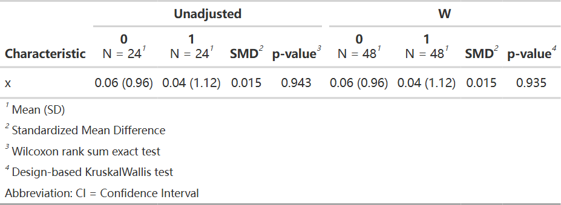{fig-alt="48 行合成数据的 get_bal 合并基线表，未调整与 W 两个表区都只有 0 和 1 两组；保留但没有观测的治疗水平 2 不显示。"}

[原生 HTML](images/clinical-workflow-guide/20261028b-update-balance-small-table.html)

::: {.callout-note collapse="true" title="复核代码"}

```r
small_serial28 <- get_bal(droplevels(small_bal28), "z", "x", methods = small_method28,
  var_names = NULL, tbl = TRUE, cores = 1)
stopifnot(identical(small_auto28[["tbl"]][["table_body"]], small_serial28[["tbl"]][["table_body"]]),
  identical(small_auto28[["balance"]], small_serial28[["balance"]]),
  identical(levels(small_auto28[["data"]][["z"]]), c("0", "1", "2")),
  nrow(small_auto28[["data"]]) == 48L)
validation_values <- list(n = nrow(small_auto28[["data"]]), source_levels = levels(small_auto28[["data"]][["z"]]),
  automatic_matches_explicit_serial = TRUE, table_body = small_auto28[["tbl"]][["table_body"]],
  gtsummary = as.character(utils::packageVersion("gtsummary")), source = "6760092", R = R.version.string)
```
:::

这次新增运行限定于 Windows R 4.4.3、上述 48 行和一协变量。图中 W 的表头每组 `N=48` 是权重之和；原始患者每组仍为 24 人，不能据此把队列写成 96 人。基线表与 Love plot 的连续 SMD 方差分母有既有差别，不能要求两者逐位相同；p 值也不能代替预设的 SMD 判断。

<!-- /update-20261028b: causal_balance_table -->

## 设计后的效应估计：明确方差与人群 {#sec-workflow-estimate}

```{r}
#| label: workflow-estimate
f_ato <- lm(y ~ z, data = pw$data, weights = w_ato)
V_ato <- sandwich::vcovHC(f_ato, type = "HC0")
matched <- subset(pm$data, w_nearest > 0 & !is.na(s_nearest))
f_att <- lm(y ~ z, data = matched, weights = w_nearest)
V_att <- sandwich::vcovCL(f_att, cluster = matched$s_nearest, type = "HC1")
b <- c(coef(f_ato)[["z"]], coef(f_att)[["z"]])
se <- c(sqrt(V_ato["z", "z"]), sqrt(V_att["z", "z"]))
data.frame(analysis = c("ATO weighted mean contrast", "Matched ATT contrast"),
           estimate = b, std.error = se, conf.low = b - qnorm(.975) * se,
           conf.high = b + qnorm(.975) * se)
```

这里是连续结局的教学估计：加权路径用异方差稳健方差，匹配路径按配对聚类。
这些区间没有完整反映估计 PS、方案选择或匹配构造的不确定性，不能当成通用最终推断模板。
放回匹配、可变比例、缺失、多中心或生存结局需要相应的数据结构与推断方法。

## 原队列上的 HTE 是另一条路径 {#sec-workflow-hte}

```{r}
#| label: fig-workflow-hte
#| fig-alt: "原队列 ATE 与预设性别亚组。它与前面的 ATO 加权或匹配 ATT 目标不同。"
#| fig-width: 8
#| fig-height: 4.5
#| fig-cap: "原队列 ATE 与预设性别亚组。它与前面的 ATO 加权或匹配 ATT 目标不同。"
hte <- get_hte(d, "z", adj_var = adj, sub_var = "sex", surv = "y",
               grf_args = list(num.trees = 500, num.threads = 2, seed = 123))
plt_hte_sub(hte, fixed_size = FALSE, show_pinter = TRUE)
```

HTE 参数与诊断见 [总览](index.qmd)、[诊断页](hte-diagnostics-guide.qmd) 和
[规则选择](method-selection-guide.qmd)。不能把同一权重再次传入森林后就称为
“多做一层双稳健”；目标人群、PS、样本权重与得分构造必须一起论证。

### HTE 输入标签、缺失与保留列（2026-10-28） {#input-contract-20261028}

<!-- update-20261028: causal_inputs -->

按已推送 causalR `26af481`，`get_hte()` 分析带标签列的底层值，先将 SPSS 用户缺失值转成 NA，再判断完整结局与暴露。**仅暴露或结局缺失会删除整行**；协变量缺失保留给 grf。`get_hte_unihtee(method="glm")` 的交叉拟合则需要完整的暴露、结局和模型协变量，两条路径的分母不能混用。

本例使用 240 行合成随机分配数据：四行协变量含缺失，两行结局是 SPSS 缺失码。实际输入与规范化后的去向如下；固定 100 棵树只用于接口复核，不作为正式分析的精度建议。

```r
library(causalR)
set.seed(2801)
input_data28 <- data.frame(id = seq_len(240), z = rep(0:1, 120), x = rnorm(240),
  g = factor(rep(c("A", "B", "C"), 80)))
input_data28[["y"]] <- .5 * input_data28[["x"]] + input_data28[["z"]] *
  (1 + (input_data28[["g"]] == "B")) + rnorm(240)
input_data28[["x"]][1:4] <- c(999, 850, 860, NA)
input_data28[["y"]][5:6] <- 999
input_data28[["x"]] <- haven::labelled_spss(input_data28[["x"]],
  na_values = 999, na_range = c(800, 900))
input_data28[["y"]] <- haven::labelled_spss(input_data28[["y"]], na_values = 999)
input_data28[["z"]] <- haven::labelled(input_data28[["z"]], labels = c(No = 0, Yes = 1))
input_args28 <- list(num.trees = 100, num.threads = 1, seed = 28, W.hat = .5, Y.hat = 0)
input_hte28 <- get_hte(input_data28, "z", adj_var = c("x", "g"), sub_var = "g", surv = "y",
  grf_args = input_args28)
input_counts28 <- data.frame(stage = c("Input", "Analyzed", "Missing x kept", "Missing y dropped"),
  n = c(nrow(input_data28), nrow(input_hte28[["data"]]),
    sum(is.na(input_hte28[["data"]][["x"]])),
    sum(!input_data28[["id"]] %in% input_hte28[["data"]][["id"]])))
gt::gtsave(gt::gt(input_counts28), file.path(tempdir(), "20261028-update-hte-input-counts.html"))
```

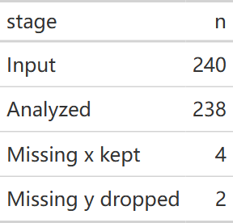{fig-alt="合成数据输入 240 行，删除两行 SPSS 缺失结局后分析 238 行，其中四行 x 缺失仍保留给 grf。"}

[原生 HTML](images/clinical-workflow-guide/20261028-update-hte-input-counts.html)

输入列名必须唯一；分析列必须是一维向量，矩阵、数组、list、复数及无限值会在拟合前拒绝。`get_hte()` 接受精确 double 范围内的 `integer64`，超出正负 2 的 53 次方应先处理。`get_hte_unihtee()` 则要求显式转换 `integer64`，不能根据森林入口的支持推断筛查入口也支持它。

两函数都保留 `.cate`、`.dr_score` 作为输出名；unihtee 还保留 `.ps`、`.mu1`、`.mu0`、`.score_diff`、`.score_ratio`、`.score_OR`。已有同名列须在调用前改名，避免结果覆盖输入；普通协变量名 `.w`、`.y` 不属于这份保留名单。

::: {.callout-note collapse="true" title="复核代码"}

```r
input_ref28 <- input_data28
input_ref28[["z"]] <- haven::zap_labels(input_ref28[["z"]])
for (v in c("x", "y")) input_ref28[[v]] <- haven::zap_labels(haven::zap_missing(input_ref28[[v]]))
input_plain28 <- get_hte(input_ref28, "z", adj_var = c("x", "g"), sub_var = "g", surv = "y",
  grf_args = input_args28)
stopifnot(identical(input_counts28[["n"]], c(240L, 238L, 4L, 2L)),
  isTRUE(all.equal(input_hte28[["stats"]], input_plain28[["stats"]])),
  isTRUE(all.equal(input_hte28[["fit"]][["X.orig"]], input_plain28[["fit"]][["X.orig"]])))
input_int28 <- input_ref28
for (v in c("x", "y")) input_int28[[v]] <- round(input_int28[[v]])
input_int_fit28 <- get_hte(input_int28, "z", adj_var = c("x", "g"), surv = "y", grf_args = input_args28)
input_i6428 <- input_int28
for (v in c("z", "x", "y")) input_i6428[[v]] <- bit64::as.integer64(input_i6428[[v]])
input_i64_fit28 <- get_hte(input_i6428, "z", adj_var = c("x", "g"), surv = "y", grf_args = input_args28)
stopifnot(isTRUE(all.equal(input_i64_fit28[["stats"]], input_int_fit28[["stats"]])))
input_bad28 <- list(reserved = transform(input_ref28, .cate = 0), matrix = input_ref28,
  infinite = input_ref28, integer64_range = input_i6428)
input_bad28[["matrix"]][["x"]] <- cbind(input_ref28[["x"]], input_ref28[["x"]])
input_bad28[["infinite"]][["x"]][10] <- Inf
input_bad28[["integer64_range"]][["x"]][10] <- bit64::as.integer64("9007199254740993")
input_rejected28 <- vapply(input_bad28, function(d) {
  message <- tryCatch(get_hte(d, "z", adj_var = c("x", "g"), surv = "y", grf_args = input_args28),
    error = conditionMessage)
  is.character(message)
}, logical(1))
stopifnot(all(input_rejected28))
validation_values <- list(n = input_counts28[["n"]], estimate = input_hte28[["stats"]][["estimate"]],
  labels_match = TRUE, integer64_match = TRUE, rejected = input_rejected28)
```
:::

本节新增例子使用 Windows R 4.4.3 与固定源码；原临床流程及历史森林继续保留各自执行快照。

<!-- /update-20261028: causal_inputs -->

## 未测量混杂敏感性：绑定到明确模型 {#sec-workflow-sens}

| 参数 | 默认 | 说明 |
|---|---|---|
| `method` | `"lm"` | sensemakr 的线性模型 partial R²；另有 cox/dml/iv，各自尺度不同 |
| `treat/outcome/adj_var` | 治疗、结局、调整列 | 本例是调整后的线性回归系数，不是森林 CATE 或 ATO |
| `bench_var` | `NULL` | 已调整基线变量作强度参照；不能放未调整变量 |
| `q` / `conf_level` | `1` / `0.95` | 希望混杂解释掉的估计比例、置信水平 |
| `bench_args$k_treat/k_out` | `1/NULL` | 相对 benchmark 的治疗端/结局端强度倍数；NULL 沿用治疗端 |
| `bench_args$bound/bound_label` | `NULL/"Manual bound"` | 另外的手工强度边界与标签 |
| 绘图 `type` | 按后端 | lm 为 contour/extreme；cox 为 tip/evalue；dml/iv 为 contour |
| 绘图 `threshold` | `0` | 需要跨越的效应或检验参照值 |
| 绘图 `lim` | `NULL` | contour 的两个 partial R² 轴上限，默认由分析范围决定 |
| `contour_args` | 见帮助页 | sensitivity_of、n_levels、grid_n、round；grid_n 仅 DML |
| `colors/save` | `NULL/list()` | 线色与 PDF 保存；标题只支持 tip/evalue 路径 |

```{r}
#| label: workflow-sensitivity
sens <- get_sens(d, treat = "z", outcome = "y", adj_var = adj,
                  bench_var = "age", method = "lm", q = 1,
                  bench_args = list(k_treat = c(1, 2)))
sens$stats
sens$bounds
```

```{r}
#| label: fig-workflow-sens
#| fig-alt: "相对于已调整年龄的混杂强度参照。横纵轴是 partial R²，不能理解为混杂患者比例。"
#| fig-width: 8
#| fig-height: 6
#| fig-cap: "相对于已调整年龄的混杂强度参照。横纵轴是 partial R²，不能理解为混杂患者比例。"
plt_sens(sens, type = "contour", contour_args = list(sensitivity_of = "estimate"))
```

敏感性结果描述“多强的未测量混杂可改变这个模型结论”，不能证明不存在未测量混杂。
年龄参照的合理性也需要研究背景；它不是自动生成的最坏情况上界。

### get_sens 的标签、integer64 与单列矩阵（2026-10-28） {#stored-sens-20261028b}

<!-- update-20261028b: causal_stored_sens -->

`get_sens()` 也先规范化用到的列：labelled 使用底层值，SPSS 用户缺失先转 NA，精确范围内的 `integer64` 转 double。**单列矩阵**可以还原为向量；这项兼容不能推到 PSM / PSW 或 HTE 的模型输入。多列矩阵、数组、list、S4、复数、无限值及超范围整数仍应先处理。

下面以 120 行连续结局的 `method="lm"` 为例；六个缺失协变量令模型实际使用 114 行。`attr(res, "analysis")[["n"]]` 是模型的实际分母；不是输入行数，也不继承上一阶段 PSM / PSW 的人群含义。DML / IV 同样先规范化其使用列，但本例只执行 lm 后端，不能据此声称其他模型已重跑。

```r
library(causalR)
set.seed(2810)
sens_store28 <- data.frame(z = rep(0:1, 60), x = rep(c(-5, -4, 0, 1, 2, 3), each = 20))
sens_store28[["y"]] <- .8 * sens_store28[["z"]] + 1.3 * sens_store28[["x"]] + rnorm(120)
sens_store28[["x"]][1:6] <- 999
sens_store28[["x"]] <- haven::labelled_spss(sens_store28[["x"]], na_values = 999)
sens_typed28 <- get_sens(sens_store28, "z", "y", adj_var = "x", method = "lm")
sens_counts28 <- data.frame(input = nrow(sens_store28),
  model_n = attr(sens_typed28, "analysis")[["n"]], user_missing = 6L)
gt::gtsave(gt::gt(sens_counts28), file.path(tempdir(), "20261028b-update-sensitivity-storage.html"))
```

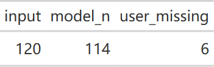{fig-alt="敏感性分析将六个 SPSS 用户缺失值转为 NA，lm 实际模型人数为 114。"}

[原生 HTML](images/clinical-workflow-guide/20261028b-update-sensitivity-storage.html)

::: {.callout-note collapse="true" title="复核代码"}

```r
sens_plain28 <- sens_store28[-(1:6), ]
sens_plain28[["x"]] <- haven::zap_labels(sens_plain28[["x"]])
sens_ref28 <- get_sens(sens_plain28, "z", "y", adj_var = "x", method = "lm")
sens_matrix28 <- sens_plain28
sens_matrix28[["x"]] <- matrix(sens_matrix28[["x"]], ncol = 1)
sens_matrix28[["y"]] <- matrix(sens_matrix28[["y"]], ncol = 1)
sens_matrix_fit28 <- get_sens(sens_matrix28, "z", "y", adj_var = "x", method = "lm")
sens_integer28 <- sens_plain28
sens_integer28[["x"]] <- bit64::as.integer64(sens_integer28[["x"]])
sens_integer_fit28 <- get_sens(sens_integer28, "z", "y", adj_var = "x", method = "lm")
stopifnot(sens_counts28[["model_n"]] == 114,
  isTRUE(all.equal(sens_typed28[["stats"]], sens_ref28[["stats"]])),
  isTRUE(all.equal(sens_matrix_fit28[["stats"]], sens_ref28[["stats"]])),
  isTRUE(all.equal(sens_integer_fit28[["stats"]], sens_ref28[["stats"]])))
validation_values <- list(n = sens_counts28, user_missing_matches = TRUE,
  single_column_matrix_matches = TRUE, integer64_matches = TRUE,
  source = "6760092c8020fb3814bdb274ebba7a03e0703470", R = R.version.string,
  sensemakr = as.character(utils::packageVersion("sensemakr")))
```
:::

本例为 Windows R 4.4.3 与 causalR `6760092` 固定源码上的新增运行，样本量 120，种子 2810。原页面中的 Cox / DML / IV 说明及历史输出继续保留各自来源。

<!-- /update-20261028b: causal_stored_sens -->

### 手工敏感性界限必须是有限的两个 R²（2026-10-28） {#manual-bounds-20261028b}

<!-- update-20261028b: causal_manual_bounds -->

`bench_args$bound` 表示一个手工设定的敏感性情景，顺序是治疗侧、结局侧 R²；两项都必须是 **有限数值且严格在 (0,1) 内**。`NULL` 表示不指定该手工情景。NA、NaN、无限值、0 / 1 边界、错误长度与字符串都会在拟合前拒绝；不将它们静默换成默认值。

```r
library(causalR)
set.seed(2810)
bound_data28 <- data.frame(z = rep(0:1, 60), y = rnorm(120))
bound_result28 <- get_sens(bound_data28, "z", "y", method = "lm", bench_args = list(bound = c(.1, .2)))
bound_table28 <- bound_result28[["bounds"]]
bound_display28 <- bound_table28[, c("bound_label", "r2_treat", "r2_out", "adj_estimate", "adj_se", "adj_conf.low", "adj_conf.high")]
bound_gt28 <- gt::cols_label(gt::gt(bound_display28), bound_label = "Scenario", r2_treat = "Treatment R²",
  r2_out = "Outcome R²", adj_estimate = "Adjusted beta", adj_se = "SE", adj_conf.low = "Lower 95%", adj_conf.high = "Upper 95%")
gt::gtsave(gt::fmt_number(bound_gt28, columns = tidyselect::where(is.numeric), decimals = 4),
  file.path(tempdir(), "20261028b-update-manual-sensitivity-bound.html"))
```

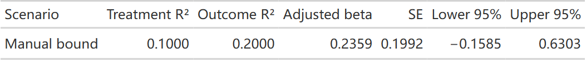{fig-alt="120 行连续结局 lm 敏感性分析的手工情景，治疗侧 R平方0.1、结局侧R平方0.2，与调用的顺序一致。"}

[原生 HTML](images/clinical-workflow-guide/20261028b-update-manual-sensitivity-bound.html)

::: {.callout-note collapse="true" title="复核代码"}

```r
bound_none28 <- get_sens(bound_data28, "z", "y", method = "lm", bench_args = list(bound = NULL))
stopifnot(nrow(bound_table28) == 1L, bound_table28[["r2_treat"]] == .1,
  bound_table28[["r2_out"]] == .2, is.null(bound_none28[["bounds"]]))
bound_bad28 <- list(c(NA_real_, .1), c(.1, NA_real_), c(NaN, .1), c(.1, NaN),
  c(Inf, .1), c(.1, Inf), c(-Inf, .1), numeric(), .1, c(0, .1), c(.1, 1), c(.1, .2, .3), "0.1")
bound_errors28 <- vapply(bound_bad28, function(b) {
  message <- tryCatch(get_sens(bound_data28, "z", "y", method = "lm", bench_args = list(bound = b)), error = conditionMessage)
  is.character(message) && grepl("bench_args$bound", message, fixed = TRUE)
}, logical(1))
stopifnot(all(bound_errors28))
validation_values <- list(n = attr(bound_result28, "analysis")[["n"]], bounds = bound_table28,
  invalid_scenarios_rejected = bound_errors28, source = "475d200", R = R.version.string)
```
:::

本例用 Windows R 4.4.3、causalR `475d200` 固定源码执行 120 行、种子 2810，仅复核 lm。手工参数校验属于共享入口，但本例不代表 DML / IV 后端已执行；Cox 使用其自身的敏感性框架，不能把两个 R² 原样解释成风险比偏倚。

<!-- /update-20261028b: causal_manual_bounds -->

## 报告与保存 {#sec-workflow-report}

报告原始人数、缺失处理、两臂 PS 支持、设计目标、保留人数与 ESS、平衡、极端权重、
结局模型、方差方法、HTE 发现/验证流程以及敏感性模型。各目标的单位和人群应贯穿图表。

```{r}
#| eval: false
plt_PSW(pw, type = "love", save = list(filename = "psw_balance.pdf", width = 9, height = 5))
plt_sens(sens, save = list(filename = "sensitivity.pdf", width = 8, height = 6))
```

```{r}
args(get_PSW)
args(get_PSM)
args(get_sens)
sessionInfo()
```

## 亚组森林表的固定行高 {#row-height-current}

2026-10-15在Windows R 4.4.3、UTF-8环境中按本机causalR `f39631a` 实际运行本节新例。2026-10-16复核：远端 `f3f7ecc` 已包含unihtee的hte字段、row_height及右角树边、结点/叶子配色；本节图片保留原 `f39631a` 执行快照。原代码块保留为原有完整流程，本轮不重新执行其历史分析。新例使用600人的固定种子连续结局模拟数据，与前面数据和结果分开。

::: {.panel-tabset}

### 按行高调整森林表密度

row_height默认0.3英寸，本例改为0.21；它调整固定尺寸森林表的行高，不修改效应或区间。fixed_size=FALSE时图会伸展，不能用行高代替patchwork比例布局。

```r
set.seed(20261015)
d_hte_new <- data.frame(b = rbinom(600, 1, 0.5), x = rnorm(600))
d_hte_new$z <- rbinom(600, 1, 0.5)
d_hte_new$y <- 0.5 * d_hte_new$x + d_hte_new$z * (-2 + 5 * d_hte_new$b) + rnorm(600)
uni_rows <- get_hte_unihtee(d_hte_new, "z", tree_var = c("b", "x"),
  adj_var = c("b", "x"), surv = "y", grf_args = list(num.trees = 200, num.threads = 1), seed = 123)
p_rows_default <- plt_hte_sub(uni_rows$hte, sub_var = "b", row_height = 0.3, show_pinter = TRUE)
p_rows_compact <- plt_hte_sub(uni_rows$hte, sub_var = "b", row_height = 0.21, show_pinter = TRUE)
p_rows_compact
```

{fig-alt="按行高调整森林表密度的固定输入参数对照实图。"}

:::


## 发布状态与树变量名称 {#release-20261016}

2026-10-16核对：树图样式及绘图环境整理已推送到causalR `f3f7ecc`。仅保存plt_hte_tree/plt_hte_icf的图对象时，绘图环境不再连带保存整个拟合；图仍含绘图所需数据，这不是匿名化功能。既有图片和数值保留各自执行日期，本轮没有重跑历史分析。

2026-10-17 核对的远端 `ceb2003` 已包含 `e389a75` 与 `f505185` 的改名，四个入口均使用 `tree_var`，不再是仅本机可用的接口。本站 `72d6139` 与 `b0f67c1` 的代码拼写已与之统一。当前源码已在 Windows R 4.4.3 核对四个签名，并实际执行 `get_hte_unihtee(method="glm", tree_var=...)`。旧安装可用 `names(formals(causalR::get_hte_tree))` 等检查；`candidate_var` 与 `tree_var` 应按安装接口选择，不同时传入。历史模型、表格与图片保持原执行快照，本轮没有重算历史森林。2026-10-18 已用 Windows R 4.4.3 与 causalR `e4b86c6` 重新执行本页全部代码块，结果缓存在 `_freeze/`。

## 当前亚组森林：表头、百分点与汇总菱形 {#subgroup-20261018}

2026-10-18 按已推送causalR `e4b86c66`，在Windows R 4.4.3实际执行本节。此前各节保留原计算与图片快照。本节另生成400条模拟生存记录，Tx为随机分配的No/Yes；仅展示当前接口，不作为治疗效果证据。

```r
library(causalR)
set.seed(20261018)
n <- 400L
d_hte <- data.frame(Tx = factor(sample(c("No", "Yes"), n, TRUE), levels = c("No", "Yes")),
  sex = factor(sample(c("Female", "Male"), n, TRUE)), x = rnorm(n))
event_time <- rexp(n, exp(-3.8 - 0.3 * (d_hte[["Tx"]] == "Yes") + 0.25 * d_hte[["x"]]))
censor_time <- rexp(n, 0.01)
d_hte[["time"]] <- pmin(event_time, censor_time)
d_hte[["DSS"]] <- as.integer(event_time <= censor_time)
hte_current <- get_hte(d_hte, "Tx", sub_var = "sex", adj_var = c("x", "sex"),
  surv = TRUE, time = 24, grf_args = list(num.trees = 400, num.threads = 1, seed = 20261018))
```

::: {.table-responsive}

| 控制项 | 当前写法 | 使用边界 |
|:--|:--|:--|
| 轴范围与刻度 | `axis_args=list(xlim=..., xticks=...)` | 仍用原始估计尺度；`0.2`表示20个百分点，不要写成20 |
| 百分比显示 | `axis_args=list(percent=TRUE)`，默认开启 | 概率差按百分点显示；不用于RMST、连续结局或比值 |
| 方向标签 | `axis_args=list(direction_labels=TRUE)` | 可关闭或传两个字符串；按结局及效应量确定方向 |
| 列头 | `header_list=list(label=..., count=..., effect=...)` | `effect`用换行可形成多行表头；默认表头不再自动附区间水平 |
| 点形 | `ci_shape=c("normal","summary")` | 亚组为按逆方差缩放的方块，总体为汇总菱形及加粗行 |
| 配色 | `box_col=c("blue4","#B2182B")` | 分别控制亚组和总体 |

:::

旧标量参数`xlim`、`ticks_at`应迁入`axis_args$xlim/xticks`。`est_label`只在一个兼容周期内保留并警告，改用`header_list$effect`；它们不是可以随意放进`...`的其他参数。

::: {.panel-tabset}

### 百分点与汇总行

```r
p_percent <- plt_hte_sub(hte_current, sub_var = "sex", show_pvalue = TRUE, show_pinter = TRUE,
  header_list = list(effect = "2-year DSS difference, %\n(95% CI)"),
  axis_args = list(xlim = c(-0.3, 0.3), xticks = c(-0.2, 0, 0.2)),
  ci_shape = c("normal", "summary"), box_col = c("blue4", "#B2182B"))
```

{fig-alt="400条模拟记录的两年DSS概率差森林图，总体为红色汇总菱形并加粗，女性男性为蓝色方块，方向标签位于参考线两侧。"}

### 原始比例与关闭方向标签

```r
p_proportion <- plt_hte_sub(hte_current, sub_var = "sex",
  axis_args = list(percent = FALSE, direction_labels = FALSE))
stopifnot(isTRUE(all.equal(attr(p_percent, "subgroup"),
  attr(p_proportion, "subgroup"), check.attributes = FALSE)))
```

{fig-alt="同一HTE结果改以0到1概率尺度显示差值，方向标签关闭，原始亚组估计保持一致。"}

:::

这里总体差约7.5个百分点对应原始概率差约0.075。改变`percent`、标题或点形不会改变模型结果。本图是同一队列的总体与亚组，**不是独立研究的荟萃分析**；汇总菱形只是显示样式。

### get_bal 的图内图例与名称映射 {#balance-legend-20261018}

沿用本节模拟数据，明确把右下角坐标与图例自身的右下锚点配对：

```r
balance_current <- get_bal(d_hte, "Tx", adj_var = c("x", "sex"), methods = c("ATE", "ATO"),
  var_names = c(x = "Marker", sex = "Sex"),
  love_args = list(legend_position = c(0.98, 0.02), legend_justification = c(1, 0)))
balance_current[["plt"]]
```

{fig-alt="未调整、ATE加权和ATO重叠加权的协变量绝对SMD，图例位于图内右下方，变量显示为Marker和Sex。"}

`get_bal()`及`plt_hte_unihtee()`的`var_names`默认现在为`character()`；RegR可用时仍合并它的名称映射，用户同名项优先。`NULL`保留原列名。图内定位使用`legend_justification`，不会更改平衡计算值。

## 当前替换亚组行：总体行随之更新 {#overall-edit-20261020}

2026-10-20 按已推送 causalR `7a983f1d`，在 Windows / WSL R 4.4.3 实际拟合和导出本节。这里另用 400 行模拟连续结局，**人工替换数值只用于演示显示接口，不是重新估计的结果，不能用于临床结论**。上方工作流保留各自的历史执行记录。

`plt_hte_sub(effect = ...)` 原本就支持替换已绘制的亚组估计或区间；现在若没有单独指定 `"All patients"`，总体行会跟随被改的亚组。对于差值，变化量是该组患者占比 × 该组估计变化量；有森林观测权重时用权重占比。仅给点估计保留其标准误；给区间则也按 delta 方法传播方差的变化。

<!-- refresh-20261020: hte_overall -->
```r
library(causalR)
set.seed(20261020)
d_edit <- data.frame(Tx = factor(rep(c("No", "Yes"), 200)),
  sex = factor(rep(c("Female", "Male"), each = 200)), x = rnorm(400))
d_edit[["y"]] <- 0.2 * d_edit[["x"]] +
  (0.4 + 0.2 * (d_edit[["sex"]] == "Male")) * (d_edit[["Tx"]] == "Yes") + rnorm(400)
hte_edit <- get_hte(d_edit, "Tx", sub_var = "sex", adj_var = c("sex", "x"), surv = "y",
  grf_args = list(num.trees = 400, num.threads = 1, seed = 20261020))
p_original <- plt_hte_sub(hte_edit, sub_var = "sex", axis_args = list(percent = FALSE))
original_rows <- attr(p_original, "subgroup")
male_row <- original_rows[original_rows[["level"]] == "Male", ]
replacement <- round(male_row[["estimate"]] + 0.1, 3)
edit_text <- sprintf("%.3f", replacement)
p_follow <- plt_hte_sub(hte_edit, sub_var = "sex", effect = list(sex = c(Male = edit_text)),
  axis_args = list(percent = FALSE), title = "Display example: edited Male row; overall follows",
  save = list(filename = file.path(tempdir(), "20261020-refresh-hte-follow.pdf")))
p_keep <- plt_hte_sub(hte_edit, sub_var = "sex",
  effect = list(sex = c(Male = edit_text), "All patients" = "conf_0.95"),
  axis_args = list(percent = FALSE), title = "Display example: edited Male row; original overall",
  save = list(filename = file.path(tempdir(), "20261020-refresh-hte-keep.pdf")))
ov <- hte_edit[["stats"]][hte_edit[["stats"]][["measure"]] == "diff", ]
expected_overall <- ov[["estimate"]] + mean(d_edit[["sex"]] == "Male") *
  (replacement - male_row[["estimate"]])
validation_values <- data.frame(original_overall = ov[["estimate"]],
  original_male = male_row[["estimate"]], replacement = replacement,
  expected_overall = expected_overall)
stopifnot(identical(attr(p_follow, "subgroup"), attr(p_keep, "subgroup")),
          isTRUE(all.equal(hte_edit[["stats"]][["estimate"]][1], ov[["estimate"]])))
validation_values
```
<!-- /refresh-20261020: hte_overall -->

本例男性占50%，估计从0.625066人工改为0.725，总体从0.605828随之变为0.655795；两端数值一致。图中按两位小数显示，第二张图明确保留原总体。这里只核对显示层的运算，不把人工数值当作模型推断。

::: {.panel-tabset}

### 总体跟随替换行 {.unnumbered}

{fig-alt="模拟连续结局的展示示例，标题明确标注男性亚组为人工替换，All patients按患者占比随之改变；不代表重新拟合森林。"}

[下载 PDF](images/clinical-workflow-guide/20261020-refresh-hte-follow.pdf)

### 明确保留原总体 {.unnumbered}

{fig-alt="相同人工替换示例另行传All patients conf_0.95，保留原始森林总体及区间；男性亚组显示值与另一图相同。"}

[下载 PDF](images/clinical-workflow-guide/20261020-refresh-hte-keep.pdf)

:::

`"conf_0.95"` 只改变该行的区间水平，不移动总体；同时替换两个分组变量的估计会有两套总体修正，必须也指定 `"All patients"`，例如上例保留原总体。比值和 OR 会保留该组对照臂均值，再调整处理臂，不使用上述简单差值公式；无效的总体或方差会报错。

函数不重新训练森林，原始 `hte_edit` 不变；其他变量的亚组行不变，`P for interaction` 和 `cate_mean` 也保留森林结果。应明确标注替换的来源与用途，不能把未重算的交互检验当作人工替换后的检验。

## 共用名称字典：重复键保留第一项 {#label-maps-20261020}

2026-10-20 按已推送 causalR `c200683` 在 Windows / WSL R 4.4.3 实跑。`get_bal(var_names=...)`、`plt_hte_unihtee(var_names=...)`、`plt_hte_sub(label_column_list=...)` 现在接受重复的名称键，保留第一次出现的标签，便于直接传入合并后的研究字典。每个值仍须是单个非缺失字符串；这不等于允许无名或无效的映射。

<!-- latest-20261020: causal_labels -->
```r
library(causalR)
set.seed(20261024)
d_labels <- data.frame(Tx = factor(rep(c("No", "Yes"), 160)),
  sex = factor(rep(c("Female", "Male"), each = 160)), x = rnorm(320))
d_labels[["y"]] <- 0.3 * d_labels[["x"]] +
  (0.4 + 0.2 * (d_labels[["sex"]] == "Male")) * (d_labels[["Tx"]] == "Yes") + rnorm(320)
shared_labels <- c(x = "Marker (first)", sex = "Sex", x = "Ignored marker label")
unique_labels <- shared_labels[!duplicated(names(shared_labels))]
bal_duplicate <- get_bal(d_labels, "Tx", adj_var = c("x", "sex"),
  methods = c("ATE", "ATO"), var_names = shared_labels, tbl = FALSE,
  save_plt = list(filename = file.path(tempdir(), "20261020-latest-labels-balance.pdf")))
bal_unique <- get_bal(d_labels, "Tx", adj_var = c("x", "sex"),
  methods = c("ATE", "ATO"), var_names = unique_labels, tbl = FALSE)
stopifnot(identical(bal_duplicate[["balance"]], bal_unique[["balance"]]))
```

`get_bal()` 的标签用于图和可选基线表，`balance` 数值表保留原变量名。默认 `character()` 仍合并 RegR 字典，用户给出的键优先；`NULL` 则保留原列名。

```r
hte_labels <- get_hte(d_labels, "Tx", sub_var = "sex", adj_var = c("x", "sex"),
  surv = "y", grf_args = list(num.trees = 400, num.threads = 1, seed = 20261024))
sub_labels <- c(sex = "Sex (first)", sex = "Ignored sex label", Female = "Women", Male = "Men")
p_sub_duplicate <- plt_hte_sub(hte_labels, sub_var = "sex",
  label_column_list = sub_labels, axis_args = list(percent = FALSE),
  title = "First dictionary entry wins",
  save = list(filename = file.path(tempdir(), "20261020-latest-labels-subgroup.pdf")))
p_sub_unique <- plt_hte_sub(hte_labels, sub_var = "sex",
  label_column_list = sub_labels[!duplicated(names(sub_labels))],
  axis_args = list(percent = FALSE))
stopifnot(identical(attr(p_sub_duplicate, "subgroup"), attr(p_sub_unique, "subgroup")))
```

`plt_hte_sub()` 可同时映射变量行、水平和 All patients。上例把显示水平改为 Women / Men，`sub_var`、`effect` 的键和 `attr(p,"subgroup")` 中的原始水平仍用 sex / Female / Male，不按显示标签索引。

```r
screen_labels <- get_hte_unihtee(d_labels, "Tx", tree_var = c("x", "sex"),
  adj_var = c("x", "sex"), surv = "y", method = "glm",
  glm_args = list(folds = 3), seed = 20261024)
vip_before <- screen_labels[["vip"]]
p_screen_duplicate <- plt_hte_unihtee(screen_labels, var_names = shared_labels,
  title = "First dictionary entry wins",
  save = list(filename = file.path(tempdir(), "20261020-latest-labels-screen.pdf")))
p_screen_unique <- plt_hte_unihtee(screen_labels, var_names = unique_labels)
stopifnot(identical(screen_labels[["vip"]], vip_before),
  isTRUE(all.equal(ggplot2::ggplot_build(p_screen_duplicate)[["data"]],
                   ggplot2::ggplot_build(p_screen_unique)[["data"]])))
same_display <- tryCatch(plt_hte_unihtee(screen_labels,
  var_names = c(x = "Same label", sex = "Same label")), error = identity)
stopifnot(inherits(same_display, "error"))
validation_values <- list(balance_unchanged = TRUE, subgroup_unchanged = TRUE,
  screen_unchanged = TRUE, distinct_candidates_same_label_rejected = TRUE)
```
<!-- /latest-20261020: causal_labels -->

::: {.panel-tabset}

### 平衡诊断 {.unnumbered}

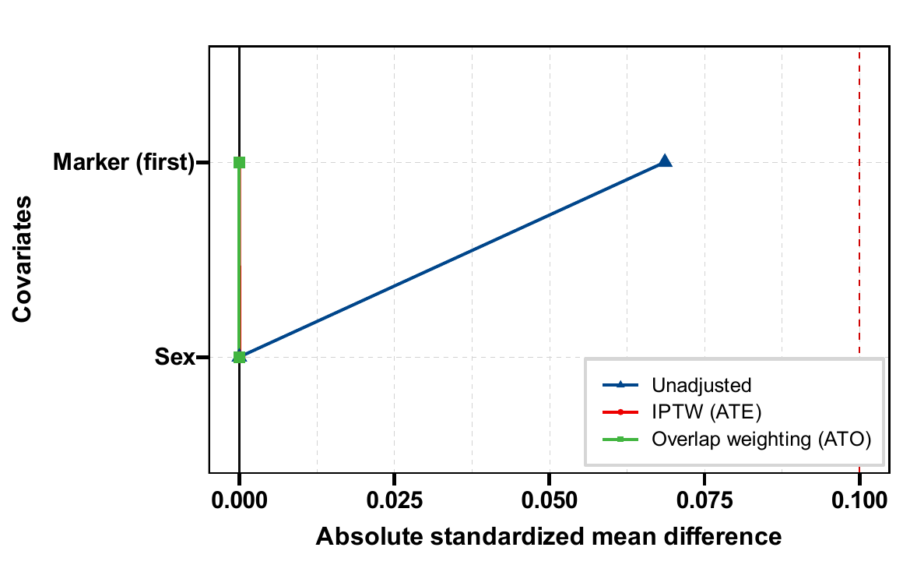{fig-alt="320行模拟数据的ATE与ATO平衡图，横轴为绝对SMD，变量显示为Marker first与Sex，Ignored marker label没有进入图中。"}

[下载 PDF](images/clinical-workflow-guide/20261020-latest-labels-balance.pdf)

### 亚组森林 {.unnumbered}

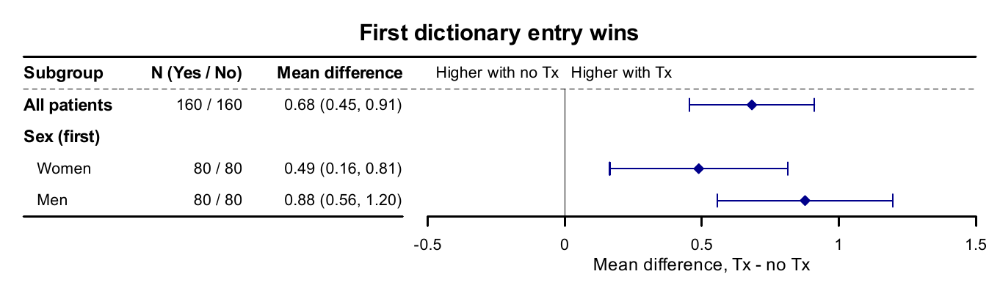{fig-alt="连续结局HTE森林使用Sex first标题和Women、Men水平，保留原总体及亚组差值估计，没有使用重复键的第二个标签。"}

[下载 PDF](images/clinical-workflow-guide/20261020-latest-labels-subgroup.pdf)

### 单变量效应修饰筛查 {.unnumbered}

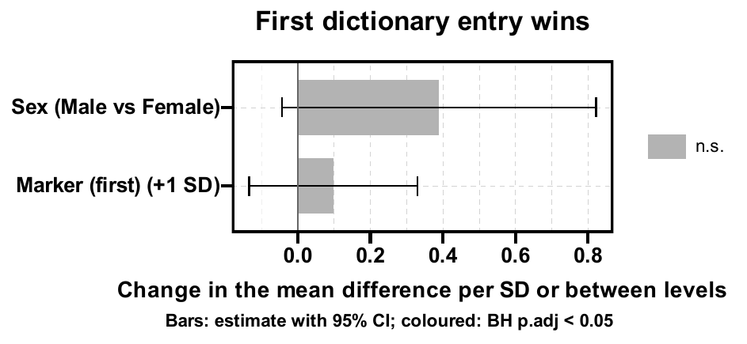{fig-alt="三折GLM伪结局筛查的效应与区间图，x显示为Marker first，sex显示为Sex，重复标签键不改变VIP数值或显著性。"}

[下载 PDF](images/clinical-workflow-guide/20261020-latest-labels-screen.pdf)

:::

重复**键**可以保留第一项；`plt_hte_unihtee()` 仍禁止把两个不同候选变量映射成同一个显示名称，避免读图混淆。本节比较重复字典与去重字典的平衡数值、原始亚组表和绘图数据，均保持一致；没有把改名当作重新分析或提高因果识别质量。


## 更新记录 {#page-updates}

::: {.callout-note collapse="true" title="更新记录"}
- 2026-10-28：追加 [手工敏感性界限](#manual-bounds-20261028b)的有效情景与 13 类无效输入复核。
- 2026-10-28：追加 [极端权重的有限摘要与溢出拒绝](#extreme-weights-20261028b)，并说明加权表头 N 与实际患者数的差别。
- 2026-10-28：补充 [平衡阈值与评分复用](#balance-policy-20261028b)、[小表串行策略和空治疗水平](#balance-table-20261028b)的独立实跑。
- 2026-10-28：补充 [get_sens 存储规范化](#stored-sens-20261028b)，实跑 lm 的 SPSS 缺失、integer64 与单列矩阵对照。
- 2026-10-28：补充 [PSM / PSW 存储类型](#stored-design-20261028b)的 120 行实跑，区分输入、完整分析队列与匹配人数。
- 2026-10-28：补充 [类别整体 SMD 不可用](#singular-balance-20261028)的 120 行诊断例，避免将奇异协方差解释为平衡。
- 2026-10-28：补充 [HTE 输入标签与缺失](#input-contract-20261028)的 240 行例子、完整结局分母及保留列约定。
:::
