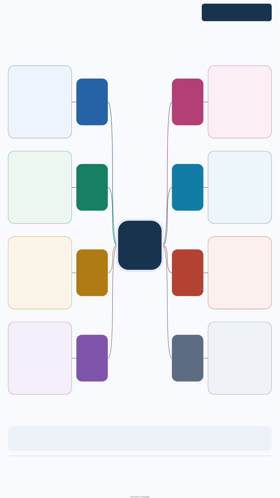
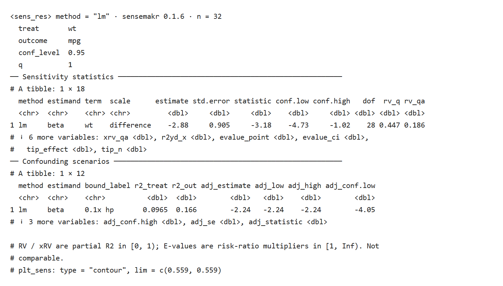
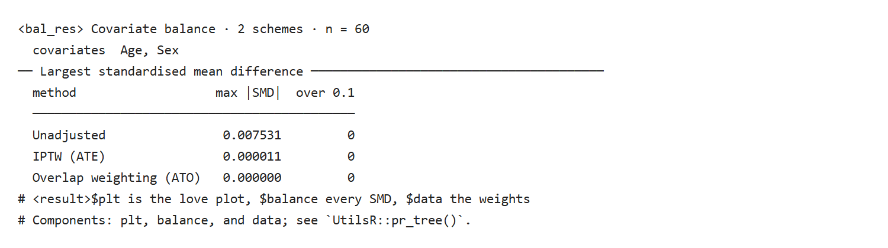

::: {.callout-note title="运行前核对树变量参数"}
2026-10-17 已核对 causalR 远端 `ceb2003`：select、unihtee、tree 和 icf 四个入口均已使用 `tree_var`。本站代码与已推送接口一致；旧安装若仍用 `candidate_var`，请按安装接口替换参数名或更新包。历史模型和图表保留原执行结果，详见 [发布状态](#release-20261016)。
:::

因果推断与效应异质性：倾向评分加权 / 匹配、因果森林与解释、亚组规则与稳定性、效应修饰筛选和敏感性分析。

本页集中展示三张图：先看功能总览，再查接口索引，最后看处理流程与返回对象。**点击图片可放大查看**，也可下载图源继续编辑。

[下载 draw.io 图源](../assets/module-maps/causalr/causalr-package-mindmap.drawio){.btn .btn-outline-primary download="causalr-package-mindmap.drawio"}
[下载三页 PDF](../assets/module-maps/causalr/causalr-package-mindmap.drawio.pdf){.btn .btn-outline-secondary download="causalr-package-mindmap.drawio.pdf"}

2026-10-15补充核对：显式导出仍为24项。已推送31e8e6d的unihtee返回hte、亚组表row_height已同步到 [方法选择](method-selection-guide.qmd#unihtee-return-current) 和 [结果复用](computation-reuse-guide.qmd#unihtee-reuse-current)。2026-10-16复核，远端f3f7ecc已包含f39631a的树图样式；对应实图及执行范围见 [当前iCF样式](icf-plot-guide.qmd#icf-style-current)。原图谱未重新绘制。

::: {.callout-note collapse="true" title="版本与复现记录"}
**核对记录：** 最近核对 **2026-10-10**，causalR **0.0.0.9000** 源码 [`b8add77`](https://github.com/HUI950319/causalR/tree/b8add77)。原图快照为 **2026-10-07**、原始基线 `d4aeb78`；本次未重新绘制图谱，已逐项核对当前 `NAMESPACE`，**24 个显式导出函数**仍完整覆盖。PDP/ALE/SHAP 教程已同步随机患者抽样、空水平与恒定变量的当前行为。`predict.hte_tree()` 是已注册的 S3 方法，另列，不重复计数。具体参数和返回值以当前源码或安装版本的帮助页为准。
:::

## 此次补齐的接口与阅读入口

| 入口 | 返回对象与用途 | 完整教程 |
|---|---|---|
| `get_evalue()` | RR / OR / HR 的 E-value 表；独立于 `sens_res` | [输入比值、区间与 rare 假设](evalue-guide.qmd) |
| `get_hte_pdp()` | 完整森林的加权 PDP；分位数网格与解释预算 | [参数对照、抽样与森林权重](pdp-guide.qmd) |
| `get_hte_ale()` | 局部 ALE 表；分类水平排序及空水平记录 | [相关变量、分箱与分类示例](ale-guide.qmd) |
| `get_hte_shp()` | `shapviz`；默认代理模型，可选 Kernel | [图形展示与留出集保真度](shap-guide.qmd) |
| `get_hte_tree_stability()` | 重复状态、变量频率、切点与叶子重叠 | [稳定性与既有规则预测](tree-stability-guide.qmd) |

图中三种森林解释描述模型的 CATE 预测，不能替代独立效应修饰检验。代理 SHAP 的 R² 衡量近似森林的程度；E-value 需要按研究设计判断比值换算假设。

## get_PSW()：含空格或连字符的变量名 {#psw-column-names}

2026-10-03 的源码修复 `4582e7f` 让 PS 拟合可以使用 `Age (years)`、`chol-level` 等列名。内部为 WeightIt 建立合法占位名，返回拟合对象的 `covs` 恢复原名，避免变量被误当成函数或在平衡诊断中遗漏。

```r
library(causalR)
set.seed(20261005)
d_psw <- data.frame(age = rnorm(300, 50, 10), chol = rnorm(300))
d_psw[["z"]] <- rbinom(300, 1,
  plogis(-1 + 0.02 * d_psw[["age"]] + 0.4 * d_psw[["chol"]]))
names(d_psw) <- c("Age (years)", "chol-level", "treatment arm")
psw <- get_PSW(d_psw, treat = "treatment arm",
  adj_var = c("Age (years)", "chol-level"), estimand = "ATE", balance = TRUE)
psw[["stats"]]
names(psw[["fit"]][["covs"]])
# "Age (years)" "chol-level"
```

下面为实际合成数据运行结果；已确认改名前后的 PS 数值一致，且拟合对象保留两个原始调整列名。

::: {.table-responsive}

| estimand | n | n_treat | n_ctrl | ess | ess_treat | ess_ctrl | ess_pct | w_min | w_max | w_mean | w_sd | w_cv | smd_max | smd_over |
| :-- | :-- | :-- | :-- | :-- | :-- | :-- | :-- | :-- | :-- | :-- | :-- | :-- | :-- | :-- |
| ATE | 300 | 148 | 152 | 287.5 | 142.3 | 145.3 | 0.9584 | 1.32 | 3.774 | 2 | 0.4172 | 0.2086 | 0.003106 | 0 |

:::

此修复针对列名兼容，不改变估计目标、修剪或权重截断。依然需要检查权重、重叠和平衡；它不是让任意模型后端接受任意额外参数。

## 功能模块总览

{width=100% fig-alt="causalR 的功能模块总览；点击图片可放大阅读。"}

[查看原尺寸 PNG](../assets/module-maps/causalr/causalr-package-mindmap-p1.drawio.png)

## 完整导出项索引

{width=100% fig-alt="causalR 的完整导出项索引；点击图片可放大阅读。"}

[查看原尺寸 PNG](../assets/module-maps/causalr/causalr-package-mindmap-p2.drawio.png)

## 分析流程与对象流

{width=100% fig-alt="causalR 的分析流程与对象流；点击图片可放大阅读。"}

[查看原尺寸 PNG](../assets/module-maps/causalr/causalr-package-mindmap-p3.drawio.png)

三页分别用于了解模块分工、定位公共接口和衔接输入输出。图中的流程分支按具体任务选择。

## 接口变化记录 {#interface-changes}

各轮接口核对的说明，按日期从新到旧排列；模块图保留各自注明的历史快照。

### 结果打印与读取层级（2026-10-25） {#printing-20261025}

<!-- update-20261025: causal_print -->

2026-10-25 按已推送 causalR `7a43fb9`、UtilsR 0.6.10 `0e4cffe` 核对，显式导出仍为 **24 项**。本轮主要更新 `get_sens()`、`get_hte()`、`get_hte_icf()`、`get_hte_tree()`、`get_PSM()`、`get_PSW()` 返回结果的打印方法，采用共享的类标签、键值、分节与紧凑表格；没有因此增加估计器。

先看类名、方法和样本摘要，再读设置块与结果表，末尾提示给出后续绘图或读取入口。屏幕表可能省略行列，程序分析仍应直接读取返回对象。这里用 R 自带 mtcars 演示线性模型敏感性结果，**仅在 Windows R 4.4.3 执行**；本轮未在 WSL 重跑 causalR，也没有重新训练因果森林。

```r
library(causalR)
sens_print25 <- get_sens(datasets::mtcars, treat = "wt", outcome = "mpg",
  adj_var = c("hp", "am"), bench_var = "hp", method = "lm",
  bench_args = list(k_treat = .1, k_out = .1))
before_print25 <- sens_print25
stats_before25 <- sens_print25[["stats"]]
lines_sens25 <- withr::with_options(list(cli.num_colors = 1, cli.width = 100, width = 100),
  capture.output(return_sens25 <- withVisible(print(sens_print25))))
```

::: {.callout-note collapse="true" title="复核代码"}
生成本页时运行的检查，接在上面的代码之后运行；只读教程可以跳过。

```r
stopifnot(inherits(sens_print25, "sens_res"), !return_sens25[["visible"]],
  identical(return_sens25[["value"]], sens_print25),
  identical(before_print25, sens_print25), identical(stats_before25, sens_print25[["stats"]]))
save_console25 <- function(lines, name) {
  body <- paste(fansi::sgr_to_html(htmltools::htmlEscape(lines)), collapse = "\n")
  writeLines(paste0('<!doctype html><meta charset="utf-8"><style>',
    'body{margin:0;background:white;color:#222}pre{margin:0;padding:20px;',
    'font:15px/1.6 Consolas,"DejaVu Sans Mono",monospace;white-space:pre}',
    '</style><pre data-native-console>', body, '</pre>'),
    file.path(tempdir(), paste0("20261025-update-", name, ".html")), useBytes = TRUE)
}
save_console25(lines_sens25, "causal-sensitivity-console")
validation_values <- list(stats = as.data.frame(stats_before25), print_invisible = !return_sens25[["visible"]],
  input_unchanged = identical(before_print25, sens_print25))
```
:::

{fig-alt="Windows R中真实get_sens线性模型输出，先显示sens_res类名和方法，再列处理变量、结局、基准变量及敏感性统计表与提示。"}

[原生 HTML 输出](images/function-modules/20261025-update-causal-sensitivity-console.html)

mtcars 是非随机分配的观察数据，示例仅说明敏感性输出如何读取，不能把 wt 的回归系数解释为已识别的因果效应。打印改变不重算估计、修正混杂或改变置信区间；因果森林、iCF、树与倾向评分结果的本轮打印变化按已推送源码核对，旧教程保留各自的模型运行记录。更多显示规则见[共享打印构件](../utilsr/function-modules.qmd#console-helpers-20261025)。

<!-- /update-20261025: causal_print -->

### 平衡结果的摘要与组成字段（2026-10-26） {#balance-print-20261026}

<!-- update-20261026: causal_balance -->

按已推送 causalR `4952af8`，`get_bal()` 返回 `bal_res`：`print()` 先显示方法摘要与最大绝对 SMD，再提示组成字段；完整 SMD、权重和图仍从命名分量读取。`get_hte_select()`、树稳定性与 unihtee 的返回类也增加摘要打印，HTE、iCF、树、PSM、PSW、敏感性结果末尾列出 Components，帮助定位对象内部，不会因打印重拟合。

下面使用 60 行合成数据，仅在 **Windows R 4.4.3** 运行 ATE / ATO 两种 glm 权重方案，不重训因果森林。摘要中的 SMD 是本次平衡诊断，不能把它单独当作因果识别或结局效果的证明。

```r
library(causalR)
set.seed(102604)
data_balance26 <- data.frame(Age = rnorm(60, 55, 8), Sex = factor(rep(c("Female", "Male"), 30)),
  Tx = factor(rep(c("No", "Yes"), each = 30)))
balance26 <- get_bal(data_balance26, treat = "Tx", adj_var = c("Age", "Sex"),
  methods = c("ATE", "ATO"), tbl = FALSE, cores = 1)
lines_balance26 <- capture.output(printed_balance26 <- withVisible(print(balance26)))
names(balance26)
UtilsR::pr_tree(balance26, max_depth = 1, max_items = 4, attrs = FALSE)
```

::: {.callout-note collapse="true" title="复核代码"}

```r
stopifnot(inherits(balance26, "bal_res"), !printed_balance26[["visible"]],
  identical(printed_balance26[["value"]], balance26),
  all(c("plt", "balance", "data") %in% names(balance26)),
  any(grepl("Components:", lines_balance26, fixed = TRUE)))
save_console26 <- function(lines, name) {
  body <- paste(fansi::sgr_to_html(htmltools::htmlEscape(lines)), collapse = "\n")
  chars <- strsplit(body, "", fixed = TRUE)[[1]]; cp <- utf8ToInt(body)
  for (i in which(cp > 127L & !(cp >= 0x2500L & cp <= 0x257fL))) {
    w <- cli::ansi_nchar(chars[i], type = "width")
    if (w %in% 1:2) chars[i] <- sprintf('<span class="w%d">%s</span>', w, chars[i])
  }
  html <- paste0('<!doctype html><meta charset="utf-8"><style>',
    'body{margin:0;background:white;color:#222}pre{margin:0;padding:20px;',
    'font:15px/1.6 Consolas,"DejaVu Sans Mono",monospace;white-space:pre}',
    '.w1,.w2{display:inline-block}.w1{width:1ch}.w2{width:2ch}',
    '</style><pre data-native-console>', paste(chars, collapse = ""), '</pre>')
  writeLines(html, file.path(tempdir(), paste0("20261026-update-", name, ".html")), useBytes = TRUE)
}
save_console26(lines_balance26, "causal-balance-summary")
validation_values <- list(class = class(balance26), components = names(balance26),
  balance = as.data.frame(balance26[["balance"]]), print_invisible = !printed_balance26[["visible"]])
```

:::

{fig-alt="Windows中60行合成数据计算ATE和ATO权重后的实际bal_res标准输出，显示各方法平衡摘要并列出可读取的组成字段。"}

[原生 HTML](images/function-modules/20261026-update-causal-balance-summary.html)

这里读取 love plot 用 `balance26[["plt"]]`，完整 SMD 用 `balance26[["balance"]]`，权重数据用 `balance26[["data"]]`。打印默认只展示摘要；`pr_tree()` 也受深度与行数限制，不能据此认为未展开字段不存在。其他结果类变化按本轮源码和帮助核对，没有在本轮重新拟合其历史森林或稳定性实验。

<!-- /update-20261026: causal_balance -->

### 亚组显示与总体行（2026-10-20） {#updates-20261020}

2026-10-20 按已推送 causalR `7a983f1d` 更新 `plt_hte_sub(effect = ...)` 的说明：未单独指定 `"All patients"` 时，总体行会跟随被替换的亚组估计或区间；明确给 `"All patients" = "conf_0.95"` 可保留森林的原总体。替换多个分组变量的估计时必须明确指定总体。

[工作流中的完整模拟例子](clinical-workflow-guide.qmd#overall-edit-20261020)已在 Windows / WSL R 4.4.3 运行，提供“总体跟随”和“保留原总体”的两张 PDF。人工替换是展示操作，不重拟合森林；交互检验、cate_mean 和其他分组变量的估计不会据此重算。

随后按已推送 `c200683` 补齐三处名称映射：`get_bal()` / `plt_hte_unihtee()` 的 `var_names` 与 `plt_hte_sub()` 的 `label_column_list` 接受重复键并保留第一项。不同候选变量在筛查图中仍须有不同显示名；默认合并RegR字典与 `NULL` 保留原名的区别不变。[共用字典的三个实际预览](clinical-workflow-guide.qmd#label-maps-20261020)核对平衡数值、亚组表和绘图数据不变，Windows / WSL 均通过；显式导出数量仍为24项。

### 发布状态与树变量名称（2026-10-16） {#release-20261016}

2026-10-16核对：树图样式及绘图环境整理已推送到causalR `f3f7ecc`。仅保存plt_hte_tree/plt_hte_icf的图对象时，绘图环境不再连带保存整个拟合；图仍含绘图所需数据，这不是匿名化功能。既有图片和数值保留各自执行日期，本轮没有重跑历史分析。

2026-10-17 核对的远端 `ceb2003` 已包含 `e389a75` 与 `f505185` 的改名，四个入口均使用 `tree_var`，不再是仅本机可用的接口。本站 `72d6139` 与 `b0f67c1` 的代码拼写已与之统一。当前源码已在 Windows R 4.4.3 核对四个签名，并实际执行 `get_hte_unihtee(method="glm", tree_var=...)`。旧安装可用 `names(formals(causalR::get_hte_tree))` 等检查；`candidate_var` 与 `tree_var` 应按安装接口选择，不同时传入。历史模型、表格与图片保持原执行快照，本轮没有重算历史森林。

## 更新记录 {#page-updates}

::: {.callout-note collapse="true" title="更新记录"}
- 2026-10-26：补充[bal_res 实际摘要与组成字段读取](#balance-print-20261026)，同步其他结果类的 Components 说明。
:::
