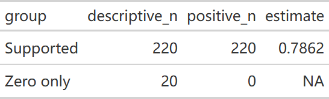
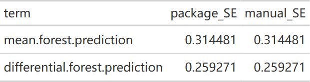
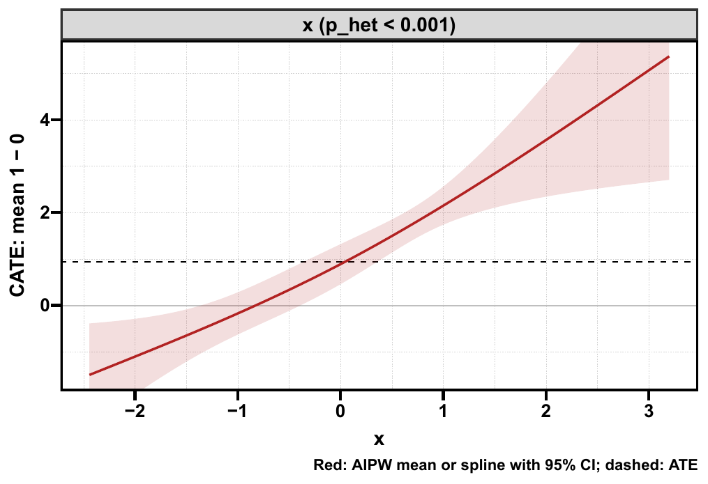
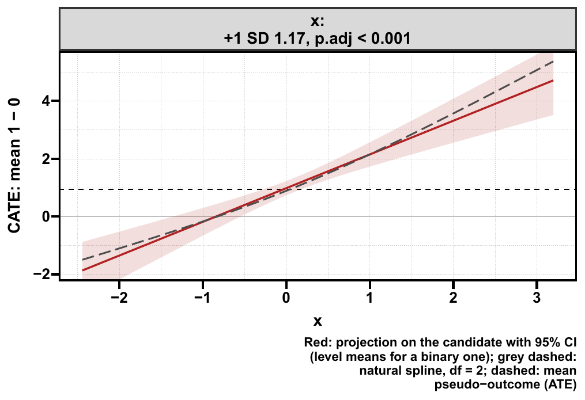
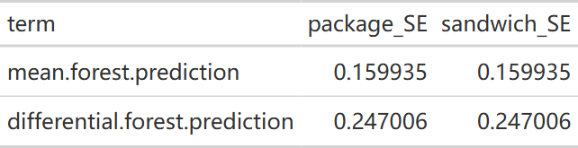
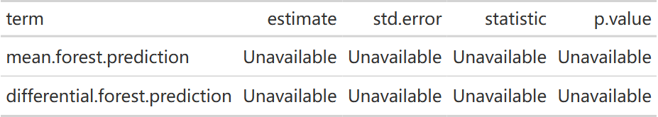
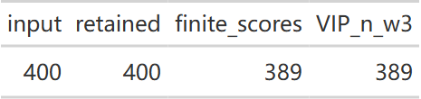
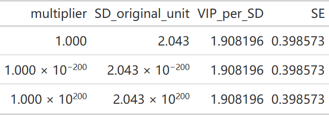
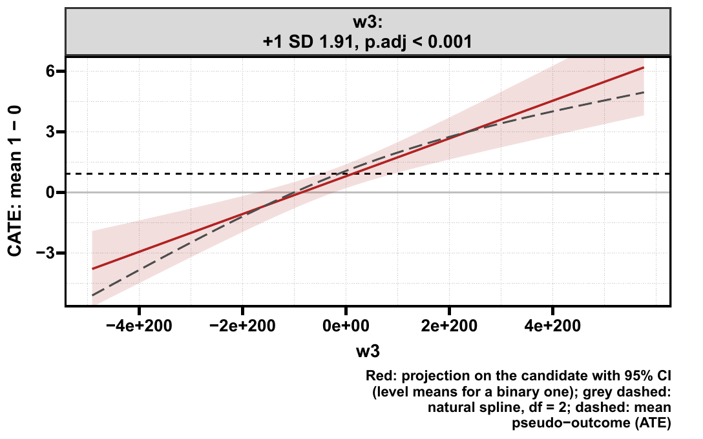

```{r}
#| label: setup-diagnostics
#| include: false
if (nzchar(Sys.getenv("CAUSALR_SOURCE"))) {
  pkgload::load_all(Sys.getenv("CAUSALR_SOURCE"), quiet = TRUE)
} else library(causalR)
library(ggplot2)
knitr::opts_chunk$set(collapse = TRUE, comment = "#>", message = FALSE)
```

CATE 看起来有起伏，不足以证明模型准确。本页分别看**单变量修饰信号、校准、排序能力、
分组效应**，并展示 `plt_hte_rate()` 的重要参数。接口与图形样式可先看 [包总览](index.qmd)。

## 指标地图 {#sec-diagnostics-map}

| 输出 | 回答的问题 | 不能据此回答 |
|---|---|---|
| `importance` | 森林在哪些变量上频繁分裂？ | 是否独立、显著地修饰治疗效应 |
| `p_het`、`p_inter` | 单变量投影或分类组的效应是否相同？ | 多变量独立贡献、患者真实个体效应 |
| differential 校准系数 | 森林排序中是否有正向异质性信号？ | p 值显著不等于系数已校准到 1 |
| RATE：AUTOC / QINI | 预先指定的排序是否将高获益者排在前面？ | 个体效应的绝对误差、临床可实施性 |
| GATES | 排序分组的双稳健效应如何变化？ | 事后挑选组的未经选择校正的最终结论 |
| Jaccard / 投票比例 | 重复的分区是否相似？ | 因果识别、效应显著性或外部价值 |

这些诊断以可识别性和有效的效应得分为前提，不能检测并修复所有未测量混杂。

## 示例数据与返回表 {#sec-diagnostics-data}

```{r}
#| label: diagnostics-data
set.seed(20261002)
n <- 1400
d <- data.frame(marker = rnorm(n), age = rnorm(n, 60, 10), noise = rnorm(n))
d$z <- rbinom(n, 1, plogis(0.3 * d$marker + 0.01 * (d$age - 60)))
d$y <- d$marker + 0.03 * (d$age - 60) + d$z * (1 + 2 * d$marker) + rnorm(n)
res <- get_hte(d, "z", adj_var = c("marker", "age", "noise"), surv = "y",
               grf_args = list(num.trees = 500, seed = 42, num.threads = 2))
res$importance
res$calibration
```

```{r}
#| label: fig-diagnostics-importance
#| fig-alt: "分裂频率与单变量检验是不同的输出。颜色按本页明确指定的 BH 检验族标记，不把重要性当 p 值。"
#| fig-width: 7
#| fig-height: 4
#| fig-cap: "分裂频率与单变量检验是不同的输出。颜色按本页明确指定的 BH 检验族标记，不把重要性当 p 值。"
imp <- res$importance
imp$p_BH <- p.adjust(imp$p_het, "BH")
ggplot(imp, aes(reorder(variable, importance), importance, fill = p_BH < 0.05)) +
  geom_col(width = 0.65) + coord_flip() +
  labs(x = NULL, y = "Split-frequency importance", fill = "BH p < 0.05") + theme_minimal()
```

### 校准系数怎样读

`mean.forest.prediction` 描述平均预测部分；`differential.forest.prediction` 描述围绕均值的
异质性预测部分。系数接近 1 是校准的理想参照，但表中的单侧 p 值检验正向信号，
**不是对系数等于 1 的检验**。负 differential 系数应按原符号解释，不能取绝对值制造异质性。
生存森林的实现使用相应删失校正残差，不应将它与原始事件的线性回归混用。

### 零权重、有效聚类与可用推断（2026-10-28） {#positive-weights-20261028}

<!-- update-20261028: causal_weights -->

causalR `26af481` 将零权重记录同时排除出校准回归及 HC3 协方差，避免仅回归忽略零权重、方差仍包含它们。`stats$n`、亚组 `n` 保留分析数据的描述人数；它们不是正权重人数，也不是有效聚类数。总体在拟合前要求至少两个正权重聚类；某个亚组不足时仅该亚组不可估计，其余有效结果保留。

下例为 240 行合成随机分配数据，前 20 行权重为零，其余 220 行分布在 22 个正权重聚类中。`Zero only` 亚组保留 20 行描述计数，但没有可估计效应。校准标准误与独立的正权重回归及 cluster-HC3 计算对照。

```r
library(causalR)
set.seed(2802)
weight_data28 <- data.frame(z = rep(0:1, 120), x = rnorm(240),
  band = factor(c(rep("Zero only", 20), rep("Supported", 220))))
weight_data28[["y"]] <- weight_data28[["x"]] + weight_data28[["z"]] *
  (1 + weight_data28[["x"]]) + rnorm(240)
weight_w28 <- c(rep(0, 20), rep(1, 220))
weight_cluster28 <- rep(seq_len(24), each = 10)
weight_args28 <- list(num.trees = 100, num.threads = 1, seed = 28,
  W.hat = .5, Y.hat = 0, sample.weights = weight_w28, clusters = weight_cluster28)
weight_fit28 <- get_hte(weight_data28, "z", adj_var = "x", sub_var = "band", surv = "y",
  estimand = c("ATE", "ATO"), grf_args = weight_args28)
weight_sub28 <- weight_fit28[["subgroup"]]
weight_sub28 <- weight_sub28[weight_sub28[["estimand"]] == "ATE", ]
weight_sub_table28 <- data.frame(group = weight_sub28[["level"]],
  descriptive_n = weight_sub28[["n"]],
  positive_n = vapply(weight_sub28[["level"]], function(g)
    sum(weight_data28[["band"]] == g & weight_w28 > 0), integer(1)),
  estimate = weight_sub28[["estimate"]])
gt::gtsave(gt::fmt_number(gt::gt(weight_sub_table28), columns = "estimate", decimals = 4),
  file.path(tempdir(), "20261028-update-hte-effective-subgroups.html"))
```

{fig-alt="合成数据中 Supported 亚组的描述人数和正权重人数都是 220，Zero only 描述人数为 20、正权重人数为零，其效应为 NA。"}

[原生 HTML](images/hte-diagnostics-guide/20261028-update-hte-effective-subgroups.html)

::: {.callout-note collapse="true" title="复核代码"}

```r
weight_f28 <- weight_fit28[["fit"]]; weight_positive28 <- weight_w28 > 0
weight_tau28 <- as.numeric(predict(weight_f28)[["predictions"]])
weight_mean28 <- weighted.mean(weight_tau28, weight_w28)
weight_centered28 <- weight_f28[["W.orig"]] - weight_f28[["W.hat"]]
weight_cal_data28 <- data.frame(y = weight_f28[["Y.orig"]] - weight_f28[["Y.hat"]],
  mean.forest.prediction = weight_centered28 * weight_mean28,
  differential.forest.prediction = weight_centered28 * (weight_tau28 - weight_mean28),
  wt = weight_w28)
weight_cal28 <- lm(y ~ 0 + mean.forest.prediction + differential.forest.prediction,
  data = weight_cal_data28[weight_positive28, ], weights = wt)
weight_cov28 <- sandwich::vcovCL(weight_cal28,
  cluster = weight_f28[["clusters"]][weight_positive28], type = "HC3")
weight_se28 <- sqrt(diag(weight_cov28))
weight_cal_table28 <- data.frame(term = weight_fit28[["calibration"]][["term"]],
  package_SE = weight_fit28[["calibration"]][["std.error"]], manual_SE = unname(weight_se28))
stopifnot(all(weight_fit28[["stats"]][["n"]] == 240L), sum(weight_positive28) == 220L,
  length(unique(weight_f28[["clusters"]][weight_positive28])) == 22L,
  isTRUE(all.equal(weight_fit28[["calibration"]][["estimate"]], unname(coef(weight_cal28)))),
  isTRUE(all.equal(weight_cal_table28[["package_SE"]], weight_cal_table28[["manual_SE"]])))
weight_ato28 <- grf::average_treatment_effect(weight_f28, target.sample = "overlap",
  subset = which(weight_positive28))
weight_ato_row28 <- weight_fit28[["stats"]][weight_fit28[["stats"]][["estimand"]] == "ATO", ]
stopifnot(isTRUE(all.equal(weight_ato_row28[["estimate"]], unname(weight_ato28[["estimate"]]))),
  isTRUE(all.equal(weight_ato_row28[["std.error"]], unname(weight_ato28[["std.err"]]))),
  is.na(weight_sub_table28[["estimate"]][weight_sub_table28[["positive_n"]] == 0]))
weight_bad_args28 <- weight_args28
weight_bad_args28[["clusters"]] <- ifelse(weight_positive28, 1, 2)
weight_cluster_error28 <- tryCatch(get_hte(weight_data28, "z", adj_var = "x", surv = "y",
  grf_args = weight_bad_args28), error = conditionMessage)
stopifnot(is.character(weight_cluster_error28), grepl("positive-weight clusters", weight_cluster_error28))
gt::gtsave(gt::fmt_number(gt::gt(weight_cal_table28), columns = c("package_SE", "manual_SE"),
  decimals = 6), file.path(tempdir(), "20261028-update-hte-calibration-hc3.html"))
validation_values <- list(n = c(240L, 220L, 22L), calibration_SE = weight_cal_table28[["package_SE"]],
  manual_SE = weight_cal_table28[["manual_SE"]], ato = as.numeric(weight_ato28),
  subgroup_positive = weight_sub_table28[["positive_n"]], effective_cluster_rejected = TRUE)
```
:::

{fig-alt="mean.forest.prediction 与 differential.forest.prediction 两个校准项的包标准误和手工正权重 HC3 标准误逐项一致。"}

[原生 HTML](images/hte-diagnostics-guide/20261028-update-hte-calibration-hc3.html)

ATO 估计与区间也只将正权重记录传给 grf 的 overlap 推断。零权重行的边界倾向评分不再阻断有效行的 AIPW 结果；原始行及其不可用得分仍可保留，不能把非有限得分当成有效观测。

分类协变量只有满足分臂及随访支持的水平进入影响函数协方差；跳过不可用水平不表示删除其描述记录。因子的显式 NA 水平按水平编码参与分类诊断，真正缺失的编码不参与对应组。连续投影、校准或 unihtee 的 HC3 失败或非有限时，受影响的推断会标为不可用并给出诊断，已有平均效应及其他候选保留。NA 不是无异质性的证据，也不应擅自改用另一种方差使其得到 p 值。

本例使用 Windows R 4.4.3；零权重亚组的警告是刻意展示的结果，不是已经通过的可用亚组。

<!-- /update-20261028: causal_weights -->

### 曲线只覆盖实际拟合行，HC3 保持同一合同（2026-10-28） {#spline-range-20261028}

<!-- update-20261028: causal_spline -->

追加核对 causalR `9d26ba6`：`plt_hte_dep()` 与 `plt_hte_unihtee()` 的共享样条网格只使用实际拟合行的协变量范围。零权重极端值不再拉长曲线、挤压有效区域；原有支持筛选及异质性检验不因此改变。聚类 HC3 也改为低秩线性代数，避免按聚类人数构造大矩阵，仍须与相同权重、聚类及有限聚类修正的协方差核对，不能据此假定统计定义变化。

下面 240 行合成记录中，前 20 行权重为零，并刻意将它们的 `x` 设为正负百万。其余 220 行、11 个正权重聚类用于拟合投影与推断；两张曲线均只覆盖这些有效记录的范围。

```r
library(causalR)
set.seed(2803)
spline_data28 <- data.frame(a = rep(0:1, 120), x = rnorm(240), v = rnorm(240))
spline_data28[["y"]] <- spline_data28[["v"]] + spline_data28[["a"]] *
  (1 + spline_data28[["x"]]) + rnorm(240)
spline_weights28 <- c(rep(0, 20), rep(1, 220))
spline_clusters28 <- rep(seq_len(12), each = 20)
spline_data28[["x"]][1:20] <- rep(c(-1e6, 1e6), 10)
spline_result28 <- get_hte_unihtee(spline_data28, "a", tree_var = "x", adj_var = "v", surv = "y",
  grf_args = list(num.trees = 100, num.threads = 1, seed = 28, W.hat = .5, Y.hat = 0,
    sample.weights = spline_weights28, clusters = spline_clusters28))
spline_hte_plot28 <- plt_hte_dep(spline_result28[["hte"]], x_var = "x", display = "dr")
spline_uni_plot28 <- plt_hte_unihtee(spline_result28, type = "dep", x_var = "x")
ggplot2::ggsave(file.path(tempdir(), "20261028-update-hte-supported-grid.pdf"), spline_hte_plot28,
  width = 7, height = 4.8)
ggplot2::ggsave(file.path(tempdir(), "20261028-update-unihtee-supported-grid.pdf"), spline_uni_plot28,
  width = 7, height = 4.8)
```

::: {.panel-tabset}

#### HTE 样条 {.unnumbered}

{fig-alt="240 行合成数据的 HTE 样条及置信区间，仅覆盖 220 行正权重记录的 x 范围，正负百万的零权重值不拉长曲线。"}

[原生 PDF](images/hte-diagnostics-guide/20261028-update-hte-supported-grid.pdf)

#### unihtee 投影与样条 {.unnumbered}

{fig-alt="同一拟合对象的 unihtee 线性投影与样条，仅在正权重拟合行的 x 范围显示，原始零权重极端值不压缩有效区域。"}

[原生 PDF](images/hte-diagnostics-guide/20261028-update-unihtee-supported-grid.pdf)

:::

::: {.callout-note collapse="true" title="复核代码"}

```r
spline_layer28 <- function(p, column) Filter(function(layer)
  inherits(layer[["geom"]], "GeomLine") && column %in% names(layer[["data"]]), p[["layers"]])[[1]][["data"]]
spline_line28 <- spline_layer28(spline_hte_plot28, "estimate")
spline_comparison28 <- spline_layer28(spline_uni_plot28, "spline")
spline_active28 <- spline_weights28 > 0
spline_range28 <- range(spline_data28[["x"]][spline_active28])
stopifnot(isTRUE(all.equal(range(spline_line28[["x"]]), spline_range28)),
  isTRUE(all.equal(range(spline_comparison28[["x"]]), spline_range28)),
  isTRUE(all.equal(spline_line28[["estimate"]], spline_comparison28[["spline"]])))
spline_f28 <- spline_result28[["hte"]][["fit"]]
spline_tau28 <- as.numeric(predict(spline_f28)[["predictions"]])
spline_mu28 <- weighted.mean(spline_tau28, spline_weights28)
spline_w28 <- spline_f28[["W.orig"]] - spline_f28[["W.hat"]]
spline_cal_data28 <- data.frame(y = spline_f28[["Y.orig"]] - spline_f28[["Y.hat"]],
  mean.forest.prediction = spline_w28 * spline_mu28,
  differential.forest.prediction = spline_w28 * (spline_tau28 - spline_mu28), wt = spline_weights28)
spline_cal28 <- lm(y ~ 0 + mean.forest.prediction + differential.forest.prediction,
  data = spline_cal_data28[spline_active28, ], weights = wt)
spline_cov28 <- sandwich::vcovCL(spline_cal28, cluster = spline_f28[["clusters"]][spline_active28], type = "HC3")
spline_cal_table28 <- data.frame(term = spline_result28[["hte"]][["calibration"]][["term"]],
  package_SE = spline_result28[["hte"]][["calibration"]][["std.error"]],
  sandwich_SE = unname(sqrt(diag(spline_cov28))))
stopifnot(max(abs(spline_cal_table28[["package_SE"]] - spline_cal_table28[["sandwich_SE"]])) < 1e-10)
gt::gtsave(gt::fmt_number(gt::gt(spline_cal_table28), columns = c("package_SE", "sandwich_SE"), decimals = 6),
  file.path(tempdir(), "20261028-update-hte-lowrank-hc3.html"))
validation_values <- list(n = c(240L, 220L, 11L), supported_range = spline_range28,
  hte_range = range(spline_line28[["x"]]), uni_range = range(spline_comparison28[["x"]]),
  package_SE = spline_cal_table28[["package_SE"]], sandwich_SE = spline_cal_table28[["sandwich_SE"]])
```
:::

{fig-alt="11 个正权重聚类的两个校准项，低秩 HC3 路径的标准误与 sandwich cluster-HC3 逐项一致，未新测内存倍数。"}

[原生 HTML](images/hte-diagnostics-guide/20261028-update-hte-lowrank-hc3.html)

本例在 Windows R 4.4.3 运行，仅复核网格范围与协方差数值；没有用小样本估计速度或内存降幅。显示范围缩小也不能替代检查因果支持、模型设定或外部验证。

<!-- /update-20261028: causal_spline -->

### 校准不可用时，保留其他结果并核对各自分母（2026-10-28） {#calibration-missing-20261028b}

<!-- update-20261028b: causal_calibration_missing -->

按 causalR `6760092`，正权重行上的 OOB 预测或残差含非有限值、或校准回归失败时，函数发出 `Calibration inference is unavailable` 警告，保留两个校准项，数值列设为 NA。这样能继续检查其他返回结果，同时明确校准推断缺失；不能把 NA 写成零、无异质性或校准良好。

下面刻意只长 **10 棵树**，复现小森林的 OOB 支持不足。这是 400 行合成数据上的诊断例，不是建议的训练参数。`data` 保留 400 行，其中 11 行伪结局非有限，VIP 在剩余 389 行上投影。本例的总体 ATE 和森林异质性推断也会警告为 NA，不能因为 VIP 有有限估计就称整体推断可用。返回行数、可用得分人数及各推断项的状态须分别报告。

```r
library(causalR)
set.seed(1028)
cal_data28 <- data.frame(w1 = rnorm(400), w2 = rnorm(400), w3 = rnorm(400, 0, 2),
  w4 = rnorm(400), sex = factor(sample(c("F", "M"), 400, replace = TRUE)))
cal_data28[["a"]] <- rbinom(400, 1, plogis(.5 * cal_data28[["w1"]]))
cal_data28[["y"]] <- cal_data28[["w1"]] + cal_data28[["w2"]] + cal_data28[["a"]] *
  (cal_data28[["w3"]] + (cal_data28[["sex"]] == "M")) + rnorm(400)
cal_args28 <- list(num.trees = 10, seed = 7, num.threads = 1, W.hat = .5, Y.hat = 0)
cal_result28 <- get_hte_unihtee(cal_data28, "a", tree_var = c("w3", "w1"), surv = "y",
  grf_args = cal_args28)
cal_table28 <- cal_result28[["hte"]][["calibration"]]
gt::gtsave(gt::sub_missing(gt::gt(cal_table28), missing_text = "Unavailable"),
  file.path(tempdir(), "20261028b-update-calibration-unavailable.html"))
cal_counts28 <- data.frame(input = nrow(cal_data28), retained = nrow(cal_result28[["data"]]),
  finite_scores = sum(is.finite(cal_result28[["data"]][[".score_diff"]])),
  VIP_n_w3 = cal_result28[["vip"]][["n"]][cal_result28[["vip"]][["variable"]] == "w3"])
gt::gtsave(gt::gt(cal_counts28), file.path(tempdir(), "20261028b-update-calibration-denominators.html"))
```

::: {.panel-tabset}

#### 校准项的可用性 {.unnumbered}

{fig-alt="mean.forest.prediction 和 differential.forest.prediction 两个校准项保留，估计、标准误、统计量和 p 值均为 Unavailable。"}

[原生 HTML](images/hte-diagnostics-guide/20261028b-update-calibration-unavailable.html)

#### 返回行与可用得分 {.unnumbered}

{fig-alt="400 行输入和返回数据人数，与有限 AIPW 得分人数、w3 的 VIP 人数并列；VIP 使用其实际可用得分分母。"}

[原生 HTML](images/hte-diagnostics-guide/20261028b-update-calibration-denominators.html)

:::

::: {.callout-note collapse="true" title="复核代码"}

```r
cal_direct28 <- get_hte(cal_data28, "a", adj_var = c("w3", "w1"), surv = "y", grf_args = cal_args28)
stopifnot(any(!is.finite(cal_result28[["hte"]][["fit"]][["predictions"]])),
  identical(cal_table28[["term"]], c("mean.forest.prediction", "differential.forest.prediction")),
  all(is.na(as.matrix(cal_table28[-1]))), nrow(cal_result28[["data"]]) == 400,
  all(cal_result28[["vip"]][["n"]] == cal_counts28[["finite_scores"]]),
  all(is.finite(cal_result28[["vip"]][["estimate"]])),
  identical(cal_direct28[["calibration"]], cal_table28))
validation_values <- list(n = cal_counts28, calibration = cal_table28, vip = cal_result28[["vip"]],
  source = "6760092c8020fb3814bdb274ebba7a03e0703470", grf = as.character(utils::packageVersion("grf")),
  R = R.version.string)
```
:::

本节在 Windows R 4.4.3、causalR `6760092` 固定源码实跑，种子 1028 / 7；只复核连续结局的这条失败路径。原有零权重、聚类 HC3 与生存诊断示例保留其执行快照。对暴露结局重叠及正权重组人数不足的检查，见[拟合前的边界检查](method-selection-guide.qmd#special-names-20261028b)。

<!-- /update-20261028b: causal_calibration_missing -->

### 极端单位与独立类别的等价诊断（2026-10-28） {#extreme-units-20261028b}

<!-- update-20261028b: causal_extreme_units -->

causalR `475d200` 对极端单位的连续候选先在内部缩放，再计算 SD、边际投影与样条诊断；报告的 VIP 仍为每 1 SD，曲线横轴仍用原单位。仅换计量单位不应令可用候选失效；若投影确实失败，则仅该候选不可用，保留其他候选并警告。

下面用 200 行固定合成数据，把 `w3` 分别乘以 `1e-200` 和 `1e200`。这两种极端倍率只用于数值诊断，不是实际变量推荐单位。100 棵树、已知倾向概率 0.5 和固定种子用来比较相同模型路径。

```r
library(causalR)
set.seed(510)
unit_data28 <- data.frame(w1 = rnorm(200), w2 = rnorm(200), w3 = rnorm(200, 0, 2),
  w4 = rnorm(200), sex = factor(sample(c("F", "M"), 200, replace = TRUE)))
unit_data28[["a"]] <- rbinom(200, 1, plogis(.5 * unit_data28[["w1"]]))
unit_data28[["y"]] <- unit_data28[["w1"]] + unit_data28[["w2"]] + unit_data28[["a"]] *
  (unit_data28[["w3"]] + (unit_data28[["sex"]] == "M")) + rnorm(200)
unit_args28 <- list(num.trees = 100, num.threads = 1, seed = 7, W.hat = .5, Y.hat = 0)
unit_fits28 <- lapply(c(1, 1e-200, 1e200), function(multiplier) {
  d <- unit_data28
  d[["w3"]] <- d[["w3"]] * multiplier
  get_hte_unihtee(d, "a", tree_var = c("w3", "w1"), surv = "y", grf_args = unit_args28)
})
unit_table28 <- do.call(rbind, lapply(seq_along(unit_fits28), function(i) {
  r <- unit_fits28[[i]][["vip"]]
  r <- r[r[["variable"]] == "w3", ]
  data.frame(multiplier = c(1, 1e-200, 1e200)[i], SD_original_unit = r[["sd"]],
    VIP_per_SD = r[["estimate"]], SE = r[["std.error"]])
}))
unit_gt28 <- gt::fmt_scientific(gt::gt(unit_table28), columns = c("multiplier", "SD_original_unit"), decimals = 3)
gt::gtsave(gt::fmt_number(unit_gt28, columns = c("VIP_per_SD", "SE"), decimals = 6),
  file.path(tempdir(), "20261028b-update-extreme-covariate-units.html"))
unit_big_plot28 <- plt_hte_unihtee(unit_fits28[[3]], type = "dep", x_var = "w3") +
  ggplot2::scale_x_continuous(breaks = c(-4, -2, 0, 2, 4) * 1e200,
    labels = scales::label_scientific(digits = 1)) +
  ggplot2::theme(plot.margin = ggplot2::margin(6, 24, 6, 6))
ggplot2::ggsave(file.path(tempdir(), "20261028b-update-extreme-unit-original-axis.pdf"), unit_big_plot28,
  width = 7.5, height = 4.7)
```

::: {.panel-tabset}

#### 每 SD 的投影保持相同 {.unnumbered}

{fig-alt="200 行合成数据的 w3 分别乘 1、10的负200次方、10的200次方，原单位 SD 随倍率变化，每SD的VIP及标准误保持相同。"}

[原生 HTML](images/hte-diagnostics-guide/20261028b-update-extreme-covariate-units.html)

#### 曲线仍用原始单位 {.unnumbered}

{fig-alt="w3 乘以10的200次方后的实际依赖图，横轴仍是极大原单位，投影和样条估计与普通单位版本一致。"}

[原生 PDF](images/hte-diagnostics-guide/20261028b-update-extreme-unit-original-axis.pdf)

:::

对互不重叠、观测独立的类别组，函数还可直接计算对角协方差，再做等价 Wald 检验；存在共享聚类或不满足条件时保留一般协方差路径。下面用额外 160 行、8 组数据，将分类异质性 p 值与分组加权均值的独立 sandwich 协方差手工结果核对。未测性能或内存倍数。

::: {.callout-note collapse="true" title="复核代码"}

```r
unit_columns28 <- c("estimate", "std.error", "conf.low", "conf.high", "p.value")
unit_ref_plot28 <- plt_hte_unihtee(unit_fits28[[1]], type = "dep", x_var = "w3")
unit_line28 <- function(p, field) {
  Filter(function(l) inherits(l[["geom"]], "GeomLine") && is.data.frame(l[["data"]]) &&
    field %in% names(l[["data"]]), p[["layers"]])[[1]][["data"]]
}
for (i in 2:3) {
  multiplier <- c(1, 1e-200, 1e200)[i]
  stopifnot(isTRUE(all.equal(unit_fits28[[i]][["vip"]][unit_columns28], unit_fits28[[1]][["vip"]][unit_columns28], tolerance = 1e-10)),
    isTRUE(all.equal(unit_fits28[[i]][["hte"]][["importance"]][["p_het"]], unit_fits28[[1]][["hte"]][["importance"]][["p_het"]], tolerance = 1e-10)))
  p <- plt_hte_unihtee(unit_fits28[[i]], type = "dep", x_var = "w3")
  for (field in c("estimate", "spline")) {
    line <- unit_line28(p, field)
    ref <- unit_line28(unit_ref_plot28, field)
    stopifnot(isTRUE(all.equal(line[[field]], ref[[field]], tolerance = 1e-10)),
      isTRUE(all.equal(line[["x"]] / multiplier, ref[["x"]], tolerance = 1e-10)))
  }
}
set.seed(914)
diag_cat28 <- data.frame(a = rep(0:1, 80), x = rnorm(160), g = factor(rep(seq_len(8), each = 20)))
diag_cat28[["y"]] <- diag_cat28[["a"]] * (1 + diag_cat28[["x"]]) + rnorm(160)
diag_w28 <- runif(160, .5, 2)
diag_args28 <- unit_args28
diag_args28[["sample.weights"]] <- diag_w28
diag_cat_result28 <- get_hte_unihtee(diag_cat28, "a", tree_var = "x", adj_var = "g", surv = "y", grf_args = diag_args28)
diag_means28 <- lapply(split(seq_len(160), diag_cat28[["g"]]), function(i)
  lm(p ~ 1, weights = w, data = data.frame(p = diag_cat_result28[["data"]][[".dr_score"]][i], w = diag_w28[i])))
diag_mu28 <- vapply(diag_means28, function(f) unname(coef(f)[1]), numeric(1))
diag_V28 <- diag(vapply(diag_means28, function(f) sandwich::vcovCL(f, type = "HC0")[1, 1], numeric(1)))
diag_C28 <- cbind(-1, diag(length(diag_mu28) - 1))
diag_b28 <- drop(diag_C28 %*% diag_mu28)
diag_manual_p28 <- pchisq(drop(crossprod(diag_b28, solve(diag_C28 %*% diag_V28 %*% t(diag_C28), diag_b28))),
  length(diag_mu28) - 1, lower.tail = FALSE)
diag_package_p28 <- diag_cat_result28[["hte"]][["importance"]][["p_het"]][diag_cat_result28[["hte"]][["importance"]][["variable"]] == "g"]
stopifnot(isTRUE(all.equal(diag_package_p28, diag_manual_p28, tolerance = 1e-12)))
validation_values <- list(n = c(200L, 160L), units = unit_table28, scaled_curves_match = TRUE,
  categorical_p = c(package = diag_package_p28, manual = diag_manual_p28),
  source = "475d200c71bceb0b5e5cda327ddb39d8752e90eb", R = R.version.string)
```
:::

本节在 Windows R 4.4.3、causalR `475d200` 固定源码运行；连续例种子 510 / 7，独立类别例种子 914 / 7。保留原单位只是数值计算与展示合同，不改变混杂调整、估计目标或因果解释。

<!-- /update-20261028b: causal_extreme_units -->

## plt_hte_rate：重要参数 {#sec-diagnostics-args}

| 参数 | 默认 | 作用与条件 |
|---|---|---|
| `x` | 必填 `hte_res` | 包含原分析数据与森林；不能只传 CATE 向量 |
| `priority` | `"cate"` | 一到两个排序规则；数值越大越先治疗，可用原数据中的数值/逻辑列 |
| `type` | `c("toc","qini")` | 可选择一个或多个面板，包括 `"gates"` |
| `train_frac` | `0.5` | CATE 排序中用于学习排序的比例，余下用于评估 |
| `max_n` | `10000` | CATE 排序的抽样上限；超过时两片森林各 500 棵树；稀有事件应慎用 |
| `seed` | `NULL` | 默认沿用森林种子；控制抽样、切分、重拟合和区间重复 |
| `smooth` | `0` | 不平滑；0.05–1 是显示用 LOESS 跨度，不改变 RATE 数值 |
| `gates_args` | `list(n_groups=5)` | 排序分组数；并列得分保持同组，实际组数可能更少 |
| `conf_level` | `0.95` | 置信区间与曲线带的水平 |
| `title` | `NULL` | 标题覆盖 |
| `save` | `list()` | 非空时保存 PDF；大小单位为英寸 |

含 `"cate"` 的调用会在分开的患者上重新学习与评估排序，两个规则也会在同一评估半上比较。
完全预先指定、没有用本研究结局挑选的评分可在全体患者上用保存的森林得分评估。
**同一数据上先尝试很多评分，再挑最大的 RATE**，仍会产生选择后的乐观偏倚。

## 曲线与平滑：数值不变、显示改变 {#sec-diagnostics-curves}

```{r}
#| label: diagnostics-rate
p_raw <- plt_hte_rate(res, priority = c("cate", "marker"),
                      type = c("toc", "qini"), train_frac = 0.5,
                      max_n = Inf, seed = 77)
p_smooth <- plt_hte_rate(res, priority = c("cate", "marker"),
                         type = c("toc", "qini"), smooth = 0.2,
                         train_frac = 0.5, max_n = Inf, seed = 77)
attr(p_raw, "rate")
stopifnot(isTRUE(all.equal(attr(p_raw, "rate"), attr(p_smooth, "rate"))))
```

::: {.panel-tabset}

### smooth = 0 {.unnumbered}

```{r}
#| label: fig-diagnostics-raw
#| fig-alt: "同一评估半上的 CATE 与预设 marker 排序。纵轴沿用连续结局的效应单位。"
#| fig-width: 10
#| fig-height: 4.8
#| fig-cap: "同一评估半上的 CATE 与预设 marker 排序。纵轴沿用连续结局的效应单位。"
p_raw
```

### smooth = 0.2 {.unnumbered}

```{r}
#| label: fig-diagnostics-smooth
#| fig-alt: "仅平滑曲线与带；上方的实际断言核对 RATE 表未变。平滑不能改善统计证据。"
#| fig-width: 10
#| fig-height: 4.8
#| fig-cap: "仅平滑曲线与带；上方的实际断言核对 RATE 表未变。平滑不能改善统计证据。"
p_smooth
```

:::

TOC(q) 是排序前 q 比例患者的平均效应减全体平均效应。AUTOC 更强调排序顶端；
Qini(q)=q×TOC(q)，QINI 对各治疗比例采用另一种权重。负值是可能的，不应截成零。
临床决策还要考虑效应大小、成本、伤害和可实施性，不能只看 p 值。

## GATES：n_groups 的参数对照 {#sec-diagnostics-gates}

::: {.panel-tabset}

### 三组 {.unnumbered}

```{r}
#| label: fig-diagnostics-gates3
#| fig-alt: "gates_args=list(n_groups=3)：排序切成较粗的组，通常每组信息量更大。"
#| fig-width: 7
#| fig-height: 4.5
#| fig-cap: "gates_args=list(n_groups=3)：排序切成较粗的组，通常每组信息量更大。"
p_g3 <- plt_hte_rate(res, type = "gates", gates_args = list(n_groups = 3),
                     max_n = Inf, seed = 77)
p_g3
```

### 五组 {.unnumbered}

```{r}
#| label: fig-diagnostics-gates5
#| fig-alt: "默认五组：展现更细的效应梯度，也有更小的每组样本量。菱形是组内平均森林 CATE。"
#| fig-width: 7
#| fig-height: 4.5
#| fig-cap: "默认五组：展现更细的效应梯度，也有更小的每组样本量。菱形是组内平均森林 CATE。"
p_g5 <- plt_hte_rate(res, type = "gates", gates_args = list(n_groups = 5),
                     max_n = Inf, seed = 77)
p_g5
```

:::

```{r}
#| label: diagnostics-gates-table
attr(p_g5, "gates")
```

分组平均森林 CATE 与双稳健效应可不同。不能把第 1 组的显著性和第 5 组的不显著性当成
组间差异显著，应读组间对比及其区间。试多个组数后挑最显著的图，也属于选择。

## 排序方向与预设评分 {#sec-diagnostics-direction}

```{r}
#| label: fig-diagnostics-direction
#| fig-alt: "预设 marker 与反向 marker 在全部分析患者上比较，因而评估人群与含 cate 的图不同。"
#| fig-width: 7
#| fig-height: 4.5
#| fig-cap: "预设 marker 与反向 marker 在全部分析患者上比较，因而评估人群与含 cate 的图不同。"
res$data$reverse_marker <- -res$data$marker
p_direction <- plt_hte_rate(res, priority = c("marker", "reverse_marker"),
                            type = "toc", seed = 77)
p_direction
```

反向列是已入森林的 marker 的确定性变换。未经森林条件化的新列如果本身是混杂变量，
不能随意增加到 `x$data` 后就声称它的排序评估有效。

## 保存、复现与报告 {#sec-diagnostics-report}

```{r}
#| eval: false
plt_hte_rate(res, priority = "cate", type = c("toc", "qini", "gates"),
             gates_args = list(n_groups = 4), max_n = Inf, seed = 77,
             save = list(filename = "hte_diagnostics.pdf", width = 14, height = 5))
```

报告目标效应的单位、排序来源、训练/评估人数、种子、抽样上限、置信水平、分组数与并列值处理。
生存结局同时报告 horizon 和每片两臂的随访支持；独立测试或外层重抽样用于评价完整的调参流程。

```{r}
args(plt_hte_rate)
sessionInfo()
```


## 更新记录 {#page-updates}

::: {.callout-note collapse="true" title="更新记录"}
- 2026-10-28：追加 [极端协变量单位与独立类别诊断](#extreme-units-20261028b)，复核每 SD 投影、原始横轴及手工 Wald 结果。
- 2026-10-28：增加 [校准推断不可用](#calibration-missing-20261028b)的 400 行诊断例，区分返回行数与 VIP 有限得分人数。
- 2026-10-28：追加 [有效曲线范围与低秩 HC3](#spline-range-20261028)的 240 行实跑对照。
- 2026-10-28：新增 [零权重与有效推断](#positive-weights-20261028)，核对 240 行描述人数、220 行正权重和 22 个有效聚类。
:::
