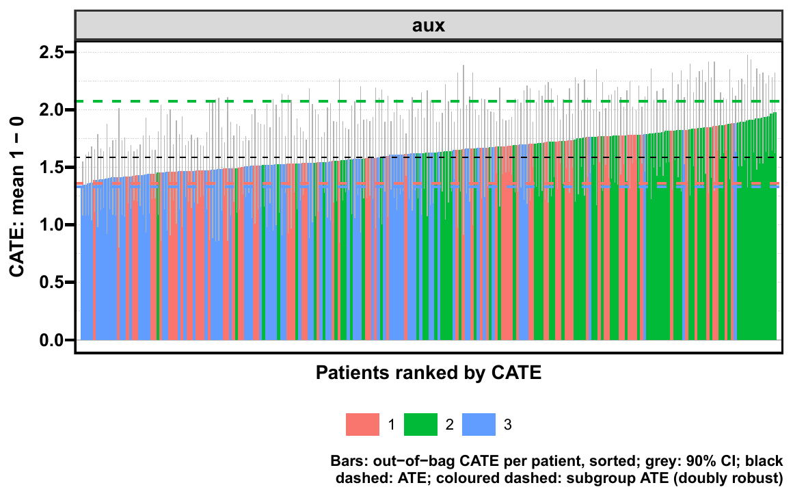
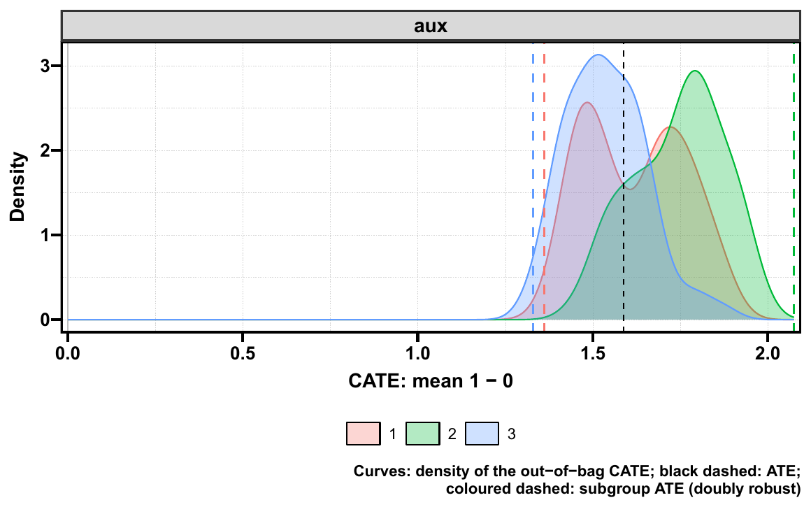
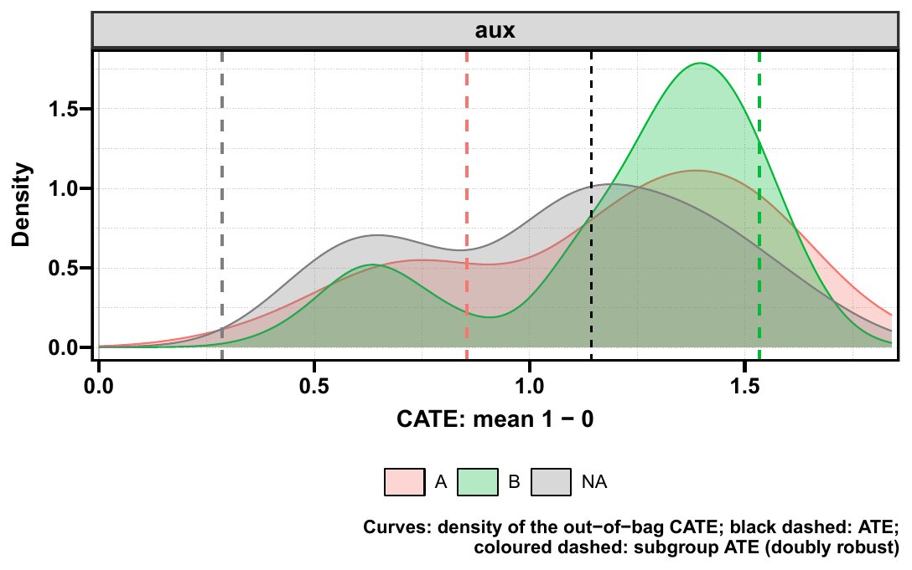
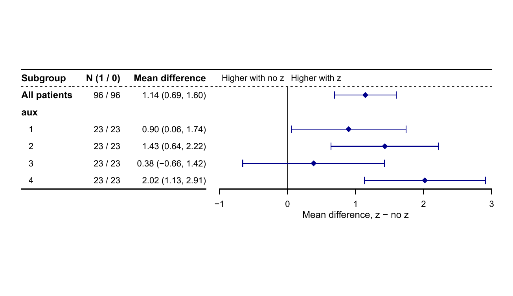
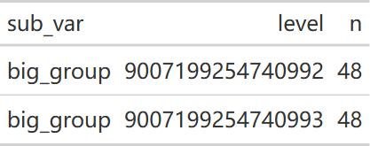

::: {.callout-note title="运行前核对树变量参数"}
2026-10-17 已核对 causalR 远端 `ceb2003`：select、unihtee、tree 和 icf 四个入口均已使用 `tree_var`。本站代码与已推送接口一致；旧安装若仍用 `candidate_var`，请按安装接口替换参数名或更新包。历史模型和图表保留原执行结果，详见 [发布状态](#release-20261016)。
:::

```{r}
#| label: setup-map
#| include: false
if (nzchar(Sys.getenv("CAUSALR_SOURCE"))) {
  pkgload::load_all(Sys.getenv("CAUSALR_SOURCE"), quiet = TRUE)
} else library(causalR)
library(ggplot2)
knitr::opts_chunk$set(collapse = TRUE, comment = "#>", message = FALSE)
```

causalR 把**分析设计、效应估计、异质性探索和敏感性分析**组织成相互衔接的工具。
本页先说明每个入口回答什么问题，再展示对象结构、重要参数和一套最短的计算—绘图流程。
重要参数在下表展示，算法详解可参照配套模块手册，函数默认值以本页实际执行的源码为准。

::: {.callout-note}
识别假设先于函数选择：一致性、条件可交换性、正性，以及生存分析需要的删失条件。
匹配或平衡改善是可观测协变量的诊断，不能证明未测量混杂已消除。
:::

## 2026-10-09：解释样本与随机数 {#sampling-update}

本次按 causalR 源码 `b8add77` 核对并重新执行本页。PDP / ALE 的解释患者由固定内部种子随机无放回抽样，随后按原行号排序；不是等间隔抽取。显式 `max_n = Inf` 使用全体，`max_n = NULL` 按成本模型选择人数，时间预算不是强制超时。

同一份输入与同一人数下，PDP 和 ALE 的默认解释样本一致，便于比较。抽样函数在退出时恢复调用者的随机数状态；调用前单独 `set.seed()` 不会改变其固定内部种子。若行顺序或人数改变，样本也可能改变，分类水平的覆盖必须以本次输出为准。

SHAP 使用其公开 `seed` 控制解释患者和背景患者的抽样，以及代理留出切分或联盟抽样，并在退出时恢复 RNG。代理 SHAP 与原森林的 Kernel SHAP 仍解释不同对象，不能因共用患者就把两者视为同一结果。

## 按研究问题选函数 {#sec-map-questions}

| 研究问题 | 入口 | 主要输出 | 下一步 |
|---|---|---|---|
| 倾向评分加权后，两组是否可比？ | `get_PSW()` | 多套权重、ESS、平衡诊断 | `plt_PSW()`，随后预先指定的结局模型 |
| 不同匹配算法保留了哪些患者？ | `get_PSM()` | 匹配权重、匹配组和诊断 | `plt_PSM()`，结合匹配结构估计效应 |
| 把匹配和加权方案放到同一张图？ | `get_bal()` | love plot、平衡表、可选基线表 | 在共同口径下比较设计 |
| 平均效应多大，效应随协变量如何变化？ | `get_hte()` | `hte_res` | `plt_hte_dep/sub/cate/rate()` |
| 森林效应随变量如何变化，相关变量怎样解释？ | `get_hte_pdp()`、`get_hte_ale()` | PDP / ALE 结果表 | [PDP](pdp-guide.qmd)、[ALE](ale-guide.qmd) 与自定义图形 |
| 哪些变量贡献了患者的预测治疗效应？ | `get_hte_shp()` | `shapviz` 与保真度记录 | [SHAP 方法与图形](shap-guide.qmd) |
| 候选修饰变量很多，如何先排序？ | `get_hte_select()` | 排序、固定顺序累加路径、选中变量 | 保留混杂变量，再作独立验证 |
| 哪个变量呈现单变量线性效应修饰？ | `get_hte_unihtee()` | TEM-VIP、区间、p 值与 BH 校正 | `plt_hte_unihtee()` |
| 从数据寻找可读的亚组规则？ | `get_hte_icf()`、`get_hte_tree()` | 规则与估计集上的效应 | 树图、亚组图和验证 |
| 换样本或种子，亚组树是否相似？ | `get_hte_tree_stability()` | 入选频率、切点、Jaccard、重复状态 | 报告重复性与失败比例 |
| 新患者落在哪条既有规则？ | `predict(hte_tree, newdata)` | 规则文字或叶子编号 | 原规则的外部应用与后续效应验证 |
| 未测量混杂多强会改变结论？ | `get_sens()` | 稳健值、翻转点或 E 值等 | `plt_sens()` |
| 已发表 RR/OR/HR 的 E-value 多大？ | `get_evalue()` | 比值、换算 RR 与点估计/区间 E-value | [E-value 指南](evalue-guide.qmd) |

```{mermaid}
flowchart TD
  Q[研究问题与目标人群] --> E[结局、时间点与效应尺度]
  E --> P[匹配或加权设计]
  P --> B[平衡、重叠与有效样本量]
  B --> O[选定设计后的结局模型]
  E --> H[get_hte：因果森林与双稳健效应]
  H --> D[依赖图、亚组图、CATE 分布、排序评估]
  H --> F[PDP、ALE、SHAP：解释完整森林的 CATE]
  E --> V[修饰变量筛选与规则发现]
  V --> S[独立估计、稳定性和验证]
  O --> U[未测量混杂敏感性分析]
  O --> EV[get_evalue：RR、OR、HR 的 E-value]
```

这里是多条分析路线的地图。PS 权重不需要机械地再套进所有森林；匹配后的人群、加权目标人群
与原始队列可能不同。混杂调整变量与候选修饰变量也不能混为同一个筛选集合。

## 配套模块手册 {#sec-map-manuals}

| 模块 | 教程 | 重点 |
|---|---|---|
| HTE 计算与绘图 | [第 1 页](https://hui950319.github.io/causalR/notes/causalR/01-hte.html) | 森林、效应尺度、四类图和排序诊断 |
| 高维变量初筛 | [第 2 页](https://hui950319.github.io/causalR/notes/causalR/02-hte-select.html) | 排序、累加路径和验证指标 |
| 倾向评分设计 | [第 3 页](https://hui950319.github.io/causalR/notes/causalR/03-ps.html) | PSM、PSW、平衡与设计后的效应估计 |
| 未测量混杂 | [第 4 页](https://hui950319.github.io/causalR/notes/causalR/04-sens.html) | LM、Cox、DML、IV 的不同框架 |
| iCF 规则发现 | [第 5 页](https://hui950319.github.io/causalR/notes/causalR/05-hte-icf.html) | 变量筛选、投票、深度选择与估计集 |
| 单变量效应修饰 | [第 6 页](https://hui950319.github.io/causalR/notes/causalR/06-hte-unihtee.html) | TEM-VIP、森林与 GLM 路线 |
| 亚组树 | [第 7 页](https://hui950319.github.io/causalR/notes/causalR/07-hte-tree.html) | 17 个 method、诚实估计与树图 |

## 输入与返回对象的衔接 {#sec-map-objects}

| 对象 | 核心字段 | 可交给的绘图接口 |
|---|---|---|
| `hte_res` | `stats`、`subgroup`、`importance`、`calibration`、`data`、`fit` | `plt_hte_dep/sub/cate/rate()` |
| PDP / ALE tibble | `variable/value/level`、`estimate` 或 `ale/n`；`analysis` 记录解释样本与预算 | `ggplot2`；PDP 与现有依赖图共用引擎 |
| `shapviz` | `S`、`X`、`baseline`；`analysis` 标明方法、人数和代理 R² | `shapviz::sv_*()` 或兼容的 MLR 图；本入口不自动计算交互矩阵 |
| `hte_icf` | `rules`、`cv`、`vote`、`importance`、`est`、`tree` | `plt_hte_icf()`；`est` 可交给 HTE 图 |
| `hte_tree` | `rules`、`nodes`、`est`、`tree`；拟合上下文在 `attr(x,"analysis")` | `plt_hte_tree()`；`est` 可交给亚组图 |
| `get_hte_select()` 的 list | `ranking`、`forward`、`selected` 与组合图等 | 直接使用结果自带的图；不是 `hte_res` |
| unihtee 结果 list | `vip/data/analysis`；grf另返回`hte`，glm为NULL | `plt_hte_unihtee()`；`hte`可交给亚组图 |
| `psm_res` / `psw_res` | 设计结果、权重、诊断和分析信息 | `plt_PSM()` / `plt_PSW()` |
| `sens_res` | `stats`、`bounds`、`fit`、`sens` 及分析属性 | `plt_sens()` |
| E-value tibble | 原比值、换算后的 RR、`evalue_point/evalue_ci` | 结果报告或自定义图；不是 `sens_res` |

保留完整对象及其分析属性。只保存 `rules` 表会丢失预测所需的训练编码；只保存效应表也无法
重画需要森林拟合的依赖图或重算排序诊断。对新样本的 `predict.hte_tree()` 不重新拟合森林，
也不自动估计新样本的治疗效应。

## 重要参数：先明确统计问题，再调计算与显示 {#sec-map-parameters}

### HTE 主入口

| 参数 | 默认或常用值 | 改变什么 | 例子 |
|---|---|---|---|
| `cat_var` | 必填二分类暴露 | 治疗与对照方向；因子第二水平为治疗 | `cat_var="z"` |
| `adj_var` | `NULL`；实际分析应预先定义 | 森林条件化的协变量 | `c("age","marker","sex")` |
| `sub_var` | `NULL` | 预先定义的分类亚组；不在协变量中会自动加入 | `sub_var="sex"` |
| `surv` | `TRUE` | `time + DSS` 生存结局；列名表示连续或二分类结局 | `surv="y"` |
| `time` | `120` | 生存概率或 RMST 的时间范围，单位沿用数据 | `time=60` |
| `estimand` | `"ATE"` | 目标人群；非生存差值可用 ATT、ATC、ATO | `c("ATE","ATT")` |
| `measure` | `"diff"` | 差值、比值或 OR；受结局与目标人群约束 | `c("diff","ratio")` |
| `factor_encoding` | `"integer"` | 分类协变量的设计矩阵表示 | 无序多水平变量可研究 `"onehot"` |
| `grf_args` | `list()` | 森林设置及已知倾向评分等逐行输入 | `list(num.trees=500,seed=42,num.threads=2)` |

生存结局目前只支持 ATE；相对尺度只支持 ATE。`grf_args$target="RMST"` 改变目标结局，
不是显示开关。`surv=FALSE` 的竞争风险路径当前不支持。

### 筛选与规则发现

| 参数 | 适用入口 | 重点 |
|---|---|---|
| `tree_var` | select、unihtee、icf、tree | 候选修饰变量；icf、tree 只在这些变量上切分，unihtee、icf、tree 同时把它们并入调整变量；不取代预先定义的混杂调整变量 |
| `split_frac` | icf、tree | 发现与估计样本的分配；`1` 会复用样本，失去这种诚实划分 |
| `method` | tree | 决定切分引擎与切分尺度；`_dr/_cate/_r/_abs/_rel/_aft` 不等价 |
| `max_depth`、`min_leaf` | tree | 规则复杂度与最小叶子大小 |
| `alpha`、`tree_args` | tree | 检验门槛、引擎控制和条件约束，适用性依 method 而定 |
| `reuse` | tree | 兼容时复用森林；需要同一数据、森林与切分设置 |
| `n_rep`、`mode` | stability | 重复数与固定得分/完整重拟合的两种重复方案 |
| `rule_args` | icf | 投票森林数、树数、叶子限制与估计设置 |

这些入口使用的同名参数不保证有相同的允许值。例如 `method` 在 PSM 指匹配算法，在 PSW
指倾向评分模型，在敏感性分析指分析框架；先读对应函数，不能把同名参数原样跨模块转发。

### 计算一次，再控制显示

| 显示入口 | 高频参数 | 应重点看什么 |
|---|---|---|
| `plt_hte_dep()` | `x_var`、`type`、`display`、`dr_args`、`pdp_args` | 双稳健曲线与森林 CATE 的区别；网格和抽样设置在 `pdp_args` |
| `plt_hte_sub()` | `sub_var`、`measure`、`header_list`、`axis_args`、`ci_shape`、`fixed_size`、`row_height` | 亚组双稳健估计、区间和效应方向 |
| `plt_hte_cate()` | `sub_var`、`type` | 森林预测分布，不是逐人真效应的验证 |
| `plt_hte_rate()` | `priority`、`type`、`train_frac`、`max_n`、`gates_args` | 排序与评估的样本独立性 |
| `plt_hte_icf/tree()` | `type` | `effect/dr/box/bar/km` 的数据与尺度不同 |
| 各公开绘图入口 | `save=list()` | 构造最终图后保存 PDF；缺省不写文件 |

### 森林解释与独立比值敏感性：2026-10-06 更新

| 入口 | 重点参数 | 条件与解释 |
|---|---|---|
| [PDP](pdp-guide.qmd) | `x_var/grid_n/max_n/time_budget` | 分位数网格；加权平均完整森林 CATE |
| [ALE](ale-guide.qmd) | `x_var/n_bins/max_n/time_budget` | 局部变化与零中心；无序分类水平按相似性排序 |
| [SHAP](shap-guide.qmd) | `method/bg_n/surrogate_args/max_n/seed` | 默认新拟合 xgboost 代理；Kernel 直接解释森林；查看代理留出 R² |
| [E-value](evalue-guide.qmd) | `effect` 或 `est/lo/hi`、`measure/rare/conf_level` | RR/OR/HR；`conf_level` 仅数据拟合路线，`rare` 先按研究设计判断 |

三个森林解释入口默认 `max_n=NULL,time_budget=20`，成本模型选择解释人数；显式 `max_n`
后忽略预算。现有 `plt_hte_dep()` 的 `pdp_args` 仍默认 `grid_n=21,max_n=1000`，不接受
`time_budget`。调用相同引擎不意味着抽样默认值相同。

这些解释都使用森林的观察权重，包括 `sample.weights` 或等群集权重；SHAP 的默认绘图汇总
仍等权平均解释患者。解释的是模型效应差，不能把 SHAP、ALE 或 PDP 当成独立效应修饰检验。

## 最短工作流：一个对象、三种图 {#sec-map-example}

示例使用可公开的模拟数据。真实效应随 `marker` 改变，治疗分配受年龄和标志物影响。

```{r}
#| label: map-data
set.seed(20261002)
n <- 1000
d <- data.frame(age = rnorm(n, 60, 10), marker = runif(n),
                sex = factor(sample(c("Female", "Male"), n, TRUE)))
d$z <- rbinom(n, 1, plogis(-0.2 + 0.3 * d$marker + 0.02 * (d$age - 60)))
d$tau <- 0.5 + 2 * d$marker
d$y <- 0.04 * (d$age - 60) + d$marker + d$z * d$tau + rnorm(n)
head(d)
```

```{r}
#| label: map-fit
res <- get_hte(d, cat_var = "z", adj_var = c("age", "marker", "sex"),
               sub_var = "sex", surv = "y",
               grf_args = list(num.trees = 500, seed = 42, num.threads = 2))
names(res)
res$stats
res$subgroup
head(res$data[c("marker", ".cate", ".dr_score")])
```

::: {.panel-tabset}

### 双稳健依赖曲线 {.unnumbered}

```{r}
#| label: fig-map-dep
#| fig-alt: "标志物与效应的关系。纵轴是连续结局的均值差，治疗效应真值随 marker 增加。"
#| fig-width: 7
#| fig-height: 4.6
#| fig-cap: "标志物与效应的关系。纵轴是连续结局的均值差，治疗效应真值随 marker 增加。"
plt_hte_dep(res, x_var = "marker", display = "dr")
```

### 森林 CATE 曲线 {.unnumbered}

```{r}
#| label: fig-map-forest
#| fig-alt: "display=‘cate’ 仅展示森林预测与平滑线；它与双稳健效应曲线的估计对象不同。"
#| fig-width: 7
#| fig-height: 4.6
#| fig-cap: "display='cate' 仅展示森林预测与平滑线；它与双稳健效应曲线的估计对象不同。"
plt_hte_dep(res, x_var = "marker", display = "cate", cate_smooth = 0.7)
```

### 亚组森林图 {.unnumbered}

```{r}
#| label: fig-map-sub
#| fig-alt: "预先定义的性别亚组。点和区间来自双稳健效应估计；不能仅凭两组显著性不同断言交互。"
#| fig-width: 7
#| fig-height: 4
#| fig-cap: "预先定义的性别亚组。点和区间来自双稳健效应估计；不能仅凭两组显著性不同断言交互。"
plt_hte_sub(res, sub_var = "sex", fixed_size = FALSE)
```

### CATE 分布 {.unnumbered}

```{r}
#| label: fig-map-cate
#| fig-alt: "森林 CATE 的分布。它描述模型输出的离散程度，不能证明个体效应估计准确。"
#| fig-width: 7
#| fig-height: 4
#| fig-cap: "森林 CATE 的分布。它描述模型输出的离散程度，不能证明个体效应估计准确。"
plt_hte_cate(res, sub_var = "sex", type = "density")
```

### PDP 与双稳健投影 {.unnumbered}

```{r}
#| label: fig-map-pdp
#| fig-alt: "蓝色 PDP 使用完整森林 CATE 的患者平均，红色曲线使用双稳健投影。相同纵轴单位不使两种估计对象相同。"
#| fig-width: 7
#| fig-height: 4.6
#| fig-cap: "蓝色 PDP 使用完整森林 CATE 的患者平均，红色曲线使用双稳健投影。相同纵轴单位不使两种估计对象相同。"
plt_hte_dep(res, x_var = "marker", display = c("dr", "pdp"),
            pdp_args = list(grid_n = 7, max_n = 300))
```

### 二维 PDP 热图 {.unnumbered}

```{r}
#| label: fig-map-heat
#| fig-alt: "marker 与 age 的二维森林 PDP。9 个分位数点形成非等距网格，热图单元延伸到相邻点中间；颜色为平均预测治疗效应差。"
#| fig-width: 7
#| fig-height: 4.6
#| fig-cap: "marker 与 age 的二维森林 PDP。9 个分位数点形成非等距网格，热图单元延伸到相邻点中间；颜色为平均预测治疗效应差。"
plt_hte_dep(res, x_var = c("marker", "age"), type = "heat",
            pdp_args = list(grid_n = 9, max_n = 300))
```

:::

`plt_hte_dep()` 的 PDP 和热图自 2026-10-06 起改用分位数网格；并列分位数会合并。
在有权森林中，平均使用森林观察权重，和该对象的双稳健效应目标相衔接。
网格和样本数控制解释计算，不会产生新的置信区间。

保存示例不在站点渲染时执行，以免产生无需求的文件；本地使用时指定自己的文件名。

```{r}
#| eval: false
plt_hte_dep(res, x_var = "marker",
            save = list(filename = "hte_marker.pdf", width = 7, height = 4.6))
saveRDS(res, "hte_result.rds")
```

### CATE 缺失分组、空面板与点态区间（2026-10-28） {#cate-panels-20261028}

<!-- update-20261028: causal_cate -->

按 causalR `26af481`，`plt_hte_cate()` 在拟合后选取的分组列中也排除 SPSS 用户缺失；全空列会警告并略过，其他面板保留。若所有请求列都为空，则明确报错。瀑布图的点态置信区间画在柱层上方，避免区间下半部被不透明柱遮住，数值不变。

下面复用[输入例子](clinical-workflow-guide.qmd#input-contract-20261028)的 `input_hte28`，它含 238 行分析记录，无须重训。`aux` 是训练分组 `g` 的派生列，前八行作为缺失演示；`empty` 刻意设为全空。有效面板实际绘制 230 行，森林中的分析行与估计仍保留。

```r
cate_result28 <- input_hte28
cate_aux28 <- as.numeric(cate_result28[["data"]][["g"]])
cate_aux28[1:8] <- c(999, 95:99, NA, 999)
cate_result28[["data"]][["aux"]] <- haven::labelled_spss(cate_aux28,
  na_values = 999, na_range = c(95, 99))
cate_result28[["data"]][["empty"]] <- NA_real_
cate_waterfall28 <- plt_hte_cate(cate_result28, sub_var = c("empty", "aux"),
  show_ci = TRUE, conf_level = .9)
cate_density28 <- plt_hte_cate(cate_result28, sub_var = c("empty", "aux"), type = "density")
ggplot2::ggsave(file.path(tempdir(), "20261028-update-cate-intervals.pdf"), cate_waterfall28,
  width = 8, height = 5)
ggplot2::ggsave(file.path(tempdir(), "20261028-update-cate-missing-groups.pdf"), cate_density28,
  width = 8, height = 5)
```

::: {.panel-tabset}

#### 点态区间位于柱层上方 {.unnumbered}

{fig-alt="合成模型的 230 个 CATE 按预测值排序，灰色 90% 点态区间完整显示在柱层上方；分组缺失的八行未进入此面板。"}

[原生 PDF](images/index/20261028-update-cate-intervals.pdf)

#### 保留有效分组面板 {.unnumbered}

{fig-alt="aux 三个有效水平的森林 CATE 密度，SPSS 缺失值排除，全空 empty 列省略；虚线为同一拟合对象的总体或亚组效应。"}

[原生 PDF](images/index/20261028-update-cate-missing-groups.pdf)

:::

::: {.callout-note collapse="true" title="复核代码"}

```r
cate_layer28 <- function(p, geom) Filter(function(layer)
  inherits(layer[["geom"]], geom), p[["layers"]])[[1]][["data"]]
cate_bar28 <- cate_layer28(cate_waterfall28, "GeomCol")
cate_ci28 <- cate_layer28(cate_waterfall28, "GeomLinerange")
cate_density_data28 <- cate_layer28(cate_density28, "GeomDensity")
cate_order28 <- order(cate_result28[["data"]][[".cate"]])
cate_keep28 <- !is.na(haven::zap_missing(cate_result28[["data"]][["aux"]]))
cate_order28 <- cate_order28[cate_keep28[cate_order28]]
cate_pred28 <- predict(cate_result28[["fit"]], estimate.variance = TRUE)
stopifnot(nrow(cate_bar28) == 230L, nrow(cate_density_data28) == 230L,
  isTRUE(all.equal(cate_ci28[["conf.high"]] - cate_ci28[["cate"]],
    qnorm(.95) * sqrt(as.numeric(cate_pred28[["variance.estimates"]]))[cate_order28])))
cate_geoms28 <- vapply(cate_waterfall28[["layers"]], function(layer) class(layer[["geom"]])[[1]], character(1))
stopifnot(which(cate_geoms28 == "GeomLinerange") > which(cate_geoms28 == "GeomCol"),
  identical(cate_result28[["data"]][["aux"]], haven::labelled_spss(cate_aux28,
    na_values = 999, na_range = c(95, 99))))
cate_error28 <- tryCatch(plt_hte_cate(cate_result28, sub_var = "empty"), error = conditionMessage)
stopifnot(is.character(cate_error28), grepl("No non-missing observations", cate_error28))
cate_restored28 <- unserialize(serialize(cate_waterfall28, NULL))
stopifnot(isTRUE(all.equal(ggplot2::ggplot_build(cate_restored28)[["data"]],
  ggplot2::ggplot_build(cate_waterfall28)[["data"]])))
validation_values <- list(n_analysis = nrow(cate_result28[["data"]]), n_panel = nrow(cate_bar28),
  intervals = head(cate_ci28[["conf.high"]] - cate_ci28[["cate"]], 6),
  interval_layer_above_bars = TRUE, all_empty_rejected = TRUE, serialization_matches = TRUE)
```
:::

这些图显示森林估计的离散程度，不能证明逐人的真实治疗效应或独立临床亚型；点态区间也不是同时置信带。省略空分组列不等于删掉训练患者或重新定义目标人群。

当前 CATE 与 unihtee 绘图环境仅保留所需绘图数据，保存图不再连带持有完整分析对象和森林；图内仍有点、柱及分组数据，不能当作匿名化功能。本例核对了实际图层和序列化，没有新测内存减少倍数，Windows R 4.4.3 之外未执行此例。

<!-- /update-20261028: causal_cate -->

### 绘图分组：显式 NA 水平与 SPSS 缺失码（2026-10-28） {#subgroup-storage-20261028b}

<!-- update-20261028b: causal_subgroup_missing -->

`plt_hte_cate()` 和 `plt_hte_sub()` 规范化的是**已有拟合对象中用于绘图的分组列**，不会重拟合森林。普通 labelled 使用底层值；SPSS 的 `na_values` / `na_range` 先变为缺失，两种图按相同的实际人群分组。分组缺失不改变原森林及整体模型的人数。

factor 中“编码指向显式 NA 水平”与“编码本身是 NA”不同：前者是已定义的一组，后者不进入该分组面板。下面先用 192 行随机分配数据拟合，再添加仅用于绘图的辅助列；每个有效组都有两种治疗，避免把单臂分组误当成可估计的亚组。

```r
library(causalR)
set.seed(2823)
group_data28 <- data.frame(z = rep(0:1, 96), x = rnorm(192), v = rnorm(192))
group_data28[["y"]] <- group_data28[["x"]] + group_data28[["z"]] * (1 + group_data28[["v"]]) + rnorm(192)
group_result28 <- get_hte(group_data28, "z", adj_var = c("x", "v"), surv = "y",
  grf_args = list(num.trees = 100, num.threads = 1, seed = 28, W.hat = .5, Y.hat = 0))
group_codes28 <- rep(c(1L, 1L, 2L, 2L, 3L, 3L, NA_integer_, NA_integer_), 24)
group_result28[["data"]][["aux"]] <- structure(group_codes28, class = "factor", levels = c("A", "B", NA_character_))
group_cate28 <- plt_hte_cate(group_result28, sub_var = "aux", type = "density")
ggplot2::ggsave(file.path(tempdir(), "20261028b-update-subgroup-explicit-na.pdf"), group_cate28,
  width = 7.5, height = 4.7)
group_spss28 <- group_result28
group_values28 <- rep(c(1, 1, 2, 2, 3, 3, 4, 4), 24)
group_values28[1:8] <- c(999, 95:99, NA, 999)
group_spss28[["data"]][["aux"]] <- structure(group_values28,
  class = c("haven_labelled_spss", "haven_labelled"), na_values = 999, na_range = c(95, 99))
group_spss_forest28 <- plt_hte_sub(group_spss28, sub_var = "aux")
group_spss_cate28 <- plt_hte_cate(group_spss28, sub_var = "aux", type = "density")
ggplot2::ggsave(file.path(tempdir(), "20261028b-update-subgroup-spss.pdf"), group_spss_forest28,
  width = 9, height = 5.2)
```

::: {.panel-tabset}

#### 显式 NA 水平保留为组 {.unnumbered}

{fig-alt="192 行模型的 CATE 密度按 A、B、显式 NA 水平分组，各组 48 人；编码本身缺失的 48 行不进入此面板。"}

[原生 PDF](images/index/20261028b-update-subgroup-explicit-na.pdf)

#### SPSS 缺失码不成为亚组 {.unnumbered}

{fig-alt="SPSS 用户缺失值 999、95至99 及真正 NA 不作为有效亚组，剩余四个数值组各 46 人，共 184 人；总体行仍对应原 192 行森林。"}

[原生 PDF](images/index/20261028b-update-subgroup-spss.pdf)

:::

上述“显式 NA 水平保留为绘图组”不能推到 PSM / PSW 的完整行选择：后者会将显式 NA 水平还原为缺失，详见[设计输入约定](clinical-workflow-guide.qmd#stored-design-20261028b)。同名缺失情况在不同阶段的用途必须分开。

::: {.callout-note collapse="true" title="复核代码"}

```r
group_layer28 <- function(p, geom) {
  found <- Filter(function(layer) inherits(layer[["geom"]], geom) && is.data.frame(layer[["data"]]), p[["layers"]])
  found[[1]][["data"]]
}
group_pd28 <- group_layer28(group_cate28, "GeomDensity")
group_sub28 <- attr(group_cate28, "subgroup")
stopifnot(nrow(group_pd28) == 144L, identical(levels(group_pd28[["level"]]), c("A", "B", NA_character_)),
  identical(as.integer(table(group_pd28[["level"]])), c(48L, 48L, 48L)),
  identical(as.integer(group_sub28[["n"]]), c(48L, 48L, 48L)))
group_original28 <- serialize(group_spss28, NULL)
group_ref28 <- group_spss28
group_values28[1:8] <- NA_real_
group_ref28[["data"]][["aux"]] <- group_values28
group_ref_plot28 <- plt_hte_sub(group_ref28, sub_var = "aux")
stopifnot(identical(attr(group_spss_forest28, "subgroup"), attr(group_ref_plot28, "subgroup")),
  identical(attr(group_spss_cate28, "subgroup"), attr(group_spss_forest28, "subgroup")),
  sum(attr(group_spss_cate28, "subgroup")[["n"]]) == 184L,
  identical(group_original28, serialize(group_spss28, NULL)))
group_bad28 <- group_result28
group_bad28[["data"]][["aux"]] <- cbind(group_codes28, group_codes28)
group_error28 <- tryCatch(plt_hte_cate(group_bad28, sub_var = "aux"), error = conditionMessage)
stopifnot(grepl("Unsupported subgroup column", group_error28, fixed = TRUE), grepl("aux", group_error28, fixed = TRUE))
validation_values <- list(input_n = nrow(group_result28[["data"]]), factor_codes_plotted = nrow(group_pd28),
  factor_groups = group_sub28, spss_groups = attr(group_spss_cate28, "subgroup"),
  spss_matches_plain = TRUE, object_unchanged = TRUE, unsupported_column = group_error28,
  source = "6760092c8020fb3814bdb274ebba7a03e0703470", R = R.version.string)
```
:::

多列矩阵、list、data.frame 或 S4 分组列会给出带列名的诊断；单列矩阵仍有兼容处理，不能把模型入口的向量要求原样套到所有绘图分组上。本例在 Windows R 4.4.3、causalR `6760092` 固定源码实跑，种子 2823 / 28，只新增上述两个图的运行；原有 CATE 和其他模型结果保留历史来源。

<!-- /update-20261028b: causal_subgroup_missing -->

### RDS 重开后仍按原始分组值绘图（2026-10-28） {#subgroup-rds-20261028b}

<!-- update-20261028b: causal_subgroup_rds -->

保存后的对象可能在未手动调用 `library(haven)` / `library(bit64)` 的新会话中打开。两种亚组图使用普通 labelled 的底层值；遇到 `integer64` 分组时加载 bit64 方法，避免把位存储当成普通 double 而合并组别。下面的两个大整数相差 1，**只用于拟合后的分组标签**，不作为森林协变量；模型输入仍受[精确 double 范围](clinical-workflow-guide.qmd#input-contract-20261028)约束。

```r
library(causalR)
set.seed(2824)
rds_data28 <- data.frame(z = rep(0:1, 72), x = rnorm(144), v = rnorm(144))
rds_data28[["y"]] <- rds_data28[["x"]] + rds_data28[["z"]] * (1 + rds_data28[["v"]]) + rnorm(144)
rds_result28 <- get_hte(rds_data28, "z", adj_var = c("x", "v"), surv = "y",
  grf_args = list(num.trees = 100, num.threads = 1, seed = 28, W.hat = .5, Y.hat = 0))
rds_labels28 <- rep(c("9007199254740992", "9007199254740992", "9007199254740993", "9007199254740993", NA, NA), 24)
rds_result28[["data"]][["big_group"]] <- bit64::as.integer64(rds_labels28)
rds_values28 <- rep(c(1, 1, 2, 2, NA, NaN), 24)
rds_values28[is.nan(rds_values28)] <- NA_real_
rds_result28[["data"]][["label_num"]] <- structure(rds_values28,
  labels = c(A = 1, B = 2), class = c("haven_labelled", "vctrs_vctr", "double"))
rds_result28[["data"]][["label_chr"]] <- structure(ifelse(is.na(rds_values28), NA_character_, as.character(rds_values28)),
  labels = c(A = "1", B = "2"), class = c("haven_labelled", "vctrs_vctr", "character"))
rds_path28 <- file.path(tempdir(), "hte-subgroup-storage.rds")
saveRDS(rds_result28, rds_path28)
```

复核用 callr 启动一个新的 R 会话，确认 bit64 尚未加载后读取 RDS。两个大整数仍是独立组，各 48 人，其余 48 个真正缺失的标签不进入分组。本环境的 UtilsR 通过 labelled 依赖加载了 haven，因此本次没有验证“haven 命名空间全程未加载”的场景；普通 labelled 的复核范围是两种图使用相同底层组值与人数。

本例另外将数值 `NaN` 显式归为 `NA`。当前绘图的类别转换可能保留名为 `"NaN"` 的水平，不能假定它会与真正 NA 自动合并；若研究字典把二者都定义为缺失，应在分组前按上面代码处理。这与有意义的文字分类 `"NaN"` 要分开。

::: {.callout-note collapse="true" title="复核代码"}

新会话加载与主进程相同的 UtilsR / RegR / causalR 固定源码，记录 haven 的依赖加载状态，检查 bit64 在绘图时按需加载。若在已安装包环境复现，则按安装位置加载同一版本。

```r
rds_sources28 <- vapply(c("UtilsR", "RegR", "causalR"), function(p)
  getNamespaceInfo(asNamespace(p), "path"), "")
rds_check28 <- callr::r(function(paths, object_path) {
  options(device = function(...) grDevices::pdf(NULL, ...), .RegR.view = FALSE)
  for (p in paths) {
    if (file.exists(file.path(p, "Meta", "package.rds")))
      library(basename(p), lib.loc = dirname(p), character.only = TRUE)
    else pkgload::load_all(p, quiet = TRUE, export_all = FALSE)
  }
  haven_at_start <- isNamespaceLoaded("haven")
  stopifnot(!isNamespaceLoaded("bit64"))
  x <- readRDS(object_path)
  original <- serialize(x, NULL)
  labelled <- lapply(c("plt_hte_cate", "plt_hte_sub"), function(fun) {
    p <- getExportedValue("causalR", fun)(x, sub_var = c("label_num", "label_chr"))
    if (inherits(p, "patchwork")) patchwork::patchworkGrob(p) else ggplot2::ggplotGrob(p)
    attr(p, "subgroup")
  })
  stopifnot(!isNamespaceLoaded("bit64"),
    identical(labelled[[1]], labelled[[2]]), identical(original, serialize(x, NULL)))
  big <- lapply(c("plt_hte_cate", "plt_hte_sub"), function(fun) {
    p <- getExportedValue("causalR", fun)(x, sub_var = "big_group")
    ggplot2::ggplotGrob(p)
    attr(p, "subgroup")
  })
  stopifnot(isNamespaceLoaded("bit64"), identical(big[[1]], big[[2]]),
    identical(original, serialize(x, NULL)))
  list(labelled = labelled[[1]], big = big[[1]], haven_namespace_at_start = haven_at_start,
    haven_loaded = isNamespaceLoaded("haven"),
    bit64_loaded = isNamespaceLoaded("bit64"), object_unchanged = TRUE)
}, args = list(paths = rds_sources28, object_path = rds_path28))
stopifnot(rds_check28[["bit64_loaded"]],
  identical(rds_check28[["big"]][["level"]], c("9007199254740992", "9007199254740993")),
  all(rds_check28[["big"]][["n"]] == 48),
  all(rds_check28[["labelled"]][["level"]] %in% c("1", "2")),
  all(rds_check28[["labelled"]][["n"]] == 48))
rds_counts28 <- rds_check28[["big"]][, c("sub_var", "level", "n")]
gt::gtsave(gt::gt(rds_counts28), file.path(tempdir(), "20261028b-update-subgroup-rds-groups.html"))
validation_values <- c(rds_check28, list(input_n = 144L, source = "6760092", R = R.version.string))
```
:::

{fig-alt="RDS 在未预加载 bit64 的新 R 会话打开后，9007199254740992 与 9007199254740993 两组仍分别为 48 人，没有因转 double 而合并。"}

[原生 HTML](images/index/20261028b-update-subgroup-rds-groups.html)

本例只用合成数据，在 Windows R 4.4.3、causalR `6760092` 固定源码执行；种子 2824 / 28。补充分组变量在这里是接口复核用标签，真实研究须满足函数对事后分组的调整与解释要求。

<!-- /update-20261028b: causal_subgroup_rds -->

## 本轮接口更新 {#api-current}

2026-10-28 追加比较 `9d26ba6..475d200` 的 26 次已推送提交，补充 [PSM / PSW 与敏感性存储](clinical-workflow-guide.qmd#stored-design-20261028b)、[平衡阈值与小表](clinical-workflow-guide.qmd#balance-policy-20261028b)、[特殊列名](method-selection-guide.qmd#special-names-20261028b)、[不可用校准](hte-diagnostics-guide.qmd#calibration-missing-20261028b)、[分组与 RDS](#subgroup-storage-20261028b)、[OOB 消费方](computation-reuse-guide.qmd#oob-consumers-20261028b)及[极端数值边界](hte-diagnostics-guide.qmd#extreme-units-20261028b)。12 组例子仅在 Windows R 4.4.3 独立执行；前九组用 `6760092`、收尾三组用 `475d200`，版本与 24 项导出数不变。详细执行范围见[功能模块图](function-modules.qmd#contracts-20261028b)。

同日较早按已推送 causalR `26af481`（24 项导出）补齐 [输入与缺失](clinical-workflow-guide.qmd#input-contract-20261028)、[正权重 HC3](hte-diagnostics-guide.qmd#positive-weights-20261028)、[生存支持](survival-estimands-guide.qmd#followup-support-20261028)、[unihtee 筛查](method-selection-guide.qmd#unihtee-contract-20261028)、[CATE 面板](#cate-panels-20261028)与[未缓存 OOB 复用](computation-reuse-guide.qmd#oob-reuse-20261028)。前六组新例使用 `26af481`；收尾另按 `9d26ba6` 追加 [整体类别 SMD](clinical-workflow-guide.qmd#singular-balance-20261028)与[有效曲线范围、聚类 HC3](hte-diagnostics-guide.qmd#spline-range-20261028)两组复核。八组例子仅在 Windows R 4.4.3 执行；原有模型、图和性能记录继续保留原快照。

2026-10-15复核：已推送基线31e8e6d增加了unihtee返回的hte拟合与plt_hte_sub(row_height=...)。对应 [结果复用](computation-reuse-guide.qmd#unihtee-reuse-current) 和 [紧凑亚组森林](clinical-workflow-guide.qmd#row-height-current) 已在Windows R实跑。2026-10-16复核，远端f3f7ecc已包含右角树边、结点及叶子配色；见 [当前树图](tree-stability-guide.qmd#tree-style-current) 和 [iCF视图](icf-plot-guide.qmd#icf-style-current)。旧版内存对象需要重新计算才有新增字段。

## 当前实现与扩展边界 {#sec-map-boundary}

包名和 DESCRIPTION 包含目标试验模拟的定位，但当前这套公开入口集中在 PS 设计、HTE
与敏感性分析。克隆—删失—加权、纵向 g-formula 等材料属于方法学习与实践，不能据此假定
存在同名的一站式公共函数。

探索发现、效应估计、重复稳定性、排序表现和决策价值分别报告。新发现的亚组要在未参与发现的
数据上估计或验证；分裂频率、SHAP 或稳定性都不能单独建立因果解释。

## 环境与接口速查 {#sec-map-session}

```{r}
packageVersion("causalR")
packageVersion("grf")
args(get_hte)
args(get_hte_tree)
args(get_hte_tree_stability)
args(get_hte_pdp)
args(get_hte_ale)
args(get_hte_shp)
args(get_evalue)
sessionInfo()
```


## 发布状态与树变量名称 {#release-20261016}

2026-10-16核对：树图样式及绘图环境整理已推送到causalR `f3f7ecc`。仅保存plt_hte_tree/plt_hte_icf的图对象时，绘图环境不再连带保存整个拟合；图仍含绘图所需数据，这不是匿名化功能。既有图片和数值保留各自执行日期，本轮没有重跑历史分析。

2026-10-17 核对的远端 `ceb2003` 已包含 `e389a75` 与 `f505185` 的改名，四个入口均使用 `tree_var`，不再是仅本机可用的接口。本站 `72d6139` 与 `b0f67c1` 的代码拼写已与之统一。当前源码已在 Windows R 4.4.3 核对四个签名，并实际执行 `get_hte_unihtee(method="glm", tree_var=...)`。旧安装可用 `names(formals(causalR::get_hte_tree))` 等检查；`candidate_var` 与 `tree_var` 应按安装接口选择，不同时传入。历史模型、表格与图片保持原执行快照，本轮没有重算历史森林。2026-10-18 已用 Windows R 4.4.3 与 causalR `e4b86c6` 重新执行本页全部代码块，结果缓存在 `_freeze/`。

## 2026-10-18 亚组森林接口 {#subgroup-20261018}

按已推送`e4b86c66`更新：`plt_hte_sub()`把轴设置集中到`axis_args`，列头用`header_list`，概率差默认显示为百分点。`axis_args$xlim/xticks`仍使用原始比例；`header_list$effect`可用换行明确写出区间水平。总体汇总菱形只是样式，不把同队列亚组变成独立研究。

[完整模拟代码及实图](clinical-workflow-guide.qmd#subgroup-20261018)覆盖百分点/原始比例、方向标签、多行表头、`ci_shape`和图内平衡图例。`get_bal()`与`plt_hte_unihtee()`的`var_names`默认已改为`character()`，可用时合并RegR映射，NULL则保留原列名。


## 更新记录 {#page-updates}

::: {.callout-note collapse="true" title="更新记录"}
- 2026-10-28：补充 [RDS 新会话的 labelled / integer64 分组](#subgroup-rds-20261028b)，验证底层值、精确大整数与原对象不变。
- 2026-10-28：增加 [绘图分组的存储与缺失边界](#subgroup-storage-20261028b)，核对 192 行森林中的 144 / 184 行有效绘图人群。
- 2026-10-28：补充 [CATE 面板与点态区间](#cate-panels-20261028)，复用 238 行拟合并核对 230 行有效面板。
:::
