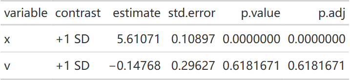
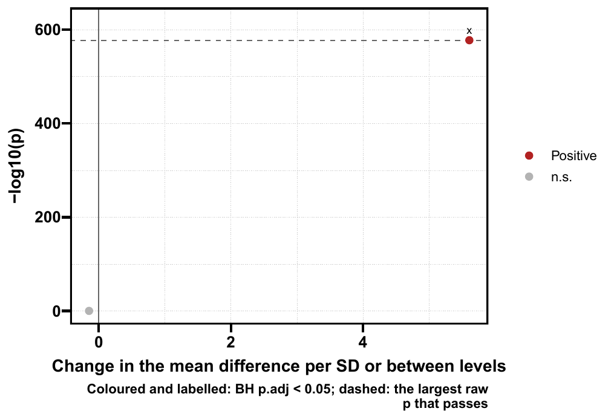
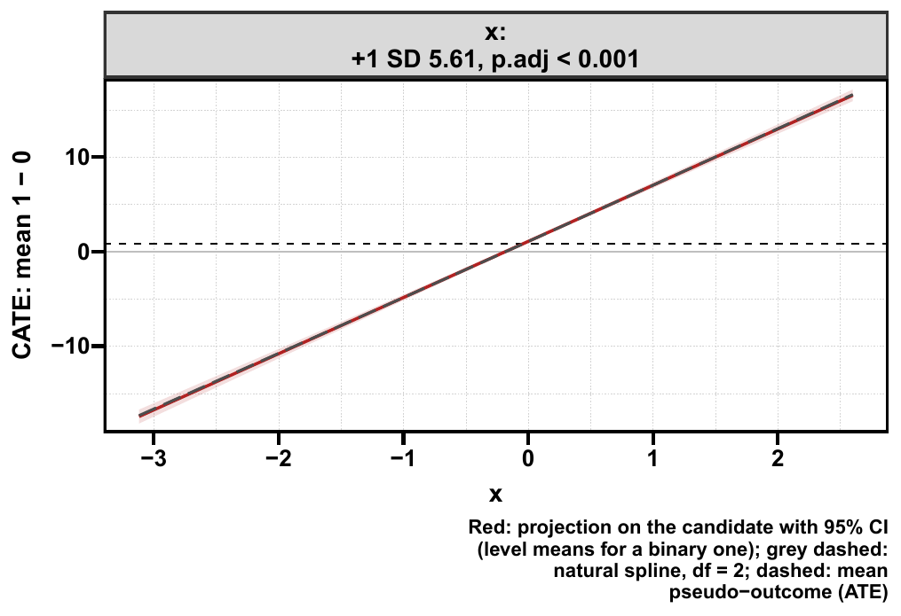
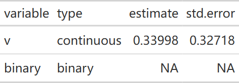
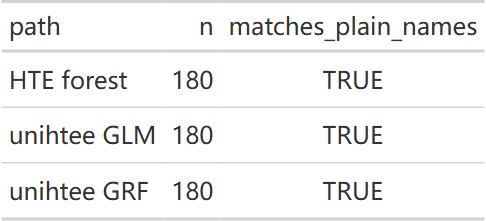

::: {.callout-note title="运行前核对树变量参数"}
2026-10-17 已核对 causalR 远端 `ceb2003`：select、unihtee、tree 和 icf 四个入口均已使用 `tree_var`。本站代码与已推送接口一致；旧安装若仍用 `candidate_var`，请按安装接口替换参数名或更新包。历史模型和图表保留原执行结果，详见 [发布状态](#release-20261016)。
:::

```{r}
#| label: setup-methods
#| include: false
if (nzchar(Sys.getenv("CAUSALR_SOURCE"))) {
  pkgload::load_all(Sys.getenv("CAUSALR_SOURCE"), quiet = TRUE)
} else library(causalR)
library(ggplot2)
knitr::opts_chunk$set(collapse = TRUE, comment = "#>", message = FALSE)
```

四条路线回答不同的问题。先选需要的输出，再选方法；不能把不同单位的得分放在一起选“赢家”。
图形沿用 [SHAP 参数页](../mlr/shap-guide.qmd) 的标签页与点击放大方式。

## 按问题选择入口 {#sec-methods-map}

| 问题 | 入口 | 输出 | 解释边界 |
|---|---|---|---|
| 哪些变量进入获益评分？ | `get_hte_select()` | 固定排序、累积模型指标、所选变量 | `selected` 不是显著修饰变量清单 |
| 哪个变量有线性效应修饰信号？ | `get_hte_unihtee()` | TEM-VIP、区间、BH p 值 | 单变量边际投影，可能遗漏 U 形 |
| 多次森林倾向哪组简单规则？ | `get_hte_icf()` | 投票、CV、胜出规则与叶子效应 | 投票一致不等于因果有效 |
| 需要哪种分裂统计量或模型？ | `get_hte_tree()` | 不同引擎的规则树和叶子效应 | 发现统计量与估计效应可能不同尺度 |

`get_hte()` 则输出森林 CATE 和预设亚组效应；它不要求必须生成离散规则。
先确定治疗对照、结局方向、调整集合、目标人群与估计尺度，再考虑筛选。

## 同一份数据，既有线性也有 U 形修饰 {#sec-methods-data}

```{r}
#| label: methods-data
set.seed(20261002)
n <- 1800
d <- data.frame(b = rbinom(n, 1, 0.5), x = rnorm(n), u = rnorm(n), noise = rnorm(n))
d$ps <- plogis(0.3 * d$x - 0.2 * d$b)
d$z <- rbinom(n, 1, d$ps)
d$true_tau <- 1 + 4 * d$b + 0.5 * d$x + 1.2 * (d$u^2 - 1)
d$y <- d$x + d$z * d$true_tau + rnorm(n)
vars <- c("b", "x", "u", "noise")
forest_args <- list(num.trees = 500, num.threads = 2, seed = 123)
```

`ps` 和 `true_tau` 来自模拟机制。实际研究没有已知 PS 或个体真效应。
本页各路线独立运行，患者划分及 nuisance 拟合不同；这是接口演示，不是方法性能竞赛。

## select：排序与选多少变量是两个参数 {#sec-methods-select}

| 参数 | 默认 | 用途 |
|---|---|---|
| `tree_var` | 必填 | 数值或二分类候选；并列排序保留输入顺序 |
| `ps_var` / `match_var` | 均 `NULL` | 必须二选一：已计算 PS 列，或每对恰有一治一控的 1:1 配对列 |
| `imp_metric` | `"score_sd"` | 决定单变量的固定顺序 |
| `sel_metric` | `NULL` | 决定累积模型停在哪一步；默认不自动选择 |
| `n_select` | `NULL` | 手动指定个数，覆盖自动所选大小；`sel_metric` 的最优步仍记录 |
| `fit_args$nfolds` | `10L` | LASSO 内部 CV；至少 3 折，配对路径以配对数为上限 |
| `fit_args$standardize` | `TRUE` | 后端惩罚拟合标准化，不改变原列 |
| `eval_args$train_frac` | `0.5` | 验证指标启用后，训练样本占比 |
| `eval_args$adjust_var` | `NULL` | 评估森林的调整列，默认候选集合；还需包含实际混杂变量 |
| `eval_args$num.trees` | `2000L` | 评估森林树数；本页减为 500 便于演示 |
| `eval_args$target` / `$time` | `"RMST"` / `NULL` | 生存评估的目标与截点；连续结局不用 |
| `seed` | `123L` | 控制 CV、验证切分和拟合 |

可选指标包括 `score_sd`、`score_iqr`、`score_mean_abs`、`score_median`、`score_mean`、
`autoc`、`qini`、`r_loss`、`dr_loss`。损失越小越好，其他指标越大越好。
得分的幅度或均值不是预测准确度；四个验证指标会启用 `eval_args`。
R/DR 损失只支持连续结局。小正 AUTOC 通过零基线也不是显著性检验。

```{r}
#| label: methods-select
sel_manual <- get_hte_select(d, "z", vars, surv = "y", ps_var = "ps",
                             n_select = 2, fit_args = list(nfolds = 3L), seed = 123)
sel_eval <- get_hte_select(d, "z", vars, surv = "y", ps_var = "ps",
                           imp_metric = "score_iqr", sel_metric = "autoc",
                           fit_args = list(nfolds = 3L),
                           eval_args = list(adjust_var = vars, num.trees = 500L), seed = 123)
sel_manual$ranking
sel_manual$selected
sel_eval$forward
sel_eval$selected
```

::: {.panel-tabset}

### 手动选 2 个 {.unnumbered}

```{r}
#| label: fig-methods-select-manual
#| fig-alt: "单变量得分 SD 固定顺序；上轴是累积模型的有符号均值。均值最大处不是验证最优处。"
#| fig-width: 9
#| fig-height: 4.5
#| fig-cap: "单变量得分 SD 固定顺序；上轴是累积模型的有符号均值。均值最大处不是验证最优处。"
sel_manual$plots$combined
```

### 用验证 AUTOC 选大小 {.unnumbered}

```{r}
#| label: fig-methods-select-eval
#| fig-alt: "IQR 决定顺序，AUTOC 决定大小。验证半参与了调参，报告最终性能仍需要独立测试。"
#| fig-width: 9
#| fig-height: 4.5
#| fig-cap: "IQR 决定顺序，AUTOC 决定大小。验证半参与了调参，报告最终性能仍需要独立测试。"
sel_eval$plots$combined
```

:::

前向过程只拟合固定排序的每个前缀，不搜索全部变量组合。此对象没有可直接交给
`plt_hte_sub()` 的森林、患者 CATE 或最终评分模型；返回结构应按 `ranking/forward/selected/plots/analysis` 读取。

## unihtee：有区间的边际线性投影 {#sec-methods-uni}

| 参数 | 默认 | 用途与条件 |
|---|---|---|
| `tree_var` | `NULL` | 默认所有调整列；候选只支持连续或二分类，多水平分类需另选方法 |
| `adj_var` | `NULL` | nuisance 调整实际使用调整列与候选列的并集 |
| `method` | `"grf"` | OOB 森林得分；`"glm"` 为交叉拟合 PS 和分臂结局 GLM，仅非生存 |
| `measure` | `"diff"` | 可多选 `diff/ratio/OR`；ratio/OR 的 VIP 是对数尺度斜率再指数化 |
| `glm_args` | `list()` | `folds=5`、`ps_trim=0.01`；PS 截断是稳定性处理，不能修复重叠不足 |
| `conf_level` / `seed` | `0.95` / `123` | Wald 区间与随机过程 |
| 绘图 `type` | `"bar"` | `bar/volcano/dep` |
| 绘图 `x_var/measure` | `NULL/NULL` | 指定变量与一份效应尺度 |
| 绘图 `sig_level` | `0.05` | 按 `p.adj` 着色，不能改成未说明的原始 p 值 |
| 绘图 `dr_args` | `list(spline_df=2,bins=0)` | 依赖图的样条自由度与分位数组均值得分；只影响 `dep` |
| 绘图 `axis_arg` | `list(share_y="all")` | `"none"` 各面板单独范围，比较时注意坐标变化 |
| 绘图 `var_names/title/save` | 名称映射 / `NULL` / `list()` | 显示名称、标题、PDF 保存 |

```{r}
#| label: methods-uni
uni <- get_hte_unihtee(d, "z", tree_var = vars, adj_var = vars, surv = "y",
                       method = "grf", grf_args = forest_args)
uni$vip
uni_glm <- get_hte_unihtee(d, "z", tree_var = vars, adj_var = vars, surv = "y",
                           method = "glm", glm_args = list(folds = 3), seed = 123)
uni_glm$vip
```

连续变量报告每 1 SD 的斜率；二分类报告第二水平减第一水平。
相关变量可以拥有自己的边际信号，不能按 p 值把它解释成独立贡献。
`u` 的真效应呈对称 U 形，其线性 VIP 接近零仍可能有强修饰。

::: {.panel-tabset}

### VIP 与区间 {.unnumbered}

```{r}
#| label: fig-methods-uni-bar
#| fig-alt: "颜色按 BH 调整 p 值。变量的 SD 单位与二分类对比单位分别报告。"
#| fig-width: 7
#| fig-height: 4.5
#| fig-cap: "颜色按 BH 调整 p 值。变量的 SD 单位与二分类对比单位分别报告。"
plt_hte_unihtee(uni, type = "bar", var_names = NULL)
```

### 直线、样条与分箱 {.unnumbered}

```{r}
#| label: fig-methods-uni-dep
#| fig-alt: "直线对应表中的线性 VIP；样条和分箱显示线性投影可能遗漏的 U 形。"
#| fig-width: 11
#| fig-height: 4.5
#| fig-cap: "直线对应表中的线性 VIP；样条和分箱显示线性投影可能遗漏的 U 形。"
plt_hte_unihtee(uni, type = "dep", x_var = c("b", "x", "u"), var_names = NULL,
                dr_args = list(spline_df = 3, bins = 6), axis_arg = list(share_y = "none"))
```

:::

### unihtee 输入、投影与交叉拟合诊断（2026-10-28） {#unihtee-contract-20261028}

<!-- update-20261028: causal_unihtee -->

causalR `26af481` 的 `get_hte_unihtee()` 先规范化 Haven 标签和用户缺失，检查保留列、分析列存储及后端参数。`method="glm"` 只接受非生存结局，不能同时传非空 `grf_args`；森林路径也不接收非空 `glm_args`。GLM 每个训练折须支持因子水平，二分类结局还须同时有事件与非事件。报错会指出折号和 propensity、treated/control outcome 角色，**不自动重抽折、不改用其他模型**；有限但不可估计的预测也会停止。

以下 400 行合成随机分配数据仅演示筛查合同，刻意设置强线性修饰，实际得到下溢至 0 的 Wald p 值。火山图用有限统计量恢复 log 概率坐标，表中的原始 p 值与 BH 调整值保持不变；0 是浮点下溢，不是数学上严格为零的概率。

```r
library(causalR)
set.seed(1027)
uni_data28 <- data.frame(a = rep(0:1, 200), x = rnorm(400), v = runif(400))
set.seed(11)
uni_data28[["y"]] <- uni_data28[["a"]] * (1 + 6 * uni_data28[["x"]]) + rnorm(400)
uni_rng_before28 <- get(".Random.seed", envir = .GlobalEnv)
uni_result28 <- get_hte_unihtee(uni_data28, "a", tree_var = c("x", "v"), surv = "y", method = "glm")
uni_rng_after28 <- get(".Random.seed", envir = .GlobalEnv)
uni_vip28 <- uni_result28[["vip"]]
uni_table28 <- as.data.frame(uni_vip28[, c("variable", "contrast", "estimate", "std.error", "p.value", "p.adj")])
gt::gtsave(gt::fmt_number(gt::gt(uni_table28), columns = c("estimate", "std.error"), decimals = 5),
  file.path(tempdir(), "20261028-update-unihtee-vip.html"))
uni_volcano28 <- plt_hte_unihtee(uni_result28, type = "volcano")
uni_dep28 <- plt_hte_unihtee(uni_result28, type = "dep", x_var = "x")
ggplot2::ggsave(file.path(tempdir(), "20261028-update-unihtee-volcano.pdf"), uni_volcano28,
  width = 7, height = 4.8)
ggplot2::ggsave(file.path(tempdir(), "20261028-update-unihtee-dependence.pdf"), uni_dep28,
  width = 7, height = 4.8)
```

::: {.panel-tabset}

#### VIP 与原始 p 值 {.unnumbered}

{fig-alt="400 行合成数据的 x、v 边际线性 VIP 与 HC3 标准误，强修饰 x 的 p 值下溢至零，BH 校正在同一效应尺度的两个候选中进行。"}

[原生 HTML](images/method-selection-guide/20261028-update-unihtee-vip.html)

#### 有限的火山图坐标 {.unnumbered}

{fig-alt="实际火山图保留两个候选，x 的极小 p 值从有限 Wald 统计量恢复为有限高度，BH 标记与原表一致。"}

[原生 PDF](images/method-selection-guide/20261028-update-unihtee-volcano.pdf)

#### 原始横轴上的投影 {.unnumbered}

{fig-alt="同一 AIPW 得分的边际线性投影与样条对照，横轴仍为原始 x；直线斜率按原单位显示，VIP 表按每标准差报告。"}

[原生 PDF](images/method-selection-guide/20261028-update-unihtee-dependence.pdf)

:::

连续候选在投影内部中心化并标准化，以减少大偏移或单位引起的秩和 HC3 数值问题，报告仍是每 SD 的边际修饰。此处理不替代 nuisance 模型的可估计性检查。二分类候选保留水平信息，连续候选的 `candidate_levels` 为 NULL，避免复制所有唯一数值。

另一个 200 行例子只有第一个聚类含 `binary` 的变化：删除该聚类后无法估计其斜率，HC3 不可定义，故仅该候选不可用。不能为了得到 p 值而擅自换方差公式。

```r
set.seed(21)
uni_cl28 <- rep(seq_len(5), each = 40)
uni_cluster_data28 <- data.frame(a = rep(0:1, 100), binary = as.integer(uni_cl28 == 1), v = rnorm(200))
uni_cluster_data28[["y"]] <- uni_cluster_data28[["v"]] + uni_cluster_data28[["a"]] + rnorm(200)
uni_cluster28 <- get_hte_unihtee(uni_cluster_data28, "a", tree_var = c("binary", "v"), surv = "y",
  seed = 123, grf_args = list(num.trees = 100, num.threads = 1, seed = 28,
    clusters = uni_cl28, W.hat = .5, Y.hat = 0))
uni_cluster_table28 <- as.data.frame(uni_cluster28[["vip"]][, c("variable", "type", "estimate", "std.error")])
gt::gtsave(gt::fmt_number(gt::gt(uni_cluster_table28), columns = c("estimate", "std.error"), decimals = 5),
  file.path(tempdir(), "20261028-update-unihtee-cluster-support.html"))
```

{fig-alt="五个聚类共 200 行，binary 的变异只来自一个聚类，因此其估计和标准误为 NA，连续候选 v 保持有限结果。"}

[原生 HTML](images/method-selection-guide/20261028-update-unihtee-cluster-support.html)

::: {.callout-note collapse="true" title="复核代码"}

```r
stopifnot(identical(uni_rng_before28, uni_rng_after28), any(uni_vip28[["p.value"]] == 0),
  identical(uni_vip28, uni_result28[["vip"]]), is.null(attr(uni_result28, "analysis")[["candidate_levels"]][["x"]]),
  attr(uni_cluster28, "analysis")[["seed"]] == 28)
uni_manual_data28 <- uni_result28[["data"]]
uni_manual_data28[["standard_x"]] <- as.numeric(scale(uni_manual_data28[["x"]]))
uni_manual28 <- lm(.score_diff ~ standard_x, data = uni_manual_data28)
uni_cov28 <- sandwich::vcovHC(uni_manual28, type = "HC3")
uni_x28 <- uni_vip28[uni_vip28[["variable"]] == "x", ]
stopifnot(abs(coef(uni_manual28)[[2]] - uni_x28[["estimate"]]) < 1e-8,
  abs(sqrt(uni_cov28[2, 2]) - uni_x28[["std.error"]]) < 1e-8)
uni_point28 <- Filter(function(layer) inherits(layer[["geom"]], "GeomPoint"), uni_volcano28[["layers"]])[[1]][["data"]]
uni_expected28 <- -(log(2) + pnorm(-abs(uni_vip28[["estimate"]] / uni_vip28[["std.error"]]), log.p = TRUE)) / log(10)
stopifnot(all(is.finite(uni_point28[["neglog10p"]])),
  isTRUE(all.equal(uni_point28[["neglog10p"]], uni_expected28)))
uni_v28 <- uni_cluster28[["vip"]]
stopifnot(is.na(uni_v28[["estimate"]][uni_v28[["variable"]] == "binary"]),
  is.finite(uni_v28[["std.error"]][uni_v28[["variable"]] == "v"]))
uni_rare28 <- uni_data28; uni_rare28[["rare"]] <- factor(c("rare", rep("common", 399)))
uni_fold_error28 <- tryCatch(get_hte_unihtee(uni_rare28, "a", tree_var = "x", adj_var = "rare",
  surv = "y", method = "glm"), error = conditionMessage)
stopifnot(is.character(uni_fold_error28), grepl("Fold [0-9]+.*(propensity|outcome).*rare", uni_fold_error28))
uni_errors28 <- vapply(c("bar", "volcano", "dep"), function(type) {
  message <- tryCatch(plt_hte_unihtee(uni_result28, type = type, x_var = character()), error = conditionMessage)
  is.character(message) && grepl("at least one candidate", message)
}, logical(1))
uni_inactive28 <- tryCatch(get_hte_unihtee(uni_data28, "a", tree_var = "x", surv = "y",
  method = "glm", grf_args = list(seed = 1)), error = conditionMessage)
stopifnot(all(uni_errors28), is.character(uni_inactive28), grepl("only", uni_inactive28))
validation_values <- list(n = c(400L, 200L), vip = uni_vip28[["estimate"]], se = uni_vip28[["std.error"]],
  finite_volcano_y = uni_point28[["neglog10p"]], raw_underflow = any(uni_vip28[["p.value"]] == 0),
  seed = attr(uni_cluster28, "analysis")[["seed"]], cluster_unavailable = TRUE, empty_rejected = uni_errors28)
```
:::

对 ratio/OR，表中效应及区间指数化，标准误仍在 log 尺度。近边界臂预测、非有限伪结局及指数化的零或非有限界限会给出诊断；不会偷偷改变得分公式或截断默认值。`ps_trim` 的截断计数会报告，仍不能修复因果重叠不足。

本节在 Windows R 4.4.3 运行。森林种子以 `grf_args$seed` 的实际设置为准，上例记录 28；GLM 交叉拟合恢复调用者随机状态。空 `x_var` 会在构图前拒绝，避免生成不能打印或保存的空图。

追加到已推送 `9d26ba6` 后，共享样条曲线只覆盖实际拟合行，零权重极端值不再拉长灰色曲线；聚类 HC3 使用等价的低秩计算。原有本节图保留 `26af481` 快照，新版范围与独立协方差对照见 [240 行实跑](hte-diagnostics-guide.qmd#spline-range-20261028)。

<!-- /update-20261028: causal_unihtee -->

### 特殊列名与拟合前的边界检查（2026-10-28） {#special-names-20261028b}

<!-- update-20261028b: causal_special_names -->

`get_hte()` 及 `get_hte_unihtee()` 会在公式求值前临时处理 `.`、`...`、`..1` 这类特殊列名，结果数据和候选变量仍使用原名。它解决的是公式将列名解释成特殊语法的问题；不会放宽重复列名、保留输出名或折内类别支持要求。

下面用 180 行随机分配的连续结局数据，将两个数值列和一个 factor 分别命名为 `.`、`...`、`..1`。同一随机种子下，对照普通名称版本的森林、GLM 交叉拟合和森林版 unihtee，核对模型数值、分类编码及输出列名。100 棵树用于接口复核，不是正式分析的精度建议。

```r
library(causalR)
set.seed(2821)
name_data28 <- data.frame(z = rep(0:1, 90), x = rnorm(180), v = rnorm(180),
  f = factor(rep(c("A", "A", "B", "B"), 45)))
name_data28[["y"]] <- name_data28[["x"]] + .5 * (name_data28[["f"]] == "B") +
  name_data28[["z"]] * (1 + name_data28[["v"]]) + rnorm(180)
name_special28 <- name_data28
names(name_special28)[2:4] <- c(".", "...", "..1")
name_args28 <- list(num.trees = 100, num.threads = 1, seed = 28, W.hat = .5, Y.hat = 0)
name_forest28 <- get_hte(name_special28, "z", adj_var = c(".", "...", "..1"), surv = "y",
  grf_args = name_args28)
name_glm28 <- get_hte_unihtee(name_special28, "z", tree_var = c(".", "..."), adj_var = "..1",
  surv = "y", method = "glm", seed = 28)
name_uni28 <- get_hte_unihtee(name_special28, "z", tree_var = c(".", "..."), adj_var = "..1",
  surv = "y", method = "grf", seed = 28, grf_args = name_args28)
```

两条入口都要求暴露列与结局列分开。森林还要求每个暴露组至少有 **两条正权重且暴露、结局完整的记录**；原始人数足够、但权重为零或结局缺失，仍可能达不到要求。这个检查只保证基本输入支持，不代表两条记录足以获得可靠推断。

::: {.callout-note collapse="true" title="复核代码"}

```r
name_ref_forest28 <- get_hte(name_data28, "z", adj_var = c("x", "v", "f"), surv = "y",
  grf_args = name_args28)
name_ref_glm28 <- get_hte_unihtee(name_data28, "z", tree_var = c("x", "v"), adj_var = "f",
  surv = "y", method = "glm", seed = 28)
name_ref_uni28 <- get_hte_unihtee(name_data28, "z", tree_var = c("x", "v"), adj_var = "f",
  surv = "y", method = "grf", seed = 28, grf_args = name_args28)
name_vip_equal28 <- function(a, b) isTRUE(all.equal(a[["vip"]][setdiff(names(a[["vip"]]), "variable")],
  b[["vip"]][setdiff(names(b[["vip"]]), "variable")], tolerance = 1e-12))
name_checks28 <- c(isTRUE(all.equal(name_forest28[["stats"]], name_ref_forest28[["stats"]], tolerance = 1e-12)),
  name_vip_equal28(name_glm28, name_ref_glm28), name_vip_equal28(name_uni28, name_ref_uni28))
stopifnot(all(name_checks28),
  identical(as.numeric(name_forest28[["fit"]][["X.orig"]]), as.numeric(name_ref_forest28[["fit"]][["X.orig"]])),
  all(c(".", "...") %in% colnames(name_forest28[["fit"]][["X.orig"]])),
  any(startsWith(colnames(name_forest28[["fit"]][["X.orig"]]), "..1")),
  all(c(".", "...", "..1") %in% names(name_forest28[["data"]])),
  setequal(name_glm28[["vip"]][["variable"]], c(".", "...")))
name_bad_outcome28 <- tryCatch(get_hte(name_data28, "z", adj_var = "x", surv = "z"), error = conditionMessage)
name_bad_uni28 <- tryCatch(get_hte_unihtee(name_data28, "z", tree_var = "x", surv = "z", method = "glm"),
  error = conditionMessage)
name_weights28 <- as.numeric(name_data28[["z"]] == 0)
name_weights28[which(name_data28[["z"]] == 1)[1]] <- 1
name_bad_args28 <- name_args28
name_bad_args28[["sample.weights"]] <- name_weights28
name_bad_support28 <- tryCatch(get_hte(name_data28, "z", adj_var = "x", surv = "y", grf_args = name_bad_args28),
  error = conditionMessage)
stopifnot(grepl("must not be an outcome", name_bad_outcome28, fixed = TRUE),
  grepl("must not be an outcome", name_bad_uni28, fixed = TRUE),
  grepl("at least two positive-weight complete rows", name_bad_support28, fixed = TRUE))
name_comparison28 <- data.frame(path = c("HTE forest", "unihtee GLM", "unihtee GRF"),
  n = c(nrow(name_forest28[["data"]]), nrow(name_glm28[["data"]]), nrow(name_uni28[["data"]])),
  matches_plain_names = name_checks28)
gt::gtsave(gt::gt(name_comparison28), file.path(tempdir(), "20261028b-update-special-column-names.html"))
validation_values <- list(comparison = name_comparison28, encoded_names = colnames(name_forest28[["fit"]][["X.orig"]]),
  guards = c(name_bad_outcome28, name_bad_uni28, name_bad_support28), source = "6760092", R = R.version.string)
```
:::

{fig-alt="HTE 森林、unihtee GLM 和 unihtee GRF 各使用 180 行，特殊列名版本均与普通列名对照一致。"}

[原生 HTML](images/method-selection-guide/20261028b-update-special-column-names.html)

本节为 Windows R 4.4.3、causalR `6760092c8020fb3814bdb274ebba7a03e0703470` 的新增运行，种子 2821 / 28；原方法比较和图形保留原快照。[诊断页](hte-diagnostics-guide.qmd#sec-diagnostics-data)解释校准和支持不足时如何报告结果。

<!-- /update-20261028b: causal_special_names -->

## iCF 与 tree：从连续异质性到规则 {#sec-methods-rules}

| 参数 | iCF | tree |
|---|---|---|
| 切分变量 | `tree_var` | `tree_var` |
| 深度 | `depth=1:3`，CV 可选 0 | `max_depth=3`，上限 |
| 随机划分 | 通常 `split_frac=0.5`；单个 depth 或 style="icf" 未显式提供时为 1 | `split_frac=0.5`、`seed=123` |
| 算法控制 | `rule_args` 投票、CV、筛选、损失 | `method` 与 `tree_args` 控制分裂统计/剪枝 |
| 最小叶子 | `rule_args$min_leaf=0.05` | `min_leaf=0.05` |
| 最终估计 | `rule_args$estimate="aipw"` | `estimator="aipw"` 或 `"tmle"` |
| 重复评估 | 投票比例与 CV | `get_hte_tree_stability()`；见 [稳定性页](tree-stability-guide.qmd) |

为了固定图例，iCF 预先只允许 `b` 切分；tree 允许 `b/x/u`。两者搜索空间不同，
**不能用是否多长一片叶子判断谁更好**。调整集合仍使用全部 `vars`。
iCF 使用 `depth=1:2` 运行 CV，显式 `split_frac=0.5` 保留独立估计患者。
若只给单个 depth，会跳过 CV 和闸门；省略 split_frac 时还会复用全部患者。

```{r}
#| label: methods-rules
icf <- get_hte_icf(d, "z", adj_var = vars, tree_var = "b", surv = "y", depth = 1:2,
                   split_frac = 0.5,
                   rule_args = list(n_forest = 5, num_trees = 200, n_folds = 3, screen = FALSE),
                   grf_args = forest_args, seed = 123)
tree <- get_hte_tree(d, "z", adj_var = vars, tree_var = c("b", "x", "u"), surv = "y",
                     method = "ctree_dr", max_depth = 2, min_leaf = 0.1,
                     grf_args = forest_args, seed = 123)
icf$rules
tree$rules
stopifnot(nrow(icf$rules) > 1, nrow(tree$rules) > 1,
          attr(icf, "analysis")$split_frac == 0.5, all(is.finite(icf$cv$cv_loss)))
```

::: {.panel-tabset}

### iCF {.unnumbered}

```{r}
#| label: fig-methods-icf
#| fig-alt: "发现集投票与 CV 选择规则，估计集提供叶子效应。规则限于预设 b。"
#| fig-width: 10
#| fig-height: 5
#| fig-cap: "发现集投票与 CV 选择规则，估计集提供叶子效应。规则限于预设 b。"
plt_hte_icf(icf, type = "effect")
```

### 条件推断树 {.unnumbered}

```{r}
#| label: fig-methods-tree
#| fig-alt: "ctree_dr 用 AIPW 得分发现分裂，叶子效应在另一半患者中估计。"
#| fig-width: 10
#| fig-height: 5
#| fig-cap: "ctree_dr 用 AIPW 得分发现分裂，叶子效应在另一半患者中估计。"
plt_hte_tree(tree, type = "effect")
```

:::

## 从探索到确认 {#sec-methods-validation}

保存完整调整集合和候选集合；变量筛选不能代替混杂控制。先冻结模型、变量、规则和效应尺度，
再在独立数据上验证。同一数据反复比较算法、深度、种子或亚组后选择结果，
即使每次内部都诚实切分，也没有自动校正这层选择。

全流程性能比较需要同一目标人群、相同评估数据、相同效应尺度、外层验证与重复模拟。
本页展示的每个结果都有自己的解释单位，没有统一的“重要性”横轴。

```{r}
args(get_hte_select)
args(get_hte_unihtee)
sessionInfo()
```

## unihtee返回对象的更新 {#unihtee-return-current}

2026-10-15在Windows R 4.4.3、UTF-8环境中按本机causalR `f39631a` 实际运行本节新例。2026-10-16复核：远端 `f3f7ecc` 已包含unihtee的hte字段、row_height及右角树边、结点/叶子配色；本节图片保留原 `f39631a` 执行快照。原代码块保留为原有完整流程，本轮不重新执行其历史分析。新例使用600人的固定种子连续结局模拟数据，与前面数据和结果分开。

method="grf"新增返回hte，即产生得分的get_hte()拟合，可直接传给plt_hte_sub()；method="glm"的hte为NULL，vip/data/analysis等字段继续保留。旧内存对象不会因升级包而新增hte，需要重新运行筛查。实例见 [森林复用](computation-reuse-guide.qmd#unihtee-reuse-current)，不把它与get_hte_tree(reuse=...)混用。


## 发布状态与树变量名称 {#release-20261016}

2026-10-16核对：树图样式及绘图环境整理已推送到causalR `f3f7ecc`。仅保存plt_hte_tree/plt_hte_icf的图对象时，绘图环境不再连带保存整个拟合；图仍含绘图所需数据，这不是匿名化功能。既有图片和数值保留各自执行日期，本轮没有重跑历史分析。

2026-10-17 核对的远端 `ceb2003` 已包含 `e389a75` 与 `f505185` 的改名，四个入口均使用 `tree_var`，不再是仅本机可用的接口。本站 `72d6139` 与 `b0f67c1` 的代码拼写已与之统一。当前源码已在 Windows R 4.4.3 核对四个签名，并实际执行 `get_hte_unihtee(method="glm", tree_var=...)`。旧安装可用 `names(formals(causalR::get_hte_tree))` 等检查；`candidate_var` 与 `tree_var` 应按安装接口选择，不同时传入。历史模型、表格与图片保持原执行快照，本轮没有重算历史森林。2026-10-18 已用 Windows R 4.4.3 与 causalR `e4b86c6` 重新执行本页全部代码块，结果缓存在 `_freeze/`。


## 更新记录 {#page-updates}

::: {.callout-note collapse="true" title="更新记录"}
- 2026-10-28：补充 [公式特殊列名与拟合前检查](#special-names-20261028b)，逐项对照 180 行森林及 unihtee 的结果。
- 2026-10-28：补充 [unihtee 投影与交叉拟合诊断](#unihtee-contract-20261028)，实际验证 p 值下溢和聚类删除支持。
:::
