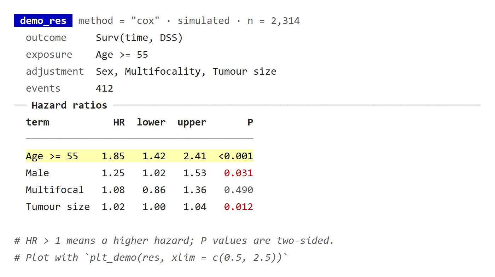
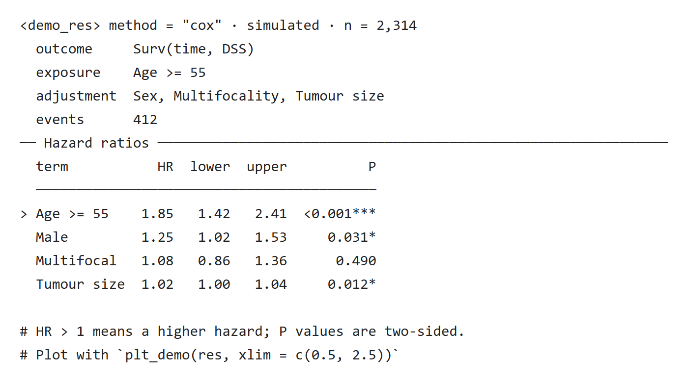
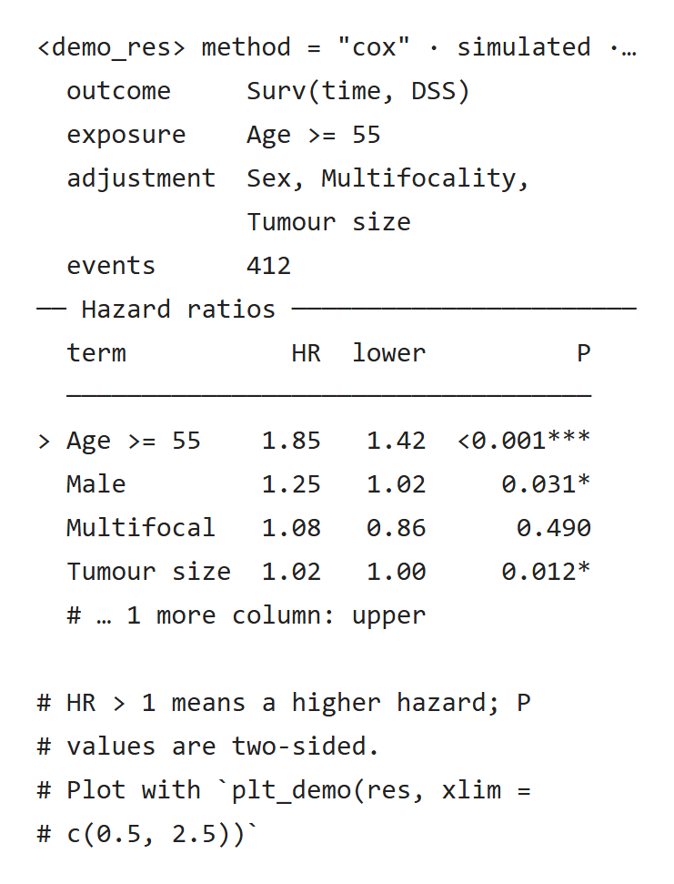

RegR、MLR、causalR 的结果对象在控制台打印时，都用 UtilsR 的同一组函数拼出来：首行是彩色的类名标签和一句摘要，下面依次是设定、分节的结果表和灰色注释。运行过程中的提示（读数据、保存文件、步骤进度）另用一组带时间戳的消息函数。本栏目逐个说明这些函数的用法、显示规则和常见问题，也给出自己写 print 方法时的做法。

各页按已推送的 UtilsR 0.6.10（`0e4cffe`）核对。示例在 Windows 与 WSL 的 R 4.4.3 上实际运行，两边的无色输出逐行一致，只有步骤耗时不同。截图是真实的控制台输出转成 HTML 后的画面，每张图下都附原生 HTML。说明文字已按 UtilsR 0.6.12（2026-10-25）修订；截图仍是 0.6.10 的输出，其中 `pr_tree()` 的预览写法在 0.6.12 有变化。

## 两条输出通道 {#channels}

::: {.table-responsive tabindex="0" role="region" aria-label="表格，可横向滚动"}

| 用途 | 函数 | 写到哪里 | 怎么关闭 |
|:--|:--|:--|:--|
| 结果对象的 print 方法、报告函数 | `pr_*` | 标准输出（stdout），并不可见地返回所打印的行 | 不打印对象；`capture.output()` 可截获 |
| 运行中的提示、步骤进度 | `.cat_message()`、`.cat_step()` | cli 消息：交互会话显示在控制台，`Rscript` 等非交互运行写到 stderr | `suppressMessages()`，或函数的 `verbose = FALSE` |
| 参数错误与警告 | `cli::cli_abort()`、`cli::cli_warn()` | 条件（condition） | `tryCatch()`、`suppressWarnings()` |

:::

两条通道分开以后：用 `capture.output(print(res))` 或 `sink()` 保存结果时不会混进运行提示；批量运行时 `suppressMessages()` 能关掉这些提示，结果打印照常输出（RegR 包内的旧版提示例外，见[打印显示问题排查](display-issues.qmd#regr-local-notice)）。

## 一个完整的结果打印 {#example}

下面用人为构造的数值写一个最小的 print 方法，没有拟合任何模型。结构与各包的结果类相同：首行、设定、分节表格、注释。

```r
library(UtilsR)

demo_res <- structure(
  list(stats = data.frame(
    term  = c("Age >= 55", "Male", "Multifocal", "Tumour size"),
    HR    = c(1.85, 1.25, 1.08, 1.02),
    lower = c(1.42, 1.02, 0.86, 1.00),
    upper = c(2.41, 1.53, 1.36, 1.04),
    P     = c(0.00003, 0.031, 0.49, 0.012))),
  class = c("demo_res", "list"),
  analysis = list(method = "cox", n = 2314L, events = 412L,
                  outcome = "Surv(time, DSS)", exposure = "Age >= 55",
                  adj_var = c("Sex", "Multifocality", "Tumour size"),
                  time = NULL))

print.demo_res <- function(x, ...) {
  a <- attr(x, "analysis")
  pr_head("demo_res", sprintf('method = "%s"', a$method), "simulated",
          sprintf("n = %s", format(a$n, big.mark = ",")))
  # time is NULL here, so its line is left out
  pr_kv(list(outcome = a$outcome, exposure = a$exposure,
             adjustment = a$adj_var, time = a$time, events = a$events))
  pr_section("Hazard ratios")
  pr_table(x$stats, p_col = "P", highlight = 1)
  cat("\n")
  pr_note("HR > 1 means a higher hazard; P values are two-sided.")
  pr_note("Plot with {.code plt_demo(res, xlim = c(0.5, 2.5))}")
  invisible(x)
}

demo_res
```

::: {.panel-tabset}

### 彩色终端 {.unnumbered}

{fig-alt="demo_res 的彩色控制台输出：蓝底类名标签和灰色摘要，灰色键名的设定块，Hazard ratios 分节线，第一行浅黄底高亮的结果表，P 值 0.031 和 0.012 为红色、0.490 为灰色，最后两行灰色斜体注释。"}

[原生 HTML](images/overview-demo-color.html)

### 无色日志 {.unnumbered}

{fig-alt="同一结果的无色输出：首行为 尖括号包住的 demo_res，P 值写成 小于 0.001 加三星、0.031*、0.490、0.012*，高亮行以大于号开头，其余结构不变。"}

[原生 HTML](images/overview-demo-plain.html)

### 40 列窄屏 {.unnumbered}

{fig-alt="40 列宽的无色输出：首行末尾截成省略号，adjustment 的取值折成两行并对齐到值列，结果表只保留 term 与 P 两列，表尾注明省略的列名。"}

[原生 HTML](images/overview-demo-narrow.html)

:::

打印改变的只是显示，返回对象不变：`demo_res` 打印前后完全相同，完整结果仍从 `demo_res$stats` 读取。

## 函数速查 {#reference}

::: {.table-responsive tabindex="0" role="region" aria-label="表格，可横向滚动"}

| 函数 | 作用 | 详见 |
|:--|:--|:--|
| [`pr_head()`](https://hui950319.github.io/UtilsR/reference/pr_head.html) | 首行：彩色类名标签加一句摘要 | [标题、设定与注释](result-blocks.qmd#pr-head) |
| [`pr_kv()`](https://hui950319.github.io/UtilsR/reference/pr_kv.html) | 对齐的键值设定块 | [标题、设定与注释](result-blocks.qmd#pr-kv) |
| [`pr_section()`](https://hui950319.github.io/UtilsR/reference/pr_section.html) | 带标题的灰色分节线 | [标题、设定与注释](result-blocks.qmd#pr-section) |
| [`pr_note()`](https://hui950319.github.io/UtilsR/reference/pr_note.html) | 灰色斜体 `#` 注释行 | [标题、设定与注释](result-blocks.qmd#pr-note) |
| [`pr_badge()`](https://hui950319.github.io/UtilsR/reference/pr_badge.html) | 两段式徽标，只返回字符串 | [标题、设定与注释](result-blocks.qmd#pr-badge) |
| [`pr_table()`](https://hui950319.github.io/UtilsR/reference/pr_table.html) | 结果表，P 值按显著性着色 | [结果表与 P 值](table-pvalue.qmd) |
| [`pr_tree()`](https://hui950319.github.io/UtilsR/reference/pr_tree.html) | 嵌套结果的结构树 | [结构树、摘要框与分布](structure-summary.qmd#pr-tree) |
| [`pr_box()`](https://hui950319.github.io/UtilsR/reference/pr_box.html) | 圆角摘要框 | [结构树、摘要框与分布](structure-summary.qmd#pr-box) |
| [`pr_spark()`](https://hui950319.github.io/UtilsR/reference/pr_spark.html) | 每列一行的迷你分布 | [结构树、摘要框与分布](structure-summary.qmd#pr-spark) |
| [`.cat_message()`](https://hui950319.github.io/UtilsR/reference/dot-cat_message.html) | 带时间戳的运行提示 | [运行提示与步骤进度](runtime-messages.qmd#cat-message) |
| [`.cat_step()`](https://hui950319.github.io/UtilsR/reference/dot-cat_step.html) | 编号、计时的步骤进度 | [运行提示与步骤进度](runtime-messages.qmd#cat-step) |
| [`.cat_line()`](https://hui950319.github.io/UtilsR/reference/dot-cat_line.html)、[`.cat_box()`](https://hui950319.github.io/UtilsR/reference/dot-cat_box.html)、[`.cat_formula()`](https://hui950319.github.io/UtilsR/reference/dot-cat_formula.html) | 旧式分隔线、提示框与公式提示 | [运行提示与步骤进度](runtime-messages.qmd#legacy) |

:::

UtilsR 里还有 `.cat_tb()`，它把数据框渲染成 gt 表格，不属于控制台打印，本栏目不涉及。

## 哪些包在用 {#packages}

- **UtilsR**：`check_system()`、`check_na()`、`check_packages()` 等报告函数。
- **RegR、MLR、causalR**：结果类的 print 方法，实例见[各包结果打印实例](package-print-methods.qmd)。seerR 同样导入了 UtilsR，可以直接使用。
- **LabR、scMMR**：不依赖 UtilsR，打印直接用 cli。
- 2026-10-25 之前安装的 RegR 用自己的旧版 `.cat_message()` 写标准输出，`suppressMessages()` 关不掉；当天起改用 UtilsR 的版本，见[打印显示问题排查](display-issues.qmd#regr-local-notice)。

## 显示环境与自动退化 {#environments}

是否输出颜色由 `cli::num_ansi_colors(stdout())` 判断，不需要自己写分支。

::: {.table-responsive tabindex="0" role="region" aria-label="表格，可横向滚动"}

| 环境 | 类名标签 | P 值 | 高亮行 | 文本缺失值 |
|:--|:--|:--|:--|:--|
| 支持颜色（RStudio 控制台、Windows Terminal 等） | 彩色底 | 粗红 <0.001、红 <0.05、其余灰 | 浅黄底 | 灰色 `NA` |
| 无色（knitr / Quarto 渲染、重定向到文件、`cli.num_colors = 1`） | `<class>` | 加 `***`、`**`、`*` | 行首 `>` | `<NA>` |

:::

无色时颜色代码会被去掉，写进日志文件的是纯文本。宽度取 `cli::console_width()`：首行、注释、键值和表格按宽度截断或折行，分节线最宽 80 列。

## 复现截图 {#reproduce}

截图用到的显示设置如下。`cli.num_colors` 强制颜色数，`cli.width` 与 `width` 固定宽度：

```r
withr::with_options(list(cli.num_colors = 256, cli.width = 80, width = 80),
                    print(demo_res))     # 彩色、80 列
withr::with_options(list(cli.num_colors = 1, cli.width = 40, width = 40),
                    print(demo_res))     # 无色、40 列
```

截取的输出用 `fansi::sgr_to_html()` 转成 HTML，再按终端显示宽度固定每个非 ASCII 字符（中文、迷你分布条）的宽度，最后用浏览器截图。

## 本栏目页面 {#pages}

- [标题、设定与注释](result-blocks.qmd)：`pr_head()`、`pr_kv()`、`pr_section()`、`pr_note()`、`pr_badge()`。
- [结果表与 P 值](table-pvalue.qmd)：`pr_table()` 的 P 值着色、数值位数、高亮、省略的行列与中文对齐。
- [结构树、摘要框与分布](structure-summary.qmd)：`pr_tree()`、`pr_box()`、`pr_spark()`。
- [运行提示与步骤进度](runtime-messages.qmd)：`.cat_message()`、`.cat_step()` 与旧式提示函数。
- [各包结果打印实例](package-print-methods.qmd)：RegR、MLR、causalR、UtilsR 各结果类的打印。
- [编写 print 方法与测试](write-print-method.qmd)：结构、习惯和测试写法。
- [打印显示问题排查](display-issues.qmd)：没有颜色、关不掉提示、对不齐等问题的原因与处理。
