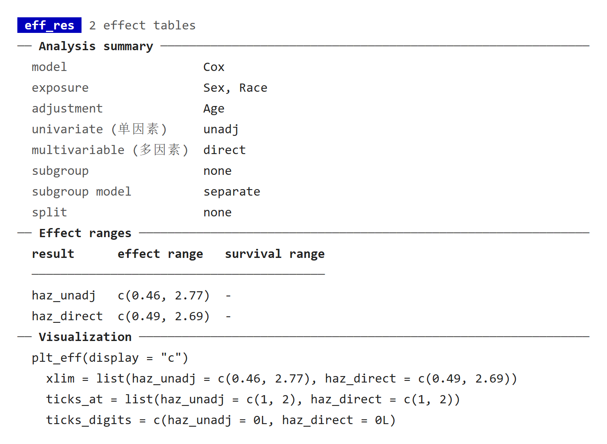
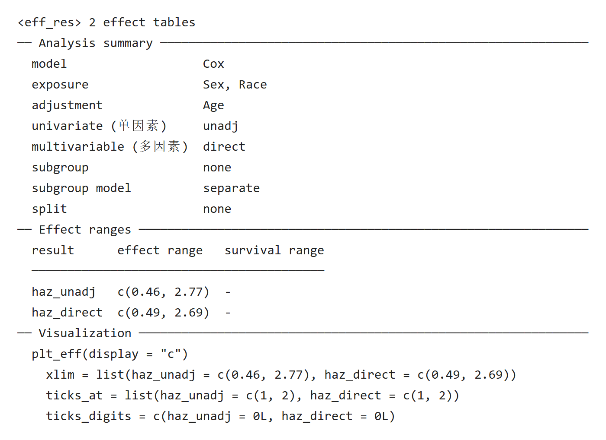
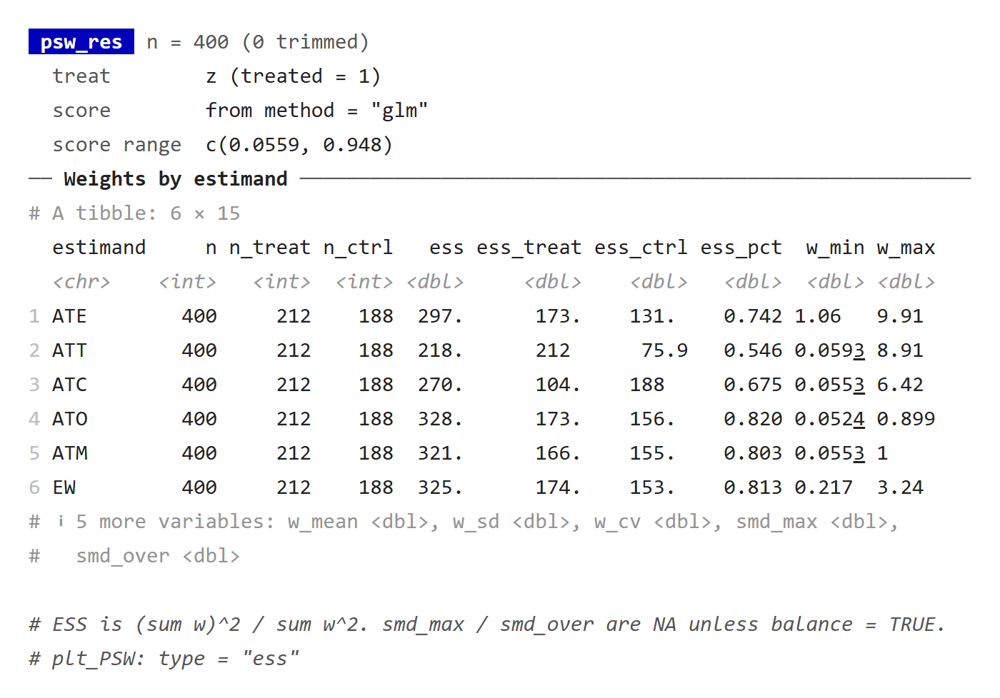
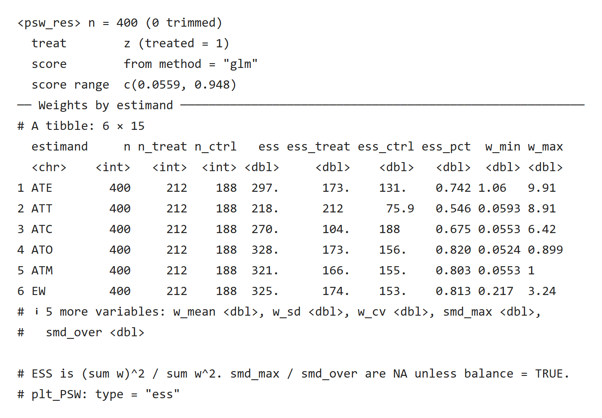

各包的结果对象打印的是摘要：首行写类名和规模，设定块写模型与变量，分节列出结果，末尾给注意事项和下一步可以运行的调用。完整的表格、模型和图形都在返回对象里，打印不会改动它们。

本页的两个例子在 Windows R 4.4.3 上运行，所用版本为 UtilsR 0.6.10、RegR 0.1.3、causalR 0.0.0.9000。

## 结果类清单 {#classes}

下表于 2026-10-26 按已推送 RegR `df14885`、MLR `45e743a`、causalR `4952af8`、UtilsR `0b59c82` 的源码与注册方法核对。它列出结果摘要类及函数运行中的报告；`get_all()`、`get_flt()` 等报告入口没有因此变成新的 S3 结果类。下面两组彩色/无色截图保留其 2026-10-25 的运行版本，新增原生输出由各教程单独记录。

::: {.table-responsive tabindex="0" role="region" aria-label="表格，可横向滚动"}

| 包 | 结果类或函数 |
|:--|:--|
| UtilsR | `check_na()`、`check_packages()`、`check_system()` 的报告 |
| RegR | `eff_res`、`cat_res`、`facet_res`、`get_um_result`、`cut_plot_result`、`gbtm_result`、`get_inter_abs`、`check_inter`、`check_inter_pairs`、`fmt_page`、`get_ps`、`get_psm`、`get_iptw`、`get_psm_iptw`、`get_rpa`、`get_var_sel`、`get_lasso`、`get_fit_stats`；另有 `get_all()` / `get_flt()` 的运行报告 |
| MLR | `mlr_model_evaluation`、`mlr_model_evaluation_tables`、`mlr_model_calibration`、`mlr_model_dca`、`mlr_model_selection`、`mlr_feature_selection`、`mlr_hyper_tuning`、`mlr_shp`；解释器 `exp.obj.sur` / `exp.obj.log` 与交互矩阵 `mlr_hstats_matrix` / `mlr_rfint_matrix` 各共用一个打印辅助函数；另有 `mlr_shp_clust`、`mlr_shp_k`、`mlr_shp_assign` 的摘要，类名随对象而定 |
| causalR | `sens_res`、`hte_res`、`hte_icf`、`hte_tree`、`psm_res`、`psw_res`、`bal_res`、`hte_select`、`hte_tree_stability`、`hte_unihtee` |

:::

RegR 的 `eff_tbl`、`surv_models`、`rpa_pair_ft` 只用其中的分节线或注释行，另有几个函数在运行报告里用 `pr_table()`；`eff_gforge_forestplot`、`flo2_plot`、`get_int`、`get_int_split`、`get_inter` 的主要打印动作是绘制图形、画布或 gt 表；其中部分方法还在绘制后补充组件说明，不能一概当作纯文字摘要。

### 新增报告与组件读取（2026-10-26） {#summaries-20261026}

- [RegR 筛选历史与 get_all 分开读](../regr/flow-guide.qmd#summary-20261026)：两步筛选从 12 行到 7 行，返回数据与属性另行读取。
- [causalR bal_res](../causalr/function-modules.qmd#balance-print-20261026)：60 行合成数据的平衡摘要，`plt`、`balance`、`data` 三个组件仍保留。
- [MLR 解释器、交互矩阵与 SHAP 聚类](../mlr/function-modules.qmd#updates-20261026)：摘要不重算模型；`get_exp()` 调用时仍打印训练模型，返回后 `print(exp)` 才是解释器摘要。

`Components:` 列出实际对象字段，`UtilsR::pr_tree(result, max_depth=1)` 可以继续看结构。矩阵的设定或原始配对表可能保存在属性中，也应读相应 `attr()`；不要只从截断摘要提取分析值。

## RegR：get_eff() 的 eff_res {#regr}

用 RegR 自带的 SEER 甲状腺髓样癌数据，按性别和种族估计疾病特异生存的风险比，调整年龄：

```r
library(RegR)
data(seer_thyroid_mtc_2026, package = "RegR")
d <- as.data.frame(seer_thyroid_mtc_2026)
d <- d[!is.na(d$DSS) & !is.na(d$time) & d$time > 0, ]
d$DSS <- as.numeric(d$DSS)

eff_um <- get_eff(d, cat_var = c("Sex", "Race"), adj_var = "Age", surv = TRUE,
                  methods = c("unadj", "direct"), show_sur = FALSE)
eff_um
```

::: {.panel-tabset}

### 彩色终端 {.unnumbered}

{fig-alt="蓝底 eff_res 标签后写 2 effect tables；Analysis summary 分节下是灰色键名的设定，其中 univariate (单因素) 与 multivariable (多因素) 两行带中文注释并与其他键对齐；Effect ranges 分节是一张三列小表；Visualization 分节列出 plt_eff(display = \"c\") 及 xlim、ticks_at、ticks_digits 三行参数。"}

[原生 HTML](images/gallery-eff-res-color.html)

### 无色日志 {.unnumbered}

{fig-alt="eff_res 的无色输出，首行为 尖括号包住的 eff_res 2 effect tables，其余分节与彩色版相同。"}

[原生 HTML](images/gallery-eff-res-plain.html)

:::

- **Analysis summary**：模型、暴露、调整变量、单因素与多因素方法、亚组设置。键名用英文，必要处加中文注释，中文按显示宽度对齐；没有设置的项写 `none`。
- **Effect ranges**：每张效应表的估计范围，没有生存表时写 `-`。
- **Visualization**：画森林图时 `plt_eff()` 可用的 `xlim`、`ticks_at`、`ticks_digits`。这几行用纯文本输出，不加颜色，直接复制就能运行。
- 效应表本身不打印，从 `eff_um$haz_unadj` 等元素读取，或交给 `plt_eff()` 画图；函数说明见 [get_eff()](https://hui950319.github.io/RegR/reference/get_eff.html)。

打印里只有估计范围这类汇总数值，不含个体记录。

## causalR：get_PSW() 的 psw_res {#causalr}

causalR 的例子用模拟数据，估计六种倾向评分权重：

```r
library(causalR)
set.seed(20260921)
n <- 400
sim <- data.frame(x1 = rnorm(n), x2 = rbinom(n, 1, 0.4), x3 = runif(n))
sim$z <- rbinom(n, 1, plogis(-0.3 + 0.8 * sim$x1 - 0.6 * sim$x2 + 1.1 * sim$x3))
psw <- get_PSW(sim, treat = "z", adj_var = c("x1", "x2", "x3"), balance = FALSE)
psw
```

::: {.panel-tabset}

### 彩色终端 {.unnumbered}

{fig-alt="蓝底 psw_res 标签后写 n = 400 (0 trimmed)；设定块列出 treat、score 和 score range；Weights by estimand 分节下是 tibble 原样打印的 6 行 15 列权重摘要，表尾说明另有 5 列；最后两行灰色注释说明 ESS 的定义和 plt_PSW 的类型。"}

[原生 HTML](images/gallery-psw-res-color.html)

### 无色日志 {.unnumbered}

{fig-alt="psw_res 的无色输出，首行为 尖括号包住的 psw_res，tibble 表头与列类型照常显示。"}

[原生 HTML](images/gallery-psw-res-plain.html)

:::

这里的权重表保留了 tibble 自己的打印：列多、需要看列类型，又没有 P 值要标注，tibble 的表尾已经说明了省略的列。注释的第二行给出下一步绘图的类型 `plt_PSW: type = "ess"`。

## UtilsR：报告函数 {#utilsr}

`check_na()` 先在控制台写一行摘要，再返回一张 gt 表，在 RStudio 的 Viewer 里显示：

```r
UtilsR::check_na(airquality)
#> <check_na> 2 variables with data quality issues
```

彩色时标签为蓝底；数据没有缺失或特殊值时改为绿底，文字为 `no missing or special values found`。`check_system()` 的报告用中文键名，同样由 `pr_head()`、`pr_section()`、`pr_kv()` 组成；它会列出本机配置，本站不放输出。

## 其他页面里的打印示例 {#elsewhere}

- causalR `get_sens()` 的 `sens_res`：[当前结果打印与读取层级](../causalr/function-modules.qmd#printing-20261025)。
- MLR 不画图时的 `mlr_shp` 等：[当前标签、份额与结果打印](../mlr/function-modules.qmd#updates-20261025)。
- RegR 交互分析的打印：[当前不合并开关与结果打印](../regr/interaction-guide.qmd#reference-print-20261025)，以及[当前依赖、分布参数与结果打印](../regr/function-modules.qmd#updates-20261025)。
- 九个 `pr_*` 构件合在一起的示例：[当前控制台构件与运行提示](../utilsr/function-modules.qmd#console-helpers-20261025)。

## 更新记录 {#page-updates}

::: {.callout-note collapse="true" title="本页更新记录"}
- 2026-10-26：补齐[结果类清单与组件读取](#summaries-20261026)，保留原截图的运行版本。
:::
