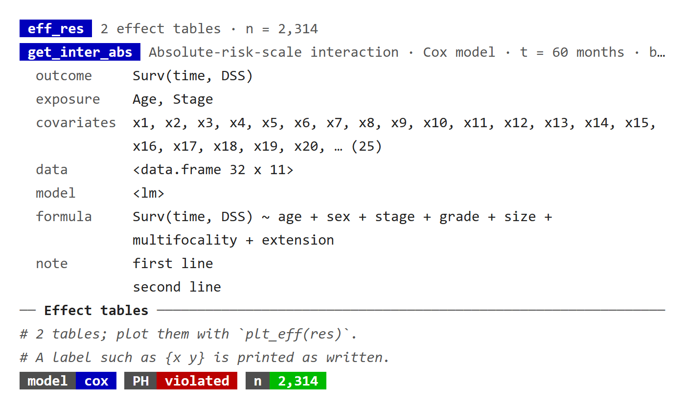
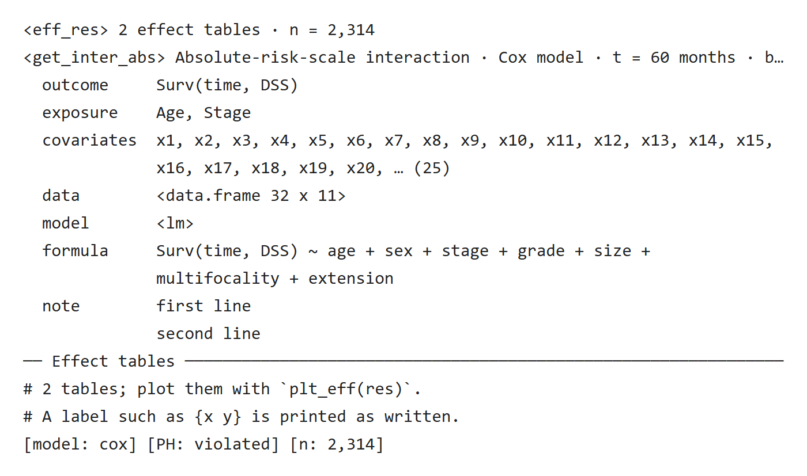
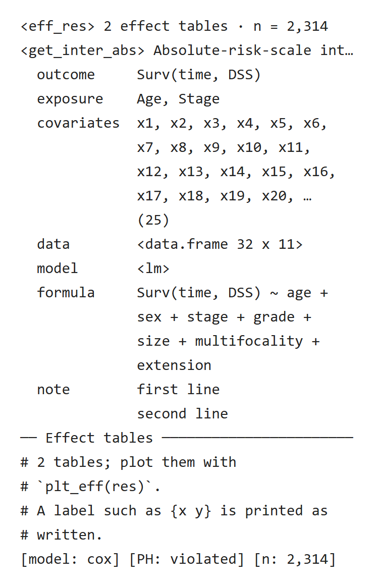
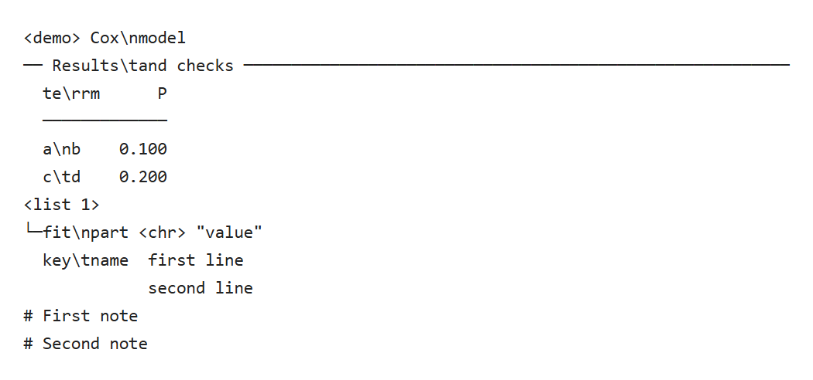

一个 print 方法通常由这五个函数拼成：`pr_head()` 写首行，`pr_kv()` 列设定，`pr_section()` 把结果分节，`pr_note()` 在末尾写注意事项和下一步，`pr_badge()` 在同一行并排显示几个状态。除 `pr_badge()` 外，它们都直接写到标准输出，并不可见地返回所打印的行。

::: {.callout-note collapse="true" title="版本与复现记录"}
本轮补充按已推送 UtilsR `5a9d8eb`（0.6.14）导出源码，在 Windows / WSL R 4.4.3 独立运行。新增预览来自真实控制台输出；原有截图保留各自注明的历史快照。

:::

## 示例 {#example}

```r
library(UtilsR)

pr_head("eff_res", "2 effect tables", NULL, "n = 2,314")
pr_head("get_inter_abs", "Absolute-risk-scale interaction", "Cox model",
        "t = 60 months", "bootstrap percentile CI, 1000 resamples")
pr_kv(list(
  outcome    = "Surv(time, DSS)",
  exposure   = c("Age", "Stage"),
  time       = NULL,
  covariates = paste0("x", 1:25),
  data       = mtcars,
  model      = lm(mpg ~ wt, data = mtcars),
  formula    = "Surv(time, DSS) ~ age + sex + stage + grade + size + multifocality + extension",
  note       = "first line\nsecond line"))
pr_section("Effect tables")
n_tab <- 2
pr_note("{n_tab} tables; plot them with {.code plt_eff(res)}.")
pr_note("A label such as {x y} is printed as written.")
cat(pr_badge("model", "cox"), pr_badge("PH", "violated", bg = "red"),
    pr_badge("n", "2,314", bg = "green"), "\n")
```

::: {.panel-tabset}

### 彩色终端 {.unnumbered}

{fig-alt="两行蓝底类名标签首行，第二行过长在末尾截成省略号；灰色键名的设定块，covariates 折成两行并以省略号和总数 25 结尾，data 显示为 data.frame 32 x 11，model 显示为 lm；Effect tables 分节线；两行灰色斜体注释；三个两段式徽标，PH violated 为红底、n 2,314 为绿底。"}

[原生 HTML](images/blocks-color.html)

### 无色日志 {.unnumbered}

{fig-alt="同一示例的无色输出：首行为 尖括号包住的 eff_res 与 get_inter_abs，徽标写成 [model: cox] [PH: violated] [n: 2,314]，其余内容与彩色版相同。"}

[原生 HTML](images/blocks-plain.html)

### 40 列窄屏 {.unnumbered}

{fig-alt="40 列宽的无色输出：第二个首行在 int 后截断，covariates 与 formula 折成多行并对齐到值列，两条注释各折成两行、每行以 # 开头。"}

[原生 HTML](images/blocks-narrow.html)

:::

## pr_head()：首行 {#pr-head}

`pr_head(class, ..., bg = "blue", fg = "br_white")` 先写类名标签，再把 `...` 的各段用 ` · ` 连接，灰色显示。

- `NULL`、`NA` 和空字符串会被丢掉，所以可选的片段可以直接写成 `if (cond) "text"`。示例第一行的 `NULL` 就没有留下多余的分隔点。
- 整行按控制台宽度截断，末尾加省略号。示例第二行在 80 列时截掉了 CI 的说明，40 列时连模型名也看不到了。所以首行只放类名、方法、样本量这类短片段，**关键的放前面**；公式、暴露列表、长备注放进 `pr_kv()` 或 `pr_note()`。2026-10-24 MLR `mlr_shp` 的备注和 RegR `get_inter_abs` 的模型、时间都曾因此被截掉：前者把备注移进了注释行，后者把暴露列表移进设定块，模型和时间才留在首行。
- 数字按 `print()` 的位数显示（`getOption("digits")`，默认 7 位有效数字），因子写水平名，日期写成日期（0.6.12 起；此前 `1/3` 显示 15 位，因子显示成内部编码，日期显示成天数）。
- `bg`、`fg` 接受 ANSI 颜色名（如 `"blue"`、`"br_white"`）、R 颜色名或十六进制色。用颜色表示状态时才改，例如 UtilsR `check_na()` 没有缺失时标签为绿底。

## pr_kv()：设定块 {#pr-kv}

`pr_kv(x, indent = 2)` 每个元素打印一行 `键  值`，键名灰色，按显示宽度对齐，中文键名也能对齐。

- `x` 必须是具名列表或具名向量；有元素没有名字时报错。
- 值为 `NULL` 的元素整行不打印。示例里的 `time = NULL` 没有出现，可选设定因此可以原样传入，不用先判断。
- 原子向量用 `", "` 连接，超过 20 个时只列前 20 个，再写 `… (总数)`；数字同样按 `print()` 的 7 位有效数字显示（0.6.12 起，此前 `1/3` 显示为 `0.333333333333333`）。
- 其他对象写成类型和大小，例如 `<data.frame 32 x 11>`、`<lm>`，不会把整个对象倒出来。
- 长值按控制台宽度折行，续行对齐到值所在的列；值里的 `\n` 同样另起一行并对齐。

## pr_section()：分节线 {#pr-section}

`pr_section(title, width = NULL)` 画一条灰色细线，左端是粗体标题。宽度默认取控制台宽度，但最宽 80 列，宽屏上不会拉得过长；标题太长时截断。一个结果有几张表，就用几条分节线分开。

## pr_note()：注释行 {#pr-note}

`pr_note(...)` 把各段拼起来，写成灰色斜体、以 `#` 开头的注释，按宽度折行，每个续行同样以 `#` 开头；文字里的 `\n` 另起一行（0.6.12 起，此前与上一行合并）。适合放结果的读法、注意事项和下一步可以运行的调用。

文字先经过 `cli::format_inline()`：

- `{x}` 取调用处的变量值，示例里的 `{n_tab}` 变成了 `2`。
- cli 的内联标记照常生效：`{.code ...}`、`{.fn ...}`、`{.arg ...}`。在支持超链接的控制台（较新的 RStudio）里，`{.run pkg::fun(x)}` 和 `{.help pkg::fun}` 会变成可点击的链接。
- 字面的花括号写成 `{{` 和 `}}`。
- cli 解析不了的文字（比如数据里带花括号）按原文打印，不会让整个 print 报错，示例里的 `{x y}` 就是这样。

所以要把数据放进注释时，写成 `pr_note("Label: {lab}")`，让 cli 代入变量，不要先 `paste()` 进模板：代入的值不会再被当成 glue 表达式解析，而拼进模板的花括号会。

## pr_badge()：徽标 {#pr-badge}

`pr_badge(key, value, bg = "blue", fg = "br_white")` 生成形如状态徽标的两段式标签：键在深灰底上，值在 `bg` 颜色上，颜色可以表达含义（如违反比例风险假设用红底）。

它**只返回字符串，不打印**，这样几个徽标可以并排放在一行，要自己用 `cat()` 输出。`key` 与 `value` 等长或长度为 1 时会循环补齐，返回同样多个徽标。无色时写成 `[key: value]`。


<!-- update-20261030: utils_print_controls -->

### 单行字段转义，注释和值保留换行（2026-10-30） {#controls-20261030}

UtilsR 0.6.14 把单行字段里的换行、回车、制表、退格、换页和纵向制表符显示为可见转义文本。适用字段包括 `pr_head()` 的首行片段、`pr_section()` 标题、表格单元格／列名、树组件名和分布标签；文字中的真实控制字符不再引入额外表格行。原来就写成两个字符的反斜杠加 n 仍照常保留。

`pr_kv()` 的键会转义，但它的值和 `pr_note()` 的内容允许有意分行。需要多行解释时使用这些位置，不要把多行文字塞入表头或组件名。以下 **2 行表格**演示的是显示行为，不会改写输入字符串。

```r
library(UtilsR)
options(cli.num_colors = 1, cli.width = 80)
control_table30 <- data.frame(term = c("a\nb", "c\td"), P = c(.1, .2))
names(control_table30)[1] <- "te\rrm"
pr_head("demo", "Cox\nmodel")
pr_section("Results\tand checks")
pr_table(control_table30, p_col = "P")
pr_tree(setNames(list("value"), "fit\npart"))
pr_kv(setNames(list("first line\nsecond line"), "key\tname"))
pr_note("First note\nSecond note")
```

{fig-alt="标题和表格中的控制字符显示为反斜杠n、r或t，树名不产生额外节点，键值正文与注释中的两行按原意分开。"}

[原生 HTML](images/result-blocks/20261030-update-layout-controls.html)

::: {.callout-note collapse="true" title="复核代码"}
重建预览复用[表格页](table-pvalue.qmd#storage-pvalues-20261030)的 `save_console30()`。

```r
control_original30 <- control_table30
control_lines30 <- capture.output({
  pr_head("demo", "Cox\nmodel"); pr_section("Results\tand checks")
  pr_table(control_table30, p_col = "P")
  pr_tree(setNames(list("value"), "fit\npart"))
  pr_kv(setNames(list("first line\nsecond line"), "key\tname"))
  pr_note("First note\nSecond note")
})
table_control_lines30 <- capture.output(pr_table(control_table30, p_col = "P"))
key_value_lines30 <- capture.output(pr_kv(setNames(list("first line\nsecond line"), "key\tname")))
note_lines30 <- capture.output(pr_note("First note\nSecond note"))
all_controls30 <- data.frame(value = paste0("a", c("\n", "\r", "\t", "\b", "\f", "\v"), "b"))
all_control_lines30 <- capture.output(pr_table(all_controls30))
expected_controls30 <- paste0("a\\", c("n", "r", "t", "b", "f", "v"), "b")
stopifnot(identical(control_original30, control_table30),
  length(table_control_lines30) == 4L, length(note_lines30) == 2L,
  length(key_value_lines30) == 2L,
  grepl("te\\rrm", table_control_lines30[1], fixed = TRUE),
  grepl("a\\nb", table_control_lines30[3], fixed = TRUE),
  grepl("c\\td", table_control_lines30[4], fixed = TRUE),
  identical(trimws(all_control_lines30[-(1:2)]), expected_controls30),
  any(grepl("key\\tname", key_value_lines30, fixed = TRUE)),
  any(grepl("first line", key_value_lines30, fixed = TRUE)),
  any(grepl("second line", key_value_lines30, fixed = TRUE)))
save_console30(control_lines30, "layout-controls")
validation_values <- list(table_rows = nrow(control_table30), output = control_lines30,
  table_lines = length(table_control_lines30), note_lines = length(note_lines30),
  key_value_lines = length(key_value_lines30), escaped = expected_controls30)
```
:::

<!-- /update-20261030: utils_print_controls -->

## 返回值 {#return}

除 `pr_badge()` 外，这几个函数都不可见地返回所打印的行（无色时已去掉颜色代码），在测试里可以直接检查，也可以拼进别的输出。

## 更新记录 {#page-updates}

::: {.callout-note collapse="true" title="本页更新记录"}
- 2026-10-30：[单行字段转义](#controls-20261030)：核对六种控制字符，并保留键值内容与注释的有意换行。
- 2026-10-25：按 UtilsR 0.6.12 说明 [pr_head()](#pr-head) 与 [pr_kv()](#pr-kv) 的数字位数、[pr_note()](#pr-note) 的换行。
:::
