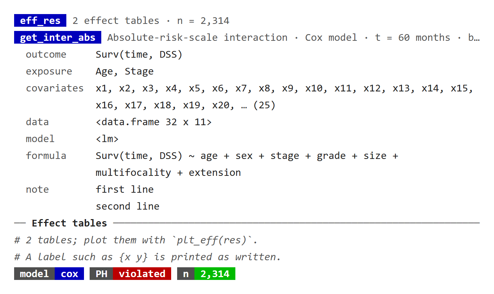
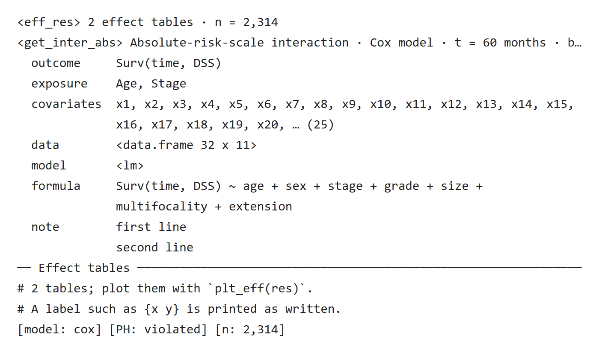
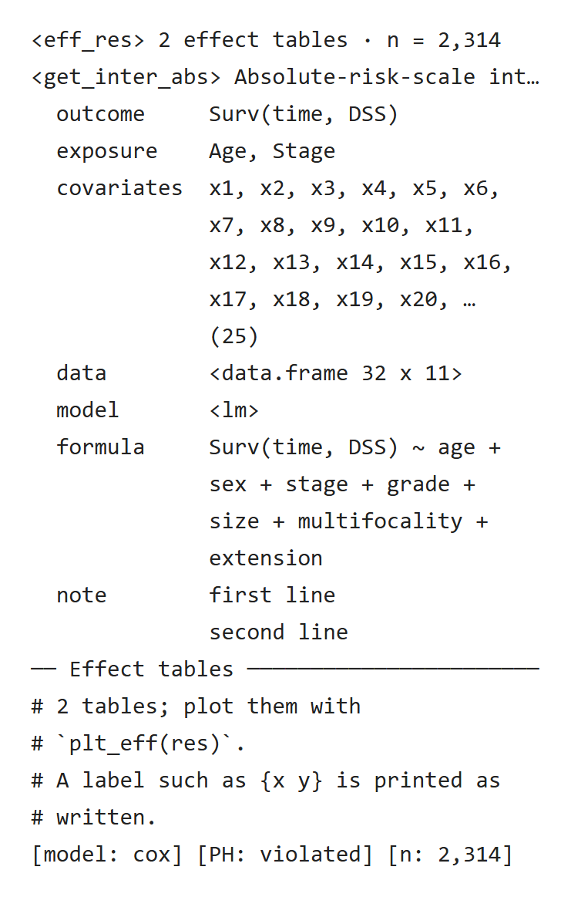
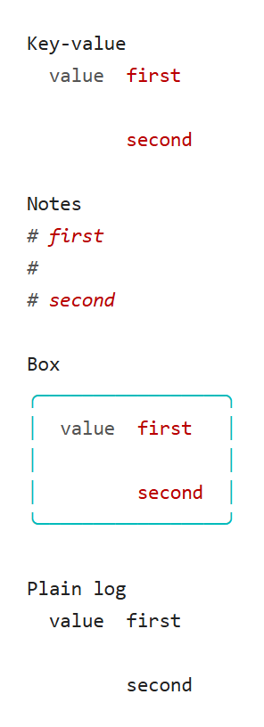
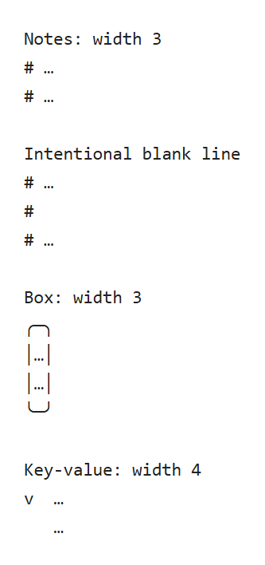
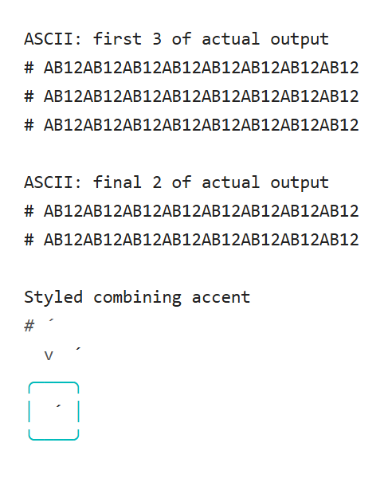
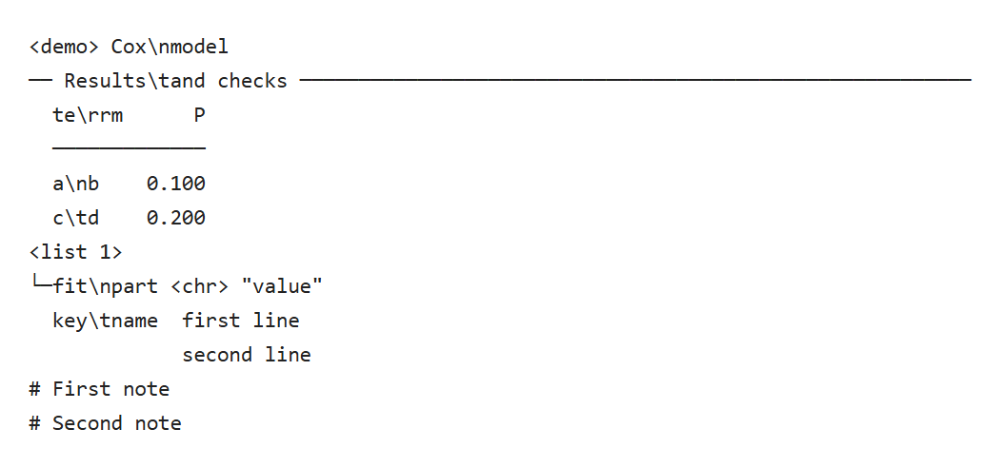
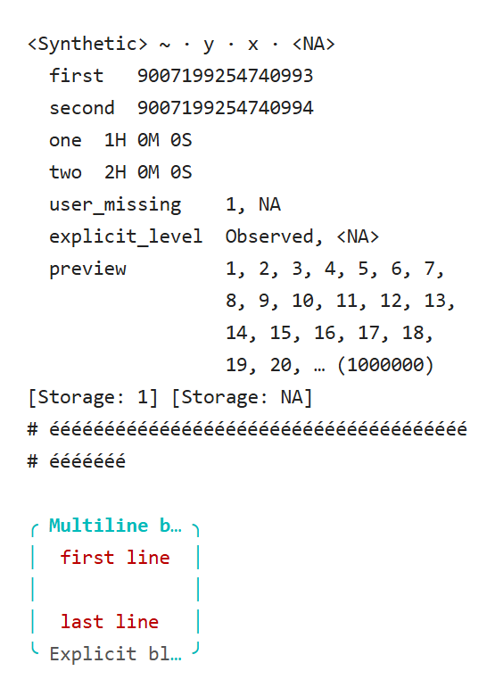

一个 print 方法通常由这五个函数拼成：`pr_head()` 写首行，`pr_kv()` 列设定，`pr_section()` 把结果分节，`pr_note()` 在末尾写注意事项和下一步，`pr_badge()` 在同一行并排显示几个状态。除 `pr_badge()` 外，它们都直接写到标准输出，并不可见地返回所打印的行。

::: {.callout-note collapse="true" title="版本与复现记录"}
2026-11-02 追加按已推送 UtilsR `64d986fc`（0.6.21）导出源码，在 Windows / WSL R 4.4.3 独立运行下述合成示例。旧图保留原执行快照；此次没有重跑历史模型或安装包。

2026-11-02 追加按已推送 UtilsR `859b2506`（0.6.21）导出源码，在 Windows / WSL R 4.4.3 独立运行下述合成示例。旧图保留原执行快照；此次没有重跑历史模型或安装包。

2026-11-01 追加按已推送 UtilsR `9ebf1e95`（0.6.20）导出源码，在 Windows / WSL R 4.4.3 独立运行下述合成示例。旧图保留原执行快照；此次没有重跑历史模型或安装包。

2026-10-31补充按已推送 UtilsR `05f4c963`（0.6.18）导出源码，在 Windows / WSL R4.4.3 独立运行下述合成示例。旧图保留原执行快照；此次没有重跑历史模型或安装包。

本轮补充按已推送 UtilsR `5a9d8eb`（0.6.14）导出源码，在 Windows / WSL R 4.4.3 独立运行。新增预览来自真实控制台输出；原有截图保留各自注明的历史快照。

:::

## 示例 {#example}

```r
library(UtilsR)

pr_head("eff_res", "2 effect tables", NULL, "n = 2,314")
pr_head("get_inter_abs", "Absolute-risk-scale interaction", "Cox model",
        "t = 60 months", "bootstrap percentile CI, 1000 resamples")
pr_kv(list(
  outcome    = "Surv(time, DSS)",
  exposure   = c("Age", "Stage"),
  time       = NULL,
  covariates = paste0("x", 1:25),
  data       = mtcars,
  model      = lm(mpg ~ wt, data = mtcars),
  formula    = "Surv(time, DSS) ~ age + sex + stage + grade + size + multifocality + extension",
  note       = "first line\nsecond line"))
pr_section("Effect tables")
n_tab <- 2
pr_note("{n_tab} tables; plot them with {.code plt_eff(res)}.")
pr_note("A label such as {x y} is printed as written.")
cat(pr_badge("model", "cox"), pr_badge("PH", "violated", bg = "red"),
    pr_badge("n", "2,314", bg = "green"), "\n")
```

::: {.panel-tabset}

### 彩色终端 {.unnumbered}

{fig-alt="两行蓝底类名标签首行，第二行过长在末尾截成省略号；灰色键名的设定块，covariates 折成两行并以省略号和总数 25 结尾，data 显示为 data.frame 32 x 11，model 显示为 lm；Effect tables 分节线；两行灰色斜体注释；三个两段式徽标，PH violated 为红底、n 2,314 为绿底。"}

[原生 HTML](images/blocks-color.html)

### 无色日志 {.unnumbered}

{fig-alt="同一示例的无色输出：首行为 尖括号包住的 eff_res 与 get_inter_abs，徽标写成 [model: cox] [PH: violated] [n: 2,314]，其余内容与彩色版相同。"}

[原生 HTML](images/blocks-plain.html)

### 40 列窄屏 {.unnumbered}

{fig-alt="40 列宽的无色输出：第二个首行在 int 后截断，covariates 与 formula 折成多行并对齐到值列，两条注释各折成两行、每行以 # 开头。"}

[原生 HTML](images/blocks-narrow.html)

:::

## pr_head()：首行 {#pr-head}

`pr_head(class, ..., bg = "blue", fg = "br_white")` 先写类名标签，再把 `...` 的各段用 ` · ` 连接，灰色显示。

- `NULL`、`NA` 和空字符串会被丢掉，所以可选的片段可以直接写成 `if (cond) "text"`。示例第一行的 `NULL` 就没有留下多余的分隔点。
- 整行按控制台宽度截断，末尾加省略号。示例第二行在 80 列时截掉了 CI 的说明，40 列时连模型名也看不到了。所以首行只放类名、方法、样本量这类短片段，**关键的放前面**；公式、暴露列表、长备注放进 `pr_kv()` 或 `pr_note()`。2026-10-24 MLR `mlr_shp` 的备注和 RegR `get_inter_abs` 的模型、时间都曾因此被截掉：前者把备注移进了注释行，后者把暴露列表移进设定块，模型和时间才留在首行。
- 数字按 `print()` 的位数显示（`getOption("digits")`，默认 7 位有效数字），因子写水平名，日期写成日期（0.6.12 起；此前 `1/3` 显示 15 位，因子显示成内部编码，日期显示成天数）。
- `bg`、`fg` 接受 ANSI 颜色名（如 `"blue"`、`"br_white"`）、R 颜色名或十六进制色。用颜色表示状态时才改，例如 UtilsR `check_na()` 没有缺失时标签为绿底。

## pr_kv()：设定块 {#pr-kv}

`pr_kv(x, indent = 2)` 每个元素打印一行 `键  值`，键名灰色，按显示宽度对齐，中文键名也能对齐。

- `x` 必须是具名列表或具名向量；有元素没有名字时报错。
- 值为 `NULL` 的元素整行不打印。示例里的 `time = NULL` 没有出现，可选设定因此可以原样传入，不用先判断。
- 原子向量用 `", "` 连接，超过 20 个时只列前 20 个，再写 `… (总数)`；数字同样按 `print()` 的 7 位有效数字显示（0.6.12 起，此前 `1/3` 显示为 `0.333333333333333`）。
- 其他对象写成类型和大小，例如 `<data.frame 32 x 11>`、`<lm>`，不会把整个对象倒出来。
- 长值按控制台宽度折行，续行对齐到值所在的列；值里的 `\n` 同样另起一行并对齐。

### 多行值和注释保留ANSI样式（2026-11-01） {#ansi-20261101c}

<!-- update-20261101c: utils_print_colors -->

`pr_kv()`、由键值构成的 `pr_box()` 与 `pr_note()` 现在按保留ANSI样式的方式拆行。连续两个换行仍产生空白行，后续文字继续使用原样式；无色日志保留相同文字、缩进和注释标记。空白分隔行不应被补成文字，也不代表丢失记录。

```r
color_linesC <- withr::with_options(list(cli.num_colors = 256L, width = 60), {
  red_textC <- cli::col_red("first\n\nsecond")
  list(kv = capture.output(UtilsR::pr_kv(list(value = red_textC))),
    note = capture.output(UtilsR::pr_note(red_textC)),
    box = capture.output(UtilsR::pr_box(list(value = red_textC))))
})
plain_linesC <- withr::with_options(list(cli.num_colors = 1L),
  capture.output(UtilsR::pr_kv(list(value = red_textC))))
```

{fig-alt="键值、注释和摘要框的真实ANSI输出，first与second均红色，中间空白行保留；末尾无色键值内容一致。"}

[原生 HTML](images/result-blocks/20261101c-update-print-colors.html)

::: {.callout-note collapse="true" title="复核代码"}

网页预览只转写实际stdout。后两页的打印示例复用此辅助函数，普通终端调用无需运行它。

```r
save_consoleC <- function(lines, filename) {
  pin <- function(line) {
    chars <- stringi::stri_split_boundaries(line, type = "character")[[1]]
    for (i in seq_along(chars)) {
      u <- utf8ToInt(chars[i])
      if (any(u > 127L) && !all(u >= 0x2500L & u <= 0x257FL)) {
        w <- cli::ansi_nchar(chars[i], type = "width")
        if (w %in% 1:2) chars[i] <- sprintf('<span style="display:inline-block;width:%dch">%s</span>', w, chars[i])
      }
    }
    paste(chars, collapse = "")
  }
  markup <- fansi::sgr_to_html(htmltools::htmlEscape(lines))
  pin_html <- function(line) {
    tokens <- regmatches(line, gregexpr("<[^>]*>|[^<]+", line, perl = TRUE))[[1]]
    paste(vapply(tokens, function(token) {
      if (startsWith(token, "<")) token else pin(token)
    }, ""), collapse = "")
  }
  body <- paste(vapply(markup, pin_html, ""), collapse = "\n")
  writeLines(paste0('<!doctype html><meta charset="utf-8"><style>',
    'body{margin:0;background:white;color:#222}pre{margin:0;padding:20px;',
    'font:15px/1.6 Consolas,"DejaVu Sans Mono",monospace;white-space:pre;display:inline-block}',
    '</style><pre data-native-console>', body, '</pre>'),
    file.path(tempdir(), filename), useBytes = TRUE)
}
stopifnot(length(color_linesC[["kv"]]) == 3L, length(color_linesC[["note"]]) == 3L,
  all(grepl("\033[31m", color_linesC[["kv"]][c(1, 3)], fixed = TRUE)),
  all(grepl("\033[31m", color_linesC[["note"]][c(1, 3)], fixed = TRUE)),
  any(grepl("\033[31msecond", color_linesC[["box"]], fixed = TRUE)),
  identical(plain_linesC, c("  value  first", "         ", "         second")))
save_consoleC(c("Key-value", color_linesC[["kv"]], "", "Notes", color_linesC[["note"]],
  "", "Box", color_linesC[["box"]], "", "Plain log", plain_linesC),
  "20261101c-update-print-colors.html")
validation_values <- list(kv = cli::ansi_strip(color_linesC[["kv"]]),
  note = cli::ansi_strip(color_linesC[["note"]]), plain = plain_linesC)
```
:::

<!-- /update-20261101c: utils_print_colors -->

## pr_section()：分节线 {#pr-section}

`pr_section(title, width = NULL)` 画一条灰色细线，左端是粗体标题。宽度默认取控制台宽度，但最宽 80 列，宽屏上不会拉得过长；标题太长时截断。一个结果有几张表，就用几条分节线分开。

## pr_note()：注释行 {#pr-note}

`pr_note(...)` 把各段拼起来，写成灰色斜体、以 `#` 开头的注释，按宽度折行，每个续行同样以 `#` 开头；文字里的 `\n` 另起一行（0.6.12 起，此前与上一行合并）。适合放结果的读法、注意事项和下一步可以运行的调用。

文字先经过 `cli::format_inline()`：

- `{x}` 取调用处的变量值，示例里的 `{n_tab}` 变成了 `2`。
- cli 的内联标记照常生效：`{.code ...}`、`{.fn ...}`、`{.arg ...}`。在支持超链接的控制台（较新的 RStudio）里，`{.run pkg::fun(x)}` 和 `{.help pkg::fun}` 会变成可点击的链接。
- 字面的花括号写成 `{{` 和 `}}`。
- cli 解析不了的文字（比如数据里带花括号）按原文打印，不会让整个 print 报错，示例里的 `{x y}` 就是这样。

所以要把数据放进注释时，写成 `pr_note("Label: {lab}")`，让 cli 代入变量，不要先 `paste()` 进模板：代入的值不会再被当成 glue 表达式解析，而拼进模板的花括号会。

### 极窄宽度不再多出续行（2026-11-02） {#overwide-20261102}

<!-- update-20261102: utils_print_wrap -->

UtilsR 0.6.21 修复了极窄控制台下的额外空续行。宽字素簇放不进剩余列宽时，仍按既有规则显示省略标记；处理完最后一个字素后，不会再输出一条无内容的续行。输入中有意保留的空行仍保留，注释、键值块和摘要框遵循同一换行规则。

```r
library(UtilsR)
narrow_notes <- withr::with_options(list(cli.width = 3, cli.num_colors = 1L,
  cli.unicode = TRUE), capture.output(pr_note("中文")))
narrow_blank <- withr::with_options(list(cli.width = 3, cli.num_colors = 1L,
  cli.unicode = TRUE), capture.output(pr_note("中\n\n文")))
narrow_box <- withr::with_options(list(cli.width = 3, cli.num_colors = 1L,
  cli.unicode = TRUE), capture.output(pr_box("中文")))
narrow_kv <- withr::with_options(list(cli.width = 4, cli.num_colors = 1L,
  cli.unicode = TRUE), capture.output(pr_kv(list(v = "中文"), indent = 0)))
narrow_notes
narrow_blank
```

{fig-alt="原生控制台预览，普通注释两行，含空行的注释三行，摘要框四行，键值两行。"}

[原生 HTML](images/result-blocks/20261102-update-print-overwide.html)

这是宽度边界复核，不建议日常把控制台缩到三列。恢复正常宽度后按完整文本阅读，不能把省略标记当作原始数据内容。

::: {.callout-note collapse="true" title="复核代码"}
HTML预览复用[多行ANSI示例](#ansi-20261101c)的 `save_consoleC()`，重建图片前先运行其定义；上面的控制台调用不依赖该辅助函数。

```r
stopifnot(identical(cli::ansi_strip(narrow_notes), c("# …", "# …")),
  identical(cli::ansi_strip(narrow_blank), c("# …", "# ", "# …")),
  length(narrow_box) == 4L, length(narrow_kv) == 2L)
for (colours in c(1L, 256L)) {
  check_notes <- withr::with_options(list(cli.width = 3, cli.num_colors = colours,
    cli.unicode = TRUE), capture.output(pr_note("中文")))
  stopifnot(identical(cli::ansi_strip(check_notes), c("# …", "# …")))
}
save_consoleC(c("Notes: width 3", narrow_notes, "", "Intentional blank line", narrow_blank,
  "", "Box: width 3", narrow_box, "", "Key-value: width 4", narrow_kv),
  "20261102-update-print-overwide.html")
validation_values <- list(notes = cli::ansi_strip(narrow_notes),
  intentional_blank = cli::ansi_strip(narrow_blank), box_lines = length(narrow_box),
  key_value_lines = length(narrow_kv))
```
:::

<!-- /update-20261102: utils_print_wrap -->

### 长ASCII段与带样式零宽字素（2026-11-02） {#wrap-paths-20261102b}

<!-- update-20261102b: utils_wrap_paths -->

长的不间断 ASCII 文本现在按固定列数切分，不再反复扫描剩余后缀；带 ANSI 样式的零显示宽度字素也能保留，避免进入不适用的换行路径。下面用1024个ASCII字符核对拼接还原，并用一个独立组合重音符核对注释、键值和摘要框。零显示宽度不等于空字符串，不能把它直接丢弃。

```r
library(UtilsR)
plain_run <- paste(rep("AB12", 256), collapse = "")
plain_notes <- withr::with_options(list(cli.width = 34, cli.num_colors = 1L),
  capture.output(pr_note(plain_run)))
zero_width_lines <- withr::with_options(list(cli.width = 12, cli.num_colors = 256L), {
  accent <- cli::col_red("\u0301")
  list(note = capture.output(pr_note(accent)),
    kv = capture.output(pr_kv(list(v = accent))), box = capture.output(pr_box(accent)))
})
head(plain_notes, 3)
```

{fig-alt="原生控制台预览，长ASCII按列宽分行；带红色样式的独立组合重音符保留在注释、键值和三行摘要框中。"}

[原生 HTML](images/result-blocks/20261102b-update-print-wrap-paths.html)

预览只摘录长文本的前三行和最后两行；完整stdout由代码中的 `plain_notes` 保留。组合重音符的实际外观受终端字体影响，本节用原始字符与ANSI序列断言保留情况，不以截图代替字符验证，也不根据这次小例子推算提速倍数。

::: {.callout-note collapse="true" title="复核代码"}
本轮同步修正预览辅助函数：先解释ANSI，再仅对HTML文本节点固定字形列宽，避免组合重音符与ANSI结束字符粘连而破坏颜色序列。重建HTML时复用[多行ANSI示例](#ansi-20261101c)的 `save_consoleC()`；先运行其定义，普通控制台调用不需要该辅助函数。

```r
plain_body <- sub("^# ", "", cli::ansi_strip(plain_notes))
stopifnot(identical(paste(plain_body, collapse = ""), plain_run),
  max(cli::ansi_nchar(plain_notes, type = "width")) <= 34L,
  identical(cli::ansi_strip(zero_width_lines[["note"]]), "# \u0301"),
  identical(cli::ansi_strip(zero_width_lines[["kv"]]), "  v  \u0301"),
  length(zero_width_lines[["box"]]) == 3L,
  any(grepl("\033[31m", zero_width_lines[["box"]], fixed = TRUE)))
save_consoleC(c("ASCII: first 3 of actual output", head(plain_notes, 3),
  "", "ASCII: final 2 of actual output", tail(plain_notes, 2),
  "", "Styled combining accent", zero_width_lines[["note"]], zero_width_lines[["kv"]],
  zero_width_lines[["box"]]), "20261102b-update-print-wrap-paths.html")
validation_values <- list(input_characters = nchar(plain_run), lines = length(plain_notes),
  maximum_width = max(cli::ansi_nchar(plain_notes, type = "width")),
  plain_rejoined = paste(plain_body, collapse = ""),
  accent_codepoint = utf8ToInt(cli::ansi_strip(zero_width_lines[["note"]])))
```
:::

<!-- /update-20261102b: utils_wrap_paths -->

## pr_badge()：徽标 {#pr-badge}

`pr_badge(key, value, bg = "blue", fg = "br_white")` 生成形如状态徽标的两段式标签：键在深灰底上，值在 `bg` 颜色上，颜色可以表达含义（如违反比例风险假设用红底）。

它**只返回字符串，不打印**，这样几个徽标可以并排放在一行，要自己用 `cat()` 输出。`key` 与 `value` 等长或长度为 1 时会循环补齐，返回同样多个徽标。无色时写成 `[key: value]`。


<!-- update-20261030: utils_print_controls -->

### 单行字段转义，注释和值保留换行（2026-10-30） {#controls-20261030}

UtilsR 0.6.14 把单行字段里的换行、回车、制表、退格、换页和纵向制表符显示为可见转义文本。适用字段包括 `pr_head()` 的首行片段、`pr_section()` 标题、表格单元格／列名、树组件名和分布标签；文字中的真实控制字符不再引入额外表格行。原来就写成两个字符的反斜杠加 n 仍照常保留。

`pr_kv()` 的键会转义，但它的值和 `pr_note()` 的内容允许有意分行。需要多行解释时使用这些位置，不要把多行文字塞入表头或组件名。以下 **2 行表格**演示的是显示行为，不会改写输入字符串。

```r
library(UtilsR)
options(cli.num_colors = 1, cli.width = 80)
control_table30 <- data.frame(term = c("a\nb", "c\td"), P = c(.1, .2))
names(control_table30)[1] <- "te\rrm"
pr_head("demo", "Cox\nmodel")
pr_section("Results\tand checks")
pr_table(control_table30, p_col = "P")
pr_tree(setNames(list("value"), "fit\npart"))
pr_kv(setNames(list("first line\nsecond line"), "key\tname"))
pr_note("First note\nSecond note")
```

{fig-alt="标题和表格中的控制字符显示为反斜杠n、r或t，树名不产生额外节点，键值正文与注释中的两行按原意分开。"}

[原生 HTML](images/result-blocks/20261030-update-layout-controls.html)

::: {.callout-note collapse="true" title="复核代码"}
重建预览复用[表格页](table-pvalue.qmd#storage-pvalues-20261030)的 `save_console30()`。

```r
control_original30 <- control_table30
control_lines30 <- capture.output({
  pr_head("demo", "Cox\nmodel"); pr_section("Results\tand checks")
  pr_table(control_table30, p_col = "P")
  pr_tree(setNames(list("value"), "fit\npart"))
  pr_kv(setNames(list("first line\nsecond line"), "key\tname"))
  pr_note("First note\nSecond note")
})
table_control_lines30 <- capture.output(pr_table(control_table30, p_col = "P"))
key_value_lines30 <- capture.output(pr_kv(setNames(list("first line\nsecond line"), "key\tname")))
note_lines30 <- capture.output(pr_note("First note\nSecond note"))
all_controls30 <- data.frame(value = paste0("a", c("\n", "\r", "\t", "\b", "\f", "\v"), "b"))
all_control_lines30 <- capture.output(pr_table(all_controls30))
expected_controls30 <- paste0("a\\", c("n", "r", "t", "b", "f", "v"), "b")
stopifnot(identical(control_original30, control_table30),
  length(table_control_lines30) == 4L, length(note_lines30) == 2L,
  length(key_value_lines30) == 2L,
  grepl("te\\rrm", table_control_lines30[1], fixed = TRUE),
  grepl("a\\nb", table_control_lines30[3], fixed = TRUE),
  grepl("c\\td", table_control_lines30[4], fixed = TRUE),
  identical(trimws(all_control_lines30[-(1:2)]), expected_controls30),
  any(grepl("key\\tname", key_value_lines30, fixed = TRUE)),
  any(grepl("first line", key_value_lines30, fixed = TRUE)),
  any(grepl("second line", key_value_lines30, fixed = TRUE)))
save_console30(control_lines30, "layout-controls")
validation_values <- list(table_rows = nrow(control_table30), output = control_lines30,
  table_lines = length(table_control_lines30), note_lines = length(note_lines30),
  key_value_lines = length(key_value_lines30), escaped = expected_controls30)
```
:::

<!-- /update-20261030: utils_print_controls -->

### 窄屏、带类键值与盒内换行（2026-10-31） {#width-types-20261031}

<!-- update-20261031: utils_blocks31 -->

命名integer64、Period等向量作为 `pr_kv()/pr_box()` 输入时保留元素类型，不先转成底层double。SPSS用户缺失在键值和徽标中显示NA，在可选首行片段中省略；显式NA因子水平仍显示 `<NA>`。下面真实stdout同时展示40列窄屏和盒内空行。

```r
kv_integer31 <- bit64::as.integer64(c("9007199254740993", "9007199254740994"))
names(kv_integer31) <- c("first", "second")
kv_period31 <- lubridate::hours(c(1, 2))
names(kv_period31) <- c("one", "two")
kv_missing31 <- haven::labelled_spss(c(1, 99), na_values = 99)
kv_level31 <- factor(c("Observed", NA), exclude = NULL)
block_lines31 <- withr::with_options(list(width = 40), capture.output({
  UtilsR::pr_head("Synthetic", quote(y ~ x), kv_missing31[2], kv_level31[2])
  UtilsR::pr_kv(kv_integer31)
  UtilsR::pr_kv(kv_period31)
  UtilsR::pr_kv(list(user_missing = kv_missing31, explicit_level = kv_level31,
    preview = 1:1000000))
  cat(UtilsR::pr_badge("Storage", kv_missing31), "\n")
  UtilsR::pr_note(paste(rep("e\u0301", 45), collapse = ""))
}))
box_lines31 <- withr::with_options(list(width = 40, cli.num_colors = 256L),
  capture.output(UtilsR::pr_box(cli::col_red("first line\n\nlast line"),
    header = "Multiline box", footer = "Explicit blank separator")))
```

{fig-alt="40列键值输出含9007199254740993、小时Period、NA与显式NA水平；一百万项只预览前20项和总数；红色盒内文本分两段并保留空白分隔行。"}

[原生 HTML](images/result-blocks/20261031-update-print-narrow.html)

::: {.callout-note collapse="true" title="复核代码"}

网页保存复用[表格页](table-pvalue.qmd#rows-decimals-20261031)的 `save_console31()`；辅助函数不参与终端格式化。

```r
stopifnot(any(grepl("9007199254740993", block_lines31, fixed = TRUE)),
  any(grepl("1000000", block_lines31, fixed = TRUE)),
  any(grepl("<NA>", block_lines31, fixed = TRUE)),
  max(cli::ansi_nchar(c(block_lines31, box_lines31), type = "width")) <= 40L,
  !any(grepl("^\u0301", trimws(block_lines31))),
  any(grepl("\033[", box_lines31, fixed = TRUE)),
  sum(grepl("first line|last line", box_lines31)) == 2L)
save_console31(c(block_lines31, "", box_lines31), "print-narrow")
validation_values <- list(width = 40L, maximum_width = max(cli::ansi_nchar(c(block_lines31, box_lines31), type = "width")),
  plain = cli::ansi_strip(block_lines31), box = cli::ansi_strip(box_lines31))
```
:::

长向量只格式化可见的前20项，原总数保留；长表达式也按可见预览反解析。窄屏会连同边框、缩进、标记和省略计数一起计算宽度。组合字符和多码点emoji按字素簇换行；本例用组合重音字符核对，没有以截图推断所有终端字体都一致。空可选注释不打印，显式空注释仍保留注释标记。

<!-- /update-20261031: utils_blocks31 -->

## 返回值 {#return}

除 `pr_badge()` 外，这几个函数都不可见地返回所打印的行（无色时已去掉颜色代码），在测试里可以直接检查，也可以拼进别的输出。

## 更新记录 {#page-updates}

::: {.callout-note collapse="true" title="本页更新记录"}
- 2026-11-02：[补充长ASCII与带样式零宽字素](#wrap-paths-20261102b)，核对完整字符和ANSI保留。
- 2026-11-02：[补充极窄宽度的宽字素续行](#overwide-20261102)，保留输入中有意的空行。
- 2026-11-01：补充多行键值、注释与摘要框的ANSI样式及空白行。
- 2026-10-31：[补充40列宽度、带类向量、缺失片段及盒内换行](#width-types-20261031)。
- 2026-10-30：[单行字段转义](#controls-20261030)：核对六种控制字符，并保留键值内容与注释的有意换行。
- 2026-10-25：按 UtilsR 0.6.12 说明 [pr_head()](#pr-head) 与 [pr_kv()](#pr-kv) 的数字位数、[pr_note()](#pr-note) 的换行。
:::
