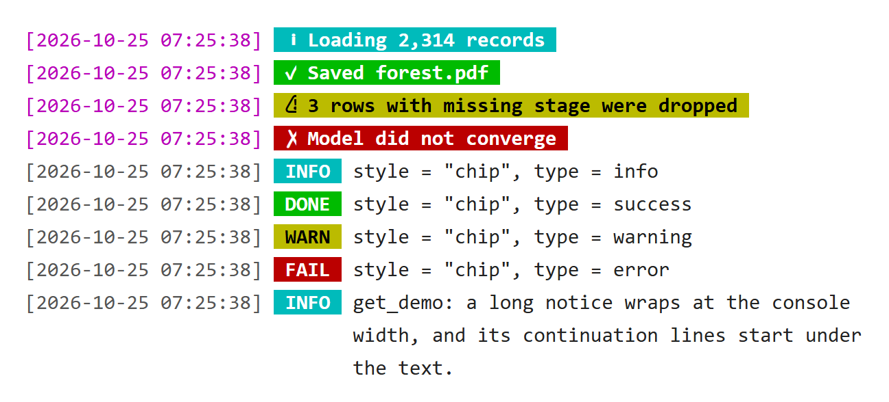
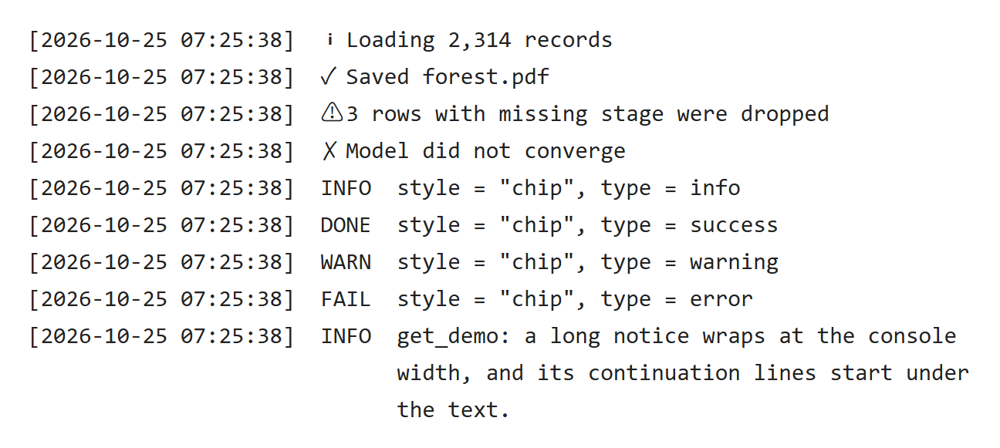
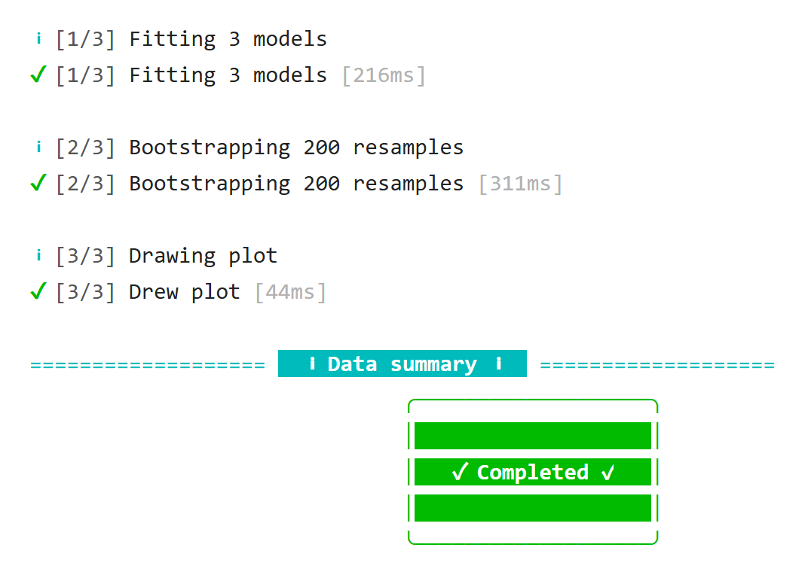
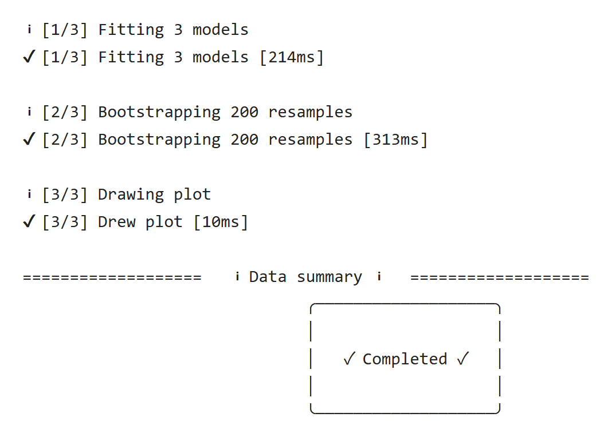

结果打印回答“算出了什么”，运行提示回答“正在做什么、做完了没有”：读了多少条记录、删了哪些行、文件存到哪里、哪一步花了多久。这类信息用 `.cat_message()` 和 `.cat_step()` 发出。它们是 cli 消息，不写进结果打印，也能整体关掉。

## .cat_message()：带时间戳的提示 {#cat-message}

```r
library(UtilsR)

.cat_message("Loading 2,314 records")
.cat_message("Saved forest.pdf", type = "success")
.cat_message("3 rows with missing stage were dropped", type = "warning")
.cat_message("Model did not converge", type = "error")
for (tp in c("info", "success", "warning", "error")) {
  .cat_message(paste("style = \"chip\", type =", tp), type = tp, style = "chip")
}
.cat_message(paste("get_demo: a long notice wraps at the console width,",
                   "and its continuation lines start under the text."),
             style = "chip")
```

::: {.panel-tabset}

### 彩色终端 {.unnumbered}

{fig-alt="前四行为完整样式：洋红时间戳后整条提示铺上类型颜色，信息青底、成功绿底、警告黄底黑字、错误红底，各带图标。后五行为紧凑样式：灰色时间戳后是 INFO、DONE、WARN、FAIL 小标签，正文不着色；最后一条长提示折成三行，续行对齐到正文。"}

[原生 HTML](images/messages-color.html)

### 无色日志 {.unnumbered}

{fig-alt="同样九条提示的无色输出：时间戳、图标和 INFO、DONE、WARN、FAIL 标签以纯文本保留，长提示的续行仍对齐到正文。"}

[原生 HTML](images/messages-plain.html)

:::

- **类型**：`type` 取 `"info"`（青）、`"success"`（绿）、`"warning"`（黄底黑字）、`"error"`（红）。
- **样式**：默认 `style = "full"`，洋红时间戳后整条铺上类型颜色，醒目，适合少数关键提示；`style = "chip"` 只给 `INFO` / `DONE` / `WARN` / `FAIL` 小标签上色，正文不着色，连续多条时更好读。MLR 的 `get_vpd()`、`get_ale()` 等在自动构建解释器时发的提示用的是 `"chip"`。
- **时间戳**：`timestamp_format` 是 `strftime` 格式，默认 `"[%Y-%m-%d %H:%M:%S]"`，可以改短成 `"[%H:%M:%S]"`；设为 `NULL` 或空字符串 `""` 时不加时间戳，续行照样对齐到正文（UtilsR 0.6.12 起；此前空格式被 R 的 `format()` 退回默认的 `年-月-日 时:分:秒`，只是少了方括号）。
- **多行与折行**：文字里的 `\n` 另起一行，字符向量的每个元素也各占一行（0.6.12 起，此前只显示第一个元素）；长度为 0 时什么也不输出，`NA` 显示为 `NA`。超出控制台宽度时按词折行，续行对齐到正文。
- **花括号**：文字原样显示，不做 glue 代入，带花括号的数据不会出错。
- **关闭**：`verbose = FALSE` 什么也不输出；它是 cli 消息，`suppressMessages()` 也能关掉。

输出通道要注意：交互会话里显示在控制台；`Rscript` 等非交互运行时写到 stderr。所以 `Rscript run.R > log.txt` 的日志里只有结果打印，没有运行提示；要一起保存就写 `Rscript run.R > log.txt 2>&1`。

我的包里，运行提示以函数名开头，例如 RegR `get_all()` 的提示都以 `get_all:` 开头，几个函数连续运行时能看出是谁发出的；有 `verbose` 参数的函数，全部提示都受它控制。

## .cat_step()：步骤进度 {#cat-step}

```r
fit_all <- function(k = 3) {
  .cat_step("Fitting {k} models", i = 1, n = 3)
  Sys.sleep(0.2)
  .cat_step("Bootstrapping 200 resamples", i = 2, n = 3)
  Sys.sleep(0.3)
  .cat_step("Drawing plot", i = 3, n = 3, msg_done = "Drew plot")
  invisible()
}
fit_all()
```

::: {.panel-tabset}

### 彩色终端 {.unnumbered}

{fig-alt="三个步骤，每步一行青色 i 图标的开始提示和一行绿色对勾的完成提示，前缀为灰色 [1/3]、[2/3]、[3/3]，完成行末尾灰色方括号写耗时；第三步完成时显示 Drew plot。下方是旧式 .cat_line 的青色分隔线和 .cat_box 的绿底提示框。"}

[原生 HTML](images/steps-color.html)

### 无色日志 {.unnumbered}

{fig-alt="同样输出的无色版本，保留 [i/n] 编号、开始与完成两行以及耗时。"}

[原生 HTML](images/steps-plain.html)

:::

`.cat_step(msg, i = NULL, n = NULL, msg_done = msg, verbose = TRUE, .envir = parent.frame())` 包装了 `cli::cli_progress_step()`：

- **编号**：给了 `i` 和 `n` 时加灰色前缀 `[i/n]`，只给 `i` 时为 `[i]`；`msg_done` 是完成时的文字，默认与 `msg` 相同，也带前缀。
- **完成时机**：下一步开始时，或调用 `.cat_step()` 的函数返回时，这一步标为完成并显示耗时；中途报错则标为失败。所以要在函数里调用，不要在全局环境里零散调用。
- **变量代入**：`msg` 里的 `{k}` 在 `.envir` 里取值，默认是调用者，示例的 `{k}` 取自 `fit_all()` 的参数。cli 解析不了的文字（数据里带花括号）按原文显示。
- **包装函数**：如果自己再写一层函数去调用 `.cat_step()`，要把 `.envir = parent.frame()` 传下去，否则步骤会在包装函数返回时就结束，`{}` 也会在包装函数里找变量。
- **关闭**：`verbose = FALSE` 不输出。

截图来自非交互运行，每步有开始、完成两行。在 RStudio 控制台里同一行会原地更新，最后只留下带耗时的完成行。

## 旧式函数 {#legacy}

`.cat_line()`（居中带标签的分隔线）和 `.cat_box()`（彩色提示框）是早期的显示函数，用 `cat()` 直接写标准输出，不是消息，`suppressMessages()` 关不掉。它们保留给已有的调用者，新代码用上面两个函数。RegR `get_facet()` 的分层提示和 MLR `get_shp()` 的模型设置原来用这两个函数，2026-10-25 已改为 `.cat_message()`。`.cat_formula()` 现在也是一行 `.cat_message()` 提示（如 `Cox model, unadjusted: Surv(time, DSS) ~ Sex`），按结局的非缺失取值个数区分 Cox 与 CRR（0.6.12 起缺失值不再算作一个水平）。

## 直接用 cli 的场合 {#cli}

- 一句话的补充信息可以直接 `cli::cli_inform(c("i" = "..."))`，用 `{.arg}`、`{.val}`、`{.var}` 等内联标记和 `{?s}` 复数。
- 参数错误、警告用 `cli::cli_abort()`、`cli::cli_warn()`，它们是条件，调用者可以捕获。
- 不要用 `message()` 拼字符串，也不要在运行提示里用 `cat()`：前者没有统一样式，后者关不掉。

## 关闭提示的核对 {#checks}

下面的检查在 Windows 与 WSL 上都通过：提示不进标准输出，`suppressMessages()` 和 `verbose = FALSE` 都能让它完全不出现。

```r
got <- character()
withCallingHandlers(
  suppressMessages(.cat_message("hidden", style = "chip")),
  message = function(cnd) got <<- c(got, conditionMessage(cnd)))
stopifnot(length(got) == 0L)

step_silent <- function() .cat_step("hidden", verbose = FALSE)
stopifnot(length(capture.output(step_silent())) == 0L)

msg_stdout <- capture.output(
  withCallingHandlers(.cat_message("to message", style = "chip"),
                      message = function(cnd) invokeRestart("muffleMessage")))
stopifnot(length(msg_stdout) == 0L)
```

## 更新记录 {#page-updates}

::: {.callout-note collapse="true" title="本页更新记录"}
- 2026-10-25：按 UtilsR 0.6.12 更新[时间戳与多行](#cat-message)和[旧式函数](#legacy)。
:::
