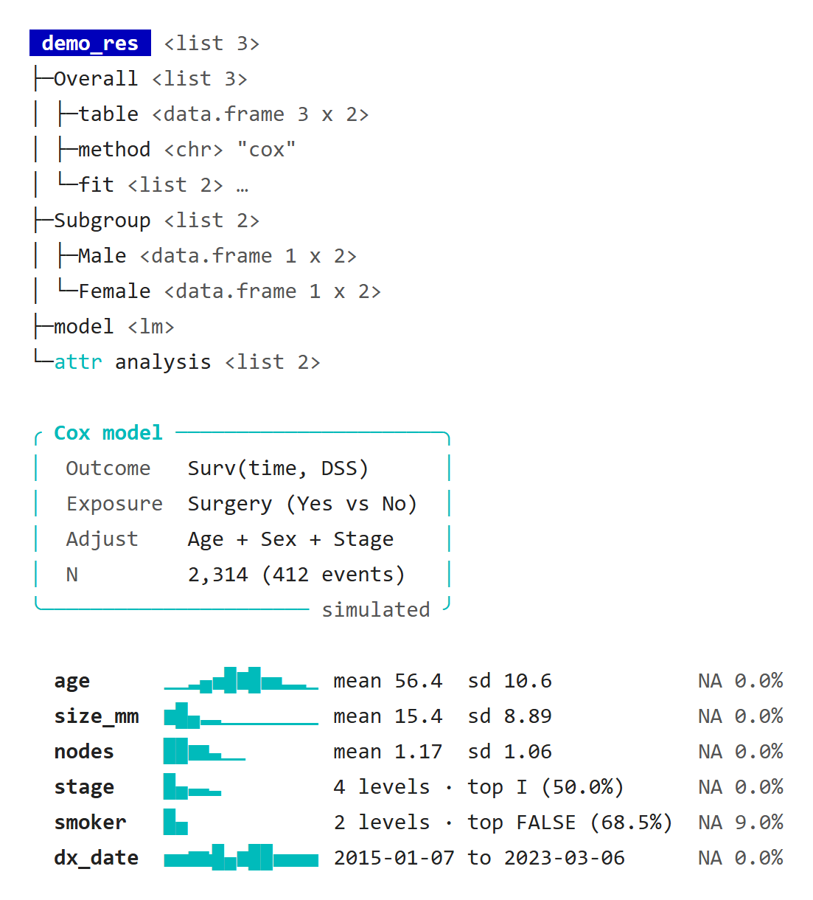
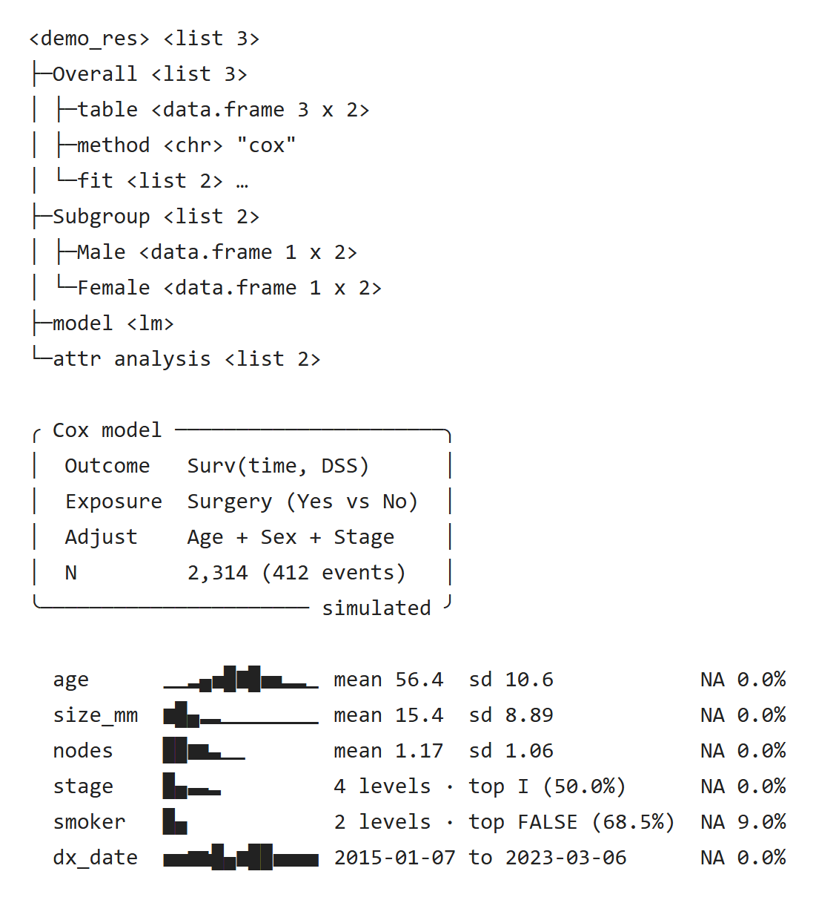
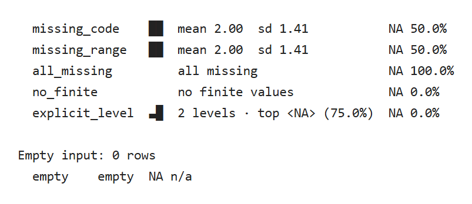

这三个函数不是每个 print 方法都要用：`pr_tree()` 看清一个嵌套结果里有什么，`pr_box()` 把模型设定这类短摘要框起来，`pr_spark()` 在建模前快速看一眼各列分布。

::: {.callout-note collapse="true" title="版本与复现记录"}
本轮补充按已推送 UtilsR `5a9d8eb`（0.6.14）导出源码，在 Windows / WSL R 4.4.3 独立运行。新增预览来自真实控制台输出；原有截图保留各自注明的历史快照。

:::

## 示例 {#example}

```r
library(UtilsR)

res <- structure(
  list(Overall = list(table = structure(
                        data.frame(term = c("Age", "Sex", "Stage"),
                                   HR = c(1.85, 1.25, 0.97)),
                        model_info = "Cox, adjusted"),
                      method = "cox",
                      p = c(0.004, 0.21, NA),
                      fit = list(coef = c(0.62, 0.22, -0.03), iter = 4L)),
       Subgroup = list(Male = data.frame(term = "Age", HR = 1.7),
                       Female = data.frame(term = "Age", HR = 2.0)),
       model = lm(mpg ~ wt, data = mtcars)),
  class = c("demo_res", "list"),
  analysis = list(n = 2314L, outcome = "DSS"))
pr_tree(res, max_depth = 2)

pr_box(list(Outcome = "Surv(time, DSS)", Exposure = "Surgery (Yes vs No)",
            Adjust = "Age + Sex + Stage", N = "2,314 (412 events)"),
       header = "Cox model", footer = "simulated")

set.seed(1)
df <- data.frame(
  age     = round(rnorm(300, 56, 11)),
  size_mm = rlnorm(300, 2.6, 0.5),
  nodes   = rpois(300, 1.2),
  stage   = factor(sample(c("I", "II", "III", "IV"), 300, TRUE, c(.5, .25, .15, .1))),
  smoker  = sample(c(TRUE, FALSE, NA), 300, TRUE, c(.3, .6, .1)),
  dx_date = as.Date("2015-01-01") + sample(0:3000, 300))
pr_spark(df)
```

::: {.panel-tabset}

### 彩色终端 {.unnumbered}

{fig-alt="上部是以蓝底 demo_res 为根的结构树：同层名字对齐，Overall、Subgroup 和 fit 加粗；table 后列出列名 term、HR，行尾为青色 attr: model_info；p 的缺失值 NA 为红色；fit 预览为 coef, iter = 4；末行青色 attr analysis 预览 n = 2314 与 outcome。中部是青色圆角框，顶边写 Cox model、底边写 simulated，框内四行键值；下部是六列的青色迷你分布条，右侧为均值与标准差、水平数与最多水平或日期范围，最右为缺失比例。"}

[原生 HTML](images/structure-color.html)

### 无色日志 {.unnumbered}

{fig-alt="同一示例的无色输出，根节点为尖括号包住的 demo_res 与 list 3；名字的对齐、树线、圆角框和分布条的字符不变。"}

[原生 HTML](images/structure-plain.html)

:::

40 列时，`pr_tree()` 按剩余宽度截短预览，放不下的行以省略号结尾；`pr_box()` 的内容超出宽度时会折行；`pr_spark()` 不折行，输出与 80 列相同。

## pr_tree()：结构树 {#pr-tree}

`pr_tree(x, max_depth = 3, max_items = 20, max_lines = 200, attrs = TRUE)` 把列表形式的结果画成树，每个元素后面跟一句描述，比 `str()` 更容易看清嵌套结果的组成。以下按 UtilsR 0.6.12（`0b59c82`）的输出，除截断提速外都是 0.6.12 新改的写法。

- 传入的对象本身总是展开：`pr_tree(fit)` 列出模型的各个组件，数据框列出各列，S4 对象列出各个槽（写成 `@name`）。再往下只展开普通列表，以及同时继承 `"list"` 的类对象（如 `c("eff_res", "list")`）；数据框、模型、图形等其他对象作为叶子，例如示例里的 `<lm>`。
- 原子向量写出类型、长度和值，如 `<chr> "cox"`、`<dbl 3> 0.004, 0.21, NA`：整数照原样，小数取 3 位有效数字但保留整数部分（`1234.5678` 写成 `1235`）。有名字的向量写成 `train = 800, test = 200`，带值标签的写成 `1 [Male]`，因子注明水平数，如 `<fct 4, 3 levels>`。值显示到行尾为止，取不完时以省略号结尾。
- 类型缩写与 vctrs 一致，如 `<drtn 2>`（时间差）、`<dbl+lbl 3>`（带值标签的向量）、`<int matrix 2 x 3>`；公式、调用写出原文，函数写出前 4 个参数，如 `<fn(data, formula, ...)>`。
- 不展开的节点也预览内容：数据框列出列名（示例的 `table`）；列表列出元素名，单个原子值写出取值（示例的 `fit` 写成 `coef, iter = 4`），没有名字的列表才只加省略号。
- 同一层的名字补齐到同一宽度（最多 18 个字符），描述从同一列开始。类型和大小是灰色，值用正常文字色，`NA` 标红，有子节点的名字加粗。
- `max_depth` 控制展开的层数。每个节点最多列 `max_items` 个元素，其余写成 `… n more: e6, e7, …`，列出被略过的名字；整棵树最多 `max_lines` 行，末尾写明剩下的行数和截断它的参数，如 `# … 340 more lines (max_lines = 200)`。到了 `max_lines` 后只计数、不再描述，层层嵌套的大列表也能马上打出前几行（20 × 20 × 20 的列表打印 200 行从 2.5 s 降到 0.07 s）。
- `attrs = TRUE` 时，除名称、类、维度、行名、srcref 和类型自带的属性（因子水平、时区、值标签等）以外，其余属性都会标出：展开的节点下另起一行，标为青色 `attr`，同样预览名字和单值（示例的 `analysis`）；不展开的节点在行尾写 `[attr: 名字]`（示例的 `model_info`），如图形上的 `[attr: plot_size]`。

## pr_box()：摘要框 {#pr-box}

`pr_box(x, header = NULL, footer = NULL, col = "cyan")` 画一个圆角框。

- `x` 是具名列表或具名向量时，框内按 `pr_kv()` 的规则显示对齐的键值，`NULL` 项同样丢弃；是无名字符向量时逐行显示。
- `header` 嵌在顶边、粗体，`footer` 嵌在底边、灰色；`col` 是边框颜色。
- 内容按控制台宽度减去边框后折行。
- 没有可显示的内容（空列表、元素全是 `NULL`、空字符向量）时什么也不打印（0.6.12 起，此前报错）。

框适合放一小段需要醒目的内容，比如模型的结局、暴露、协变量和样本量；不要把整个输出都框起来。

## pr_spark()：迷你分布 {#pr-spark}

`pr_spark(data, vars = NULL, bins = 12, indent = 2)` 每列打印一行：列名、青色迷你分布条、摘要和缺失比例。

::: {.table-responsive tabindex="0" role="region" aria-label="表格，可横向滚动"}

| 列的类型 | 分布条 | 摘要 |
|:--|:--|:--|
| 数值 | 在有限值上分 `bins` 个等宽区间的直方图 | 均值和标准差，3 位有效数字 |
| 不同取值不超过 `bins` 个的整数 | 每个取值一根条，中间不会出现空区间（示例的 `nodes`） | 均值和标准差 |
| 日期、日期时间 | 同样的直方图 | 最早到最晚日期 |
| 因子、字符、逻辑 | 各水平的计数，按水平顺序；水平多于 `bins` 个时取最多的 `bins` 个 | 水平数，以及最多的水平和它在非缺失值中的比例 |
| 取值互不相同、多于 `bins` 个的字符或因子（如患者编号） | 无 | `<n> unique values`，不再逐值计数（0.6.12 起） |
| 其他 | 无 | 只写类名 |

:::

最右一列是缺失比例，按全部行计算；分类变量“最多水平”的比例以非缺失值为分母，示例的 `smoker` 缺失 9.0%，`FALSE` 占非缺失值的 68.5%。

分布条只用于快速浏览，不能代替正式的分布图；画分布图见 UtilsR 的[连续变量分布](../utilsr/continuous-guide.qmd)与[分类变量](../utilsr/categorical-guide.qmd)。


<!-- update-20261030: utils_print_spark -->

### SPSS 用户缺失、空列与显式 NA 水平（2026-10-30） {#missing-20261030}

UtilsR 0.6.14 的 `pr_spark()` 在计算分布、均值和标准差前排除 SPSS 用户缺失码及缺失范围，最右缺失比例也使用同一掩码。下例 **4 行**数据中，两种 SPSS 编码的有效值都只有 1 与 3，因此均值为 2、缺失为 50%；99、8、9 不会混入分布。

空列、全部缺失和没有有限值是三种状态：分别显示 `empty / NA n/a`、`all missing / NA 100.0%` 和 `no finite values`。没有有限值不意味着都是 NA；本例无穷值列显示 NA 0.0%。显式 NA 因子水平仍是一种分类水平：下面四行中的三个 NA 水平显示 `top <NA> (75.0%)`，普通缺失比例为 0%，不能据显示名称把它与真正缺失合并。

```r
library(UtilsR)
options(cli.num_colors = 1, cli.width = 100)
spark_data30 <- data.frame(
  missing_code = haven::labelled_spss(c(1, 3, 99, NA), na_values = 99),
  missing_range = haven::labelled_spss(c(1, 3, 8, 9), na_range = c(8, 9)),
  all_missing = rep(NA_real_, 4),
  no_finite = c(Inf, -Inf, Inf, -Inf),
  explicit_level = factor(c(NA, NA, NA, "a"), exclude = NULL))
pr_spark(spark_data30)
empty_spark30 <- data.frame(empty = numeric())
pr_spark(empty_spark30)
```

{fig-alt="两种SPSS用户缺失编码都显示均值2与缺失50%，全缺失与无有限值另行标明，显式NA因子水平的最多比例为75%，空列缺失比例不可用。"}

[原生 HTML](images/structure-summary/20261030-update-spark-missing.html)

::: {.callout-note collapse="true" title="复核代码"}
重建 HTML 预览时，先运行[表格页复核代码](table-pvalue.qmd#storage-pvalues-20261030)中的 `save_console30()`；打印和数值检查只需本页数据。

```r
spark_lines30 <- capture.output(pr_spark(spark_data30))
empty_lines30 <- capture.output(pr_spark(empty_spark30))
stopifnot(length(spark_lines30) == 5L, length(empty_lines30) == 1L,
  all(grepl("mean 2.00  sd 1.41", spark_lines30[1:2], fixed = TRUE)),
  all(grepl("NA 50.0%", spark_lines30[1:2], fixed = TRUE)),
  grepl("all missing", spark_lines30[3], fixed = TRUE),
  grepl("NA 100.0%", spark_lines30[3], fixed = TRUE),
  grepl("no finite values", spark_lines30[4], fixed = TRUE),
  grepl("NA 0.0%", spark_lines30[4], fixed = TRUE),
  grepl("top <NA> (75.0%)", spark_lines30[5], fixed = TRUE),
  grepl("NA 0.0%", spark_lines30[5], fixed = TRUE),
  grepl("empty", empty_lines30, fixed = TRUE),
  grepl("NA n/a", empty_lines30, fixed = TRUE),
  !any(grepl("NaN", c(spark_lines30, empty_lines30))),
  mean(as.numeric(spark_data30$missing_code)[!is.na(spark_data30$missing_code)]) == 2,
  mean(is.na(spark_data30$missing_range)) == .5)
save_console30(c(spark_lines30, "", "Empty input: 0 rows", empty_lines30), "spark-missing")
validation_values <- list(rows = nrow(spark_data30), output = spark_lines30, empty = empty_lines30)
```
:::

<!-- /update-20261030: utils_print_spark -->

## 更新记录 {#page-updates}

::: {.callout-note collapse="true" title="本页更新记录"}
- 2026-10-30：[SPSS与空列](#missing-20261030)：统一缺失掩码，区分空、全缺失、非有限及显式NA水平。
- 2026-10-25：按 UtilsR 0.6.12 补充 [pr_tree()](#pr-tree) 截断提速、[pr_box()](#pr-box) 空输入与 [pr_spark()](#pr-spark) 标识列。
- 2026-10-25：按 UtilsR 0.6.12（`0b59c82`）重写 [pr_tree()](#pr-tree) 的说明；示例加入属性与缺失值，重做截图。
:::
