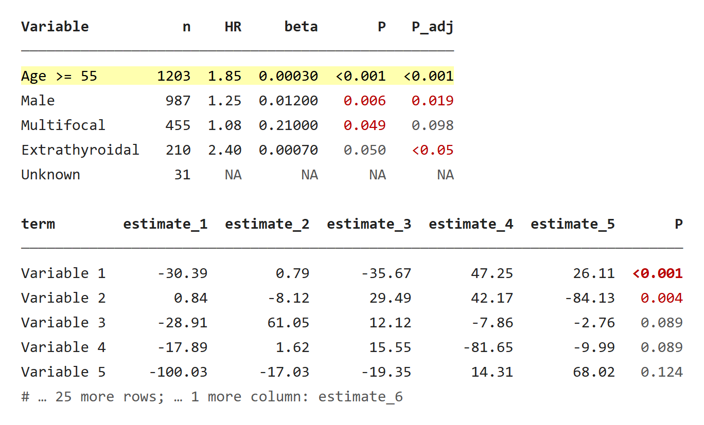
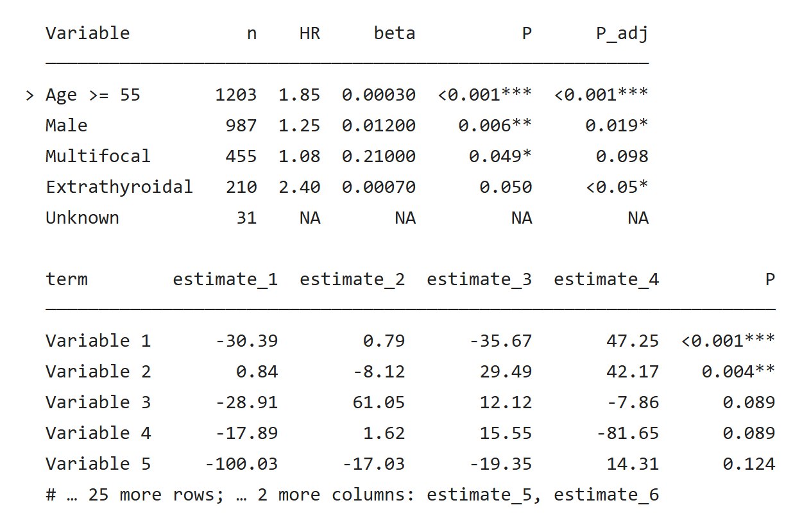
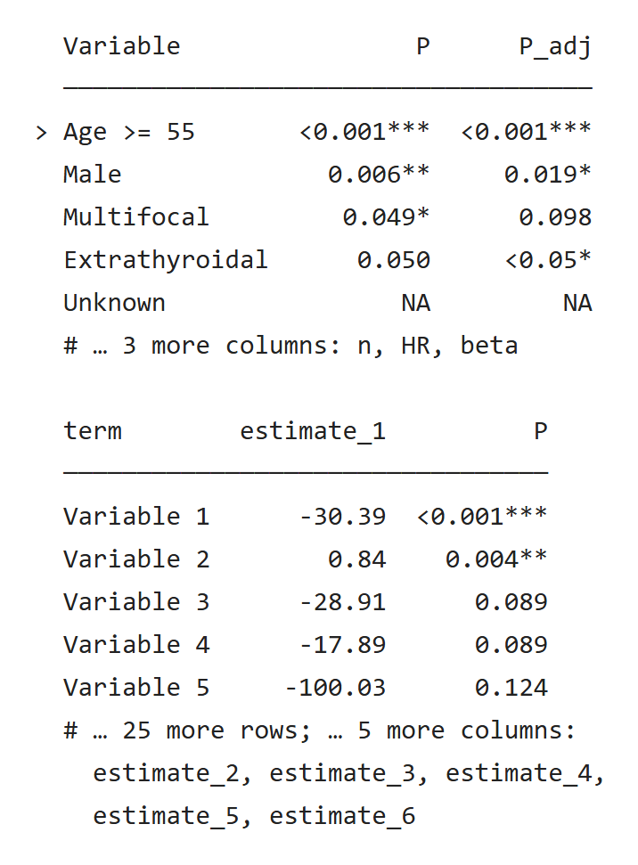
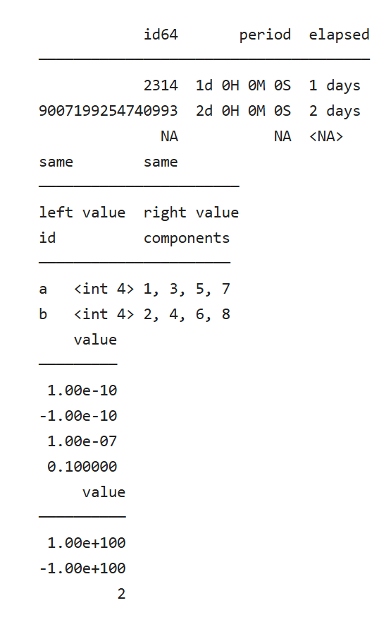
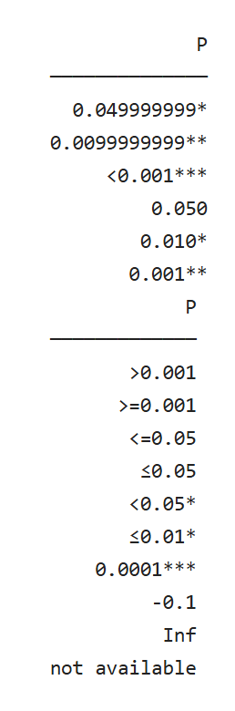
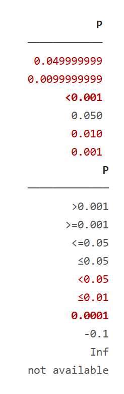
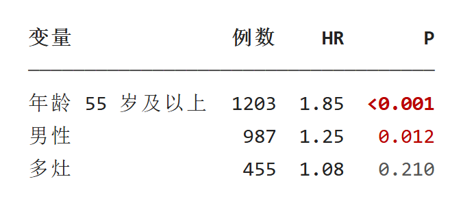

`pr_table(data, p_col = NULL, highlight = NULL, n = 20, align = NULL, digits = 2, width = NULL, indent = 2)` 把数据框打印成对齐的纯文本表：粗体表头、一条灰线，然后每行一条。它不修改数据，屏幕上省略的行列仍在对象里。

::: {.callout-note collapse="true" title="版本与复现记录"}
本轮补充按已推送 UtilsR `5a9d8eb`（0.6.14）导出源码，在 Windows / WSL R 4.4.3 独立运行。新增预览来自真实控制台输出；原有截图保留各自注明的历史快照。

:::

## 示例 {#example}

第一张表演示 P 值、位数、高亮和缺失值；第二张是 30 行、8 列的宽表，只显示前 5 行。

```r
library(UtilsR)

tab <- data.frame(
  Variable = c("Age >= 55", "Male", "Multifocal", "Extrathyroidal", "Unknown"),
  n        = c(1203L, 987L, 455L, 210L, 31L),
  HR       = c(1.853, 1.25, 1.083, 2.4, NA),
  beta     = c(0.0003, 0.012, 0.21, 0.0007, NA),
  P        = c(0.00004, 0.0062, 0.049, 0.05, NA),
  P_adj    = c("<0.001", "0.019", "0.098", "<0.05", NA))
pr_table(tab, p_col = c("P", "P_adj"), highlight = 1)

set.seed(20261025)
wide <- data.frame(term = paste("Variable", 1:30),
                   matrix(round(rnorm(30 * 6, 0, 50), 2), 30,
                          dimnames = list(NULL, paste0("estimate_", 1:6))),
                   P = sort(runif(30, 0, 0.6)))
wide$P[1:2] <- c(0.0004, 0.004)
pr_table(wide, p_col = "P", n = 5)
```

::: {.panel-tabset}

### 彩色终端 {.unnumbered}

{fig-alt="两张彩色表。第一张：第一行浅黄底，P 值 0.006 和 0.049 红色，0.050 灰色，P_adj 的 0.019 和 小于 0.05 红色，Unknown 行全为灰色 NA。第二张：5 行，P 列 小于 0.001 粗红、0.004 红，表尾灰字注明省略 25 行和 2 列。"}

[原生 HTML](images/table-color.html)

### 无色日志 {.unnumbered}

{fig-alt="同样两张表的无色输出：小于 0.001 加三星、0.006**、0.049*、0.050 无星号，P_adj 的 小于 0.05 加一星；第一行以大于号开头；表尾注明 25 more rows 与 2 more columns: estimate_5, estimate_6。"}

[原生 HTML](images/table-plain.html)

### 40 列窄屏 {.unnumbered}

{fig-alt="40 列宽的无色输出：第一张表只剩 Variable、P、P_adj 三列，表尾写明省略 n、HR、beta；第二张只剩 term、estimate_1 和 P，表尾的省略说明折成三行。"}

[原生 HTML](images/table-narrow.html)

:::

## P 值列 {#p-values}

`p_col` 指定 P 值列，可以不止一列。

- 数值列按 [`stat_pval(mode = "pvalue")`](https://hui950319.github.io/UtilsR/reference/stat_pval.html) 的写法显示，小于 0.001 写成 `<0.001`；文本列照原文。
- 颜色：小于 0.001 粗体红，小于 0.05 红，其余灰。阈值按原数值判断，`0.05` 本身不算显著，示例里的 `0.050` 是灰色、没有星号。
- 刚好低于 0.05 或 0.01、按三位小数会舍入成阈值的数值多显示几位：`0.0499` 写成 `0.0499*` 而不是 `0.050*`，`0.00999` 写成 `0.00999**`，文字与颜色、星号一致（0.6.12 起；`stat_pval()` 本身的写法不变）。
- 文本里的上界也能识别：`"<0.05"` 按低于 0.05 处理，显示为红色（无色时带一个星号）。
- 无色时用星号表达显著性：`***` 小于 0.001，`**` 小于 0.01，`*` 小于 0.05。
- `p_col` 写了数据里没有的列名时报错。

## 数值位数 {#numbers}

- 整数列原样显示。
- 小数列默认保留 `digits = 2` 位；整列都是整数值时不带小数。
- 如果一列里最小的非零绝对值按 `digits` 舍入后会变成 0，整列改为保留两位有效数字所需的位数，最多 6 位。示例的 `beta` 最小值是 0.0003，所以整列显示 5 位小数（`0.00030`、`0.21000`）。
- 数值缺失显示为灰色 `NA`；文本缺失在无色时写成 `<NA>`，与字符串 `"NA"` 区分。
- 列表列的每格按 `pr_tree()` 的写法描述，例如 `<dbl 2> 1.1, 2.2`，不再显示 `c(1.1, 2.2)` 这样的反解析文字（0.6.12 起）。

位数规则只管显示。需要论文格式的数字时，先用 UtilsR 的 `fmt_*` 函数把列转成文本再传入。


<!-- update-20261030: utils_print_table -->

### 带类数值、完整单元格与临界 P 值（2026-10-30） {#storage-pvalues-20261030}

UtilsR 0.6.14（`5a9d8eb`）按原类的格式化方法显示 `integer64`、`difftime` 和 lubridate 时间跨度，不再把底层 double 存储当作实际数值。大整数应从字符串构造：先写成普通 double 再转 integer64，已丢失的末位无法靠打印恢复。这些类分别需要 bit64、haven 或 lubridate 的可选方法；RDS 回读时也按存储类加载对应命名空间。

矩阵／数组列按数据行描述所有分量；重复或空列名仍按列位置读取。小到六位小数仍会显示为零的非零数，以及宽度容纳不下的巨大数，改用科学计数法。下例只有 **1–10 行人工显示样本**，用于核对打印，不是统计模型结果。

```r
library(UtilsR)
options(cli.num_colors = 1, cli.width = 80, width = 80)
stored30 <- data.frame(
  id64 = bit64::as.integer64(c("2314", "9007199254740993", NA)),
  period = lubridate::days(c(1, 2, NA)),
  elapsed = as.difftime(c(1, 2, NA), units = "days"))
pr_table(stored30)
repeated30 <- data.frame(first = "left value", second = "right value")
names(repeated30) <- c("same", "same")
pr_table(repeated30)
array30 <- data.frame(id = c("a", "b"))
array30$components <- array(1:8, dim = c(2, 2, 2))
pr_table(array30)
tiny30 <- data.frame(value = c(1e-10, -1e-10, 1e-7, .1))
huge30 <- data.frame(value = c(1e100, -1e100, 2))
pr_table(tiny30)
pr_table(huge30)

p_numeric30 <- data.frame(P = c(.049999999, .0099999999, .0009999999, .05, .01, .001))
p_text30 <- data.frame(P = c(">0.001", ">=0.001", "<=0.05", "\u22640.05",
  "<0.05", "\u22640.01", "0.0001", "-0.1", "Inf", "not available"))
pr_table(p_numeric30, p_col = "P")
pr_table(p_text30, p_col = "P")
```

文本范围只有在能保证低于阈值时才带相应星号或颜色。例如 `<0.05` 带一颗星，`<=0.05` 和 `≤0.05` 不能排除恰等于 0.05，因而不带星；`≤0.01` 只能保证低于 0.05，带一颗星。`>0.001`、`>=0.001` 没有显著性保证；无效数值文本也不赋星。数值型 P 值按未舍入值判断，必要时多显示小数；这项修复没有改写 `stat_pval()` 的通用接口。打印不能替代上游对 P 值有效性的检查。

::: {.panel-tabset}
#### 类型、重复列与数组 {.unnumbered}

{fig-alt="实际pr_table输出包含9007199254740993的完整位数、时间跨度、两个同名列的不同内容，以及数组各行的四个分量和科学计数法。"}

[原生 HTML](images/table-pvalue/20261030-update-table-storage.html)

#### 无色 P 值边界 {.unnumbered}

{fig-alt="临界数值保留足够小数，小于阈值的上界可赋星，含等号的0.05及下界与无效文本不带星号。"}

[原生 HTML](images/table-pvalue/20261030-update-table-pvalues-plain.html)

#### ANSI P 值边界 {.unnumbered}

{fig-alt="同一组实际P值输出模拟ANSI终端，符合阈值的范围标红，其余保持灰色。"}

[原生 HTML](images/table-pvalue/20261030-update-table-pvalues-colour.html)
:::

::: {.callout-note collapse="true" title="复核代码"}
仅重建网页预览时需要后半段的 HTML 保存函数；终端里直接运行上面的调用即可。

```r
storage_lines30 <- capture.output({
  pr_table(stored30); pr_table(repeated30); pr_table(array30)
  pr_table(tiny30); pr_table(huge30)
})
plain_p30 <- capture.output({
  pr_table(p_numeric30, p_col = "P"); pr_table(p_text30, p_col = "P")
})
colour_p30 <- withr::with_options(list(cli.num_colors = 256),
  capture.output({pr_table(p_numeric30, p_col = "P"); pr_table(p_text30, p_col = "P")}))
numeric_cells30 <- trimws(capture.output(pr_table(p_numeric30, p_col = "P")))[-(1:2)]
text_cells30 <- trimws(capture.output(pr_table(p_text30, p_col = "P")))[-(1:2)]
empty_names30 <- repeated30
names(empty_names30) <- c("", "")
empty_names_lines30 <- capture.output(pr_table(empty_names30))
stopifnot(any(grepl("9007199254740993", storage_lines30, fixed = TRUE)),
  any(grepl("1d 0H 0M 0S", storage_lines30, fixed = TRUE)),
  any(grepl("1 days", storage_lines30, fixed = TRUE)),
  any(grepl("left value +right value", storage_lines30)),
  any(grepl("left value +right value", empty_names_lines30)),
  any(grepl("<int 4> 1, 3, 5, 7", storage_lines30, fixed = TRUE)),
  any(grepl("<int 4> 2, 4, 6, 8", storage_lines30, fixed = TRUE)),
  any(grepl("1.00e-10", storage_lines30, fixed = TRUE)),
  any(grepl("1.00e+100", storage_lines30, fixed = TRUE)),
  identical(numeric_cells30, c("0.049999999*", "0.0099999999**", "<0.001***",
    "0.050", "0.010*", "0.001**")),
  identical(text_cells30, c(">0.001", ">=0.001", "<=0.05", "\u22640.05",
    "<0.05*", "\u22640.01*", "0.0001***", "-0.1", "Inf", "not available")),
  max(cli::ansi_nchar(storage_lines30, type = "width")) <= 80L,
  any(grepl("\033[", colour_p30, fixed = TRUE)))

# 复用本站预览方法：保留真实ANSI，将非制表线的非ASCII字符固定到终端显示宽度。
pin_console30 <- function(line) {
  ch <- strsplit(line, "")[[1]]
  for (k in which(vapply(ch, function(z) {
    u <- utf8ToInt(z)[1]
    u > 127L && !(u >= 0x2500L && u <= 0x257FL)
  }, logical(1)))) {
    w <- cli::ansi_nchar(ch[k], type = "width")
    if (w %in% 1:2) ch[k] <- sprintf('<span class="w%d">%s</span>', w, ch[k])
  }
  paste(ch, collapse = "")
}
save_console30 <- function(lines, name) {
  body <- paste(fansi::sgr_to_html(vapply(htmltools::htmlEscape(lines),
    pin_console30, "", USE.NAMES = FALSE)), collapse = "\n")
  writeLines(paste0('<!doctype html><meta charset="utf-8"><style>',
    'body{margin:0;background:white;color:#222}pre{margin:0;padding:20px;',
    'font:15px/1.6 Consolas,"DejaVu Sans Mono",monospace;white-space:pre;display:inline-block}',
    '.w1,.w2{display:inline-block;vertical-align:top}.w1{width:1ch}.w2{width:2ch}',
    '</style><pre data-native-console>', body, '</pre>'),
    file.path(tempdir(), paste0("20261030-update-", name, ".html")), useBytes = TRUE)
}
save_console30(storage_lines30, "table-storage")
save_console30(plain_p30, "table-pvalues-plain")
save_console30(colour_p30, "table-pvalues-colour")
validation_values <- list(rows = c(stored = nrow(stored30), repeated = nrow(repeated30),
  array = nrow(array30), numeric_p = nrow(p_numeric30), text_p = nrow(p_text30)),
  storage_lines = storage_lines30, numeric_p = numeric_cells30, text_p = text_cells30)
```
:::

<!-- /update-20261030: utils_print_table -->

## 高亮行 {#highlight}

`highlight` 接受行号或逻辑向量。高亮行整行浅黄底、黑字，**行内其他颜色去掉**，所以示例第一行的 `<0.001` 不是红色。无色时高亮行行首写 `>`，表格整体靠两格缩进对齐。

## 行数、宽度与省略 {#width}

- `n` 控制显示的行数，默认 20，`NULL` 显示全部。多出的行数写在表尾。
- 宽度默认取控制台宽度，可用 `width` 指定。首列和所有 P 值列总是显示，其余列按原顺序放到放不下为止；省略的列在表尾写出列名。首列和 P 值列合起来仍超出宽度时，首列用省略号截短（至少留 8 个字符），表格不再超出 `width`（0.6.12 起）。
- 表尾用灰色 `#` 行，过长时按宽度折行。
- 行名默认不显示。系数矩阵转成的数据框把变量名放在行名里，用 `rownames = TRUE` 把行名作为不带列名的首列显示（0.6.12 起）。不自动显示，是因为 `do.call(rbind, 命名列表)` 也会留下 `cox.1`、`cox.2` 这样的字符行名。

屏幕表只是摘要：省略的行列、未舍入的数值都在原对象里，程序里分析时直接读取对象。

## 对齐 {#align}

`align` 默认把数值列和 P 值列右对齐、其余列左对齐，也可以给 `"left"`、`"right"`、`"center"`，按列循环使用。列宽按显示宽度计算，中文占两列，中文表头和内容同样对齐：

```r
pr_table(data.frame(变量 = c("年龄 55 岁及以上", "男性", "多灶"),
                    例数 = c(1203L, 987L, 455L),
                    HR = c(1.85, 1.25, 1.08),
                    P = c(0.0003, 0.012, 0.21)), p_col = "P")
```

{fig-alt="中文表头变量、例数、HR、P 的彩色表，年龄 55 岁及以上、男性、多灶三行，数字列右对齐，P 值 小于 0.001 粗红、0.012 红、0.210 灰。"}

[原生 HTML](images/table-cjk-color.html)

终端里要真正对齐，需要中文正好占两个英文字符宽的等宽字体；字体不满足时会错位，见[打印显示问题排查](display-issues.qmd#cjk)。

## 什么时候直接打印 tibble {#vs-tibble}

tibble 自带的打印会显示列类型，列多时把放不下的列名列在表尾，也足够清楚。需要下面几项时才换成 `pr_table()`：P 值着色或星号、高亮某些行、中文列对齐、与其他 `pr_*` 输出统一缩进。causalR 的 `psw_res` 就保留了 tibble 的打印，见[各包结果打印实例](package-print-methods.qmd#causalr)。

## 更新记录 {#page-updates}

::: {.callout-note collapse="true" title="本页更新记录"}
- 2026-10-30：[0.6.14显示合同](#storage-pvalues-20261030)：保留存储类型、重复列和数组分量，核对极端数值与P值边界。
- 2026-10-25：按 UtilsR 0.6.12 补充[临界 P 值](#p-values)、[列表列](#numbers)与[首列截短、rownames](#width)。
:::
