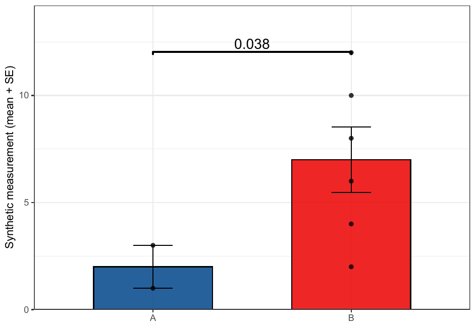
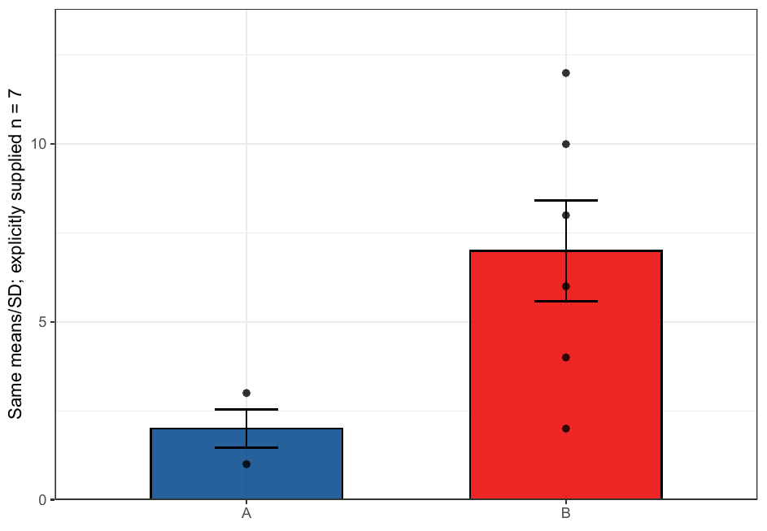
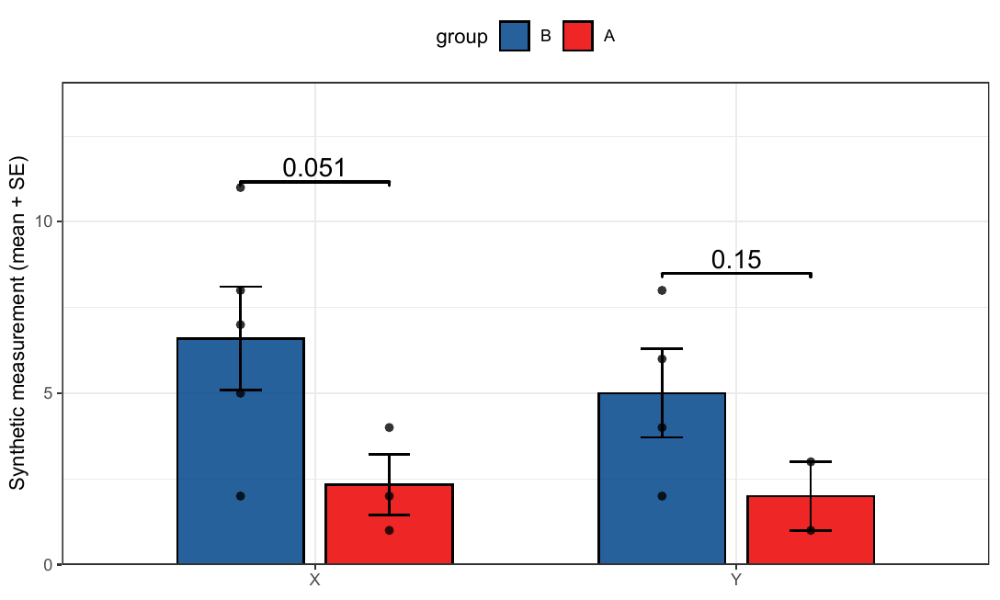
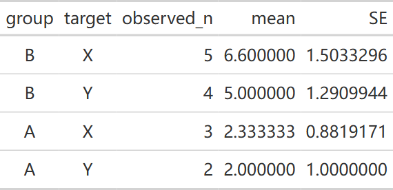

# LabR 概览

LabR 为基础实验数据出版级作图：CCK-8 增殖曲线、Western blot 灰度、qPCR 相对表达等。

**主要函数：** `plt_bar()`、`plt_cck8()`

参考文档：<https://hui950319.github.io/LabR/>

::: {.callout-note collapse="true" title="版本与复现记录"}
2026-10-26 按已推送 LabR 0.1.0 `b8ea9e5`，在 Windows / WSL R 4.4.3 运行本页 4–16 行合成数据。图中每行只代表一个示例测量，不对应真实受试者；没有用技术重复代替生物学重复。模块图保留[原快照](function-modules.qmd)。
:::

## 先确定每个误差线的重复数 {#observed-counts}

<!-- update-20261026: labr_counts -->

`plt_bar()` 可从 `raw_data` 计算均值与 SD；`error_type="se"` 再按 **每个 group×target 的非缺失 value 数**计算 `SD/sqrt(n)`。默认误差类型仍是 SD，`show_se` 这个名称不等于已选择 SE。传入真实散点时先确定独立重复单位，同一对象的多次技术测量应先按研究设计汇总。

### 不平衡重复与缺失值（2026-10-26）

A 有 3 行但只有 2 个观察值，B 有 6 个观察值；不能拿第一组的行数给所有误差线使用。下例也用各组自己的 n 做两独立组 Welch t 检验，图上显示格式化 P 值。绘图时剔除缺失散点的提示对应这里的 NA，不会把缺失值计入 n。

```r
library(LabR)
raw_bar26 <- data.frame(group = c(rep("A", 3), rep("B", 6)),
  value = c(1, 3, NA, 2, 4, 6, 8, 10, 12))
p_observed26 <- plt_bar(raw_data = raw_bar26, error_type = "se",
  com_method = "ref", sig_label = "p.format", bar_type = "default",
  point_type = "point", ggtheme = ggplot2::theme_bw(),
  ylab = "Synthetic measurement (mean + SE)")
ggplot2::ggsave(file.path(tempdir(), "20261026-update-labr-observed.pdf"),
  p_observed26, width = 6.5, height = 4.5)
```

::: {.callout-note collapse="true" title="复核代码"}

```r
observed_n26 <- c(A = 2L, B = 6L)
expected_se26 <- c(stats::sd(c(1, 3)) / sqrt(2), stats::sd(seq(2, 12, 2)) / sqrt(6))
reference_p26 <- stats::t.test(value ~ group, data = raw_bar26)[["p.value"]]
annotation26 <- p_observed26[["layers"]][[length(p_observed26[["layers"]])]][["stat_params"]][["annotations"]]
stopifnot(isTRUE(all.equal(p_observed26[["data"]][["error"]], expected_se26)),
  identical(annotation26, formatC(reference_p26, format = "g", digits = 2)))
error_layer26 <- ggplot2::ggplot_build(p_observed26)[["data"]][[2]]
stopifnot(isTRUE(all.equal(error_layer26[["ymax"]] - error_layer26[["ymin"]], 2 * expected_se26)))
```

:::

{fig-alt="原生柱图显示A和B的真实示例散点、均值及标准误，A的缺失测量不计入n，组间标注使用各自样本数的Welch检验。"}

[下载 PDF](images/index/20261026-update-labr-observed.pdf)

### 显式 n 的优先级（2026-10-26）

显式给 `n` 会覆盖自动推断，不是“帮助函数检查 n”。下面固定同一均值与 SD，只把误差分母指定为每组 7，因此与上图不同；这是说明参数优先级的反例，不能把不真实的 n 用于报告。向量 n 按汇总表的行顺序使用，重排汇总行时也要同步重排 n。

```r
p_override26 <- plt_bar(raw_data = raw_bar26, n = 7, error_type = "se",
  com_method = NULL, bar_type = "default", point_type = "point",
  ggtheme = ggplot2::theme_bw(), ylab = "Same means/SD; explicitly supplied n = 7")
ggplot2::ggsave(file.path(tempdir(), "20261026-update-labr-explicit-n.pdf"),
  p_override26, width = 6.5, height = 4.5)
```

::: {.callout-note collapse="true" title="复核代码"}

```r
stopifnot(isTRUE(all.equal(p_override26[["data"]][["error"]],
  p_override26[["data"]][["sd"]] / sqrt(7))))
```

:::

{fig-alt="同一组合成值显式指定每组n为7后，标准误按SD除以根号7计算；这张反例图用于说明参数优先级。"}

[下载 PDF](images/index/20261026-update-labr-explicit-n.pdf)

## 多靶点分别计算，不借用另一靶点的 n {#multiple-targets}

四个 group×target 单元的观察数分别计算。已提供汇总 `data` 时，同时给 `raw_data` 可按组名和靶点匹配 n；此时均值与 SD 仍取汇总表，不会被 raw_data 重新估计，需由调用者保证两者来自相同实验与尺度。

```r
raw_multi26 <- data.frame(
  group = rep(c("B", "A", "B", "A"), c(4, 3, 5, 4)),
  target = rep(c("Y", "Y", "X", "X"), c(4, 3, 5, 4)),
  value = c(2, 4, 6, 8, 1, 3, NA, 2, 5, 7, 8, 11, 1, 2, 4, NA))
p_multi26 <- plt_bar(raw_data = raw_multi26, error_type = "se",
  com_method = "ref", sig_label = "p.format", bar_type = "default",
  point_type = "point", ggtheme = ggplot2::theme_bw(),
  ylab = "Synthetic measurement (mean + SE)")
ggplot2::ggsave(file.path(tempdir(), "20261026-update-labr-targets.pdf"),
  p_multi26, width = 7.5, height = 4.5)
```

::: {.callout-note collapse="true" title="复核代码"}

```r
summary_multi26 <- p_multi26[["data"]]
count_multi26 <- vapply(seq_len(nrow(summary_multi26)), function(i) {
  sum(raw_multi26[["group"]] == as.character(summary_multi26[["group"]][i]) &
    raw_multi26[["target"]] == as.character(summary_multi26[["target"]][i]) &
    !is.na(raw_multi26[["value"]]))
}, integer(1))
stopifnot(isTRUE(all.equal(summary_multi26[["error"]], summary_multi26[["sd"]] / sqrt(count_multi26))))
p_by_target26 <- vapply(levels(summary_multi26[["target"]]), function(g)
  stats::t.test(value ~ group, data = raw_multi26[raw_multi26[["target"]] == g, ])[["p.value"]], numeric(1))
labels_multi26 <- p_multi26[["layers"]][[length(p_multi26[["layers"]])]][["stat_params"]][["annotations"]]
stopifnot(identical(labels_multi26, unname(formatC(p_by_target26, format = "g", digits = 2))))
preview_multi26 <- data.frame(group = summary_multi26[["group"]], target = summary_multi26[["target"]],
  observed_n = count_multi26, mean = summary_multi26[["mean"]], SE = summary_multi26[["error"]])
gt::gtsave(gt::gt(preview_multi26), file.path(tempdir(), "20261026-update-labr-counts.html"))
small_bar26 <- plt_bar(raw_data = data.frame(group = c("A", "A", "B", "B"), value = c(1, NA, 2, 4)),
  error_type = "se", com_method = "ref", sig_label = "p.format", point_type = "point", ggtheme = ggplot2::theme_bw())
stopifnot(identical(small_bar26[["layers"]][[length(small_bar26[["layers"]])]][["stat_params"]][["annotations"]], "NA"))
validation_values <- list(group_n = observed_n26, SE = expected_se26, p = reference_p26,
  targets = preview_multi26, target_p = p_by_target26, insufficient_label = "NA")
```

:::

::: {.panel-tabset}

### 图形 {.unnumbered}

{fig-alt="两靶点分组柱图使用相同16行合成数据，各靶点内部按各组非缺失测量数计算误差线和独立组Welch检验。"}

[下载 PDF](images/index/20261026-update-labr-targets.pdf)

### 观察数 {.unnumbered}

{fig-alt="原生表列出group、target、observed_n、均值和标准误，便于逐一核对每根误差线的分母。"}

[原生 HTML 表](images/index/20261026-update-labr-counts.html)

:::

某个比较组少于 2 个非缺失观察值，或 SD 不可计算时，比较显示 NA。它不是 P=1，也不是“无差异”。同一受试者配对、重复测量或批次相关不能用这个独立组 Welch 标注替代相应模型；多个比较的自动标注也不能当作已完成多重检验校正。

<!-- /update-20261026: labr_counts -->

## 更新记录 {#page-updates}

::: {.callout-note collapse="true" title="更新记录"}
- 2026-10-26：补充[实际观察数与显式 n](#observed-counts)、[多靶点分母](#multiple-targets)的原生图表与 Welch 核对。
:::
