`get_model_FeaSel()` 保留已评估子集与每个特征数的最佳结果。先查看搜索路径，再用 `get_selected_features()` 明确取出对应候选，最后在嵌套划分中观察选择频率和留出性能。

**执行范围：** 原有 9 张参数图保留 WSL R 4.4.3 的历史示例结果，包含 SFS、SBS、RFE、生存及嵌套 SFS。本轮另按 MLR `a4865f2` 在 Windows / WSL 执行下面的 60 行 RFECV 与模型留存核对，新增 1 张原生 PDF 预览；历史模型没有重新运行。

## 示例准备与读图规则 {#data}

生存示例使用 `ToyData::toy_ptc_m1_cnd` 的 598 人 M1 PTC 队列，175 个疾病特异死亡事件，time 单位为月，与 [ToyData 介绍](../toydata/index.qmd)一致。模型使用 Age、Sex、Tum_3；Unknown 是原有因子水平。二分类示例为固定种子的 300 行模拟数据，正类明确为 Yes，避免把删失生存记录直接当成完整二分类结局。

分类的前向/后向和嵌套示例固定 rpart；RFE 需要 importance 属性，使用 80 棵树的 ranger。因此 RFE 与前向图同时改变了算法和学习器，不能把差异归因于单一参数。生存示例固定 Cox，并优化 C-index。

```r
library(MLR)
library(ToyData)
library(ggplot2)

d <- as.data.frame(ToyData::toy_ptc_m1_cnd[,
  c("time", "DSS", "Age", "Sex", "Tum_3", "Race")])
d <- droplevels(d[complete.cases(d), ])
vars <- c("Age", "Sex", "Tum_3")
set.seed(246)
n <- 300L
dc <- data.frame(Age = runif(n, 20, 85),
  Sex = factor(sample(c("Female", "Male"), n, TRUE)),
  Marker = rnorm(n), Group = factor(sample(c("A", "B"), n, TRUE)))
prob <- plogis(-0.4 + (dc[["Age"]] - 50) / 20 +
  0.5 * (dc[["Sex"]] == "Male") + 0.8 * dc[["Marker"]] +
  0.7 * dc[["Marker"]] * (dc[["Group"]] == "B"))
dc[["Outcome"]] <- factor(ifelse(runif(n) < prob, "Yes", "No"),
  levels = c("No", "Yes"))
cvars <- c("Age", "Sex", "Marker", "Group")

library(mlr3)
library(mlr3proba)
library(mlr3learners)
task_c <- as_task_classif(dc[, c("Outcome", cvars)],
  target = "Outcome", positive = "Yes", id = "binary_demo")
task_s <- mlr3proba::as_task_surv(d[, c("time", "DSS", vars)],
  time = "time", event = "DSS", id = "ptc_demo")
tree <- lrn("classif.rpart", predict_type = "prob")
fsf <- get_model_FeaSel(task_c, learner = tree, method = "sfs",
  selector_args = list(max_features = 3), inner_resampling = rsmp("cv", folds = 3),
  backend = "sequential", seed = 246)
fsb <- get_model_FeaSel(task_c, learner = tree, method = "sbs",
  inner_resampling = rsmp("cv", folds = 3), backend = "sequential", seed = 246)
fsr <- get_model_FeaSel(task_c,
  learner = lrn("classif.ranger", predict_type = "prob", num.trees = 80,
    num.threads = 1, importance = "impurity"), method = "rfe",
  inner_resampling = rsmp("cv", folds = 3), backend = "sequential", seed = 246)
fsn <- get_model_FeaSel(task_c, learner = tree, method = "sfs",
  selector_args = list(max_features = 3), nested = TRUE,
  inner_resampling = rsmp("cv", folds = 2), outer_resampling = rsmp("cv", folds = 3),
  backend = "sequential", seed = 246)
fss <- get_model_FeaSel(task_s, learner = lrn("surv.coxph"), method = "sfs",
  selector_args = list(max_features = 3), inner_resampling = rsmp("cv", folds = 3),
  backend = "sequential", seed = 246)
```


## 接口、返回对象与分析流程 {#interface}

返回 `mlr_feature_selection`（另带任务类别），含 instance、archive、best_by_n、selected_features、selected_summary、tables 和 settings 等字段；嵌套时还提供 nested_result、nested_selections、outer_scores 和 stability。`archive` 是实际评估过的子集，不代表枚举了全部可能组合。

| 方法 | 选择规则与条件 |
|:--|:--|
| sfs / sbs | 前向加入 / 后向删去；selector_args 管理方法专用设置 |
| random_search / exhaustive_search | 随机搜索 / 枚举；高维枚举代价大 |
| rfe / rfecv | 重要性驱动的递归消除；要求学习器支持 importance |
| shadow_variable_search / genetic_search | 影子变量 / 遗传搜索；需要相应可选依赖 |

`n_evals` 主要是随机/遗传搜索的预算；顺序或递归路径要用方法专用配置，例如 max_features，不能仅凭较小 n_evals 假定限制了变量数量。

`get_selected_features(x)` 返回最终最佳子集。给定 n_features 时，从已经评估的该规模子集中取最佳结果；未评估规模会报错。改变 plt 的 n_features 只是移动高亮线，不会运行新的筛选。

该入口返回筛选结果，不提供已经用全部样本训练的最终 learner；需要取出变量后自行训练。nested = TRUE 在每个外层训练集重新筛选；频率表示外层选择稳定性，不表示变量的真实因果作用或统计显著性。


### RFECV 最终路径、x 列与模型留存（2026-10-27） {#rfecv-final-20261027}

<!-- update-20261027: mlr_latest_fs -->

按已推送 MLR `a4865f2`（含 `d4a600e`、`befdce5`、`fd8f1a3`、`a7be5f7`）核对。`rfecv` 的最终变量集合遵循原生 `instance$result_feature_set`；规范化 `archive`、`best_by_n` 只保留最终全数据重拟合路径。这里的 `score` 是 **in-sample 分数**，不能当成 RFECV 的交叉验证性能；各折搜索记录仍在 `instance$archive`。其他搜索方法的内层 CV 分数继续按各自方法解释。

下面用 60 行合成二分类数据、3 个特征和 20 棵树演示，故意把一个预测列命名为 `x`。`x` 是合法特征名，不再与上游 archive 转换器的参数重名冲突。

```r
library(MLR)
library(mlr3)
library(mlr3learners)
library(ggplot2)
set.seed(2710)
fs_data27 <- data.frame(x = seq(-2, 2, length.out = 60),
  noise1 = rnorm(60), noise2 = rnorm(60))
fs_data27[["Outcome"]] <- factor(ifelse(fs_data27[["x"]] > 0, "Yes", "No"),
  levels = c("No", "Yes"))
fs_task27 <- as_task_classif(fs_data27, target = "Outcome", positive = "Yes")
fs_original27 <- fs_task27$data()
fs_learner27 <- lrn("classif.ranger", predict_type = "prob", num.trees = 20,
  num.threads = 4, importance = "permutation")
fs_final27 <- get_model_FeaSel(fs_task27, learner = fs_learner27,
  method = "rfecv", selector_args = list(n_features = 1L),
  inner_resampling = rsmp("cv", folds = 2), backend = "sequential", seed = 17)
get_selected_features(fs_final27)
fs_path27 <- plt_model_FeaSel(fs_final27, type = "path") +
  labs(title = "RFECV final full-data refit path", y = "In-sample AUC",
    caption = "Selection follows the native RFECV result; this is not validation AUC.") +
  scale_y_continuous(breaks = seq(0, 1, .25)) + coord_cartesian(ylim = c(0, 1.02)) +
  guides(color = "none", fill = "none", shape = "none")
ggsave(file.path(tempdir(), "20261027-update-rfecv-final-path.pdf"), fs_path27,
  width = 7.5, height = 5)
```

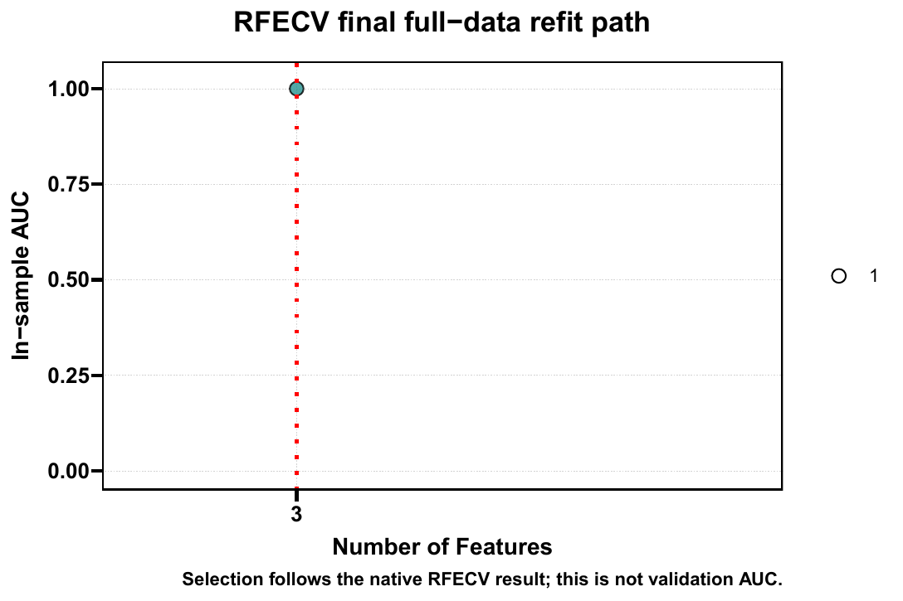{fig-alt="60 行合成数据的 RFECV 最终路径，横轴是特征数，纵轴明确标为 in-sample AUC，选择点遵循原生最终变量集合。"}

[原生 PDF](images/feature-selection-guide/20261027-update-rfecv-final-path.pdf)

本例原生最终结果保留 3 个特征，规范化归档只有这 1 个重拟合点，表观 AUC 为 1；图中的单点不能用来推断变量数与性能的趋势。原生 `geom_line()` 可能提示每组只有一个观测，这是没有可连接的第二点，不是拟合失败。

要估计筛选后的泛化性能，使用 `nested=TRUE` 的 `outer_scores`，每个外层训练集都重新筛选。`store_models=FALSE` 同时关闭内层候选模型留存，并在提取外层分数与稳定性后丢弃外层模型；`TRUE` 可供进一步查看模型。下面的两个外层折只核对接口与留存行为，不足以报告稳定的预测性能。

::: {.callout-note collapse="true" title="复核代码"}

```r
fs_native27 <- fs_final27[["instance"]]$result_feature_set
stopifnot(setequal(get_selected_features(fs_final27), fs_native27),
  all(is.na(fs_final27[["archive"]][["iteration"]])),
  any(!is.na(fs_final27[["instance"]]$archive$data[["iteration"]])),
  is.logical(fs_final27[["archive"]][["x"]]),
  identical(fs_task27$data(), fs_original27),
  fs_learner27$param_set$values[["num.threads"]] == 4,
  fs_final27[["instance"]]$objective$learner$param_set$values[["num.threads"]] == 1)
fs_nested27 <- lapply(c(FALSE, TRUE), function(store) {
  get_model_FeaSel(fs_task27, learner = lrn("classif.rpart", predict_type = "prob"),
    method = "sfs", selector_args = list(max_features = 1L), nested = TRUE,
    inner_resampling = rsmp("cv", folds = 2), outer_resampling = rsmp("cv", folds = 2),
    store_models = store, backend = "sequential", seed = 20)
})
fs_kept27 <- vapply(fs_nested27, function(z) {
  sum(vapply(z[["nested_result"]]$learners, function(learner) !is.null(learner$model), logical(1)))
}, integer(1))
stopifnot(identical(fs_kept27, c(0L, 2L)),
  isTRUE(all.equal(fs_nested27[[1]][["outer_scores"]][["score"]],
    fs_nested27[[2]][["outer_scores"]][["score"]])),
  identical(fs_task27$data(), fs_original27))
validation_values <- list(n = nrow(fs_data27),
  native = sort(fs_native27), selected = sort(get_selected_features(fs_final27)),
  path_scores = as.numeric(fs_final27[["archive"]][["score"]]),
  stored_outer_models = fs_kept27,
  outer_scores = as.numeric(fs_nested27[[1]][["outer_scores"]][["score"]]))
```
:::

AutoTuner 的内部学习器也在克隆后限制为单线程，调用者原对象的线程设置保持不变。本例执行了普通 ranger 与 rpart 路径；AutoTuner 及其图学习器的递归处理按源码核对，没有在本页另做完整调参或性能测试。

<!-- /update-20261027: mlr_latest_fs -->

## 选择方法与搜索路径

同一变量数可能评估多个子集。默认红线标出最终选择数目；它不是对特征数的显著性检验。

::: {.panel-tabset}


### 前向选择 {.unnumbered}


每个点为已评估子集的内层 CV 分数；连线连接各特征数的最佳子集。


```r
plt_model_FeaSel(fsf, type = "path")
```


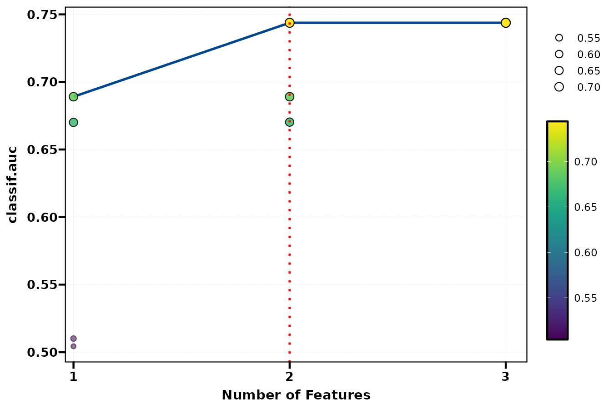{fig-alt="每个点为已评估子集的内层 CV 分数；连线连接各特征数的最佳子集。"}


### 后向选择 {.unnumbered}


从更多变量向少数变量删减；路径和前向搜索不同。


```r
plt_model_FeaSel(fsb, type = "path")
```


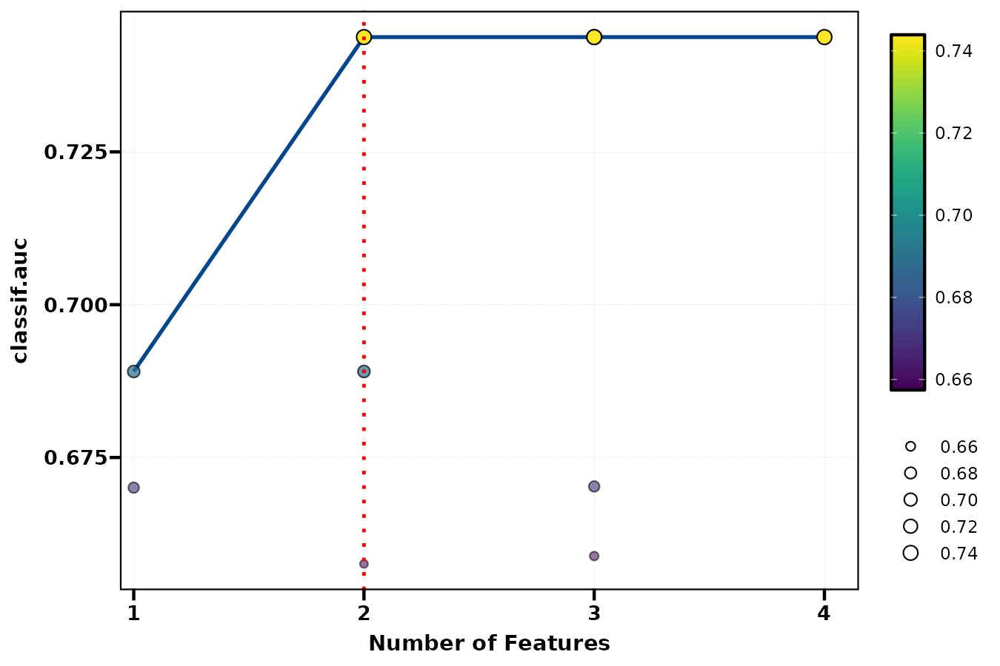{fig-alt="从更多变量向少数变量删减；路径和前向搜索不同。"}


### 递归重要性消除 {.unnumbered}


RFE 需支持 importance 的学习器，本例换用 ranger；同时改变算法与学习器。


```r
plt_model_FeaSel(fsr, type = "path")
```


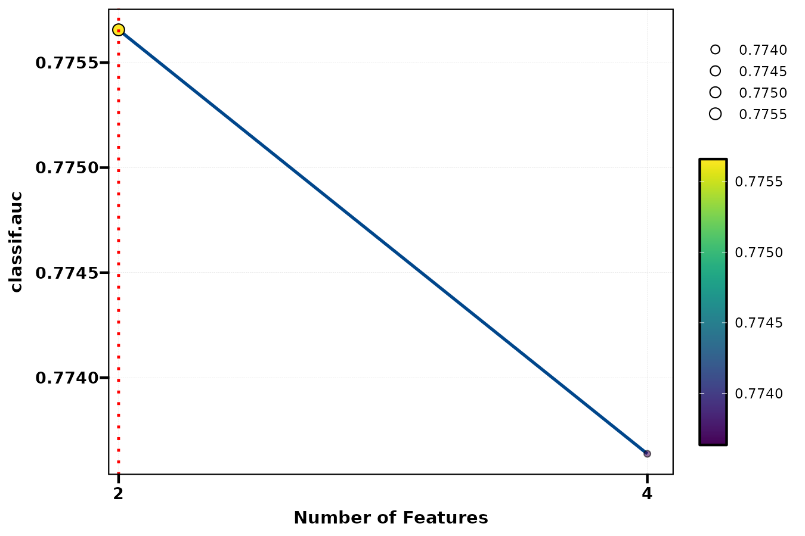{fig-alt="RFE 需支持 importance 的学习器，本例换用 ranger；同时改变算法与学习器。"}


### 生存 Cox {.unnumbered}


同一公开入口也支持生存，当前指标为 C-index，不能与 AUC 数值直接混用。


```r
plt_model_FeaSel(fss, type = "path")
```


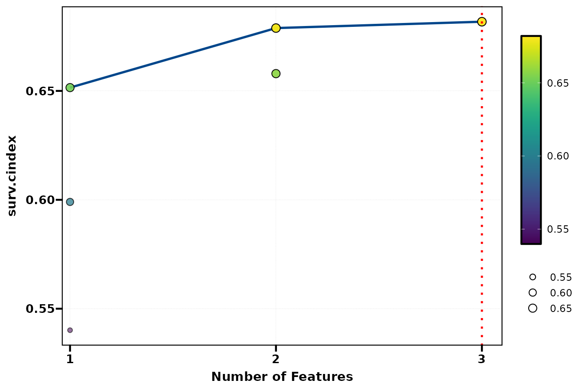{fig-alt="同一公开入口也支持生存，当前指标为 C-index，不能与 AUC 数值直接混用。"}


:::


## 候选规模与观察窗

`n_features` 从已评估集合中选择对应规模；它不会补算没有出现过的特征数。

::: {.panel-tabset}


### 强调 1 个变量 {.unnumbered}


红线改为已评估的一变量候选，未重新筛选或训练。


```r
plt_model_FeaSel(fsf, type = "path", n_features = 1)
```


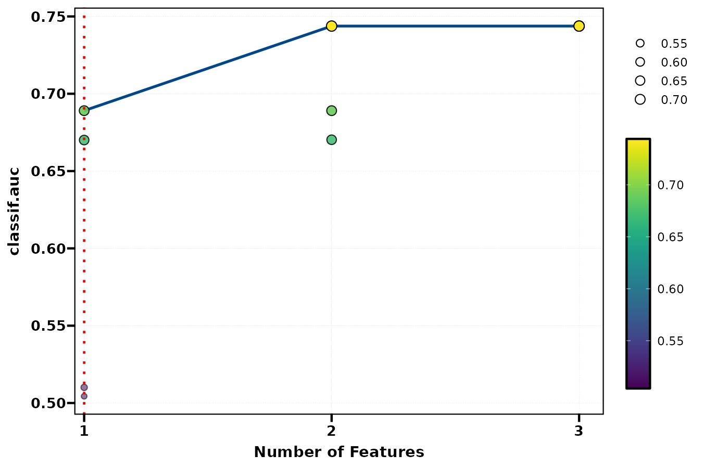{fig-alt="红线改为已评估的一变量候选，未重新筛选或训练。"}


### 强调 2 个变量 {.unnumbered}


两变量规模与观察窗一起改变；统计归档保持相同。


```r
plt_model_FeaSel(fsf, type = "path", n_features = 2, ylim = c(0.5, 0.9))
```


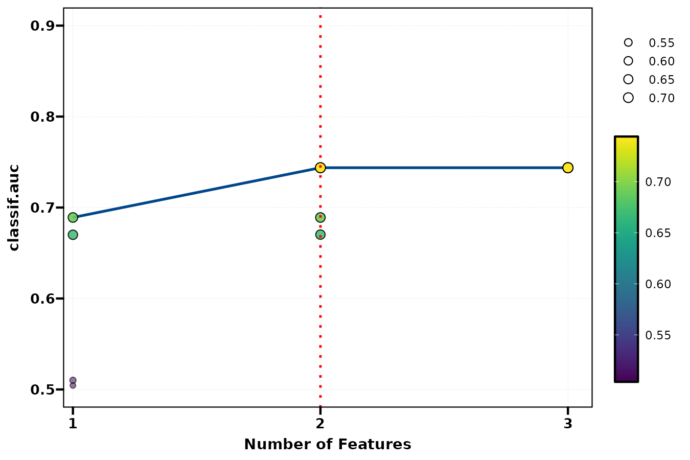{fig-alt="两变量规模与观察窗一起改变；统计归档保持相同。"}


:::


## 嵌套筛选与外层证据

每个外层训练集独立做内层筛选，外层测试集评估整个流程。频率只来自三个外层划分，用于接口演示。

::: {.panel-tabset}


### 全部变量频率 {.unnumbered}


嵌套外层训练集分别筛选，显示被选择的频率。


```r
plt_model_FeaSel(fsn, type = "stability")
```


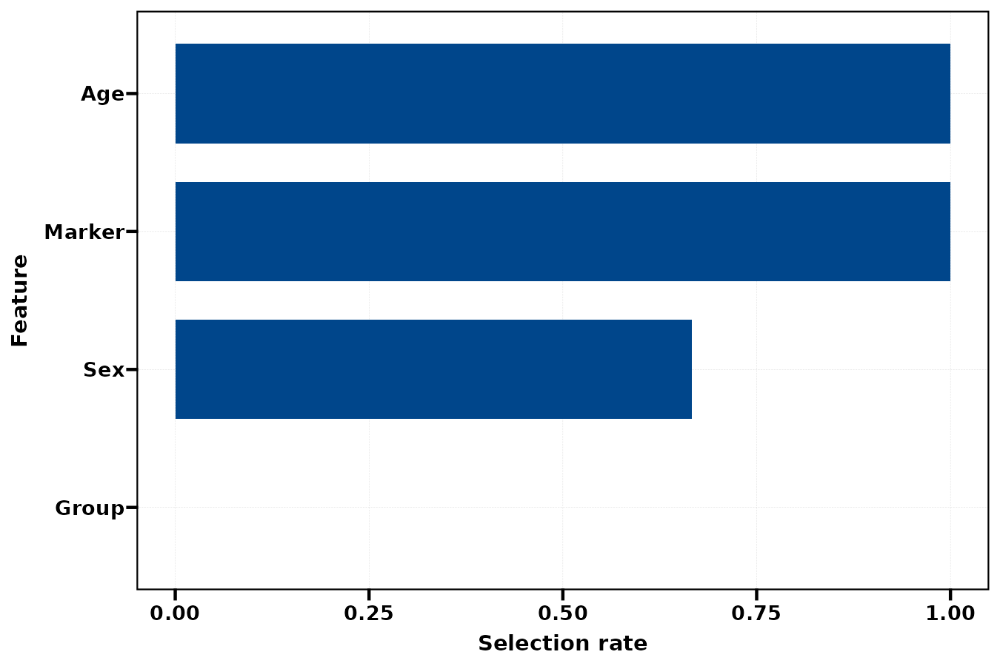{fig-alt="嵌套外层训练集分别筛选，显示被选择的频率。"}


### 前 2 个变量 {.unnumbered}


top_n 控制显示项数；频率不是因果效应或假发现率。


```r
plt_model_FeaSel(fsn, type = "stability", top_n = 2, ylim = c(0, 1))
```


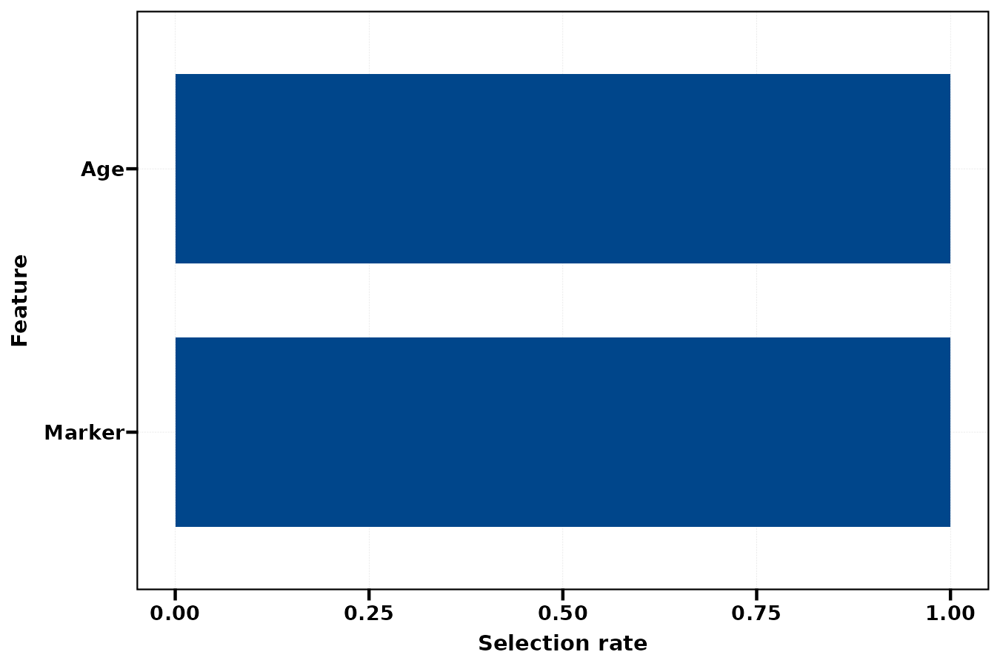{fig-alt="top_n 控制显示项数；频率不是因果效应或假发现率。"}


### 外层性能 {.unnumbered}


留出集分数反映训练折内筛选流程，和最高内层分数含义不同。


```r
plt_model_FeaSel(fsn, type = "outer_performance", ylim = c(0.5, 0.9))
```


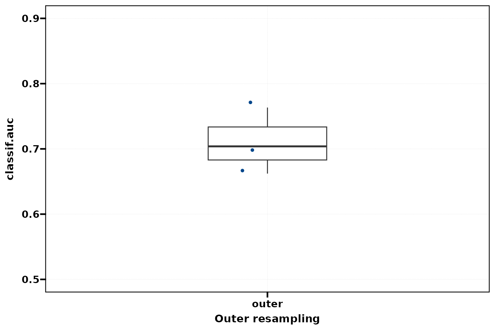{fig-alt="留出集分数反映训练折内筛选流程，和最高内层分数含义不同。"}


:::


## 当前按内容保存：特征选择路径 {#save-20261020}

2026-10-20 按已推送 MLR `e915077e`（接口自 `bcd7ede`）与 RegR `da6157be`，在 Windows / WSL R 4.4.3 实际运行下例。上方历史结果保留原执行记录；本节另用 180 行固定种子模拟数据，较小计算预算只用于接口演示。

当前 `plt_model_FeaSel()` 支持 `save = list(filename = ...)`。省略 `width` / `height` 时，按面板、轴文字、条带和图例估算 PDF 画布；控制台打印尺寸，返回图携带 `attr(p, "plot_size")`。`list()` 或 `NULL` 不写文件；明确给出的尺寸覆盖对应维度，单位是英寸。相同包版本号的旧安装可能还没有此接口，应核对提交和 `names(formals(...))`。

<!-- refresh-20261020: feasel_save -->
```r
library(MLR)
library(mlr3)
library(mlr3learners)
set.seed(20261020)
n_save <- 180L
d_save <- data.frame(Age = rnorm(n_save, 55, 10), Marker = rnorm(n_save),
  Sex = factor(rep(c("Female", "Male"), n_save / 2)))
d_save[["Outcome"]] <- factor(ifelse(runif(n_save) < plogis(
  -0.3 + 0.04 * (d_save[["Age"]] - 55) + 0.5 * d_save[["Marker"]]),
  "Yes", "No"), levels = c("No", "Yes"))
task_save <- as_task_classif(d_save, target = "Outcome", positive = "Yes")
fs_save <- get_model_FeaSel(task_save,
  learner = lrn("classif.rpart", predict_type = "prob"), method = "sfs",
  selector_args = list(max_features = 2), inner_resampling = rsmp("cv", folds = 2),
  backend = "sequential", seed = 20261020)
p_saved <- plt_model_FeaSel(fs_save, type = "path",
  save = list(filename = file.path(tempdir(), "20261020-refresh-feasel.pdf")))
size <- attr(p_saved, "plot_size")
size
```

::: {.callout-note collapse="true" title="复核代码"}
生成本页时运行的检查，接在上面的代码之后运行；只读教程可以跳过。

```r
stopifnot(length(size) == 2L, all(is.finite(size)), all(size > 0))
```
:::

<!-- /refresh-20261020: feasel_save -->

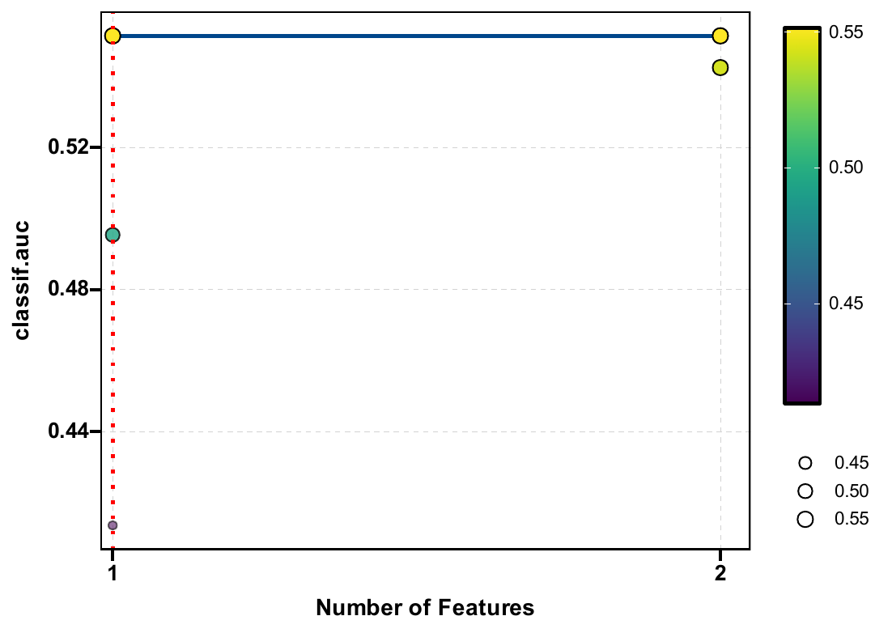{fig-alt="固定模拟数据的特征选择路径保存示例，预览由实际导出的PDF转换；用于核对内容、图例和文字边界。"}

[下载 feasel PDF](images/feature-selection-guide/20261020-refresh-feasel.pdf)。

保存的是已评估的选择路径，不会再次筛选变量；此非嵌套小示例只演示文件输出。

## 参数调整、保存与使用边界 {#parameters}

| 参数 | 影响 | 对照 |
|:--|:--|:--|
| method / learner | 子集搜索与打分模型 | SFS、SBS、RFE；Cox/rpart/ranger |
| selector_args | 方法专用设置 | SFS 的 max_features = 3 |
| measure / positive | 优化指标与方向 | C-index / AUC；分类正类 Yes |
| inner_resampling / nested / outer_resampling | 搜索和评估划分 | 全数据搜索与嵌套外层 |
| n_features | 展示或读取已评估规模 | 1 / 2；不补算未评估规模 |
| top_n / ylim | 稳定性显示与观察窗 | 所有变量 / 前两项；0–1 频率 |

## 取出结果与表格

```r
get_selected_features(fsf)
get_selected_features(fsf, n_features = 2)
tb_model_FeaSel(fsf, type = "path")
tb_model_FeaSel(fsf, type = "selected")
tb_model_FeaSel(fsn, type = "stability", top_n = 2)
tb_model_FeaSel(fsn, type = "outer_performance")
```

公开入口实际读回的分类 SFS 结果：

| 规模 | 变量 |
| :-- | :-- |
| best | Age, Marker |
| one | Marker |
| two | Age, Marker |

```r
p <- plt_model_FeaSel(fsf, type = "path", n_features = 2)
ggplot2::ggsave("feature-selection.pdf", p, width = 9, height = 6)
chosen <- get_selected_features(fsf)
task_final <- task_c$clone(deep = TRUE)
task_final$select(chosen)
fit <- tree$clone(deep = TRUE)
fit$train(task_final)
```

如果后续只把全数据选出的变量交给普通 CV，筛选信息已经泄露到测试折。评估时需在每个训练折重做筛选，或直接保留本入口的嵌套流程。三个外层折的稳定频率只适合演示，没有足够精度支撑“稳定生物标志物”的结论。

## 相关页面与源码 {#references}

- [模型筛选](model-selection-guide.qmd)
- [超参数调优](hyper-tuning-guide.qmd)
- [模型评估](model-evaluation-guide.html)
- [`get_model_FeaSel()` 帮助页](https://hui950319.github.io/MLR/reference/get_model_FeaSel.html)
- [mlr3fselect 官方文档](https://mlr3fselect.mlr-org.com/)

本页图片来自上面的实际公共调用。使用固定示例、固定随机种子和注明的小规模设置，图形用于学习接口及解释预测结果。
五条实际筛选路径完成；九张图通过构建，get_selected_features 的默认与 1/2 变量读回成功；path / stability 的 flextable 返回已实际验证。

## 更新记录 {#page-updates}

::: {.callout-note collapse="true" title="本页更新记录"}
- 2026-10-27：补充[RFECV 最终路径与模型留存](#rfecv-final-20261027)，区分重拟合分数和外层验证分数。
:::
