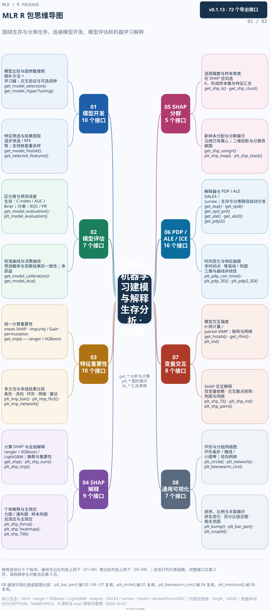
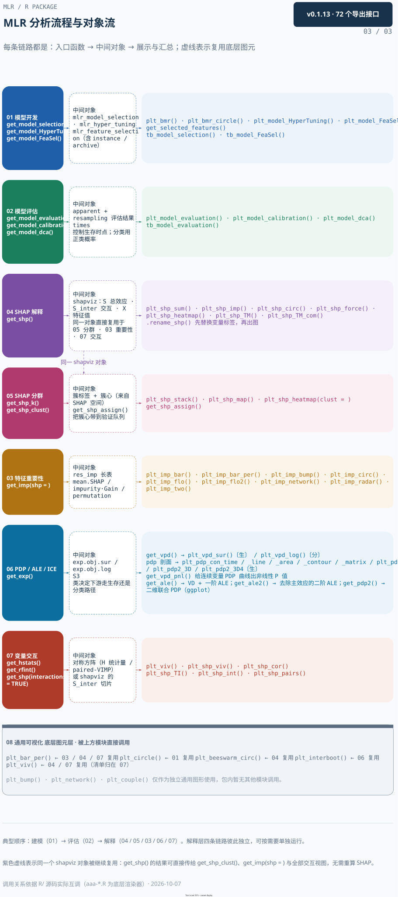
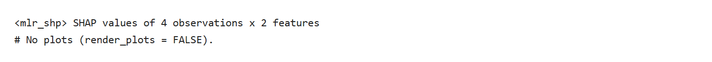

机器学习模型开发与解释：特征选择、评估、重要性、SHAP、PDP / ICE、ALE 和变量交互。

本页集中展示三张图：先看功能总览，再查接口索引，最后看处理流程与返回对象。**点击图片可放大查看**，也可下载图源继续编辑。

[下载 draw.io 图源](../assets/module-maps/mlr/mlr-package-mindmap.drawio){.btn .btn-outline-primary download="mlr-package-mindmap.drawio"}
[下载三页 PDF](../assets/module-maps/mlr/mlr-package-mindmap.drawio.pdf){.btn .btn-outline-secondary download="mlr-package-mindmap.drawio.pdf"}

2026-10-15按已推送MLR `c5b85af` 核对：显式导出仍为72项。plt_couple()支持onehot和编码后add_name，get_rfint()支持int_var，plt_shp_TI()使用跨行对齐网格；对应页面已补实际图形，原图谱快照保留。

图谱快照：**2026-10-07**。对应包版本：**0.1.13**。具体参数和返回值以当前安装版本的帮助页为准。

## 功能总览

{width=100% fig-alt="MLR 的功能总览；点击图片可放大阅读。"}

[查看原尺寸 PNG](../assets/module-maps/mlr/mlr-package-mindmap-p1.drawio.png)

## 完整函数索引

{width=100% fig-alt="MLR 的完整函数索引；点击图片可放大阅读。"}

[查看原尺寸 PNG](../assets/module-maps/mlr/mlr-package-mindmap-p2.drawio.png)

## 可搜索的函数索引 {#function-index}

当前 `NAMESPACE` 的 **72 个导出接口**逐项列在下面；函数名链接到参考页或本页说明。
`get_ale()` 的按组曲线是一阶 ALE；`get_ale2()` 去除两个主效应后展示二阶 ALE；
`get_pdp2()` 则保留两个变量的联合响应。二维 ALE 的解释还取决于预测尺度和模型，详见帮助页。

::: {.table-responsive}

| 模块 | 导出接口与帮助 | 用途 |
|:--|:--|:--|
| 01 模型开发 | [`get_model_selection()`](https://hui950319.github.io/MLR/reference/get_model_selection.html) | 插补 × 学习器基准比较 |
| 01 模型开发 | [`get_model_HyperTuning()`](https://hui950319.github.io/MLR/reference/get_model_HyperTuning.html) | 单学习器超参数调优 |
| 01 模型开发 | [`get_model_FeaSel()`](https://hui950319.github.io/MLR/reference/get_model_FeaSel.html) | 特征选择（8 种方法） |
| 01 模型开发 | [`get_selected_features()`](https://hui950319.github.io/MLR/reference/get_selected_features.html) | 提取入选变量 |
| 01 模型开发 | [`plt_bmr()`](https://hui950319.github.io/MLR/reference/plt_bmr.html) | 基准分数半小提琴图 |
| 01 模型开发 | [`plt_bmr_circle()`](https://hui950319.github.io/MLR/reference/plt_bmr_circle.html) | 基准分数环形布局 |
| 01 模型开发 | [`plt_model_HyperTuning()`](https://hui950319.github.io/MLR/reference/plt_model_HyperTuning.html) | 调参档案热图 / 曲面 |
| 01 模型开发 | [`plt_model_FeaSel()`](https://hui950319.github.io/MLR/reference/plt_model_FeaSel.html) | 选择路径与稳定性 |
| 01 模型开发 | [`tb_model_selection()`](https://hui950319.github.io/MLR/reference/tb_model_selection.html) | 基准结果出版级表 |
| 01 模型开发 | [`tb_model_FeaSel()`](https://hui950319.github.io/MLR/reference/tb_model_FeaSel.html) | 特征选择汇总表 |
| 02 模型评估 | [`get_model_evaluation()`](https://hui950319.github.io/MLR/reference/get_model_evaluation.html) | 重抽样 C-index / AUC / Brier |
| 02 模型评估 | [`get_model_calibration()`](https://hui950319.github.io/MLR/reference/get_model_calibration.html) | Bootstrap 校准曲线 |
| 02 模型评估 | [`get_model_dca()`](https://hui950319.github.io/MLR/reference/get_model_dca.html) | 决策曲线净获益 |
| 02 模型评估 | [`plt_model_evaluation()`](https://hui950319.github.io/MLR/reference/plt_model_evaluation.html) | AUC / ROC / PR / 混淆矩阵 |
| 02 模型评估 | [`plt_model_calibration()`](https://hui950319.github.io/MLR/reference/plt_model_calibration.html) | 校准曲线（KM 校正） |
| 02 模型评估 | [`plt_model_dca()`](https://hui950319.github.io/MLR/reference/plt_model_dca.html) | 决策曲线图 |
| 02 模型评估 | [`tb_model_evaluation()`](https://hui950319.github.io/MLR/reference/tb_model_evaluation.html) | 评估结果汇总表 |
| 03 特征重要性 | [`get_imp()`](https://hui950319.github.io/MLR/reference/get_imp.html) | SHAP / impurity / permutation；[重复与稳定性](imp-guide.qmd#importance-repeat-current) |
| 03 特征重要性 | [`plt_imp_bar()`](https://hui950319.github.io/MLR/reference/plt_imp_bar.html) | 重要性条形 / 棒棒糖 |
| 03 特征重要性 | [`plt_imp_bar_per()`](https://hui950319.github.io/MLR/reference/plt_imp_bar_per.html) | 条形 ＋ 百分比环组合 |
| 03 特征重要性 | [`plt_imp_bump()`](https://hui950319.github.io/MLR/reference/plt_imp_bump.html) | 方法间排名变化 |
| 03 特征重要性 | [`plt_imp_circ()`](https://hui950319.github.io/MLR/reference/plt_imp_circ.html) | circlize 环形柱 |
| 03 特征重要性 | [`plt_imp_flo()`](https://hui950319.github.io/MLR/reference/plt_imp_flo.html) | 三方法排名冲积图 |
| 03 特征重要性 | [`plt_imp_flo2()`](https://hui950319.github.io/MLR/reference/plt_imp_flo2.html) | 带间隙冲积图 |
| 03 特征重要性 | [`plt_imp_network()`](https://hui950319.github.io/MLR/reference/plt_imp_network.html) | 径向层次网络 |
| 03 特征重要性 | [`plt_imp_radar()`](https://hui950319.github.io/MLR/reference/plt_imp_radar.html) | 相对重要性雷达 |
| 03 特征重要性 | [`plt_imp_two()`](https://hui950319.github.io/MLR/reference/plt_imp_two.html) | 两方法排名散点 |
| 04 SHAP 解释 | [`get_shp()`](https://hui950319.github.io/MLR/reference/get_shp.html) | 计算 SHAP（含交互） |
| 04 SHAP 解释 | [`plt_shp_sum()`](https://hui950319.github.io/MLR/reference/plt_shp_sum.html) | 蜂群摘要图 |
| 04 SHAP 解释 | [`plt_shp_imp()`](https://hui950319.github.io/MLR/reference/plt_shp_imp.html) | mean\|SHAP\| 条形 / 极坐标 |
| 04 SHAP 解释 | [`plt_shp_circ()`](https://hui950319.github.io/MLR/reference/plt_shp_circ.html) | 环形 SHAP 摘要 |
| 04 SHAP 解释 | [`plt_shp_force()`](https://hui950319.github.io/MLR/reference/plt_shp_force.html) | 单样本力图 / 瀑布图 |
| 04 SHAP 解释 | [`plt_shp_heatmap()`](https://hui950319.github.io/MLR/reference/plt_shp_heatmap.html) | 样本 × 特征热图 |
| 04 SHAP 解释 | [`plt_shp_TM()`](https://hui950319.github.io/MLR/reference/plt_shp_TM.html) | 总效应 / 主效应面板 |
| 04 SHAP 解释 | [`plt_shp_TM_com()`](https://hui950319.github.io/MLR/reference/plt_shp_TM_com.html) | 总效应 vs 主效应检验 |
| 04 SHAP 解释 | [`.rename_shp()`](https://hui950319.github.io/MLR/reference/dot-rename_shp.html) | 变量名 → 标签字典替换 |
| 05 SHAP 分群 | [`get_shp_k()`](https://hui950319.github.io/MLR/reference/get_shp_k.html) | 选 K：肘 / 轮廓 / gap |
| 05 SHAP 分群 | [`get_shp_clust()`](https://hui950319.github.io/MLR/reference/get_shp_clust.html) | SHAP 空间聚类 |
| 05 SHAP 分群 | [`get_shp_assign()`](https://hui950319.github.io/MLR/reference/get_shp_assign.html) | 新队列按簇心分配 |
| 05 SHAP 分群 | [`plt_shp_stack()`](https://hui950319.github.io/MLR/reference/plt_shp_stack.html) | 分簇堆叠力图 |
| 05 SHAP 分群 | [`plt_shp_map()`](https://hui950319.github.io/MLR/reference/plt_shp_map.html) | PCA / UMAP / t-SNE 投影 |
| 06 PDP / ALE / ICE | [`get_exp()`](https://hui950319.github.io/MLR/reference/get_exp.html) | 构建 DALEX / survex 解释器 |
| 06 PDP / ALE / ICE | [`get_vpd()`](https://hui950319.github.io/MLR/reference/get_vpd.html) | vd + pd 自动分发 |
| 06 PDP / ALE / ICE | [`get_vpd_pnl()`](https://hui950319.github.io/MLR/reference/get_vpd_pnl.html) | PDP 曲线非线性 P 值 |
| 06 PDP / ALE / ICE | [`get_ale()`](#fn-get-ale) | VD + 一阶 ALE（含按组计算） |
| 06 PDP / ALE / ICE | [`get_ale2()`](#fn-get-ale2) | 二阶 ALE：[网格与统一入口](vpd-guide.qmd#ale-grid-current) |
| 06 PDP / ALE / ICE | [`get_pdp2()`](#fn-get-pdp2) | 二维 PDP：主效应与交互的联合响应 |
| 06 PDP / ALE / ICE | [`plt_vpd_sur()`](https://hui950319.github.io/MLR/reference/plt_vpd_sur.html) | 生存路径 vd + pd |
| 06 PDP / ALE / ICE | [`plt_vpd_log()`](https://hui950319.github.io/MLR/reference/plt_vpd_log.html) | 分类路径 vd + pd |
| 06 PDP / ALE / ICE | [`plt_pdp_con_time()`](https://hui950319.github.io/MLR/reference/plt_pdp_con_time.html) | 多时点折线 |
| 06 PDP / ALE / ICE | [`plt_pdp_con_line()`](https://hui950319.github.io/MLR/reference/plt_pdp_con_line.html) | 固定取值多线 |
| 06 PDP / ALE / ICE | [`plt_pdp_con_area()`](https://hui950319.github.io/MLR/reference/plt_pdp_con_area.html) | 渐变色折线 |
| 06 PDP / ALE / ICE | [`plt_pdp_con_contour()`](https://hui950319.github.io/MLR/reference/plt_pdp_con_contour.html) | 填充等高线 |
| 06 PDP / ALE / ICE | [`plt_pdp_con_matrix()`](https://hui950319.github.io/MLR/reference/plt_pdp_con_matrix.html) | 分箱矩阵热图 |
| 06 PDP / ALE / ICE | [`plt_pdp_3D()`](https://hui950319.github.io/MLR/reference/plt_pdp_3D.html) | 单变量三维曲面 |
| 06 PDP / ALE / ICE | [`plt_pdp2_3D()`](https://hui950319.github.io/MLR/reference/plt_pdp2_3D.html) | 连续 × 分类三维 |
| 06 PDP / ALE / ICE | [`plt_pdp2_3D4()`](https://hui950319.github.io/MLR/reference/plt_pdp2_3D4.html) | 连续 × 连续三维散点 |
| 07 变量交互 | [`get_hstats()`](https://hui950319.github.io/MLR/reference/get_hstats.html) | ranger H 统计量方阵 |
| 07 变量交互 | [`get_rfint()`](https://hui950319.github.io/MLR/reference/get_rfint.html) | paired-VIMP方阵；int_var仅计算锚点配对 |
| 07 变量交互 | [`plt_viv()`](https://hui950319.github.io/MLR/reference/plt_viv.html) | VIV 方阵热图 / 网络 |
| 07 变量交互 | [`plt_shp_TI()`](https://hui950319.github.io/MLR/reference/plt_shp_TI.html) | 双变量交互依赖 |
| 07 变量交互 | [`plt_shp_int()`](https://hui950319.github.io/MLR/reference/plt_shp_int.html) | 单参照变量交互视图 |
| 07 变量交互 | [`plt_shp_pairs()`](https://hui950319.github.io/MLR/reference/plt_shp_pairs.html) | 交互散点矩阵 |
| 07 变量交互 | [`plt_shp_viv()`](https://hui950319.github.io/MLR/reference/plt_shp_viv.html) | SHAP 交互热图 / 网络 |
| 07 变量交互 | [`plt_shp_cor()`](https://hui950319.github.io/MLR/reference/plt_shp_cor.html) | 交互热图 ＋ 列和条 |
| 08 通用可视化 | [`plt_bar_per()`](https://hui950319.github.io/MLR/reference/plt_bar_per.html) | 条形 / 百分比环底层 |
| 08 通用可视化 | [`plt_beeswarm_circ()`](https://hui950319.github.io/MLR/reference/plt_beeswarm_circ.html) | 环形蜂群 |
| 08 通用可视化 | [`plt_bump()`](https://hui950319.github.io/MLR/reference/plt_bump.html) | 排名轨迹图 |
| 08 通用可视化 | [`plt_circle()`](https://hui950319.github.io/MLR/reference/plt_circle.html) | 环形柱 / 箱线 / 小提琴 |
| 08 通用可视化 | [`plt_couple()`](couple-guide.qmd) | 相关热图与连线；分类编码、五组样式与当前实图 |
| 08 通用可视化 | [`plt_interboot()`](https://hui950319.github.io/MLR/reference/plt_interboot.html) | Bootstrap 分组小提琴 |
| 08 通用可视化 | [`plt_network()`](https://hui950319.github.io/MLR/reference/plt_network.html) | 通用径向网络 |

:::

## ALE 与二维 PDP 入口

以下说明按 2026-10-07 的本地源码与帮助文件核对。三个入口均接受 `get_exp()` 返回的
生存或二分类解释器，也接受用于构造解释器的参数 list；生存解释在解释器指定的预测时点计算。

### get_ale()：一阶局部效应 {#fn-get-ale}

```r
get_ale(EXP.obj, exp_var = "Sex", N = 10000,
        tidy_plot = TRUE, cores = NULL)
```

返回上方变量分布、下方一阶 ALE 的 patchwork 组合图。`exp_var = c(group, focus)`
是在同一模型下分别计算各组的一阶 ALE，不是二阶交互。ALE 中心化到均值零；
纵轴表示预测相对变化，不能当作绝对生存概率。

### get_ale2()：二阶局部效应 {#fn-get-ale2}

```r
get_ale2(EXP.obj, exp_var, N = 10000,
         scale = "link", engine = "iml", cores = NULL, save = list())
```

`exp_var` 指定两个不同变量。返回 ggplot，其 `data` 含 `x1`、`x2` 和 `ale`，
去除两个主效应后展示模型的二阶局部效应；可选 `engine = "ale"`。
默认 `"link"` 在生存任务用 `log(-log(S(t)))`，二分类用 logit。
Cox / Logistic 的加性结构可在该尺度解释；森林并不在此尺度拟合，建议用
`scale = "prob"`，并注意概率尺度的非线性本身也可能产生交互形状。

### get_pdp2()：二维联合响应 {#fn-get-pdp2}

```r
get_pdp2(EXP.obj, exp_var, N = 1000,
         scale = "prob", engine = "iml", cores = NULL, save = list())
```

返回 ggplot，其 `data` 含 `x1`、`x2` 和 `pd`，保留两个主效应与交互的联合响应。
默认 `"prob"` 展示生存概率或事件概率，也可用 `"link"`；可选 `engine = "pdp"`。
PDP 会在各网格组合下对所用行的预测求均值，相关变量可能产生数据中罕见的组合。

三者的 `N` 均为所用解释器行数上限，`NULL` 使用全部行；当前实现按行序等距抽取，
不能自动保证样本代表性。`get_ale()` 的按组计算在各组内分别应用上限。
二维入口的 `save = list()` 默认不写文件；非空配置交给 `RegR::save_plt()` 保存 PDF。

## 分析流程与对象流

{width=100% fig-alt="MLR 的分析流程与对象流；点击图片可放大阅读。"}

[查看原尺寸 PNG](../assets/module-maps/mlr/mlr-package-mindmap-p3.drawio.png)

三页分别用于了解模块分工、定位公共接口和衔接输入输出。图中的流程分支按具体任务选择。

## 接口变化记录 {#interface-changes}

### 解释器输入与分类预测复用（2026-10-27） {#updates-20261027}

按已推送 MLR **0.1.13** `52c03f9` 核对，显式导出仍为 **72 项**。`get_exp()` 统一二分类正类编码、拒绝响应泄漏和保留名冲突，字符/逻辑预测列与下游元数据同步转为 factor；分类缓存、返回概率与残差复用同一次预测，`per` 仍为建模样本的表观性能。[60 行 Logistic 示例](vpd-guide.qmd#explainer-contract-20261027)核对带空格结局名、输入保护、类别映射和缓存一致性，没有重新训练旧页的重模型。

生存任务会在无事件时拒绝拟合；旧的性能数字仍保留原快照。`get_ale2()` 内部 iml 的特定兼容警告已就地屏蔽，不应关闭全部警告或据此修改 ALE 的含义。

### RFECV 结果与模型留存（2026-10-27） {#rfecv-20261027}

MLR `a4865f2` 的 `get_model_FeaSel(method="rfecv")` 遵循原生最终变量集合，规范化路径只保留全数据重拟合记录，其分数属于 in-sample；泛化性能看嵌套 `outer_scores`。预测列名 `x` 可正常归档，`store_models=FALSE` 也不保留内层候选模型；AutoTuner 内部线程在克隆后限制，调用者设置保留。详见 [60 行 RFECV 与模型留存示例](feature-selection-guide.qmd#rfecv-final-20261027)。

### SHAP 聚类与新样本分配（2026-10-27） {#cluster-20261027}

`get_shp_clust()` 在 MLR `a4865f2` 校验有限实数 SHAP、唯一名称、特征类型和缩放状态；分类特征完整编码后比较特征空间，避免列顺序与 contrasts 改变距离。`get_shp_assign()` 复用训练尺度并按训练簇均值分配，层次聚类训练标签不保证原样恢复。新样本必须与训练解释共用模型、输出尺度及背景，详见 [60 行训练、12 行新样本的精确 SHAP 示例](shap-guide.qmd#cluster-assignment-20261027)。

### 预测输入与 RDS 回读（2026-10-27） {#reload-20261027}

MLR `a4865f2` 的 `get_exp()` 接受原始逻辑/字符列预测，ranger 分类预测遵守 `cores`，回调在 RDS 回读时保留或加载所需后端。所有路径拒绝无限预测值；Logistic、Cox、ranger 生存要求完整预测列，ranger 分类与 XGBoost 保留后端原有缺失支持。生存目标须为普通数值；XGBoost 要求正随访，预测时点仍可为 0。[48 行独立 R 进程回读](vpd-guide.qmd#explainer-reload-20261027)实际核对 ranger 分类，其余后端边界按固定源码说明。

### 聚类随机流与同大小簇（2026-10-27） {#cluster-seed-20261027}

MLR `4d7d979` 的 `get_shp_clust()` 在指定 seed 时恢复调用者随机状态，同大小簇按中心坐标稳定编号；层次聚类与 silhouette 复用成对距离，仍保留二次规模开销。详见 [24 行矩阵规则核对](shap-guide.qmd#cluster-seed-20261027)，不把不同划分强行解释成同一分组，也没有新增速度倍数。

### 环形标签、训练副本与结构摘要（2026-10-26） {#updates-20261026}

2026-10-26 按已推送 MLR `45e743a` 核对，仍为 **0.1.13 / 72 项显式导出**。新增绘图与重采样示例均在 Windows / WSL R 4.4.3 执行。

- 环形百分比图使用 `label_args` 控制径向标签；[重要性页](imp-guide.qmd#radial-labels-20261026)给出长标签及换行对照，[SHAP 页](shap-guide.qmd#sum-per-labels-20261026)验证 `mode="sum_per"` 的转发。该控制不适用于 `per2`，布局改变不改变重要性或 SHAP 值。
- `get_model_evaluation()` 的线程限制识别带点的参数名，并递归进入 AutoTuner。它修改训练副本，保留调用者对象；[48 行、两折重采样](model-evaluation-guide.qmd#threads-20261026)核对了调用者、最终模型及折内模型的线程参数，没有据此声称端到端加速。
- `print(exp)` 对 `exp.obj.sur` / `exp.obj.log` 显示解释器摘要；**`get_exp()` 本身仍保留训练模型的打印**。分类摘要中的 apparent AUC 来自建模样本，不是交叉验证性能。
- `mlr_hstats_matrix` / `mlr_rfint_matrix` 的专门打印方法汇总矩阵与配对信息；`mlr_shp_clust`、`mlr_shp_k`、`mlr_shp_assign` 汇总聚类、选 K 或新样本分配。完整矩阵、属性和结果组件仍在对象中；`Components:` 或结构树帮助定位，不会重新计算。

构建解释器和 `get_shp()` 准备提示使用消息通道。关闭提示不取消相应计算；历史性能表继续按原源码、数据与平台解释。

各轮接口核对的说明，按日期从新到旧排列；模块图保留各自注明的历史快照。

### 标签、份额与结果打印（2026-10-25） {#updates-20261025}

<!-- update-20261025: mlr_print -->

2026-10-25 按已推送 MLR `273f72a` 核对，仍为 **0.1.13 / 72 项显式导出**，UtilsR 最低版本已为 **0.6.10**。本轮用户可见变化集中在标签控制、重要性份额以及标准输出；原图谱保留历史快照。

::: {.table-responsive tabindex="0" role="region" aria-label="MLR 当前函数变化与阅读入口"}

| 入口 | 当前行为与阅读入口 |
|:--|:--|
| `plt_imp_circ()` | `label_args` 控制换行、cex、间距和颜色；[单行/换行真实 PDF](imp-guide.qmd#labels-shares-20261025) |
| `plt_imp_network()` / `plt_network()` | 外围文字放 `label_args`；旧 network_args 标签字段警告兼容，内部节点字段保留 |
| `plt_imp_bump(value_type="percent")` | [Top N 限制显示，不重置完整方法分母](imp-guide.qmd#labels-shares-20261025) |
| `plt_imp_flo2(fmt_args=...)` | 先缩放指定原变量，再重算份额和排序；[原值/缩放图与数值核对](imp-guide.qmd#labels-shares-20261025) |
| 模型选择、特征筛选、调参、评估、校准、DCA | 返回类使用[共享打印构件](../utilsr/function-modules.qmd#console-helpers-20261025)，仍按对应页面的统计方法解读 |
| 无图 `mlr_shp` | 先打印观察数×特征数，再单列未绘图提示；下方为实际方法输出 |
| PDP、二维 PDP、ALE、二维 ALE、get_vpd | 传入参数 list 而非解释器时，自动构建解释器的提示走 cli 消息通道，可用 suppressMessages 关闭 |

:::

#### 无图 SHAP 的打印不重新计算 SHAP

下面直接构造一个含 4×2 合成 SHAP 矩阵的打印夹具，**没有调用模型或解释器**。它只演示 `print.mlr_shp()` 的无图路径；真实结果来自 `get_shp(...,render_plots=FALSE)`。示例在 Windows / WSL R 4.4.3 执行，显示方法返回原对象且不可见。

```r
library(MLR)
S_print25 <- matrix(c(.1, -.1, .2, -.2, .3, -.3, .4, -.4), nrow = 4,
  dimnames = list(NULL, c("Age", "Marker")))
shp_print25 <- structure(list(shp = list(S = S_print25)), class = "mlr_shp")
lines_shp25 <- withr::with_options(list(cli.num_colors = 1, cli.width = 80, width = 80),
  capture.output(return_shp25 <- withVisible(print(shp_print25))))
```

::: {.callout-note collapse="true" title="复核代码"}
生成本页时运行的检查，接在上面的代码之后运行；只读教程可以跳过。

```r
stopifnot(identical(return_shp25[["value"]], shp_print25), !return_shp25[["visible"]],
  any(grepl("4 observations x 2 features", lines_shp25, fixed = TRUE)),
  any(grepl("No plots (render_plots = FALSE)", lines_shp25, fixed = TRUE)))
save_console25 <- function(lines, name) {
  body <- paste(fansi::sgr_to_html(htmltools::htmlEscape(lines)), collapse = "\n")
  writeLines(paste0('<!doctype html><meta charset="utf-8"><style>',
    'body{margin:0;background:white;color:#222}pre{margin:0;padding:20px;',
    'font:15px/1.6 Consolas,"DejaVu Sans Mono",monospace;white-space:pre}',
    '</style><pre data-native-console>', body, '</pre>'),
    file.path(tempdir(), paste0("20261025-update-", name, ".html")), useBytes = TRUE)
}
save_console25(lines_shp25, "mlr-shap-console")
validation_values <- list(printed = lines_shp25, unchanged = identical(return_shp25[["value"]], shp_print25))
```
:::

{fig-alt="实际print.mlr_shp输出：类标签后显示4个观察和2个特征，下一行说明render_plots为FALSE而没有图；不重新计算SHAP。"}

[原生 HTML](images/function-modules/20261025-update-mlr-shap-console.html)

标签或打印更新不重训模型，不把旧速度比较当作当前测量。完整绘图和计算范围仍见各教程；自动构建解释器的消息被关闭时，构建计算本身仍会发生。

<!-- /update-20261025: mlr_print -->

### 焦点配对构造与预测建议（2026-10-22） {#updates-20261022}

2026-10-22 按已推送 MLR `71c2753` 核对，导出仍为 72 项。`get_hstats(int_var=...)` 在 PDP 准备和矩阵组装时直接构造焦点的 p−1 对；首、中、末位置焦点均已在 Windows / WSL R 4.4.3 与全配对原始值核对，新增一张原生热图，见[当前示例](interaction-guide.qmd#hstats-compute-20261022)。

同一 `get_hstats()` 调用中，ranger 的 `impurity_corrected` 预测建议至多报告一次，其他警告继续按原方式报告，森林和设置未因此改变。这项整理没有取消 ranger 的建议；边际、补集及不兼容缓存的全配对回退仍可能占用计算，不将本轮优化描述为整体调用都线性化，也没有新增加速倍数。

### 计算范围、配对与 SHAP 显示（2026-10-21） {#updates-20261021}

2026-10-21 按已推送 MLR `8d94e59` 核对，显式导出仍为 72 项；本轮增加参数及结果属性，原图谱不作为最新签名表。

| 接口 | 需要核对的变化 | 教程 |
|:--|:--|:--|
| `get_imp()` | 逐次模型种子、SHAP 来源、评估范围、置换打乱记录、全零诊断、并列排名 | [当前重要性合同](imp-guide.qmd#diagnostics-20261021) |
| `get_hstats()` | `int_var` 焦点配对、NA 与覆盖率、原始行位置和固定时间阶梯 | [可运行对照](interaction-guide.qmd#hstats-20261021) |
| `plt_shp_TI()` | 共用或逐配对 `int_args`，总 SHAP 不变 | [两张新预览与数值核对](shap-guide.qmd#pair-settings-20261021) |
| `plt_shp_int()` | 原始名称解析和 `per_position` 独立控制百分比插图 | [命名映射与布局边界](shap-guide.qmd#pair-settings-20261021) |

新增示例均在 Windows / WSL R 4.4.3 执行。XGBoost 当前使用原生 SHAP，ranger SHAP 与 impurity 解释同一拟合森林；OOB 与训练样本置换不能直接比较。焦点 H² 的可用配对之和不是总体 H²，变换后的 SHAP 散点也不是原始分解。旧性能数字仍保留原版本和配置，未据本轮改动推算新倍数。

### 模型图与解释图的保存入口（2026-10-20） {#save-20261020}

2026-10-20 按已推送 MLR `e915077e` 与 RegR `da6157be` 核对，显式导出仍为72项；本次没有新增导出，而是给既有绘图入口补齐 `save` 和按内容估算的画布。下列各页均附两端实跑代码、PDF 和对应预览。

| 图形 | 教程 |
|:--|:--|
| `plt_bmr()` | [模型筛选](model-selection-guide.qmd#save-20261020) |
| `plt_model_evaluation()` | [模型评估](model-evaluation-guide.qmd#save-20261020) |
| `plt_model_calibration()` / `plt_model_dca()` | [校准与 DCA](calibration-dca-guide.qmd#save-20261020) |
| `plt_model_FeaSel()` / `plt_model_HyperTuning()` | [特征选择](feature-selection-guide.qmd#save-20261020) · [调参](hyper-tuning-guide.qmd#save-20261020) |
| 四个连续 PDP 绘图入口 | [时间、曲线、色阶与等高线](pdp-guide.qmd#save-20261020) |
| `plt_vpd_log()` / `plt_vpd_sur()` / `plt_interboot()` | [变量剖面与数值分布](vpd-guide.qmd#save-20261020) |
| `plt_shp_TM_com()` | [组合 SHAP 保存与旧说明纠正](shap-guide.qmd#tm-save-20261020) |

省略宽高时使用估算尺寸，图中保留 `attr(p, "plot_size")`，控制台打印可复制配置。3D HTML、矩阵图与基础设备环形图各有自己的导出方式，不能把同一参数添加到所有 `plt_*()`。保存不重做拟合、调参、重采样或解释计算。

### 功能补充（2026-10-16） {#current-20261016}

2026-10-16核对：72项导出集合未变。已推送462f041包含 [单int_var的SHAP图](shap-guide.qmd#single-anchor-current)、[ALE网格与风险配色](vpd-guide.qmd#ale-grid-current)、重要性surv检查与Windows后端更新。2026-10-17 远端 `4bbc8c8` 已包含 `get_imp(n_rep=...)` 的逐次表、运行间波动与排名稳定性，见 [重复重要性](imp-guide.qmd#importance-repeat-current)；另有 `model="rfsrc"` 的 VIMP / 最小深度，见 [当前模型示例](imp-guide.qmd#rfsrc-current)。旧图谱保持原快照，不把历史图中的接口签名当成当前完整帮助。
