本页先说明 `get_imp()` 如何组织多种重要性，再用同一份结果比较全部 9 个 `plt_imp_*()` 函数。关键选项放在标签页中，代码与图片相邻；点击图片可放大。重要性回答变量对预测贡献有多大，方向与个体解释接着看 [SHAP 页](shap-guide.qmd)。

::: {.callout-note collapse="true" title="版本与复现记录"}
**版本与执行范围：** 按 MLR 0.1.13 当前源码核对，使用 WSL R 4.4.3 实际导出本页 **25 张参数对照图**。绘图复用 ToyData::toy_imp，没有重新训练 get_imp 的模型。环形图按实际基础绘图设备导出；其余图检查构建或实际保存边界。
:::

## 示例准备与读图规则 {#data}

`toy_imp` 含 **15 个变量 × 3 种方法 = 45 行**。所有图复用原始数值；圆形网络和雷达图使用 `imp8`，按 SHAP 排名前八项取出相同变量集合。

| 字段 | 用途 | 读图规则 |
|:--|:--|:--|
| `var` | 原始变量名 | 三种方法之间按名称对应 |
| `imp_type` | mean.SHAP、impurity、permutation | 每个方法各有自己的原始单位 |
| `yhat_raw` | 原始重要性 | 保留方法的实际幅度 |
| `yhat` | 方法内部 min–max 值 | 映射到 0–1；不是解释方差 |
| `order` | 方法内部排名 | 第一名是本方法最重要的变量 |

百分比图优先使用非负 `yhat_raw`，原始值缺失或全部非正时回退到 `yhat`。本页预先构造 `imp8` 后再传入网络/环形图时，份额以这八项输入为分母；`plt_imp_bump(imp, top_n=...)` 仅限制显示，百分比仍以传入的完整方法结果为分母，见[当前例子](#labels-shares-20261025)。变量名称用自定义标签覆盖，避免把图中名称映射当作疾病定义。

```r
library(MLR)
library(ToyData)
library(ggplot2)

imp <- ToyData::toy_imp
labels <- setNames(gsub("_", " ", unique(imp[["var"]])),
                   unique(imp[["var"]]))
shap_vars <- imp[["var"]][imp[["imp_type"]] == "mean.SHAP"]
imp8 <- imp[imp[["var"]] %in% head(shap_vars, 8), ]
```

## 2026-10-09：当前默认森林与重新计算示例 {#current-importance}

按 MLR 0.1.13 源码 `95d3204` 核对，`get_imp()` 的 ranger 路径现在使用 **300 棵树**，此前为 500 棵。减少树数会影响随机森林近似和重要性排序，不能当成只改变运行时间。这个数量是内部设置，不是当前 `get_imp()` 的公开参数。

当前 ranger 的 SHAP 路径与 impurity 重要性解释同一棵已拟合森林，包括可用的 Python、treeshap 和回退路线；permutation 仍来自相应的置换森林。按工作量选择线程和保留调用者 RNG 的加载处理属于计算优化，不改变各重要性的定义。

原有图使用 `ToyData::toy_imp` 的保存表，展示布局与绘图参数；它们不代表当前默认森林重新拟合的结果。下面另用 300 行合成二分类数据实际运行当前 `get_imp()`，在 WSL R 4.4.3 中计算并导出图形。

```r
library(MLR)
library(ggplot2)
set.seed(246)
n <- 300L
dc <- data.frame(Age = runif(n, 20, 85),
  Sex = factor(sample(c("Female", "Male"), n, TRUE)),
  Marker = rnorm(n), Group = factor(sample(c("A", "B"), n, TRUE)))
prob <- plogis(-0.4 + (dc[["Age"]] - 50) / 20 +
  0.5 * (dc[["Sex"]] == "Male") + 0.8 * dc[["Marker"]] +
  0.7 * dc[["Marker"]] * (dc[["Group"]] == "B"))
dc[["Outcome"]] <- factor(ifelse(runif(n) < prob, "Yes", "No"),
  levels = c("No", "Yes"))
cvars <- c("Age", "Sex", "Marker", "Group")

imp_current <- get_imp(dc, vars = cvars, surv = "Outcome", model = "ranger")
imp_plot <- plt_imp_bar(imp_current, display = "b") +
  theme(axis.text = element_text(size = 10),
    axis.title = element_text(size = 11), strip.text = element_text(size = 11),
    legend.position = "none")
imp_plot
```

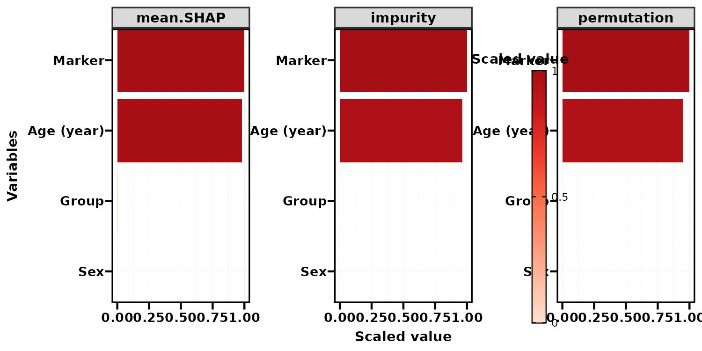{fig-alt="合成二分类队列的当前 ranger 重要性，分别显示平均绝对 SHAP、impurity 和 permutation，使用当前 300 棵树设置。"}

`yhat_raw` 保留各方法的原始值，`yhat` 在每个类型内缩放。不同方法的单位与定义不同，不能把缩放后的大小当成同一统计量，也不能据此确定变量的因果作用。旧版本的计时见 [2026-10-06 性能记录](../regr/mlr-imp-speedup-20261006.qmd)。

## 接口、返回对象与分析流程 {#interface}

`get_imp()` 当前只接受 `surv=TRUE`（读取 `time` / `DSS`）或一个二分类结局列名。`surv=FALSE` 及其他值会在拟合前报错；ranger 分类结局必须恰有两个不同值。2026-10-16按已推送MLR `462f041` 核对，旧版按逻辑类型分派的说明已不适用。

| 模型 | 原生重要性 | 共用方法 | 编码 |
|:--|:--|:--|:--|
| ranger | impurity | mean.SHAP、permutation | 分类特征保留因子 |
| xgboost | gain | mean.SHAP、permutation | 生存仅 onehot；二分类可 onehot / target |
| rfsrc | vimp | min.depth | 无 SHAP；最小深度原值越小越重要 |

`get_imp()` 返回长格式数据框，计算过程中还会打印柱形组合、标准和带间隙流向图。它不返回一个装满图的 list。提供 `shp` 会复用平均绝对 SHAP；XGBoost 仍训练模型以计算 Gain 和 permutation。只有数据、变量和预测目标相匹配时才应复用 SHAP。

原生重要性、置换后的性能损失与平均绝对 SHAP 具有不同定义；0–1 缩放方便查看排序，不能据此把三种方法的原始大小作等量比较。

```r
get_imp(data, vars, surv = TRUE, shp = NULL,
        model = c("ranger", "xgboost", "rfsrc"),
        boosting_encoding = c("onehot", "target"), n_rep = 1L)

# 重新计算时传自己的数据；下面只展示写法，本页未执行。
# res <- get_imp(d, vars = c("Age", "Sex", "T_stage"), surv = TRUE)
```

## 当前后端与重复重要性 {#importance-repeat-current}

以下为 2026-10-16 的历史后端记录；XGBoost 的当前原生 SHAP 路线见[最新计算范围](#diagnostics-20261021)。当日已推送 `462f041` 包含上述surv检查、ranger字符特征转因子及后端更新。Windows的生存和XGBoost路径直接使用treeshap，不先尝试Python；Unix仍按条件尝试Python并回退。Python完全无法启动的失败会在当前R会话中记住，模块导入失败则仍可重试。Windows R已验证后端选择与surv=FALSE报错；不据此给出新的耗时倍数。

2026-10-17 核对 GitHub 远端 MLR `4bbc8c8`：`n_rep` 已推送，也已包含下节的 `model="rfsrc"`。以下重复分析仍保留 `78c4238` 在 WSL R 4.4.3 的真实执行结果。旧安装可用 `"n_rep" %in% names(formals(MLR::get_imp))` 检查接口，不能只看 0.1.13 版本号。旧保存结果和前面的 300 棵树实图保留原执行快照。

`n_rep=1L` 保持一次运行；大于1时每次重新拟合、抽训练与SHAP行，先对原始重要性求均值，再按方法缩放，不能先平均各次0–1值。新增lower/upper、sd、rank_median/rank_lower/rank_upper、p_top3；逐次表在 `attr(res,"reps")`，Kendall's W在 `attr(res,"stability")`。提供shp会让各次复用同一份SHAP，因而mean.SHAP不随重复变化。置换重要性允许为负，不应为了画百分比而将其解释成正贡献。


### 重复运行与排名稳定性

固定种子，三次完整运行只演示汇总结构。点是原始重要性的运行均值，线是运行间2.5%–97.5%分位数，不是总体置信区间。各方法单位不同，分面各用自己的纵轴。

```r
set.seed(20261016)
n_rep_demo <- 320L
d_rep <- data.frame(Age = runif(n_rep_demo, 20, 80), Marker = rnorm(n_rep_demo),
  Sex = sample(c("Female", "Male"), n_rep_demo, TRUE),
  Group = factor(sample(c("A", "B"), n_rep_demo, TRUE)))
d_rep$Outcome <- factor(ifelse(runif(n_rep_demo) < plogis(-0.5 +
  0.04 * (d_rep$Age - 45) + 1.2 * d_rep$Marker + 0.6 * (d_rep$Group == "B")), "Yes", "No"))
rep_vars <- c("Age", "Marker", "Sex", "Group")
set.seed(321)
imp_rep <- get_imp(d_rep, rep_vars, surv = "Outcome", n_rep = 3L)
attr(imp_rep, "stability")
ggplot(imp_rep, aes(var, yhat_raw)) +
  geom_errorbar(aes(ymin = lower, ymax = upper), width = 0.15) +
  geom_point(size = 2.5, colour = "#137C8B") +
  facet_wrap(~imp_type, scales = "free_y") + theme_bw() +
  labs(x = NULL, y = "Raw importance: mean and between-run spread")
```

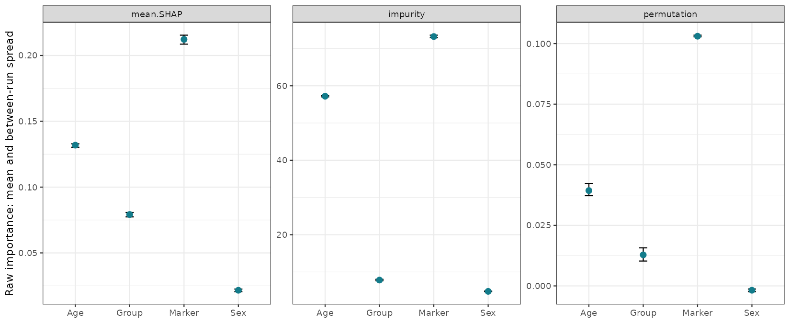{fig-alt="重复运行与排名稳定性；固定输入、按注明源码快照实际运行的示例。"}

三次运行用于检查接口和画图，不代表正式分析已达到稳定。该例字符Sex由ranger路径内部转因子，调用者的数据列仍为字符。正式分析应结合不同种子、样本及模型设置检查排名稳定性；这些运行间分位数不是患者总体的置信区间。

## randomForestSRC：VIMP 与最小深度 {#rfsrc-current}

2026-10-17 按已推送 MLR `4bbc8c8`，用固定种子的 360 行合成数据在 WSL R 4.4.3 执行并导出以下三张图；Windows R 同时核验相同调用与图形构建。原来的 ToyData 图保持历史快照，不作为新森林的结果。

`model="rfsrc"` 需要可选包 randomForestSRC，使用 300 棵树，只返回 `vimp` 与 `min.depth`，没有 SHAP；与 `shp=` 同传会报错。二分类 VIMP 使用 G-mean 对应的 OOB 误差，生存 VIMP 使用 Harrell C 对应的 OOB 误差。VIMP 内部限定单核以保证同一种子下的复现，该临时线程设置在调用后恢复。

`min.depth` 的 `yhat_raw` 是原始深度，越小越重要；`yhat` 已反转为越大越重要。百分比图使用该反向缩放值，不把原始深度相加当作贡献份额。单次结果的 `attr(res,"min_depth_threshold")` 给出深度阈值；它不是 P 值或置信区间。不同方法的缩放值也不是同一统计量。

::: {.panel-tabset}

### 二分类重要性 {.unnumbered}

合成二分类数据的 VIMP 与最小深度；两者的 0–1 展示都按越大越重要排列。

```r
set.seed(1017)
n_rf <- 360L
d_rf <- data.frame(Age = runif(n_rf, 20, 80), Marker = rnorm(n_rf),
  Sex = factor(sample(c("Female", "Male"), n_rf, TRUE)), Noise = rnorm(n_rf))
d_rf$Outcome <- factor(ifelse(runif(n_rf) < plogis(-0.5 +
  0.05 * (d_rf$Age - 50) + 1.4 * d_rf$Marker), "Yes", "No"))
rf_vars <- c("Age", "Marker", "Sex", "Noise")
imp_rf <- get_imp(d_rf, rf_vars, surv = "Outcome", model = "rfsrc")
attr(imp_rf, "min_depth_threshold")
plt_imp_bar_per(imp_rf, imp_type = c("vimp", "min.depth"), mode = "bar")
```

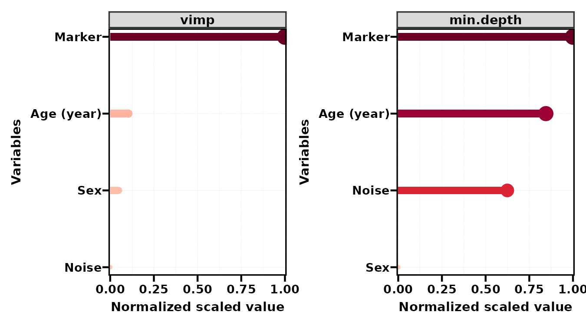{fig-alt="合成二分类数据的 VIMP 与最小深度；两者的 0–1 展示都按越大越重要排列。"}

### 生存重要性 {.unnumbered}

同一组特征用于合成生存结局；VIMP 的误差定义与二分类不同，不能横向比较原值。

```r
set.seed(1018)
d_sur_rf <- d_rf
d_sur_rf$time <- rexp(n_rf, exp(-4 + 0.04 * (d_rf$Age - 50) + d_rf$Marker))
d_sur_rf$DSS <- rbinom(n_rf, 1, 0.65)
imp_sur_rf <- get_imp(d_sur_rf, rf_vars, surv = TRUE, model = "rfsrc")
plt_imp_bar_per(imp_sur_rf, imp_type = c("vimp", "min.depth"), mode = "bar")
```

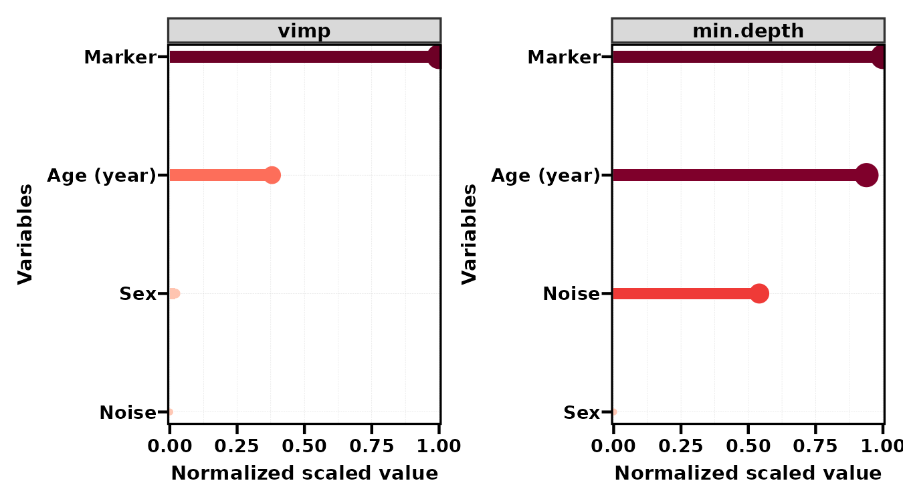{fig-alt="同一组特征用于合成生存结局；VIMP 的误差定义与二分类不同，不能横向比较原值。"}

### 两种排名 {.unnumbered}

最小深度与 VIMP 的排名比较；偏离对角线表示排序分歧，不等于统计显著差异。

```r
plt_imp_two(imp_rf, imp_type = c("vimp", "min.depth"))
```

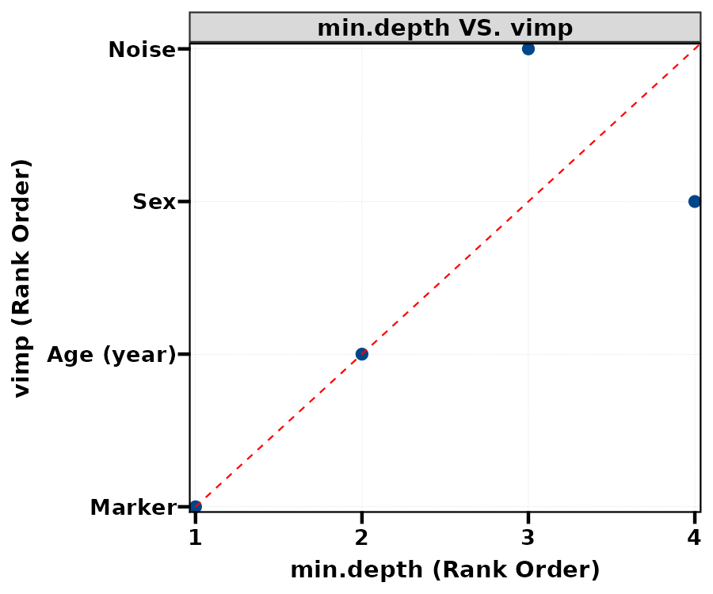{fig-alt="最小深度与 VIMP 的排名比较；偏离对角线表示排序分歧，不等于统计显著差异。"}

:::

`plt_imp_two()` 和 `plt_imp_circ()` 默认比较 SHAP 与 permutation；对 rfsrc 结果应显式传 `imp_type=c("vimp","min.depth")`。`n_rep>1` 仍可汇总重复运行的均值、波动和排名；深度阈值属性只在单次结果提供。此处未测量速度，也不把单个合成队列的排序当作外部验证。

## 当前重要性：计算范围、诊断与重复排名 {#diagnostics-20261021}

<!-- refresh-20261021: imp_diagnostics -->

以下按已推送 MLR `8d94e59` 在 Windows / WSL R 4.4.3 执行。当前 XGBoost 在两个平台均使用原生 SHAP，不要求 Python；one-hot 的贡献回收到原始特征。下面的 180 行、4 特征和 3 次运行用于验证接口，没有重新测量旧性能文章中的加速倍数。

```r
library(MLR)
set.seed(20261021)
dc_now <- data.frame(Age = runif(180, 20, 80), Marker = rnorm(180),
  Sex = factor(sample(c("F", "M"), 180, TRUE)),
  Group = factor(sample(c("A", "B"), 180, TRUE)))
dc_now[["Outcome"]] <- factor(ifelse(runif(180) < plogis(
  (dc_now[["Age"]] - 50) / 15 + dc_now[["Marker"]]), "positive", "negative"),
  levels = c("negative", "positive", "unused"))
v_now <- c("Age", "Marker", "Sex", "Group")
set.seed(521)
imp_now <- get_imp(dc_now, v_now, surv = "Outcome", model = "xgboost", n_rep = 3L)
analysis_now <- attr(imp_now, "analysis")
draws_now <- attr(imp_now, "permutations")
analysis_now[c("rep", "model", "metric", "training_n", "shap_n", "permutation_n",
               "permutation_scope", "shap_source")]
```

::: {.callout-note collapse="true" title="复核代码"}
生成本页时运行的检查，接在上面的代码之后运行；只读教程可以跳过。

```r
stopifnot(nrow(analysis_now) == 3L, length(unique(analysis_now[["seed"]])) == 3L,
          all(analysis_now[["shap_source"]] == "native_xgboost"),
          all(analysis_now[["permutation_scope"]] == "training_sample"),
          nrow(draws_now) == 3L * length(v_now) * 10L,
          max(abs(draws_now[["baseline"]] - draws_now[["permuted"]] -
                  draws_now[["drop"]])) < 1e-12)
```
:::

| 本例属性 | 实际范围 | 读取方法 |
|:--|:--|:--|
| `analysis` | 3 行，每次训练、SHAP 与置换各 180 行；accuracy；训练样本 | `attr(imp_now, "analysis")` |
| `permutations` | 120 行：3 次 × 4 特征 × 10 次打乱 | `attr(imp_now, "permutations")` |
| `diagnostics` | 每种方法的全零、全非正、负值数和原值范围 | `attr(imp_now, "diagnostics")` |
| `reps` / `stability` | 各次原始结果与经并列校正的 Kendall W | `attr(imp_now, "reps")` / `attr(imp_now, "stability")` |

XGBoost 置换是训练样本上、分类阈值 0.5 的 accuracy 降低量，生存任务使用 Harrell C；ranger / rfsrc 的置换使用 OOB 范围，不能直接当作同一种验证误差比较。target encoding 的训练行使用排除本折的映射和先验；这仍是训练范围解释，不等于独立验证集表现。`analysis` 同时记录编码、树数或轮数、种子和输入行数，正式报告应一起保存。

### 全零结果、外部 SHAP 与输入检查

```r
external <- list(S = matrix(0, nrow = 5, ncol = length(v_now),
                           dimnames = list(NULL, v_now)))
zero_now <- get_imp(dc_now, v_now, surv = "Outcome", model = "xgboost", shp = external)
z <- attr(zero_now, "diagnostics")
leak_error <- tryCatch(get_imp(dc_now, c(v_now, "Outcome"), surv = "Outcome"), error = identity)
bad_rep <- tryCatch(get_imp(dc_now, v_now, surv = "Outcome", n_rep = 1.5), error = identity)
```

::: {.callout-note collapse="true" title="复核代码"}
生成本页时运行的检查，接在上面的代码之后运行；只读教程可以跳过。

```r
stopifnot(all(zero_now[["yhat_raw"]][zero_now[["imp_type"]] == "mean.SHAP"] == 0),
          z[["all_zero"]][match("mean.SHAP", z[["imp_type"]])],
          attr(zero_now, "analysis")[["shap_source"]] == "external_unverified")
stopifnot(inherits(leak_error, "error"), inherits(bad_rep, "error"))
```
:::

全零原值保持为零；先看 `diagnostics`，不要把相同的零值强行排成变量贡献。`shp$S` 必须是非空、有限数值矩阵，列名唯一且与特征准确对应；通过检查只证明结构正确，不能证明它来自本次模型或同一人群。外部 SHAP 会在重复分析中复用，来源明确记为 `external_unverified`，且不能与 `model="rfsrc"` 同传。

`vars` 不得包含结局列或生存时间列。生存任务要求正且有限的 time、非缺失 0/1 DSS，且至少有事件；分类按观察到的两个标签映射 0/1，未使用的因子水平不算额外类别。因子按保留的水平顺序映射，字符或数值按排序映射；需要明确阳性方向时先设置因子水平。

重复排名使用平均秩，并列跨越 top 3 时共享名额；全并列时 Kendall W 为 NA。`min.depth` 原值越小越重要，重复排名也沿用这个方向。`lower` / `upper` 是各次原始重要性的 2.5%–97.5% 分位数，反映模型种子和内部抽样波动，不是患者总体置信区间。重复 XGBoost 现在会从 R 随机流产生不同的模型种子；用 `set.seed()` 固定整个重复调用，单次仍沿用种子 1。

<!-- /refresh-20261021: imp_diagnostics -->

## `plt_imp_bar()`：柱形与棒棒糖

`display` 只改变图形几何；`yhat` 是每个方法内部的 min–max 值，不能把不同方法的同一高度当成相同原始贡献。

::: {.panel-tabset}


### 棒棒糖 {.unnumbered}


三种方法分别显示其 0–1 归一化重要性。


```r
plt_imp_bar(imp, display = "l", add_name = labels)
```


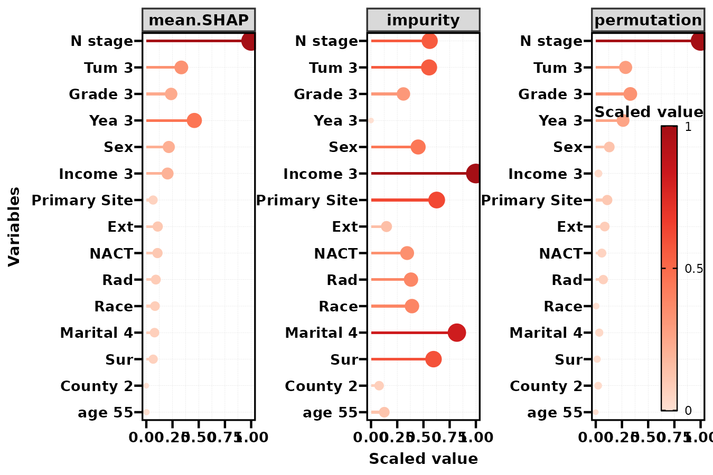{fig-alt="三种方法分别显示其 0–1 归一化重要性。"}


### 实心柱形 {.unnumbered}


同一结果切换为柱形，方法内部的排序和数值保持一致。


```r
plt_imp_bar(imp, display = "b", add_name = labels)
```


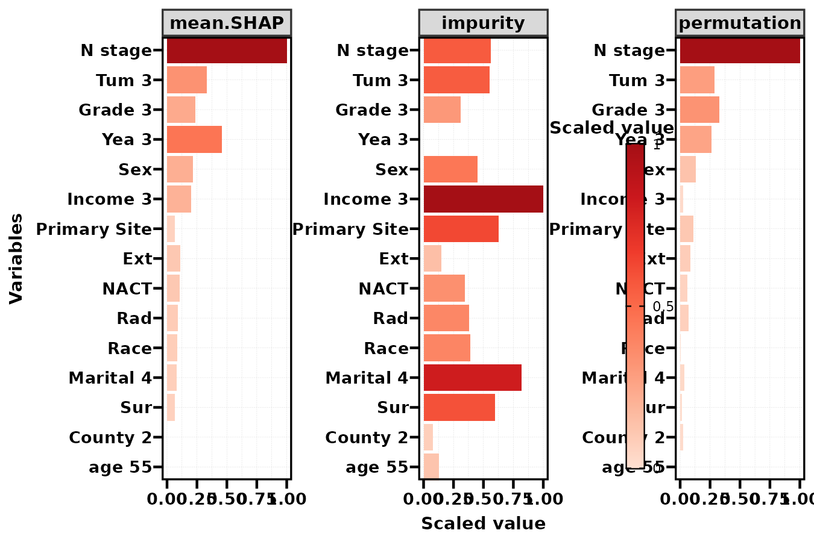{fig-alt="同一结果切换为柱形，方法内部的排序和数值保持一致。"}


:::

## `plt_imp_bar_per()`：五种组合模式

`mode` 覆盖单独条形、单环、双环和两种组合；`bar_display` 控制棒棒糖/柱形，`bar_per_palette` 分别控制条形与环图配色。

::: {.panel-tabset}


### bar {.unnumbered}


mode = bar；百分比优先用非负原始重要性计算。


```r
plt_imp_bar_per(imp, mode = "bar", add_name = labels)
```


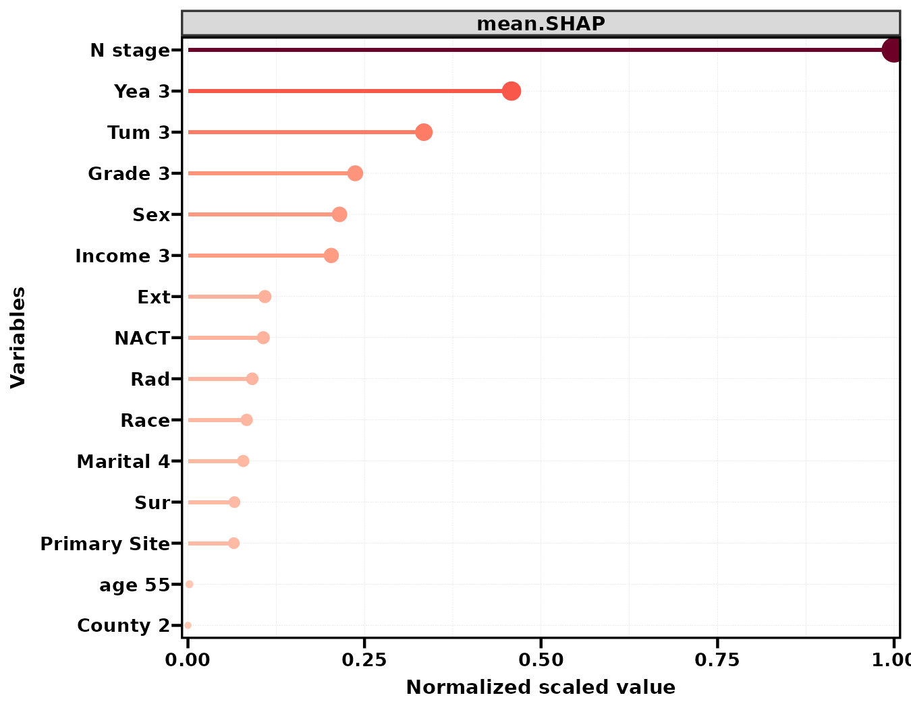{fig-alt="mode = bar；百分比优先用非负原始重要性计算。"}


### per {.unnumbered}


mode = per；百分比优先用非负原始重要性计算。


```r
plt_imp_bar_per(imp, mode = "per", add_name = labels)
```


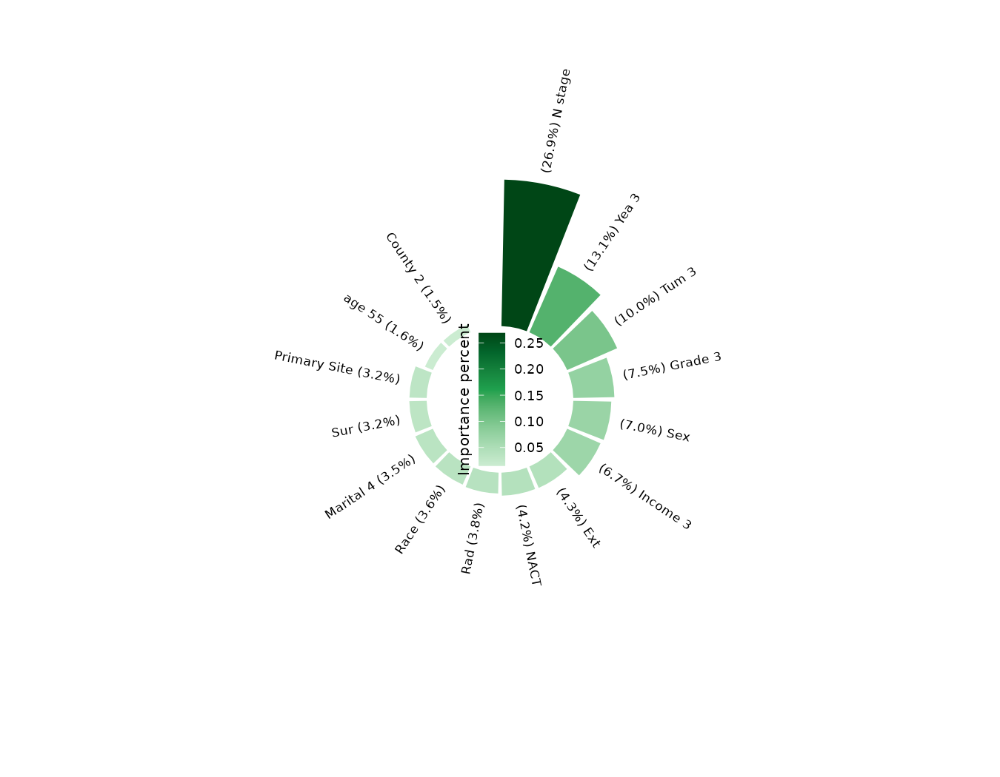{fig-alt="mode = per；百分比优先用非负原始重要性计算。"}


### per2 {.unnumbered}


mode = per2；百分比优先用非负原始重要性计算。


```r
plt_imp_bar_per(imp, mode = "per2", add_name = labels)
```


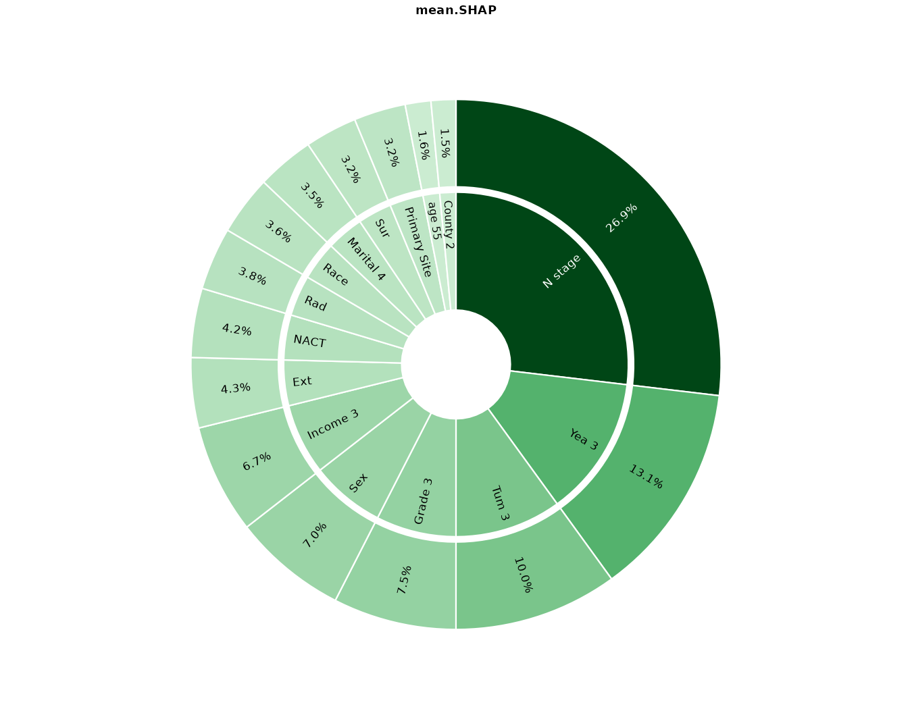{fig-alt="mode = per2；百分比优先用非负原始重要性计算。"}


### bar_per {.unnumbered}


mode = bar_per；百分比优先用非负原始重要性计算。


```r
plt_imp_bar_per(imp, mode = "bar_per", add_name = labels)
```


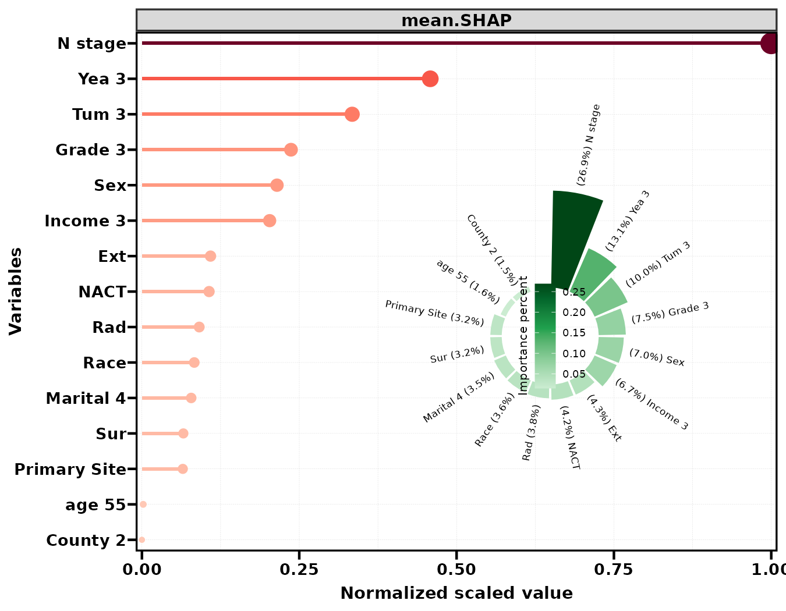{fig-alt="mode = bar_per；百分比优先用非负原始重要性计算。"}


### bar_per2 {.unnumbered}


mode = bar_per2；百分比优先用非负原始重要性计算。


```r
plt_imp_bar_per(imp, mode = "bar_per2", add_name = labels)
```


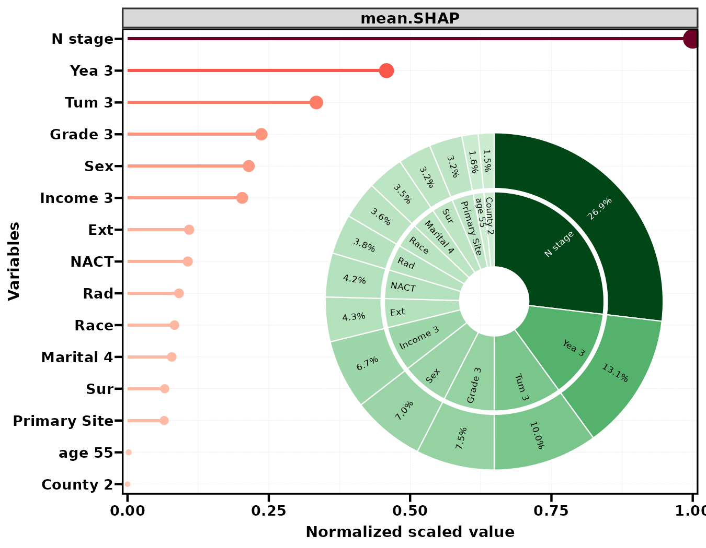{fig-alt="mode = bar_per2；百分比优先用非负原始重要性计算。"}


:::

## `plt_imp_bar_per()`：方法、配色与布局

方法选择和变量删减会改变比较集合；`per_position` 只改变插图位置。

::: {.panel-tabset}


### 选择与排列方法 {.unnumbered}


只选 permutation、mean.SHAP，并按所给顺序组成面板。


```r
plt_imp_bar_per(imp, imp_type = c("permutation", "mean.SHAP"), mode = "bar", bar_display = "b", add_name = labels)
```


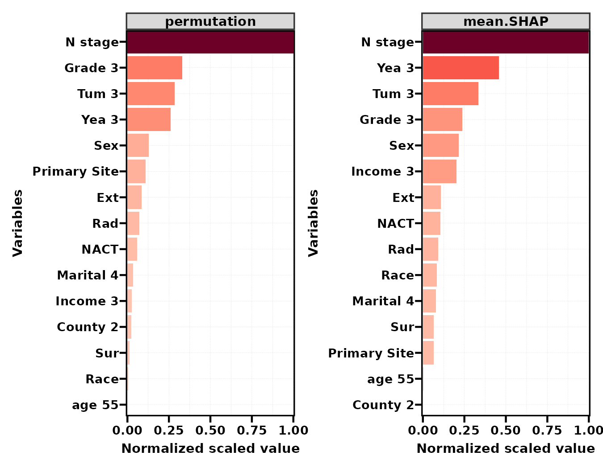{fig-alt="只选 permutation、mean.SHAP，并按所给顺序组成面板。"}


### 配色与插图位置 {.unnumbered}


蓝色柱形配橙色双环；移动并缩小插图，为变量标签留空间。


```r
plt_imp_bar_per(imp, mode = "bar_per2", bar_display = "b", bar_per_palette = c("Blues", "Oranges"), per_position = c(0.36, 0.07, 0.62, 0.8), add_name = labels)
```


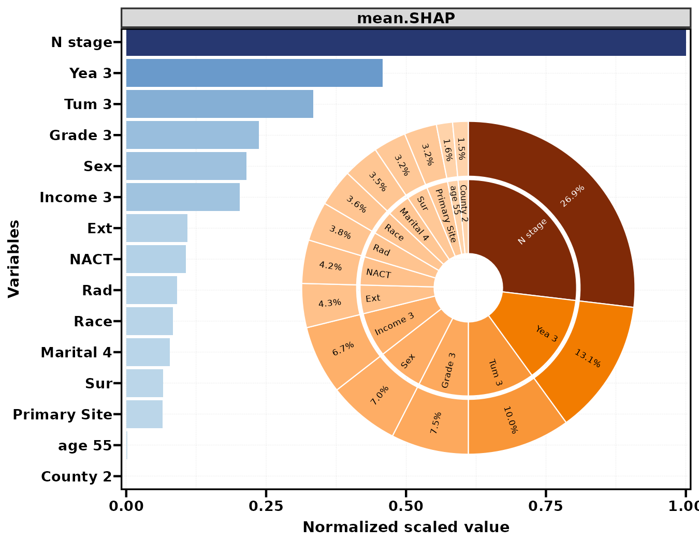{fig-alt="蓝色柱形配橙色双环；移动并缩小插图，为变量标签留空间。"}


:::

### 径向比例条的 label_args（2026-10-26） {#radial-labels-20261026}

<!-- update-20261026: mlr_radial -->

按已推送 MLR 0.1.13 `45e743a`，`plt_bar_per()` 和 `plt_imp_bar_per()` 的径向比例条支持 `label_args`。它只控制 `mode="per"` 或 `"bar_per"` 插图中的“百分比＋变量名”；两圈的 `per2/bar_per2` 保持自动排字，普通条形轴也不受影响。下例的五项数值是合成显示输入，不是新拟合的重要性。

```r
library(MLR)
radial_data26 <- data.frame(var = paste0("F", 1:5), yhat = c(9, 6, 4, 2, 1), yhat_raw = c(9, 6, 4, 2, 1))
radial_names26 <- setNames(c("Tumor size at diagnosis", "Age at initial diagnosis", "Regional lymph node count",
  "Treatment sequence group", "Clinical marker score"), radial_data26[["var"]])
radial_line26 <- plt_bar_per(radial_data26, mode = "per", add_name = radial_names26,
  label_args = list(size = 2.8, offset = .03))
radial_wrap26 <- plt_bar_per(radial_data26, mode = "per", add_name = radial_names26,
  label_args = list(wrap = 13, size = 2.8, lineheight = .9, offset = .03, col = "grey20", font = 1))
ggplot2::ggsave(file.path(tempdir(), "20261026-update-radial-line.pdf"), radial_line26, width = 8, height = 8)
ggplot2::ggsave(file.path(tempdir(), "20261026-update-radial-wrap.pdf"), radial_wrap26, width = 8, height = 8)
radial_imp26 <- transform(radial_data26, order = 1:5, imp_type = "mean.SHAP")
radial_forward26 <- plt_imp_bar_per(radial_imp26, mode = "per", add_name = radial_names26,
  label_args = list(wrap = 13, size = 2.8, lineheight = .9, offset = .03))
ggplot2::ggsave(file.path(tempdir(), "20261026-update-radial-importance.pdf"), radial_forward26, width = 8, height = 8)
```

::: {.callout-note collapse="true" title="复核代码"}

```r
before_radial26 <- radial_data26
for (p in list(radial_line26, radial_wrap26, radial_forward26)) ggplot2::ggplot_build(p)
stopifnot(identical(radial_data26, before_radial26))
label_args26 <- eval(formals(plt_bar_per)[["label_args"]])
stopifnot(identical(names(label_args26), c("wrap", "size", "lineheight", "offset", "col", "font")),
  identical(eval(formals(plt_imp_bar_per)[["label_args"]]), label_args26))
validation_values <- list(data = radial_data26, percentages = 100 * radial_data26[["yhat_raw"]] / sum(radial_data26[["yhat_raw"]]),
  unchanged = identical(radial_data26, before_radial26), label_defaults = label_args26)
```

:::

::: {.panel-tabset}

### 单行 {.unnumbered}

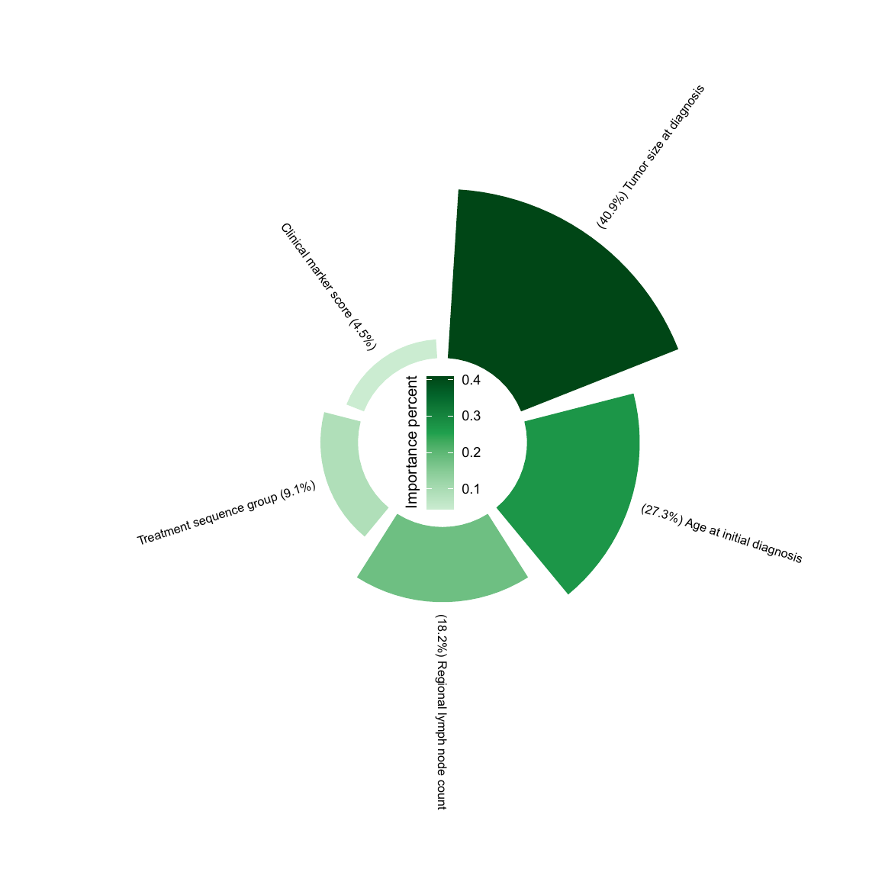{fig-alt="原生径向比例条PDF，五个合成变量的百分比与长名称使用单行文字。"}

[PDF](images/imp-guide/20261026-update-radial-line.pdf)

### 按空格换行 {.unnumbered}

{fig-alt="相同径向比例条输入使用label_args的wrap按空格换行变量名，百分比仍在第一行靠近条端。"}

[PDF](images/imp-guide/20261026-update-radial-wrap.pdf)

### 重要性包装入口 {.unnumbered}

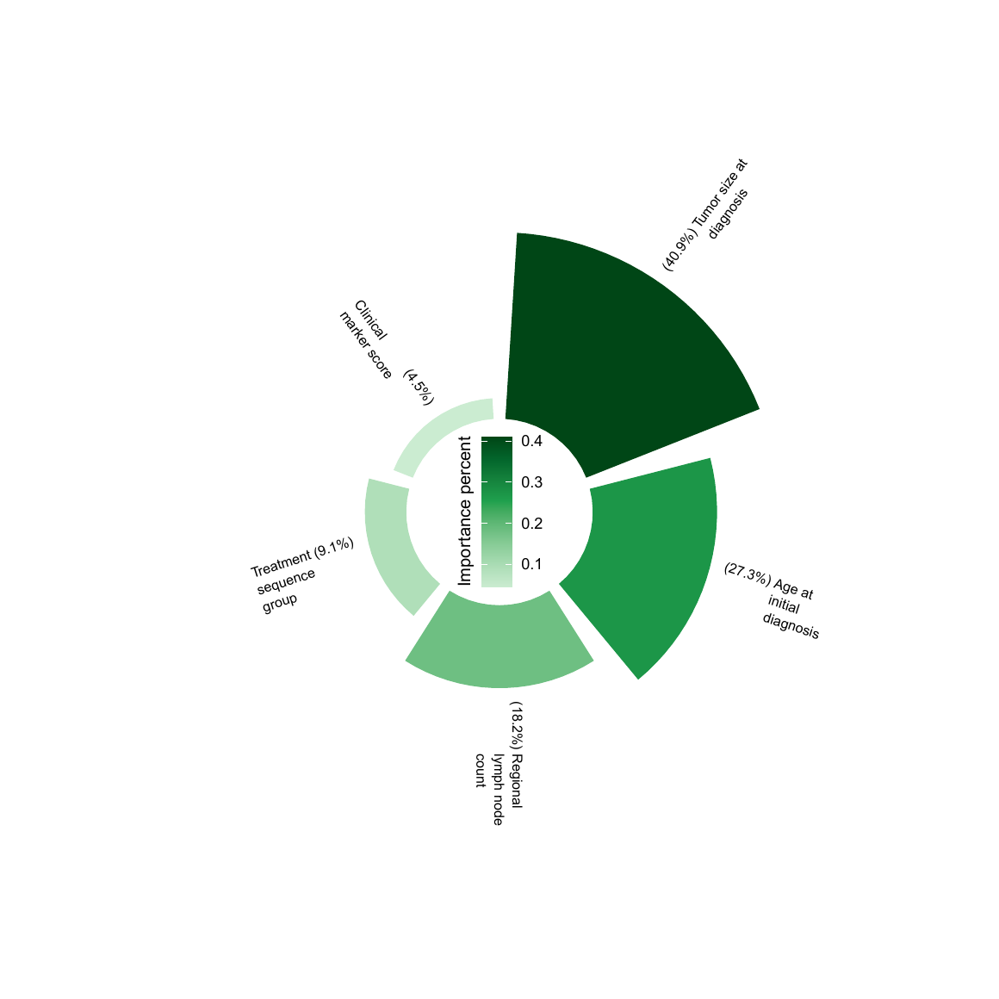{fig-alt="plt_imp_bar_per以合成mean.SHAP重要性表生成原生径向条，label_args参数与通用入口一致。"}

[PDF](images/imp-guide/20261026-update-radial-importance.pdf)

:::

`wrap` 按变量名的空格折行，长的无空格单词不硬拆；百分比不计入换行宽度，保留在靠近条端的第一行。`size` 是 ggplot 的毫米单位，`offset` 是比例单位：0.02 表示 2 个百分点的径向距离；`font` 1/2/3/4 对应普通/粗体/斜体/粗斜体。部分 list 只覆盖指定项。旧 `per_args$text_height` 仍会警告兼容，但应改用 `label_args$offset`；标签设置不改变份额和原始重要性。

<!-- /update-20261026: mlr_radial -->

## `plt_imp_flo()`：标准流向图

流线表示变量的对应关系，不表示患者流动，也不是因果路径。

流线追踪同一变量在三种重要性方法间的排序变化。


```r
plt_imp_flo(imp, add_name = labels)
```


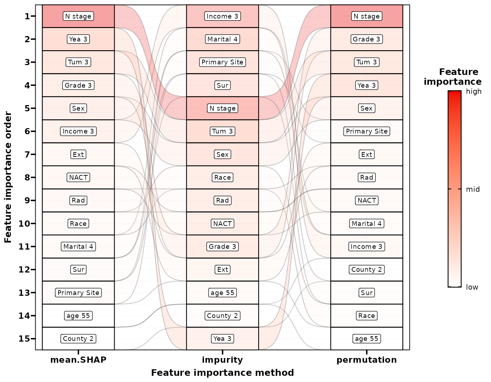{fig-alt="流线追踪同一变量在三种重要性方法间的排序变化。"}

## `plt_imp_flo2()`：高度、颜色与间隙

至少选择两个方法。`height_by` 控制条块高度；`color_by = first` 沿用第一个方法的颜色，便于追踪变量。`gap` 是条块间隙。

::: {.panel-tabset}


### 按百分比分配高度 {.unnumbered}


height_by = pct、color_by = method；每个方法按自己的份额着色。


```r
plt_imp_flo2(imp, add_name = labels, label.size = 2.5, base.size = 12)
```


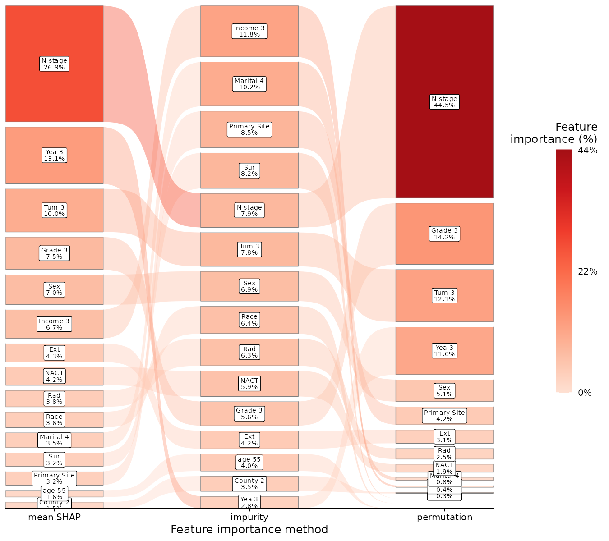{fig-alt="height_by = pct、color_by = method；每个方法按自己的份额着色。"}


### 等高与固定颜色 {.unnumbered}


所有变量等高，颜色沿用第一个方法，隐藏百分比文字。


```r
plt_imp_flo2(imp, height_by = "equal", color_by = "first", pct.style = "none", add_name = labels, label.size = 2.5, base.size = 12)
```


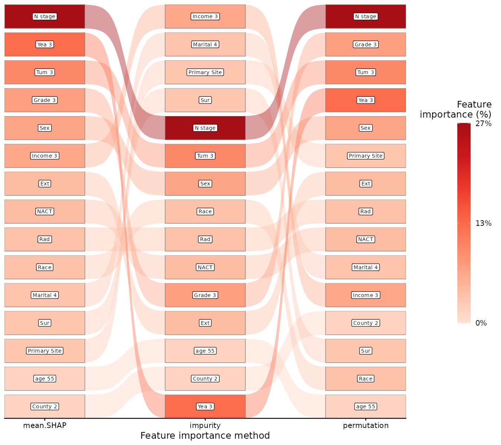{fig-alt="所有变量等高，颜色沿用第一个方法，隐藏百分比文字。"}


### 两方法、直线与大间隙 {.unnumbered}


改变方法顺序、曲线类型和留白；对应关系仍由变量名称决定。


```r
plt_imp_flo2(imp, imp_type = c("permutation", "mean.SHAP"), gap = 0.025, curve.type = "linear", pct.style = "pct", add_name = labels, label.size = 2.5, base.size = 12)
```


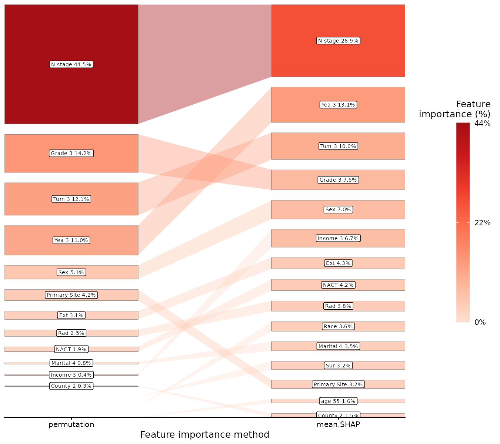{fig-alt="改变方法顺序、曲线类型和留白；对应关系仍由变量名称决定。"}


:::

## `plt_imp_two()`：排名一致性

此图比较排名，不比较原始重要性幅度；`imp_type = NULL` 展示所有方法对。

::: {.panel-tabset}


### 指定两个方法 {.unnumbered}


横纵轴是排名；偏离对角线表示排序不一致。


```r
plt_imp_two(imp, imp_type = c("mean.SHAP", "permutation"), add_name = labels)
```


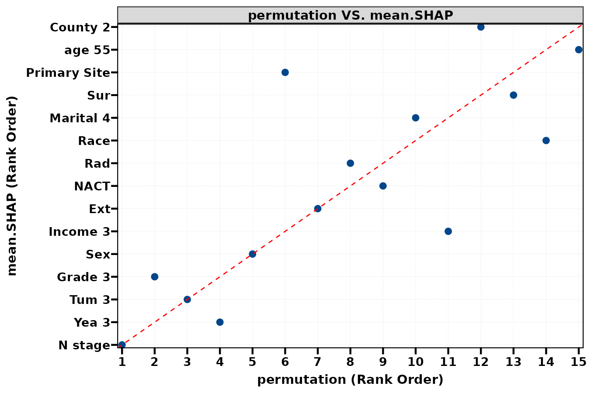{fig-alt="横纵轴是排名；偏离对角线表示排序不一致。"}


### 全部方法对 {.unnumbered}


全部三对排名比较使用同一输入。


```r
plt_imp_two(imp, imp_type = NULL, add_name = labels)
```


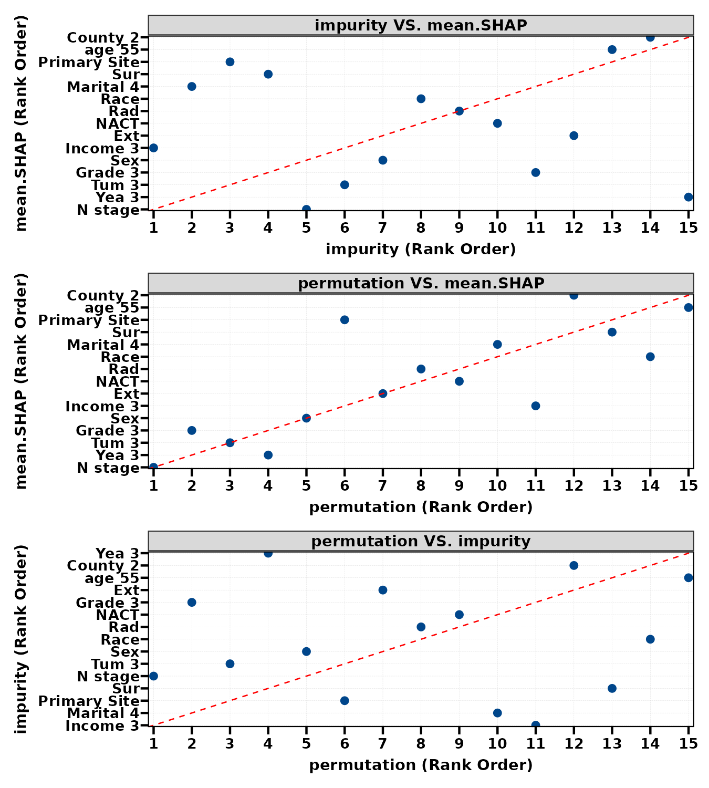{fig-alt="全部三对排名比较使用同一输入。"}


:::

## `plt_imp_bump()`：变量数量与数字显示

`value_type` 控制节点附近的数字；`reverse_y = TRUE` 让第一名在上方。它们不会重新估计重要性。

::: {.panel-tabset}


### 前八项与归一化值 {.unnumbered}


top_n 依据第一种方法选取变量；方法变换后仍追踪同一集合。


```r
plt_imp_bump(imp, top_n = 8, add_name = labels, bump_args = list(value_size = 10, rank_label_size = 10, group_label_size = 10, rank_circle_size = 6, point_size = 5))
```


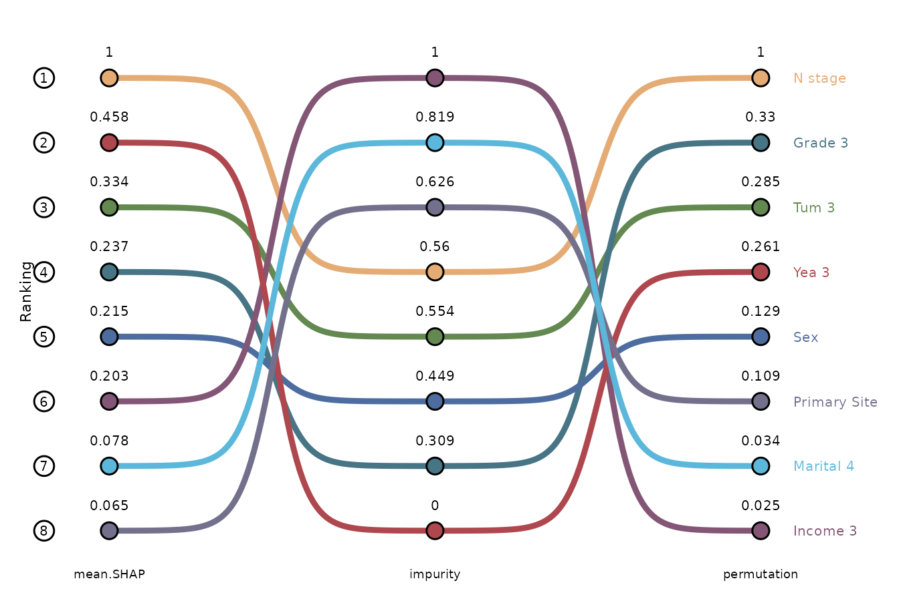{fig-alt="top_n 依据第一种方法选取变量；方法变换后仍追踪同一集合。"}


### 原始值 {.unnumbered}


节点数字切换为 yhat_raw；不同方法的单位与范围各不相同。


```r
plt_imp_bump(imp, top_n = 6, value_type = "raw", add_name = labels, bump_args = list(value_size = 10, rank_label_size = 10, group_label_size = 10, rank_circle_size = 6, point_size = 5))
```


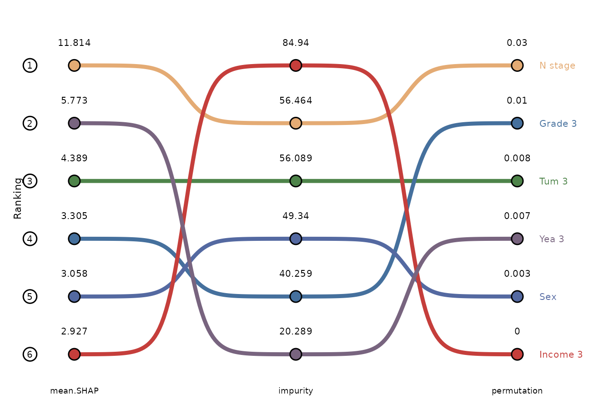{fig-alt="节点数字切换为 yhat_raw；不同方法的单位与范围各不相同。"}


### 隐藏数值与直线连接 {.unnumbered}


降低曲线平滑度并隐藏数值，突出排名路径。


```r
plt_imp_bump(imp, top_n = 8, smooth = 1, add_name = labels, bump_args = list(show_value = FALSE, point_size = 5, rank_label_size = 10, group_label_size = 10, rank_circle_size = 6))
```


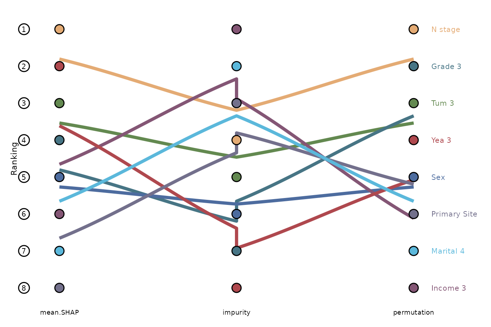{fig-alt="降低曲线平滑度并隐藏数值，突出排名路径。"}


:::

## `plt_imp_circ()`：两方法环形布局

这是 circlize 基础绘图设备输出，不能用 ggplot 的 `+ theme()` 调整。`start_position`、`gap`、`cell.padding` 控制起点与留白。

::: {.panel-tabset}


### 从顶部开始 {.unnumbered}


展示 SHAP 前八项的两方法环形对照；百分比分母是所选八项。


```r
plt_imp_circ(imp8, add_name = labels, cell.padding = c(0.02, 0, 0.02, 0), gap = c(3, 12))
```


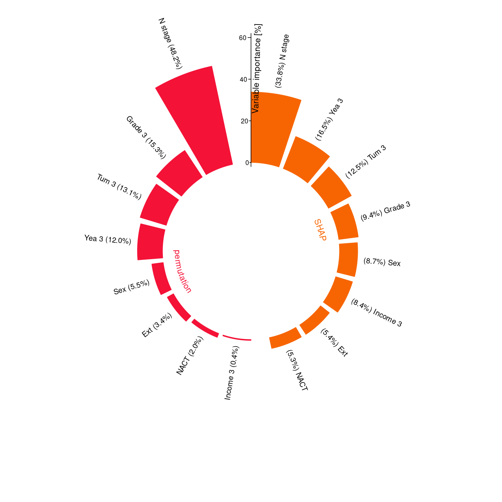{fig-alt="展示 SHAP 前八项的两方法环形对照；百分比分母是所选八项。"}


### 改变起点并隐藏百分比 {.unnumbered}


交换内外方法、从右侧开始，并增加方法组之间的间隔。


```r
plt_imp_circ(imp8, imp_type = c("permutation", "mean.SHAP"), add_name = labels, start_position = "right", show_percent = FALSE, cell.padding = c(0.02, 0, 0.02, 0), gap = c(2, 18))
```


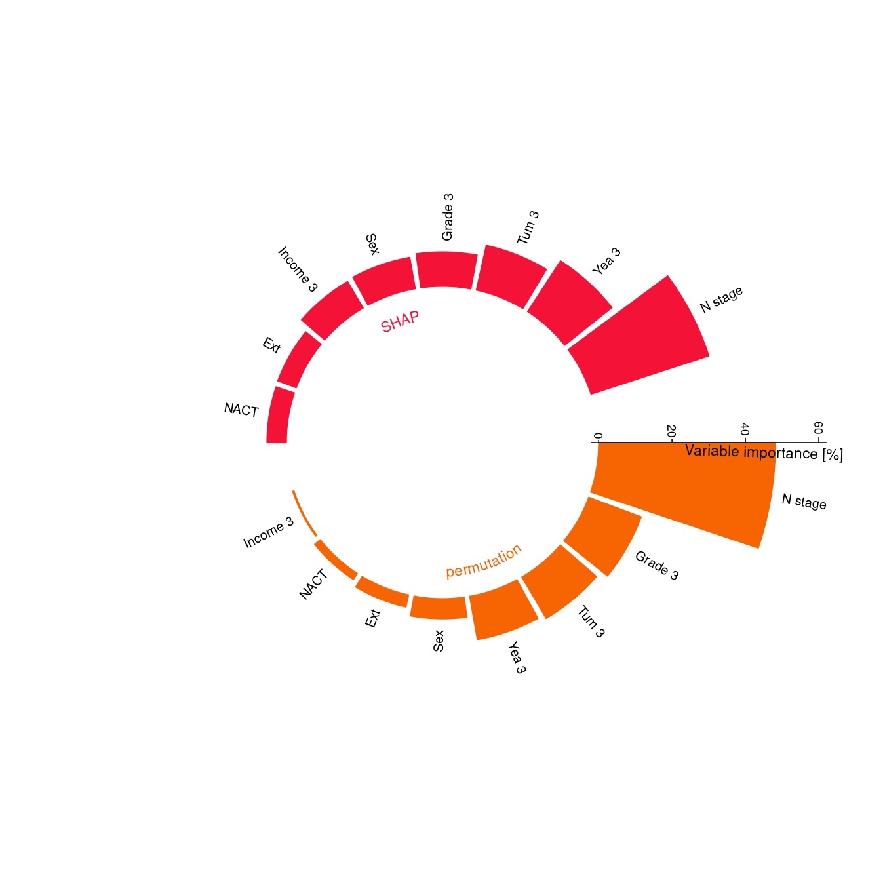{fig-alt="交换内外方法、从右侧开始，并增加方法组之间的间隔。"}


:::

## `plt_imp_network()`：柱形、气泡与百分比

此网络连接的是方法与特征，边不是变量间交互。`y_hat` 选择 scale_value / percent；`network_args` 可局部覆盖标签配置。

::: {.panel-tabset}


### 外圈柱形 {.unnumbered}


方法节点连接其变量，外圈柱长表示方法内部的归一化值。


```r
plt_imp_network(imp8, add_name = labels, outer_style = "bar", label_args = list(size = 2.6))
```


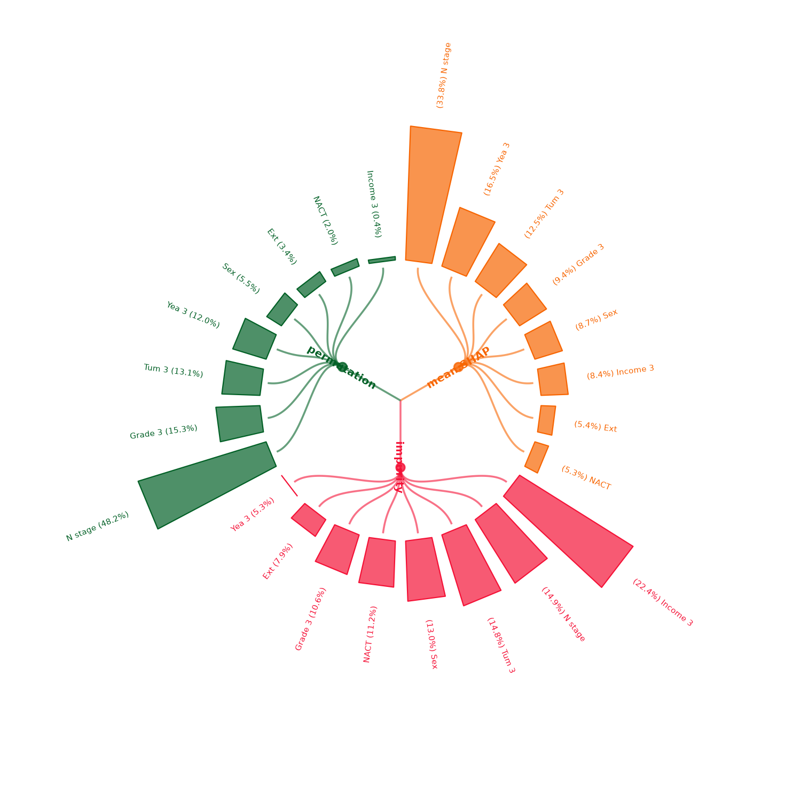{fig-alt="方法节点连接其变量，外圈柱长表示方法内部的归一化值。"}


### 外圈气泡与百分比 {.unnumbered}


以方法内份额控制气泡大小，起点转到右侧。


```r
plt_imp_network(imp8, add_name = labels, outer_style = "bubble", y_hat = "percent", start_position = "right", label_args = list(size = 2.6))
```


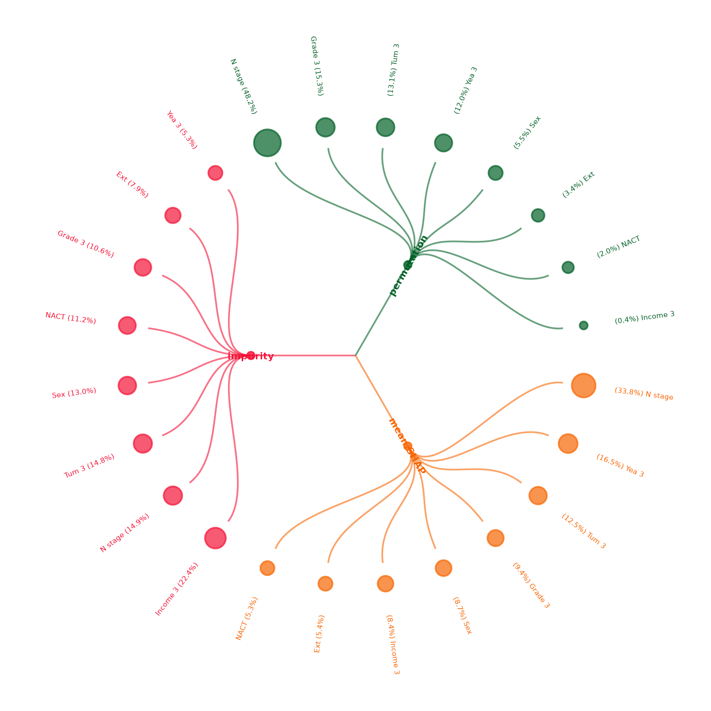{fig-alt="以方法内份额控制气泡大小，起点转到右侧。"}


:::

## `plt_imp_radar()`：归一化与分面

`normalize = max` 展示相对于本方法最大值的幅度；`sum` 展示所选变量中的份额。`output = gg` 返回 ggplot，可继续排版。

::: {.panel-tabset}


### 按最大值归一化 {.unnumbered}


每个方法最大的非负原始重要性映射为 1；并非 min–max 归一化。


```r
plt_imp_radar(imp8, normalize = "max", output = "gg", add_name = labels)
```


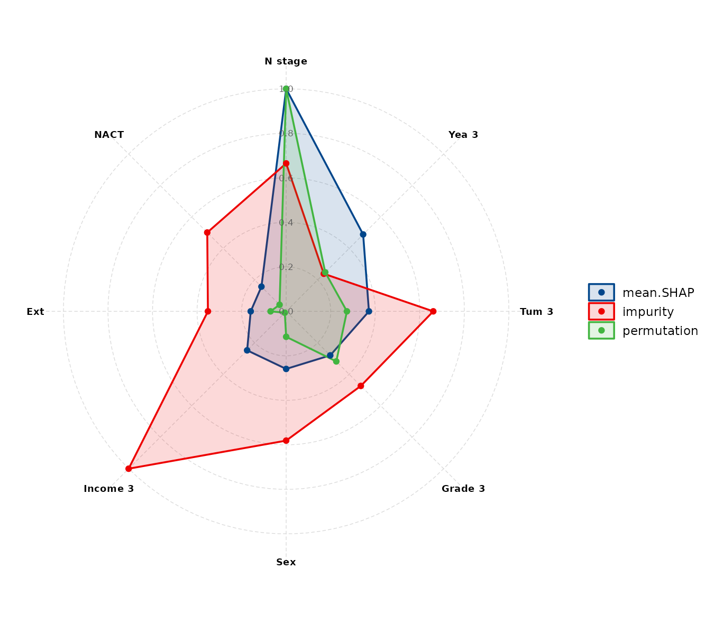{fig-alt="每个方法最大的非负原始重要性映射为 1；并非 min–max 归一化。"}


### 按总和归一化 {.unnumbered}


每个方法的轴值总和为 1；图形变化来自归一化规则。


```r
plt_imp_radar(imp8, normalize = "sum", output = "gg", add_name = labels)
```


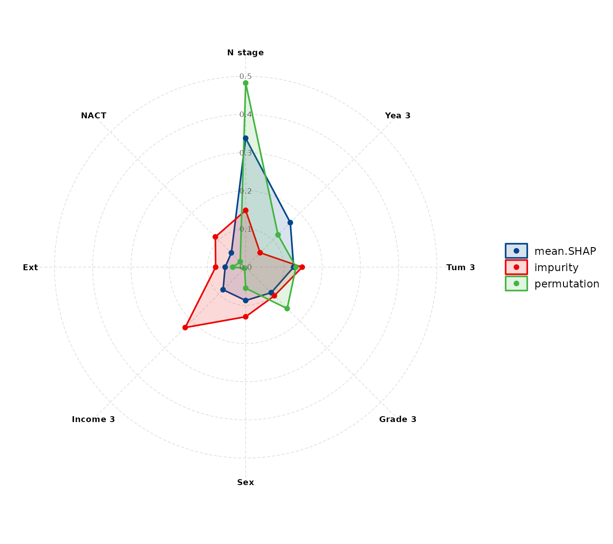{fig-alt="每个方法的轴值总和为 1；图形变化来自归一化规则。"}


### 选择方法并分面 {.unnumbered}


把两种方法分别绘制，减少雷达轮廓重叠。


```r
plt_imp_radar(imp8, imp_type = c("mean.SHAP", "permutation"), normalize = "max", output = "gg", facet = TRUE, n_breaks = 4, add_name = labels)
```


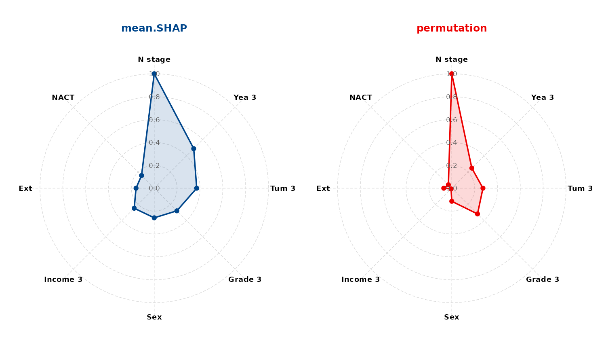{fig-alt="把两种方法分别绘制，减少雷达轮廓重叠。"}


:::

## 参数调整、保存与使用边界 {#parameters}

| 调整目标 | 参数 | 是否改变图中数值 |
|:--|:--|:--|
| 指定方法及顺序 | `imp_type` | 改比较集合，不重新计算重要性 |
| 截取变量 | `top_n` 或先筛选输入 | 排名图聚焦；百分比分母可能改变 |
| 比较排名 | `plt_imp_two()`、`plt_imp_bump()` | 纵横轴为名次 |
| 显示原始值 | `value_type = raw` | 数字换回各方法的原始单位 |
| 修改流向图 | `height_by`、`color_by`、`gap`、`curve.type` | 高度/颜色含义随选项改变 |
| 调整径向图 | `outer_style`、`start_position`、`network_args` | 改图形几何与标签 |
| 雷达归一化 | `normalize = max / sum` | 改相对数值定义 |
| 自定义名称 | `add_name` | 仅改标签 |

`fmt_args$cha_mult` 会改变贡献数值，不能当成普通字体设置；本页没有使用倍乘。重要性网络的边连接方法与变量，不代表变量交互。多方法排序相近说明在此对象上排序一致，不保证外部稳定性或因果重要性。

```r
p <- plt_imp_bump(imp, top_n = 8,
                  bump_args = list(show_value = FALSE))
ggplot2::ggsave("importance-ranks.pdf", p, width = 10, height = 6)

# 有 save 参数的函数可直接转交保存设置。
plt_imp_network(imp8, add_name = labels,
                save = list(filename = "importance-network.pdf",
                            width = 10, height = 10))

# circlize 图使用基础绘图设备。
pdf("importance-circle.pdf", width = 9, height = 9)
plt_imp_circ(imp8, add_name = labels)
dev.off()
```

不同函数的保存接口并不完全相同，复制时查看实际签名；不要把 `save` 传给不支持它的入口。

### 标签、份额与绘图缩放（2026-10-25） {#labels-shares-20261025}

<!-- update-20261025: mlr_importance -->

2026-10-25 按已推送 MLR `273f72a`、UtilsR 0.6.10 `0e4cffe` 在 Windows / WSL R 4.4.3 执行。本节使用 **5 个变量 × 3 种方法的合成重要性表**，只验证绘图合同，没有训练模型；所有预览来自实际 PDF。原来的模型计算和 25 张参数图保留其执行范围。

#### 环形与网络标签改用 label_args

环形图 `label_args` 用 `cex` 控制基础绘图字号，网络图用 ggplot 的 `size`；两者不能把同一个字号数值直接照搬。`wrap` 按空格换行变量名，百分比单列在前；单个无空格长词不会被强制拆开。环形图换行写作 `label_args=list(wrap=...)`，没有顶层 `label_wrap` 参数；网络图旧 `network_args$label_size / label_offset` 暂时警告兼容，应迁移到 `label_args$size / offset`，显式的新字段优先。网络内部节点文字仍由 `network_args$node_text_*` 控制。

```r
library(MLR)
vars_imp25 <- paste0("F", 1:5)
methods_imp25 <- c("mean.SHAP", "impurity", "permutation")
raw_imp25 <- list(c(10, 6, 3, 1, .5), c(4, 9, 3, 2, 1), c(3, 2, 8, 1, .5))
imp25 <- do.call(rbind, Map(function(method, raw) data.frame(var = vars_imp25,
  yhat = (raw - min(raw)) / diff(range(raw)), order = rank(-raw, ties.method = "first"),
  imp_type = method, yhat_raw = raw), methods_imp25, raw_imp25))
attr(imp25, "imp_types") <- methods_imp25
original_imp25 <- imp25
long_names25 <- setNames(c("Tumor size at diagnosis", "Age at initial diagnosis",
  "Regional lymph node count", "Treatment sequence group", "Clinical marker score"), vars_imp25)
short_names25 <- setNames(c("Tumor size", "Age", "Node count", "Treatment", "Marker"), vars_imp25)
save_imp25 <- function(name, width = 9, height = 9) list(
  filename = file.path(tempdir(), paste0("20261025-update-", name)), width = width, height = height)
plt_imp_circ(imp25, add_name = long_names25, label_args = list(cex = .55, offset = 3),
  save = save_imp25("imp-circle-line", 10, 10))
plt_imp_circ(imp25, add_name = long_names25,
  label_args = list(wrap = 13, cex = .62, lineheight = .9, offset = 3, col = "grey20"),
  save = save_imp25("imp-circle-wrap", 10, 10))
network_imp25 <- plt_imp_network(imp25, add_name = long_names25, y_hat = "percent",
  label_args = list(wrap = 13, size = 2.5, lineheight = .9, offset = 1.5, col = "grey20"),
  save = save_imp25("imp-network-wrap", 10, 10))
generic_network25 <- plt_network(data.frame(group = imp25[["imp_type"]],
  vars = imp25[["var"]], value = imp25[["yhat_raw"]]),
  label_args = list(wrap = 8, size = 2.5), show_percent = FALSE)
ggplot2::ggplot_build(network_imp25)
ggplot2::ggplot_build(generic_network25)
```

::: {.callout-note collapse="true" title="复核代码"}
生成本页时运行的检查，接在上面的代码之后运行；只读教程可以跳过。

```r
stopifnot(inherits(network_imp25, "ggplot"), inherits(generic_network25, "ggplot"))
```
:::

::: {.panel-tabset}

#### 环形单行 {.unnumbered}

{fig-alt="原生环形重要性PDF，三种方法与五个合成变量使用单行长标签，变量百分比基于完整输入。"}

[PDF](images/imp-guide/20261025-update-imp-circle-line.pdf)

#### 环形换行 {.unnumbered}

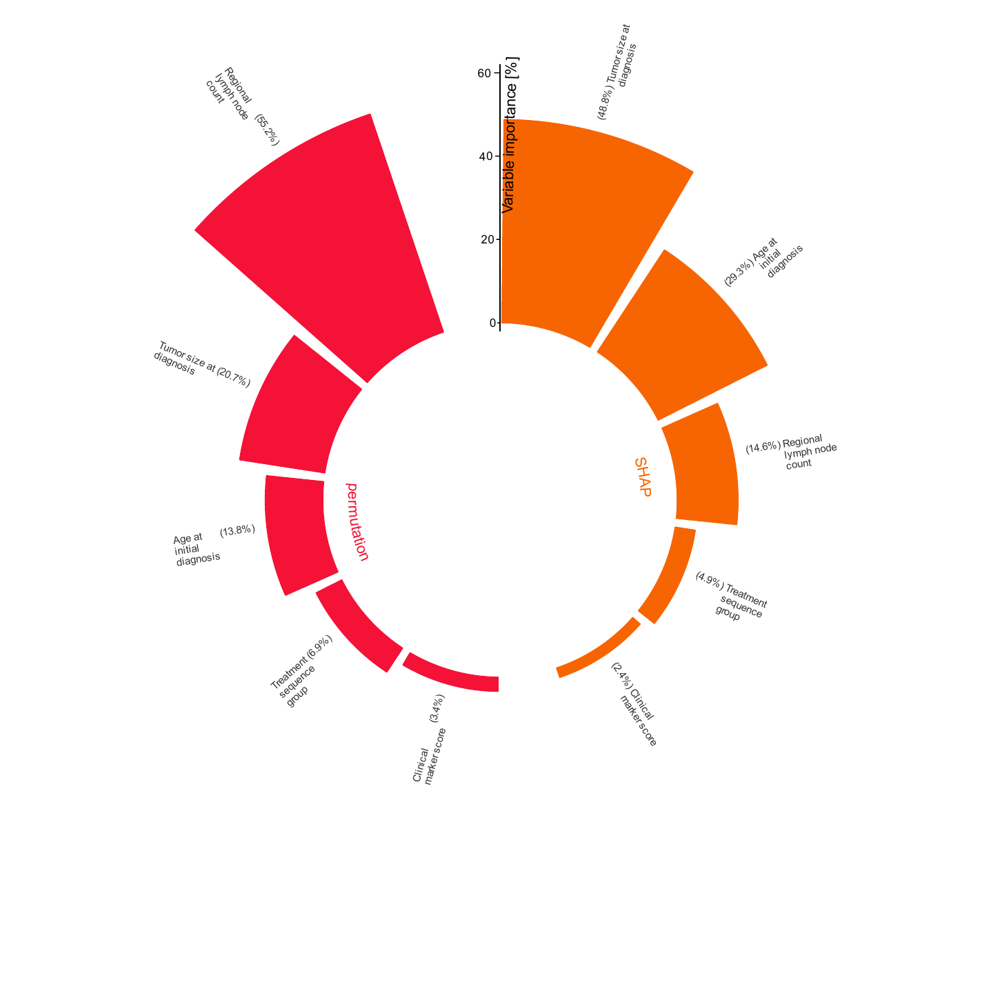{fig-alt="与单行图相同的合成重要性，label_args wrap将有空格的变量名分行，百分比单列在前。"}

[PDF](images/imp-guide/20261025-update-imp-circle-wrap.pdf)

#### 网络换行 {.unnumbered}

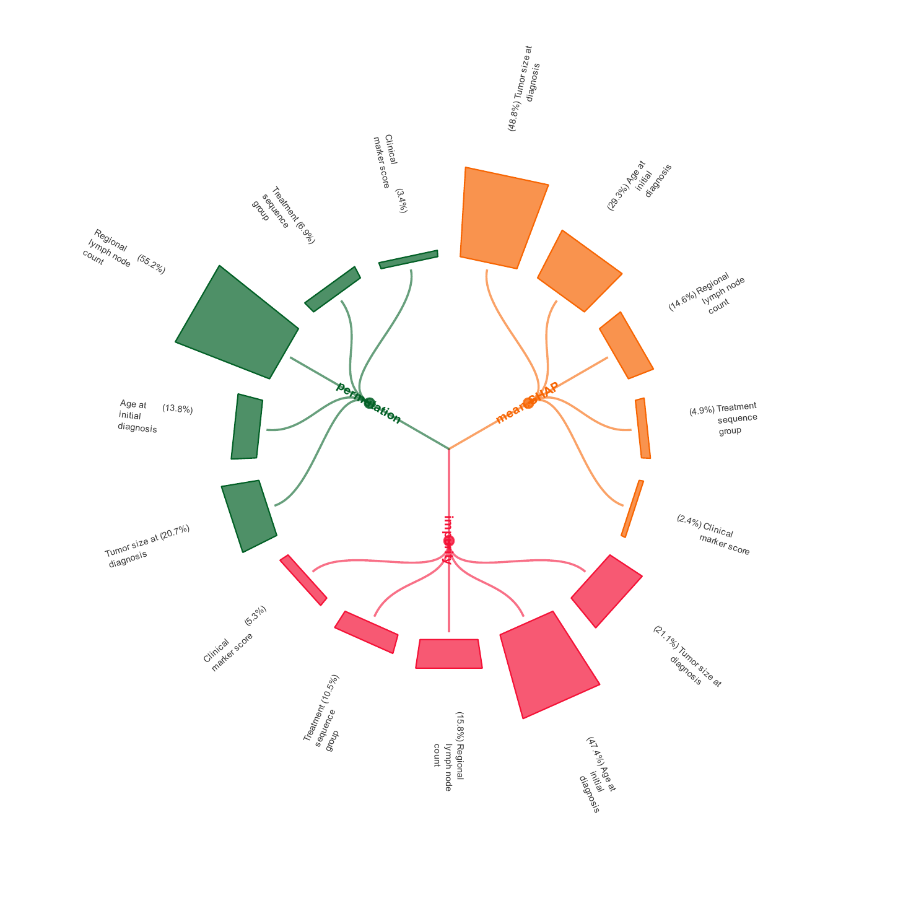{fig-alt="实际径向网络重要性图，外围变量名换行并显示百分比，中心为三种重要性方法。"}

[PDF](images/imp-guide/20261025-update-imp-network-wrap.pdf)

:::

#### Top N 百分比仍以完整输入为分母

`plt_imp_bump(value_type="percent")` 先在每个方法的**完整输入**中计算份额，再按平均秩选 `top_n`；显示项之和可以小于 100%。有原始值时使用非负原始重要性，否则按当前回退规则使用缩放值。`value_digits` 不改变百分比标签固定的一位小数。预先截掉数据再调用会换分母，不能与单纯 `top_n` 混用解释。

```r
bump_imp25 <- plt_imp_bump(imp25, top_n = 3, value_type = "percent", add_name = short_names25,
  bump_args = list(value_size = 9, group_label_size = 9, rank_label_size = 9),
  save = save_imp25("imp-bump-percent", 9, 5))
label_bump25 <- ggplot2::ggplot_build(bump_imp25)[["data"]][[3]][["label"]]
full_shares25 <- unlist(lapply(raw_imp25, function(raw) paste0(sprintf("%.1f", 100 * raw / sum(raw)), "%")))
```

::: {.callout-note collapse="true" title="复核代码"}
生成本页时运行的检查，接在上面的代码之后运行；只读教程可以跳过。

```r
stopifnot(length(label_bump25) == 9L, all(label_bump25 %in% full_shares25))
```
:::

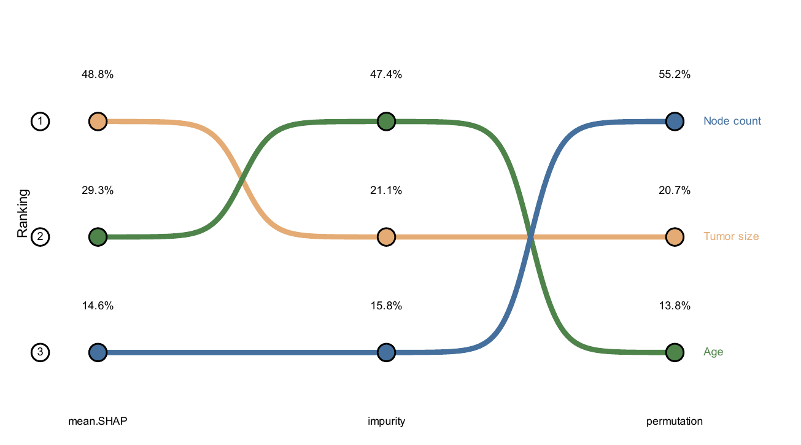{fig-alt="原生bump图展示按平均秩选择的三个变量；节点百分比按每个方法完整五变量的重要性总量计算。"}

[PDF](images/imp-guide/20261025-update-imp-bump-percent.pdf)

#### 流向图的 fmt_args 先改值，再归一化与重排

`plt_imp_flo2(fmt_args=list(cha_var="F1",cha_mult=.2))` 用**原列名**匹配，先缩放重要性，再重算各方法的份额、排序、标签及高度。它是绘图变换，不是重新计算模型重要性；报告中应说明缩放原因。只给 `cha_var`、不给倍数会警告并跳过缩放。

```r
flow_base25 <- plt_imp_flo2(imp25, add_name = short_names25, gap = 0, label.size = 2.4,
  save = save_imp25("imp-flow-original", 9, 7))
flow_scaled25 <- plt_imp_flo2(imp25, add_name = short_names25, gap = 0, label.size = 2.4,
  fmt_args = list(cha_var = "F1", cha_mult = .2),
  save = save_imp25("imp-flow-scaled", 9, 7))
scaled_shap25 <- flow_scaled25[["data"]]
scaled_shap25 <- scaled_shap25[!scaled_shap25[["is_gap"]] & scaled_shap25[["imp_type"]] == "mean.SHAP", ]
scaled_shap25 <- scaled_shap25[order(scaled_shap25[["var_raw"]]), ]
want_scaled25 <- raw_imp25[[1]]; want_scaled25[1] <- want_scaled25[1] * .2
```

::: {.callout-note collapse="true" title="复核代码"}
生成本页时运行的检查，接在上面的代码之后运行；只读教程可以跳过。

```r
stopifnot(isTRUE(all.equal(scaled_shap25[["fill_value"]], want_scaled25 / sum(want_scaled25))),
  identical(as.integer(scaled_shap25[["order"]]), as.integer(rank(-want_scaled25, ties.method = "first"))),
  identical(imp25, original_imp25))
validation_values <- list(bump_labels = label_bump25,
  scaled = scaled_shap25[c("var_raw", "fill_value", "order")], unchanged = identical(imp25, original_imp25))
```
:::

::: {.panel-tabset}

#### 原始值 {.unnumbered}

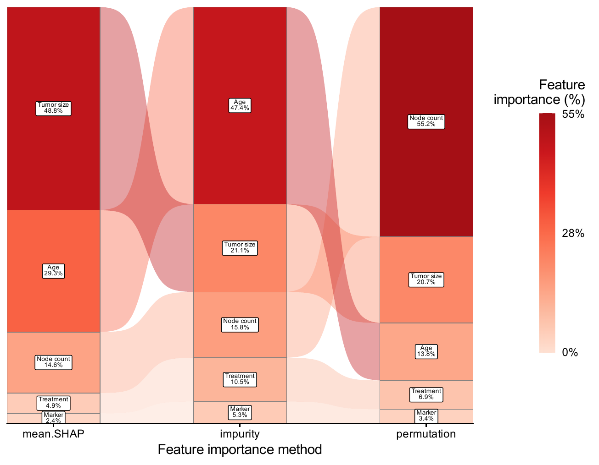{fig-alt="原生重要性流向图按未变换的完整五项原值计算各方法份额和排序。"}

[PDF](images/imp-guide/20261025-update-imp-flow-original.pdf)

#### F1 乘 0.2 {.unnumbered}

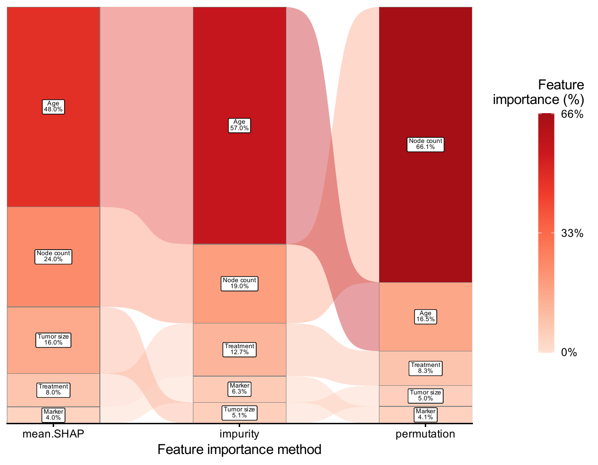{fig-alt="同一输入只将F1重要性乘0.2；流向图在归一化前应用倍数并同步重排，原始输入对象未被修改。"}

[PDF](images/imp-guide/20261025-update-imp-flow-scaled.pdf)

:::

<!-- /update-20261025: mlr_importance -->

## 当前重要性图的内置保存与尺寸 {#save-20261019}

2026-10-19 使用已推送 MLR `fc081cc`、RegR `f26e137` 与 UtilsR `0bb52b5`，在 Windows / WSL R 4.4.3 执行。本节继续复用 `ToyData::toy_imp` 的既有重要性数值，不重新训练模型。

<!-- rnotes-20261019: imp-save -->
```r
p_imp_save <- plt_imp_bar_per(imp,
  imp_type = c("mean.SHAP", "impurity", "permutation"), mode = "bar",
  bar_display = "b", add_name = labels,
  save = list(filename = file.path(tempdir(), "importance-bars.pdf")))
p_rank_save <- plt_imp_two(imp, imp_type = c("mean.SHAP", "permutation"),
  add_name = labels,
  save = list(filename = file.path(tempdir(), "importance-ranks.pdf")))
attr(p_imp_save, "plot_size")
attr(p_rank_save, "plot_size")
```

::: {.panel-tabset}

### 多方法柱形图 {.unnumbered}

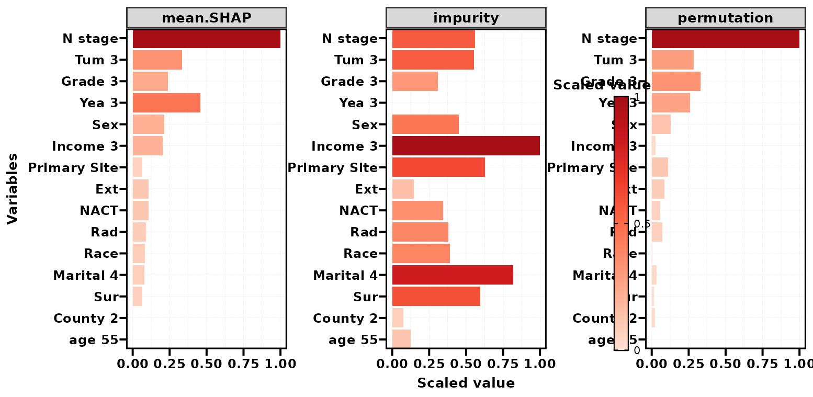{fig-alt="toy_imp的15个变量与三种方法柱形图，save只给filename，整图尺寸包含方法面板与变量文字。"}

[下载柱形图 PDF](images/imp-guide/20261019-bars-save.pdf)

### 两方法排名图 {.unnumbered}

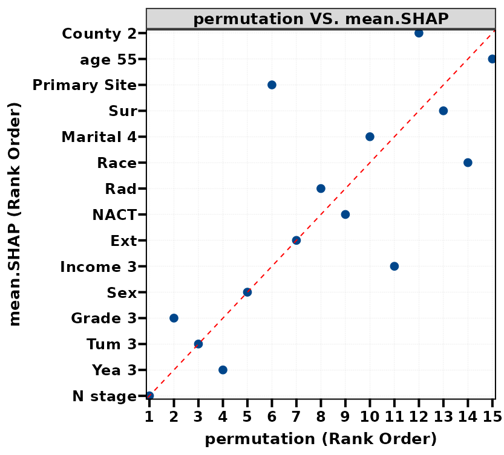{fig-alt="mean.SHAP与permutation两方法的排名散点及变量名称，按内容计算整图尺寸并生成PDF。"}

[下载排名图 PDF](images/imp-guide/20261019-ranks-save.pdf)

:::

`plt_imp_bar/bar_per/flo/flo2/two/radar` 和 `plt_bar_per()` 已支持末尾 `save=list()`。空 list 或 NULL 不写文件；非空设置转交 `RegR::save_plt()`，省略的宽高按变量数、方法面板及实际文字测量补齐，并记录英寸单位的 `plot_size`。显式尺寸保留；不要把各函数的面板基准尺寸当作整图尺寸。

多方法柱形图选用 `plt_imp_bar_per(mode="bar")`，保留其无内嵌色条的布局，避免色条压住相邻面板的变量标签；各方法仍使用原来的重要性数值和各自的坐标轴。

原有 `plt_imp_network()`、`plt_imp_bump()` 的保存代码仍按其接口使用；`plt_imp_circ()` 继续使用基础图形设备。这里只统一已有图形的保存与显示，不改变重要性数值、排序定义或百分比分母，也没有新的速度测量。

## 相关页面与源码 {#references}

- [SHAP：get_shp 与 14 个绘图函数](shap-guide.qmd)
- [ToyData 数据对象介绍](../toydata/index.qmd)
- [MLR 函数参考站点](https://hui950319.github.io/MLR/)
- [`get_imp()` 帮助页](https://hui950319.github.io/MLR/reference/get_imp.html)
- 重要性绘图函数帮助页：[`plt_imp_bar()`](https://hui950319.github.io/MLR/reference/plt_imp_bar.html)、[`plt_imp_circ()`](https://hui950319.github.io/MLR/reference/plt_imp_circ.html)、[`plt_imp_flo()`](https://hui950319.github.io/MLR/reference/plt_imp_flo.html)、[`plt_imp_flo2()`](https://hui950319.github.io/MLR/reference/plt_imp_flo2.html)、[`plt_imp_two()`](https://hui950319.github.io/MLR/reference/plt_imp_two.html)

本页图片来自上面的实际公共调用。使用固定示例、固定随机种子和注明的小规模设置，图形用于学习接口及解释预测结果。
核对绘图前后输入数据框序列化结果完全一致。旧版主题或图例依赖可能给出兼容提示；实际图形均完成导出。这里验证的是绘图及参数表现，没有把预计算对象当成重新训练模型的证据。

## 更新记录 {#page-updates}

::: {.callout-note collapse="true" title="本页更新记录"}
- 2026-10-26：补充[径向比例条 label_args](#radial-labels-20261026)的单行、换行及包装入口 PDF。
- 2026-10-25：[标签、份额与绘图缩放](#labels-shares-20261025)
:::
