这一页分为两部分：先介绍 `get_shp()` 如何训练树模型、计算 SHAP 并组织结果，再用已经计算好的 `ToyData::toy_shp` 展示全部 14 个 `plt_shp_*()` 函数。图形选项放在各节的标签页中，可切换比较，并点击图片放大。

**核对记录：** 最近核对2026-10-13。复核的已推送MLR基线 `fe46c5f` 包含 `9f3ba6b`，新增按系统选择SHAP引擎的默认值，版本仍为0.1.13。保留原34张SHAP对象绘图及执行范围，没有重新训练模型或计算SHAP；下方说明更新后的默认值与旧安装行为。

::: {.callout-note collapse="true" title="版本与复现记录"}
2026-10-31 追加按已推送 MLR `49cdb4c`（0.1.13）导出源码；配套依赖固定为 RegR `5067cdf`、UtilsR `dd654ef1`，在 Windows / WSL R 4.4.3 独立运行下述合成示例。旧图保留原执行快照；此次没有重跑历史模型或安装包。

:::

## 示例准备与读图规则 {#data}

`toy_shp` 是从 SEER 胰腺导管腺癌（PDAC）、TNM I 期示例分析中抽取的生存随机森林解释对象，含 **400 个观测、14 个变量**。它与本站 ToyData 目录中的 **598 人 M1 PTC 队列**是两个不同的数据对象，详细来源见 [ToyData 数据介绍](../toydata/index.qmd)。

::: {.table-responsive}

| 成分 | 维度 / 内容 | 用途 |
|:--|:--|:--|
| `S` | 400 × 14 | 每个观测的特征总 SHAP |
| `X` | 400 × 14 | 解释样本的原始特征值；用于横轴与着色 |
| `S_inter` | 400 × 14 × 14 | 主效应与两两交互分解 |
| `baseline` | 0 | 该对象存储的解释基线 |

:::


```r
library(MLR)
library(ToyData)
library(ggplot2)

# 胰腺癌示例的 Ext 使用通用名称，避免套用甲状腺专用标签。
# .rename_shp() 是 MLR 导出的名称同步工具；同时更新 S、X 和 S_inter。
shp <- MLR::.rename_shp(ToyData::toy_shp,
                        name_map = c(Ext = "Extension"))

# 插图和环形图使用较短标签；只改名称，不改数值。
short_names <- c(
  Age = "age", Sex = "sex", Race = "race", Marital_4 = "marital",
  Income_3 = "income", County_2 = "county", Primary_Site = "site",
  Yea_3 = "year", Grade_3 = "grade", Tum_3 = "size", Extension = "extent",
  Sur = "surgery", Rad = "rt", Che = "chemo"
)
shp_labels <- MLR::.rename_shp(shp, name_map = short_names)

# 仅为演示分组图固定为 3 簇，使用默认的 SHAP 列标准化。
clu <- get_shp_clust(shp, k = 3, seed = 246, silhouette = FALSE)
```

变量包括年龄、性别、种族、婚姻、收入、城乡、原发部位、诊断年份、分级、肿瘤大小、扩展、手术、放疗和化疗。`Che` 的水平是 `No/Unknown` 与 `Yes`；前者含治疗信息未知，不能当作完全明确的未治疗组。

### 总贡献、主效应、交互与重要性

对观测 $i$ 与变量 $j$，记总 SHAP 为 $\phi_{ij}$，交互矩阵为 $\Phi_{ijk}$：

$$
\begin{aligned}
\phi_{ij}&=\sum_k\Phi_{ijk},\\
\text{主效应}_{ij}&=\Phi_{ijj},\\
\text{完整变量对贡献}_{i,jk}&=2\Phi_{ijk}\;(j\ne k).
\end{aligned}
$$

矩阵非对角项对称；一对变量的贡献分在两个对称位置，所以本页的配对交互图使用两倍非对角项。这与 [SHAP TreeExplainer 的交互分解定义](https://shap.readthedocs.io/en/latest/generated/shap.TreeExplainer.html)一致。当前对象已核验 $\max|\sum_k\Phi_{ijk}-\phi_{ij}|<10^{-12}$。

全局重要性为 $I_j=n^{-1}\sum_i|\phi_{ij}|$。它衡量平均贡献幅度，取绝对值后不保留方向；百分比是所选变量集合内的重要性份额，不能解释成死亡风险占比或解释方差。

::: {.callout-note}
SHAP 解释的是已拟合模型的输出。生存森林的风险尺度不是死亡概率或 HR，治疗变量的 SHAP 分布也不直接等于因果治疗效果。`toy_shp` 的基线存储为 0；热图和力图中的 `f(x)` 按 `baseline + rowSums(S)` 构造，不能据此把它认作已经校准的绝对风险或原模型的平均预测。
:::

## get_shp()：接口与分析流程 {#get-shp}

`get_shp()` 把任务选择、训练样本处理、树模型训练、SHAP 计算和常用图形组装放在一个入口。`vars` 必须是**列名字符向量**，例如 `c("Age", "Che", "Tum_3")`。以下签名展示含9f3ba6b的接口；条件默认值与旧安装的区别见 [engine与device](#engine-与-device)：

```r
get_shp(
  data, vars, surv = TRUE,
  interactions = TRUE, int_var = NULL, ...,
  Num.sample = 2000, exp.sample = 400,
  sample_args = list(
    Down.sample = TRUE, Outcome.Ratio = NULL,
    Num.sample = 2000, exp.sample = 400
  ),
  model = c("ranger", "xgboost", "lightgbm"),
  boosting_encoding = c("onehot", "target"),
  engine = if (.Platform$OS.type == "windows")
    c("treeshap", "python") else c("python", "treeshap"),
  device = c("auto", "cpu", "gpu"),
  render_plots = TRUE
)
```


### 任务由 surv 的类型决定

::: {.table-responsive}

| `surv` 的写法 | 实际任务 | 数据要求 |
|:--|:--|:--|
| `surv = TRUE` | 生存分析 | 当前实现固定读取 `time` 与 `DSS`；预测变量列由 `vars` 指定 |
| `surv = FALSE` | 仍然是生存分析 | 当前分派条件为 `is.logical(surv)`，不是逻辑值本身 |
| `surv = "outcome"` | 二分类 | 指定结局列；应有明确的 0/1 或两水平因子编码 |

:::


二分类分支把因子结局转换为 `as.numeric(outcome) - 1`，所以第二个因子水平对应正类。分析前应明确这个水平的临床含义；此入口不是一般的多分类接口。生存分析建议写 `surv = TRUE`，二分类则显式写结局列名。

### model 与变量编码

::: {.table-responsive}

| 模型 | 生存任务 | 二分类任务 | 编码与模型边界 |
|:--|:--|:--|:--|
| `"ranger"`（默认） | 支持 | 支持 | 分类变量保持因子；默认 200 棵树；生存解释使用森林风险输出 |
| `"xgboost"` | 支持 | 支持 | 生存任务使用 `onehot`；二分类可用 `onehot` 或 `target` |
| `"lightgbm"` | 不支持 | 支持 | 二分类可用 `onehot` 或 `target` |

:::


`onehot` 将分类特征展开成编码列；`target` 是分类任务中的交叉拟合、平滑目标编码。Boosting 模型产生的编码列 SHAP 会按原始变量归并，交互块也按原始变量求和，因此下游绘图仍面对原始特征层级。

### 数值变量的自动分箱 {#numeric-binning}

**当前行为（2026-10-07 核对）：** `get_shp()` 会检查 `vars` 中的数值预测变量。
如果某列有 **超过 200 个不同的非缺失值**，就先用整份输入数据的分位数构造最多
200 个箱，再把每个值替换为其所在箱的中位数。重复的分位数边界会合并，因此实际箱数
可能少于 200。恰好 200 个不同值的数值列，以及因子、字符列，不走这一步。

分箱发生在训练抽样和解释抽样**之前**，适用于当前入口支持的所有模型、任务和 SHAP
引擎。它会改变拟合数据与模型；当前接口没有关闭自动分箱的参数。

::: {.table-responsive}

| 位置 | 分箱后的含义 |
|:--|:--|
| 模型训练与解释输入 | 使用箱中位数；模型不再区分同一箱内的原始数值 |
| `res$shp$X` | 解释样本中相应列保存箱中位数；其余列按原有编码处理 |
| 依赖图横轴、数值着色 | 对应 `shp$X` 的箱中位数，可能出现重复横坐标或颜色；不能据此读取箱内的精细变化 |
| `res$par_lis$data` | 保留调用时的原始数据；不会被分箱后的拟合副本覆盖 |

:::

调用前可先检查哪些变量会触发分箱：

```r
bin_vars <- Filter(function(v) {
  is.numeric(data[[v]]) &&
    length(unique(stats::na.omit(data[[v]]))) > 200L
}, intersect(vars, names(data)))
bin_vars
```

本页下面的图形仍来自此前保存的 `ToyData::toy_shp`，补充说明没有重新计算这个对象。
不要仅凭当前分箱规则反推旧对象是否经过相同预处理。验证集应先从原始数据划分；
上述分位数边界基于传给 `get_shp()` 的整份数据，不能把混入验证集后的结果当作独立验证。
运行耗时的历史实测见 [get_shp 提速记录](../regr/mlr-shp-speedup-20261006.qmd)。

### 训练样本与解释样本是两件事

::: {.table-responsive}

| 参数 | 当前默认 / 行为 | 选择时要注意 |
|:--|:--|:--|
| `Down.sample` | `TRUE` | 先处理结局比例，再限制训练样本量 |
| `Outcome.Ratio` | `NULL` 保留任务默认：生存 9、二分类 3 | 指负类 / 正类的目标比例；不是每次都强制达到此比例 |
| `Num.sample` | 2000 | 默认路径中的训练样本上限，不是树的数量 |
| `exp.sample` | 400 | 从处理后的数据中抽取解释样本；整数时不超过可用行数 |
| `sample_args` | 命名 list，允许局部覆盖 | 只允许上述四个字段，未知名称、重复字段或与显式参数重复指定会报错 |

:::


当前采样 helper 仅在负类 / 正类比例 **大于 9** 时触发比例下采样，再按任务的 `Outcome.Ratio` 取负类。因此二分类默认比例 3 并不代表比例为 4–9 时也会自动平衡到 3。生存任务中的正类按 `DSS` 的事件编码判断。

另一个容易忽略的细节是：`Down.sample = FALSE` 会提前返回训练数据，**同时跳过 `Num.sample` 上限**。这时不能把 `Num.sample = 2000` 当作仍然有效的限额。

`exp.sample` 的整数控制解释行数；生存分支还支持按 `sampling::strata()` 约定给出分层抽样 list。当前二分类分支按数值样本量处理，不能照搬生存分支的分层 list。若需稳定复现，抽样前设置 R 随机种子。

配置可以集中写成 `sample_args = list(Num.sample = 1000, exp.sample = 200)`；也可以只用显式的 `Num.sample` 与 `exp.sample`。同一个设置选一种位置即可。`...` 不应被当成任意模型超参数的通用转发口。

### engine 与 device

**已推送默认值更新（2026-10-13核对）：** MLR提交 `9f3ba6b` 在Windows默认选 `treeshap`，其他系统默认选 `python`；显式engine始终优先。该提交已包含于已推送基线 `fe46c5f`，旧安装仍可能在Windows默认使用Python，版本号同为0.1.13。下面34张图继续使用原SHAP对象，本次只核对入口和条件默认值，没有重新训练或重新计算SHAP。

```r
# 计算入口示例，本页未执行：data为你自己的time/DSS队列，vars为预测变量列名。
# 选择一个后端执行。
set.seed(246)
res_r <- get_shp(data, vars = vars, surv = TRUE, model = "ranger",
  engine = "treeshap", render_plots = FALSE)

# 使用Python前，先在reticulate初始化前选定可用环境。
set.seed(246)
res_python <- get_shp(data, vars = vars, surv = TRUE, model = "ranger",
  engine = "python", device = "cpu", render_plots = FALSE)
```

显式engine更适合跨系统复现；`device`只控制Python解释路径，不能改变R模型训练设备，也不控制treeshap。条件默认值减少Windows下对Python初始化的依赖，不保证所有模型/交互配置在两个引擎下都等价。


::: {.table-responsive}

| 选项 | 作用 | 环境与含义 |
|:--|:--|:--|
| `engine = "python"` | Python SHAP 树解释器 | 通过 reticulate；需先选择可用的 Python SHAP 环境 |
| `engine = "treeshap"` | R 端树解释器 | 可在 R 端完成计算；`device` 不控制这个后端 |
| `device = "auto"` | 自动选择可用的 Python 计算路径 | GPU 是否可用取决于环境与已安装扩展 |
| `device = "cpu"` / `"gpu"` | 指定 Python SHAP 的计算设备 | 这不等于把 R 端模型训练也转移到 GPU |

:::


若使用项目的 Python 环境，应在 reticulate 初始化前选定 `MLR-shap`。本页绘图读取已存储的 SHAP，因此不需要启动这个环境。

比较两个计算引擎时还要控制模型本身：当前 ranger 生存路径在 Python 引擎下设 `max.depth = 30`，R treeshap 路径没有相同的默认深度限制。直接比较两次默认 `get_shp()` 的数值，可能同时比较了模型训练差异与解释器差异。

### interactions、int_var 与 render_plots

`interactions = TRUE` 请求交互矩阵，便于展示主效应、变量对贡献、交互排名与网络；关闭后，依赖 `S_inter` 的图形无法生成。交互存储量随解释样本数与变量数按 $n\times p\times p$ 增长，变量较多时可先缩小解释样本或关闭交互。

`int_var` 选择预生成交互图的一个或两个变量，例如 `"Marker"` 或 `c("Age", "Che")`，不缩小SHAP交互矩阵的计算范围。单个锚点的plt.int1按交互排名配对各伙伴的两个方向，plt.int2只画一个锚点；两个变量保留双锚点展示。

`render_plots = FALSE` 保留 SHAP 计算，但把下面六个预生成图字段全部置为 `NULL`。需要自己选图、自己调参数时，这个开关可以减少不必要的作图。

### 返回对象如何使用

::: {.table-responsive}

| 字段 | 内容 | 条件 |
|:--|:--|:--|
| `shp` | `shapviz` 对象，含 `S`、`X`、`baseline`，以及可选 `S_inter` | 核心绘图输入 |
| `plt.sum` | 总体蜂群 / 百分比组合图 | `render_plots = TRUE` |
| `plt.viv` | 总体交互可视化 | 还需 `S_inter` |
| `plt.tot` | 各变量总 SHAP 依赖图 | `render_plots = TRUE` |
| `plt.mai` | 各变量主效应图 | 还需 `S_inter` |
| `plt.int1` | `int_var` 两个方向的总贡献 / 配对交互图 | 还需 `S_inter` 与 `int_var` |
| `plt.int2` | 一个或两个锚点各自的交互排名与自动配对插图 | 自动选择各自最强搭档，不保证就是 `int_var` 的另一个变量 |
| `cat_vars` | 原始 `vars` 中因子或字符列的名称 | 用于变量分类 |
| `con_vars` | 原始 `vars` 中数值列的名称 | 用于变量分类 |
| `par_lis` | 原始 `data` 与 `vars` | 参数记录；保存完整结果时也会保存原始数据 |

:::


返回值中没有单独的已拟合 learner 字段。大部分绘图入口既可接收完整结果 `res`，也可接收 `res[["shp"]]`；`plt_shp_stack()` 的首个参数是聚类结果，`plt_shp_circ()` 还可接收命名的多组 SHAP 对象列表。


### 聚类输入与同基线的新样本分配（2026-10-27） {#cluster-assignment-20261027}

<!-- update-20261027: mlr_latest_cluster -->

按已推送 MLR `a4865f2`，`get_shp_clust()` 先核对 SHAP 为有限实数矩阵、列名唯一非空、行名存在时也唯一非空；`X` 的行数应与 SHAP 相同，且覆盖所有 SHAP 列。重复列、Inf、非整数控制量或损坏的训练缩放属性会明确拒绝。

**新队列必须复用同一个已拟合模型、同一解释尺度与同一 SHAP 背景。** 不能在新队列另调一次 `get_shp()` 训练另一模型后，直接把两个解释矩阵拿来分配。下面实际拟合 60 行合成线性模型，为四个加性特征计算精确的 interventional SHAP；新增 12 行只解释、不重训。所有图都来自本例，不沿用上面的 SEER 示例对象。

```r
library(MLR)
library(ggplot2)
set.seed(2711)
cl_train27 <- data.frame(x1 = rnorm(60), x2 = rnorm(60),
  Grade = rep(c("A", "B", "C"), 20), Flag = rep(c(TRUE, FALSE), 30))
cl_train27[["y"]] <- 2 + 1.5 * cl_train27[["x1"]] - .5 * cl_train27[["x2"]] +
  c(A = -1, B = .5, C = 1.5)[cl_train27[["Grade"]]] + .7 * cl_train27[["Flag"]]
cl_fit27 <- lm(y ~ x1 + x2 + Grade + Flag, data = cl_train27)
cl_beta27 <- coef(cl_fit27)
cl_terms27 <- function(d) {
  cbind(x1 = cl_beta27[["x1"]] * d[["x1"]], x2 = cl_beta27[["x2"]] * d[["x2"]],
    Grade = cl_beta27[["GradeB"]] * (d[["Grade"]] == "B") +
      cl_beta27[["GradeC"]] * (d[["Grade"]] == "C"),
    Flag = cl_beta27[["FlagTRUE"]] * d[["Flag"]])
}
cl_reference27 <- colMeans(cl_terms27(cl_train27))
cl_baseline27 <- unname(cl_beta27[["(Intercept)"]] + sum(cl_reference27))
cl_explain27 <- function(d) {
  shapviz::shapviz(sweep(cl_terms27(d), 2, cl_reference27, "-"),
    X = d[, c("x1", "x2", "Grade", "Flag")], baseline = cl_baseline27)
}
cl_shp27 <- cl_explain27(cl_train27)
clu27 <- get_shp_clust(cl_shp27, k = 3, cluster_fun = "hclust", compare = TRUE)
cl_new27 <- data.frame(x1 = rnorm(12), x2 = rnorm(12),
  Grade = rep(c("A", "B", "C"), 4), Flag = rep(c(TRUE, FALSE), 6))
cl_new_shp27 <- cl_explain27(cl_new27)
cl_assigned27 <- get_shp_assign(clu27, cl_new_shp27)
print(clu27)
print(cl_assigned27)
cl_map27 <- plt_shp_map(cl_shp27, clust = clu27, outline = "none", label = FALSE) +
  labs(title = "Training SHAP clusters: fixed k = 3")
cl_distance27 <- ggplot(data.frame(row = seq_len(12),
  distance = cl_assigned27[["dist"]], cluster = cl_assigned27[["cluster"]]),
  aes(row, distance, color = cluster)) + geom_point(size = 2.5) +
  labs(x = "New observation", y = "Distance on training scale",
    title = "New explanations assigned to training cluster means") + theme_minimal(base_size = 12)
ggsave(file.path(tempdir(), "20261027-update-shap-cluster-training.pdf"), cl_map27,
  width = 7, height = 5)
ggsave(file.path(tempdir(), "20261027-update-shap-cluster-assignment.pdf"), cl_distance27,
  width = 7, height = 4.5)
```

::: {.panel-tabset}

#### 训练解释的聚类 {.unnumbered}

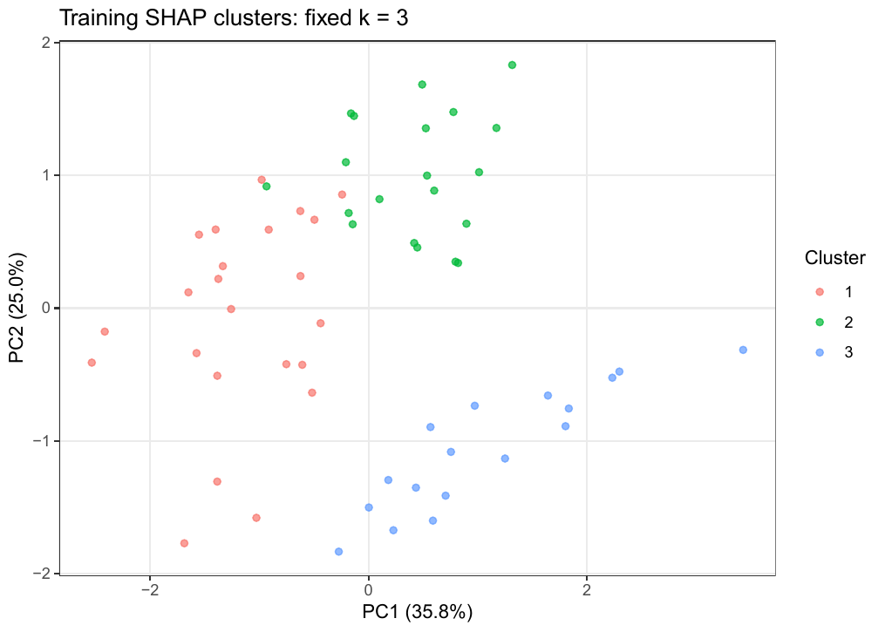{fig-alt="60 行合成线性模型的四特征 SHAP 聚类，PCA 投影显示固定 k 等于 3 的分组，不代表最优簇数。"}

[原生 PDF](images/shap-guide/20261027-update-shap-cluster-training.pdf)

#### 新解释的分配距离 {.unnumbered}

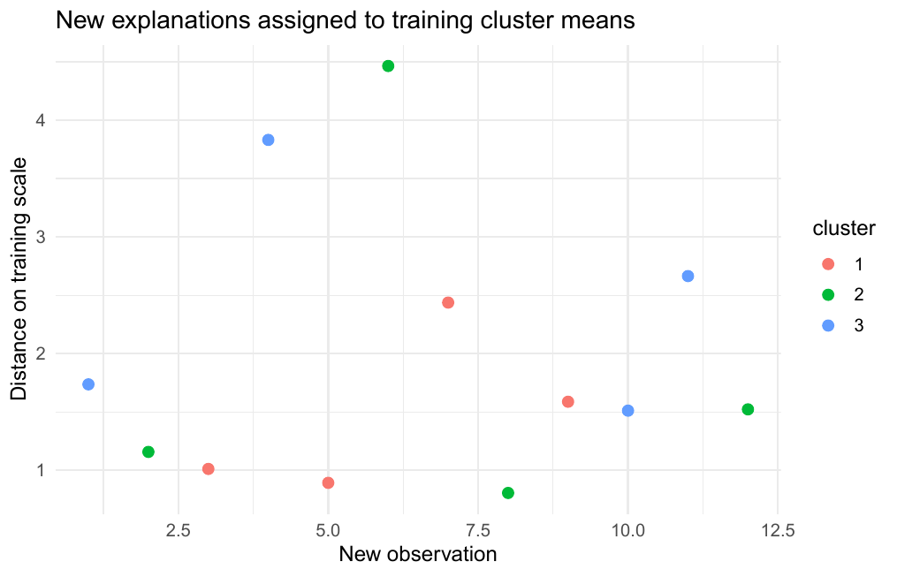{fig-alt="12 行新样本到所分配训练簇均值的距离，颜色为簇标签；距离越大说明与训练中心越远，不是经过校准的异常概率。"}

[原生 PDF](images/shap-guide/20261027-update-shap-cluster-assignment.pdf)

:::

`get_shp_assign()` 保留训练集的中心化与标准差，再按欧氏或 Manhattan 距离选择最近的**训练簇均值**。它支持空输入、单行和 SHAP 列重排；额外列不参与已经训练好的聚类。尤其是层次聚类，对训练数据再次分配也可能与原树切割标签不同，不能把该函数当成层次聚类的原标签恢复器。距离没有默认的已校准异常阈值。

`compare=TRUE` 将每个分类特征完整 one-hot 编码、去除常量并标准化，结果不依赖原特征列顺序或 treatment/sum contrasts。它比较特征空间与 SHAP 空间分组的一致程度；ARI 接近 0 表示超出随机的一致性较少，不能单凭它认定任一分组有用或发现临床亚型。

::: {.callout-note collapse="true" title="复核代码"}

```r
stopifnot(max(abs(cl_baseline27 + rowSums(cl_shp27[["S"]]) - predict(cl_fit27))) < 1e-10,
  max(abs(cl_baseline27 + rowSums(cl_new_shp27[["S"]]) - predict(cl_fit27, cl_new27))) < 1e-10)
cl_reordered27 <- cl_shp27
cl_reordered27[["X"]] <- cl_reordered27[["X"]][, c("Flag", "Grade", "x2", "x1")]
cl_reordered27[["X"]][["Grade"]] <- factor(cl_reordered27[["X"]][["Grade"]])
contrasts(cl_reordered27[["X"]][["Grade"]]) <- contr.sum(3)
clu_reordered27 <- get_shp_clust(cl_reordered27, 3, cluster_fun = "hclust", compare = TRUE)
stopifnot(identical(clu27[["compare"]], clu_reordered27[["compare"]]),
  identical(get_shp_assign(clu27, cl_new_shp27[["S"]]),
    get_shp_assign(clu27, cl_new_shp27[["S"]][, 4:1, drop = FALSE])),
  length(get_shp_assign(clu27, cl_new_shp27[["S"]][FALSE, , drop = FALSE])[["dist"]]) == 0L,
  length(get_shp_assign(clu27, cl_new_shp27[["S"]][1, , drop = FALSE])[["dist"]]) == 1L)
cl_x27 <- sweep(sweep(cl_new_shp27[["S"]], 2, attr(clu27[["obj"]][["x"]], "scaled:center"), "-"),
  2, attr(clu27[["obj"]][["x"]], "scaled:scale"), "/")
cl_gaps27 <- vapply(seq_len(3), function(i) {
  sqrt(rowSums(sweep(cl_x27, 2, cl_assigned27[["centers"]][i, ], "-")^2))
}, numeric(12))
stopifnot(identical(as.integer(cl_assigned27[["cluster"]]), max.col(-cl_gaps27, ties.method = "first")))
# 仅复核类型规范化；这份带缺失值的副本不用于拟合或上述图形。
cl_typed27 <- cl_shp27
cl_typed27[["X"]][["x1"]] <- bit64::as.integer64(seq_len(60))
cl_typed27[["X"]][["x2"]] <- haven::labelled_spss(c(999, seq_len(59)), na_values = 999)
cl_typed_result27 <- get_shp_clust(cl_typed27, 3, cluster_fun = "hclust")
for (f in c("x1", "x2")) {
  values <- if (f == "x1") seq_len(60) else c(NA_real_, seq_len(59))
  expected <- as.numeric(tapply(values, cl_typed_result27[["cluster"]], mean, na.rm = TRUE))
  stopifnot(isTRUE(all.equal(cl_typed_result27[["tab"]][["mean_x"]][
    cl_typed_result27[["tab"]][["feature"]] == f], expected)))
}
cl_bad27 <- cl_shp27[["S"]]; cl_bad27[1, 1] <- Inf
cl_error27 <- tryCatch(get_shp_clust(cl_bad27, 3), error = conditionMessage)
stopifnot(is.character(cl_error27), grepl("finite", cl_error27))
validation_values <- list(n_train = 60L, n_new = 12L, baseline = cl_baseline27,
  sizes = as.integer(table(clu27[["cluster"]])), assigned = as.integer(cl_assigned27[["cluster"]]),
  distances = as.numeric(cl_assigned27[["dist"]]), ari = clu27[["compare"]][["ari"]],
  typed_means = as.numeric(cl_typed_result27[["tab"]][["mean_x"]][
    cl_typed_result27[["tab"]][["feature"]] %in% c("x1", "x2")]))
```
:::

特征概要中，普通数值给均值，逻辑/因子/字符给众数；`integer64` 转为数值，SPSS 用户缺失值先规范化为 NA 再汇总。超大整数仍受 double 精度约束；Date、difftime、矩阵或 list 等列需要显式预处理。`compare=TRUE` 要求原特征没有缺失，不能把概要允许缺失误解成比较路径也会自动填补。

<!-- /update-20261027: mlr_latest_cluster -->


### 随机状态、同大小簇与距离复用（2026-10-27） {#cluster-seed-20261027}

<!-- update-20261027: mlr_followup_cluster -->

MLR `4d7d979` 继续补齐 `get_shp_clust()` 的复现边界：给定 `seed` 时，正常返回或报错都恢复调用者随机状态；`seed=NULL` 使用当前随机流，k-means 会自然推进它。簇先按人数从多到少编号；人数相同则按特征名称排序后的中心坐标作字典序排序，仍同分时使用首个训练行位置。这保证**同一划分**的编号一致，不保证不同随机初值一定得到同一划分。

下面的 24×3 数值矩阵只用于校验聚类规则，不来自拟合模型或临床数据。两组各 12 行，输出展示实际簇编号、人数和标准化 A 维中心。

```r
library(MLR)
set.seed(2731)
seed_S27 <- rbind(matrix(rnorm(36, -4, .15), 12, 3),
  matrix(rnorm(36, 4, .15), 12, 3))
colnames(seed_S27) <- c("Z", "A", "M")
set.seed(2732)
seed_before27 <- get(".Random.seed", envir = .GlobalEnv)
seed_clu27 <- get_shp_clust(seed_S27, 2, seed = 1, silhouette = FALSE)
stopifnot(identical(get(".Random.seed", envir = .GlobalEnv), seed_before27))
seed_table27 <- data.frame(cluster = levels(seed_clu27[["cluster"]]),
  n = as.integer(table(seed_clu27[["cluster"]])),
  standardized_A_center = as.numeric(tapply(seed_clu27[["obj"]][["x"]][, "A"],
    seed_clu27[["cluster"]], mean)))
gt::gtsave(gt::fmt_number(gt::gt(seed_table27), columns = "standardized_A_center", decimals = 4),
  file.path(tempdir(), "20261027-update-shap-equal-cluster-labels.html"))
```

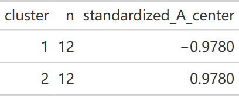{fig-alt="用于规则核对的 24 行合成矩阵形成两个各 12 行的簇，表中簇 1 的标准化 A 维中心小于簇 2；不代表临床亚型。"}

[原生 HTML](images/shap-guide/20261027-update-shap-equal-cluster-labels.html)

::: {.callout-note collapse="true" title="复核代码"}

```r
seed_before27 <- get(".Random.seed", envir = .GlobalEnv)
for (seed in 2:4) {
  z <- get_shp_clust(seed_S27, 2, seed = seed, silhouette = FALSE)
  stopifnot(identical(z[["cluster"]], seed_clu27[["cluster"]]),
    identical(get(".Random.seed", envir = .GlobalEnv), seed_before27))
}
seed_reverse27 <- get_shp_clust(seed_S27[, 3:1], 2, seed = 1, silhouette = FALSE)
stopifnot(identical(seed_reverse27[["cluster"]], seed_clu27[["cluster"]]))
seed_hc27 <- get_shp_clust(seed_S27, 2, cluster_fun = "hclust", seed = 1)
seed_sil27 <- cluster::silhouette(as.integer(seed_hc27[["cluster"]]),
  stats::dist(seed_hc27[["obj"]][["x"]]))
stopifnot(isTRUE(all.equal(seed_hc27[["sil"]][["sil_width"]], as.numeric(seed_sil27[, "sil_width"]))))
seed_bad27 <- seed_S27; seed_bad27[1:12, ] <- 1; seed_bad27[13:24, ] <- 2
seed_error27 <- tryCatch(get_shp_clust(seed_bad27, 3, seed = 1), error = conditionMessage)
stopifnot(is.character(seed_error27), identical(get(".Random.seed", envir = .GlobalEnv), seed_before27))
invisible(get_shp_clust(seed_S27, 2, seed = NULL, silhouette = FALSE))
stopifnot(!identical(get(".Random.seed", envir = .GlobalEnv), seed_before27))
validation_values <- list(n = 24L, sizes = seed_table27[["n"]],
  centers = seed_table27[["standardized_A_center"]], restored = TRUE,
  labels = as.integer(seed_clu27[["cluster"]]), silhouette = seed_hc27[["sil"]][["sil_width"]])
```
:::

`hclust` 与 silhouette 复用同一份 SHAP 成对距离；本例宽度与独立计算逐项一致，没有新测提速倍数。距离仍需二次规模存储；关闭 silhouette 可减少轮廓计算，但层次聚类本身仍需距离，不能据此把大样本开销当成线性。

<!-- /update-20261027: mlr_followup_cluster -->

### 聚类缩放状态、基线与空分配（2026-10-27） {#preprocessing-state-20261027b}

<!-- update-20261027b: mlr_shp_state -->

MLR `6ea0111` 将训练用的 `center`、`scale` 另存于 `obj$preprocess`。矩阵的缩放属性在传递中丢失时，新对象仍能复用训练尺度；两份记录不一致则报错，避免静默改变分配距离。没有此字段的旧对象仍依赖原矩阵属性，应保留完整训练对象。

本节接着使用[上方 60 行线性模型](#cluster-assignment-20261027)的 `cl_shp27`、`cl_explain27`，新增 8 行只做解释与分配。下表记录的是 **SHAP 列**的训练均值和标准差，不是原始临床变量的均值与标准差。

```r
state_clu27 <- get_shp_clust(cl_shp27, 3, cluster_fun = "hclust", compare = TRUE)
state_new27 <- data.frame(x1 = seq(-1, 1, length.out = 8), x2 = cos(seq_len(8)),
  Grade = rep(c("A", "B", "C"), length.out = 8), Flag = rep(c(TRUE, FALSE), 4))
state_shp27 <- cl_explain27(state_new27)
state_assigned27 <- get_shp_assign(state_clu27, state_shp27)
state_training27 <- state_clu27[["obj"]][["preprocess"]]
state_table27 <- data.frame(feature = names(state_training27[["center"]]),
  SHAP_center = unname(state_training27[["center"]]),
  SHAP_scale = unname(state_training27[["scale"]]))
gt::gtsave(gt::fmt_number(gt::gt(state_table27), columns = c("SHAP_center", "SHAP_scale"),
  decimals = 6), file.path(tempdir(), "20261027b-update-shap-training-scale.html"))

# 带标签基线仍表示这个已拟合模型的同一个数值。
state_labelled27 <- cl_shp27
state_labelled27[["baseline"]] <- haven::labelled(cl_baseline27,
  labels = c(reference = cl_baseline27))
state_map27 <- plt_shp_map(state_labelled27, clust = state_clu27,
  color_by = "prediction", outline = "none", label = FALSE) +
  ggplot2::labs(title = "Same model, normalized labelled baseline")
ggplot2::ggsave(file.path(tempdir(), "20261027b-update-shap-labelled-baseline.pdf"),
  state_map27, width = 7, height = 5)

state_empty27 <- get_shp_assign(state_clu27, state_shp27[["S"]][FALSE, , drop = FALSE])
print(state_empty27)
state_empty_table27 <- data.frame(cluster = levels(state_empty27[["cluster"]]),
  assigned_n = as.integer(table(state_empty27[["cluster"]])))
gt::gtsave(gt::gt(state_empty_table27),
  file.path(tempdir(), "20261027b-update-shap-empty-assignment.html"))
```

::: {.panel-tabset}

#### 训练缩放记录 {.unnumbered}

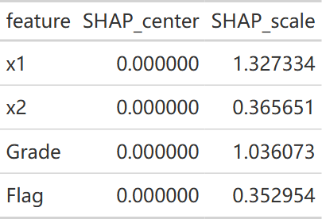{fig-alt="60 行训练 SHAP 的四列均值接近零，各列标准差保存在独立的 preprocess 字段，供新样本复用。"}

[原生 HTML](images/shap-guide/20261027b-update-shap-training-scale.html)

#### 带标签基线的预测着色 {.unnumbered}

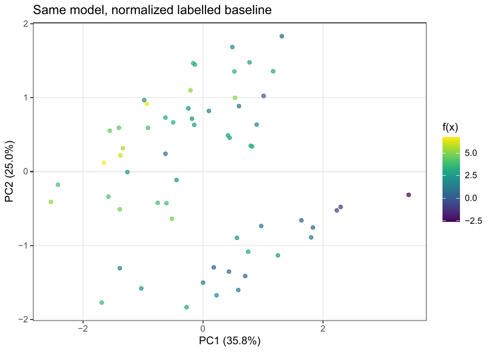{fig-alt="60 行训练解释的二维 SHAP 投影，以模型预测值着色；带标签基线先转为相同的普通数值，预测值等于基线加各特征 SHAP 之和。"}

[原生 PDF](images/shap-guide/20261027b-update-shap-labelled-baseline.pdf)

#### 空批次的各簇计数 {.unnumbered}

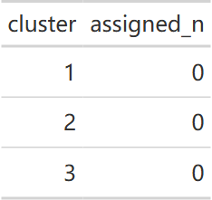{fig-alt="空批次分配结果保留三个训练簇，assigned_n 均为零，没有可汇总的距离。"}

[原生 HTML](images/shap-guide/20261027b-update-shap-empty-assignment.html)

:::

`integer64` 与 haven 带标签基线先转成普通数值，再用于簇内预测均值、预测着色和堆叠图；SPSS 用户缺失值不能作为基线。超大整数仍受 double 精度约束。空分配的打印明确提示没有待分配样本，不再计算空距离的中位数或最大值。

::: {.callout-note collapse="true" title="复核代码"}

```r
state_noattr27 <- state_clu27
attr(state_noattr27[["obj"]][["x"]], "scaled:center") <- NULL
attr(state_noattr27[["obj"]][["x"]], "scaled:scale") <- NULL
state_reloaded27 <- unserialize(serialize(state_noattr27, NULL))
state_legacy27 <- state_clu27; state_legacy27[["obj"]][["preprocess"]] <- NULL
stopifnot(identical(state_assigned27, get_shp_assign(state_noattr27, state_shp27)),
  identical(state_assigned27, get_shp_assign(state_reloaded27, state_shp27)),
  identical(state_assigned27, get_shp_assign(state_legacy27, state_shp27)))
state_bad27 <- state_clu27
attr(state_bad27[["obj"]][["x"]], "scaled:center")[[1]] <- 1
state_conflict27 <- tryCatch(get_shp_assign(state_bad27, state_shp27), error = conditionMessage)
stopifnot(is.character(state_conflict27), grepl("disagree", state_conflict27))
state_label_result27 <- get_shp_clust(state_labelled27, 3, cluster_fun = "hclust")
stopifnot(isTRUE(all.equal(state_label_result27[["tab"]][["mean_fx"]],
  state_clu27[["tab"]][["mean_fx"]])),
  max(abs(cl_baseline27 + rowSums(cl_shp27[["S"]]) - predict(cl_fit27))) < 1e-10)
invisible(ggplot2::ggplot_build(state_map27))
state_missing27 <- cl_shp27
state_missing27[["baseline"]] <- haven::labelled_spss(999, na_values = 999)
state_missing_error27 <- tryCatch(get_shp_clust(state_missing27, 3), error = conditionMessage)
stopifnot(is.character(state_missing_error27), grepl("finite", state_missing_error27))
state_range_errors27 <- vapply(c(1e-170, 1e154), function(multiplier) {
  message <- tryCatch(get_shp_clust(cl_shp27[["S"]] * multiplier, 3,
    cluster_fun = "hclust"), error = conditionMessage)
  is.character(message) && grepl("supported numeric range", message)
}, logical(1))
stopifnot(all(state_range_errors27))
state_zero27 <- get_shp_clust(cl_shp27, 3, scale = FALSE, cluster_fun = "hclust")
state_centers27 <- get_shp_assign(state_zero27, state_shp27)[["centers"]]
stopifnot(all(get_shp_assign(state_zero27, state_centers27)[["dist"]] == 0))
state_empty_text27 <- capture.output(print(state_empty27))
stopifnot(length(state_empty27[["dist"]]) == 0L,
  all(state_empty_table27[["assigned_n"]] == 0L),
  any(grepl("no observations to assign", state_empty_text27)),
  !any(grepl("Inf|NaN", state_empty_text27)))
state_kmeans27 <- get_shp_clust(cl_shp27, 3, seed = 27, silhouette = FALSE)
state_kmeans_text27 <- capture.output(print(state_kmeans27))
stopifnot(any(grepl("ifault", state_kmeans_text27)), any(grepl("iterations", state_kmeans_text27)))
validation_values <- list(n_train = 60L, n_new = 8L,
  center = state_table27[["SHAP_center"]], scale = state_table27[["SHAP_scale"]],
  assigned = as.integer(state_assigned27[["cluster"]]), distance = state_assigned27[["dist"]],
  restored = TRUE, conflict_rejected = TRUE, missing_baseline_rejected = TRUE,
  range_rejected = state_range_errors27, empty_counts = state_empty_table27[["assigned_n"]])
```
:::

SHAP 变异、标准化或 `baseline + rowSums(S)` 超出支持的数值范围时会提前拒绝；`compare=TRUE` 的编码特征也有同类检查。分配时，非零差值的平方若下溢为零或进入非正规数范围，应先调整 SHAP 数值尺度，不能把它当成真正的零距离；精确相等的中心仍允许零距离。Manhattan 距离继续使用绝对差值。k-means 打印的 `ifault` 和迭代次数帮助识别本次拟合状态，不保证最优簇数或不同初值下的划分一致。

<!-- /update-20261027b: mlr_shp_state -->

## 绘图函数速查 {#plot-index}

::: {.table-responsive}

| 函数 | 主要用途 | 重点比较 |
|:--|:--|:--|
| [`plt_shp_sum()`](#plt-shp-sum) | 总体蜂群与组合图 | mode、显示数量、横轴与插图位置 |
| [`plt_shp_imp()`](#plt-shp-imp) | 全局重要性与百分比 | 原始 / 归一化、条形 / 百分比 |
| [`plt_shp_TM()`](#plt-shp-tm) | 总贡献与主效应 | T / M / TM、共享纵轴 |
| [`plt_shp_TM_com()`](#plt-shp-tm-com) | 分类变量的分布组合 | 分类变量、标签 |
| [`plt_shp_TI()`](#plt-shp-ti) | 变量对的交互依赖 | 配对选择、共享纵轴 |
| [`plt_shp_int()`](#plt-shp-int) | 以一个变量为锚点的交互排名 | 锚点、搭档、排名数量 |
| [`plt_shp_viv()`](#plt-shp-viv) | 全局交互矩阵与网络 | 矩阵 / 网络、边阈值 |
| [`plt_shp_cor()`](#plt-shp-cor) | 交互矩阵与总交互柱形 | 布局、排序、分级色阶 |
| [`plt_shp_pairs()`](#plt-shp-pairs) | 配对矩阵 | 变量选择、点密度 |
| [`plt_shp_heatmap()`](#plt-shp-heatmap) | 观测 × 特征热图 | 观测排序、分组与聚合 |
| [`plt_shp_map()`](#plt-shp-map) | SHAP 空间的二维投影 | PCA / UMAP、着色与轮廓 |
| [`plt_shp_stack()`](#plt-shp-stack) | 各簇的贡献堆叠 | 簇内排序、聚合与列数 |
| [`plt_shp_circ()`](#plt-shp-circ) | 环形蜂群与组间尺度 | 全局 / 组内尺度 |
| [`plt_shp_force()`](#plt-shp-force) | 单个观测的力图与瀑布图 | 力图 / 瀑布图、展示数量 |

:::


## `plt_shp_sum()`： 总体蜂群与组合图 {#plt-shp-sum}

蜂群图同时展示变量的重要性顺序、每个观测的贡献方向和特征值着色。下列标签页比较纯蜂群、横轴缩放，以及两种插图组合。

- `mode = "sum"`：纯蜂群；`"sum_per"`：加重要性径向条形；`"sum_tot"`：加 `tot_var` 的总 SHAP 分布。新增 `"sum_per2"`、`"bar_per"`、`"bar_per2"` 见[本轮实图](#modes-20261031b)。
- `display.ncol = 8` 在纯蜂群示例中保留前 8 项；当前组合模式的内部调用没有转发这个参数，因此示例保留全部变量。
- `show_numbers = TRUE` 的纯蜂群百分比以**展示的 8 项**为分母；全变量百分比组合以全部 14 项为分母，数值会不同。
- `scale_x = list(xlim = ..., xbre = ...)` 设置观察范围与刻度；`xlim` 使用坐标缩放，不重新计算 SHAP 或重要性。
- `per_position` / `tot_position` 为 `c(x, y, width, height)`，使用组合画布的相对坐标；组合示例通过扩展横轴，在右边给插图留空间。

::: {.panel-tabset}

### 蜂群图 {.unnumbered}

前 8 项的分母与全 14 项图不同；图例移至右侧，避免挡住散点。

```r
plt_shp_sum(shp, mode = "sum", display.ncol = 8,
            show_numbers = TRUE) +
  ggplot2::theme(legend.position = "right")
```

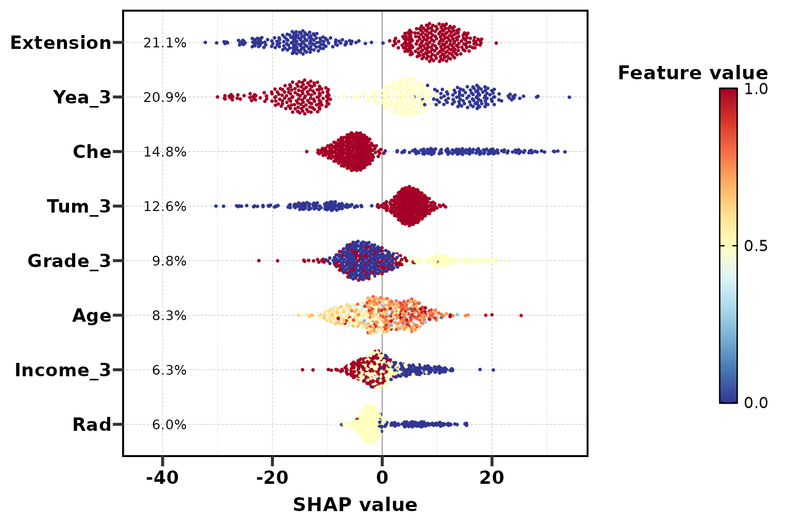{fig-alt="总体蜂群与组合图；蜂群图；数据为 toy_shp 的 400 个观测。"}

### 缩放横轴 {.unnumbered}

以绝对 SHAP 的第 95 百分位设置对称观察窗。窗外点仍参与重要性计算。

```r
lim <- as.numeric(quantile(abs(shp[["S"]]), 0.95))
plt_shp_sum(shp, mode = "sum", display.ncol = 8,
            scale_x = list(xlim = c(-lim, lim), xbre = c(-lim, 0, lim)),
            colors = c("#2166AC", "#F7F7F7", "#B2182B")) +
  ggplot2::theme(legend.position = "right")
```

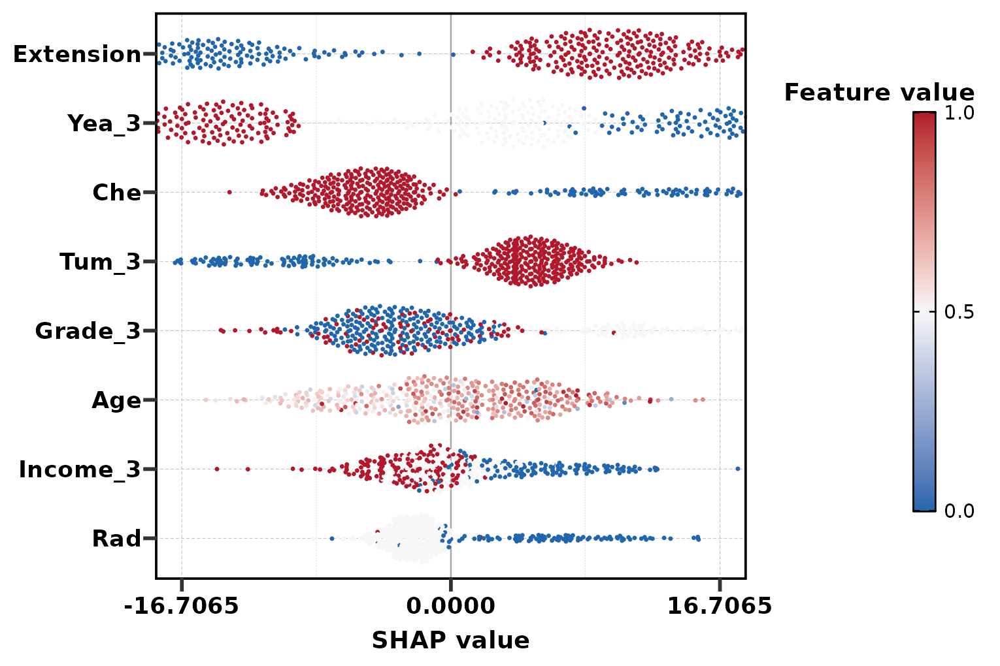{fig-alt="总体蜂群与组合图；缩放横轴；数据为 toy_shp 的 400 个观测。"}

### 蜂群与百分比 {.unnumbered}

给右侧环形插图预留横轴空间；标签副本与原对象具有相同数值。

```r
plt_shp_sum(shp_labels, mode = "sum_per",
            scale_x = list(xlim = c(-90, 110)),
            per_position = c(0.59, 0.17, 0.38, 0.63))
```

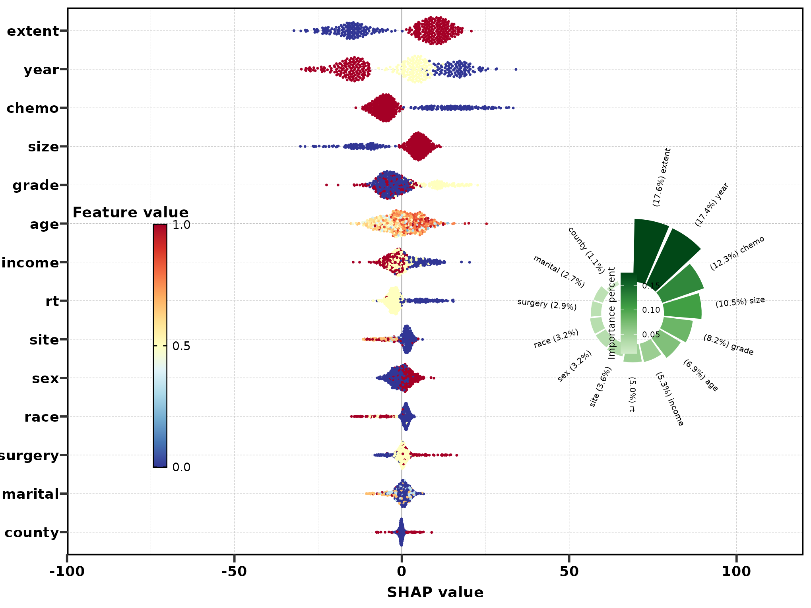{fig-alt="总体蜂群与组合图；蜂群与百分比；数据为 toy_shp 的 400 个观测。"}

### 蜂群与分组依赖 {.unnumbered}

右侧查看 chemo（原 Che）的总贡献分布；横轴分组含 No/Unknown。

```r
plt_shp_sum(shp_labels, mode = "sum_tot", tot_var = "chemo",
            scale_x = list(xlim = c(-90, 110)),
            tot_position = c(0.59, 0.14, 0.37, 0.42))
```

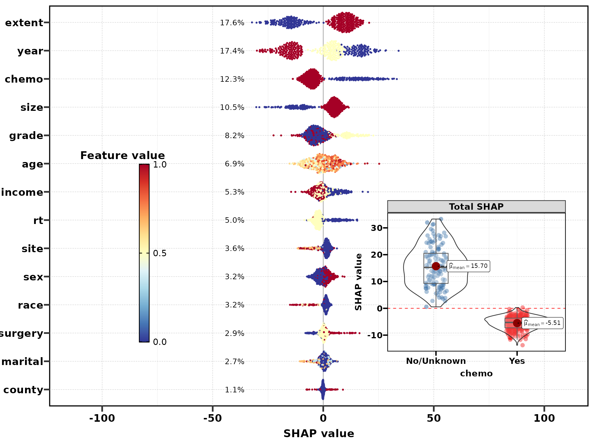{fig-alt="总体蜂群与组合图；蜂群与分组依赖；数据为 toy_shp 的 400 个观测。"}

:::

### 双环插图与棒棒糖组合（2026-10-31） {#modes-20261031b}

<!-- update-20261031b: mlr_shap_modes -->

MLR `7acb56c` 为 `plt_shp_sum()` 增加三个模式：`"sum_per2"` 是蜂群＋双环重要性插图，`"bar_per"` 和 `"bar_per2"` 分别是mean(|SHAP|)棒棒糖＋径向条形或双环插图。`plt_shp_imp()` 同样可直接选择 `"per2"` / `"bar_per2"`。以下40行、4特征的S矩阵是合成绘图输入，没有训练模型，也不代表任何患者的解释值。

```r
set.seed(103102)
shap_x31b <- as.data.frame(matrix(rnorm(160), nrow = 40,
  dimnames = list(NULL, c("F1", "F2", "F3", "F4"))))
shap_s31b <- sweep(as.matrix(shap_x31b), 2, c(1.4, 1, 0.6, 0.3), "*")
shap_obj31b <- shapviz::shapviz(shap_s31b, X = shap_x31b, baseline = 0)
shap_names31b <- c(F1 = "Tumor size at diagnosis", F2 = "Age at initial diagnosis",
  F3 = "Regional lymph node count", F4 = "Treatment sequence group")
shap_sum_per231b <- MLR::plt_shp_sum(shap_obj31b, mode = "sum_per2", add_name = shap_names31b,
  scale_x = list(xlim = c(-4, 7)),
  save = list(filename = file.path(tempdir(), "20261031b-update-shap-sum-per2.pdf"), width = 8, height = 5))
shap_bar_per31b <- MLR::plt_shp_sum(shap_obj31b, mode = "bar_per", add_name = shap_names31b,
  label_args = list(wrap = 14, size = 2.4),
  save = list(filename = file.path(tempdir(), "20261031b-update-shap-bar-per.pdf"), width = 8, height = 5))
shap_bar_per231b <- MLR::plt_shp_sum(shap_obj31b, mode = "bar_per2", add_name = shap_names31b,
  save = list(filename = file.path(tempdir(), "20261031b-update-shap-bar-per2.pdf"), width = 8, height = 5))
shap_ring31b <- MLR::plt_shp_imp(shap_obj31b, mode = "per2",
  save = list(filename = file.path(tempdir(), "20261031b-update-shap-per2.pdf"), width = 5.5, height = 5.5))
```

::: {.panel-tabset}
#### 蜂群＋双环 {.unnumbered}

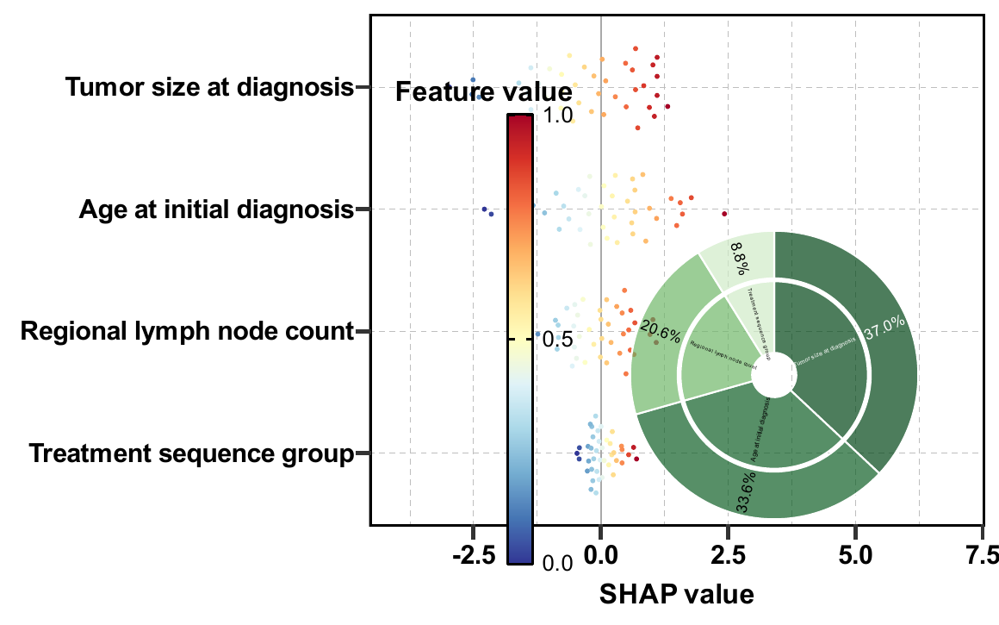{fig-alt="四十行四特征的合成SHAP蜂群，右下角双环插图，较长特征名缩小后避开中心留白。"}

[原生 PDF](images/shap-guide/20261031b-update-shap-sum-per2.pdf)

#### 棒棒糖＋径向条形 {.unnumbered}

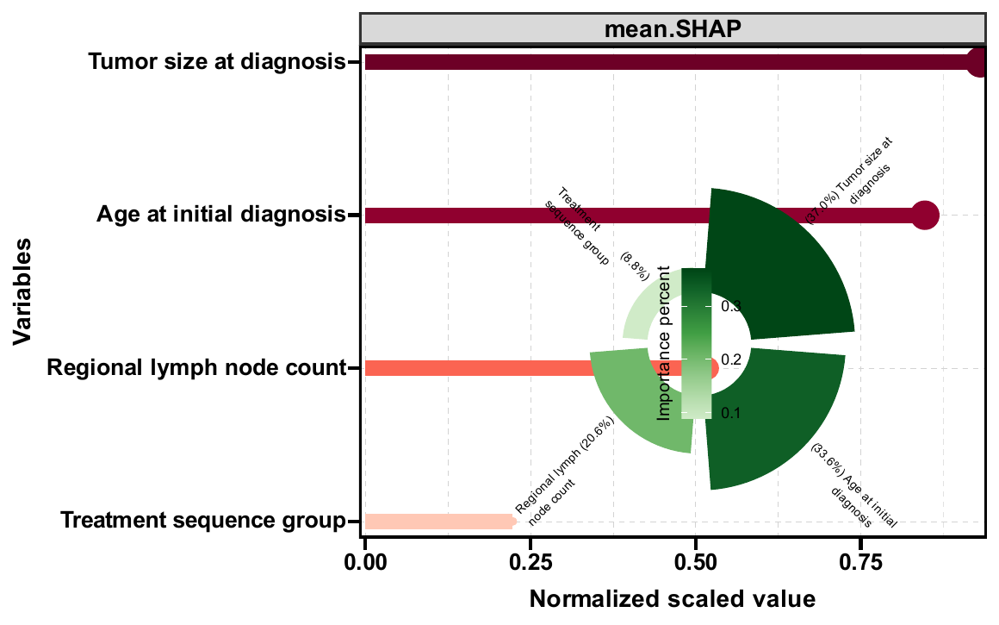{fig-alt="四特征重要性棒棒糖，径向插图标签按十四字符换行，份额仍来自相同SHAP矩阵。"}

[原生 PDF](images/shap-guide/20261031b-update-shap-bar-per.pdf)

#### 棒棒糖＋双环 {.unnumbered}

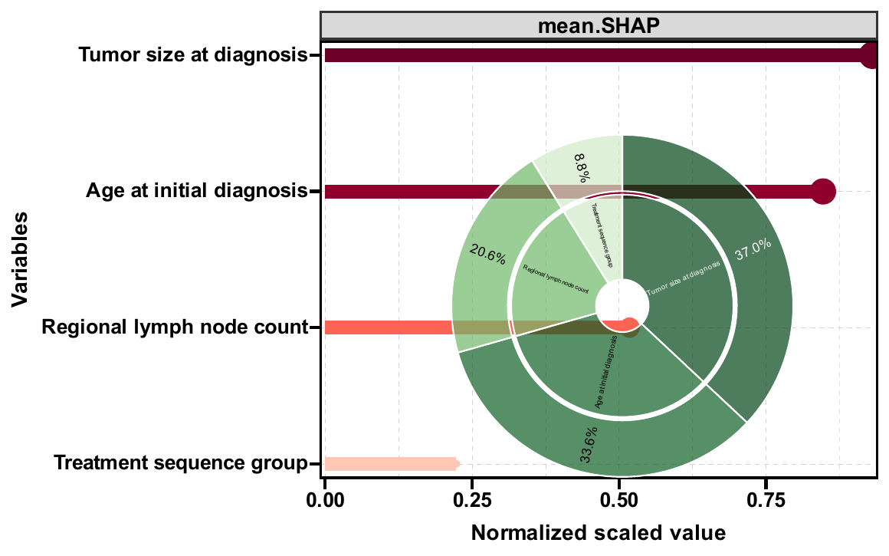{fig-alt="相同重要性棒棒糖与半透明双环插图，环中长名称按实际可用尺寸缩放。"}

[原生 PDF](images/shap-guide/20261031b-update-shap-bar-per2.pdf)

#### 独立双环 {.unnumbered}

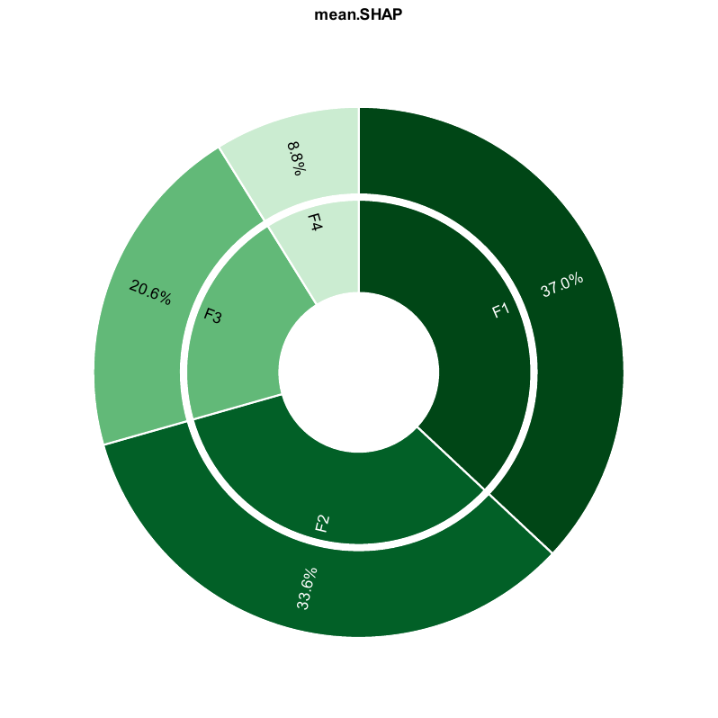{fig-alt="同一四特征SHAP重要性双环独立图，原始特征名F1至F4，填色保持不透明。"}

[原生 PDF](images/shap-guide/20261031b-update-shap-per2.pdf)
:::

::: {.callout-note collapse="true" title="复核代码"}
```r
shap_importance31b <- sort(colMeans(abs(shap_s31b)), decreasing = TRUE)
shap_share31b <- shap_importance31b / sum(shap_importance31b) * 100
shap_ring_build31b <- ggplot2::ggplot_build(shap_ring31b)
shap_rects31b <- which(vapply(shap_ring31b$layers, function(z) inherits(z$geom, "GeomRect"), FALSE))
stopifnot(identical(shap_obj31b$S, shap_s31b), identical(shap_obj31b$X, shap_x31b),
  abs(sum(shap_share31b) - 100) < 1e-10,
  all(vapply(list(shap_sum_per231b, shap_bar_per31b, shap_bar_per231b, shap_ring31b), inherits, FALSE, "ggplot")),
  all(vapply(shap_ring_build31b$data[shap_rects31b], function(z)
    all(is.na(z$alpha) | z$alpha == 1), FALSE)))
validation_values <- list(rows = nrow(shap_s31b), features = ncol(shap_s31b),
  importance = as.list(shap_importance31b), percentages = as.list(shap_share31b), input_unchanged = TRUE,
  modes = c("sum_per2", "bar_per", "bar_per2", "per2"))
```
:::

双环作为组合插图时固定alpha为0.7，让底下的点或线仍可见；独立 `per2` 保持不透明。组合模式的特征值图例改为从面板左侧内部对齐，减少8英寸画布上的裁切。双环内名字按实际尺寸测量，小插图会进一步缩小字号以避开中心洞。`label_args` 控制径向条形标签，双环使用自身的拟合标签；`per_args` 的径向留空设置不作用于双环。组合图仍用全部特征计算份额。条形横轴沿用生成图的 `Normalized scaled value`，并非原始SHAP单位；本节复核框另列原始mean(|SHAP|)及百分比。`bar_per*` 可用的条形细节参数以 `plt_shp_imp()` 为准；不要把mean(|SHAP|)的无方向份额当作贡献的正负方向。

<!-- /update-20261031b: mlr_shap_modes -->

### 百分比插图的标签换行（2026-10-26） {#sum-per-labels-20261026}

<!-- update-20261026: mlr_shap_labels -->

按已推送 MLR `45e743a`，`plt_shp_sum(mode="sum_per")` 把 `label_args` 转发给比例插图。`wrap/size/lineheight/offset/col/font` 与[重要性径向条](imp-guide.qmd#radial-labels-20261026)同义，但这里的默认 offset 是 0.04。该 list 不调整蜂群点、普通 summary 或总 SHAP 插图的文字；可分别用 `per_position` 与 `scale_x` 给插图预留空间。

```r
library(MLR)
set.seed(102602)
X_labels26 <- data.frame(F1 = rnorm(40), F2 = rnorm(40), F3 = rnorm(40), F4 = rnorm(40))
S_labels26 <- as.matrix(X_labels26) * rep(c(1.5, 1, .6, .3), each = 40)
shp_labels26 <- shapviz::shapviz(S_labels26, X = X_labels26, baseline = 0)
names_labels26 <- c(F1 = "Tumor size at diagnosis", F2 = "Age at initial diagnosis",
  F3 = "Regional lymph node count", F4 = "Treatment sequence group")
sum_line26 <- plt_shp_sum(shp_labels26, mode = "sum_per", add_name = names_labels26,
  scale_x = list(xlim = c(-5, 10)), per_position = c(.6, .15, .38, .7),
  label_args = list(size = 2, offset = .04))
sum_wrap26 <- plt_shp_sum(shp_labels26, mode = "sum_per", add_name = names_labels26,
  scale_x = list(xlim = c(-5, 10)), per_position = c(.6, .15, .38, .7),
  label_args = list(wrap = 13, size = 2, lineheight = .9, offset = .04, col = "grey20"))
ggplot2::ggsave(file.path(tempdir(), "20261026-update-shap-label-line.pdf"), sum_line26, width = 11, height = 6)
ggplot2::ggsave(file.path(tempdir(), "20261026-update-shap-label-wrap.pdf"), sum_wrap26, width = 11, height = 6)
```

::: {.callout-note collapse="true" title="复核代码"}

```r
stopifnot(identical(shp_labels26[["S"]], S_labels26), identical(shp_labels26[["X"]], X_labels26))
stopifnot(inherits(sum_line26, "ggplot"), inherits(sum_wrap26, "ggplot"))
means_labels26 <- colMeans(abs(S_labels26))
validation_values <- list(mean_absolute_SHAP = means_labels26,
  percentages = 100 * means_labels26 / sum(means_labels26), input_unchanged = identical(shp_labels26[["S"]], S_labels26))
```

:::

::: {.panel-tabset}

### 单行 {.unnumbered}

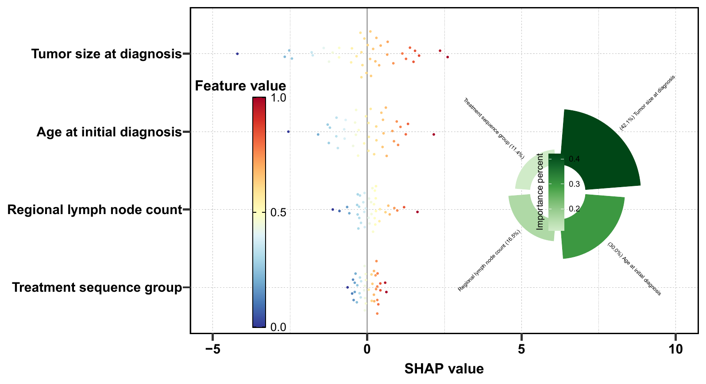{fig-alt="原生SHAP蜂群加比例插图PDF，40个合成观察和4个特征用于单行标签展示，不代表真实模型解释。"}

[PDF](images/shap-guide/20261026-update-shap-label-line.pdf)

### 换行 {.unnumbered}

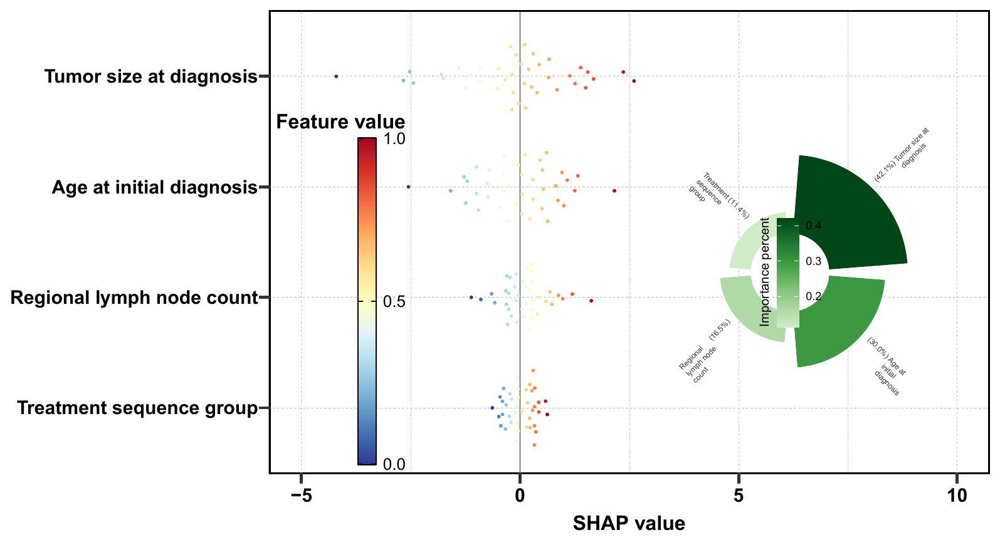{fig-alt="相同合成SHAP蜂群和插图使用label_args换行，原始SHAP值与按平均绝对SHAP计算的比例不变。"}

[PDF](images/shap-guide/20261026-update-shap-label-wrap.pdf)

:::

本例直接构造 40×4 的合成 SHAP 矩阵，只验证显示和输入保护，没有训练模型或重新计算 SHAP。插图按平均绝对 SHAP 给出份额，不能读作效应方向、因果贡献或模型解释方差。WSL 绘图环境产生了 element_blank 标签对象提示，属于当前绘图兼容性问题；本页保留该提示记录，并核对了实际 PDF 与原 SHAP 值，没有将它解释为方法限制。

<!-- /update-20261026: mlr_shap_labels -->

## `plt_shp_imp()`： 全局重要性与百分比 {#plt-shp-imp}

这组图把 $I_j=\mathrm{mean}(|\phi_j|)$ 汇总为排名。它适合回答“模型主要使用哪些信息”，不提供贡献正负方向。

- `mode` 选择 `"bar"`、`"per"` 或 `"bar_per"`。
- `bar_display = "l"` 画棒棒糖，`"b"` 画柱形；`bar_rescale = TRUE` 将条形数值重新缩放到 0–1。
- 当前条形图的默认轴标题会写为 Normalized scaled value；在 `bar_rescale = FALSE` 时应按原始平均绝对 SHAP 读数。
- `per_position` 调组合插图位置；`per_args` 中的 `empty_bar_ratio` 与 `text_height` 调环形留白和标签偏移，不改变重要性。

::: {.panel-tabset}

### 原始重要性 {.unnumbered}

条形数值是原始平均绝对 SHAP，保留该解释对象的单位。

```r
plt_shp_imp(shp_labels, mode = "bar", bar_display = "l")
```

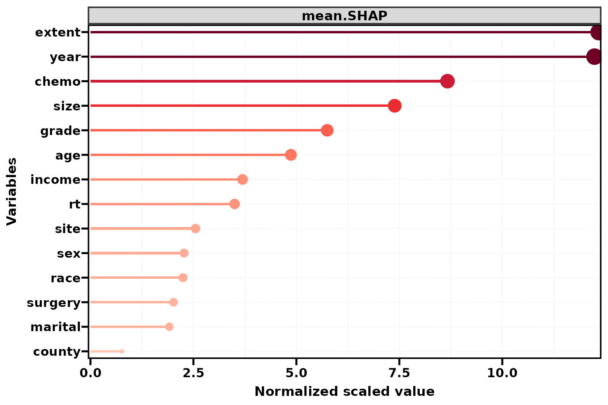{fig-alt="全局重要性与百分比；原始重要性；数据为 toy_shp 的 400 个观测。"}

### 归一化柱形 {.unnumbered}

改用柱形并归一化到 0–1，突出相对排名，单位随之改变。

```r
plt_shp_imp(shp_labels, mode = "bar", bar_display = "b",
            bar_rescale = TRUE)
```

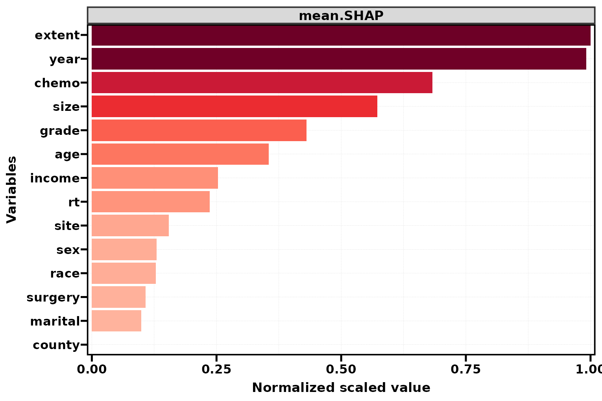{fig-alt="全局重要性与百分比；归一化柱形；数据为 toy_shp 的 400 个观测。"}

### 组合图 {.unnumbered}

条形与百分比组合；`per_position` 控制插图大小及位置。

```r
plt_shp_imp(shp_labels, mode = "bar_per",
            per_position = c(0.40, 0.10, 0.48, 0.70))
```

{fig-alt="全局重要性与百分比；组合图；数据为 toy_shp 的 400 个观测。"}

### 百分比图 {.unnumbered}

增加环形留白，并调整标签偏移；重要性份额保持不变。

```r
plt_shp_imp(shp_labels, mode = "per",
            per_args = list(empty_bar_ratio = 0.18, text_height = 0.025))
```

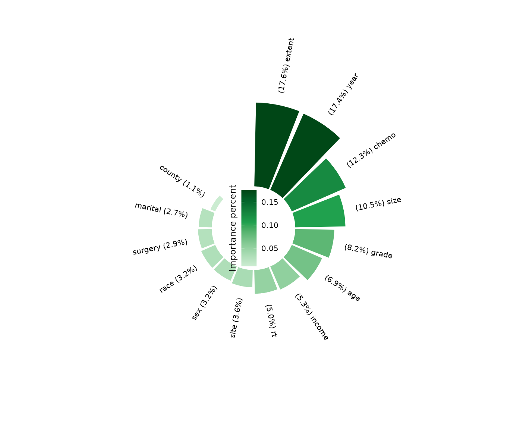{fig-alt="全局重要性与百分比；百分比图；数据为 toy_shp 的 400 个观测。"}

:::

## `plt_shp_TM()`： 总贡献与主效应 {#plt-shp-tm}

同一个特征的总 SHAP 可以包含大量交互。`display = "TM"` 把总贡献与交互矩阵对角线的主效应并排，便于判断两者分布是否相似。

- `x_var` 可为一个列名、多个列名，或 `"fct"` / `"num"`；本页分别展示 `Age` 与 `Che`。
- `display = "T"` / `"M"` / `"TM"` 选择总贡献、主效应或两者；主效应必须有 `S_inter`。
- `axis_arg = list(share_y = "var", hide_y = TRUE)` 给同一变量共用纵轴范围，并隐藏重复纵轴；`"all"` 则在所有面板间共享范围。
- `strip_arg` 控制条带开关、文字与颜色；`ylim` 可显式限定纵轴，但不应通过裁剪制造分布差异。

::: {.panel-tabset}

### 连续变量 {.unnumbered}

总贡献与主效应共用纵轴，避免面板自动缩放掩盖幅度差异。

```r
plt_shp_TM(shp, x_var = "Age", display = "TM",
           axis_arg = list(share_y = "var", hide_y = TRUE))
```

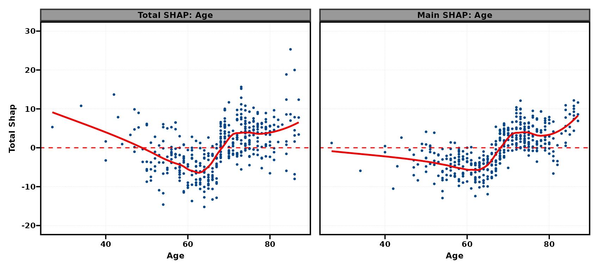{fig-alt="总贡献与主效应；连续变量；数据为 toy_shp 的 400 个观测。"}

### 分类变量 {.unnumbered}

分类变量也可比较总贡献与主效应；条带颜色区分两个面板。

```r
plt_shp_TM(shp, x_var = "Che", display = "TM",
           axis_arg = list(share_y = "var", hide_y = TRUE),
           strip_arg = list(strip_fill = c("#BCD9EA", "#D4E9DD")))
```

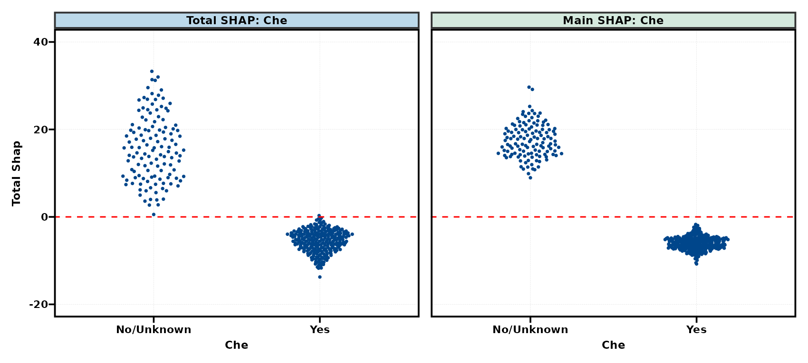{fig-alt="总贡献与主效应；分类变量；数据为 toy_shp 的 400 个观测。"}

:::

## `plt_shp_TM_com()`： 分类变量的分布组合 {#plt-shp-tm-com}

针对一个分类变量，把总贡献与主效应的抖动点、小提琴、箱线与中心值放在两张组合图中。图中均值标签是描述统计，不能直接读作治疗效果。

- `x_var` 在这里应选择分类列，例如 `"Che"`；默认的 `"surgery"` 不在 `toy_shp` 中，所以需要显式指定。
- `add_name` 自定义展示名称；`color` 调分组颜色；`fmt_tag` 控制面板标签。
- 当前已支持 `save = list(filename = ...)`；按内容估算的画布及实跑例子见[当前保存入口](#tm-save-20261020)。

箱线、小提琴、散点与均值提供互补的分布描述。

```r
plt_shp_TM_com(shp, x_var = "Che",
               add_name = c(Che = "Chemotherapy"), fmt_tag = TRUE)
```

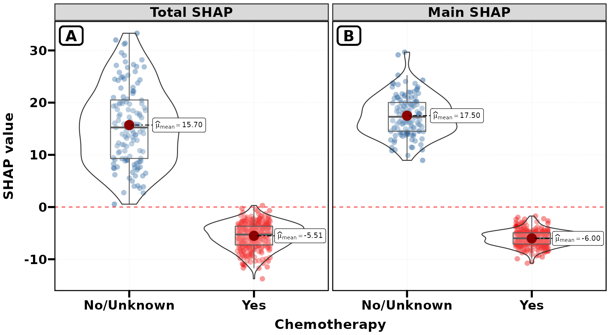{fig-alt="分类变量的分布组合；分布组合；数据为 toy_shp 的 400 个观测。"}

## `plt_shp_TI()`： 变量对的交互依赖 {#plt-shp-ti}

横轴是锚点变量，颜色是搭档变量。`display = "TI"` 的上部显示完整变量对贡献 $2\Phi_{jk}$，下部显示锚点的总 SHAP；也可只展示其中一层。

- `two_var = c("Age", "Che")` 指定一对变量；`display = "T"` / `"I"` / `"TI"` 控制展示层。
- `c("Che", "Age", "Tum_3")` 是同一锚点 Che 分别与 Age、Tum_3 配对，并不自动穷举三个变量的所有组合。
- `axis_arg$share_y = "all"` 让多个面板使用相同尺度；`hide_x = TRUE` 隐藏上下重复横轴，`hide_y = TRUE` 隐藏重复纵轴。
- `color` 可用调色板名或颜色向量；连续搭档与分类搭档分别使用连续色阶与离散颜色。

::: {.panel-tabset}

### 总贡献与交互 {.unnumbered}

上方是两倍配对交互，下方是 Age 的总贡献；同一纵轴范围。

```r
plt_shp_TI(shp, two_var = c("Age", "Che"), display = "TI",
           axis_arg = list(share_y = "all", hide_x = TRUE),
           color = "RdYlBu")
```

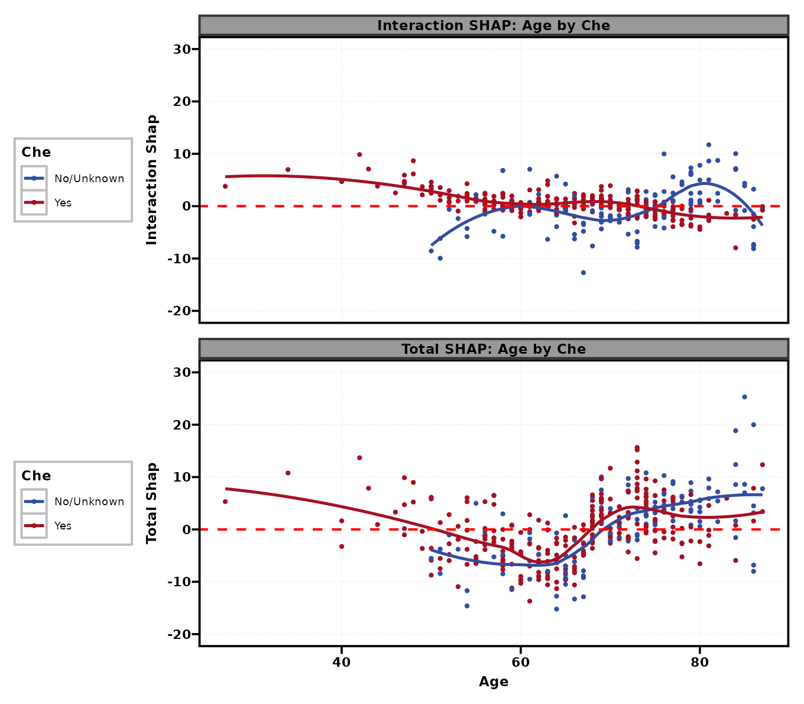{fig-alt="变量对的交互依赖；总贡献与交互；数据为 toy_shp 的 400 个观测。"}

### 同一锚点多配对 {.unnumbered}

Che 与 Age、Tum_3 两个搭档的配对贡献采用共同纵轴。

```r
plt_shp_TI(shp, two_var = c("Che", "Age", "Tum_3"), display = "I",
           axis_arg = list(share_y = "all", hide_y = TRUE),
           color = "RdYlBu")
```

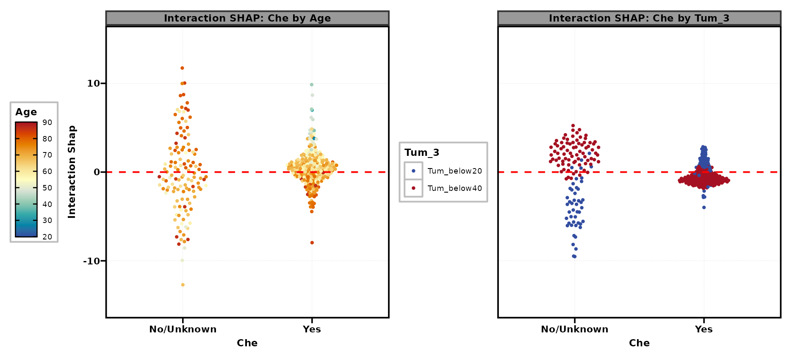{fig-alt="变量对的交互依赖；同一锚点多配对；数据为 toy_shp 的 400 个观测。"}

:::

## 当前配对设置：交互变换与百分比插图 {#pair-settings-20261021}

<!-- refresh-20261021: shap_pairs -->

以下按已推送 MLR `8d94e59` 在 Windows / WSL R 4.4.3 执行，仍使用 `ToyData::toy_shp` 的 400 行保存解释；没有重新训练模型。新增两张预览来自本次实际导出的 PDF。

### 每个变量对单独配置

`plt_shp_TI(int_args=...)` 可传一个命名设置，应用于全部配对；也可传**无名列表**，长度为 1 或变量对数，按绘图顺序配置。列表中的 `NULL` 保留该对原值。下面第一对 Che–Age 不变；第二对 Che–Tum_3 只对 Che=Yes 的交互乘 0.5 再加 2，并演示对 Che=No/Unknown 的正交互重新着色。

```r
library(MLR)
shp_now <- ToyData::toy_shp
before_now <- serialize(shp_now, NULL)
ti_now <- plt_shp_TI(shp_now, two_var = c("Che", "Age", "Tum_3"), display = "TI",
  int_args = list(NULL, list(cha_level = "Yes", cha_mult = 0.5, cha_add = 2,
    sign_group = list(x_level = "No/Unknown", negative = NULL, positive = "Tum_below40"))),
  axis_arg = list(share_y = "all", hide_x = TRUE, hide_y = FALSE),
  save = list(filename = file.path(tempdir(), "20261021-refresh-shap-pairs.pdf"),
              width = 12, height = 7))
expected <- 2 * shp_now[["S_inter"]][, "Che", "Tum_3"]
yes <- as.character(shp_now[["X"]][, "Che"]) == "Yes"
expected[yes] <- expected[yes] * 0.5 + 2
```

::: {.callout-note collapse="true" title="复核代码"}
生成本页时运行的检查，接在上面的代码之后运行；只读教程可以跳过。

```r
stopifnot(isTRUE(all.equal(as.numeric(ti_now[[1]][["data"]][["y"]]),
                           as.numeric(2 * shp_now[["S_inter"]][, "Che", "Age"]))),
          isTRUE(all.equal(as.numeric(ti_now[[2]][["data"]][["y"]]), as.numeric(expected))),
          isTRUE(all.equal(as.numeric(ti_now[[3]][["data"]][["y"]]), as.numeric(shp_now[["S"]][, "Che"]))),
          identical(before_now, serialize(shp_now, NULL)))
```
:::

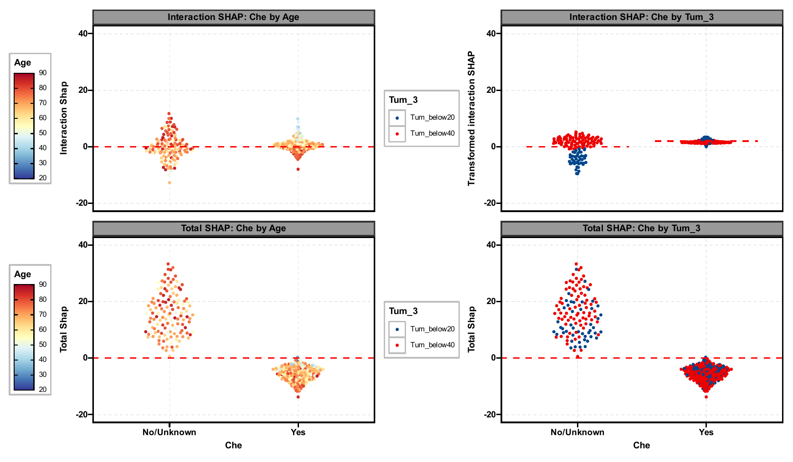{fig-alt="2列2行的TI图：第一对Che与Age保持原始2倍配对SHAP，第二对Che与Tum_3只变换Yes行；两列下排总SHAP相同。"}

[下载配对图 PDF](images/shap-guide/20261021-refresh-shap-pairs.pdf)

`cha_level` 必须是横轴分类变量实际观察到的水平；倍乘和偏移须为有限数值，可给一个值或与所选水平等长的向量。偏移后用虚线标记对应水平的新零点，纵轴标为 `Transformed interaction SHAP`。`sign_group` 按变换后的正负值重分配颜色，零值和对应 `NULL` 分支保留原类别；它需要分类搭档及现有类别名。

这些选项只改变**交互面板**，不会改下排总 SHAP，也不修改输入对象；变换或条件着色后的图不能再当作未经处理的 SHAP 分解。`display="T"` 仅显示总贡献；需要保留模型原解释时使用 `int_args=NULL`。若每对的横轴或搭档类型不同，应分别配置，不要向连续横轴传分类水平设置。

### 百分比插图位置与原始变量名

```r
bar_now <- plt_shp_int(shp_now, int_var = "Che", mode = "bar_per",
  add_name = c(Age = "Age", Ext = "Extension", Yea_3 = "Year", Grade_3 = "Grade"),
  fmt_args = list(dis_ncol = 4, del_var = "Race"), per_args = list(text_height = 0.02),
  per_position = c(0.50, 0.04, 0.48, 0.80),
  save = list(filename = file.path(tempdir(), "20261021-refresh-shap-per-position.pdf"),
              width = 12, height = 6.5))
bar_now
```

::: {.callout-note collapse="true" title="复核代码"}
生成本页时运行的检查，接在上面的代码之后运行；只读教程可以跳过。

```r
stopifnot(identical(before_now, serialize(shp_now, NULL)))
```
:::

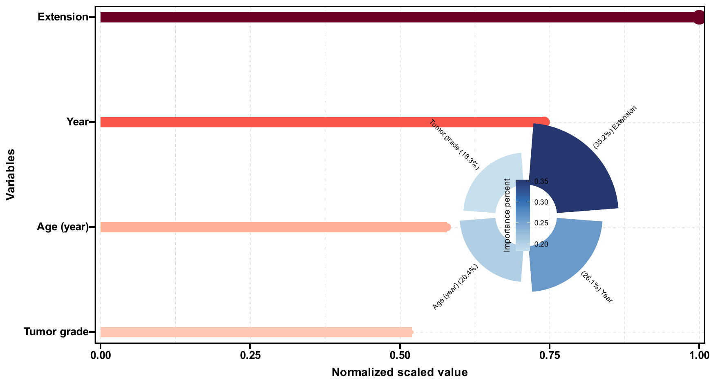{fig-alt="Che交互排名以SEER友好名称显示，排除Race；百分比插图按per_position调整，仍显示所选搭档中的份额。"}

[下载百分比组合图 PDF](images/shap-guide/20261021-refresh-shap-per-position.pdf)

`per_position=c(left,bottom,width,height)` 使用相对画布坐标，默认 `c(0.3,0.05,0.8,0.8)`；接口要求四个有限数值，布局时应另外核对宽高及是否超出画布。它只调 `bar_per` 百分比插图；`int_position` 调 `bar_shp` 交互散点插图。`plt_shp_int()` 的 `int_args` 也会传入 TI 分支，统一配对变换规则。`add_name` 需传命名字符向量或列表，本例缩短部分搭档标签，Che 和 Race 仍通过内置名称字典解析。

<!-- /refresh-20261021: shap_pairs -->

## `plt_shp_int()`： 以一个变量为锚点的交互排名 {#plt-shp-int}

先把锚点与各搭档的绝对交互值在样本间求和、去掉对角线，再归一化并排名。它关注交互幅度，排名本身不保留交互方向。

- `int_var = "Che"` 固定锚点；`mode` 支持 `"bar_per"`、`"bar"`、`"per"` 与 `"bar_shp"`。
- `fmt_args = list(dis_ncol = 6)` 显示前 6 个搭档；`del_var` 可排除指定搭档。归一化在筛选前进行，因此修改显示数量不等于对保留项重新定标。环形百分比随后基于这些归一化值、在展示搭档内重新求份额，不是原始绝对交互总和的比例。
- `"bar_shp"` 默认选择最强搭档；显式 `oth_var = "Age"` 可以查看另一个指定配对。`int_position` 与 `legend_position` 调交互散点插图和图例位置；`mode="bar_per"` 的百分比插图用独立的 `per_position`。
- 当前 `add_name` 非 NULL 时，原始 `int_var` 和 `fmt_args$del_var` 会通过自定义映射及 SEER 名称字典解析。`add_name` 必须是命名向量或列表；下方历史示例保留显式映射写法。
- `fmt_args$cha_mult` 会改变排名数值；`int_args` 中的平移或倍乘改变配对散点显示，不能把这些设置都当作纯布局调整。

::: {.panel-tabset}

### 交互排名与百分比 {.unnumbered}

归一化交互排名与所选搭档的百分比视图。

```r
plt_shp_int(shp, int_var = "Che", mode = "bar_per",
            fmt_args = list(dis_ncol = 6))
```

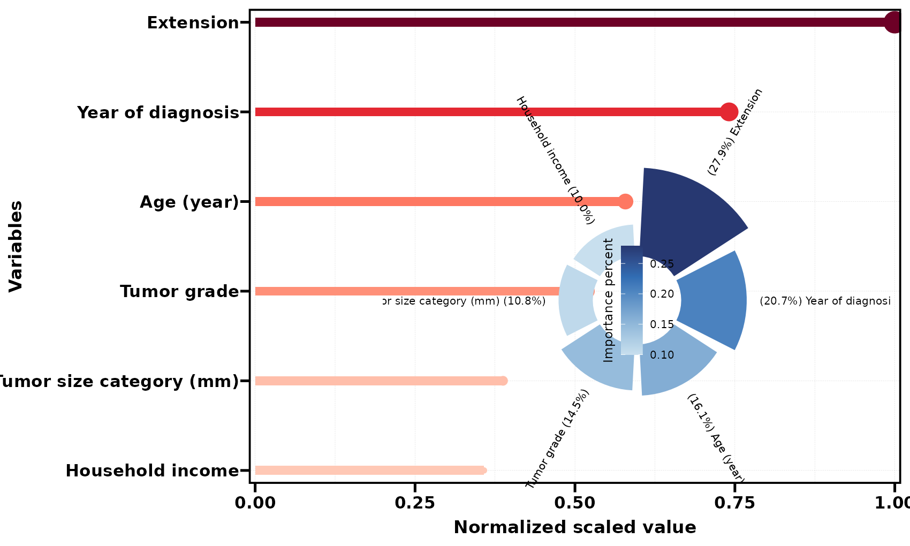{fig-alt="以一个变量为锚点的交互排名；交互排名与百分比；数据为 toy_shp 的 400 个观测。"}

### 交互柱形 {.unnumbered}

前 6 个搭档的归一化交互排名，柱形显示。

```r
plt_shp_int(shp, int_var = "Che", mode = "bar", display = "b",
            fmt_args = list(dis_ncol = 6))
```

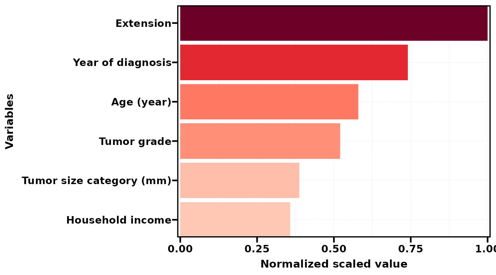{fig-alt="以一个变量为锚点的交互排名；交互柱形；数据为 toy_shp 的 400 个观测。"}

### 交互百分比 {.unnumbered}

所展示搭档的归一化交互值份额，不是原始交互总和或总 SHAP 重要性份额。

```r
plt_shp_int(shp, int_var = "Che", mode = "per",
            fmt_args = list(dis_ncol = 6))
```

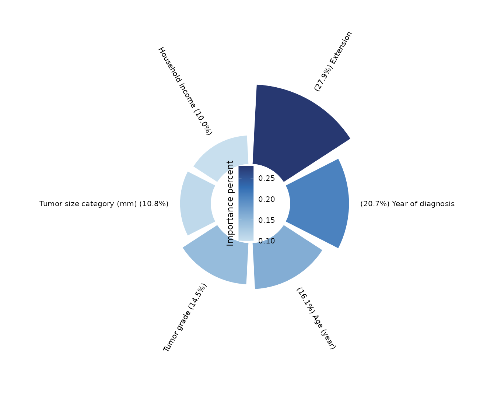{fig-alt="以一个变量为锚点的交互排名；交互百分比；数据为 toy_shp 的 400 个观测。"}

### 指定配对与插图 {.unnumbered}

显式选择 Age，而不是自动使用最强搭档；散点保留贡献正负方向。

```r
plt_shp_int(shp, int_var = "Che", mode = "bar_shp", oth_var = "Age",
  add_name = c(Che = "Chemotherapy", Age = "Age", Yea_3 = "Diagnosis year", Tum_3 = "Tumor size",
               Grade_3 = "Grade", Income_3 = "Income"),
            fmt_args = list(dis_ncol = 6),
            bar_int_palette = list("Reds", "RdYlBu"),
            int_position = c(0.51, 0.15, 0.46, 0.57),
            strip_label = "Chemotherapy interactions")
```

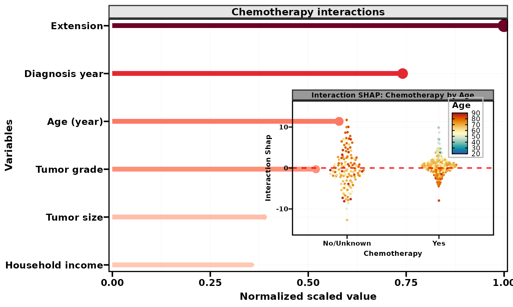{fig-alt="以一个变量为锚点的交互排名；指定配对与插图；数据为 toy_shp 的 400 个观测。"}

:::

## `plt_shp_viv()`： 全局交互矩阵与网络 {#plt-shp-viv}

热图对角线放变量总重要性，非对角线放绝对交互汇总；它们分别归一化。网络把变量画为节点，以边展示交互关系。

- `mode = "heatmap"` / `"network"` 切换图形；`display.ncol = 8` 聚焦前 8 项。
- `heatmap_arg = list(text = TRUE, text_size = 2.5)` 控制单元格数字；`color` 统一配色方案。
- `network_arg$intThreshold = 0.20` 在归一化尺度上筛边；不是 P 值阈值。`removeNode = FALSE` 保留没有达到边阈值的节点。
- `network_arg` 还可设 `layout`、`cluster`、`edgeWidths`；布局改变位置，不改变原始交互值。
- 默认 `fixed_size = TRUE` 固定面板物理尺寸；导出画布应至少容纳 `attr(p, "plot_size")` 的宽、高。

::: {.panel-tabset}

### 交互矩阵 {.unnumbered}

对角线与非对角线采用两种归一化量，应分别读图例。

```r
plt_shp_viv(shp_labels, display.ncol = 8, mode = "heatmap",
            color = "blue_red", heatmap_arg = list(text = TRUE))
```

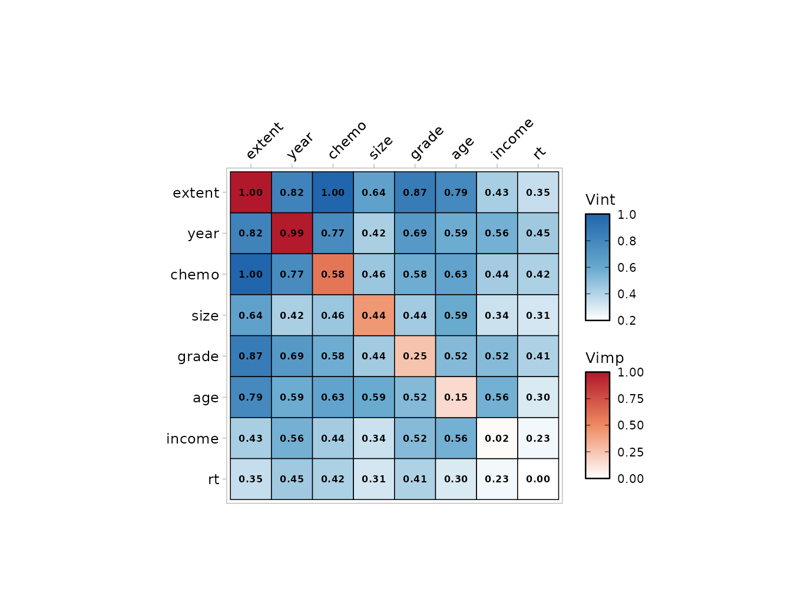{fig-alt="全局交互矩阵与网络；交互矩阵；数据为 toy_shp 的 400 个观测。"}

### 交互网络 {.unnumbered}

边阈值是 0.20 的归一化强度；没有达到边阈值的节点仍保留。

```r
plt_shp_viv(shp_labels, display.ncol = 8, mode = "network",
            color = "blue_red",
            network_arg = list(intThreshold = 0.20, removeNode = FALSE, nudge_x = 0.10))
```

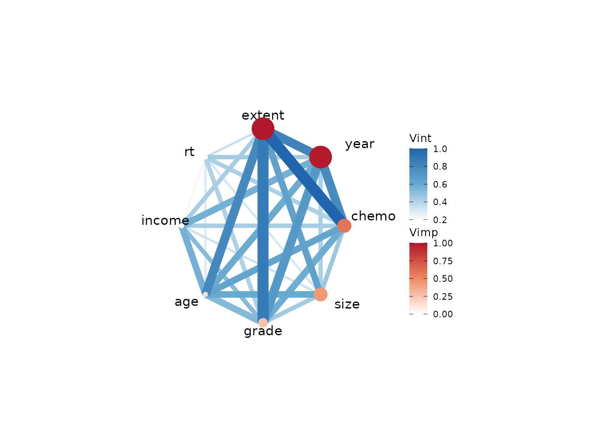{fig-alt="全局交互矩阵与网络；交互网络；数据为 toy_shp 的 400 个观测。"}

:::

## `plt_shp_cor()`： 交互矩阵与总交互柱形 {#plt-shp-cor}

名称中虽然有 `cor`，这里画的是 SHAP 交互汇总矩阵，**不是 Pearson 或 Spearman 相关矩阵**。旁边的柱形表示该变量与全部其他变量的绝对交互总和。

- `bar_layout = "square"` 在三角矩阵下叠加柱形；`"side_upper"` 把柱形放到三角矩阵右侧；`"rotate"` 旋转三角矩阵并省略柱形。另有 `"side"`、`"stacked"` 与 `"none"`。
- `order_by = "importance"` / `"interaction"` / `"none"` 控制变量顺序，也决定 `display.ncol` 从哪个排名取前几项。
- `color_bins = 4` 使用分级色阶；0–1 是归一化显示值，不是相关系数。
- 侧边模式的对角线显示单独归一化的重要性；柱形仍汇总全部搭档，包括没有显示在前 8 项矩阵中的变量。
- `fixed_size` 的物理尺寸规则与上一节相同；本页导出时给画布额外留白，避免字体和色条被裁掉。

::: {.panel-tabset}

### 三角矩阵与柱形 {.unnumbered}

三角矩阵叠加总交互柱形，柱形数值保留原始汇总量。

```r
plt_shp_cor(shp, display.ncol = 8, bar_layout = "square")
```

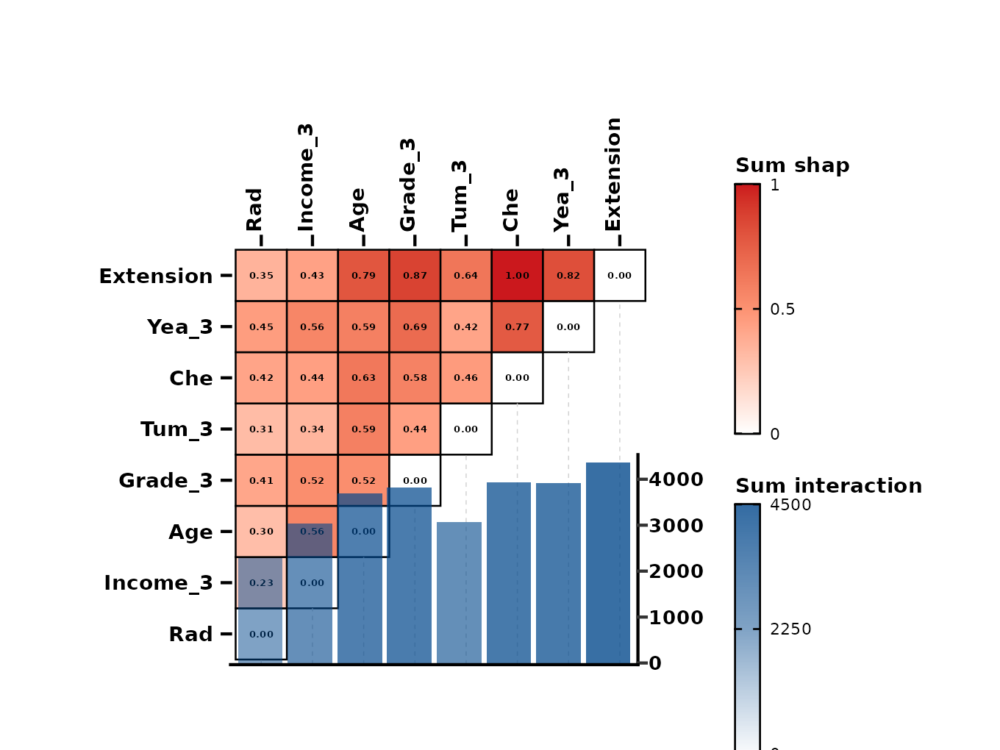{fig-alt="交互矩阵与总交互柱形；三角矩阵与柱形；数据为 toy_shp 的 400 个观测。"}

### 侧边柱形 {.unnumbered}

改为按交互强度排序；矩阵仅画前 8 项，柱形仍汇总全部搭档。

```r
plt_shp_cor(shp, display.ncol = 8, bar_layout = "side_upper",
            order_by = "interaction", color = "blue_red")
```

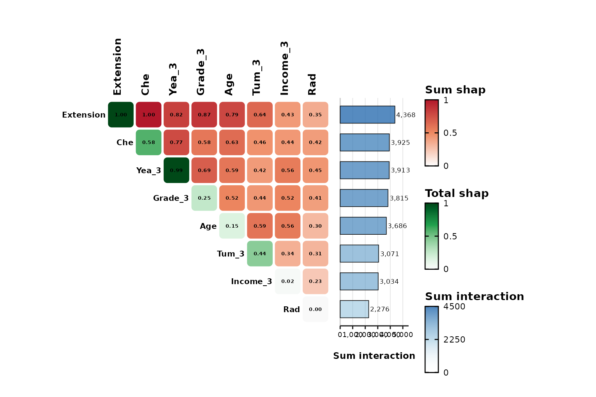{fig-alt="交互矩阵与总交互柱形；侧边柱形；数据为 toy_shp 的 400 个观测。"}

### 旋转矩阵与分级色阶 {.unnumbered}

旋转三角矩阵，并将色阶分为 4 档。

```r
plt_shp_cor(shp, display.ncol = 8, bar_layout = "rotate",
            color = "purple_green", color_bins = 4)
```

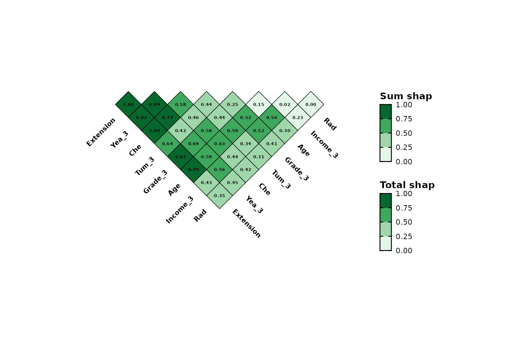{fig-alt="交互矩阵与总交互柱形；旋转矩阵与分级色阶；数据为 toy_shp 的 400 个观测。"}

:::

## `plt_shp_pairs()`： 配对矩阵 {#plt-shp-pairs}

一张图同时放主效应和变量对关系：对角线为特征值与主 SHAP；下三角为两个特征值构成的散点、用完整配对贡献 $2\Phi_{jk}$ 着色；上三角为该配对贡献的平均绝对值。

- `vars` 明确选择顺序，`display.ncol` 限制面板数。示例使用 Age、Sur、Che 与 Tum_3，避免 14 × 14 面板过密。
- `point.size`、`alpha` 调点密度；`text`、`digits` 控制上三角数值。
- 颜色使用稳健的分位范围处理极端值；色阶饱和不表示极端点被删除，也不能据此推断显著性。

用 4 个变量控制面板密度；颜色表示有符号贡献，上三角为幅度汇总。

```r
plt_shp_pairs(shp, vars = c("Age", "Sur", "Che", "Tum_3"),
              display.ncol = 4, point.size = 0.65, alpha = 0.65,
              text = TRUE, digits = 2)
```

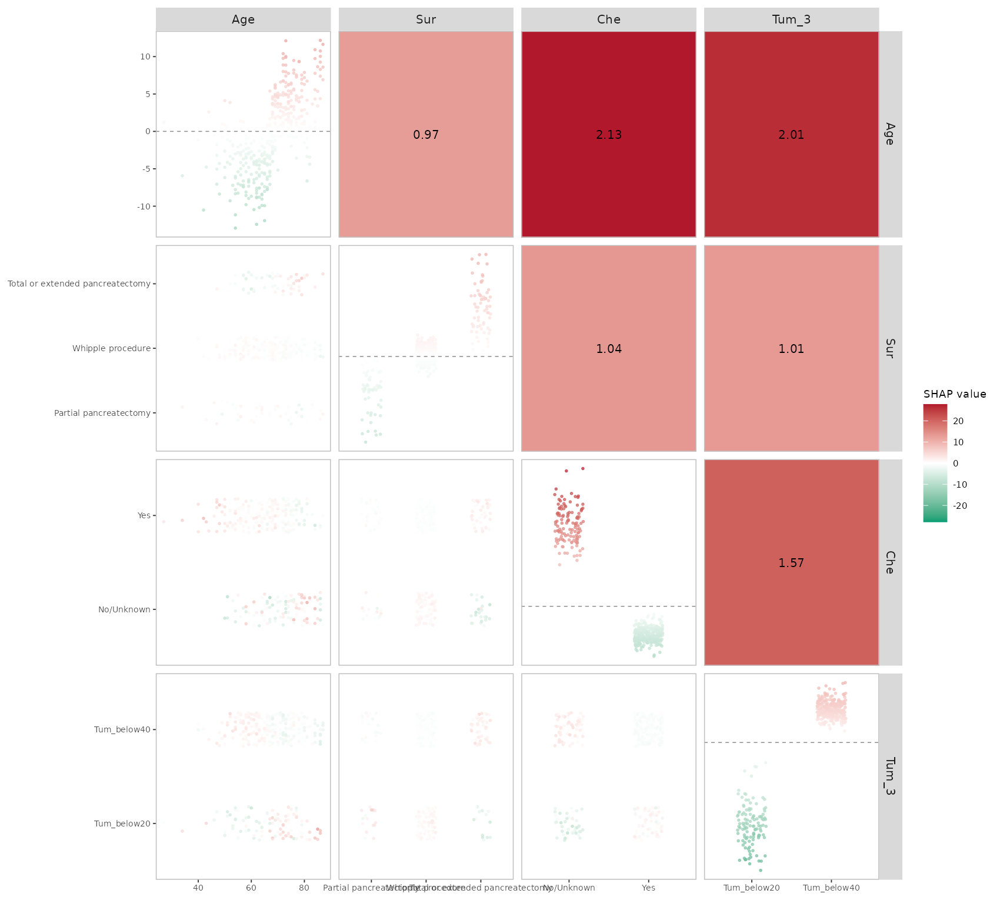{fig-alt="配对矩阵；配对矩阵；数据为 toy_shp 的 400 个观测。"}

## `plt_shp_heatmap()`： 观测 × 特征热图 {#plt-shp-heatmap}

每一列是一个观测；主热图是各特征的有符号 SHAP，上部是对象定义的模型输出，右侧是全局重要性。可以按解释相似度排序，也可以在预先得到的簇内按模型输出排序。

- `sample_order = "cluster"` 使用 SHAP 距离的层次聚类顺序；`"prediction"` 按 `baseline + rowSums(S)` 从低到高排列。
- `clust = clu` 加聚类条带，并把排序限制在各簇内；两个例图同时展示排序和分组方式的改变。
- `display.ncol = 8` 包含聚合行：此处保留 7 个单变量，另外 7 个按观测求和为 `7 other features`，不会简单丢掉贡献。
- `colors` 依次指定负值、零值、正值的颜色。

::: {.panel-tabset}

### 相似解释排序 {.unnumbered}

按 SHAP 相似性排序；保留 7 个变量，另外 7 个合并成一行。

```r
plt_shp_heatmap(shp, display.ncol = 8, sample_order = "cluster")
```

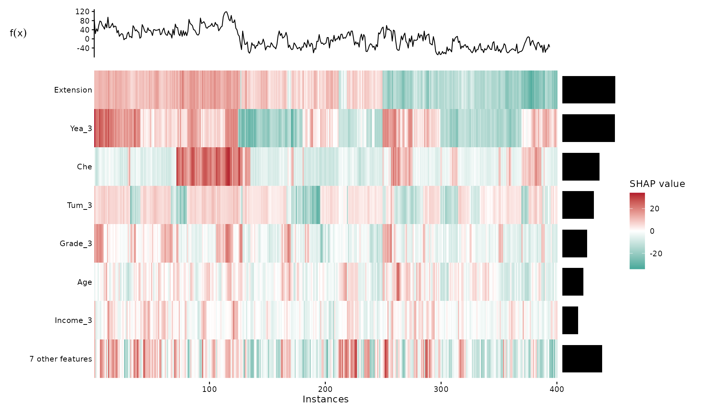{fig-alt="观测 × 特征热图；相似解释排序；数据为 toy_shp 的 400 个观测。"}

### 簇内预测排序 {.unnumbered}

展示固定 3 簇，并在簇内按解释输出排列。

```r
plt_shp_heatmap(shp, clust = clu, display.ncol = 8,
                sample_order = "prediction")
```

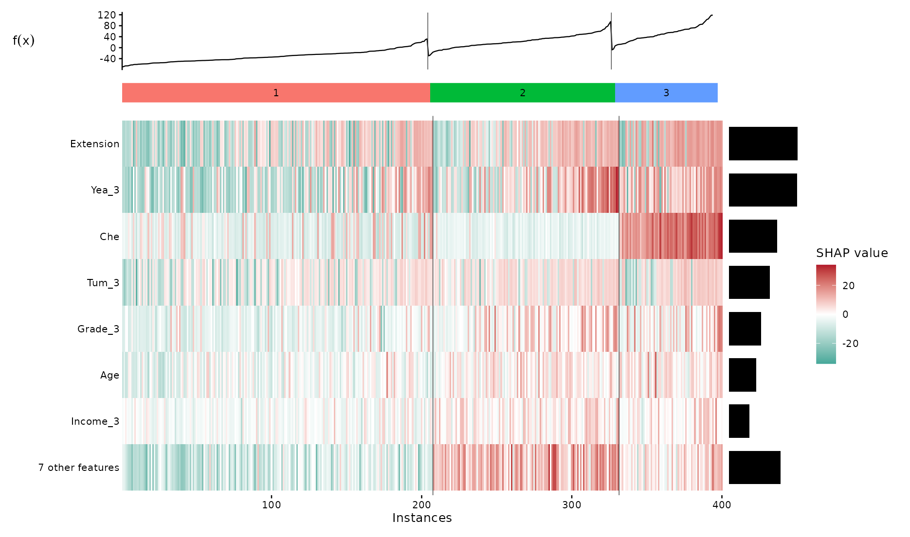{fig-alt="观测 × 特征热图；簇内预测排序；数据为 toy_shp 的 400 个观测。"}

:::

## `plt_shp_map()`： SHAP 空间的二维投影 {#plt-shp-map}

把每个观测的 SHAP 向量投影到二维，观察模型解释模式是否成团。PCA 和 UMAP 的坐标没有相同单位，图中的距离也不是患者的临床距离。

- `embed = "pca"` / `"umap"` / `"tsne"`，或直接提供两列坐标；`embed_args` 放相应算法参数。
- `color_by = "prediction"` 按对象定义的模型输出着色；`color_by = "Che"` 按 **Che 的 SHAP 值**着色，不是按 X 中的治疗水平着色。
- `clust = clu` 使用同一聚类结果的输入矩阵；`outline = "ellipse"` / `"hull"` / `"none"` 调轮廓，`label` 控制簇标签。
- UMAP 示例固定 `seed = 246`，比较 `n_neighbors = 20`、`min_dist = 0.15` 的嵌入；算法与环境版本也可能影响坐标。
- 本页固定的 3 簇仅用于教学展示，没有通过选 K 流程证明最优簇数，也不意味着发现了临床亚型。

::: {.panel-tabset}

### PCA 与模型输出 {.unnumbered}

按解释输出着色，椭圆显示固定簇的范围。

```r
plt_shp_map(shp, clust = clu, embed = "pca",
            color_by = "prediction", outline = "ellipse",
            point_args = list(size = 1.5, alpha = 0.7))
```

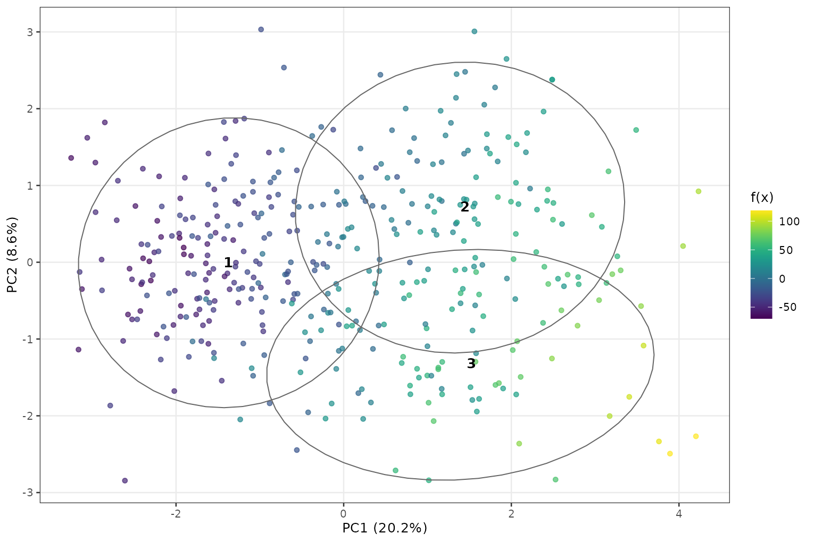{fig-alt="SHAP 空间的二维投影；PCA 与模型输出；数据为 toy_shp 的 400 个观测。"}

### UMAP 与单变量 SHAP {.unnumbered}

按 Che 的 SHAP 值着色，并使用凸包；颜色并不是治疗水平。

```r
plt_shp_map(shp, clust = clu, embed = "umap", color_by = "Che",
            embed_args = list(n_neighbors = 20, min_dist = 0.15),
            outline = "hull", seed = 246)
```

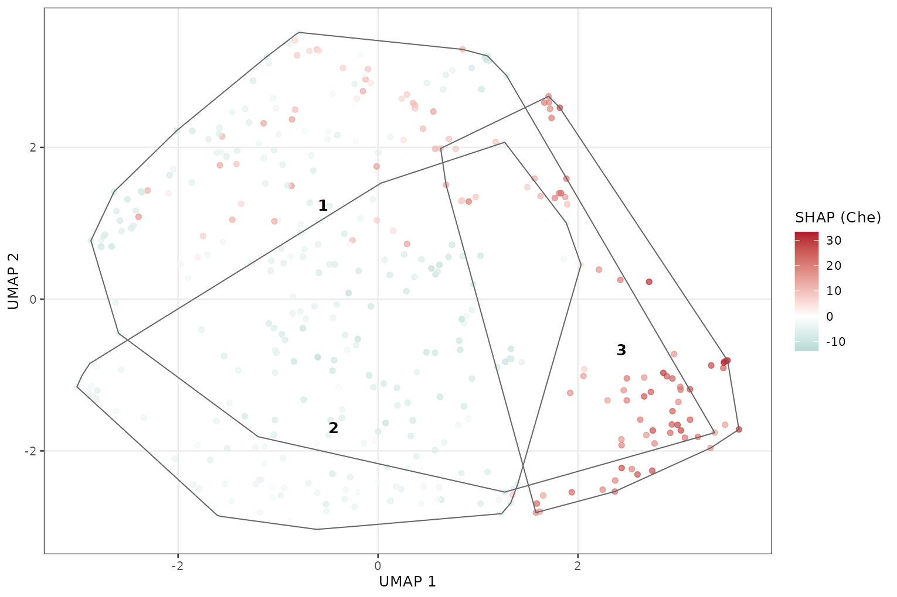{fig-alt="SHAP 空间的二维投影；UMAP 与单变量 SHAP；数据为 toy_shp 的 400 个观测。"}

:::

## `plt_shp_stack()`： 各簇的贡献堆叠 {#plt-shp-stack}

每个簇单独作图，按观测把正、负 SHAP 堆叠起来，便于观察解释组成与模型输出方向。不同特征的正、负贡献可以相互抵消。

- 首个参数是 `clust`，例如 `plt_shp_stack(clu, ...)`；如果只传分组向量，还需通过 `shp` 提供解释对象。
- `sample_order = "prediction"` 在每簇内按对象定义的模型输出排序；`ncol = 3` 把本页的 3 簇并列。
- `display.ncol = 6` 包含聚合项：保留 5 个特征，另 9 个按观测相加。这样保留总体贡献的可加性。

3 簇并列；5 个单变量加 9 个变量的汇总项。

```r
plt_shp_stack(clu, display.ncol = 6,
              sample_order = "prediction", ncol = 3)
```

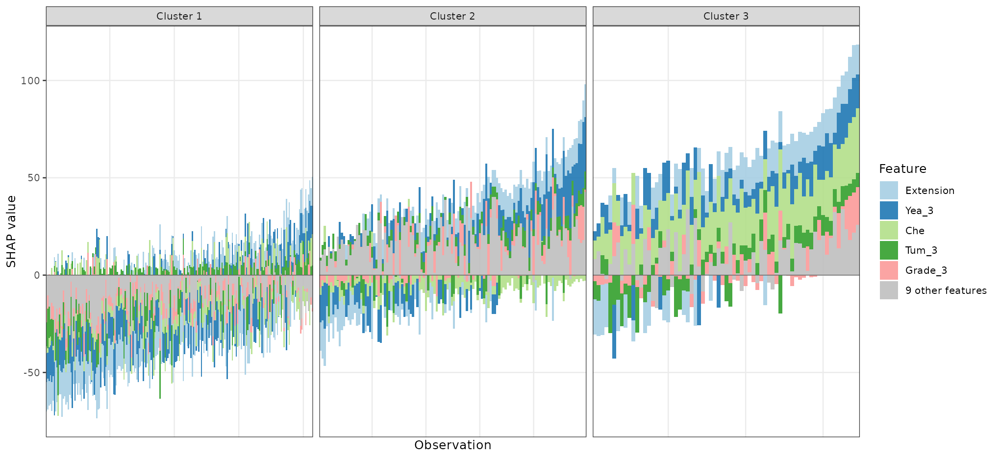{fig-alt="各簇的贡献堆叠；分组堆叠贡献；数据为 toy_shp 的 400 个观测。"}

## `plt_shp_circ()`： 环形蜂群与组间尺度 {#plt-shp-circ}

外圈的点沿半径显示有符号 SHAP、按特征值着色；内圈条形显示各组的平均绝对重要性。单组图用于概览，多组图用于对照解释分布。

- `display.ncol` 或 `vars` 选择变量；多组会使用共同变量并按合并重要性排序。
- `shp_scale = "global"` 在各组间共用径向尺度，可以比较贡献幅度；`"group"` 每组独立定标，只适合比较组内形状，不能用半径直接比较组间绝对幅度。
- `group_labels` 的名称必须完整匹配列表名；本例为 `"No/Unknown"` 与 `"Yes"`。
- `layout_args$group_gap = 10` 调组间留白；`point_args` 调点大小、透明度和蜂群宽度。
- 治疗组的预测解释差异也可能来自其他特征分布与模型关系；此图不构成因果疗效比较。

按治疗水平切分现有对象，直接切分已经存储的矩阵，不重新计算 SHAP：

```r
che_groups <- lapply(
  split(seq_len(nrow(shp[["S"]])), shp[["X"]][["Che"]]),
  function(i) shapviz::shapviz(
    shp[["S"]][i, , drop = FALSE],
    X = shp[["X"]][i, , drop = FALSE],
    baseline = shp[["baseline"]],
    S_inter = shp[["S_inter"]][i, , , drop = FALSE]
  )
)
che_groups_labels <- lapply(che_groups, MLR::.rename_shp,
                           name_map = short_names)
```

::: {.panel-tabset}

### 单组环形概览 {.unnumbered}

单组环形概览，外圈看分布，内圈看贡献幅度。

```r
plt_shp_circ(shp, display.ncol = 8, shp_scale = "global",
             point_args = list(size = 0.55, alpha = 0.55))
```

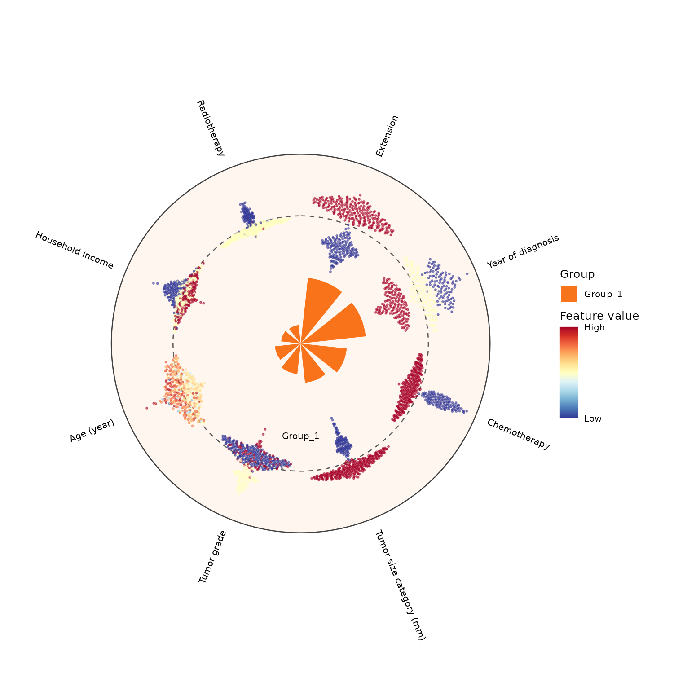{fig-alt="环形蜂群与组间尺度；单组环形概览；数据为 toy_shp 的 400 个观测。"}

### 两组共用尺度 {.unnumbered}

两组共用径向尺度，适合比较贡献幅度。

```r
plt_shp_circ(che_groups_labels, display.ncol = 6, shp_scale = "global",
             group_labels = c("No/Unknown" = "No/Unknown", Yes = "Yes"),
             layout_args = list(group_gap = 10))
```

{fig-alt="环形蜂群与组间尺度；两组共用尺度；数据为 toy_shp 的 400 个观测。"}

### 两组各自尺度 {.unnumbered}

两组分别定标，相同半径不再表示相同的绝对贡献。

```r
plt_shp_circ(che_groups_labels, display.ncol = 6, shp_scale = "group",
             group_labels = c("No/Unknown" = "No/Unknown", Yes = "Yes"),
             layout_args = list(group_gap = 10))
```

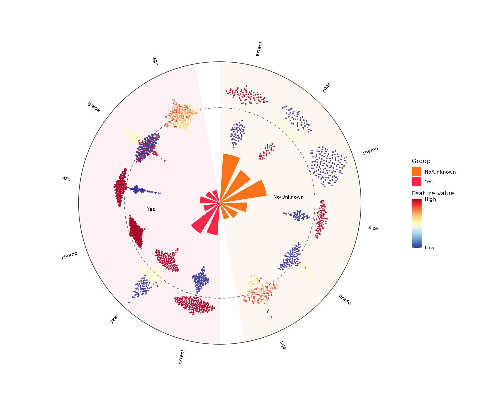{fig-alt="环形蜂群与组间尺度；两组各自尺度；数据为 toy_shp 的 400 个观测。"}

:::

## `plt_shp_force()`： 单个观测的力图与瀑布图 {#plt-shp-force}

展示一个观测如何从存储的基线得到解释输出。正向贡献推高输出，负向贡献降低输出；瀑布图用逐步加和的方式表达同一分解。

- `row_id = 1` 固定同一个解释样本；`display.ncol` 限制显式特征数，剩余特征按有符号贡献求和。
- `mode = "shapviz"` / `"custom"` / `"waterfall"` 均可在 R 端绘图；本页不调用需要 Python 环境的 `"python"` 模式。
- `colors` 顺序为正贡献、负贡献；`show_annotation` 控制数值与特征注释。
- 当前对象的 `baseline = 0`，例如负的 `f(x)` 是解释尺度上的值，不代表负的死亡概率。
- 此函数的 PDF 保存走自身实现；它与大多数绘图函数转发到 `RegR::save_plt()` 的路径不同。

::: {.panel-tabset}

### 标准力图 {.unnumbered}

同一解释样本的标准力图。

```r
plt_shp_force(shp, row_id = 1, display.ncol = 6,
              mode = "shapviz", show_annotation = TRUE)
```

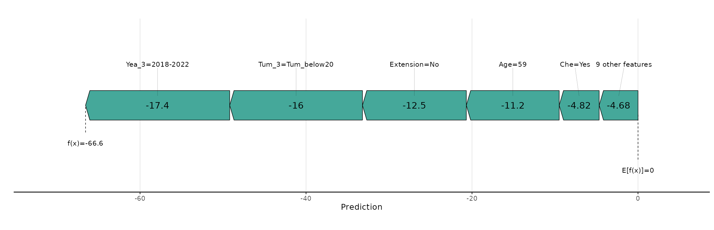{fig-alt="单个观测的力图与瀑布图；标准力图；数据为 toy_shp 的 400 个观测。"}

### 自定义力图 {.unnumbered}

同一分解换成自定义力图，并改变正、负贡献颜色。

```r
plt_shp_force(shp, row_id = 1, display.ncol = 6,
              mode = "custom", colors = c("#B2182B", "#2166AC"))
```

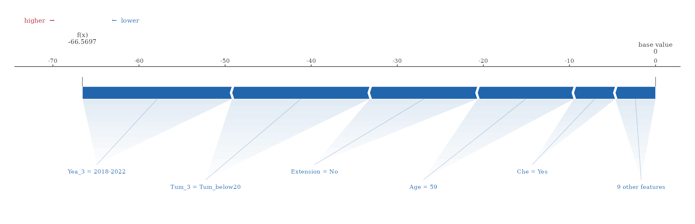{fig-alt="单个观测的力图与瀑布图；自定义力图；数据为 toy_shp 的 400 个观测。"}

### 瀑布图 {.unnumbered}

逐步累加贡献的瀑布图；剩余变量求和后展示。

```r
plt_shp_force(shp, row_id = 1, display.ncol = 8,
              mode = "waterfall", show_annotation = TRUE)
```

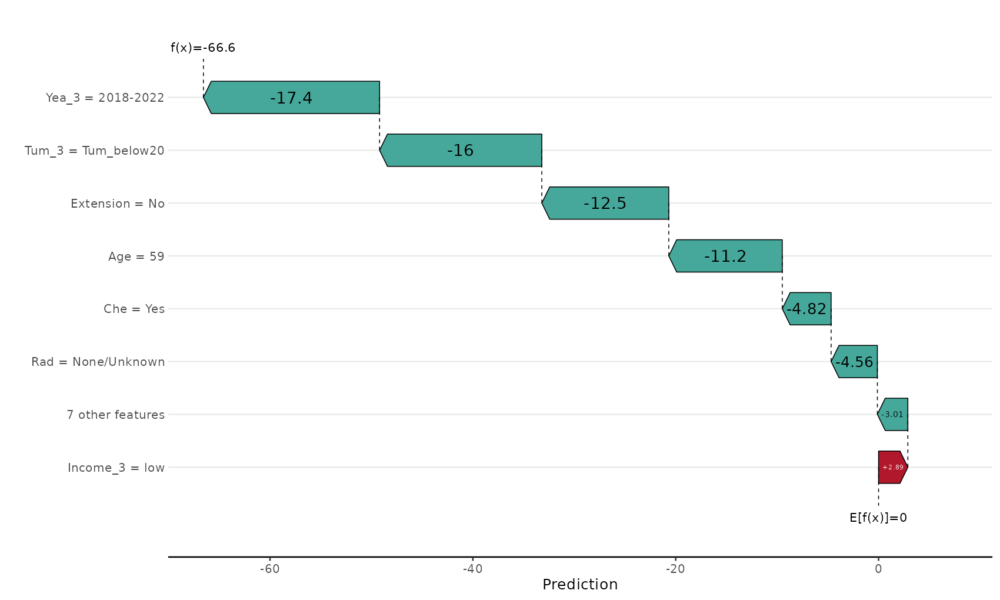{fig-alt="单个观测的力图与瀑布图；瀑布图；数据为 toy_shp 的 400 个观测。"}

:::


## 多行TI面板对齐 {#ti-grid-current}

2026-10-15按已推送MLR `c5b85af` 重新绘制本节一张TI网格，使用现有ToyData::toy_shp对象。其他34张图保留原快照；本节不重新计算SHAP值。增加配对会增加行数，保存时应同时增加height；只改变画布不改变解释值。

::: {.panel-tabset}

### 跨行的TI面板使用同一网格

同一锚点的多个配对最多每行四对，短末行保留空位；TI模式中每对的交互面板位于总贡献面板正上方，各行列边界对齐。本节复用现有SHAP数值，没有重新训练或计算SHAP。

```r
shp_grid <- MLR::.rename_shp(ToyData::toy_shp, name_map = c(Ext = "Extension"))
p_ti_grid <- plt_shp_TI(shp_grid, two_var = c("Age", "Che", "Sex", "Tum_3", "Race", "Income_3"),
  display = "TI", axis_arg = list(share_y = "all", hide_y = TRUE), color = "RdYlBu")
p_ti_grid
```

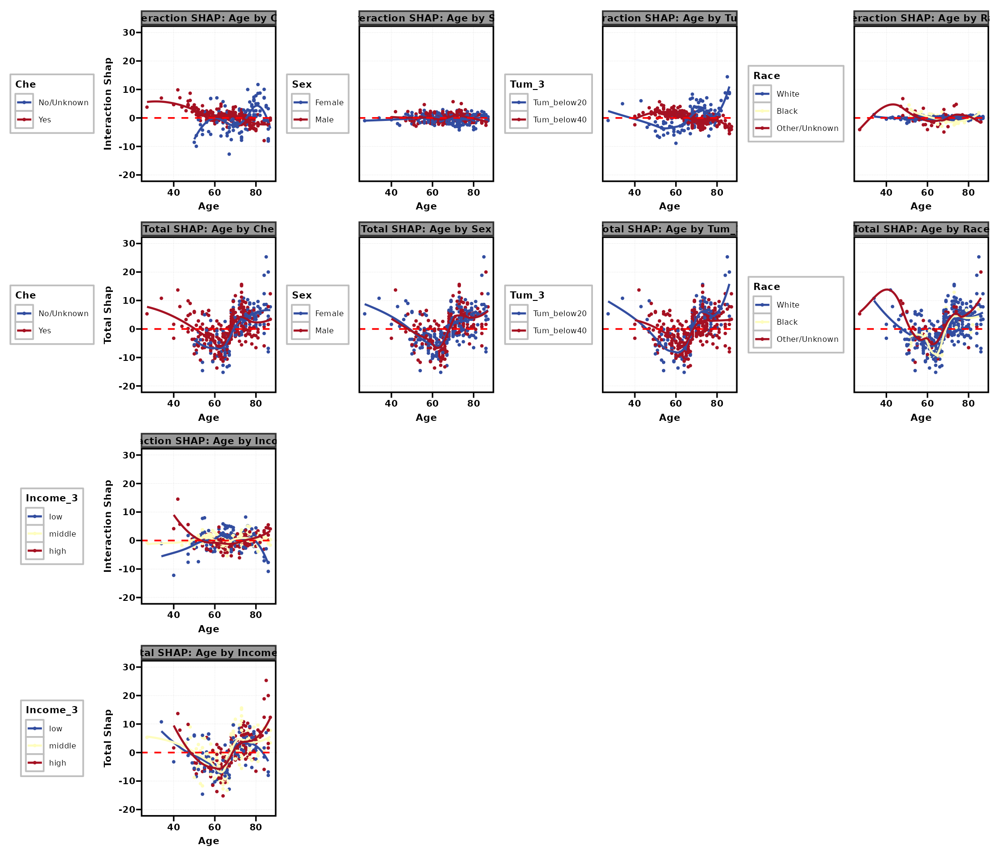{fig-alt="跨行的TI面板使用同一网格的固定输入参数对照实图。"}

:::

## 当前组合 SHAP 图的保存入口 {#tm-save-20261020}

2026-10-20 按已推送 MLR `e915077e` 与 RegR `da6157be`，在 Windows / WSL R 4.4.3 实跑。此前文字误写 `plt_shp_TM_com()` 没有 `save`，现已纠正；旧图保留原计算，这里直接使用已计算的 `ToyData::toy_shp`，不重新训练森林或计算 SHAP。

<!-- refresh-20261020: tm_save -->
```r
library(MLR)
p_tm_saved <- plt_shp_TM_com(ToyData::toy_shp, x_var = "Che", fmt_tag = FALSE,
  add_name = c(Che = "Chemotherapy"),
  save = list(filename = file.path(tempdir(), "20261020-refresh-shap-tm.pdf")))
size <- attr(p_tm_saved, "plot_size")
size
```

::: {.callout-note collapse="true" title="复核代码"}
生成本页时运行的检查，接在上面的代码之后运行；只读教程可以跳过。

```r
stopifnot(length(size) == 2L, all(is.finite(size)), all(size > 0))
```
:::

<!-- /refresh-20261020: tm_save -->

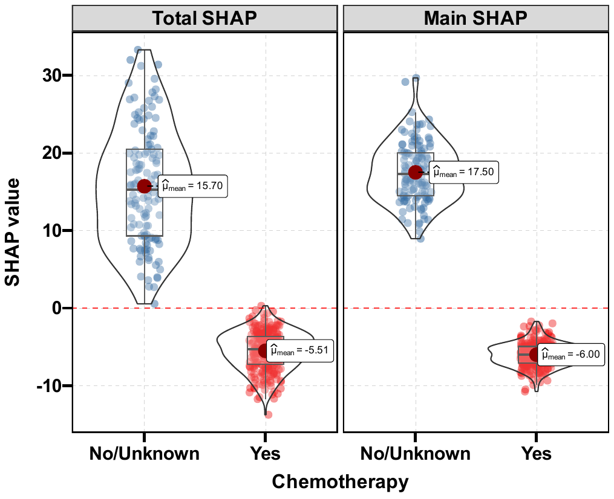{fig-alt="400行toy_shp对象中化疗分组的Total SHAP与Main SHAP组合，按内容估算PDF画布；仅比较已拟合模型的贡献分布，不作因果效果解释。"}

[下载 PDF](images/shap-guide/20261020-refresh-shap-tm.pdf)

`save = list()` / `NULL` 不写文件；给 `filename` 后以 PDF 导出，省略的宽高按组数、文字和组合布局估算。显式尺寸单位为英寸。修改标题、配色或输出尺寸不会重新计算 SHAP；保存文件仍含图中数据，不能把格式导出理解为数据匿名化。

## 参数调整与保存 {#parameters}

::: {.table-responsive}

| 调整目标 | 参数 | 对解释量的影响 |
|:--|:--|:--|
| 提高可读性 | 点大小、透明度、颜色、条带、插图位置 | 不改变 SHAP 数值 |
| 比较幅度 | `axis_arg$share_y`、`shp_scale` | 改显示尺度；共用尺度更适合直接比较 |
| 聚焦部分变量 | `display.ncol`、`vars`、`fmt_args$dis_ncol` | 不同图的聚合、百分比分母与归一化方式不同 |
| 限制观察窗 | `scale_x$xlim`、`ylim` | 窗外值可能不可见；不能当作没有对应观测 |
| 倍乘或平移贡献 | `fmt_args$cha_mult`、`cha_add`、`int_args` | 改变解释数值；不宜再按原始 SHAP 的单位或可加性读图 |
| 改观测位置 | `sample_order`、`embed`、`embed_args` | 改排序或投影；二维成团不证明统计显著性 |

:::

大部分函数的 `save = list()` 默认不写文件，指定时转交 `RegR::save_plt()` 保存 PDF。`plt_shp_TM_com()` 现也支持该入口并按内容估算尺寸；`plt_shp_force()` 使用自身的 PDF 保存实现。

```r
p <- plt_shp_TM(shp, x_var = "Age", display = "TM",
                save = list(filename = "shap-age.pdf", width = 10, height = 4.5))

# 外部导出同样可用；矩阵 / 网络图注意固定面板需要的画布尺寸。
p2 <- plt_shp_cor(shp, display.ncol = 8)
attr(p2, "plot_size")  # 顺序为 width、height，单位为英寸
# ggplot2::ggsave("shap-interactions.png", p2, width = 9, height = 7, dpi = 300)
```

本页未对 SHAP 做倍乘或平移。所有绘图示例已通过实际导出验证，并核对输入对象的 SHAP、原始特征和交互值保持一致。环形留白相关图可能提示少量占位行被坐标范围移除；蜂群与旧版相关热图依赖也可能给出主题或弃用提示，图形仍能完成。这里的验证范围是已有解释对象的绘图，没有运行模型训练、比较计算后端或检验临床效应。

## 参考与源码 {#references}

- [MLR 参考站点](https://hui950319.github.io/MLR/)
- [`get_shp()` 帮助页](https://hui950319.github.io/MLR/reference/get_shp.html)
- [SHAP TreeExplainer：主效应、交互与可加性](https://shap.readthedocs.io/en/latest/generated/shap.TreeExplainer.html)
- [ToyData 数据对象介绍](../toydata/index.qmd)


## 单个int_var与保存图对象 {#single-anchor-current}

2026-10-16按MLR `78c4238` 固定快照在WSL R 4.4.3实际执行以下合成数据新例；单锚点与图对象环境整理已包含于核对时远端 `462f041`。原ToyData的35张图和既有SHAP值保留原快照。

ranger路径会将字符预测变量转成因子，使ranger与treeshap使用一致的水平编码，调用者的数据不被改写。Unix treeshap可按工作量使用fork，Windows仍启动独立R进程；Python无法启动的会话缓存与get_imp共用。没有在本轮测量新的加速倍数。


### 单变量锚点的预生成交互图

独立320人合成二分类数据，使用R treeshap重新计算。一个int_var使plt.int1进入排名模式，展示与各伙伴的两个方向；plt.int2只生成一个锚点的排名与插图。int_var仅选择展示，不缩小S_inter的计算范围。

```r
set.seed(20261016)
d_shp_one <- data.frame(Age=runif(320,20,80),Marker=rnorm(320),
  Group=sample(c("A","B"),320,TRUE))
d_shp_one$Outcome <- factor(ifelse(runif(320)<plogis(-0.3+d_shp_one$Marker+
  0.04*(d_shp_one$Age-50)+0.08*(d_shp_one$Age-50)*d_shp_one$Marker),"Yes","No"))
shp_one <- get_shp(d_shp_one,vars=c("Age","Marker","Group"),surv="Outcome",
  interactions=TRUE,int_var="Marker",engine="treeshap",device="cpu",
  Num.sample=320,exp.sample=40)
shp_one$plt.int1
```

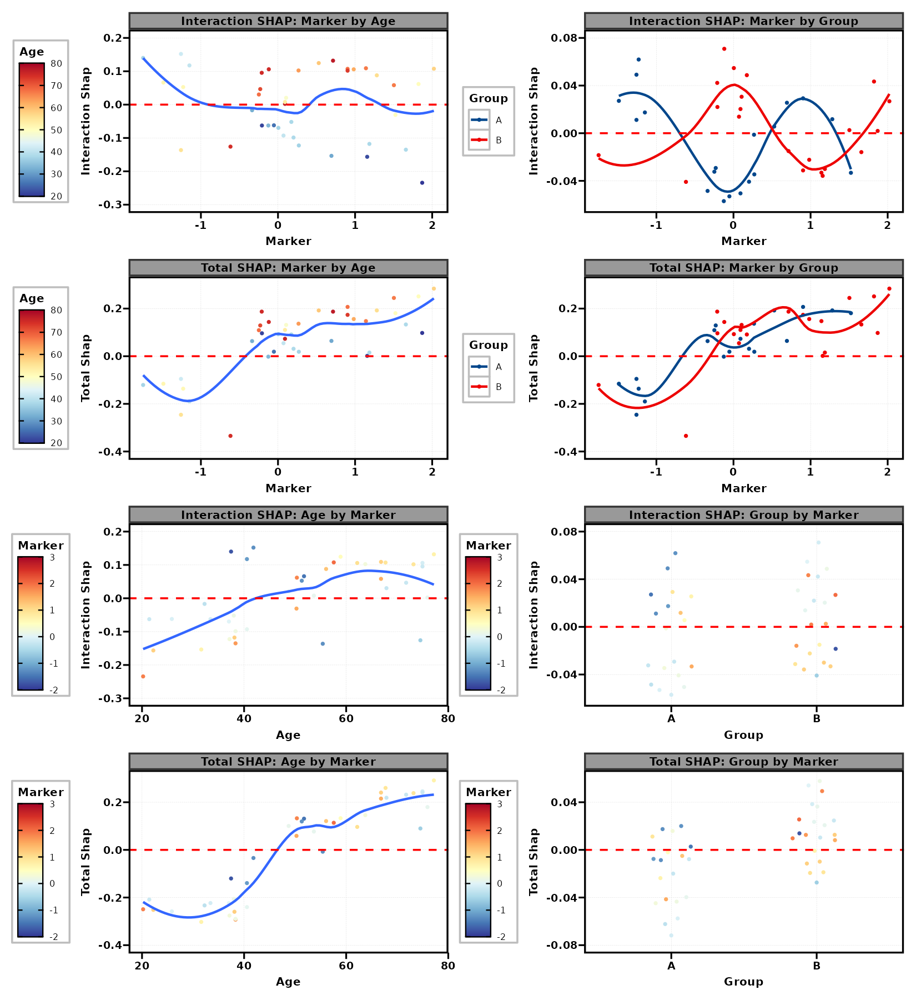{fig-alt="单变量锚点的预生成交互图；固定输入、按注明源码快照实际运行的示例。"}


### 单锚点的排名与搭档

直接读取同一shp_one的plt.int2，不重新训练。最强搭档由交互强度选择；图上没有P值，也不是治疗效应检验。

```r
shp_one$plt.int2
```

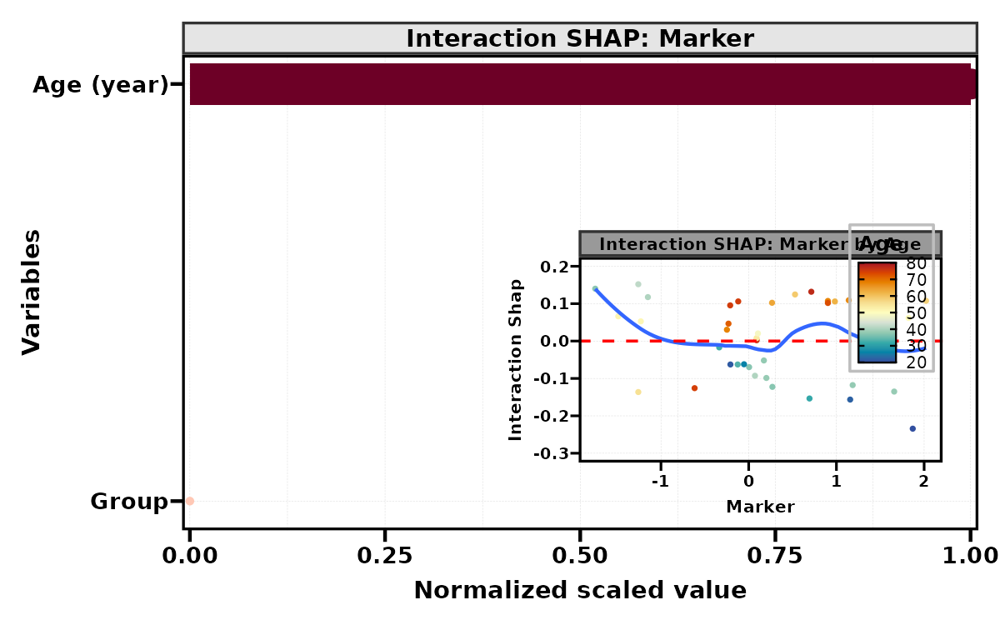{fig-alt="单锚点的排名与搭档；固定输入、按注明源码快照实际运行的示例。"}

当前plt_shp_TI/TM整理了绘图环境，保存图不应再因局部环境带入整份输入对象。本例已保存、读回plt.int1并重新构建；这不等于完整get_shp结果已去掉原始数据，par_lis仍记录data和vars。只需图时保存图，只需数值时选择必要字段；不要把图对象当作匿名数据。

## 当前打印行为与 TM 层级 {#current-20261017}

2026-10-17 按已推送 MLR `4bbc8c8`，在 WSL R 4.4.3 实际拟合下面的合成二分类模型，并导出新图。`get_shp()` 的返回对象增加 `mlr_shp` 类，原来十个字段仍在，未增加保存 HTML 的 `view` 字段。

在交互会话直接打印结果，会把可用图放在同一 Viewer 页面；Rscript 和 knitted 文档中仍逐图打印。`render_plots=FALSE` 时打印 SHAP 矩阵规模。页面每次打印时构建，保存结果 RDS 不会额外保留这一临时页面。

```r
set.seed(1017)
n_shp <- 240L
d_shp <- data.frame(Age = runif(n_shp, 25, 80), Marker = rnorm(n_shp),
  Sex = factor(sample(c("Female", "Male"), n_shp, TRUE)), Noise = rnorm(n_shp))
d_shp$Outcome <- factor(ifelse(runif(n_shp) < plogis(-0.4 +
  0.04 * (d_shp$Age - 50) + d_shp$Marker), "Yes", "No"))
vars_shp <- c("Age", "Marker", "Sex", "Noise")
res_shp_new <- get_shp(d_shp, vars_shp, surv = "Outcome", model = "ranger",
  engine = "treeshap", Num.sample = 240, exp.sample = 160,
  interactions = TRUE, int_var = "Marker")
res_shp_new  # 交互会话显示整页；Rscript / knitr 逐图显示
```


### 变量标题与总贡献 / 主效应

`plt_shp_TM()` 的默认条带改为深灰、白色加粗标题，变量名称与 SHAP 总图的映射一致。条带已标明变量时省去重复 x 轴标题；分类标签可按空格折行、拥挤时交错排列。下面沿用真实模型产生的 SHAP，比较三个变量的总贡献与主效应。

```r
p_tm_new <- plt_shp_TM(res_shp_new, x_var = c("Age", "Sex", "Marker"),
  display = "TM", axis_arg = list(share_y = "var", hide_y = TRUE))
p_tm_new
```


{fig-alt="新拟合合成模型的 Age、Sex、Marker 总贡献与主效应面板，深色条带突出变量层级。"}

### 超过十二个变量的布局

超过 12 个变量时按四列排布。下面直接构造数值矩阵，只演示布局；这些数值没有经过模型训练或 SHAP 解释器计算，不用于解释预测贡献。

```r
set.seed(1019)
X_layout <- as.data.frame(matrix(rnorm(80 * 13), nrow = 80))
names(X_layout) <- paste0("X", seq_len(13))
S_layout <- as.matrix(X_layout) / 5
sv_layout <- shapviz::shapviz(S_layout, X = X_layout, baseline = 0)
plt_shp_TM(sv_layout, display = "T", axis_arg = list(share_y = "all", hide_y = TRUE))
```


{fig-alt="直接构造的十三变量矩阵展示四列面板布局，仅用于排版验证。"}

### 把选定图保存为 HTML

需要保留页面时，显式组合所需图。下面选择 summary、TM 与交互图，原始十字段结果对象保持原结构。`get_all(shp.args=...)` 在交互会话也使用 `mlr_shp` 的打印方法；Rscript、knitr 或旧 MLR 仍逐图输出。

```r
p_summary <- res_shp_new$plt.sum
attr(p_summary, "plot_size") <- c(12, 6)
page_shp_new <- RegR::fmt_page(Summary = p_summary, `Total and main` = p_tm_new,
  Interactions = res_shp_new$plt.int1, plot_size = c(12, 7),
  save = list(filename = file.path(tempdir(), "shap-results.html")))
```


{fig-alt="实际浏览器中的 SHAP summary 与选定图结果页。"}

[打开完整 HTML](images/shap-guide/20261017-shap-view.html){target="_blank"} · [下载 HTML](images/shap-guide/20261017-shap-view.html){download="shap-results.html"}

本轮核验了返回类与十个字段、非交互打印、图形构建，以及 HTML 离线加载、手机宽度和点击缩放。前面的 37 张历史图与解释数值保留原快照；新增三张图分别说明当前模型、纯布局与页面预览。

## 更新记录 {#page-updates}

::: {.callout-note collapse="true" title="更新记录"}
- 2026-10-31：[新增双环和棒棒糖组合](#modes-20261031b)，补充三个summary模式及独立per2实图。
- 2026-10-27：补充[独立缩放记录、带标签基线与空分配](#preprocessing-state-20261027b)，复用 60 行模型并解释 8 行新样本，新增三张实图。
- 2026-10-27：补充[随机状态与同大小簇](#cluster-seed-20261027)的 24 行规则核对。
- 2026-10-27：补充[同模型同基线聚类与分配](#cluster-assignment-20261027)的 60/12 行例子和两张原生 PDF。
- 2026-10-26：补充[sum_per 插图标签换行](#sum-per-labels-20261026)的两张合成 SHAP 原生 PDF。
:::
