`get_exp()` 构建预测解释器，`get_vpd()` 将变量分布（VD）与部分依赖（PD）放在一起。本页用实际图形解释两块面板的差别，并对照主要任务和分组路径。

**版本与执行范围：** 按 MLR 0.1.13 当前源码核对，使用 WSL R 4.4.3 实际导出原主教程 **12 张参数对照图**。Cox、Logistic 和生存随机森林均实际训练，图形来自公开入口；使用已有临床示例和模拟二分类数据，未执行外部临床验证。

## 示例准备与读图规则 {#data}

生存示例使用 `ToyData::toy_ptc_m1_cnd` 的 598 人 M1 PTC 队列，175 个疾病特异死亡事件，time 单位为月，与 [ToyData 介绍](../toydata/index.qmd)一致。模型使用 Age、Sex、Tum_3；Unknown 是原有因子水平。二分类示例为固定种子的 300 行模拟数据，正类明确为 Yes，避免把删失生存记录直接当成完整二分类结局。

| 面板 | 如何得到预测 | 解释范围 |
|:--|:--|:--|
| VD | 每个观测保留其实际特征，展示变量值与模型预测 | 有混杂特征与其他变量差异 |
| PD | 扫描关注变量并对参考样本预测平均 | 已拟合模型的平均响应；不是回归系数 |
| 生存 y 轴 | S(t) | 当前预测时间的生存概率 |
| 二分类 y 轴 | P(Outcome = Yes) | 正类预测概率 |

横轴上的密集区域反映观测分布。超出数据支持的变量组合需要结合样本密度判断；曲线也不能直接解释为干预效果。

```r
library(MLR)
library(ToyData)
library(ggplot2)

d <- as.data.frame(ToyData::toy_ptc_m1_cnd[,
  c("time", "DSS", "Age", "Sex", "Tum_3", "Race")])
d <- droplevels(d[complete.cases(d), ])
vars <- c("Age", "Sex", "Tum_3")
e60 <- get_exp(d, vars = vars, surv = 60)
e120 <- get_exp(d, vars = vars, surv = 120)

set.seed(246)
n <- 300L
dc <- data.frame(Age = runif(n, 20, 85),
  Sex = factor(sample(c("Female", "Male"), n, TRUE)),
  Marker = rnorm(n), Group = factor(sample(c("A", "B"), n, TRUE)))
prob <- plogis(-0.4 + (dc[["Age"]] - 50) / 20 +
  0.5 * (dc[["Sex"]] == "Male") + 0.8 * dc[["Marker"]] +
  0.7 * dc[["Marker"]] * (dc[["Group"]] == "B"))
dc[["Outcome"]] <- factor(ifelse(runif(n) < prob, "Yes", "No"),
  levels = c("No", "Yes"))
cvars <- c("Age", "Sex", "Marker", "Group")
ec <- get_exp(dc, vars = cvars, surv = "Outcome")

set.seed(246)
erf <- get_exp(d, vars = vars, surv = 60, model = "ranger")
```


## get_ale2()：去除主效应后的二阶 ALE {#get-ale2}

本节按 MLR 0.1.13 源码 `95d3204` 核对；复用 [二维 PDP 页的 300 行合成数据与 cvars](pdp-guide.qmd#get-pdp2)，在 WSL R 4.4.3 中实际执行。

原有 `get_vpd(exp_var=c("Group","Marker"))` 是按组展示的一维响应曲线。`get_ale2()` 计算两个变量的局部二阶变化、累积并去除低阶项，用于观察模型中的二阶交互；它与包含主效应的 `get_pdp2()` 有不同含义。

```r
get_ale2(EXP.obj, exp_var, N = 10000, grid_size = 20, scale = c("link", "prob"),
  engine = c("iml", "ale"), cores = NULL, save = list())
```

::: {.panel-tabset}

### 随机森林的概率尺度

```r
ec_joint <- get_exp(dc, vars = cvars, surv = "Outcome", model = "ranger", cores = 1)
interaction_ale <- get_ale2(ec_joint, c("Marker", "Group"),
  N = 300, scale = "prob", cores = 1)
interaction_ale
```

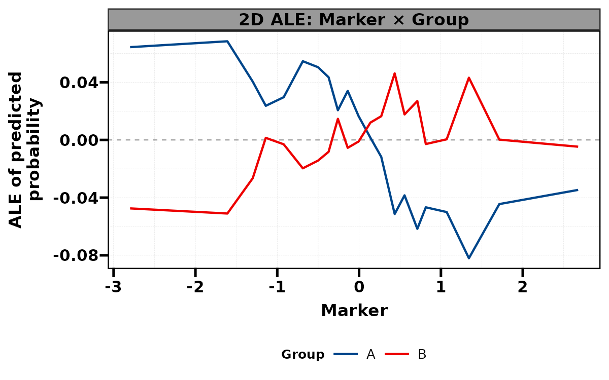{fig-alt="同一合成队列的 ranger 二阶 ALE，去除低阶项后展示 Marker 与 Group 的预测事件概率变化。"}

### 加性 Logistic 的 link 尺度

```r
ec_linear <- get_exp(dc, vars = cvars, surv = "Outcome", model = "default")
linear_ale <- get_ale2(ec_linear, c("Marker", "Group"),
  N = 300, scale = "link", cores = 1) +
  coord_cartesian(ylim = c(-0.1, 0.1))
linear_ale
```

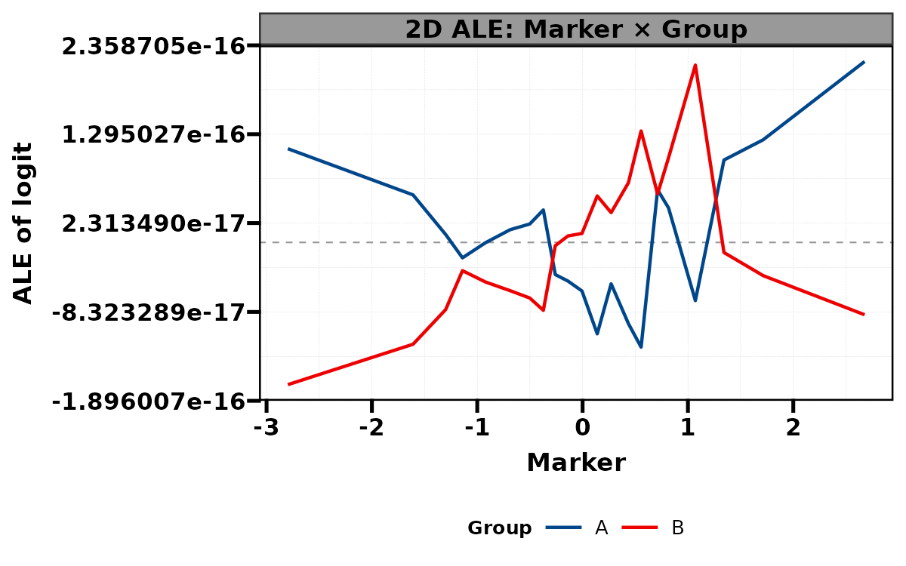{fig-alt="只含主效应的 Logistic 模型在 logit 尺度上的二阶 ALE 接近数值零，反映所拟合模型而不是生成数据的交互。"}

:::

第二张图将纵轴固定在 ±0.1 logit，避免放大约 1e−16 的浮点误差。模拟数据含有 Marker × Group，但默认 Logistic 工作模型只拟合主效应，所以第二张图的 link 尺度交互应接近零。图解释的是实际拟合模型；不能据此否定真实数据生成过程中的交互。概率尺度与 link 尺度的交互含义也不同。

默认 `N=10000`，`N=NULL` 使用全部数据；超过 N 时等间隔取行，不消耗 RNG。二阶 ALE 的成本主要是每个有效局部区间四角预测。随机森林没有对应的拟合 link，显式使用 `scale="prob"`；Cox / Logistic 的 link 则对应模型工作尺度。

本例执行默认 `engine="iml"`；其他引擎和分类水平排序应按当前帮助选择。二阶 ALE 是模型解释图，不提供交互 P 值，也不能替代临床效应修饰检验。

## 接口、返回对象与分析流程 {#interface}

| `surv` | 实际任务 | 预测时间 |
|:--|:--|:--|
| TRUE / FALSE | 生存 | 默认 120；FALSE 仍走生存路径 |
| 数值，如 60 | 生存 | 使用该数值，单位跟随 time |
| 字符结局名 | 二分类 | 没有随访时间维度 |

`model = default` 对生存是 Cox，对二分类是 Logistic；另外支持 ranger 和 xgboost。`get_exp()` 返回统一的 12 字段 list：核心解释器在 `EXP`，追加预测的原始数据在 `dat`，类型名称在 `cat_vars` / `con_vars`，原始设置在 `par_lis`。`per`、`imp_res`、`imp_plot` 等随任务填充；默认生存简化路径中的预生成重要性/PDP 字段可为 NULL。

`get_vpd()` 接受完整解释结果或构建参数 list，返回组合图。`exp_var = c(group, focus)` 的第一项必须为分类变量。这是分组的一维 PDP。当前生存分组路径会按组重建解释器；分类路径使用 DALEX 的分组剖面。因此不能把组间曲线直接当成同一模型的二维联合响应。真正二维生存 PDP 的接口和图谱见后续专题。

```r
get_exp(data, vars, surv = 120,
        model = c("default", "ranger", "xgboost"))
get_vpd(EXP.obj, exp_var, tidy_plot = TRUE, cores = NULL)
get_vpd_pnl(EXP.obj, exp_var, N = 300, cores = NULL)
```


### 输入隔离、正类编码与预测缓存（2026-10-27） {#explainer-contract-20261027}

<!-- update-20261027: mlr_explainer -->

按已推送 MLR `52c03f9`，`get_exp()` 在拟合前统一输入检查，阻止把结局放进 `vars`，保留字 `yhat` 也不能被原数据占用。生存任务还禁止 `time` / `DSS` 出现在预测变量中，并在无事件时提前停止。下例只拟合 60 行合成 Logistic 数据，演示带空格的结局名、字符/逻辑特征和预测缓存。

```r
library(MLR)
library(ggplot2)
set.seed(20261027)
exp_data27 <- data.frame("Marker score" = rnorm(60), Group = rep(c("A", "B"), 30),
  Flag = rep(c(TRUE, FALSE, FALSE), 20), check.names = FALSE)
exp_data27[["Clinical outcome"]] <- factor(ifelse(runif(60) < plogis(
  .2 + .5 * exp_data27[["Marker score"]]), "Event", "Control"),
  levels = c("Unused", "Control", "Event"))
exp_before27 <- exp_data27
exp_vars27 <- c("Marker score", "Group", "Flag")
exp27 <- get_exp(exp_data27, vars = exp_vars27, surv = "Clinical outcome", model = "default")
print(exp27)
exp_types27 <- data.frame(variable = exp_vars27,
  input = vapply(exp_before27[exp_vars27], function(x) class(x)[1], ""),
  returned = vapply(exp27[["dat"]][exp_vars27], function(x) class(x)[1], ""))
gt::gtsave(gt::gt(exp_types27), file.path(tempdir(), "20261027-update-explainer-types.html"))
exp_plot27 <- ggplot(exp27[["dat"]], aes(x = yhat, fill = `Clinical outcome`)) +
  geom_histogram(position = "identity", alpha = .5, bins = 12) +
  labs(x = "P(Event)", y = "Training observations", fill = "Original outcome",
    title = "Apparent predictions; no validation split") + theme_minimal(base_size = 12)
ggsave(file.path(tempdir(), "20261027-update-explainer-probabilities.pdf"), exp_plot27,
  width = 7, height = 4.5)
```

因子结局丢掉未观测水平后，保持其余原顺序，**第二个水平为 1 和预测正类**；字符结局按 `factor(y)` 的水平顺序，数值可用 0/1 或 1/2（较大值为正类），逻辑 TRUE 为正类。缺失、单类和多类结局会拒绝。本例是 Control / Event，因此 `EXP$y=1` 对应 Event；`dat` 和 `par_lis$data` 仍保留原结局标签。

字符、逻辑预测变量被转成 factor，`cat_vars` 与返回数据保持一致；普通数值仍是连续变量。Date、difftime、integer64、矩阵或 list 预测列应先明确转换，不能自动猜测单位或编码。data.table、分组 tibble 会在内部规范化为普通 data.frame，调用者对象不被改写；命名 vars 向量的名字也不重命名真实列。

::: {.callout-note collapse="true" title="复核代码"}

```r
stopifnot(inherits(exp27, "exp.obj.log"), length(exp27) == 12L,
  identical(exp_data27, exp_before27),
  all(exp27[["EXP"]][["y"]] == as.integer(exp_data27[["Clinical outcome"]] == "Event")),
  isTRUE(all.equal(as.numeric(exp27[["dat"]][["yhat"]]), as.numeric(exp27[["EXP"]][["y_hat"]]))),
  isTRUE(all.equal(as.numeric(exp27[["EXP"]][["residuals"]]),
    as.numeric(exp27[["EXP"]][["y"]] - exp27[["EXP"]][["y_hat"]]))),
  setequal(exp27[["cat_vars"]], c("Group", "Flag")),
  identical(exp27[["con_vars"]], "Marker score"),
  all(is.finite(exp27[["dat"]][["yhat"]])),
  all(exp27[["dat"]][["yhat"]] >= 0 & exp27[["dat"]][["yhat"]] <= 1))
exp_bad27 <- list(
  leakage = tryCatch(get_exp(exp_data27, vars = c(exp_vars27, "Clinical outcome"),
    surv = "Clinical outcome"), error = conditionMessage),
  reserved = tryCatch(get_exp(transform(exp_data27, yhat = 0), vars = exp_vars27,
    surv = "Clinical outcome"), error = conditionMessage),
  selector = tryCatch(get_exp(exp_data27, vars = exp_vars27, surv = NA), error = conditionMessage))
stopifnot(all(vapply(exp_bad27, is.character, logical(1))))
validation_values <- list(n = nrow(exp_data27), types = exp_types27,
  encoded_classes = as.integer(table(exp27[["EXP"]][["y"]])),
  probabilities = as.numeric(exp27[["dat"]][["yhat"]]), rejected = names(exp_bad27), unchanged = TRUE)
```
:::

::: {.panel-tabset}

#### 规范化后的类型 {.unnumbered}

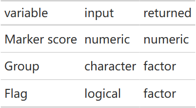{fig-alt="三个合成特征的原始和返回类型：数值保持 numeric，字符 Group 与逻辑 Flag 转为 factor，原输入保留。"}

[原生 HTML](images/vpd-guide/20261027-update-explainer-types.html)

#### 同一缓存的训练预测 {.unnumbered}

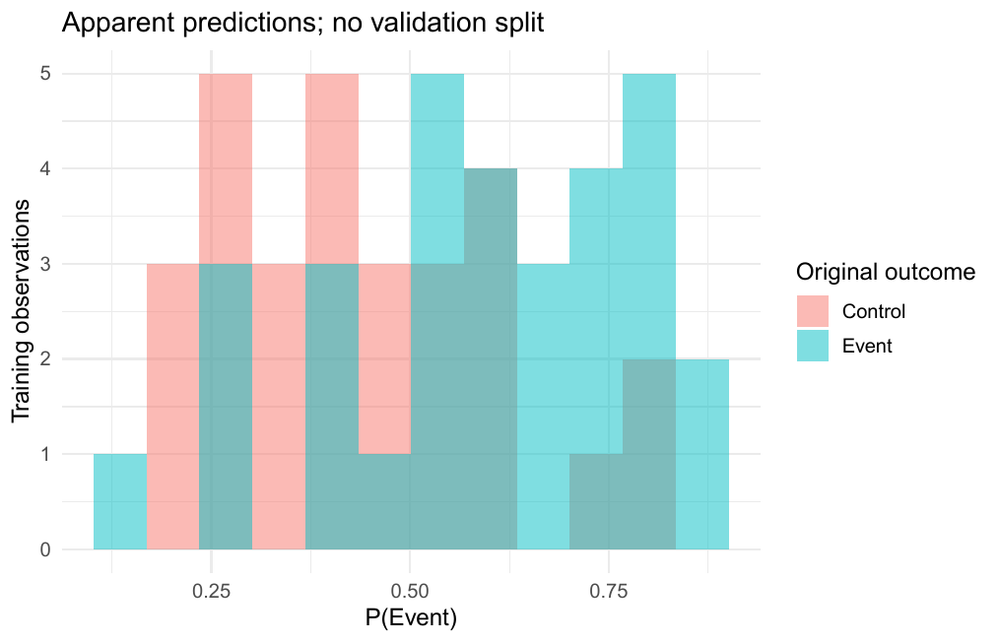{fig-alt="60 行合成训练数据的预测概率直方图，以原结局 Control 和 Event 填色，展示缓存一致性，不是验证集性能。"}

[PDF](images/vpd-guide/20261027-update-explainer-probabilities.pdf)

:::

分类解释器复用一次全数据预测给 `dat$yhat`、解释器缓存和残差；`per` 仍是 apparent performance，既不是留出验证也不是交叉验证。默认仍不预先计算置换重要性或 PDP；缓存复用没有新增端到端提速倍数。`get_ale2()` 还会屏蔽内部 iml 特定的 `merge(on=...)` 兼容警告，其他警告继续报告；这不改变二阶 ALE 的统计定义。

<!-- /update-20261027: mlr_explainer -->

## 生存任务：四种变量组合

`exp_var` 为一个变量时直接展示该变量；两个变量时第一项必须为分类分组，第二项为关注变量。纵轴是选定时间点的预测生存概率 S(t)，不是 HR。

::: {.panel-tabset}


### 单连续变量 {.unnumbered}


生存模型在 60 月的 Age：VD 保留其他观测特征，PD 在参考样本上平均。


```r
get_vpd(e60, exp_var = "Age", cores = 1)
```


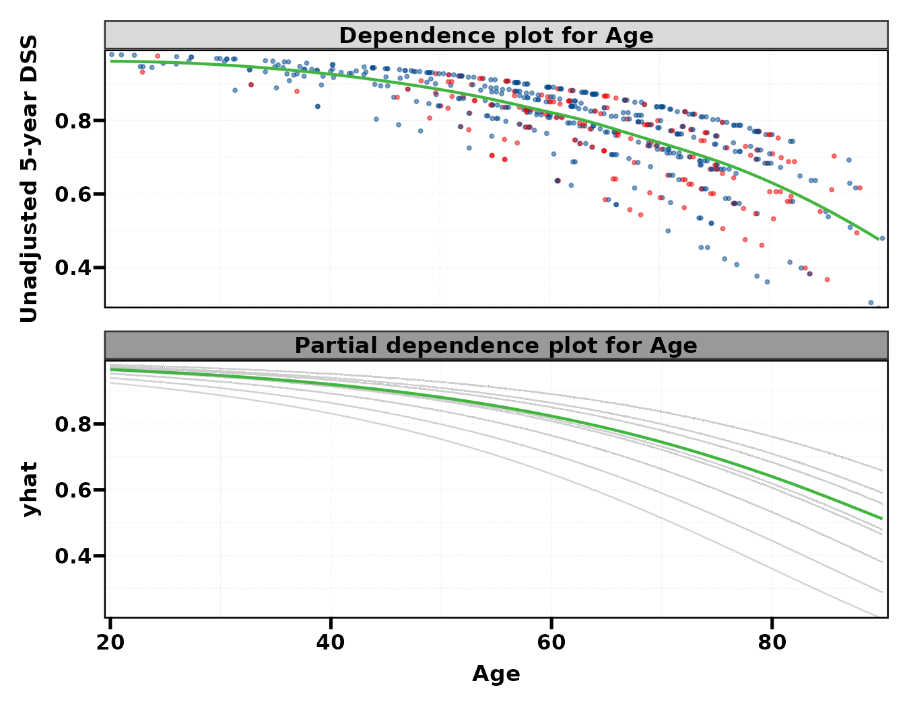{fig-alt="生存模型在 60 月的 Age：VD 保留其他观测特征，PD 在参考样本上平均。"}


### 单分类变量 {.unnumbered}


比较性别两水平的预测分布与平均部分依赖。


```r
get_vpd(e60, exp_var = "Sex", cores = 1)
```


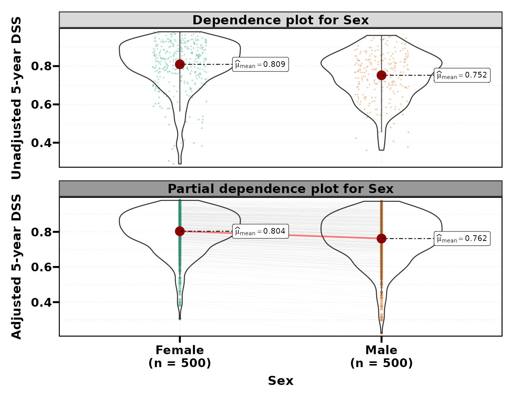{fig-alt="比较性别两水平的预测分布与平均部分依赖。"}


### 分类 × 分类 {.unnumbered}


按 Sex 分组查看 Tum_3；这是分组一维剖面。


```r
get_vpd(e60, exp_var = c("Sex", "Tum_3"), cores = 1)
```


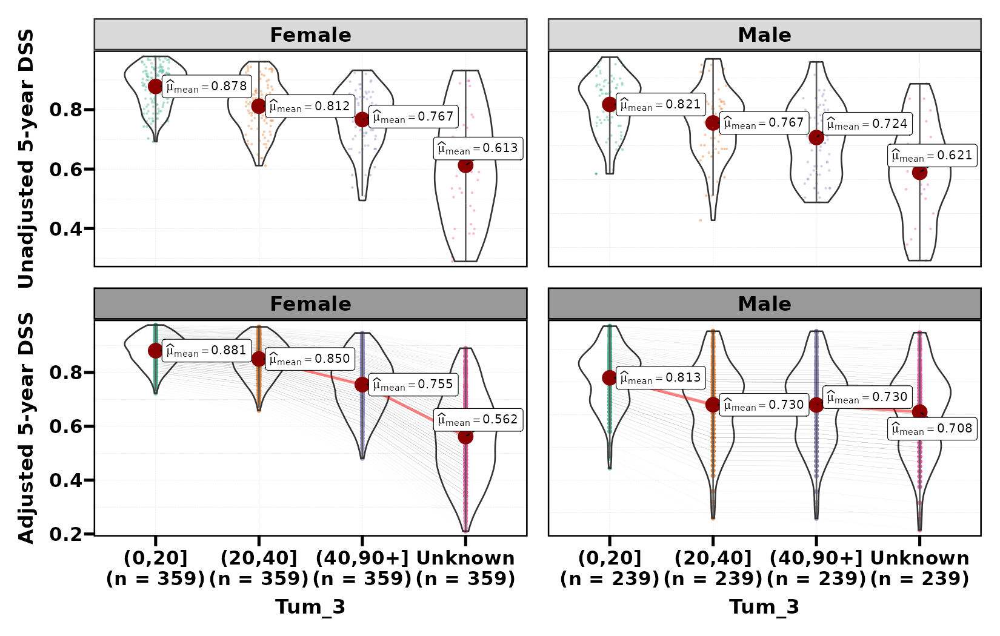{fig-alt="按 Sex 分组查看 Tum_3；这是分组一维剖面。"}


### 分类 × 连续 {.unnumbered}


按 Sex 分组查看 Age；当前生存路径在各组内重建模型。


```r
get_vpd(e60, exp_var = c("Sex", "Age"), cores = 1)
```


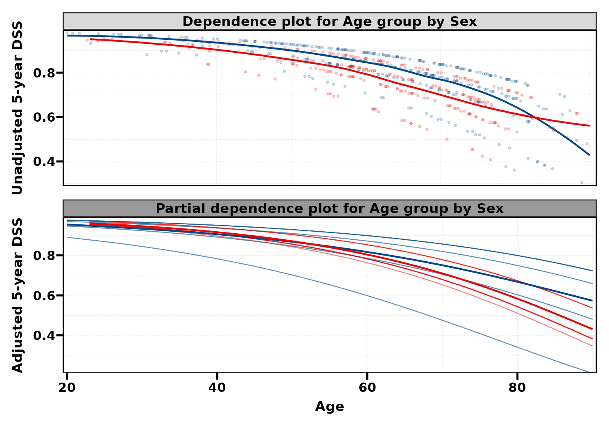{fig-alt="按 Sex 分组查看 Age；当前生存路径在各组内重建模型。"}


:::


## 预测时间与布局

数值 `surv` 是预测时间，单位跟随数据的 time。`tidy_plot` 只整理组合图坐标，`cores` 控制生存剖面的计算线程。

::: {.panel-tabset}


### 120 月 {.unnumbered}


把预测时间改为 120 月；对应的预测量从 S(60) 改成 S(120)。


```r
get_vpd(e120, exp_var = "Age", cores = 1)
```


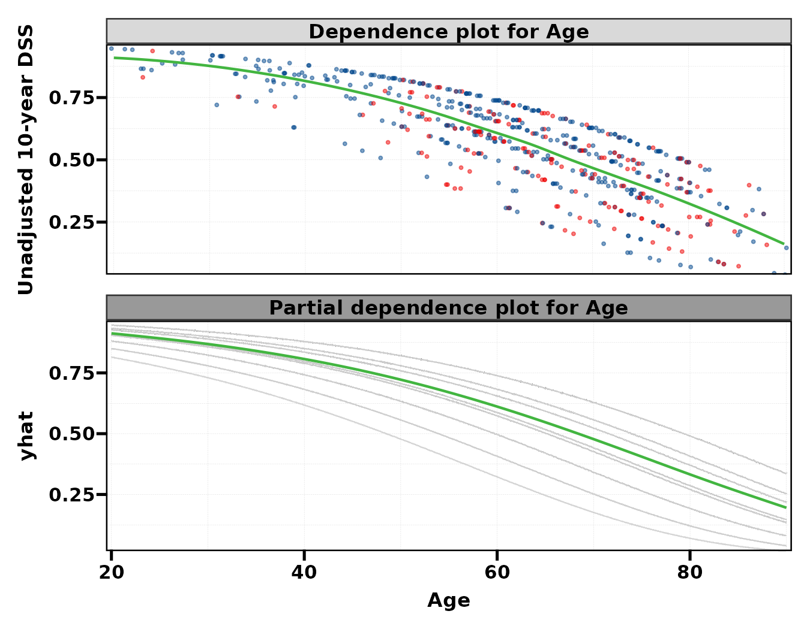{fig-alt="把预测时间改为 120 月；对应的预测量从 S(60) 改成 S(120)。"}


### 关闭轴整理 {.unnumbered}


关闭 tidy_plot，保留原始组合布局；模型与预测目标不变。


```r
get_vpd(e60, exp_var = "Age", tidy_plot = FALSE, cores = 1)
```


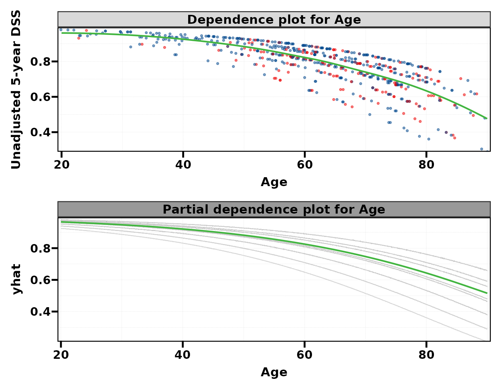{fig-alt="关闭 tidy_plot，保留原始组合布局；模型与预测目标不变。"}


:::


## 二分类任务：四种变量组合

`surv = Outcome` 指定二分类目标；结局水平设为 No / Yes。分类概率没有随访时间维度。

::: {.panel-tabset}


### 单连续变量 {.unnumbered}


二分类纵轴为预测 Outcome = Yes 的概率，数据是明确标注的模拟样本。


```r
get_vpd(ec, exp_var = "Age")
```


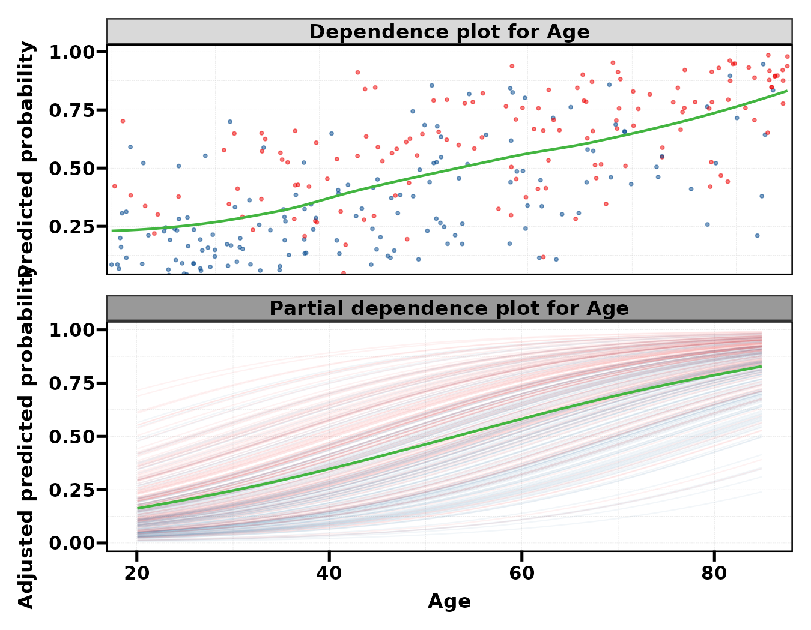{fig-alt="二分类纵轴为预测 Outcome = Yes 的概率，数据是明确标注的模拟样本。"}


### 单分类变量 {.unnumbered}


比较模拟样本的 Sex 与预测阳性概率。


```r
get_vpd(ec, exp_var = "Sex")
```


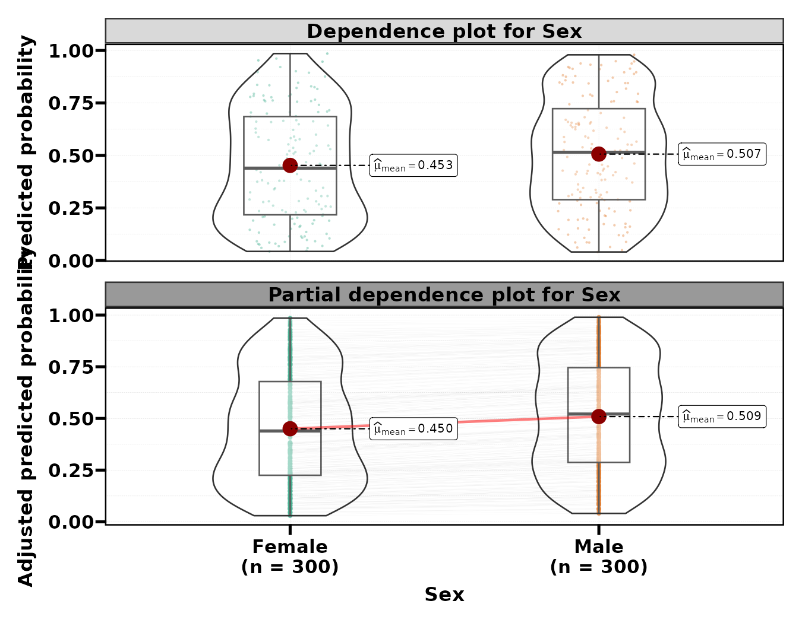{fig-alt="比较模拟样本的 Sex 与预测阳性概率。"}


### 分类 × 分类 {.unnumbered}


按 Sex 分组查看 Group；二分类路径使用 DALEX 分组剖面。


```r
get_vpd(ec, exp_var = c("Sex", "Group"))
```


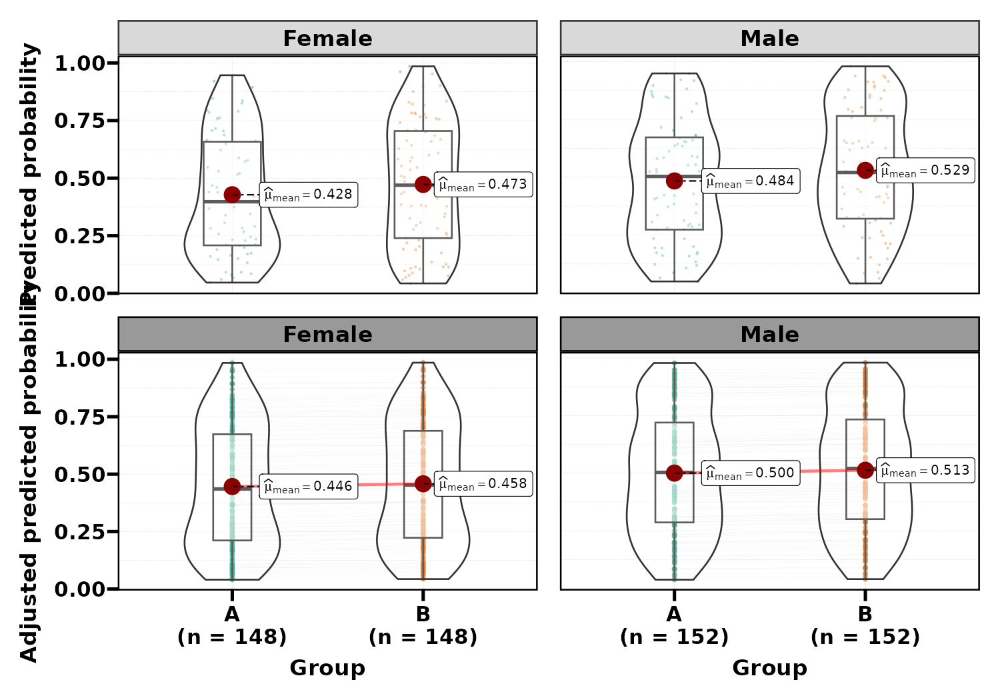{fig-alt="按 Sex 分组查看 Group；二分类路径使用 DALEX 分组剖面。"}


### 分类 × 连续 {.unnumbered}


按 Sex 分组查看 Age 的平均响应，不能把组间曲线差读作因果效果。


```r
get_vpd(ec, exp_var = c("Sex", "Age"))
```


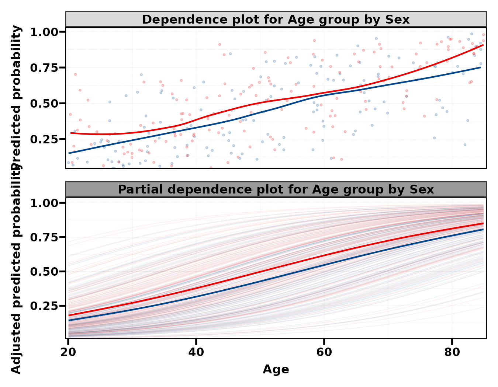{fig-alt="按 Sex 分组查看 Age 的平均响应，不能把组间曲线差读作因果效果。"}


:::


## 模型后端与对象输入

`model = default` 对应 Cox / Logistic；`ranger` 对应随机森林；`xgboost` 对应相应任务的 boosting 模型。改变模型须重新计算解释对象。

::: {.panel-tabset}


### 生存随机森林 {.unnumbered}


随机森林的响应形状可与上面的 Cox 结果比较；模型本身已改变。


```r
get_vpd(erf, exp_var = "Age", cores = 1)
```


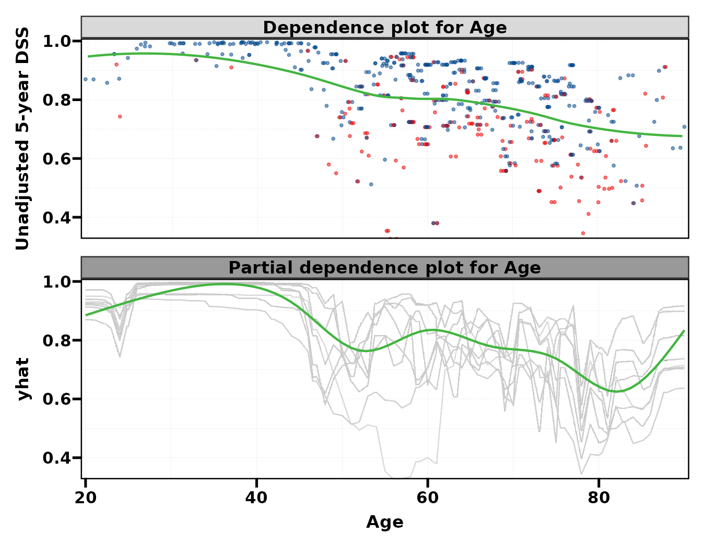{fig-alt="随机森林的响应形状可与上面的 Cox 结果比较；模型本身已改变。"}


### 参数列表自动构建 {.unnumbered}


传入 get_exp 参数列表时，get_vpd 先训练模型并构建解释器，再绘图。


```r
get_vpd(list(data = dc, vars = cvars, surv = "Outcome"), exp_var = "Marker")
```


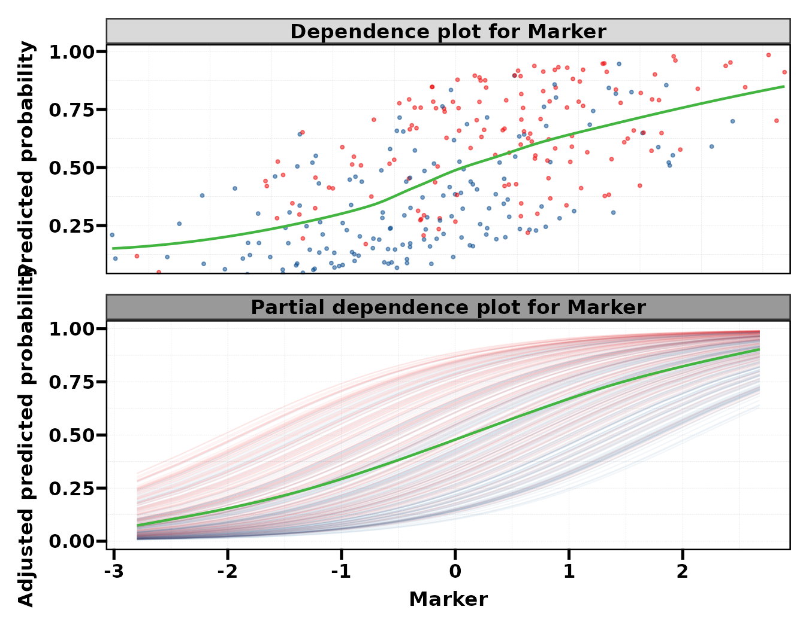{fig-alt="传入 get_exp 参数列表时，get_vpd 先训练模型并构建解释器，再绘图。"}


:::


## 当前按内容保存：变量预测剖面 {#save-20261020}

2026-10-20 按已推送 MLR `e915077e`（接口自 `bcd7ede`）与 RegR `da6157be`，在 Windows / WSL R 4.4.3 实际运行下例。上方历史结果保留原执行记录；本节另用 180 行固定种子模拟数据，较小计算预算只用于接口演示。

当前 `plt_vpd_log()`、`plt_vpd_sur()`、`plt_interboot()` 支持 `save = list(filename = ...)`。省略 `width` / `height` 时，按面板、轴文字、条带和图例估算 PDF 画布；控制台打印尺寸，返回图携带 `attr(p, "plot_size")`。`list()` 或 `NULL` 不写文件；明确给出的尺寸覆盖对应维度，单位是英寸。相同包版本号的旧安装可能还没有此接口，应核对提交和 `names(formals(...))`。

<!-- refresh-20261020: vpd_save -->
```r
library(MLR)
library(mlr3)
library(mlr3learners)
set.seed(20261020)
n_save <- 180L
d_save <- data.frame(Age = rnorm(n_save, 55, 10), Marker = rnorm(n_save),
  Sex = factor(rep(c("Female", "Male"), n_save / 2)))
d_save[["Outcome"]] <- factor(ifelse(runif(n_save) < plogis(
  -0.3 + 0.04 * (d_save[["Age"]] - 55) + 0.5 * d_save[["Marker"]]),
  "Yes", "No"), levels = c("No", "Yes"))
task_save <- as_task_classif(d_save, target = "Outcome", positive = "Yes")
d_save[["time"]] <- rexp(nrow(d_save), exp(-3.6 + 0.015 * (d_save[["Age"]] - 55)))
d_save[["DSS"]] <- rbinom(nrow(d_save), 1, 0.7)
exp_log_save <- get_exp(d_save, vars = c("Age", "Sex", "Marker"), surv = "Outcome")
exp_sur_save <- get_exp(d_save, vars = c("Age", "Sex", "Marker"), surv = 24)
p_log <- plt_vpd_log(exp_log_save, exp_var = "Sex",
  save = list(filename = file.path(tempdir(), "20261020-refresh-vpd-log.pdf")))
p_saved <- plt_vpd_sur(exp_sur_save, exp_var = "Sex", cores = 1,
  save = list(filename = file.path(tempdir(), "20261020-refresh-vpd-sur.pdf")))
# 独立的模拟分布例子，只演示已有数值的绘图保存，不执行 bootstrap。
distribution_save <- data.frame(group = factor(rep(c("A", "B"), each = 30)),
  value = c(rnorm(30), rnorm(30, 0.4)))
p_distribution <- plt_interboot(distribution_save, x = group, y = value,
  centrality.plotting = FALSE, point.path = FALSE,
  save = list(filename = file.path(tempdir(), "20261020-refresh-interboot.pdf")))
size <- attr(p_saved, "plot_size")
size
```

::: {.callout-note collapse="true" title="复核代码"}
生成本页时运行的检查，接在上面的代码之后运行；只读教程可以跳过。

```r
stopifnot(length(size) == 2L, all(is.finite(size)), all(size > 0))
```
:::

<!-- /refresh-20261020: vpd_save -->

::: {.panel-tabset}

### 生存解释器 {.unnumbered}

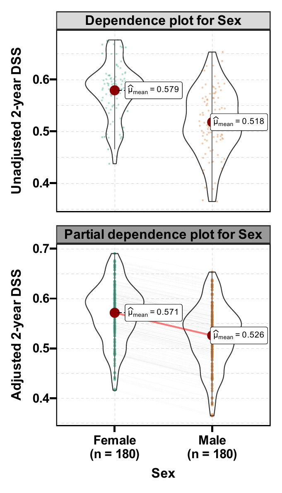{fig-alt="固定模拟数据的生存解释器保存示例，预览由实际PDF转换，用于核对坐标、图例和文字边界。"}

[下载 PDF](images/vpd-guide/20261020-refresh-vpd-sur.pdf)

### 二分类解释器 {.unnumbered}

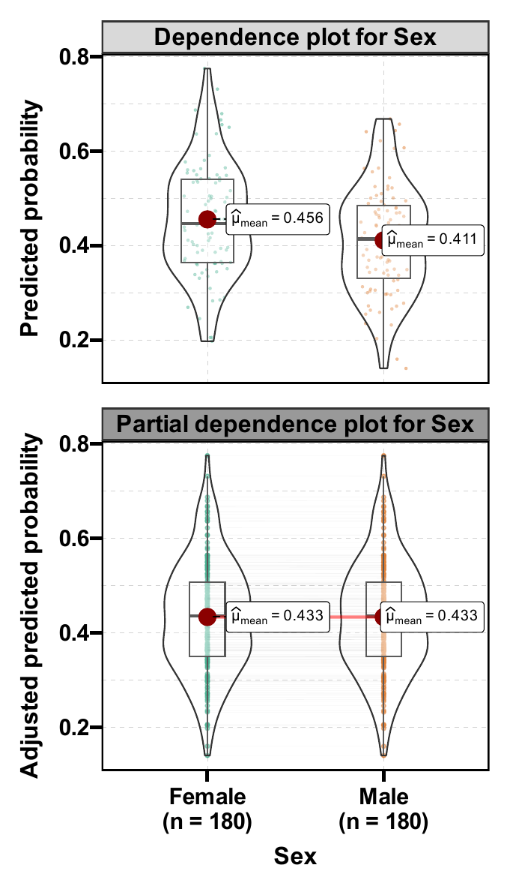{fig-alt="固定模拟数据的二分类解释器保存示例，预览由实际PDF转换，用于核对坐标、图例和文字边界。"}

[下载 PDF](images/vpd-guide/20261020-refresh-vpd-log.pdf)

### 已有数值分布 {.unnumbered}

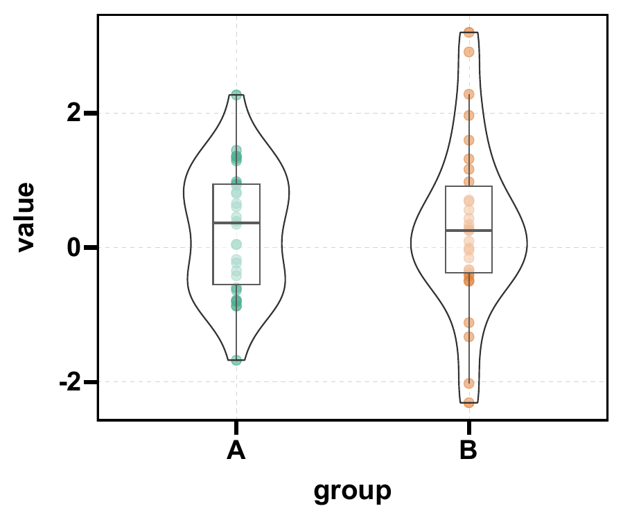{fig-alt="固定模拟数据的已有数值分布保存示例，预览由实际PDF转换，用于核对坐标、图例和文字边界。"}

[下载 PDF](images/vpd-guide/20261020-refresh-interboot.pdf)

:::

`plt_vpd_log()` 和 `plt_vpd_sur()` 保存现有解释器的 VD / PD 组合；预测时间、解释对象和原始拟合仍由上游决定。本节原始数据为180行，Female / Male各90行；PD对每个性别值使用全部180个参考行，图中PD的n是参考行数，不能相加或当作原始分组人数。`plt_interboot()` 只是把传入的数值画成组间分布，本例没有运行 bootstrap，也不是交互项显著性检验。

## 参数调整、保存与使用边界 {#parameters}

| 需求 | 参数 | 是否需要重算 |
|:--|:--|:--|
| 修改预测时间 | get_exp 的数值 surv | 重建解释器，再作图 |
| 改模型 | model | 重新训练 |
| 选择变量/分组 | exp_var | 重算相应剖面，分组生存还会重建组内模型 |
| 整理组合图 | tidy_plot | 改呈现 |
| 控制计算线程 | cores | 生存有效；分类忽略 |
| 检查曲线非线性 | get_vpd_pnl 的 N | 重新抽样/计算曲线 |

`get_vpd_pnl()` 对拟合模型的 PDP 曲线调用 `RegR::get_pnl_curve()`，其 P 值描述所生成曲线的形状。它不是原始患者结局模型的非线性检验，也不包含完整模型开发过程的不确定性。

```r
get_vpd_pnl(e60, exp_var = "Age", N = 100, cores = 1)
get_vpd_pnl(e60, exp_var = c("Sex", "Age"), N = 100, cores = 1)

p <- get_vpd(e60, exp_var = "Age", cores = 1)
ggplot2::ggsave("age-pdp-60-months.pdf", p, width = 9, height = 7)
```

多数 VD/PD 图由内部平滑层显示趋势；原始剖面、统计尺度和共享轴应结合条带与本文说明阅读。get_exp 控制台打印的训练分数是表观性能，需要另外的重采样或外部数据评估。

## 相关页面与源码 {#references}

- [SHAP 解释](shap-guide.qmd)
- [特征重要性图谱](imp-guide.qmd)
- [ToyData 数据来源](../toydata/index.qmd)
- [MLR 参考手册](https://hui950319.github.io/MLR/)
- [`get_exp()` 帮助页](https://hui950319.github.io/MLR/reference/get_exp.html)
- [`get_vpd()` 帮助页](https://hui950319.github.io/MLR/reference/get_vpd.html)
- [survex 官方文档](https://modeloriented.github.io/survex/)

本页图片来自上面的实际公共调用。使用固定示例、固定随机种子和注明的小规模设置，图形用于学习接口及解释预测结果。
12 张图覆盖两类任务各四种变量组合、60/120 月、tidy_plot 和 ranger 后端。生存剖面限制为单线程以控制资源；小规模曲线形状计算可能提示某些重采样无事件，不能把相关提示当成临床效应证据。


## 当前网格与统一工作流 {#ale-grid-current}

2026-10-16按MLR `78c4238` 与RegR `a8a6eb8` 的固定源码快照在WSL R 4.4.3执行以下新例；相关ALE接口已包含于核对时远端MLR `462f041`、RegR `1dc3b2f`。旧图保留原快照。

grid_size默认20，是每个连续变量的分位数区间数，两种引擎都使用它；通常有grid_size+1个网格点，重复分位数会减少实际点数。分类变量仍每个水平一个点。它与N限制背景行数是两种控制，改变任一项都可能改变近似结果。

热图当前统一用红色表达较高风险：log累计风险、logit和事件概率的正ALE为红；生存概率尺度则负ALE为红。不能将所有尺度都读作“红色=ALE正值”。分类×连续变量仍用分类曲线展示。


### 相同模型比较两种网格

同一个解释器只训练一次，分别用6和16个分位数区间计算二阶ALE。连续网格更细时每格样本更少；这会改变估计的曲面，不能作为纯计算提速比较。

```r
set.seed(20261016)
d_ale <- data.frame(Age = runif(400,20,80), Marker = rnorm(400),
  Group = factor(sample(c("A","B"),400,TRUE)))
d_ale$Outcome <- factor(ifelse(runif(400) < plogis(-0.4 +
  0.04*(d_ale$Age-50) + d_ale$Marker + 0.06*(d_ale$Age-50)*d_ale$Marker),"Yes","No"))
exp_ale <- get_exp(d_ale, vars=c("Age","Marker","Group"), surv="Outcome", model="ranger",cores=1)
ale_coarse <- get_ale2(exp_ale,c("Age","Marker"),N=400,grid_size=6,scale="prob",cores=1)
ale_fine <- get_ale2(exp_ale,c("Age","Marker"),N=400,grid_size=16,scale="prob",cores=1)
(ale_coarse + ggtitle("6 quantile intervals") |
  ale_fine + ggtitle("16 quantile intervals")) &
  theme(text=element_text(size=10),strip.text=element_text(size=11),
    axis.title=element_text(size=11),legend.title=element_text(size=10),
    plot.title=element_text(size=13))
```

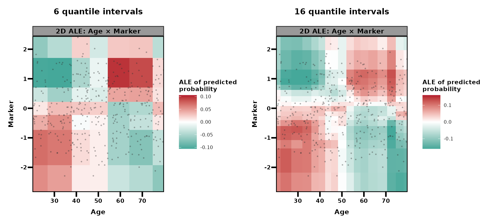{fig-alt="相同模型比较两种网格；固定输入、按注明源码快照实际运行的示例。"}


### get_all的二阶ALE入口

统一入口显式传ale2.args才启用分析，结果在ale2字段。此例选择ranger与概率尺度；省略model的当前模板选择xgboost，省略scale选择link。

```r
ale_all <- get_all(com.args=list(data=d_ale,adj_var="Group",surv="Outcome"),
  ale2.args=list(exp_var=c("Age","Marker"),model="ranger",scale="prob",
    grid_size=6,N=400,cores=1))
ale_all$ale2 + theme(text=element_text(size=10),strip.text=element_text(size=12),
  legend.title=element_text(size=10))
```

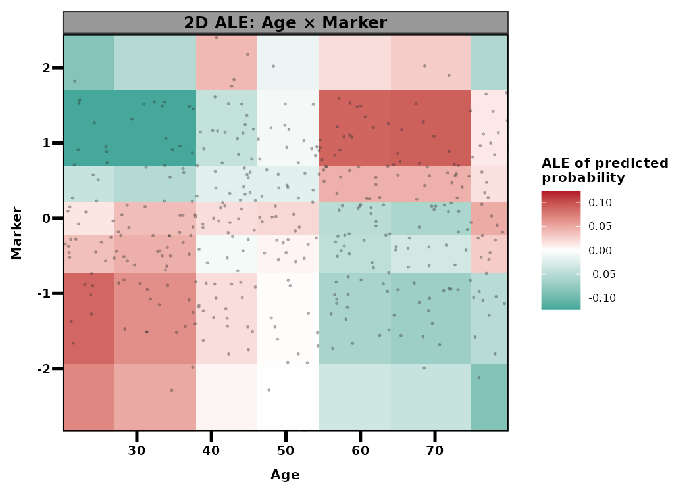{fig-alt="get_all的二阶ALE入口；固定输入、按注明源码快照实际运行的示例。"}

get_all现在有13个分析入口。ale2.args必须显式提供才启用；仅提供exp_var时继承model="xgboost"、scale="link"、grid_size=20。com.args提供data、adj_var、surv和生存预测时间time；N、engine、cores、save继续传给get_ale2。返回 `res$ale2` 是图，不是交互显著性检验。

## 更新记录 {#page-updates}

::: {.callout-note collapse="true" title="本页更新记录"}
- 2026-10-27：补充[解释器输入、正类编码与缓存](#explainer-contract-20261027)的 60 行实际拟合与类型核对。
:::
