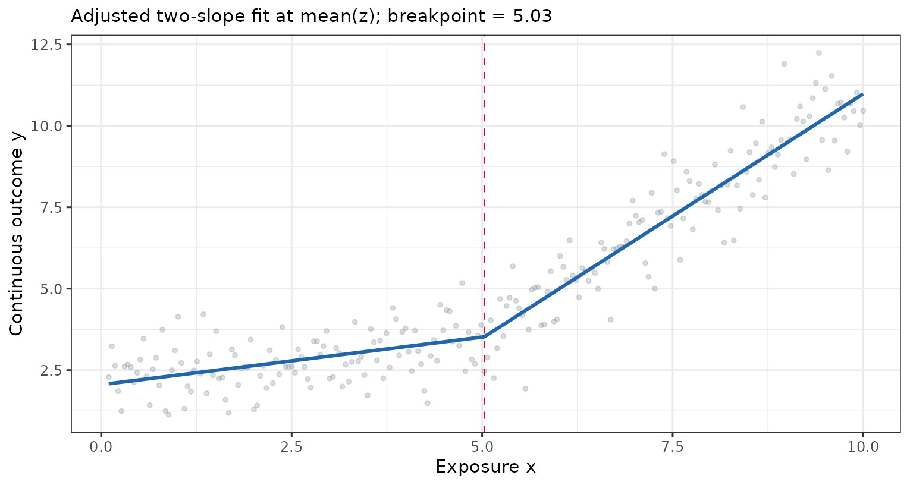
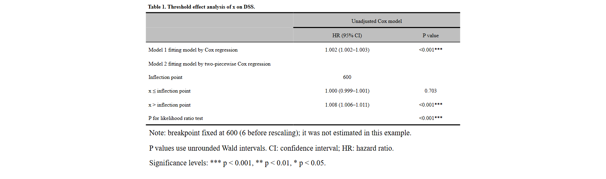
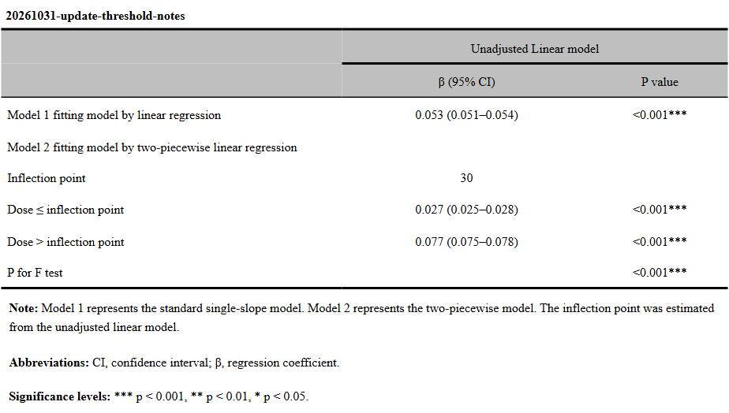
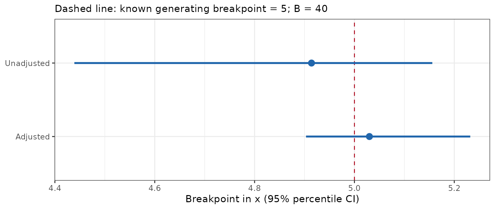
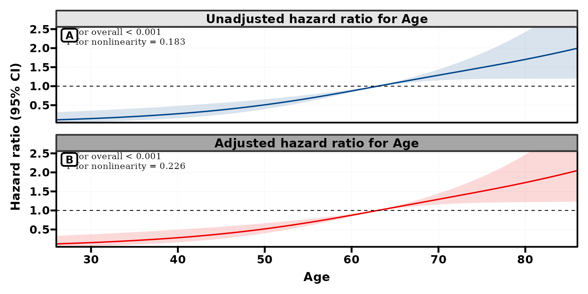

这三个入口共享两段回归思路，但分析对象与返回值不同。先辨认要分析的是原始结局还是模型曲线，再决定是否需要切点本身的区间。本页沿用 [SHAP 示例页](../mlr/shap-guide.qmd) 的标签页展示方式，配实际表格、代码与放大图；RCS 组合模式见 [get_rcs_all 教程](rcs-guide.qmd)。

```{=html}
<style>
.cut-web-table { overflow-x: auto; background: #fff; color: #111; padding: .8rem; border: 1px solid #dee2e6; border-radius: .35rem; margin: 1rem 0; }
.cut-web-table .tabwid { width: max-content; min-width: 100%; }
.cut-web-table table { min-width: 620px; margin: auto; }
.cut-web-table caption { caption-side: top; }
.cut-web-table span { font-size: 13px !important; }
</style>
```

::: {.callout-note collapse="true" title="版本与复现记录"}
2026-10-31补充按已推送 RegR `e2926a6`（0.1.3）与 UtilsR `05f4c963`导出源码，在 Windows / WSL R4.4.3 独立运行下述合成示例。旧图保留原执行快照；此次没有重跑历史模型或安装包。

**版本与执行范围：** 按 RegR **0.1.3**、本机源码快照 `0add2bb` 核对，在 WSL R **4.4.3** 实际运行 **13 个切点 / 展示示例**，包括原始数据的 Cox、Logistic、线性模型，RCS 面板切点，以及 B = 40 的 bootstrap。表格是本次真实 flextable 输出；页面只包含汇总结果。
:::

## 三个入口如何选择 {#overview}

:::: {.table-responsive tabindex="0" role="region" aria-label="表格，可横向滚动"}

| 入口 | 分析对象 | 返回值 | 主要问题 |
|:--|:--|:--|:--|
| [`get_cut()`](#get-cut) | 受试者原始结局：Cox / Logistic / 线性 | flextable；attr(params) 保留输入与切点来源 | 切点两侧的每单位效应、两段与单斜率模型比较 |
| [`get_cut_ci()`](#get-cut-ci) | 对完整受试者行进行 bootstrap，每次重估切点 | 每个模型一行的 data.frame | 切点的固定 95% percentile 区间、拟合失败比例 |
| [`get_cut_plot()`](#get-cut-plot) | 已附在 RCS / VPD 图上的 x 与 yhat | cut_plot_result list | 拟合曲线在响应尺度上的两段线性近似切点 |

::::

**本页实际结果：** 临床队列的 Cox 自动切点约为 **51 岁**；调整后年龄 HR 曲线上的切点约为 **52.096 岁**。后者分析的是 **200 个预测网格点**，前者分析的是 **598 位受试者**。数值接近不能使两个分析目标等同。

### 两段回归的表达

给定切点 $c$，构造

$$
X_1=\min(x-c,0),\qquad X_2=\max(x-c,0).
$$

左段和右段分别有斜率，模型在切点处连续。`get_cut()` 先拟合单斜率模型，自动切点时调用 `segmented()`，再按选定切点拟合两段模型。[segmented 官方文档](https://search.r-project.org/CRAN/refmans/segmented/html/segmented.html)说明了断点及斜率的估计流程。

:::: {.table-responsive tabindex="0" role="region" aria-label="表格，可横向滚动"}

| 模型 | 表中的量 | 单位解释 |
|:--|:--|:--|
| Cox | HR (95% CI) | 暴露增加 1 单位的危险比；年龄为增加 1 岁 |
| Logistic | OR (95% CI) | 暴露增加 1 单位的优势比 |
| 线性回归 | β (95% CI) | 暴露增加 1 单位的结局变化 |

::::

切点左右 HR 不等于“高年龄组相对低年龄组”的 HR。表中的模型比较是 Cox / Logistic 的似然比检验、线性模型的 F 检验。

## 示例数据 {#data}

临床示例与 [RCS 页](rcs-guide.qmd#data) 同源：598 人、175 个目标死亡，time 单位月。为使模型可比，本页统一按同一组分析列取 complete cases；不输出个体水平数据。

```r
library(RegR)
library(ToyData)
library(ggplot2)
library(survival)

vars <- c("time", "DSS", "event", "Age", "Sex", "Race", "Tum_3")
d <- as.data.frame(ToyData::toy_ptc_m1_cnd[, vars])
d <- droplevels(d[complete.cases(d), , drop = FALSE])
adj <- c("Sex", "Race", "Tum_3")

# 保留函数直接返回的图，供切点提取。
p_cox <- get_rcs_all(d, rcs_var = "Age", adj_var = adj,
                     surv = TRUE, panel_show = "haz")
p_fg <- get_rcs_all(d, rcs_var = "Age", adj_var = adj,
                    surv = FALSE, panel_show = "haz")
p_rate <- get_rcs_all(
  d, rcs_var = c("Sex", "Age"), adj_var = c("Race", "Tum_3"),
  surv = TRUE, poi_time = 12 * 1000, panel_show = "haz_poi",
  strip_list = list(strip_style = "grid", adj_position = "right")
)
```

线性与 Logistic 示例使用完全模拟数据，已知生成曲线在 **x = 5** 改变斜率。它便于比较算法输出与生成机制，不代表临床人群的真实切点。

```r
set.seed(246)
sim <- data.frame(x = seq(0.1, 10, length.out = 240), z = rnorm(240))
sim[["y"]] <- with(sim,
  2 + 0.3 * x + 1.2 * pmax(x - 5, 0) + 0.5 * z + rnorm(240, sd = 0.65))
sim[["binary"]] <- rbinom(240, 1,
  with(sim, plogis(-2 + 0.2 * x + 0.65 * pmax(x - 5, 0) + 0.3 * z)))
```

## get_cut()：原始结局的两段效应表 {#get-cut}

```r
get_cut(
  data, con_var, adj_var = NULL,
  surv = TRUE, breakpoint = NULL,
  outcome_time = "time", outcome_event = "DSS",
  save_arg = NULL, save = list()
)
```

:::: {.table-responsive tabindex="0" role="region" aria-label="表格，可横向滚动"}

| 参数 | 当前行为 |
|:--|:--|
| `con_var` | 一个连续暴露列；本页使用字符列名 |
| `adj_var` | NULL 只分析未调整模型；非空时再分析调整模型并合并表格 |
| `surv = TRUE` 或数值 | Cox，使用 outcome_time / outcome_event；数值不指定预测时间 |
| `surv = "列名"` | 数值结局有超过两个不同值时用线性回归；否则用二分类 Logistic |
| `breakpoint = NULL` | 未调整与调整模型分别估计一个切点 |
| 数值 `breakpoint` | 两个模型共用指定切点；本页以 55 岁或 x = 5 演示 |
| `outcome_time` / `outcome_event` | 指定 Cox 时间和事件列；默认 time / DSS |
| `save` | NULL 或 `list()`（默认）不保存；非空 list 可含 path、title、note；`save = list(path = ".")` 按默认名称写入工作目录 |
| `save_arg` | `save` 的旧名，仍可用但给出弃用警告；`save_arg = list()` 仍按默认名称写文件 |

::::

该入口没有 Fine–Gray 模型分支；不要把 `get_rcs_all(surv = FALSE)` 的用法移植到原始数据切点分析。Cox 事件列需要符合 0/1 事件编码，其他死亡如何处理应在分析前确定。

### 自动切点与固定切点

::: {.panel-tabset}

### Cox：自动估计 {.unnumbered}

```r
set.seed(246)
tb_cox <- RegR::run_quiet(get_cut(d, con_var = "Age", adj_var = adj, surv = TRUE))
tb_cox
```



本次两套 Cox 模型均估计到约 51 岁；右段 HR 是该段内年龄每增加 1 岁的效应。模型比较 P 值未调整约 0.042、调整后约 0.060，不能据此宣布存在已验证的临床分界。

### Cox：预设 55 岁 {.unnumbered}

```r
tb_fixed <- RegR::run_quiet(get_cut(d, con_var = "Age", adj_var = adj,
                        surv = TRUE, breakpoint = 55))
tb_fixed
```



这里是把 55 岁作为给定分析设定。它不再是这次数据自动选出的切点。

### 线性：自动切点 {.unnumbered}

```r
set.seed(246)
tb_lm <- RegR::run_quiet(get_cut(sim, con_var = "x", adj_var = "z", surv = "y"))
tb_lm
```



两侧 β 保持结局 y 的原始单位，模型比较使用 F 检验。

### Logistic：固定切点 {.unnumbered}

```r
tb_log <- RegR::run_quiet(get_cut(sim, con_var = "x", adj_var = "z",
                        surv = "binary", breakpoint = 5))
tb_log
```



`binary` 为模拟的 0/1 结局；表中报告每单位 x 的 OR。

:::

### 返回值、打印与中位数回退

返回的是 **flextable**，不是含 breakpoint 字段的 list。函数完成时会打印表并以 invisible 形式返回；`run_quiet()` 可用于把计算结果赋给对象，再在需要时显示。

```r
tb <- RegR::run_quiet(get_cut(d, con_var = "Age", adj_var = adj, surv = TRUE))
tb

# 检查每个模型的切点来源，尤其关注 method 与 reason。
attr(tb, "params")[["breakpoint_source"]]

# 格式化后的汇总单元格；原始输入数据保留在 params 中。
tb[["body"]][["dataset"]]
```

自动 segmented 拟合失败或没有有限切点时，`get_cut()` 会警告并改用暴露的中位数；`breakpoint_source` 中的 method 为 `median`。这时有一张能打印的表，并不表示断点估计成功。保存整个对象时，attr(params) 还包含原始 data，应遵守数据共享范围。

::: {.callout-note title="切点筛选与表中推断"}
斜率区间和模型比较 P 值由**切点已选定后的两段模型**计算；自动选切点的不确定性没有完整传播到这些区间和检验。应把它们作为探索性结果，另看切点稳定性、模型假设和外部验证。Cox 还需检查比例风险假设。
:::

### 把同一两段模型画出来

下面从 `tb_lm` 取调整后的切点，按相同 X1 / X2 构造重拟合，并在平均 z 处展示预测。散点来自模拟数据，蓝线是补充的 ggplot 可视化；**get_cut() 本身返回表格**。

```r
bp <- attr(tb_lm, "params")[["breakpoint_source"]][["adjusted"]][["breakpoint"]]
hinge <- transform(sim, X1 = pmin(x - bp, 0), X2 = pmax(x - bp, 0))
fit <- lm(y ~ X1 + X2 + z, data = hinge)
grid_d <- data.frame(x = seq(min(sim[["x"]]), max(sim[["x"]]), length.out = 200),
                     z = mean(sim[["z"]]))
grid_d[["X1"]] <- pmin(grid_d[["x"]] - bp, 0)
grid_d[["X2"]] <- pmax(grid_d[["x"]] - bp, 0)
grid_d[["fitted"]] <- as.numeric(predict(fit, grid_d))
ggplot(sim, aes(x, y)) +
  geom_point(alpha = 0.28, size = 1.2, color = "#7A8793") +
  geom_line(data = grid_d, aes(x, fitted), linewidth = 1.2, color = "#2166AC") +
  geom_vline(xintercept = bp, linetype = 2, color = "#B2182B") +
  labs(x = "Exposure x", y = "Continuous outcome y",
       subtitle = paste("Adjusted two-slope fit at mean(z); breakpoint =", bp)) +
  theme_bw(base_size = 13)
```

{fig-alt="线性模拟数据的两段拟合；红虚线为调整后的估计切点。"}

### P 值：从未舍入区间计算（2026-10-20） {#unrounded-p-20261020}

2026-10-20 按已推送 RegR `a2f2553` 在 Windows / WSL R 4.4.3 验证。`get_cut()` 现在使用未舍入的 Wald 区间计算 P，再格式化文字；不再从三位小数的效应文本倒推。每单位 HR 接近 1 时，打印为 `1.000 (1.000–1.001)` 不代表区间真的退化。

<!-- latest-20261020: cut_precision -->
```r
library(RegR)
set.seed(20260808)
x <- 10 * runif(150)^2
failure <- rexp(150, 0.03 * exp(0.05 * x + 0.8 * pmax(x - 6, 0)))
censor <- rexp(150, 0.015)
d_precision <- data.frame(time = pmin(failure, censor),
  DSS = as.integer(failure <= censor), x = 100 * x)
cut_precision <- get_cut(d_precision, "x", surv = TRUE, breakpoint = 600)
body <- cut_precision[["body"]][["dataset"]]
one_slope <- survival::coxph(survival::Surv(time, DSS) ~ x, data = d_precision)
d_precision[["X1"]] <- pmin(d_precision[["x"]] - 600, 0)
d_precision[["X2"]] <- pmax(d_precision[["x"]] - 600, 0)
two_slopes <- survival::coxph(survival::Surv(time, DSS) ~ X1 + X2, data = d_precision)
raw_p <- c(summary(one_slope)[["coefficients"]]["x", "Pr(>|z|)"],
           summary(two_slopes)[["coefficients"]][c("X1", "X2"), "Pr(>|z|)"])
expected <- UtilsR::stat_pval(raw_p, map_signif = c("***" = 0.001, "**" = 0.01, "*" = 0.05))
validation_values <- data.frame(model = c("one slope", "left slope", "right slope"),
  raw_wald_p = raw_p, displayed_p = expected)
validation_values
# 本例使用预设切点，替换通用模板中“切点由数据估计”的脚注。
cut_precision <- flextable::add_footer_lines(
  flextable::delete_part(cut_precision, part = "footer"),
  values = c("Note: breakpoint fixed at 600 (6 before rescaling); it was not estimated in this example.",
    "P values use unrounded Wald intervals. CI: confidence interval; HR: hazard ratio.",
    "Significance levels: *** p < 0.001, ** p < 0.01, * p < 0.05."))
flextable::save_as_docx(cut_precision,
  path = file.path(tempdir(), "20261020-latest-cut-precision.docx"))
flextable::save_as_html(cut_precision,
  path = file.path(tempdir(), "20261020-latest-cut-precision.html"))
```

::: {.callout-note collapse="true" title="复核代码"}
生成本页时运行的检查，接在上面的代码之后运行；只读教程可以跳过。

```r
stopifnot(identical(unname(body[["P.value_Unadj"]][c(1, 4, 5)]), unname(expected)))
```
:::

<!-- /latest-20261020: cut_precision -->

{fig-alt="150行模拟Cox数据的单斜率与600切点两段回归表，左段每单位HR接近1，P值仍来自未舍入的Wald区间。"}

[下载 Word 表](images/cut-guide/20261020-latest-cut-precision.docx)

代码把同一变量放大100倍、把固定切点同步设为600，核对单斜率及左右两段 P 与 `coxph()` 原始 Wald 检验的格式化值一致。它只演示单位与显示精度，不是新切点发现，也不改变 `get_cut_ci()` 的 bootstrap 定义。单位放大后，每单位 HR 更接近1，不能只看三位小数判断效应是否为零。

### 逐图两段表与可编辑Word脚注（2026-10-31） {#lists-notes-20261031}

<!-- update-20261031: regr_cut_lists -->

本节先运行[RCS数据列表](rcs-guide.qmd#subsets-20261031)的 `rcs_cohorts31/rcs_lists31`。`get_cut_plot()` 直接接受这类图列表，返回按子集命名的结果列表。每个元素仍有自己的 `summary/tables/curve_data/plot/table/view`，不是一张把两个人群混起来的表。

```r
cut_lists31 <- RegR::run_quiet(RegR::get_cut_plot(rcs_lists31, which = 1L,
  breakpoint = list(A = 20, B = 30)))
cut_ft31 <- RegR::save_tb_cut(cut_lists31$B$table,
  title = file.path(tempdir(), "20261031-update-threshold-notes.docx"), landscape = TRUE)
flextable::save_as_html(cut_ft31, path = file.path(tempdir(), "20261031-update-threshold-notes.html"))
```

{fig-alt="原生flextable展示子集B调整曲线在30处的两段斜率及P值，表尾保留Note与缩略语等说明。"}

[打开原生表格](images/cut-guide/20261031-update-threshold-notes.html) · [下载横向Word](images/cut-guide/20261031-update-threshold-notes.docx)

当前 `save_tb_cut()` 与 `get_cut()/get_cut_plot()` 的 `save` 共用表格保存合同：Word中表格靠左，`Note:`、`Abbreviations:`、`Significance levels:` 每行各是表下可编辑段落，Times New Roman 8pt；不再写成Word表的最后几行。返回的flextable仍保留逐行footer和 `footnotes` 属性，因此网页预览与Word的脚注位置不同。嵌入footer的换行也会另起段落，不显示字面量HTML换行标签。

::: {.callout-note collapse="true" title="复核代码"}
```r
cut_notes31 <- attr(cut_ft31, "footnotes")
cut_doc31 <- officer::docx_summary(officer::read_docx(
  file.path(tempdir(), "20261031-update-threshold-notes.docx")))
stopifnot(identical(names(cut_lists31), c("A", "B")),
  all(cut_lists31$A$summary$breakpoint == 20), all(cut_lists31$B$summary$breakpoint == 30),
  length(cut_notes31) > 0L, flextable::nrow_part(cut_ft31, "footer") == length(cut_notes31),
  all(vapply(cut_notes31, function(note) any(cut_doc31$content_type == "paragraph" & cut_doc31$text == note), FALSE)),
  !any(grepl("<br>", cut_doc31$text, fixed = TRUE)))
validation_values <- list(subsets = names(cut_lists31), notes = cut_notes31,
  summary_A = cut_lists31$A$summary, summary_B = cut_lists31$B$summary,
  note_paragraphs = cut_doc31$text[cut_doc31$content_type == "paragraph"])
```
:::

本例每条曲线分析200个网格点，原始人群各120行。曲线上两段斜率不等于受试者的HR或OR，不能直接作为患者效应引用。需要逐图另存时，`get_cut_plot(..., save=list(title=c("A表", "B表")))` 自动分配标题；RCS同一次调用内的嵌套标题向量见[RCS示例](rcs-guide.qmd#subsets-20261031)。

<!-- /update-20261031: regr_cut_lists -->

## get_cut_ci()：切点的 bootstrap 区间 {#get-cut-ci}

```r
get_cut_ci(
  data, con_var, adj_var = NULL, surv = TRUE,
  outcome_time = "time", outcome_event = "DSS", B = 100
)
```

函数对完整受试者行有放回抽样，在每个重抽样里重新拟合并重新估计切点，再取成功切点的 2.5% 与 97.5% 分位数。未调整、调整模型分别运行；Cox 抽样保留同一人的时间 / 事件配对。固定 **95% percentile CI**，没有 conf_level、seed 或并行控制参数。

### 本次 B = 40 的实际结果

```r
RNGkind("L'Ecuyer-CMRG")
set.seed(246)
ci <- get_cut_ci(sim, con_var = "x", adj_var = "z", surv = "y", B = 40)
ci
```

:::: {.table-responsive tabindex="0" role="region" aria-label="表格，可横向滚动"}

| Model | Breakpoint | CI_low | CI_high | B | Success | Failed | Failure_rate |
| :-- | :-- | :-- | :-- | :-- | :-- | :-- | :-- |
| Unadjusted | 4.914 | 4.439 | 5.156 | 40 | 40 | 0 | 0 |
| Adjusted | 5.03 | 4.903 | 5.232 | 40 | 40 | 0 | 0 |

::::

本机使用 `pblapply-fork`，自动选取 8 个 worker；两模型各 **40 / 40 次成功**。B = 40 用于快速展示接口，尾部分位数仍较粗；正式分析应增加重复次数并检查稳定性。随机数类型、并行后端与包版本可能使不同环境的精确结果有差异。

```r
ggplot(ci, aes(x = Breakpoint, y = Model)) +
  geom_vline(xintercept = 5, linetype = 2, color = "#B2182B") +
  geom_segment(aes(x = CI_low, xend = CI_high, yend = Model),
               linewidth = 1.2, color = "#2166AC") +
  geom_point(size = 3.5, color = "#2166AC") +
  labs(x = "Breakpoint in x (95% percentile CI)", y = NULL,
       subtitle = "Dashed line: known generating breakpoint = 5; B = 40") +
  theme_bw(base_size = 13)
```

{fig-alt="未调整与调整切点的固定 95% bootstrap percentile 区间；红虚线为已知生成切点 x = 5。"}

### 失败记录与缺失区间

:::: {.table-responsive tabindex="0" role="region" aria-label="表格，可横向滚动"}

| 返回列 | 内容 |
|:--|:--|
| `Model` / `Breakpoint` | 模型名、原始数据估计的切点 |
| `CI_low` / `CI_high` | 成功 bootstrap 切点的 95% percentile 区间 |
| `Method` / `B` | 估计方式与请求的重抽样次数 |
| `Success` / `Failed` / `Failure_rate` | 成功、失败次数与失败比例 |

::::

当 bootstrap 失败率 **大于 20%** 时，函数警告并将该模型 CI 置为 NA；不会把失败抽样填成中位数后继续缩窄区间。若原始数据的断点拟合已经失败，则标记 `median fallback`，也不报告有效 CI。

```r
attr(ci, "params")[["parallel"]]
attr(ci, "params")[["failure_reasons"]]
attr(ci, "params")[["breakpoint_source"]]
```

`get_cut_ci()` 按各模型所需列分别取 complete cases；若要比较同一人群的调整前后切点，应像本页一样先统一分析样本。该区间描述断点位置的抽样变异，并不自动验证“真实存在一个断点”或给斜率做筛选后的完整校正。segmented 内部的 bootstrap restarting 用于优化求解，与这里的外层区间重抽样用途不同。

## get_cut_plot()：拟合曲线上的切点 {#get-cut-plot}

```r
get_cut_plot(
  plot, panel = "auto", group = NULL,
  breakpoint = NULL, which = NULL, save_arg = NULL, save = list()
)
```

它读取图对象附带的连续曲线数据，把 `yhat` 作为**连续结局**交给 `get_cut()`。因此原图即使是 HR 或 subHR，切点表仍是 yhat 对 x 的**线性两段拟合**，报告 β 与 F 检验。它没有重新拟合原始患者的 Cox 或 Fine–Gray 模型。

RCS 通常使用预测网格；VD 可使用观测位置上的预测，PD 则先对同一 x / 分组的 ICE 预测求平均。此类网格或预测点不是新的独立患者，曲线表的 CI 和 P 值不代表原始结局效应的推断，也没有传播第一阶段模型的估计误差。

### 默认面板、并列表与固定切点

::: {.panel-tabset}

### 默认：调整后 RCS {.unnumbered}

```r
curve_one <- RegR::run_quiet(get_cut_plot(p_cox))
curve_one
```

:::: {.table-responsive tabindex="0" role="region" aria-label="表格，可横向滚动"}

| 曲线 ID | 组别 / 对比 | 分析点数 | 切点 | 方法 |
| :-- | :-- | :-- | :-- | :-- |
| rcs_adjusted | — | 200 | 52.096 | segmented |

::::



本次读出 rcs_adjusted 的 200 个网格点，切点约 52.096 岁。

### 两个子图并列 {.unnumbered}

```r
curve_pair <- RegR::run_quiet(get_cut_plot(p_cox, which = c(1, 2)))
curve_pair
```

:::: {.table-responsive tabindex="0" role="region" aria-label="表格，可横向滚动"}

| 曲线 ID | 组别 / 对比 | 分析点数 | 切点 | 方法 |
| :-- | :-- | :-- | :-- | :-- |
| rcs_unadjusted | — | 200 | 49.006 | segmented |
| rcs_adjusted | — | 200 | 52.096 | segmented |

::::



表头为 Unadjusted RCS 与 Adjusted RCS；每条曲线各自估计切点。

### 两图共同固定 55 岁 {.unnumbered}

```r
curve_fixed <- RegR::run_quiet(get_cut_plot(p_cox, which = c(1, 2), breakpoint = 55))
curve_fixed
```

:::: {.table-responsive tabindex="0" role="region" aria-label="表格，可横向滚动"}

| 曲线 ID | 组别 / 对比 | 分析点数 | 切点 | 方法 |
| :-- | :-- | :-- | :-- | :-- |
| rcs_unadjusted | — | 200 | 55 | user |
| rcs_adjusted | — | 200 | 55 | user |

::::



此调用把给定 55 岁用于两个子图，而不是分别搜索切点。

### 所有面板：汇总列表 {.unnumbered}

```r
curve_all <- RegR::run_quiet(get_cut_plot(p_cox, panel = "all"))
curve_all
```

:::: {.table-responsive tabindex="0" role="region" aria-label="表格，可横向滚动"}

| 曲线 ID | 组别 / 对比 | 分析点数 | 切点 | 方法 |
| :-- | :-- | :-- | :-- | :-- |
| rcs_unadjusted | — | 200 | 49.006 | segmented |
| rcs_adjusted | — | 200 | 52.096 | segmented |

::::

不用 which 且同时产生多条分析时，table 为 NULL；各表保存在 tables 中。

:::

### 分组与 Fine–Gray 曲线

::: {.panel-tabset}

### 男性的调整死亡率 {.unnumbered}

```r
curve_group <- RegR::run_quiet(get_cut_plot(p_rate, panel = "poisson_adjusted", group = "Male"))
curve_group
```

:::: {.table-responsive tabindex="0" role="region" aria-label="表格，可横向滚动"}

| 曲线 ID | 组别 / 对比 | 分析点数 | 切点 | 方法 |
| :-- | :-- | :-- | :-- | :-- |
| poisson_adjusted | Male | 200 | 39.41 | segmented |

::::



`group = "Male"` 指定原始组别名称。对于性别 HR 对比，组名可能为 `Male vs Female`；应先查看结果图附带的曲线属性再选择。

### 调整后的 subHR 曲线 {.unnumbered}

```r
curve_fg <- RegR::run_quiet(get_cut_plot(p_fg))
curve_fg
```

:::: {.table-responsive tabindex="0" role="region" aria-label="表格，可横向滚动"}

| 曲线 ID | 组别 / 对比 | 分析点数 | 切点 | 方法 |
| :-- | :-- | :-- | :-- | :-- |
| rcs_adjusted | — | 201 | 40.306 | segmented |

::::



该表仍是 subHR 响应尺度上的 β 与 F 检验，不是原始受试者的 Fine–Gray 两段效应表。

:::

### panel、which 与结果组件

:::: {.table-responsive tabindex="0" role="region" aria-label="表格，可横向滚动"}

| 选择方式 | 行为 |
|:--|:--|
| `panel = "auto"` | get_rcs_all 优先 rcs_adjusted；独立 get_vpd 图优先 pd；连续子图取唯一曲线 |
| `panel = "all"` | 分析所有可用连续曲线；可以返回多张表 |
| 稳定 ID | 如 rcs_unadjusted、rcs_adjusted、poisson_adjusted、pd；以实际属性中存在的 ID 为准 |
| `which = 1` / `c(1, 2)` | 选择 patchwork 中 1–2 个位置；panel 必须保持 auto |
| 两个分组子图 | 每个仅一组 / 一对比时自动合并；任一有多组时，group 必须选定一个 |
| `breakpoint = NULL` / 数值 | 各曲线独立估计 / 所选曲线共用给定切点 |

::::

`which` 使用**当前排版的子图位置**，条带方向转置后要重新核对。对跨布局分析，优先使用稳定 panel ID。`haz_vpd` 组合的 auto 仍优先调整后 RCS，不会自动切换到底部 PD。

```r
result <- RegR::run_quiet(get_cut_plot(p_cox, which = c(1, 2)))
result[["summary"]]    # 每条曲线一行：面板、组别、n、切点、估计方法等
result[["tables"]]     # 各条曲线的 flextable
result[["curve_data"]] # 实际进入线性两段分析的 x / yhat
result[["plot"]]       # 原图
result[["table"]]      # 单张表或两个 which 子图的并列表

# 原始曲线规格；含各曲线 ID、组名与预测数据。
attr(p_rate, "cut_curve_data")
```

旧版本的保存图、普通 ggplot、截图或分类变量 VPD 不具备所需连续曲线属性，应使用当前入口重新生成。当前 `fmt_rcs()` 会同步变换后的曲线属性；随后取出的切点就描述该变换后曲线，不能据此代替原始模型结果。

## Word 保存与无文件输出 {#save}

`get_cut()` 与 `get_cut_plot()` 的保存接口是 **save**，与 `get_rcs_all()` 等函数一致（RegR `35b23e7` 起；此前叫 `save_arg`）。下面两种 Word 输出已于 2026-10-18 在 Windows R 用 `save` 在临时目录实际运行并检查内容。

```r
# 原始结局切点表：支持 path、title、note。
get_cut(
  d, con_var = "Age", adj_var = adj, surv = TRUE, breakpoint = 55,
  save = list(path = tempdir(), title = "Age outcome threshold",
             note = "The breakpoint was fixed at 55 years.")
)

# 两个 RCS 子图的并列表：支持 path、title，需有一个非 NULL table。
get_cut_plot(
  p_cox, which = c(1, 2), breakpoint = 55,
  save = list(path = tempdir(), title = "Age curve threshold")
)
```

两个入口的 `save = list()` 默认没有文件输出，与 `get_rcs_all(save = list())` 一致；要按默认名称写入工作目录，写 `save = list(path = ".")`。旧名 `save_arg` 仍可使用，但会给出弃用警告，并保留原来的含义：**`save_arg = list()` 会保存**；`save` 与 `save_arg` 同时给出会报错。`get_cut_plot(panel = "all")` 产生多张表且 table 为 NULL 时，不能用一个 `save` 直接输出为单表，应明确选择一个面板或两个 which 位置。

手动使用 `save_tb_cut()` 时，保存位置由 `title` 中的文件路径或当前工作目录决定；它没有独立 path 参数。`get_cut_ci()` 返回普通 data.frame，不提供同名的保存参数。

## 源码入口与复现记录 {#source}

:::: {.table-responsive tabindex="0" role="region" aria-label="表格，可横向滚动"}

| 文件 | 责任 |
|:--|:--|
| `get-cutoff.R`（[`get_cut()`](https://hui950319.github.io/RegR/reference/get_cut.html)、[`save_tb_cut()`](https://hui950319.github.io/RegR/reference/save_tb_cut.html)） | 原始结局模型、切点 / 回退、两段模型、flextable 与 Word 保存 |
| `get-cutoff-ci.R`（[`get_cut_ci()`](https://hui950319.github.io/RegR/reference/get_cut_ci.html)） | 完整行重抽样、自动并行、失败记录和 percentile CI |
| `get-cut-plot.R`（[`get_cut_plot()`](https://hui950319.github.io/RegR/reference/get_cut_plot.html)） | 连续曲线提取、面板 / 分组选择、单表或并列表 |

::::

源码链接固定到本页原核对快照 `0add2bb`，避免分支变化使复现入口失效。

本页使用 segmented **2.1.1**、survival **3.8.12**、flextable **0.9.10**、UtilsR **0.6.8**。验证包括真实模型与图片输出、面板数量 / 固定切点断言、bootstrap 成功记录，以及 Word 的实际文件内容；没有为本教程修改 RegR 源码或重新安装包。

## 当前结果页：原曲线与两段分析表 {#view-20261018}

2026-10-18按已推送RegR `7265b31`，在Windows / WSL R 4.4.3实际运行。`get_cut_plot()`当前返回6个字段，前面的summary、tables、curve_data、plot、table之外新增`view`。页面显示原图及选定的table；table为NULL时改为列出各曲线的tables。原图按其plot_size绘制，页面另存沿用已有结果。

```r
data("toy_ptc_m1_cnd", package = "ToyData")
d_current <- as.data.frame(toy_ptc_m1_cnd)
rcs_current <- run_quiet(get_rcs_all(d_current, rcs_var = "Age", adj_var = "Sex",
  surv = TRUE, panel_show = "haz"))
cut_current <- get_cut_plot(rcs_current)
cut_current[["summary"]]
cut_current[["view"]]
fmt_page(cut_current[["view"]],
  save = list(filename = file.path(tempdir(), "cut-view.html")))
```

{fig-alt="598人队列按Sex调整前后的年龄HR曲线，切点页默认分析rcs_adjusted曲线。"}

[打开原图与切点表](images/cut-guide/20261018-cut-view.html){target="_blank"} · [下载HTML](images/cut-guide/20261018-cut-view.html){download="cut-view.html"}

此例auto选择`rcs_adjusted`，summary中的n=200指预测曲线网格点，原始队列仍为598人。估计切点约50.268岁；这是HR预测曲线上的线性两段近似，不是原始受试者Cox两段模型，也不替代年龄预设分组边界。

本轮表格构建实际提示一个区间在exp=TRUE下无效并原样返回；该区间不能作为有效的患者HR置信区间引用。需要原始结局效应时使用本页前面的`get_cut()`，并核查原模型、切点选择和区间。完整HTML保留本次实际输出，未把警告结果修成正常数值。

[`get_cut_plot()` 帮助页](https://hui950319.github.io/RegR/reference/get_cut_plot.html)

## 更新记录 {#page-updates}

::: {.callout-note collapse="true" title="本页更新记录"}
- 2026-10-31：[补充逐图两段表和表下可编辑Word脚注](#lists-notes-20261031)。
- 2026-10-20：[P 值：从未舍入区间计算](#unrounded-p-20261020)
:::
