get_eff_cat() 把同一个分类暴露在不同模型下的估计排成行，便于检查调整集合、结局定义和分层怎样改变结果。它与逐个预测变量的 get_eff()/get_um() 表格组织方式不同。页面提供同一数据的模型表、森林图和绝对效应。

**版本与执行范围：** 按 RegR 0.1.3 当前源码核对，使用 WSL R 4.4.3 实际运行下面的示例并保存汇总输出。示例用于理解接口和输出；不构成外部验证或临床效果结论。

## 当前 sub_inter 模型行的交叉核对 {#sub-inter-check-20261022}

2026-10-22 按已推送 RegR `d24e8a0` 核对：`check_inter(inter, target)` 能读取本页 `get_eff_cat(sub_var=..., sub_inter=...)` 的逐层面板，并按 Cox、Fine–Gray 或 Logistic 类型与 `get_inter()` 配对。[双平台 20 单元示例](interaction-guide.qmd#eff-cat-check-20261022)已用改名后的接口重新执行，实际拟合了两个模型和两列亚组。

要核对的未调整行和一个调整模型需明确列入 `sub_inter`，调整集合与 `get_inter()` 相同；未启用 `sub_inter` 或同时选择多个调整模型的结果不能直接使用该核对。Overall、未选择的模型行、PS 行与绝对效应不在比较范围内；一致只表示格式化效应及区间单元匹配，不证明人数或交互 P 也一致。

一个交互对象含多个修饰变量时，核对器先与目标 `sub_var` 取交集；只有一个候选才自动选择。目标同时包含多个候选时须显式给 `modifier`，或逐个传入单修饰变量的交互结果。差异提示及实际重拟合对照见[目标推断与差异原因](interaction-guide.qmd#check-target-20261022)，提示不能代替检查队列、编码和调整集合。

## 当前多个亚组变量：逐列分层 {#sub-columns-20261021}

<!-- controls-20261021: eff_cat_groups -->

2026-10-21 按新推送 RegR `e217f1c`（分组改动 `c09cdcd`）在 Windows / WSL R 4.4.3 执行。`sub_var = c("Sex","Stage")` 现在先给出 Sex 的各层，再给出 Stage 的各层；顺序遵循输入列及其水平，标签写为 `Sex = Female` 等。它替代了旧版的 Sex×Stage 联合格子。真正需要联合分层时，先明确建立一个组合列，再把该单列传给 `sub_var`。

### 同一人群，逐列保留其余调整变量

```r
library(RegR)
set.seed(834)
sub_data <- expand.grid(Tx = factor(c("No", "Yes")),
  Sex = factor(c("Female", "Male")), Stage = factor(c("Early", "Late")), id = 1:75)
sub_data[["Age"]] <- rnorm(600, 55, 10)
t_event <- rexp(600, exp(0.35 * (sub_data[["Tx"]] == "Yes") +
  0.2 * (sub_data[["Sex"]] == "Male") + 0.3 * (sub_data[["Stage"]] == "Late") +
  0.02 * (sub_data[["Age"]] - 55)) / 80)
t_censor <- rexp(600, 1 / 130)
sub_data[["time"]] <- pmin(t_event, t_censor) + 0.2
sub_data[["DSS"]] <- as.integer(t_event < t_censor)
sub_data[["Sex"]][1] <- NA
sub_data[["Stage"]][2] <- NA
common_sub <- sub_data[complete.cases(sub_data[c("Sex", "Stage")]), , drop = FALSE]
ps_demo <- list(IPTW = list(design = "weighting", method = "glm", estimand = "ATE"))
panels <- get_eff_cat(sub_data, "Tx", sub_var = c("Sex", "Stage"),
  adj_var = c("Age", "Sex", "Stage"), ps_var = c("Age", "Sex", "Stage"),
  ps_methods = ps_demo, surv = TRUE, add_overall = TRUE)
labels_sub <- vapply(panels, attr, character(1), which = "sub_level")
stopifnot(identical(unname(labels_sub),
  c("Overall", "Sex = Female", "Sex = Male", "Stage = Early", "Stage = Late")),
  nrow(common_sub) == 598L)
validation_values <- data.frame(panel = unname(labels_sub), n = c(nrow(common_sub),
  as.integer(table(common_sub[["Sex"]])), as.integer(table(common_sub[["Stage"]]))))
validation_values
```

两个 `sub_var` 中任一列缺失的行都会先删除，所以本例共同人群为 598 人，Sex 两层为 298 / 300，Stage 两层也为 298 / 300；这不是每列各自保留其非缺失病例。每列分层时，仅从 `adj_var` 和 `ps_var` 移除当前这列：Sex 面板仍调整 Stage，Stage 面板仍调整 Sex，PS 也在各层重新估计。

```r
by_sex <- get_eff_cat(common_sub, "Tx", sub_var = "Sex",
  adj_var = c("Age", "Sex", "Stage"), ps_var = c("Age", "Sex", "Stage"),
  ps_methods = ps_demo, surv = TRUE)
by_stage <- get_eff_cat(common_sub, "Tx", sub_var = "Stage",
  adj_var = c("Age", "Sex", "Stage"), ps_var = c("Age", "Sex", "Stage"),
  ps_methods = ps_demo, surv = TRUE)
manual_panels <- c(by_sex, by_stage)
for (i in seq_along(manual_panels)) {
  stopifnot(isTRUE(all.equal(panels[[i + 1L]][["estimate"]], manual_panels[[i]][["estimate"]])),
    isTRUE(all.equal(panels[[i + 1L]][["conf.low"]], manual_panels[[i]][["conf.low"]])),
    identical(panels[[i + 1L]][["num1"]], manual_panels[[i]][["num1"]]))
}
plt_eff(panels, xlim = c(0.2, 5), base_size = 9,
  core_size = c(3, 2), forest_nchar = 16,
  save = list(filename = file.path(tempdir(), "20261021-controls-five-panels.pdf")))
```

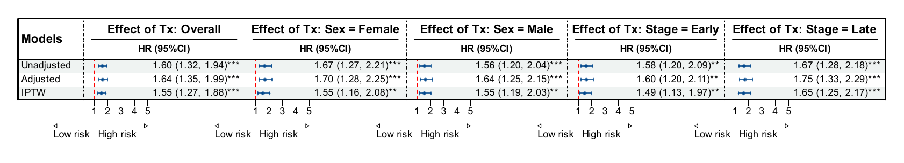{fig-alt="600条模拟记录删去两个亚组缺失后为598人，Overall、Sex两层、Stage两层共五个面板，各含未调整、调整与IPTW模型，第五面板表头没有fs5占位名。"}

[下载原生 PDF](images/eff-cat-guide/20261021-controls-five-panels.pdf)

本例逐面板与在共同人群上单独分层的结果核对，包含估计、区间下限和计数。当前 `plt_eff()` 也修复了第五及后续面板暴露 `fs5...` 占位表头的问题，并为正文文字保留右边距；宽图仍需按推荐尺寸保存、放大阅读。

### sub_inter 也按每列建立自己的交互模型

```r
inter_panels <- get_eff_cat(sub_data, "Tx", sub_var = c("Sex", "Stage"),
  adj_var = c("Age", "Sex", "Stage"), ps_var = c("Age", "Sex", "Stage"),
  ps_methods = ps_demo, surv = TRUE, sub_inter = TRUE)
reference_sub <- get_eff(common_sub, "Tx", sub_var = c("Sex", "Stage"),
  adj_var = c("Age", "Sex", "Stage"), surv = TRUE, subgroup_model = "interaction",
  methods_haz = c("unadj", "direct"), methods_sur = character(), all = NULL)
for (i in seq_along(inter_panels)) {
  panel <- inter_panels[[i]]
  label <- attr(panel, "sub_level")
  column <- sub(" = .*$", "", label); level <- sub("^.* = ", "", label)
  for (model in c("Unadjusted", "Adjusted")) {
    source <- reference_sub[[if (model == "Unadjusted") "haz_unadj" else "haz_direct"]]
    row <- source[["row_type"]] == "level" & source[["variable"]] == column & source[["label"]] == level
    stopifnot(isTRUE(all.equal(panel[["estimate"]][panel[["model_label"]] %in% model],
                              source[["estimate"]][row])))
  }
  iptw <- panel[["model_label"]] %in% "IPTW"
  original <- panels[[i + 1L]]
  stopifnot(isTRUE(all.equal(panel[["estimate"]][iptw],
    original[["estimate"]][original[["model_label"]] %in% "IPTW"])),
    identical(attr(panel, "subgroup_model")[["IPTW"]], "separate"))
}
```

相对效应分别来自 Tx×Sex 与 Tx×Stage 模型，不是三重交互。PS 行保持层内估计，`sub_inter` 不切换这些行；`abs_args` 的绝对效应与 `add_overall` 总体面板也不随它切换。仍要求二分类暴露，不能与 `split_var` 同用；只有一个可拟合层的列保留层内重拟合。下方单列历史示例仍有效，多列分析应从原始数据重新运行，不能只改旧图标题。

<!-- /controls-20261021: eff_cat_groups -->

## 当前亚组模型、完整案例与逐模型森林 {#sub-inter-20261020}

2026-10-20 按已推送 RegR `a2f2553` 在 Windows / WSL R 4.4.3 运行本节。`sub_inter` 是新的估计设置；多模型绘图返回值也已改变。下方早期并列多结局图片保留原执行记录，代码已显式指定其合并展示方式。

### sub_inter：层内重拟合与交互模型

默认 `sub_inter=NULL` 仍在每层分别拟合。`sub_inter="Model 1"` 只把该模型的亚组相对效应改为来自全队列的暴露×亚组模型，调整变量的系数在层间共享；未调整行继续层内拟合。`TRUE` 选择未调整与全部调整模型，PS 行仍在每层估计倾向评分。它要求二分类暴露和 `sub_var`，不能与 `split_var` 合用，也不能点名 PS 行；只有一个可拟合层时保留层内重拟合。多个 `sub_var` 在当前版本逐列处理，旧联合格子行为已由[上节合同](#sub-columns-20261021)替代。

<!-- latest-20261020: eff_cat_current -->
```r
library(RegR)
options(RegR.eff_cat.plot = FALSE)
set.seed(20261020)
d_new <- expand.grid(Tx = factor(c("No", "Yes")),
  Sex = factor(c("Female", "Male")), Site = factor(c("A", "B")), id = 1:60)
d_new[["Age"]] <- rnorm(nrow(d_new), 55, 10)
tx <- as.integer(d_new[["Tx"]] == "Yes")
male <- as.integer(d_new[["Sex"]] == "Male")
t1 <- rexp(nrow(d_new), exp(-3.8 + 0.45 * tx + 0.3 * male +
  0.35 * tx * male + 0.025 * (d_new[["Age"]] - 55)))
t2 <- rexp(nrow(d_new), 0.008)
tc <- rexp(nrow(d_new), 0.012)
d_new[["time"]] <- pmin(t1, t2, tc)
d_new[["event"]] <- ifelse(t1 <= pmin(t2, tc), 1L, ifelse(t2 <= tc, 2L, 0L))
d_new[["DSS"]] <- as.integer(d_new[["event"]] == 1L)

refit <- get_eff_cat(d_new, "Tx", sub_var = "Sex",
  adj_var = list(`Model 1` = "Age"), add_overall = TRUE)
joint <- get_eff_cat(d_new, "Tx", sub_var = "Sex",
  adj_var = list(`Model 1` = "Age"), add_overall = TRUE, sub_inter = "Model 1")
reference <- get_eff(d_new, "Tx", sub_var = "Sex", adj_var = "Age",
  methods_haz = "direct", methods_sur = character(), all = NULL,
  subgroup_model = "interaction")[["haz_direct"]]
comparison <- do.call(rbind, lapply(c("Female", "Male"), function(sex) {
  name <- paste0("haz_models_", sex)
  a <- refit[[name]]; b <- joint[[name]]
  row <- b[["model_label"]] %in% "Model 1"
  expected <- reference[reference[["row_type"]] == "level" &
    reference[["label"]] == sex, , drop = FALSE]
  stopifnot(isTRUE(all.equal(b[["estimate"]][row], expected[["estimate"]])),
    identical(a[["eve1"]], b[["eve1"]]),
    identical(attr(b, "subgroup_model"), c(Unadjusted = "separate", `Model 1` = "interaction")))
  data.frame(Sex = sex, refit_HR = a[["estimate"]][row], interaction_HR = b[["estimate"]][row])
}))
stopifnot(identical(refit[["haz_models_Overall"]], joint[["haz_models_Overall"]]))
comparison
plt_eff(refit, fixed_size = TRUE, base_size = 10,
  title = "Separate subgroup fits", save = list(filename = file.path(tempdir(),
    "20261020-latest-eff-cat-refit.pdf")))
plt_eff(joint, fixed_size = TRUE, base_size = 10,
  title = "Model 1 from a Tx x Sex model", save = list(filename = file.path(tempdir(),
    "20261020-latest-eff-cat-interaction.pdf")))
```

::: {.panel-tabset}

### 每层重拟合 {.unnumbered}

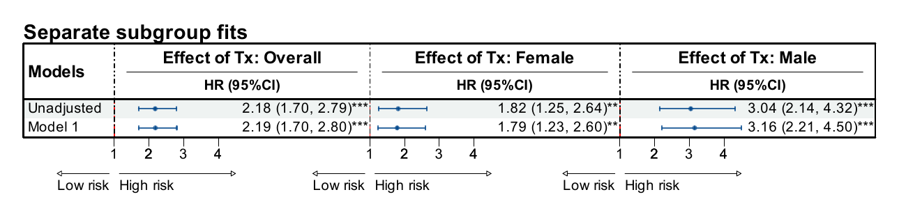{fig-alt="480行模拟数据的Overall、Female、Male三个面板，每个面板有未调整和年龄调整HR，均分别拟合。"}

[下载 PDF](images/eff-cat-guide/20261020-latest-eff-cat-refit.pdf)

### 选择交互模型 {.unnumbered}

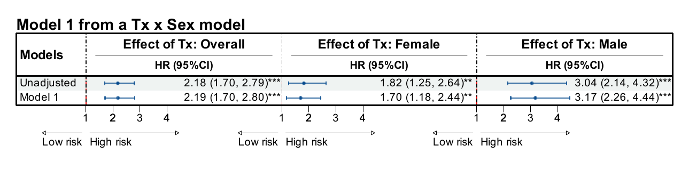{fig-alt="相同三个亚组面板，Female与Male的Model 1 HR改用同一个Tx乘Sex交互模型；未调整行、Overall与事件计数保持不变。"}

[下载 PDF](images/eff-cat-guide/20261020-latest-eff-cat-interaction.pdf)

:::

本例年龄调整 HR：Female 层内重拟合为 1.786923、交互模型为 1.695827；Male 分别为 3.155215、3.168770。代码核对两层交互模型 HR 与 `get_eff(subgroup_model="interaction")` 一致，并保留原层计数与 Overall。来源记录在各表的 `attr(.,"subgroup_model")` 中。`abs_args` 的绝对效应不随 `sub_inter` 改变；不要把它理解为整张图的所有模型都已切换。亚组间的正式效应修饰仍需报告交互检验。

### PS 先按各结局筛完整案例

```r
d_missing <- d_new
d_missing[["DSS"]][c(3, 10, 25)] <- NA_integer_
d_missing[["event"]][c(3, 10, 25)] <- NA_integer_
d_missing[["time"]][40] <- NA_real_
ps_specs <- list(
  IPTW = list(design = "weighting", method = "glm", estimand = "ATE", stabilize = TRUE),
  PSM = list(design = "matching", method = "nearest", estimand = "ATT"))
cc_check <- do.call(rbind, lapply(list(Cox = TRUE, `Fine-Gray` = FALSE, Logistic = "DSS"), function(model) {
  needed <- if (isTRUE(model)) c("time", "DSS") else if (isFALSE(model)) c("time", "event") else model
  complete <- d_missing[complete.cases(d_missing[needed]), , drop = FALSE]
  fit <- function(dat) get_eff_cat(dat, "Tx", ps_var = c("Age", "Sex"),
    ps_methods = ps_specs, surv = model, ps_robust = TRUE)
  automatic <- fit(d_missing)[[1]]
  explicit <- fit(complete)[[1]]
  stopifnot(isTRUE(all.equal(automatic[["estimate"]], explicit[["estimate"]])),
    isTRUE(all.equal(automatic[["conf.low"]], explicit[["conf.low"]])),
    isTRUE(all.equal(automatic[["conf.high"]], explicit[["conf.high"]])))
  data.frame(n_input = nrow(d_missing), n_complete = nrow(complete), matches = TRUE)
}))
cc_check
```

Cox / Fine–Gray 的 PS 分别使用 `time+DSS` / `time+event`（没有 event 时取 status）的完整记录；Logistic 只需对应结局列。上例前两者各保留 476 行，Logistic 保留 477 行，IPTW 与匹配的效应及区间都与显式预筛一致。存在结局缺失时，这会改变以前在所有记录上拟合的倾向评分；它没有填补缺失，也不保证不同结局有相同分析人群。

### 多模型返回列表与 Fine–Gray 方向

```r
models_new <- get_eff_cat(d_new, "Tx", adj_var = "Age",
  surv = list(Cox = TRUE, `Fine-Gray` = FALSE),
  abs_args = list(enabled = TRUE, time = 24, cif_boot = 100))
plots_new <- plt_eff(models_new, fixed_size = TRUE, base_size = 10,
  save = list(filename = file.path(tempdir(), c(
    "20261020-latest-eff-cat-cox.pdf", "20261020-latest-eff-cat-cif.pdf"))))
stopifnot(inherits(plots_new, "surv_models"),
          identical(names(plots_new), c("Cox", "Fine-Gray")))
validation_values <- list(subgroups = comparison, complete_cases = cc_check)
```
<!-- /latest-20261020: eff_cat_current -->

::: {.panel-tabset}

### Cox {.unnumbered}

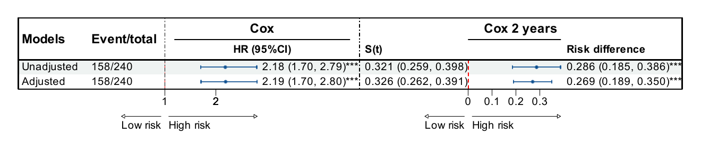{fig-alt="按模型返回的Cox森林，展示未调整和年龄调整HR及24月生存概率差。"}

[下载 PDF](images/eff-cat-guide/20261020-latest-eff-cat-cox.pdf)

### Fine–Gray {.unnumbered}

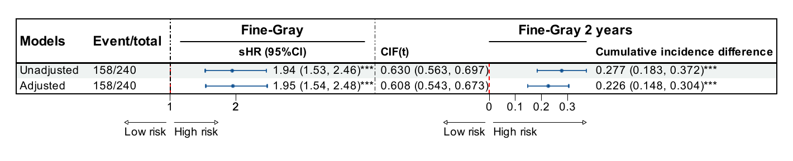{fig-alt="按模型返回的Fine-Gray森林，sHR以1为参考，24月CIF差以0为参考，均左侧Low risk、右侧High risk。"}

[下载 PDF](images/eff-cat-guide/20261020-latest-eff-cat-cif.pdf)

:::

`plt_eff()` 自动按 `outcome_label` 分模型，返回以模型命名的 `surv_models` 图列表，可用 `plots_new[["Fine-Gray"]]` 单独访问。普通设置共享，命名 list 或长度正确的无名 list 可逐模型设置；无名 `save$filename` 向量按模型顺序匹配。`xlim` / `ticks_at` 的无名 list 仍按面板解释，逐模型设置这两项须命名。

本例 `get_eff_cat()` 的 CIF 差是比较组减参照组，正值表示更高目标事件风险；sHR>1 也在右侧。`get_eff()` 的 Fine–Gray 概率差则是参照减比较，风险方向相反。Cox 的绝对列按生存概率差读取，不能仅凭箭头把生存获益与事件风险当成同一量。本例 CIF bootstrap=100 只用于接口演示；正式分析应另行确定重复数并检查稳定性。

## Fine–Gray 并列时间：保持调用者行序 {#fg-ties-20261021}

<!-- refresh-20261021: fg_ties -->

2026-10-21 按已推送 RegR `338a664`（行序修复 `f5e1f10`）在 Windows / WSL R 4.4.3 验证。`get_eff_cat(sub_inter=...)` 现在把完整病例按调用者原行序交给交互模型；此前先拼接各亚组，可能改变同一时间内的行序。mets 的 Fine–Gray 拟合对这种并列顺序可能敏感，因此相同数据、公式和引擎也曾与 `get_eff()` 出现差异。

```r
library(RegR)
options(RegR.eff_cat.plot = FALSE)
set.seed(20261021)
fg_tied <- data.frame(Tx = factor(sample(c("No", "Yes"), 360, TRUE)),
  Stratum = factor(sample(c("Low", "High"), 360, TRUE), levels = c("Low", "High")),
  Age = rnorm(360, 55, 10), time = ceiling(rexp(360, 1 / 12)),
  event = sample(0:2, 360, TRUE, prob = c(0.35, 0.45, 0.20)))
fg_tied[["DSS"]] <- as.integer(fg_tied[["event"]] == 1L)
fg_tied[["OS"]] <- as.integer(fg_tied[["event"]] > 0L)
stopifnot(anyDuplicated(fg_tied[["time"]]) > 0L)
joint_fg <- get_eff_cat(fg_tied, "Tx", sub_var = "Stratum", adj_var = "Age",
  surv = FALSE, sub_inter = TRUE)
reference_fg <- get_eff(fg_tied, "Tx", sub_var = "Stratum", adj_var = "Age",
  surv = FALSE, methods_haz = c("unadj", "direct"), methods_sur = character(),
  all = NULL, subgroup_model = "interaction")
matched_fg <- do.call(rbind, lapply(c("Low", "High"), function(st) {
  panel <- joint_fg[[paste0("haz_models_", st)]]
  do.call(rbind, lapply(c(Unadjusted = "haz_unadj", Adjusted = "haz_direct"), function(key) {
    model_name <- if (key == "haz_unadj") "Unadjusted" else "Adjusted"
    got <- panel[panel[["model_label"]] %in% model_name, ]
    ref <- reference_fg[[key]]
    ref <- ref[ref[["row_type"]] %in% "level" & ref[["label"]] %in% st, ]
    stopifnot(nrow(got) == 1L, nrow(ref) == 1L,
      isTRUE(all.equal(as.numeric(got[1, c("estimate", "conf.low", "conf.high")]),
                       as.numeric(ref[1, c("estimate", "conf.low", "conf.high")]), tolerance = 1e-10)))
    data.frame(stratum = st, model = model_name, sHR = got[["estimate"]],
               absolute_difference = abs(got[["estimate"]] - ref[["estimate"]]))
  }))
}))
matched_fg
```

本例同时核对两个层、未调整与年龄调整模型的 sHR 及区间，两个入口在同一平台上一致。这里比较的是**相同的交互模型**；层内分别重拟合与共享调整系数的交互模型仍有不同的估计含义，不要求它们相等。

| 亚组 | 未调整 sHR | 年龄调整 sHR | 两入口点估计差 |
|:--|--:|--:|--:|
| Low | 0.882859 | 0.887939 | 0 |
| High | 1.136623 | 1.131291 | 0 |

该合成输入的辅助加性交互计算会提示预防性暴露及 `NaNs produced`；这里的断言仅覆盖有限的 sHR 与区间，不据此验证或解释 RERI 等辅助指标。

保留稳定的患者行序，不为“统一结果”临时按亚组或事件重排。若旧分析使用了并列月份，建议用原始行序重新计算，并记录数据筛选、行序、引擎和依赖版本；仅更新图形无法纠正已经缓存的旧系数。本页没有重跑真实队列，也不据此承诺结果对任意行序完全不变。

<!-- /refresh-20261021: fg_ties -->

## 数据准备与复现


使用 RegR 自带的 SEER 甲状腺髓样癌队列。保留完整模型变量、正随访时间及肿瘤大小在 0–200 mm 内的记录，再固定种子抽取最多 800 人。`stage` 合并为 T1/T2 与其余分期，`surgery` 为无手术与任一手术。它们是本页的演示编码。时间单位沿用原始队列的月。只发布汇总结果。

```r
library(RegR)
library(ggplot2)
library(survival)
data("seer_thyroid_mtc_2026", package = "RegR")
d <- as.data.frame(seer_thyroid_mtc_2026)
d[["DSS"]] <- as.integer(as.character(d[["DSS"]]))
d[["OS"]] <- as.integer(as.character(d[["OS"]]))
needed <- c("time", "DSS", "OS", "Age", "Tum", "Sex", "Race", "T_stage", "Sur")
d <- d[complete.cases(d[needed]) & d[["time"]] > 0 &
       d[["Tum"]] > 0 & d[["Tum"]] < 200, , drop = FALSE]
d[["stage"]] <- factor(ifelse(d[["T_stage"]] %in% c("T1", "T2"), "Early", "Other"))
d[["surgery"]] <- factor(ifelse(d[["Sur"]] == "No surgery", "No", "Yes"),
                          levels = c("No", "Yes"))
set.seed(20261001)
d <- droplevels(d[sample.int(nrow(d), min(800L, nrow(d))), , drop = FALSE])
```


## 共用计算与返回对象


Sex 的首水平 Female 是参照。adj_var 是命名调整变量 list；未调整结果自动保留。surv 的 TRUE/FALSE/字符分别是 Cox、Fine–Gray 和 Logistic；此处 event 使用原队列 0=删失、1=目标死亡、2=其他死亡。Logistic 仅描述记录期间的二分类结局，不处理随访删失。

```r
# 可选：关闭计算完成后的自动绘图，下面显式绘图。
options(RegR.eff_cat.plot = FALSE)
adjustments <- list(Age = "Age", Full = c("Age", "Tum", "stage"))
multi <- run_quiet({get_eff_cat(d, cat_var = "Sex", adj_var = adjustments,
  surv = list(`DSS Cox` = TRUE, `DSS Fine-Gray` = FALSE, `DSS Logistic` = "DSS"))})
absolute <- run_quiet({get_eff_cat(d, cat_var = "Sex", adj_var = adjustments,
  abs_args = list(enabled = TRUE, time = 60))})
by_panel <- run_quiet({get_eff_cat(d, cat_var = "Sex", sub_var = "stage",
  adj_var = c("Age", "Tum"), add_overall = TRUE)})
by_rows <- run_quiet({get_eff_cat(d, cat_var = "Sex", split_var = "stage",
  adj_var = c("Age", "Tum"), add_overall = TRUE)})
combined <- run_quiet({get_eff_cat(d, cat_var_combine = c("Sex", "stage"),
  adj_var = c("Age", "Tum"))})
```


## 返回表：模型排成行


标量 surv 返回 haz_models；多结局返回 haz_cox_DSS、haz_crr_event、haz_log_DSS 等。每个非参考暴露水平形成对照块，块内不同调整模型是行。表含 estimate/conf.low/conf.high/p_value，以及 model_label、adjustment、level、reference、status。需要看这些元数据，不能只比较格式化字符串。

::: {.panel-tabset}


### Cox 结果表 {.unnumbered}


同一 Female 参照、Male 比较，在未调整、Age、Full 模型中的结果。

```r
as.data.frame(multi[["haz_cox_DSS"]])[, intersect(c("model_label", "adjustment", "level", "reference", "estimate", "conf.low", "conf.high", "p_value", "status"), names(multi[["haz_cox_DSS"]]))]
```


::: {.table-responsive}


<div id="ahmuiomsmi" style="padding-left:0px;padding-right:0px;padding-top:10px;padding-bottom:10px;overflow-x:auto;overflow-y:auto;width:auto;height:auto;">

  <table class="gt_table" data-quarto-disable-processing="false" data-quarto-bootstrap="false" style="-webkit-font-smoothing: antialiased; -moz-osx-font-smoothing: grayscale; font-family: system-ui, 'Segoe UI', Roboto, Helvetica, Arial, sans-serif, 'Apple Color Emoji', 'Segoe UI Emoji', 'Segoe UI Symbol', 'Noto Color Emoji'; display: table; border-collapse: collapse; line-height: normal; margin-left: auto; margin-right: auto; color: #333333; font-size: 16px; font-weight: normal; font-style: normal; background-color: #FFFFFF; width: auto; border-top-style: solid; border-top-width: 2px; border-top-color: #A8A8A8; border-right-style: none; border-right-width: 2px; border-right-color: #D3D3D3; border-bottom-style: solid; border-bottom-width: 2px; border-bottom-color: #A8A8A8; border-left-style: none; border-left-width: 2px; border-left-color: #D3D3D3;" bgcolor="#FFFFFF">
  <thead style="border-style: none;">
    <tr class="gt_col_headings" style="border-style: none; border-top-style: solid; border-top-width: 2px; border-top-color: #D3D3D3; border-bottom-style: solid; border-bottom-width: 2px; border-bottom-color: #D3D3D3; border-left-style: none; border-left-width: 1px; border-left-color: #D3D3D3; border-right-style: none; border-right-width: 1px; border-right-color: #D3D3D3;">
      <th class="gt_col_heading gt_columns_bottom_border gt_left" rowspan="1" colspan="1" scope="col" id="model_label" style="border-style: none; color: #333333; background-color: #FFFFFF; font-size: 100%; font-weight: normal; text-transform: inherit; border-left-style: none; border-left-width: 1px; border-left-color: #D3D3D3; border-right-style: none; border-right-width: 1px; border-right-color: #D3D3D3; vertical-align: bottom; padding-top: 5px; padding-bottom: 6px; padding-left: 5px; padding-right: 5px; overflow-x: hidden; text-align: left;" bgcolor="#FFFFFF" valign="bottom" align="left">model_label</th>
      <th class="gt_col_heading gt_columns_bottom_border gt_left" rowspan="1" colspan="1" scope="col" id="adjustment" style="border-style: none; color: #333333; background-color: #FFFFFF; font-size: 100%; font-weight: normal; text-transform: inherit; border-left-style: none; border-left-width: 1px; border-left-color: #D3D3D3; border-right-style: none; border-right-width: 1px; border-right-color: #D3D3D3; vertical-align: bottom; padding-top: 5px; padding-bottom: 6px; padding-left: 5px; padding-right: 5px; overflow-x: hidden; text-align: left;" bgcolor="#FFFFFF" valign="bottom" align="left">adjustment</th>
      <th class="gt_col_heading gt_columns_bottom_border gt_left" rowspan="1" colspan="1" scope="col" id="level" style="border-style: none; color: #333333; background-color: #FFFFFF; font-size: 100%; font-weight: normal; text-transform: inherit; border-left-style: none; border-left-width: 1px; border-left-color: #D3D3D3; border-right-style: none; border-right-width: 1px; border-right-color: #D3D3D3; vertical-align: bottom; padding-top: 5px; padding-bottom: 6px; padding-left: 5px; padding-right: 5px; overflow-x: hidden; text-align: left;" bgcolor="#FFFFFF" valign="bottom" align="left">level</th>
      <th class="gt_col_heading gt_columns_bottom_border gt_left" rowspan="1" colspan="1" scope="col" id="reference" style="border-style: none; color: #333333; background-color: #FFFFFF; font-size: 100%; font-weight: normal; text-transform: inherit; border-left-style: none; border-left-width: 1px; border-left-color: #D3D3D3; border-right-style: none; border-right-width: 1px; border-right-color: #D3D3D3; vertical-align: bottom; padding-top: 5px; padding-bottom: 6px; padding-left: 5px; padding-right: 5px; overflow-x: hidden; text-align: left;" bgcolor="#FFFFFF" valign="bottom" align="left">reference</th>
      <th class="gt_col_heading gt_columns_bottom_border gt_right" rowspan="1" colspan="1" scope="col" id="estimate" style="border-style: none; color: #333333; background-color: #FFFFFF; font-size: 100%; font-weight: normal; text-transform: inherit; border-left-style: none; border-left-width: 1px; border-left-color: #D3D3D3; border-right-style: none; border-right-width: 1px; border-right-color: #D3D3D3; vertical-align: bottom; padding-top: 5px; padding-bottom: 6px; padding-left: 5px; padding-right: 5px; overflow-x: hidden; text-align: right; font-variant-numeric: tabular-nums;" bgcolor="#FFFFFF" valign="bottom" align="right">estimate</th>
      <th class="gt_col_heading gt_columns_bottom_border gt_right" rowspan="1" colspan="1" scope="col" id="conf.low" style="border-style: none; color: #333333; background-color: #FFFFFF; font-size: 100%; font-weight: normal; text-transform: inherit; border-left-style: none; border-left-width: 1px; border-left-color: #D3D3D3; border-right-style: none; border-right-width: 1px; border-right-color: #D3D3D3; vertical-align: bottom; padding-top: 5px; padding-bottom: 6px; padding-left: 5px; padding-right: 5px; overflow-x: hidden; text-align: right; font-variant-numeric: tabular-nums;" bgcolor="#FFFFFF" valign="bottom" align="right">conf.low</th>
      <th class="gt_col_heading gt_columns_bottom_border gt_right" rowspan="1" colspan="1" scope="col" id="conf.high" style="border-style: none; color: #333333; background-color: #FFFFFF; font-size: 100%; font-weight: normal; text-transform: inherit; border-left-style: none; border-left-width: 1px; border-left-color: #D3D3D3; border-right-style: none; border-right-width: 1px; border-right-color: #D3D3D3; vertical-align: bottom; padding-top: 5px; padding-bottom: 6px; padding-left: 5px; padding-right: 5px; overflow-x: hidden; text-align: right; font-variant-numeric: tabular-nums;" bgcolor="#FFFFFF" valign="bottom" align="right">conf.high</th>
      <th class="gt_col_heading gt_columns_bottom_border gt_right" rowspan="1" colspan="1" scope="col" id="p_value" style="border-style: none; color: #333333; background-color: #FFFFFF; font-size: 100%; font-weight: normal; text-transform: inherit; border-left-style: none; border-left-width: 1px; border-left-color: #D3D3D3; border-right-style: none; border-right-width: 1px; border-right-color: #D3D3D3; vertical-align: bottom; padding-top: 5px; padding-bottom: 6px; padding-left: 5px; padding-right: 5px; overflow-x: hidden; text-align: right; font-variant-numeric: tabular-nums;" bgcolor="#FFFFFF" valign="bottom" align="right">p_value</th>
      <th class="gt_col_heading gt_columns_bottom_border gt_left" rowspan="1" colspan="1" scope="col" id="status" style="border-style: none; color: #333333; background-color: #FFFFFF; font-size: 100%; font-weight: normal; text-transform: inherit; border-left-style: none; border-left-width: 1px; border-left-color: #D3D3D3; border-right-style: none; border-right-width: 1px; border-right-color: #D3D3D3; vertical-align: bottom; padding-top: 5px; padding-bottom: 6px; padding-left: 5px; padding-right: 5px; overflow-x: hidden; text-align: left;" bgcolor="#FFFFFF" valign="bottom" align="left">status</th>
    </tr>
  </thead>
  <tbody class="gt_table_body" style="border-style: none; border-top-style: solid; border-top-width: 2px; border-top-color: #D3D3D3; border-bottom-style: solid; border-bottom-width: 2px; border-bottom-color: #D3D3D3;">
    <tr style="border-style: none;"><td headers="model_label" class="gt_row gt_left" style="border-style: none; padding-top: 8px; padding-bottom: 8px; padding-left: 5px; padding-right: 5px; margin: 10px; border-top-style: solid; border-top-width: 1px; border-top-color: #D3D3D3; border-left-style: none; border-left-width: 1px; border-left-color: #D3D3D3; border-right-style: none; border-right-width: 1px; border-right-color: #D3D3D3; vertical-align: middle; overflow-x: hidden; text-align: left;" valign="middle" align="left">NA</td>
<td headers="adjustment" class="gt_row gt_left" style="border-style: none; padding-top: 8px; padding-bottom: 8px; padding-left: 5px; padding-right: 5px; margin: 10px; border-top-style: solid; border-top-width: 1px; border-top-color: #D3D3D3; border-left-style: none; border-left-width: 1px; border-left-color: #D3D3D3; border-right-style: none; border-right-width: 1px; border-right-color: #D3D3D3; vertical-align: middle; overflow-x: hidden; text-align: left;" valign="middle" align="left">NA</td>
<td headers="level" class="gt_row gt_left" style="border-style: none; padding-top: 8px; padding-bottom: 8px; padding-left: 5px; padding-right: 5px; margin: 10px; border-top-style: solid; border-top-width: 1px; border-top-color: #D3D3D3; border-left-style: none; border-left-width: 1px; border-left-color: #D3D3D3; border-right-style: none; border-right-width: 1px; border-right-color: #D3D3D3; vertical-align: middle; overflow-x: hidden; text-align: left;" valign="middle" align="left">Male</td>
<td headers="reference" class="gt_row gt_left" style="border-style: none; padding-top: 8px; padding-bottom: 8px; padding-left: 5px; padding-right: 5px; margin: 10px; border-top-style: solid; border-top-width: 1px; border-top-color: #D3D3D3; border-left-style: none; border-left-width: 1px; border-left-color: #D3D3D3; border-right-style: none; border-right-width: 1px; border-right-color: #D3D3D3; vertical-align: middle; overflow-x: hidden; text-align: left;" valign="middle" align="left">Female</td>
<td headers="estimate" class="gt_row gt_right" style="border-style: none; padding-top: 8px; padding-bottom: 8px; padding-left: 5px; padding-right: 5px; margin: 10px; border-top-style: solid; border-top-width: 1px; border-top-color: #D3D3D3; border-left-style: none; border-left-width: 1px; border-left-color: #D3D3D3; border-right-style: none; border-right-width: 1px; border-right-color: #D3D3D3; vertical-align: middle; overflow-x: hidden; text-align: right; font-variant-numeric: tabular-nums;" valign="middle" align="right">NA</td>
<td headers="conf.low" class="gt_row gt_right" style="border-style: none; padding-top: 8px; padding-bottom: 8px; padding-left: 5px; padding-right: 5px; margin: 10px; border-top-style: solid; border-top-width: 1px; border-top-color: #D3D3D3; border-left-style: none; border-left-width: 1px; border-left-color: #D3D3D3; border-right-style: none; border-right-width: 1px; border-right-color: #D3D3D3; vertical-align: middle; overflow-x: hidden; text-align: right; font-variant-numeric: tabular-nums;" valign="middle" align="right">NA</td>
<td headers="conf.high" class="gt_row gt_right" style="border-style: none; padding-top: 8px; padding-bottom: 8px; padding-left: 5px; padding-right: 5px; margin: 10px; border-top-style: solid; border-top-width: 1px; border-top-color: #D3D3D3; border-left-style: none; border-left-width: 1px; border-left-color: #D3D3D3; border-right-style: none; border-right-width: 1px; border-right-color: #D3D3D3; vertical-align: middle; overflow-x: hidden; text-align: right; font-variant-numeric: tabular-nums;" valign="middle" align="right">NA</td>
<td headers="p_value" class="gt_row gt_right" style="border-style: none; padding-top: 8px; padding-bottom: 8px; padding-left: 5px; padding-right: 5px; margin: 10px; border-top-style: solid; border-top-width: 1px; border-top-color: #D3D3D3; border-left-style: none; border-left-width: 1px; border-left-color: #D3D3D3; border-right-style: none; border-right-width: 1px; border-right-color: #D3D3D3; vertical-align: middle; overflow-x: hidden; text-align: right; font-variant-numeric: tabular-nums;" valign="middle" align="right">NA</td>
<td headers="status" class="gt_row gt_left" style="border-style: none; padding-top: 8px; padding-bottom: 8px; padding-left: 5px; padding-right: 5px; margin: 10px; border-top-style: solid; border-top-width: 1px; border-top-color: #D3D3D3; border-left-style: none; border-left-width: 1px; border-left-color: #D3D3D3; border-right-style: none; border-right-width: 1px; border-right-color: #D3D3D3; vertical-align: middle; overflow-x: hidden; text-align: left;" valign="middle" align="left">header</td></tr>
    <tr style="border-style: none;"><td headers="model_label" class="gt_row gt_left" style="border-style: none; padding-top: 8px; padding-bottom: 8px; padding-left: 5px; padding-right: 5px; margin: 10px; border-top-style: solid; border-top-width: 1px; border-top-color: #D3D3D3; border-left-style: none; border-left-width: 1px; border-left-color: #D3D3D3; border-right-style: none; border-right-width: 1px; border-right-color: #D3D3D3; vertical-align: middle; overflow-x: hidden; text-align: left;" valign="middle" align="left">Unadjusted</td>
<td headers="adjustment" class="gt_row gt_left" style="border-style: none; padding-top: 8px; padding-bottom: 8px; padding-left: 5px; padding-right: 5px; margin: 10px; border-top-style: solid; border-top-width: 1px; border-top-color: #D3D3D3; border-left-style: none; border-left-width: 1px; border-left-color: #D3D3D3; border-right-style: none; border-right-width: 1px; border-right-color: #D3D3D3; vertical-align: middle; overflow-x: hidden; text-align: left;" valign="middle" align="left">None</td>
<td headers="level" class="gt_row gt_left" style="border-style: none; padding-top: 8px; padding-bottom: 8px; padding-left: 5px; padding-right: 5px; margin: 10px; border-top-style: solid; border-top-width: 1px; border-top-color: #D3D3D3; border-left-style: none; border-left-width: 1px; border-left-color: #D3D3D3; border-right-style: none; border-right-width: 1px; border-right-color: #D3D3D3; vertical-align: middle; overflow-x: hidden; text-align: left;" valign="middle" align="left">Male</td>
<td headers="reference" class="gt_row gt_left" style="border-style: none; padding-top: 8px; padding-bottom: 8px; padding-left: 5px; padding-right: 5px; margin: 10px; border-top-style: solid; border-top-width: 1px; border-top-color: #D3D3D3; border-left-style: none; border-left-width: 1px; border-left-color: #D3D3D3; border-right-style: none; border-right-width: 1px; border-right-color: #D3D3D3; vertical-align: middle; overflow-x: hidden; text-align: left;" valign="middle" align="left">Female</td>
<td headers="estimate" class="gt_row gt_right" style="border-style: none; padding-top: 8px; padding-bottom: 8px; padding-left: 5px; padding-right: 5px; margin: 10px; border-top-style: solid; border-top-width: 1px; border-top-color: #D3D3D3; border-left-style: none; border-left-width: 1px; border-left-color: #D3D3D3; border-right-style: none; border-right-width: 1px; border-right-color: #D3D3D3; vertical-align: middle; overflow-x: hidden; text-align: right; font-variant-numeric: tabular-nums;" valign="middle" align="right">2.357022</td>
<td headers="conf.low" class="gt_row gt_right" style="border-style: none; padding-top: 8px; padding-bottom: 8px; padding-left: 5px; padding-right: 5px; margin: 10px; border-top-style: solid; border-top-width: 1px; border-top-color: #D3D3D3; border-left-style: none; border-left-width: 1px; border-left-color: #D3D3D3; border-right-style: none; border-right-width: 1px; border-right-color: #D3D3D3; vertical-align: middle; overflow-x: hidden; text-align: right; font-variant-numeric: tabular-nums;" valign="middle" align="right">1.531063</td>
<td headers="conf.high" class="gt_row gt_right" style="border-style: none; padding-top: 8px; padding-bottom: 8px; padding-left: 5px; padding-right: 5px; margin: 10px; border-top-style: solid; border-top-width: 1px; border-top-color: #D3D3D3; border-left-style: none; border-left-width: 1px; border-left-color: #D3D3D3; border-right-style: none; border-right-width: 1px; border-right-color: #D3D3D3; vertical-align: middle; overflow-x: hidden; text-align: right; font-variant-numeric: tabular-nums;" valign="middle" align="right">3.628558</td>
<td headers="p_value" class="gt_row gt_right" style="border-style: none; padding-top: 8px; padding-bottom: 8px; padding-left: 5px; padding-right: 5px; margin: 10px; border-top-style: solid; border-top-width: 1px; border-top-color: #D3D3D3; border-left-style: none; border-left-width: 1px; border-left-color: #D3D3D3; border-right-style: none; border-right-width: 1px; border-right-color: #D3D3D3; vertical-align: middle; overflow-x: hidden; text-align: right; font-variant-numeric: tabular-nums;" valign="middle" align="right">9.817454e-05</td>
<td headers="status" class="gt_row gt_left" style="border-style: none; padding-top: 8px; padding-bottom: 8px; padding-left: 5px; padding-right: 5px; margin: 10px; border-top-style: solid; border-top-width: 1px; border-top-color: #D3D3D3; border-left-style: none; border-left-width: 1px; border-left-color: #D3D3D3; border-right-style: none; border-right-width: 1px; border-right-color: #D3D3D3; vertical-align: middle; overflow-x: hidden; text-align: left;" valign="middle" align="left">estimated</td></tr>
    <tr style="border-style: none;"><td headers="model_label" class="gt_row gt_left" style="border-style: none; padding-top: 8px; padding-bottom: 8px; padding-left: 5px; padding-right: 5px; margin: 10px; border-top-style: solid; border-top-width: 1px; border-top-color: #D3D3D3; border-left-style: none; border-left-width: 1px; border-left-color: #D3D3D3; border-right-style: none; border-right-width: 1px; border-right-color: #D3D3D3; vertical-align: middle; overflow-x: hidden; text-align: left;" valign="middle" align="left">Age</td>
<td headers="adjustment" class="gt_row gt_left" style="border-style: none; padding-top: 8px; padding-bottom: 8px; padding-left: 5px; padding-right: 5px; margin: 10px; border-top-style: solid; border-top-width: 1px; border-top-color: #D3D3D3; border-left-style: none; border-left-width: 1px; border-left-color: #D3D3D3; border-right-style: none; border-right-width: 1px; border-right-color: #D3D3D3; vertical-align: middle; overflow-x: hidden; text-align: left;" valign="middle" align="left">Age</td>
<td headers="level" class="gt_row gt_left" style="border-style: none; padding-top: 8px; padding-bottom: 8px; padding-left: 5px; padding-right: 5px; margin: 10px; border-top-style: solid; border-top-width: 1px; border-top-color: #D3D3D3; border-left-style: none; border-left-width: 1px; border-left-color: #D3D3D3; border-right-style: none; border-right-width: 1px; border-right-color: #D3D3D3; vertical-align: middle; overflow-x: hidden; text-align: left;" valign="middle" align="left">Male</td>
<td headers="reference" class="gt_row gt_left" style="border-style: none; padding-top: 8px; padding-bottom: 8px; padding-left: 5px; padding-right: 5px; margin: 10px; border-top-style: solid; border-top-width: 1px; border-top-color: #D3D3D3; border-left-style: none; border-left-width: 1px; border-left-color: #D3D3D3; border-right-style: none; border-right-width: 1px; border-right-color: #D3D3D3; vertical-align: middle; overflow-x: hidden; text-align: left;" valign="middle" align="left">Female</td>
<td headers="estimate" class="gt_row gt_right" style="border-style: none; padding-top: 8px; padding-bottom: 8px; padding-left: 5px; padding-right: 5px; margin: 10px; border-top-style: solid; border-top-width: 1px; border-top-color: #D3D3D3; border-left-style: none; border-left-width: 1px; border-left-color: #D3D3D3; border-right-style: none; border-right-width: 1px; border-right-color: #D3D3D3; vertical-align: middle; overflow-x: hidden; text-align: right; font-variant-numeric: tabular-nums;" valign="middle" align="right">2.306445</td>
<td headers="conf.low" class="gt_row gt_right" style="border-style: none; padding-top: 8px; padding-bottom: 8px; padding-left: 5px; padding-right: 5px; margin: 10px; border-top-style: solid; border-top-width: 1px; border-top-color: #D3D3D3; border-left-style: none; border-left-width: 1px; border-left-color: #D3D3D3; border-right-style: none; border-right-width: 1px; border-right-color: #D3D3D3; vertical-align: middle; overflow-x: hidden; text-align: right; font-variant-numeric: tabular-nums;" valign="middle" align="right">1.497455</td>
<td headers="conf.high" class="gt_row gt_right" style="border-style: none; padding-top: 8px; padding-bottom: 8px; padding-left: 5px; padding-right: 5px; margin: 10px; border-top-style: solid; border-top-width: 1px; border-top-color: #D3D3D3; border-left-style: none; border-left-width: 1px; border-left-color: #D3D3D3; border-right-style: none; border-right-width: 1px; border-right-color: #D3D3D3; vertical-align: middle; overflow-x: hidden; text-align: right; font-variant-numeric: tabular-nums;" valign="middle" align="right">3.552486</td>
<td headers="p_value" class="gt_row gt_right" style="border-style: none; padding-top: 8px; padding-bottom: 8px; padding-left: 5px; padding-right: 5px; margin: 10px; border-top-style: solid; border-top-width: 1px; border-top-color: #D3D3D3; border-left-style: none; border-left-width: 1px; border-left-color: #D3D3D3; border-right-style: none; border-right-width: 1px; border-right-color: #D3D3D3; vertical-align: middle; overflow-x: hidden; text-align: right; font-variant-numeric: tabular-nums;" valign="middle" align="right">1.493859e-04</td>
<td headers="status" class="gt_row gt_left" style="border-style: none; padding-top: 8px; padding-bottom: 8px; padding-left: 5px; padding-right: 5px; margin: 10px; border-top-style: solid; border-top-width: 1px; border-top-color: #D3D3D3; border-left-style: none; border-left-width: 1px; border-left-color: #D3D3D3; border-right-style: none; border-right-width: 1px; border-right-color: #D3D3D3; vertical-align: middle; overflow-x: hidden; text-align: left;" valign="middle" align="left">estimated</td></tr>
    <tr style="border-style: none;"><td headers="model_label" class="gt_row gt_left" style="border-style: none; padding-top: 8px; padding-bottom: 8px; padding-left: 5px; padding-right: 5px; margin: 10px; border-top-style: solid; border-top-width: 1px; border-top-color: #D3D3D3; border-left-style: none; border-left-width: 1px; border-left-color: #D3D3D3; border-right-style: none; border-right-width: 1px; border-right-color: #D3D3D3; vertical-align: middle; overflow-x: hidden; text-align: left;" valign="middle" align="left">Full</td>
<td headers="adjustment" class="gt_row gt_left" style="border-style: none; padding-top: 8px; padding-bottom: 8px; padding-left: 5px; padding-right: 5px; margin: 10px; border-top-style: solid; border-top-width: 1px; border-top-color: #D3D3D3; border-left-style: none; border-left-width: 1px; border-left-color: #D3D3D3; border-right-style: none; border-right-width: 1px; border-right-color: #D3D3D3; vertical-align: middle; overflow-x: hidden; text-align: left;" valign="middle" align="left">Age, Tum, stage</td>
<td headers="level" class="gt_row gt_left" style="border-style: none; padding-top: 8px; padding-bottom: 8px; padding-left: 5px; padding-right: 5px; margin: 10px; border-top-style: solid; border-top-width: 1px; border-top-color: #D3D3D3; border-left-style: none; border-left-width: 1px; border-left-color: #D3D3D3; border-right-style: none; border-right-width: 1px; border-right-color: #D3D3D3; vertical-align: middle; overflow-x: hidden; text-align: left;" valign="middle" align="left">Male</td>
<td headers="reference" class="gt_row gt_left" style="border-style: none; padding-top: 8px; padding-bottom: 8px; padding-left: 5px; padding-right: 5px; margin: 10px; border-top-style: solid; border-top-width: 1px; border-top-color: #D3D3D3; border-left-style: none; border-left-width: 1px; border-left-color: #D3D3D3; border-right-style: none; border-right-width: 1px; border-right-color: #D3D3D3; vertical-align: middle; overflow-x: hidden; text-align: left;" valign="middle" align="left">Female</td>
<td headers="estimate" class="gt_row gt_right" style="border-style: none; padding-top: 8px; padding-bottom: 8px; padding-left: 5px; padding-right: 5px; margin: 10px; border-top-style: solid; border-top-width: 1px; border-top-color: #D3D3D3; border-left-style: none; border-left-width: 1px; border-left-color: #D3D3D3; border-right-style: none; border-right-width: 1px; border-right-color: #D3D3D3; vertical-align: middle; overflow-x: hidden; text-align: right; font-variant-numeric: tabular-nums;" valign="middle" align="right">1.692258</td>
<td headers="conf.low" class="gt_row gt_right" style="border-style: none; padding-top: 8px; padding-bottom: 8px; padding-left: 5px; padding-right: 5px; margin: 10px; border-top-style: solid; border-top-width: 1px; border-top-color: #D3D3D3; border-left-style: none; border-left-width: 1px; border-left-color: #D3D3D3; border-right-style: none; border-right-width: 1px; border-right-color: #D3D3D3; vertical-align: middle; overflow-x: hidden; text-align: right; font-variant-numeric: tabular-nums;" valign="middle" align="right">1.090096</td>
<td headers="conf.high" class="gt_row gt_right" style="border-style: none; padding-top: 8px; padding-bottom: 8px; padding-left: 5px; padding-right: 5px; margin: 10px; border-top-style: solid; border-top-width: 1px; border-top-color: #D3D3D3; border-left-style: none; border-left-width: 1px; border-left-color: #D3D3D3; border-right-style: none; border-right-width: 1px; border-right-color: #D3D3D3; vertical-align: middle; overflow-x: hidden; text-align: right; font-variant-numeric: tabular-nums;" valign="middle" align="right">2.627049</td>
<td headers="p_value" class="gt_row gt_right" style="border-style: none; padding-top: 8px; padding-bottom: 8px; padding-left: 5px; padding-right: 5px; margin: 10px; border-top-style: solid; border-top-width: 1px; border-top-color: #D3D3D3; border-left-style: none; border-left-width: 1px; border-left-color: #D3D3D3; border-right-style: none; border-right-width: 1px; border-right-color: #D3D3D3; vertical-align: middle; overflow-x: hidden; text-align: right; font-variant-numeric: tabular-nums;" valign="middle" align="right">1.905722e-02</td>
<td headers="status" class="gt_row gt_left" style="border-style: none; padding-top: 8px; padding-bottom: 8px; padding-left: 5px; padding-right: 5px; margin: 10px; border-top-style: solid; border-top-width: 1px; border-top-color: #D3D3D3; border-left-style: none; border-left-width: 1px; border-left-color: #D3D3D3; border-right-style: none; border-right-width: 1px; border-right-color: #D3D3D3; vertical-align: middle; overflow-x: hidden; text-align: left;" valign="middle" align="left">estimated</td></tr>
  </tbody>

</table>
</div>


:::


### 多结局面板 {.unnumbered}


Cox HR、Fine–Gray sHR、Logistic OR 并列，各面板对应不同统计对象。

```r
plt_eff(structure(multi, multi_outcome = NULL), display = "c", show_pinter = "none", del.arrow_lab = TRUE,
  fixed_size = FALSE, base_size = 10)
```


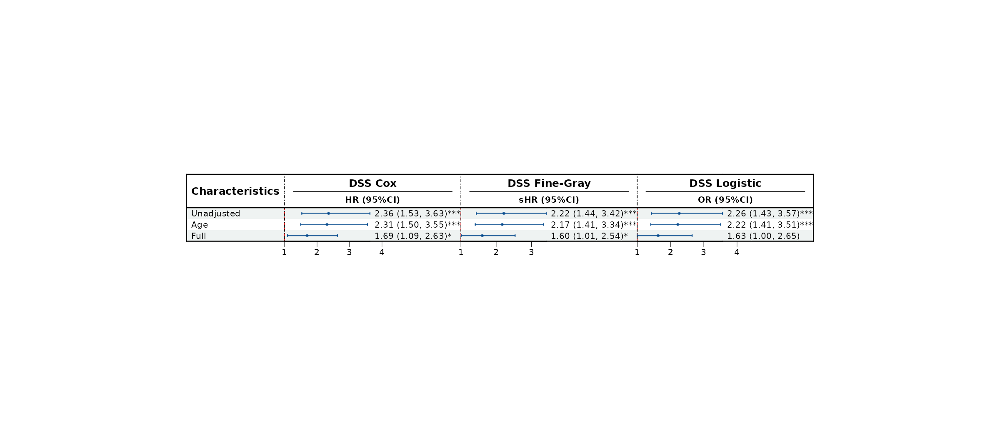{fig-alt="多结局面板；Cox HR、Fine–Gray sHR、Logistic OR 并列，各面板对应不同统计对象。"}


:::


## 相同结果的方向、列与坐标


display、summary_vars 和 x_trans 用于展示，不重新拟合模型。比值效应可用 log 坐标；负数绝对差值不能使用 log 坐标。隐藏某列不会让模型改变，也不应隐藏模型失败状态。

::: {.panel-tabset}


### 单一 Cox 面板 {.unnumbered}


单独提取一个结局，保留模型行。

```r
plt_eff(multi["haz_cox_DSS"], show_pinter = "none",
  fixed_size = FALSE, base_size = 11)
```


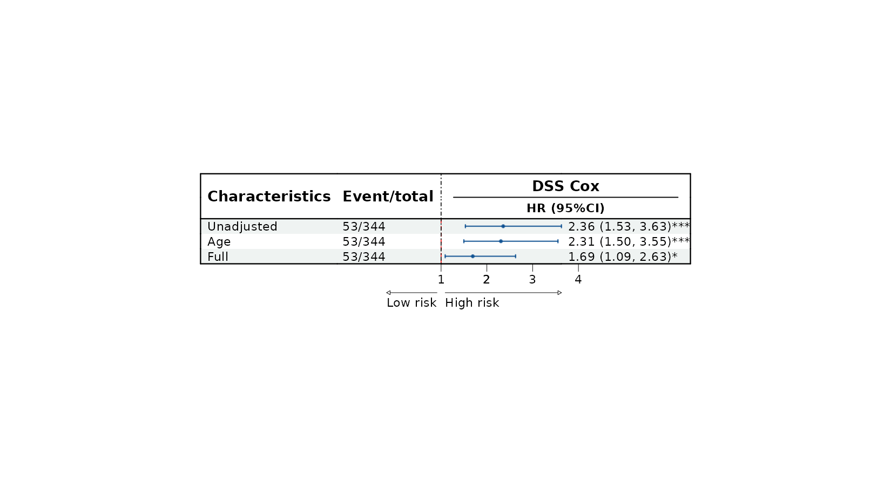{fig-alt="单一 Cox 面板；单独提取一个结局，保留模型行。"}


### HR 对数坐标 {.unnumbered}


同一 HR 改为 log 坐标，参考线仍为 1。

```r
plt_eff(multi["haz_cox_DSS"], show_pinter = "none",
  x_trans = "log", fixed_size = FALSE, base_size = 11)
```


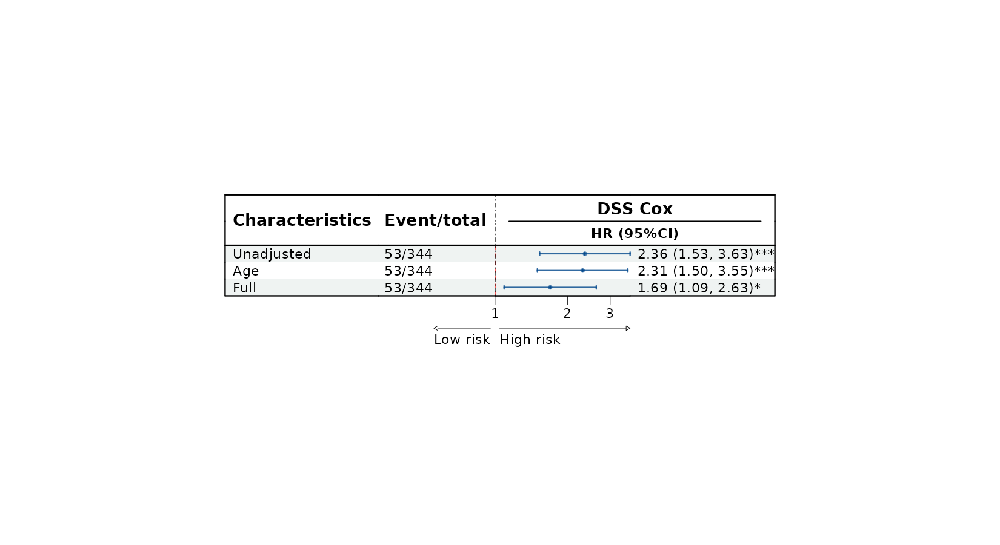{fig-alt="HR 对数坐标；同一 HR 改为 log 坐标，参考线仍为 1。"}


### 纵向结局面板 {.unnumbered}


把多个结局上下排列，适合较窄的页面。

```r
plt_eff(structure(multi, multi_outcome = NULL), display = "v", show_pinter = "none", del.arrow_lab = TRUE,
  fixed_size = FALSE, base_size = 10)
```


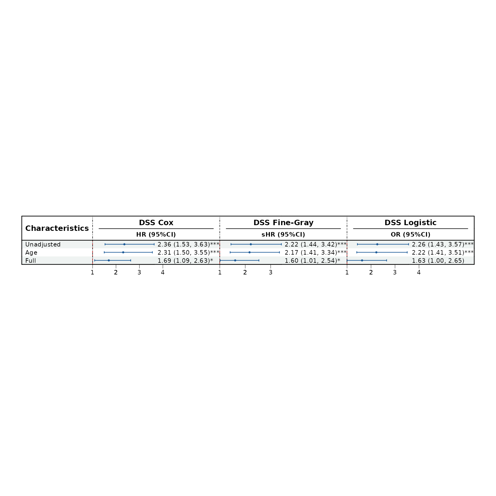{fig-alt="纵向结局面板；把多个结局上下排列，适合较窄的页面。"}


:::


## 60 月绝对效应


abs_args 默认 enabled=FALSE、time=120、cif_boot=50L；本例只启用 Cox 的 60 月 S(t)，追加 sur_models，同时保留 haz_models。绝对表的 estimate 是参照减比较的差值，estimate_sur 是各水平的 S(t)。它们不是把 HR 换一个标签得到的数值。

::: {.panel-tabset}


### HR 与 ΔS(60) {.unnumbered}


相对效应参考值为 1；绝对差值参考值为 0。

```r
plt_eff(absolute, display = "c", show_pinter = "none",
  fixed_size = FALSE, base_size = 10)
```


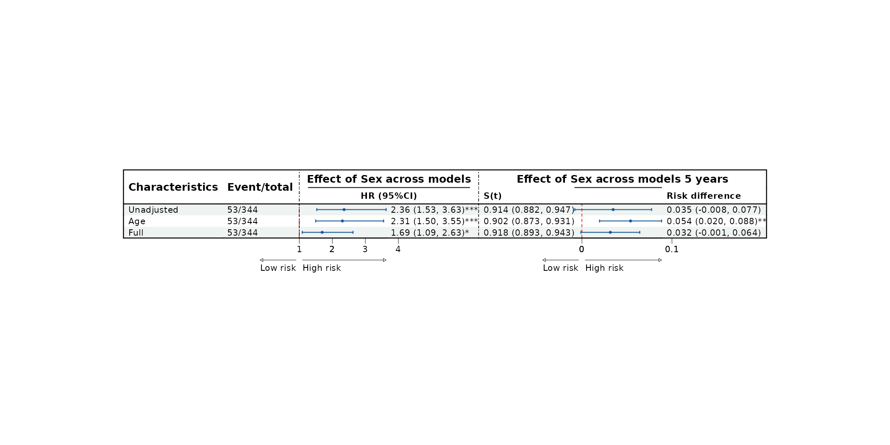{fig-alt="HR 与 ΔS(60)；相对效应参考值为 1；绝对差值参考值为 0。"}


### 概率与差值表 {.unnumbered}


读取 S(60) 与参照减比较差值的数值列，核对方向。

```r
as.data.frame(absolute[["sur_models"]])[, intersect(c("model_label", "level", "reference", "estimate_sur", "conf.low_sur", "conf.high_sur", "estimate", "conf.low", "conf.high", "status"), names(absolute[["sur_models"]]))]
```


::: {.table-responsive}


<div id="kfcqhnnbbx" style="padding-left:0px;padding-right:0px;padding-top:10px;padding-bottom:10px;overflow-x:auto;overflow-y:auto;width:auto;height:auto;">

  <table class="gt_table" data-quarto-disable-processing="false" data-quarto-bootstrap="false" style="-webkit-font-smoothing: antialiased; -moz-osx-font-smoothing: grayscale; font-family: system-ui, 'Segoe UI', Roboto, Helvetica, Arial, sans-serif, 'Apple Color Emoji', 'Segoe UI Emoji', 'Segoe UI Symbol', 'Noto Color Emoji'; display: table; border-collapse: collapse; line-height: normal; margin-left: auto; margin-right: auto; color: #333333; font-size: 16px; font-weight: normal; font-style: normal; background-color: #FFFFFF; width: auto; border-top-style: solid; border-top-width: 2px; border-top-color: #A8A8A8; border-right-style: none; border-right-width: 2px; border-right-color: #D3D3D3; border-bottom-style: solid; border-bottom-width: 2px; border-bottom-color: #A8A8A8; border-left-style: none; border-left-width: 2px; border-left-color: #D3D3D3;" bgcolor="#FFFFFF">
  <thead style="border-style: none;">
    <tr class="gt_col_headings" style="border-style: none; border-top-style: solid; border-top-width: 2px; border-top-color: #D3D3D3; border-bottom-style: solid; border-bottom-width: 2px; border-bottom-color: #D3D3D3; border-left-style: none; border-left-width: 1px; border-left-color: #D3D3D3; border-right-style: none; border-right-width: 1px; border-right-color: #D3D3D3;">
      <th class="gt_col_heading gt_columns_bottom_border gt_left" rowspan="1" colspan="1" scope="col" id="model_label" style="border-style: none; color: #333333; background-color: #FFFFFF; font-size: 100%; font-weight: normal; text-transform: inherit; border-left-style: none; border-left-width: 1px; border-left-color: #D3D3D3; border-right-style: none; border-right-width: 1px; border-right-color: #D3D3D3; vertical-align: bottom; padding-top: 5px; padding-bottom: 6px; padding-left: 5px; padding-right: 5px; overflow-x: hidden; text-align: left;" bgcolor="#FFFFFF" valign="bottom" align="left">model_label</th>
      <th class="gt_col_heading gt_columns_bottom_border gt_left" rowspan="1" colspan="1" scope="col" id="level" style="border-style: none; color: #333333; background-color: #FFFFFF; font-size: 100%; font-weight: normal; text-transform: inherit; border-left-style: none; border-left-width: 1px; border-left-color: #D3D3D3; border-right-style: none; border-right-width: 1px; border-right-color: #D3D3D3; vertical-align: bottom; padding-top: 5px; padding-bottom: 6px; padding-left: 5px; padding-right: 5px; overflow-x: hidden; text-align: left;" bgcolor="#FFFFFF" valign="bottom" align="left">level</th>
      <th class="gt_col_heading gt_columns_bottom_border gt_left" rowspan="1" colspan="1" scope="col" id="reference" style="border-style: none; color: #333333; background-color: #FFFFFF; font-size: 100%; font-weight: normal; text-transform: inherit; border-left-style: none; border-left-width: 1px; border-left-color: #D3D3D3; border-right-style: none; border-right-width: 1px; border-right-color: #D3D3D3; vertical-align: bottom; padding-top: 5px; padding-bottom: 6px; padding-left: 5px; padding-right: 5px; overflow-x: hidden; text-align: left;" bgcolor="#FFFFFF" valign="bottom" align="left">reference</th>
      <th class="gt_col_heading gt_columns_bottom_border gt_right" rowspan="1" colspan="1" scope="col" id="estimate_sur" style="border-style: none; color: #333333; background-color: #FFFFFF; font-size: 100%; font-weight: normal; text-transform: inherit; border-left-style: none; border-left-width: 1px; border-left-color: #D3D3D3; border-right-style: none; border-right-width: 1px; border-right-color: #D3D3D3; vertical-align: bottom; padding-top: 5px; padding-bottom: 6px; padding-left: 5px; padding-right: 5px; overflow-x: hidden; text-align: right; font-variant-numeric: tabular-nums;" bgcolor="#FFFFFF" valign="bottom" align="right">estimate_sur</th>
      <th class="gt_col_heading gt_columns_bottom_border gt_right" rowspan="1" colspan="1" scope="col" id="conf.low_sur" style="border-style: none; color: #333333; background-color: #FFFFFF; font-size: 100%; font-weight: normal; text-transform: inherit; border-left-style: none; border-left-width: 1px; border-left-color: #D3D3D3; border-right-style: none; border-right-width: 1px; border-right-color: #D3D3D3; vertical-align: bottom; padding-top: 5px; padding-bottom: 6px; padding-left: 5px; padding-right: 5px; overflow-x: hidden; text-align: right; font-variant-numeric: tabular-nums;" bgcolor="#FFFFFF" valign="bottom" align="right">conf.low_sur</th>
      <th class="gt_col_heading gt_columns_bottom_border gt_right" rowspan="1" colspan="1" scope="col" id="conf.high_sur" style="border-style: none; color: #333333; background-color: #FFFFFF; font-size: 100%; font-weight: normal; text-transform: inherit; border-left-style: none; border-left-width: 1px; border-left-color: #D3D3D3; border-right-style: none; border-right-width: 1px; border-right-color: #D3D3D3; vertical-align: bottom; padding-top: 5px; padding-bottom: 6px; padding-left: 5px; padding-right: 5px; overflow-x: hidden; text-align: right; font-variant-numeric: tabular-nums;" bgcolor="#FFFFFF" valign="bottom" align="right">conf.high_sur</th>
      <th class="gt_col_heading gt_columns_bottom_border gt_right" rowspan="1" colspan="1" scope="col" id="estimate" style="border-style: none; color: #333333; background-color: #FFFFFF; font-size: 100%; font-weight: normal; text-transform: inherit; border-left-style: none; border-left-width: 1px; border-left-color: #D3D3D3; border-right-style: none; border-right-width: 1px; border-right-color: #D3D3D3; vertical-align: bottom; padding-top: 5px; padding-bottom: 6px; padding-left: 5px; padding-right: 5px; overflow-x: hidden; text-align: right; font-variant-numeric: tabular-nums;" bgcolor="#FFFFFF" valign="bottom" align="right">estimate</th>
      <th class="gt_col_heading gt_columns_bottom_border gt_right" rowspan="1" colspan="1" scope="col" id="conf.low" style="border-style: none; color: #333333; background-color: #FFFFFF; font-size: 100%; font-weight: normal; text-transform: inherit; border-left-style: none; border-left-width: 1px; border-left-color: #D3D3D3; border-right-style: none; border-right-width: 1px; border-right-color: #D3D3D3; vertical-align: bottom; padding-top: 5px; padding-bottom: 6px; padding-left: 5px; padding-right: 5px; overflow-x: hidden; text-align: right; font-variant-numeric: tabular-nums;" bgcolor="#FFFFFF" valign="bottom" align="right">conf.low</th>
      <th class="gt_col_heading gt_columns_bottom_border gt_right" rowspan="1" colspan="1" scope="col" id="conf.high" style="border-style: none; color: #333333; background-color: #FFFFFF; font-size: 100%; font-weight: normal; text-transform: inherit; border-left-style: none; border-left-width: 1px; border-left-color: #D3D3D3; border-right-style: none; border-right-width: 1px; border-right-color: #D3D3D3; vertical-align: bottom; padding-top: 5px; padding-bottom: 6px; padding-left: 5px; padding-right: 5px; overflow-x: hidden; text-align: right; font-variant-numeric: tabular-nums;" bgcolor="#FFFFFF" valign="bottom" align="right">conf.high</th>
      <th class="gt_col_heading gt_columns_bottom_border gt_left" rowspan="1" colspan="1" scope="col" id="status" style="border-style: none; color: #333333; background-color: #FFFFFF; font-size: 100%; font-weight: normal; text-transform: inherit; border-left-style: none; border-left-width: 1px; border-left-color: #D3D3D3; border-right-style: none; border-right-width: 1px; border-right-color: #D3D3D3; vertical-align: bottom; padding-top: 5px; padding-bottom: 6px; padding-left: 5px; padding-right: 5px; overflow-x: hidden; text-align: left;" bgcolor="#FFFFFF" valign="bottom" align="left">status</th>
    </tr>
  </thead>
  <tbody class="gt_table_body" style="border-style: none; border-top-style: solid; border-top-width: 2px; border-top-color: #D3D3D3; border-bottom-style: solid; border-bottom-width: 2px; border-bottom-color: #D3D3D3;">
    <tr style="border-style: none;"><td headers="model_label" class="gt_row gt_left" style="border-style: none; padding-top: 8px; padding-bottom: 8px; padding-left: 5px; padding-right: 5px; margin: 10px; border-top-style: solid; border-top-width: 1px; border-top-color: #D3D3D3; border-left-style: none; border-left-width: 1px; border-left-color: #D3D3D3; border-right-style: none; border-right-width: 1px; border-right-color: #D3D3D3; vertical-align: middle; overflow-x: hidden; text-align: left;" valign="middle" align="left">NA</td>
<td headers="level" class="gt_row gt_left" style="border-style: none; padding-top: 8px; padding-bottom: 8px; padding-left: 5px; padding-right: 5px; margin: 10px; border-top-style: solid; border-top-width: 1px; border-top-color: #D3D3D3; border-left-style: none; border-left-width: 1px; border-left-color: #D3D3D3; border-right-style: none; border-right-width: 1px; border-right-color: #D3D3D3; vertical-align: middle; overflow-x: hidden; text-align: left;" valign="middle" align="left">Male</td>
<td headers="reference" class="gt_row gt_left" style="border-style: none; padding-top: 8px; padding-bottom: 8px; padding-left: 5px; padding-right: 5px; margin: 10px; border-top-style: solid; border-top-width: 1px; border-top-color: #D3D3D3; border-left-style: none; border-left-width: 1px; border-left-color: #D3D3D3; border-right-style: none; border-right-width: 1px; border-right-color: #D3D3D3; vertical-align: middle; overflow-x: hidden; text-align: left;" valign="middle" align="left">Female</td>
<td headers="estimate_sur" class="gt_row gt_right" style="border-style: none; padding-top: 8px; padding-bottom: 8px; padding-left: 5px; padding-right: 5px; margin: 10px; border-top-style: solid; border-top-width: 1px; border-top-color: #D3D3D3; border-left-style: none; border-left-width: 1px; border-left-color: #D3D3D3; border-right-style: none; border-right-width: 1px; border-right-color: #D3D3D3; vertical-align: middle; overflow-x: hidden; text-align: right; font-variant-numeric: tabular-nums;" valign="middle" align="right">NA</td>
<td headers="conf.low_sur" class="gt_row gt_right" style="border-style: none; padding-top: 8px; padding-bottom: 8px; padding-left: 5px; padding-right: 5px; margin: 10px; border-top-style: solid; border-top-width: 1px; border-top-color: #D3D3D3; border-left-style: none; border-left-width: 1px; border-left-color: #D3D3D3; border-right-style: none; border-right-width: 1px; border-right-color: #D3D3D3; vertical-align: middle; overflow-x: hidden; text-align: right; font-variant-numeric: tabular-nums;" valign="middle" align="right">NA</td>
<td headers="conf.high_sur" class="gt_row gt_right" style="border-style: none; padding-top: 8px; padding-bottom: 8px; padding-left: 5px; padding-right: 5px; margin: 10px; border-top-style: solid; border-top-width: 1px; border-top-color: #D3D3D3; border-left-style: none; border-left-width: 1px; border-left-color: #D3D3D3; border-right-style: none; border-right-width: 1px; border-right-color: #D3D3D3; vertical-align: middle; overflow-x: hidden; text-align: right; font-variant-numeric: tabular-nums;" valign="middle" align="right">NA</td>
<td headers="estimate" class="gt_row gt_right" style="border-style: none; padding-top: 8px; padding-bottom: 8px; padding-left: 5px; padding-right: 5px; margin: 10px; border-top-style: solid; border-top-width: 1px; border-top-color: #D3D3D3; border-left-style: none; border-left-width: 1px; border-left-color: #D3D3D3; border-right-style: none; border-right-width: 1px; border-right-color: #D3D3D3; vertical-align: middle; overflow-x: hidden; text-align: right; font-variant-numeric: tabular-nums;" valign="middle" align="right">NA</td>
<td headers="conf.low" class="gt_row gt_right" style="border-style: none; padding-top: 8px; padding-bottom: 8px; padding-left: 5px; padding-right: 5px; margin: 10px; border-top-style: solid; border-top-width: 1px; border-top-color: #D3D3D3; border-left-style: none; border-left-width: 1px; border-left-color: #D3D3D3; border-right-style: none; border-right-width: 1px; border-right-color: #D3D3D3; vertical-align: middle; overflow-x: hidden; text-align: right; font-variant-numeric: tabular-nums;" valign="middle" align="right">NA</td>
<td headers="conf.high" class="gt_row gt_right" style="border-style: none; padding-top: 8px; padding-bottom: 8px; padding-left: 5px; padding-right: 5px; margin: 10px; border-top-style: solid; border-top-width: 1px; border-top-color: #D3D3D3; border-left-style: none; border-left-width: 1px; border-left-color: #D3D3D3; border-right-style: none; border-right-width: 1px; border-right-color: #D3D3D3; vertical-align: middle; overflow-x: hidden; text-align: right; font-variant-numeric: tabular-nums;" valign="middle" align="right">NA</td>
<td headers="status" class="gt_row gt_left" style="border-style: none; padding-top: 8px; padding-bottom: 8px; padding-left: 5px; padding-right: 5px; margin: 10px; border-top-style: solid; border-top-width: 1px; border-top-color: #D3D3D3; border-left-style: none; border-left-width: 1px; border-left-color: #D3D3D3; border-right-style: none; border-right-width: 1px; border-right-color: #D3D3D3; vertical-align: middle; overflow-x: hidden; text-align: left;" valign="middle" align="left">header</td></tr>
    <tr style="border-style: none;"><td headers="model_label" class="gt_row gt_left" style="border-style: none; padding-top: 8px; padding-bottom: 8px; padding-left: 5px; padding-right: 5px; margin: 10px; border-top-style: solid; border-top-width: 1px; border-top-color: #D3D3D3; border-left-style: none; border-left-width: 1px; border-left-color: #D3D3D3; border-right-style: none; border-right-width: 1px; border-right-color: #D3D3D3; vertical-align: middle; overflow-x: hidden; text-align: left;" valign="middle" align="left">Unadjusted</td>
<td headers="level" class="gt_row gt_left" style="border-style: none; padding-top: 8px; padding-bottom: 8px; padding-left: 5px; padding-right: 5px; margin: 10px; border-top-style: solid; border-top-width: 1px; border-top-color: #D3D3D3; border-left-style: none; border-left-width: 1px; border-left-color: #D3D3D3; border-right-style: none; border-right-width: 1px; border-right-color: #D3D3D3; vertical-align: middle; overflow-x: hidden; text-align: left;" valign="middle" align="left">Male</td>
<td headers="reference" class="gt_row gt_left" style="border-style: none; padding-top: 8px; padding-bottom: 8px; padding-left: 5px; padding-right: 5px; margin: 10px; border-top-style: solid; border-top-width: 1px; border-top-color: #D3D3D3; border-left-style: none; border-left-width: 1px; border-left-color: #D3D3D3; border-right-style: none; border-right-width: 1px; border-right-color: #D3D3D3; vertical-align: middle; overflow-x: hidden; text-align: left;" valign="middle" align="left">Female</td>
<td headers="estimate_sur" class="gt_row gt_right" style="border-style: none; padding-top: 8px; padding-bottom: 8px; padding-left: 5px; padding-right: 5px; margin: 10px; border-top-style: solid; border-top-width: 1px; border-top-color: #D3D3D3; border-left-style: none; border-left-width: 1px; border-left-color: #D3D3D3; border-right-style: none; border-right-width: 1px; border-right-color: #D3D3D3; vertical-align: middle; overflow-x: hidden; text-align: right; font-variant-numeric: tabular-nums;" valign="middle" align="right">0.9137864</td>
<td headers="conf.low_sur" class="gt_row gt_right" style="border-style: none; padding-top: 8px; padding-bottom: 8px; padding-left: 5px; padding-right: 5px; margin: 10px; border-top-style: solid; border-top-width: 1px; border-top-color: #D3D3D3; border-left-style: none; border-left-width: 1px; border-left-color: #D3D3D3; border-right-style: none; border-right-width: 1px; border-right-color: #D3D3D3; vertical-align: middle; overflow-x: hidden; text-align: right; font-variant-numeric: tabular-nums;" valign="middle" align="right">0.8817345</td>
<td headers="conf.high_sur" class="gt_row gt_right" style="border-style: none; padding-top: 8px; padding-bottom: 8px; padding-left: 5px; padding-right: 5px; margin: 10px; border-top-style: solid; border-top-width: 1px; border-top-color: #D3D3D3; border-left-style: none; border-left-width: 1px; border-left-color: #D3D3D3; border-right-style: none; border-right-width: 1px; border-right-color: #D3D3D3; vertical-align: middle; overflow-x: hidden; text-align: right; font-variant-numeric: tabular-nums;" valign="middle" align="right">0.9470035</td>
<td headers="estimate" class="gt_row gt_right" style="border-style: none; padding-top: 8px; padding-bottom: 8px; padding-left: 5px; padding-right: 5px; margin: 10px; border-top-style: solid; border-top-width: 1px; border-top-color: #D3D3D3; border-left-style: none; border-left-width: 1px; border-left-color: #D3D3D3; border-right-style: none; border-right-width: 1px; border-right-color: #D3D3D3; vertical-align: middle; overflow-x: hidden; text-align: right; font-variant-numeric: tabular-nums;" valign="middle" align="right">0.03470878</td>
<td headers="conf.low" class="gt_row gt_right" style="border-style: none; padding-top: 8px; padding-bottom: 8px; padding-left: 5px; padding-right: 5px; margin: 10px; border-top-style: solid; border-top-width: 1px; border-top-color: #D3D3D3; border-left-style: none; border-left-width: 1px; border-left-color: #D3D3D3; border-right-style: none; border-right-width: 1px; border-right-color: #D3D3D3; vertical-align: middle; overflow-x: hidden; text-align: right; font-variant-numeric: tabular-nums;" valign="middle" align="right">-0.007917264</td>
<td headers="conf.high" class="gt_row gt_right" style="border-style: none; padding-top: 8px; padding-bottom: 8px; padding-left: 5px; padding-right: 5px; margin: 10px; border-top-style: solid; border-top-width: 1px; border-top-color: #D3D3D3; border-left-style: none; border-left-width: 1px; border-left-color: #D3D3D3; border-right-style: none; border-right-width: 1px; border-right-color: #D3D3D3; vertical-align: middle; overflow-x: hidden; text-align: right; font-variant-numeric: tabular-nums;" valign="middle" align="right">0.07733483</td>
<td headers="status" class="gt_row gt_left" style="border-style: none; padding-top: 8px; padding-bottom: 8px; padding-left: 5px; padding-right: 5px; margin: 10px; border-top-style: solid; border-top-width: 1px; border-top-color: #D3D3D3; border-left-style: none; border-left-width: 1px; border-left-color: #D3D3D3; border-right-style: none; border-right-width: 1px; border-right-color: #D3D3D3; vertical-align: middle; overflow-x: hidden; text-align: left;" valign="middle" align="left">estimated</td></tr>
    <tr style="border-style: none;"><td headers="model_label" class="gt_row gt_left" style="border-style: none; padding-top: 8px; padding-bottom: 8px; padding-left: 5px; padding-right: 5px; margin: 10px; border-top-style: solid; border-top-width: 1px; border-top-color: #D3D3D3; border-left-style: none; border-left-width: 1px; border-left-color: #D3D3D3; border-right-style: none; border-right-width: 1px; border-right-color: #D3D3D3; vertical-align: middle; overflow-x: hidden; text-align: left;" valign="middle" align="left">Age</td>
<td headers="level" class="gt_row gt_left" style="border-style: none; padding-top: 8px; padding-bottom: 8px; padding-left: 5px; padding-right: 5px; margin: 10px; border-top-style: solid; border-top-width: 1px; border-top-color: #D3D3D3; border-left-style: none; border-left-width: 1px; border-left-color: #D3D3D3; border-right-style: none; border-right-width: 1px; border-right-color: #D3D3D3; vertical-align: middle; overflow-x: hidden; text-align: left;" valign="middle" align="left">Male</td>
<td headers="reference" class="gt_row gt_left" style="border-style: none; padding-top: 8px; padding-bottom: 8px; padding-left: 5px; padding-right: 5px; margin: 10px; border-top-style: solid; border-top-width: 1px; border-top-color: #D3D3D3; border-left-style: none; border-left-width: 1px; border-left-color: #D3D3D3; border-right-style: none; border-right-width: 1px; border-right-color: #D3D3D3; vertical-align: middle; overflow-x: hidden; text-align: left;" valign="middle" align="left">Female</td>
<td headers="estimate_sur" class="gt_row gt_right" style="border-style: none; padding-top: 8px; padding-bottom: 8px; padding-left: 5px; padding-right: 5px; margin: 10px; border-top-style: solid; border-top-width: 1px; border-top-color: #D3D3D3; border-left-style: none; border-left-width: 1px; border-left-color: #D3D3D3; border-right-style: none; border-right-width: 1px; border-right-color: #D3D3D3; vertical-align: middle; overflow-x: hidden; text-align: right; font-variant-numeric: tabular-nums;" valign="middle" align="right">0.9022021</td>
<td headers="conf.low_sur" class="gt_row gt_right" style="border-style: none; padding-top: 8px; padding-bottom: 8px; padding-left: 5px; padding-right: 5px; margin: 10px; border-top-style: solid; border-top-width: 1px; border-top-color: #D3D3D3; border-left-style: none; border-left-width: 1px; border-left-color: #D3D3D3; border-right-style: none; border-right-width: 1px; border-right-color: #D3D3D3; vertical-align: middle; overflow-x: hidden; text-align: right; font-variant-numeric: tabular-nums;" valign="middle" align="right">0.8730716</td>
<td headers="conf.high_sur" class="gt_row gt_right" style="border-style: none; padding-top: 8px; padding-bottom: 8px; padding-left: 5px; padding-right: 5px; margin: 10px; border-top-style: solid; border-top-width: 1px; border-top-color: #D3D3D3; border-left-style: none; border-left-width: 1px; border-left-color: #D3D3D3; border-right-style: none; border-right-width: 1px; border-right-color: #D3D3D3; vertical-align: middle; overflow-x: hidden; text-align: right; font-variant-numeric: tabular-nums;" valign="middle" align="right">0.9313325</td>
<td headers="estimate" class="gt_row gt_right" style="border-style: none; padding-top: 8px; padding-bottom: 8px; padding-left: 5px; padding-right: 5px; margin: 10px; border-top-style: solid; border-top-width: 1px; border-top-color: #D3D3D3; border-left-style: none; border-left-width: 1px; border-left-color: #D3D3D3; border-right-style: none; border-right-width: 1px; border-right-color: #D3D3D3; vertical-align: middle; overflow-x: hidden; text-align: right; font-variant-numeric: tabular-nums;" valign="middle" align="right">0.05403428</td>
<td headers="conf.low" class="gt_row gt_right" style="border-style: none; padding-top: 8px; padding-bottom: 8px; padding-left: 5px; padding-right: 5px; margin: 10px; border-top-style: solid; border-top-width: 1px; border-top-color: #D3D3D3; border-left-style: none; border-left-width: 1px; border-left-color: #D3D3D3; border-right-style: none; border-right-width: 1px; border-right-color: #D3D3D3; vertical-align: middle; overflow-x: hidden; text-align: right; font-variant-numeric: tabular-nums;" valign="middle" align="right">0.019608801</td>
<td headers="conf.high" class="gt_row gt_right" style="border-style: none; padding-top: 8px; padding-bottom: 8px; padding-left: 5px; padding-right: 5px; margin: 10px; border-top-style: solid; border-top-width: 1px; border-top-color: #D3D3D3; border-left-style: none; border-left-width: 1px; border-left-color: #D3D3D3; border-right-style: none; border-right-width: 1px; border-right-color: #D3D3D3; vertical-align: middle; overflow-x: hidden; text-align: right; font-variant-numeric: tabular-nums;" valign="middle" align="right">0.08845976</td>
<td headers="status" class="gt_row gt_left" style="border-style: none; padding-top: 8px; padding-bottom: 8px; padding-left: 5px; padding-right: 5px; margin: 10px; border-top-style: solid; border-top-width: 1px; border-top-color: #D3D3D3; border-left-style: none; border-left-width: 1px; border-left-color: #D3D3D3; border-right-style: none; border-right-width: 1px; border-right-color: #D3D3D3; vertical-align: middle; overflow-x: hidden; text-align: left;" valign="middle" align="left">estimated</td></tr>
    <tr style="border-style: none;"><td headers="model_label" class="gt_row gt_left" style="border-style: none; padding-top: 8px; padding-bottom: 8px; padding-left: 5px; padding-right: 5px; margin: 10px; border-top-style: solid; border-top-width: 1px; border-top-color: #D3D3D3; border-left-style: none; border-left-width: 1px; border-left-color: #D3D3D3; border-right-style: none; border-right-width: 1px; border-right-color: #D3D3D3; vertical-align: middle; overflow-x: hidden; text-align: left;" valign="middle" align="left">Full</td>
<td headers="level" class="gt_row gt_left" style="border-style: none; padding-top: 8px; padding-bottom: 8px; padding-left: 5px; padding-right: 5px; margin: 10px; border-top-style: solid; border-top-width: 1px; border-top-color: #D3D3D3; border-left-style: none; border-left-width: 1px; border-left-color: #D3D3D3; border-right-style: none; border-right-width: 1px; border-right-color: #D3D3D3; vertical-align: middle; overflow-x: hidden; text-align: left;" valign="middle" align="left">Male</td>
<td headers="reference" class="gt_row gt_left" style="border-style: none; padding-top: 8px; padding-bottom: 8px; padding-left: 5px; padding-right: 5px; margin: 10px; border-top-style: solid; border-top-width: 1px; border-top-color: #D3D3D3; border-left-style: none; border-left-width: 1px; border-left-color: #D3D3D3; border-right-style: none; border-right-width: 1px; border-right-color: #D3D3D3; vertical-align: middle; overflow-x: hidden; text-align: left;" valign="middle" align="left">Female</td>
<td headers="estimate_sur" class="gt_row gt_right" style="border-style: none; padding-top: 8px; padding-bottom: 8px; padding-left: 5px; padding-right: 5px; margin: 10px; border-top-style: solid; border-top-width: 1px; border-top-color: #D3D3D3; border-left-style: none; border-left-width: 1px; border-left-color: #D3D3D3; border-right-style: none; border-right-width: 1px; border-right-color: #D3D3D3; vertical-align: middle; overflow-x: hidden; text-align: right; font-variant-numeric: tabular-nums;" valign="middle" align="right">0.9181732</td>
<td headers="conf.low_sur" class="gt_row gt_right" style="border-style: none; padding-top: 8px; padding-bottom: 8px; padding-left: 5px; padding-right: 5px; margin: 10px; border-top-style: solid; border-top-width: 1px; border-top-color: #D3D3D3; border-left-style: none; border-left-width: 1px; border-left-color: #D3D3D3; border-right-style: none; border-right-width: 1px; border-right-color: #D3D3D3; vertical-align: middle; overflow-x: hidden; text-align: right; font-variant-numeric: tabular-nums;" valign="middle" align="right">0.8932701</td>
<td headers="conf.high_sur" class="gt_row gt_right" style="border-style: none; padding-top: 8px; padding-bottom: 8px; padding-left: 5px; padding-right: 5px; margin: 10px; border-top-style: solid; border-top-width: 1px; border-top-color: #D3D3D3; border-left-style: none; border-left-width: 1px; border-left-color: #D3D3D3; border-right-style: none; border-right-width: 1px; border-right-color: #D3D3D3; vertical-align: middle; overflow-x: hidden; text-align: right; font-variant-numeric: tabular-nums;" valign="middle" align="right">0.9430763</td>
<td headers="estimate" class="gt_row gt_right" style="border-style: none; padding-top: 8px; padding-bottom: 8px; padding-left: 5px; padding-right: 5px; margin: 10px; border-top-style: solid; border-top-width: 1px; border-top-color: #D3D3D3; border-left-style: none; border-left-width: 1px; border-left-color: #D3D3D3; border-right-style: none; border-right-width: 1px; border-right-color: #D3D3D3; vertical-align: middle; overflow-x: hidden; text-align: right; font-variant-numeric: tabular-nums;" valign="middle" align="right">0.03154510</td>
<td headers="conf.low" class="gt_row gt_right" style="border-style: none; padding-top: 8px; padding-bottom: 8px; padding-left: 5px; padding-right: 5px; margin: 10px; border-top-style: solid; border-top-width: 1px; border-top-color: #D3D3D3; border-left-style: none; border-left-width: 1px; border-left-color: #D3D3D3; border-right-style: none; border-right-width: 1px; border-right-color: #D3D3D3; vertical-align: middle; overflow-x: hidden; text-align: right; font-variant-numeric: tabular-nums;" valign="middle" align="right">-0.001120068</td>
<td headers="conf.high" class="gt_row gt_right" style="border-style: none; padding-top: 8px; padding-bottom: 8px; padding-left: 5px; padding-right: 5px; margin: 10px; border-top-style: solid; border-top-width: 1px; border-top-color: #D3D3D3; border-left-style: none; border-left-width: 1px; border-left-color: #D3D3D3; border-right-style: none; border-right-width: 1px; border-right-color: #D3D3D3; vertical-align: middle; overflow-x: hidden; text-align: right; font-variant-numeric: tabular-nums;" valign="middle" align="right">0.06421027</td>
<td headers="status" class="gt_row gt_left" style="border-style: none; padding-top: 8px; padding-bottom: 8px; padding-left: 5px; padding-right: 5px; margin: 10px; border-top-style: solid; border-top-width: 1px; border-top-color: #D3D3D3; border-left-style: none; border-left-width: 1px; border-left-color: #D3D3D3; border-right-style: none; border-right-width: 1px; border-right-color: #D3D3D3; vertical-align: middle; overflow-x: hidden; text-align: left;" valign="middle" align="left">estimated</td></tr>
  </tbody>

</table>
</div>


:::


:::


## 分面与按行分层


`sub_var` 返回各层独立面板；`split_var` 将层绑定为同一张表的前导列。两者可以同时使用：先按 `sub_var` 分面板，再在每个面板内按 `split_var` 绑定行。`add_overall=TRUE` 同时增加总体面板及面板内的 Overall 行块；某面板缺少的分层水平保留空白块，`status="not_estimable"`，便于面板对齐。总体调整变量仍按原指定，层内会去掉常数分层变量。分层效应差异不是正式交互检验。当前组合用法见下方[独立分层与面板内分层](#strata-20261019)。

::: {.panel-tabset}


### 各层独立面板 {.unnumbered}


Overall、Early、Other 分别成面板。

```r
plt_eff(by_panel, display = "v", show_pinter = "none",
  fixed_size = FALSE, base_size = 10)
```


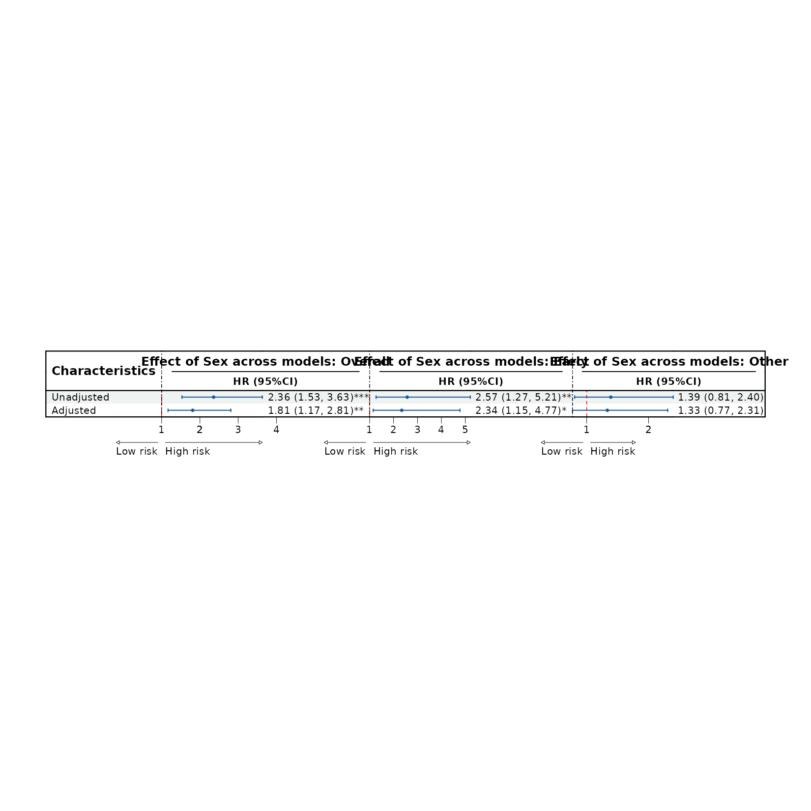{fig-alt="各层独立面板；Overall、Early、Other 分别成面板。"}


### 层作为前导列 {.unnumbered}


同一分层对象组织成一张按层排列的模型表。

```r
plt_eff(by_rows, show_pinter = "none",
  fixed_size = FALSE, base_size = 10)
```


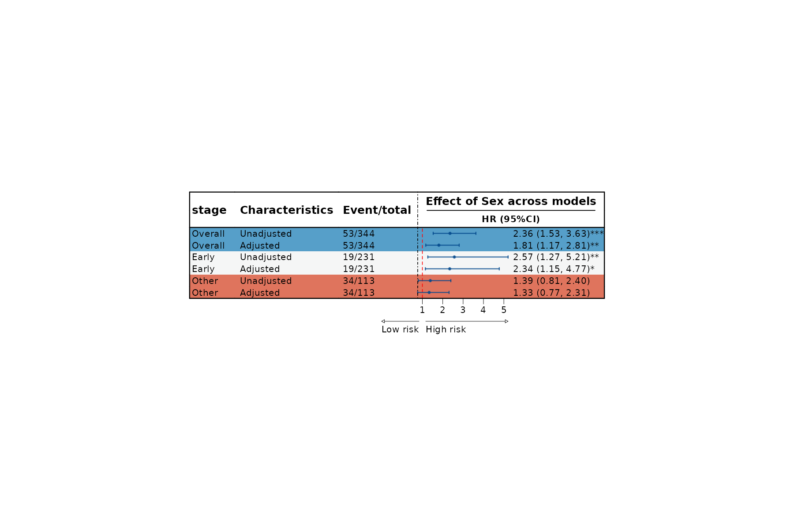{fig-alt="层作为前导列；同一分层对象组织成一张按层排列的模型表。"}


:::


## 独立分层与面板内分层 {#strata-20261019}

2026-10-19 按已推送 RegR `f26e137`，在 Windows / WSL R 4.4.3 执行本节。继续使用上面的同一份 MTC 演示样本；未改变结局、参考组或随访单位。

<!-- rnotes-20261019: eff-strata -->
```r
both_strata <- run_quiet(get_eff_cat(d, cat_var = "Sex",
  sub_var = "stage", split_var = "surgery", adj_var = c("Age", "Tum"),
  add_overall = TRUE))

d_split <- d
d_split[["age55"]] <- factor(ifelse(d_split[["Age"]] < 55, "<55", ">=55"))
independent <- run_quiet(get_eff_cat(d_split, cat_var = "Sex",
  split_var = list("stage", "age55"), adj_var = c("Age", "Tum")))
joint <- run_quiet(get_eff_cat(d_split, cat_var = "Sex",
  split_var = c("stage", "age55"), adj_var = c("Age", "Tum")))
```

::: {.panel-tabset}

### 面板内再分层 {.unnumbered}

`stage` 决定 Overall、Early、Other 三个面板；每个面板内按手术分组，保留该面板的 Overall 行块。

```r
plt_eff(both_strata, fixed_size = FALSE, base_size = 10,
  forest_nchar = 35, xlim = c(0.3, 70), ticks_at = c(1, 10, 30, 60))
```

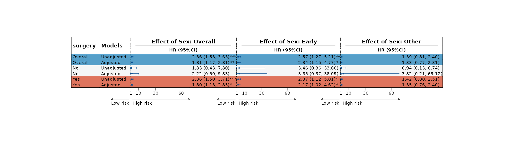{fig-alt="同一MTC样本中，Overall和两种分期分别成面板，各面板内再展示总体及手术分层的未调整与调整Cox效应。"}

### 每个变量独立分层 {.unnumbered}

```r
names(independent[[1]])
plt_eff(independent, fixed_size = FALSE, base_size = 10, forest_nchar = 35)
```

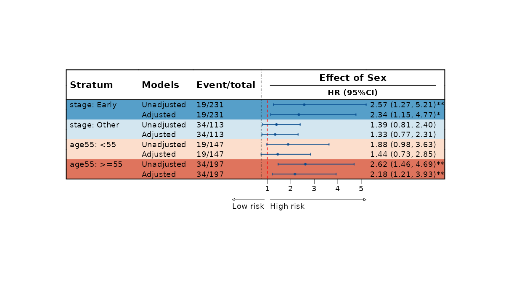{fig-alt="单张森林表依次展示stage的Early与Other、age55的两个年龄层；前导列为split_var和split_level。"}

:::

| 写法 | 模型所用的数据层 | 返回表的前导列 |
|:--|:--|:--|
| `split_var=list("stage","age55")` | 先分别分析分期各层，再分别分析年龄各层 | `split_var`、`split_level` |
| `split_var=c("stage","age55")` | 分期与年龄的交叉组合 | `stage`、`age55` |

独立分层每次只剔除当前分层列的缺失值，并从模型中移除当前列；另一列若在调整项中仍会保留。不能将 `sub_var` 中的同一列再放进独立分层 list。两种写法的分析人群和调整集合可能不同，不能当作同一结果的两种排版。`dat_adj_ps` 的场景限制仍按其专节执行。

图中增加 `forest_nchar` 为估计与区间留出列宽，原结果表保留完整数值。

## 联合暴露与倾向评分设计


cat_var_combine 交叉多个列构成暴露水平，首组合为参照；组成暴露的列会从调整变量与 ps_var 中移除。这个效应对照不等同于 Sex×stage 交互项检验。倾向评分规格可通过 ps_var/ps_methods 指定 design、method、estimand 与相应参数，但要先做支持区域和平衡诊断。

比较 Sex 与 stage 的联合水平，各对照块下列出调整模型。

```r
plt_eff(combined, show_pinter = "none",
  fixed_size = FALSE, base_size = 10)
```


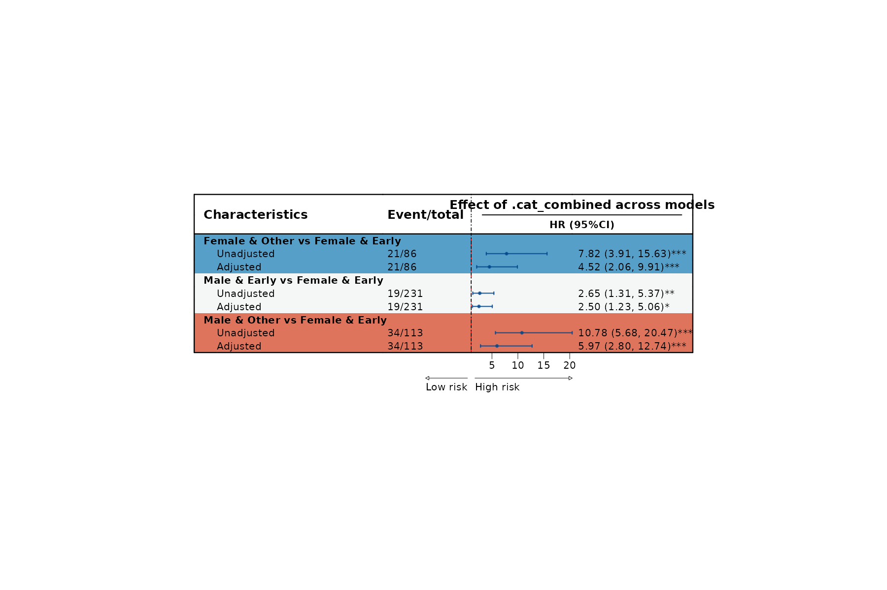{fig-alt="交叉分类暴露；比较 Sex 与 stage 的联合水平，各对照块下列出调整模型。"}


## 倾向评分模型与区间口径 {#ps-precision}

2026-10-05 按源码 `3411eb0` 在本页同一个 `d` 上重新运行。`ps_methods` 的每个规格必须含 `design`、`method`、`estimand`；下面用 Age、Tum 和 stage 估计 Sex 的 ATE 权重，独立于结果模型的调整集合。

```r
ps_fit <- run_quiet(get_eff_cat(d, cat_var = "Sex",
  adj_var = list(Age = "Age", Full = c("Age", "Tum", "stage")),
  ps_var = c("Age", "Tum", "stage"),
  ps_methods = list(IPTW = list(design = "weighting", method = "glm", estimand = "ATE")),
  surv = list(Cox = TRUE, Logistic = "DSS"),
  ps_robust = TRUE, conf_level = 0.95))
plt_eff(structure(ps_fit, multi_outcome = NULL), fixed_size = FALSE)
```

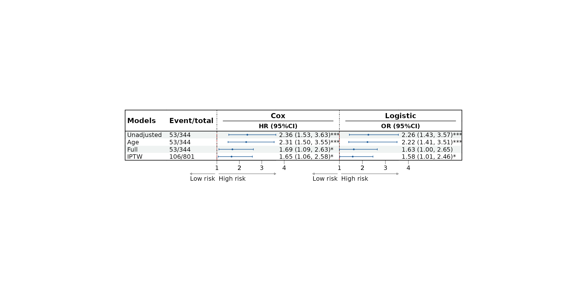{fig-alt="Cox 与 Logistic 效应表，95% 区间与模型标题对应。"}

IPTW 的 Event/total 是加权汇总，不能当作新增患者或原始样本数。观察性 Sex 对比用于说明接口；权重不会赋予暴露可干预含义。

::: {.panel-tabset}

### Cox 的 95% 区间

:::: {.table-responsive tabindex="0" role="region" aria-label="表格，可横向滚动"}

| model_label | estimate | conf.low | conf.high | p_value |
| :-- | :-- | :-- | :-- | :-- |
|  |  |  |  |  |
| Unadjusted | 2.357 | 1.531 | 3.629 | 9.817e-05 |
| Age | 2.306 | 1.497 | 3.552 | 0.0001494 |
| Full | 1.692 | 1.09 | 2.627 | 0.01906 |
| IPTW | 1.654 | 1.061 | 2.581 | 0.02646 |

::::

### Logistic 的 95% 区间

:::: {.table-responsive tabindex="0" role="region" aria-label="表格，可横向滚动"}

| model_label | estimate | conf.low | conf.high | p_value |
| :-- | :-- | :-- | :-- | :-- |
|  |  |  |  |  |
| Unadjusted | 2.261 | 1.433 | 3.566 | 0.0004531 |
| Age | 2.222 | 1.407 | 3.508 | 0.0006162 |
| Full | 1.627 | 0.9994 | 2.65 | 0.05026 |
| IPTW | 1.58 | 1.015 | 2.461 | 0.04285 |

::::

### 改成 90% 数值表

```r
ps90 <- run_quiet(get_eff_cat(d, cat_var = "Sex",
  adj_var = list(Age = "Age", Full = c("Age", "Tum", "stage")),
  ps_var = c("Age", "Tum", "stage"),
  ps_methods = list(IPTW = list(design = "weighting", method = "glm", estimand = "ATE")),
  surv = list(Cox = TRUE, Logistic = "DSS"),
  ps_robust = TRUE, conf_level = 0.90))
ps90[["haz_cox_DSS"]][c("model_label", "estimate", "conf.low", "conf.high",
                           "p_value", "p.value_0.95")]
```

:::: {.table-responsive tabindex="0" role="region" aria-label="表格，可横向滚动"}

| model_label | estimate | conf.low | conf.high | p_value | p.value_0.95 |
| :-- | :-- | :-- | :-- | :-- | :-- |
|  |  |  |  |  |  |
| Unadjusted | 2.357 | 1.641 | 3.385 | 3.462e-06 | 9.817e-05 |
| Age | 2.306 | 1.605 | 3.314 | 6.224e-06 | 0.0001494 |
| Full | 1.692 | 1.17 | 2.448 | 0.005213 | 0.01906 |
| IPTW | 1.654 | 1.139 | 2.403 | 0.008177 | 0.02646 |

::::

:::

`p_value` 按所选区间口径回推，`p.value_0.95` 保留原始检验值，两列不能混用。当前源码的比值图默认列名仍写 `95%CI`；非 95% 示例在这里展示数值表，避免给 90% 区间配上错误标题。

:::: {.table-responsive tabindex="0" role="region" aria-label="表格，可横向滚动"}

| `ps_robust = TRUE` 的路径 | 实际方差处理 |
|:--|:--|
| 二分类 GLM 权重 + Logistic | `WeightIt::glm_weightit()`，可用时采用包含 PS 估计的 M-estimation；否则 HC0 |
| 多分类 GLM 权重 + Logistic | PS 来自 `nnet::multinom()`，采用 HC0 |
| 加权 Cox | `WeightIt::coxph_weightit(vcov = "HC0")`，权重视为固定 |
| 加权 Fine–Gray | 按个体聚类的稳健拟合 |
| 匹配后的相对效应 | 匹配权重与按 subclass 聚类的稳健方差 |

::::

`ps_robust = FALSE` 保留旧推断路径；未启用任何 PS 模型时此参数不生效；当前 `ps_var` 自动预设规则见下节。自定义加权 CIF 的绝对效应在 bootstrap 内重新拟合 PS，与上面的相对效应面板不同。原页历史结果不作为新推断口径的数值对照。

## 当前 PS 预设与自动启用边界 {#ps-presets-20261020}

2026-10-20 按已推送 RegR `da6157be`，在 Windows / WSL R 4.4.3 实跑本节。`ps_methods` 现在可用预设名称的字符向量，按给定顺序成为模型行名；自定义参数或改行名仍用具名 list。

| 预设名称 | 规格与目标 |
|:--|:--|
| `PS matching (nearest, ATT)` | 最近邻匹配，ATT，ratio=1、caliper=0.2 |
| `Stabilized IPTW (ATE)` | GLM 稳定化权重，ATE |
| `SMR weighting (ATT)` | GLM，ATT |
| `Overlap weighting (ATO)` | GLM，ATO |
| `Entropy weighting (EW)` | GLM，EW |

只给非空 `ps_var` 而省略 `ps_methods`，当前二分类暴露自动运行以上五种，多分类只运行 ATE 和 ATO；`ps_methods = list()` 明确关闭。两者均为 NULL 时不启用 PS。`dat_adj_ps` 仍由每个场景自行指定，不自动补预设；顶层设置不能替场景做决定。

<!-- refresh-20261020: ps_presets -->
```r
library(RegR)
set.seed(20261020)
d_refresh <- expand.grid(Tx = factor(c("No", "Yes")),
  Group = factor(c("Low", "High"), levels = c("Low", "High")),
  Site = factor(c("A", "B")), id = 1:60)
d_refresh[["Age"]] <- rnorm(nrow(d_refresh), 55, 10)
tx <- as.integer(d_refresh[["Tx"]] == "Yes")
gr <- as.integer(d_refresh[["Group"]] == "High")
event_time <- rexp(nrow(d_refresh), exp(-3.8 + 0.6 * tx + 0.4 * gr +
  0.2 * tx * gr + 0.01 * (d_refresh[["Age"]] - 55)))
censor_time <- rexp(nrow(d_refresh), 0.012)
d_refresh[["time"]] <- pmin(event_time, censor_time)
d_refresh[["DSS"]] <- as.integer(event_time <= censor_time)
d_refresh[["Outcome"]] <- factor(ifelse(runif(nrow(d_refresh)) < plogis(
  -1 + 0.7 * tx + 0.4 * gr + 0.02 * (d_refresh[["Age"]] - 55)), "Yes", "No"),
  levels = c("No", "Yes"))
old_plot_option <- getOption("RegR.eff_cat.plot")
options(RegR.eff_cat.plot = FALSE)
presets <- c("Stabilized IPTW (ATE)", "Overlap weighting (ATO)")
ps_selected <- get_eff_cat(d_refresh, cat_var = "Tx", adj_var = "Age",
  ps_var = c("Age", "Group"), ps_methods = presets, surv = "Outcome")
ps_auto <- get_eff_cat(d_refresh, cat_var = "Tx", ps_var = c("Age", "Group"), surv = "Outcome")
ps_off <- get_eff_cat(d_refresh, cat_var = "Tx", ps_var = c("Age", "Group"),
  ps_methods = list(), surv = "Outcome")
collect_rows <- function(x) {
  rows <- do.call(rbind, lapply(x, as.data.frame))
  rows[rows[["status"]] == "estimated", c("model_label", "estimate", "conf.low", "conf.high")]
}
selected_rows <- collect_rows(ps_selected)
auto_rows <- collect_rows(ps_auto)
off_rows <- collect_rows(ps_off)
stopifnot(all(presets %in% selected_rows[["model_label"]]), nrow(auto_rows) == 6L,
          identical(as.character(off_rows[["model_label"]]), "Unadjusted"))
# 多分类只自动启用 ATE / ATO；场景列表仍不自动补 PS。
d_refresh[["Exposure3"]] <- factor(rep(c("A", "B", "C"), length.out = nrow(d_refresh)))
ps_multi <- get_eff_cat(d_refresh, cat_var = "Exposure3", ps_var = c("Age", "Group"), surv = "Outcome")
ps_scenario <- get_eff_cat(d_refresh, cat_var = "Tx", ps_var = c("Age", "Group"), surv = "Outcome",
  dat_adj_ps = list(One_cohort = list(data = d_refresh)))
stopifnot(setequal(unique(collect_rows(ps_multi)[["model_label"]]), c("Unadjusted", presets)),
          identical(as.character(collect_rows(ps_scenario)[["model_label"]]), "Unadjusted"))
p_ps <- plt_eff(ps_selected, fixed_size = TRUE, show_pinter = "none", base_size = 10,
  save = list(filename = file.path(tempdir(), "20261020-refresh-ps-presets.pdf")))
options(RegR.eff_cat.plot = old_plot_option)
selected_rows
```
<!-- /refresh-20261020: ps_presets -->

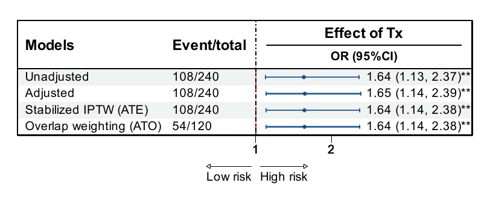{fig-alt="480行模拟二分类数据的OR森林图，包含未调整、Age调整、稳定化ATE权重和ATO重叠权重四行；不同目标人群明确保留在行名。"}

[下载 PDF](images/eff-cat-guide/20261020-refresh-ps-presets.pdf)

本例完整模型有 4 行，自动预设有未调整 + 5 种 PS 共 6 行，明确关闭后仅有未调整行。新增默认会增加拟合工作量，也会改变输出行；旧脚本若曾只给 `ps_var` 却未计划加权，需现在显式传 `list()`。本节只核对接口，不以五种结果接近证明无混杂；匹配/权重、平衡、有效样本量及 ATE / ATT / ATO / EW 的目标人群仍须分别报告。此处 OR 仅指模拟二分类结局，不解释成固定时间生存风险比。

## 使用边界、保存与复现记录


ps_robust 默认 TRUE，权重模型应报告 estimand、权重规格、平衡和有效样本量；稳健方差不会修复未测混杂或支持区域不足。本页没有给 Sex 的观察性差异作因果解释。HR、sHR、OR 及绝对概率来自不同模型，不可直接换算或用数值大小评定“哪种模型更好”。on_error="skip" 会丢掉失败的层并发出警告，发布前应报告缺失的层，不能把它们视为没有差异。

绘图调色、字体和布局只改变展示；模型、编码、样本、预测时间或权重改变后需要重新计算。带 `save` 的接口按帮助页传入保存配置；其余返回图可用 `ggplot2::ggsave()` 或 `RegR::save_plt()`，表格按返回类型使用 `save_tb()` / `save_gt()`。重采样示例的预算仅用于演示，应结合实际分析目的增加并报告失败与收敛情况。

## 相关页面与源码


- [单多因素与模型清单](um-guide.qmd)

- [倾向评分设计与诊断](ps-guide.qmd)

- [交互分析](interaction-guide.qmd)

- [RegR 函数参考](https://hui950319.github.io/RegR/reference/index.html)

- [`get_eff_cat()` 帮助页](https://hui950319.github.io/RegR/reference/get_eff_cat.html)

- [`plt_eff()` 帮助页](https://hui950319.github.io/RegR/reference/plt_eff.html)

- [`get_eff()` 帮助页](https://hui950319.github.io/RegR/reference/get_eff.html)


```r
packageVersion("RegR")
sessionInfo()
```

## dat_adj_ps：各队列分别拟合的敏感性分析 {#dat-adj-ps}

本节按 RegR 0.1.3 源码 `40515e1` 核对，复用本页 800 人演示样本，在 WSL R 4.4.3 中实际执行。`dat_adj_ps` 是具名场景 list：每个场景必须提供自己的 `data`，可分别提供 `adj_var` 与 `ps_methods`，每个场景都重新拟合自己的模型。

```r
scenario_fit <- get_eff_cat(d, cat_var = "Sex", surv = TRUE,
  ps_var = c("Age", "Tum", "stage"),
  dat_adj_ps = list(
    Full_cohort = list(data = d, adj_var = c("Age", "Tum", "stage")),
    Older_cohort = list(data = droplevels(d[d[["Age"]] >= 55, ]),
      adj_var = c("Age", "Tum", "stage"),
      ps_methods = list(IPTW = list(design = "weighting", method = "glm", estimand = "ATE")))
  ))
scenario_tables <- lapply(names(scenario_fit), function(panel) {
  tab <- as.data.frame(scenario_fit[[panel]])
  tab <- tab[tab[["status"]] != "header", , drop = FALSE]
  tab[["panel"]] <- panel
  tab[, intersect(c("panel", "label", "model_label", "level", "reference", "estimate",
    "conf.low", "conf.high", "p_value", "status"), names(tab)), drop = FALSE]
})
scenario_view <- do.call(rbind, scenario_tables)
stopifnot(nrow(scenario_view) == 6L,
  all(c("haz_models_Unadjusted", "haz_models_Adjusted") %in% names(scenario_fit)),
  sum(scenario_view[["status"]] == "not_estimable") == 1L)
```

每个场景始终拟合未调整模型；省略 `adj_var` 就不拟合调整模型，省略 `ps_methods` 就不拟合倾向评分模型。返回表按模型分组，例如 `haz_models_Unadjusted`、`haz_models_Adjusted`；每张表中，场景名称进入 `label` 并成为行标签，`model_label` 保留模型名称。森林图以模型为面板、场景为行；下面的汇总移除了仅用于显示对照名称的 header 行。

启用此参数时，顶层 `adj_var`、`ps_methods` 必须为 NULL；`ps_var`、`ps_robust`、`surv`、`conf_level` 等设置由场景共享。只有 PS 而没有调整项的场景需要顶层 `ps_var`。不能同时使用 `sub_var` / `split_var`，未知场景字段会报错。

### 实际结果

:::: {.table-responsive tabindex="0" role="region" aria-label="表格，可横向滚动"}

|panel                 |label        |model_label |level |reference | estimate| conf.low| conf.high| p_value|status        |
|:---------------------|:------------|:-----------|:-----|:---------|--------:|--------:|---------:|-------:|:-------------|
|haz_models_Unadjusted |Full_cohort  |Unadjusted  |Male  |Female    |    2.357|    1.531|     3.629|   0.000|estimated     |
|haz_models_Unadjusted |Older_cohort |Unadjusted  |Male  |Female    |    2.619|    1.461|     4.695|   0.001|estimated     |
|haz_models_Adjusted   |Full_cohort  |Adjusted    |Male  |Female    |    1.692|    1.090|     2.627|   0.019|estimated     |
|haz_models_Adjusted   |Older_cohort |Adjusted    |Male  |Female    |    2.100|    1.161|     3.799|   0.014|estimated     |
|haz_models_IPTW       |Full_cohort  |IPTW        |Male  |Female    |       NA|       NA|        NA|      NA|not_estimable |
|haz_models_IPTW       |Older_cohort |IPTW        |Male  |Female    |    1.848|    1.005|     3.396|   0.048|estimated     |

::::

Older_cohort 提供了 IPTW 设置；Full_cohort 没有该设置，所以 IPTW 面板中保留一行 `status="not_estimable"`，效应与区间为 NA。这一行表示该场景未拟合此模型，不能解读成效应为零。

```r
plt_eff(scenario_fit, show_pinter = "none", fixed_size = FALSE, base_size = 10)
```

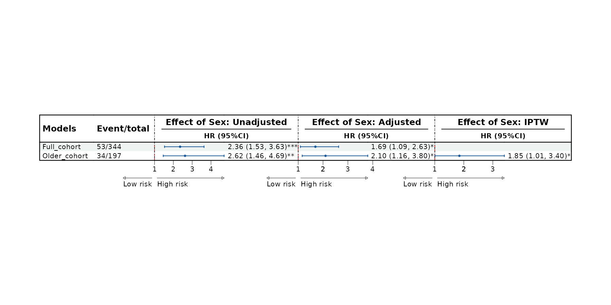{fig-alt="全体与年龄至少 55 岁队列的未调整、调整和场景内 IPTW Cox 结果，队列与调整方法均由标签区分。"}

这里比较的是不同队列和分析设计；结果差异同时可能来自入组人群、调整和加权。此演示用于检查场景组织，不能仅凭图形判定哪种模型更正确。匹配/加权仍需单独报告平衡与重叠。

## 累计调整模型与森林图默认布局 {#step-current}

2026-10-15按RegR `2d4d83c` 在WSL实际绘制以下两张图。这里的adj_var_step与森林图布局改动已包含于核对时已推送基线 `ef4ecda`；本节使用360人的固定种子模拟生存数据，与前面的SEER队列结果分开。

依次运行两个标签页；第二张图复用第一张的step_models。调整顺序是分析者指定的模型敏感性比较，不是自动筛变量，也不能凭估计趋于稳定证明消除了混杂。

::: {.panel-tabset}

### 逐项累计调整与当前默认单张森林图

adj_var_step按给定顺序累计加入协变量；本例依次为age、age+marker、age+marker+sex，外加未调整模型。不能同时给adj_var或dat_adj_ps。plt_eff()识别模型比较表后默认放进同一森林图；每种量纲仍使用自己的横轴。

```r
set.seed(20261015)
n_step <- 360L
d_step <- data.frame(z = factor(rep(c("No", "Yes"), each = 180)),
  age = rnorm(n_step, 55, 10), marker = rnorm(n_step),
  sex = factor(rep(c("F", "M"), 180)))
d_step$time <- rexp(n_step, exp(-4.5 + 0.4 * (d_step$z == "Yes") + 0.015 * (d_step$age - 55)))
d_step$DSS <- rbinom(n_step, 1, 0.65)
options(RegR.eff_cat.plot = FALSE)
step_models <- get_eff_cat(d_step, cat_var = "z", adj_var_step = c("age", "marker", "sex"),
  abs_args = list(enabled = TRUE, time = 60))
p_step_default <- plt_eff(step_models, fixed_size = FALSE)
p_step_default
```

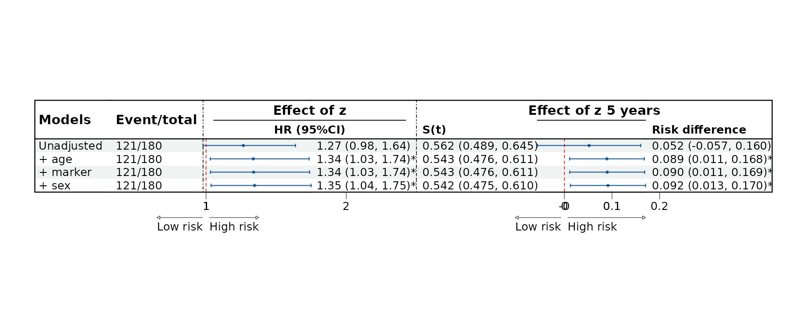{fig-alt="逐项累计调整与当前默认单张森林图的固定输入参数对照实图。"}

### 显式v保留分行展示

display="v"仍可明确要求拆成多行。相同效应尺度的面板共享范围，HR/OR与概率差等不同尺度不会强行共用一条轴。这里只重排同一个step_models，不重新拟合。

```r
p_step_vertical <- plt_eff(step_models, display = "v", fixed_size = FALSE)
p_step_vertical
```

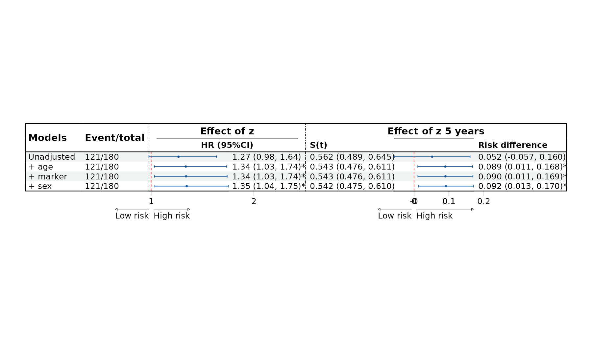{fig-alt="显式v保留分行展示的固定输入参数对照实图。"}

:::
