`get_flt()` 执行筛选并记录每一步人数，`plt_flo()` 把这些记录画成流程图，`plt_flo2()` 用阶段说明和队列人数绘制彩色研究流程。本页沿用 [MLR 的 SHAP 页](../mlr/shap-guide.qmd) 的展示方式：**实际图形配可运行代码，重要参数放在标签页中比较，点击图片可以放大**。

**本次更新：** 保留上述历史流程图与筛选结果；按已推送提交 `857677a` 新增 `save_plt()` 的 Cairo 设备说明，并实际导出、读回含 ≥、± 和希腊字母的 PDF。包版本仍为 0.1.3，设备默认值以安装源码为准。

::: {.callout-note collapse="true" title="版本与复现记录"}
**版本与执行范围：** 接口按本机 RegR **0.1.3**（源码快照 `0add2bb`）核对，使用 WSL R **4.4.3** 实际执行筛选、绘制 **12 张 `plt_flo` 图和 8 张 `plt_flo2` 图**并验证 PDF 保存。网页展示保存的汇总结果；先运行下面的共用准备代码，再运行所选标签页代码即可复现。
:::

## 示例数据与共用准备 {#data}

使用 RegR 自带的 `seer_thyroid_mtc_2026`：**4,387 人、92 列甲状腺髓样癌（MTC）示例数据**。它已经过预筛选并带有 15 步历史；本页在副本上清除该属性，从现有 4,387 人重新演示三步筛选。图中的起始人数因此对应这份预筛选数据。

<!-- flow-run: setup -->
```r
library(RegR)
library(ggplot2)

data("seer_thyroid_mtc_2026", package = "RegR")
start <- as.data.frame(seer_thyroid_mtc_2026)

# 仅为本页示例重新记录历史；真实分析应保留完整的原始筛选链。
attr(start, "flt") <- NULL
cohort <- get_flt(
  start,
  Age >= 18,
  Race %in% c("White", "Black"),
  !is.na(Tum) & Tum > 0
)

# get_flt 的条件表示“保留谁”；流程图上的标签表示“移除谁”。
reasons <- c(
  Age = "Age < 18 years",
  Race = "Race other than White or Black",
  Tum = "Tumor size missing or <= 0"
)

# 集中保存共用调用参数，标签页中用 modifyList() 局部覆盖。
flow_args <- list(
  data = cohort, inclu_row = 0,
  cohort = list(label = "Medullary thyroid carcinoma cohort"),
  analysis_label = "Patients eligible for analysis",
  name_map = reasons,
  exc_args = list(text_fs = 9),
  box_args = list(text_fs = 12, equal_width = TRUE)
)
```

页面中的 `flow_args` 交给 `do.call()` 展开为函数参数；`modifyList()` 合并局部设置，例如增加 `exc_args$pct` 时会保留已设定的 `text_fs = 9`。若直接调用 `plt_flo()`，命名 list 参数也支持局部覆盖，未指定的字段使用函数默认值。

## get_flt()：筛选、历史与返回对象 {#get-flt}

```r
get_flt(data, ...)
attr(cohort, "flt")
```

`...` 接收**不带参数名的筛选表达式**。每个表达式单独执行，产生一行记录；一条合并表达式则只有一行记录。以上示例依次保留成年人、White / Black 族裔、肿瘤大小非缺失且大于 0 的患者，实际人数为：

::: {.table-responsive}

| 步骤 | 保留条件 | 筛选前 `all_pat` | 保留 `res_pat` | 本步移除 `del_pat` | 累计移除 `del_pat_sum` |
|:--|:--|--:|--:|--:|--:|
| 1 | `Age >= 18` | 4,387 | 4,249 | 138 | 138 |
| 2 | `Race %in% c("White", "Black")` | 4,249 | 3,948 | 301 | 439 |
| 3 | `!is.na(Tum) & Tum > 0` | 3,948 | 3,606 | 342 | 781 |

:::

每一步均满足 `all_pat - res_pat = del_pat`，本例累计移除 **781 人**，最终保留 **3,606 人**。改变筛选顺序可能改变每一步的移除人数，因为每步只对上一步剩余的数据执行；不能把各条件在原始数据上分别统计的人数直接相加。

::: {.table-responsive}

| 返回值 / 历史字段 | 含义 |
|:--|:--|
| 返回值 | 带 `flt` 属性的筛选后数据框，单数据框路径为不可见返回；应赋值给对象 |
| `order` | 筛选顺序；已有历史时继续累计 |
| `var` | 表达式涉及的第一个数据列，用于名称映射 |
| `filter` | 实际筛选表达式的文本 |
| `label` | 内置字典提供的标签；不应代替对实际条件的核对 |
| `all_pat, res_pat` | 本步筛选前后人数 |
| `del_pat, del_pat_sum` | 本步及累计移除人数 |

:::

`get_flt()` 每次只打印本次新增的步骤，完整累计历史从 `attr(result,"flt")` 读取。打印表不是函数返回值；单数据框和数据框列表均不可见返回。列表各表按元素名或 `[[i]]` 标题区分；`plt_flo()` 接收其中一个数据框。

### 累计历史、实际行数与排除标签（2026-10-28） {#history-rows-20261028b}

<!-- update-20261028b: regr_filter_history -->

已发布 RegR `245ed79` 增加人数一致性提醒：外部 `filter()`、`[`、join 或 `bind_rows()` 改变行数后，保留下来的 `flt` 历史可能仍记录旧人数。后续 `get_flt()`、`get_all()`，以及自动计算分组人数的 `plt_flo()` / `get_flo()` 会检查这个差别。**警告不会补回漏记的步骤，也不会自动修正流程图。** 检查只比较行数，无法发现同样行数下的记录替换，不能代替患者 ID 审计。

下面从 6 行依次保留成年人和符合条件者，得到 6→5→4 的完整历史，最终 Arm A / B 各 2 行。程序化 `.data[[var]]` 条件能正确记录原列名；每次只打印新增步骤，但返回对象仍带完整历史。`name_map` 写的是排除原因，须与实际保留条件相反。

```r
library(RegR)
history_data28 <- data.frame(Age = seq(10, 60, 10), Eligible = c(TRUE, TRUE, TRUE, TRUE, TRUE, FALSE),
  Arm = factor(c("A", "A", "B", "B", "A", "B")))
history_var28 <- "Age"
history_first28 <- get_flt(history_data28, .data[[history_var28]] >= 18)
history_output28 <- capture.output(history_kept28 <- get_flt(history_first28, Eligible))
history_table28 <- attr(history_kept28, "flt")
gt::gtsave(gt::gt(history_table28[, c("order", "var", "all_pat", "res_pat", "del_pat")]),
  file.path(tempdir(), "20261028b-update-filter-cumulative-history.html"))
history_plot28 <- plt_flo(history_kept28, inclu_row = 0, cohort = list(label = "Synthetic records"),
  split_var = "Arm", name_map = c(Age = "Age below 18", Eligible = "Patients not eligible"))
history_size28 <- attr(history_plot28, "flo_size")
ggplot2::ggsave(file.path(tempdir(), "20261028b-update-filter-audited-flow.pdf"), history_plot28,
  width = history_size28[[1]], height = history_size28[[2]])
```

::: {.panel-tabset}

#### 完整累计历史 {.unnumbered}

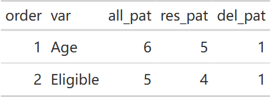{fig-alt="筛选第一步记录 Age，从6行保留5行；第二步记录 Eligible，从5行保留4行，每步均排除1行。"}

[原生 HTML](images/flow-guide/20261028b-update-filter-cumulative-history.html)

#### 人数与标签一致的流程图 {.unnumbered}

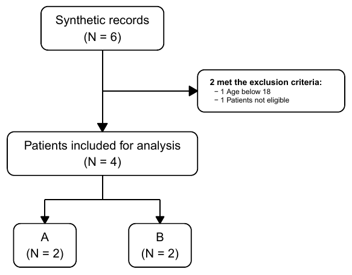{fig-alt="六行合成记录排除年龄不足与不符合条件者各一行，最终4行，Arm A和B各2行；排除原因已提供有意义的名称。"}

[原生 PDF](images/flow-guide/20261028b-update-filter-audited-flow.pdf)

#### 新步骤与列表标题 {.unnumbered}

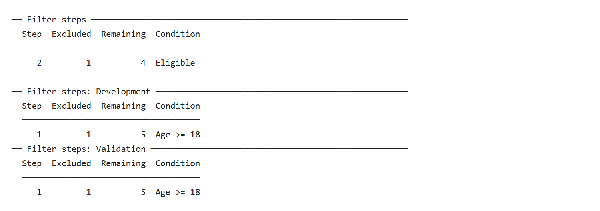{fig-alt="原生控制台先显示续接调用新增的第二步，再显示 Development 与 Validation 两个列表元素各自的筛选表，列表本身为不可见返回。"}

[原生 HTML](images/flow-guide/20261028b-update-filter-print-contract.html)

:::

缺少排除名称的步骤仍会显示 `"missing"`；`plt_flo()` 现在明确提醒步骤序号、变量名及 `name_map` 写法。它不是说该步骤删除了缺失数据；须先按真实筛选条件填写原因。手工 `split_N` 由调用者负责，不能把没有自动人数警告当成已验证。

::: {.callout-note collapse="true" title="复核代码"}

```r
stopifnot(identical(history_table28[["var"]], c("Age", "Eligible")),
  identical(as.integer(history_table28[["res_pat"]]), c(5L, 4L)),
  nrow(history_kept28) == 4L, all(table(history_kept28[["Arm"]]) == 2L),
  any(grepl("Eligible", history_output28, fixed = TRUE)), !any(grepl("Age", history_output28, fixed = TRUE)))
history_list_output28 <- capture.output(history_list28 <- withVisible(get_flt(
  list(Development = history_data28, Validation = history_data28), Age >= 18)))
stopifnot(!history_list28[["visible"]], identical(names(history_list28[["value"]]), c("Development", "Validation")),
  any(grepl("Filter steps: Development", history_list_output28, fixed = TRUE)),
  any(grepl("Filter steps: Validation", history_list_output28, fixed = TRUE)))
history_capture28 <- function(expr) {
  notes <- character()
  value <- withCallingHandlers(tryCatch(force(expr), error = conditionMessage), warning = function(w) {
    notes <<- c(notes, conditionMessage(w)); invokeRestart("muffleWarning")
  })
  list(value = value, warnings = notes)
}
history_stale28 <- dplyr::filter(history_first28, Eligible)
history_filter_warning28 <- history_capture28(get_flt(history_stale28, Age >= 30))
history_plot_warning28 <- history_capture28(plt_flo(history_stale28, split_var = "Arm"))
history_label_warning28 <- history_capture28(plt_flo(history_kept28))
stopifnot(any(grepl("has 4 rows", history_filter_warning28[["warnings"]], fixed = TRUE)),
  any(grepl("ends with 5 remaining", history_plot_warning28[["warnings"]], fixed = TRUE)),
  any(grepl("Eligible", history_label_warning28[["warnings"]], fixed = TRUE)),
  any(grepl("no exclusion reason", history_label_warning28[["warnings"]], fixed = TRUE)))
history_bad28 <- history_data28
attr(history_bad28, "flt") <- data.frame(foo = 1)
history_bad_error28 <- tryCatch(get_flt(history_bad28, Age >= 18), error = conditionMessage)
stopifnot(grepl("not a get_flt() filter history", history_bad_error28, fixed = TRUE))
history_levels28 <- sprintf("level_%02d_with_a_long_label", 1:25)
history_long28 <- get_flt(data.frame(x = history_levels28[1:3]), x %in% c(!!!history_levels28))
history_long_text28 <- attr(history_long28, "flt")[["filter"]]
stopifnot(nchar(history_long_text28) > 500, !grepl("\n", history_long_text28, fixed = TRUE),
  !grepl(" {2,}", history_long_text28))
save_console28 <- function(lines, name) {
  body <- paste(fansi::sgr_to_html(htmltools::htmlEscape(lines)), collapse = "\n")
  chars <- strsplit(body, "", fixed = TRUE)[[1]]; cp <- utf8ToInt(body)
  for (i in which(cp > 127L & !(cp >= 0x2500L & cp <= 0x257fL))) {
    w <- cli::ansi_nchar(chars[i], type = "width")
    if (w %in% 1:2) chars[i] <- sprintf('<span class="w%d">%s</span>', w, chars[i])
  }
  html <- paste0('<!doctype html><meta charset="utf-8"><style>',
    'body{margin:0;background:white;color:#222}pre{margin:0;padding:20px;',
    'font:15px/1.6 Consolas,"DejaVu Sans Mono",monospace;white-space:pre}',
    '.w1,.w2{display:inline-block}.w1{width:1ch}.w2{width:2ch}',
    '</style><pre data-native-console>', paste(chars, collapse = ""), '</pre>')
  writeLines(html, file.path(tempdir(), paste0("20261028b-update-", name, ".html")), useBytes = TRUE)
}

save_console28(c(history_output28, "", history_list_output28), "filter-print-contract")
validation_values <- list(n_input = 6L, n_kept = 4L, history = as.data.frame(history_table28),
  groups = as.integer(table(history_kept28[["Arm"]])), list_invisible = TRUE,
  stale_filter_warning = history_filter_warning28[["warnings"]], stale_plot_warning = history_plot_warning28[["warnings"]],
  missing_label_warning = history_label_warning28[["warnings"]], bad_history_error = history_bad_error28,
  long_condition = history_long_text28, source = "245ed79cc2f368732f3828eb622b6ae20347754d")
```
:::

本节在 Windows / WSL R 4.4.3 使用 RegR `245ed79` 固定源码分别执行，不运行模型拟合。共享的 `get_flo()` / `get_all()` 检查按源码说明，没有在本节重跑它们的完整工作流。包帮助例已改用自带 `seer_thyroid_mtc_2026_raw`；本节继续用上述合成输入，不依赖 ToyData，也不重跑历史 SEER 图。

<!-- /update-20261028b: regr_filter_history -->

### 返回类、种子与未完成分析（2026-10-27） {#dispatcher-20261027}

<!-- update-20261027: regr_dispatcher -->

按已推送 RegR **0.1.3** `212a156`，`get_all()` 现在返回 `c("get_all","list")` 对象，仍不可见；再次 `print(result)` 只显示分析摘要和 `Components:`，不重画已完成图表。用 `result[["dis"]]` 等分量继续分析；原来的命名字段不变，`attr(result,"analysis")` 保存本轮设定、完成情况与耗时。

```r
library(RegR)
dispatch_data27 <- data.frame(Age = 21:36,
  Arm = factor(rep(c("No", "Yes"), each = 8)),
  Stage = factor(rep(c("I", "II"), 8)),
  time = 1:16, DSS = rep(c(0L, 1L), 8))
dispatch_before27 <- dispatch_data27
set.seed(20261027)
dispatch_rng27 <- .Random.seed
dispatch_lines27 <- capture.output(dispatch_visible27 <- withVisible(get_all(
  com.args = list(data = dispatch_data27, seed = 71, time = 8,
    get_flt = list(Age >= 25), fct_cat = c(Age_band = Age, breaks = c(30))),
  dis.args = list(dis_var = c("Arm", "Stage"), type = "bar"))))
dispatch27 <- dispatch_visible27[["value"]]
names(dispatch27)
dispatch_print27 <- capture.output(dispatch_printed27 <- withVisible(print(dispatch27)))
attr(dispatch27, "analysis")[["seed"]]
```

`com.args$seed` 默认 123，每个启用块及公共分层的每个层都从同一种子开始；调用结束后恢复会话 RNG。显式 `seed=NULL` 才让各块依次消费调用者的随机流。这保证开关其他块不改变某块的随机起点，不代表 Windows / WSL 或不同依赖版本必然逐位相同。

列名和各块参数在运行前集中检查，包含不可见字符的近似列名会给出可辨认提示。`fct_cat=c(Age_band=Age,...)` 创建新列时不能覆盖已有同名列；保留连续原列可供 RCS 使用。学习器块的特征缺失行与公共分层缺失行分别计数，不能把摘要中的全体 n 当作每个模型的有效 n；RPA 的置信水平也继承公共设定。

::: {.callout-note collapse="true" title="复核代码"}

以下中断复核只在当前 R 进程临时替换耗时评分步骤，以 `rlang::interrupt()` 模拟中断；它不代表运行了真实评分模型。

```r
stopifnot(inherits(dispatch27, "get_all"), identical(names(dispatch27), "dis"),
  !dispatch_visible27[["visible"]], !dispatch_printed27[["visible"]],
  identical(dispatch_printed27[["value"]], dispatch27),
  identical(.Random.seed, dispatch_rng27), identical(dispatch_data27, dispatch_before27),
  attr(dispatch27, "analysis")[["n"]] == 12,
  attr(dispatch27, "analysis")[["seed"]] == 71,
  any(grepl("Components:", dispatch_print27, fixed = TRUE)))
interrupted_lines27 <- capture.output(interrupted27 <- testthat::with_mocked_bindings(
  get_all(com.args = list(data = dispatch_data27, surv = "DSS"),
    dis.args = list(dis_var = c("Arm", "Stage"), type = "bar"),
    msr.args = list(vars = "Age")),
  get_score = function(data, vars, surv, ...) rlang::interrupt(), .package = "RegR"))
stopifnot(inherits(interrupted27, "get_all"), identical(names(interrupted27), "dis"),
  identical(attr(interrupted27, "interrupted"), "msr.args"),
  !"msr" %in% names(interrupted27))
save_console26 <- function(lines, name) {
  body <- paste(fansi::sgr_to_html(htmltools::htmlEscape(lines)), collapse = "\n")
  chars <- strsplit(body, "", fixed = TRUE)[[1]]; cp <- utf8ToInt(body)
  for (i in which(cp > 127L & !(cp >= 0x2500L & cp <= 0x257fL))) {
    w <- cli::ansi_nchar(chars[i], type = "width")
    if (w %in% 1:2) chars[i] <- sprintf('<span class="w%d">%s</span>', w, chars[i])
  }
  html <- paste0('<!doctype html><meta charset="utf-8"><style>',
    'body{margin:0;background:white;color:#222}pre{margin:0;padding:20px;',
    'font:15px/1.6 Consolas,"DejaVu Sans Mono",monospace;white-space:pre}',
    '.w1,.w2{display:inline-block}.w1{width:1ch}.w2{width:2ch}',
    '</style><pre data-native-console>', paste(chars, collapse = ""), '</pre>')
  writeLines(html, file.path(tempdir(), paste0("20261027-update-", name, ".html")), useBytes = TRUE)
}
save_console26(dispatch_print27, "dispatcher-summary")
save_console26(interrupted_lines27, "dispatcher-interrupted")
validation_values <- list(n = attr(dispatch27, "analysis")[["n"]],
  completed = names(dispatch27), class = class(dispatch27),
  interrupted = attr(interrupted27, "interrupted"), retained = names(interrupted27),
  unchanged = identical(dispatch_data27, dispatch_before27), rng_preserved = identical(.Random.seed, dispatch_rng27))
```
:::

::: {.panel-tabset}

#### 再次 print 的摘要 {.unnumbered}

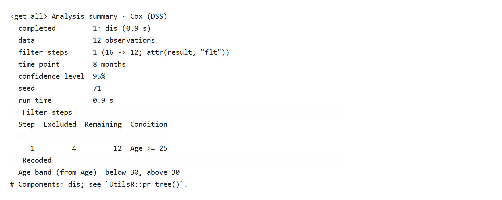{fig-alt="16 行合成数据筛选为 12 行，get_all 结果显示 dis 模块、公共 seed、筛选历史、重编码和 Components；耗时以实际调用为准。"}

[原生 HTML](images/flow-guide/20261027-update-dispatcher-summary.html)

#### 模拟评分步骤中断 {.unnumbered}

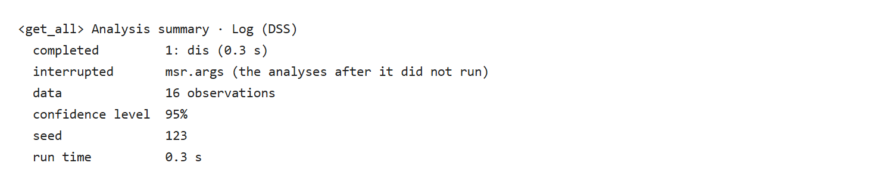{fig-alt="验证夹具在 msr.args 处模拟中断，摘要明确后续分析未运行，返回对象只保留此前完成的 dis。"}

[原生 HTML](images/flow-guide/20261027-update-dispatcher-interrupted.html)

:::

中断发生在分析块中时返回先前已完成的结果，`attr(result,"interrupted")` 记录中断块；该块即使已创建临时图，也不会作为完成结果返回。普通块错误与分层失败仍分别记录，部分成功不是完整分析。输入预检阶段的错误也不能据此解释为会返回部分结果。

<!-- /update-20261027: regr_dispatcher -->

### 筛选历史与分析摘要分开读（2026-10-26） {#summary-20261026}

<!-- update-20261026: regr_summary -->

以下保留 2026-10-26 的 RegR `df14885`、UtilsR 0.6.12 `0b59c82` 快照；新版返回类见上节。该快照中，`get_flt()` 用分节表打印筛选历史，仍不可见返回 data.frame；`get_all()` 运行结束后打印完成块、失败块、分析人数、筛选历史和重编码设置，仍不可见返回已命名的结果 list。控制台摘要不是返回表，不能把输出文字当作后续分析数据。

下例只有 12 行合成输入，启用筛选、重编码和分布图，不拟合回归模型。两段控制台输出分别从实际调用捕获；不是手工绘制的界面。

```r
library(RegR)
data_summary26 <- data.frame(Age = c(15, 16, 17, 18, 20, 25, 30, 40, 50, 60, 75, 80),
  site = factor(rep(c("Head", "Body", "Tail"), 4)), Arm = factor(rep(c("No", "Yes"), 6)),
  time = 1:12 + 1, DSS = rep(c(0L, 1L), 6))
original_summary26 <- data_summary26
lines_filter26 <- capture.output(filtered_visible26 <- withVisible(
  get_flt(data_summary26, Age >= 18, Age <= 70)))
filtered_summary26 <- filtered_visible26[["value"]]
lines_summary26 <- capture.output(all_visible26 <- withVisible(get_all(
  com.args = list(data = data_summary26, get_flt = list("Age >= 18", "Age <= 70"),
    fct_cat = list(list("site", Head_Body = c("Head", "Body"))),
    adj_var = c("Age", "site"), surv = TRUE, time = 6),
  dis.args = list(dis_var = c("site", "Arm"), type = "bar",
    label_args = list(style = "count_percent_wrap")))))
analysis_summary26 <- all_visible26[["value"]]
names(analysis_summary26)
attr(analysis_summary26, "flt")
```

::: {.callout-note collapse="true" title="复核代码"}

```r
history_summary26 <- attr(analysis_summary26, "flt")
stopifnot(!filtered_visible26[["visible"]], !all_visible26[["visible"]],
  is.data.frame(filtered_summary26), nrow(filtered_summary26) == 7L,
  identical(names(analysis_summary26), "dis"), is.null(attr(analysis_summary26, "failures")),
  tail(history_summary26[["res_pat"]], 1) == 7L,
  identical(data_summary26, original_summary26))
save_console26 <- function(lines, name) {
  body <- paste(fansi::sgr_to_html(htmltools::htmlEscape(lines)), collapse = "\n")
  chars <- strsplit(body, "", fixed = TRUE)[[1]]; cp <- utf8ToInt(body)
  for (i in which(cp > 127L & !(cp >= 0x2500L & cp <= 0x257fL))) {
    w <- cli::ansi_nchar(chars[i], type = "width")
    if (w %in% 1:2) chars[i] <- sprintf('<span class="w%d">%s</span>', w, chars[i])
  }
  html <- paste0('<!doctype html><meta charset="utf-8"><style>',
    'body{margin:0;background:white;color:#222}pre{margin:0;padding:20px;',
    'font:15px/1.6 Consolas,"DejaVu Sans Mono",monospace;white-space:pre}',
    '.w1,.w2{display:inline-block}.w1{width:1ch}.w2{width:2ch}',
    '</style><pre data-native-console>', paste(chars, collapse = ""), '</pre>')
  writeLines(html, file.path(tempdir(), paste0("20261026-update-", name, ".html")), useBytes = TRUE)
}
save_console26(lines_filter26, "regr-filter-summary")
save_console26(lines_summary26, "regr-analysis-summary")
validation_values <- list(filtered_rows = nrow(filtered_summary26), history = as.data.frame(history_summary26),
  components = names(analysis_summary26), invisible = c(filtered_visible26[["visible"]], all_visible26[["visible"]]),
  unchanged = identical(data_summary26, original_summary26))
```

:::

::: {.panel-tabset}

### get_flt {.unnumbered}

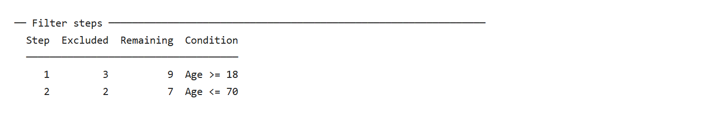{fig-alt="实际get_flt标准输出将两步筛选的排除数、剩余人数及条件分列，12行输入最终保留7行。"}

[原生 HTML](images/flow-guide/20261026-update-regr-filter-summary.html)

### get_all {.unnumbered}

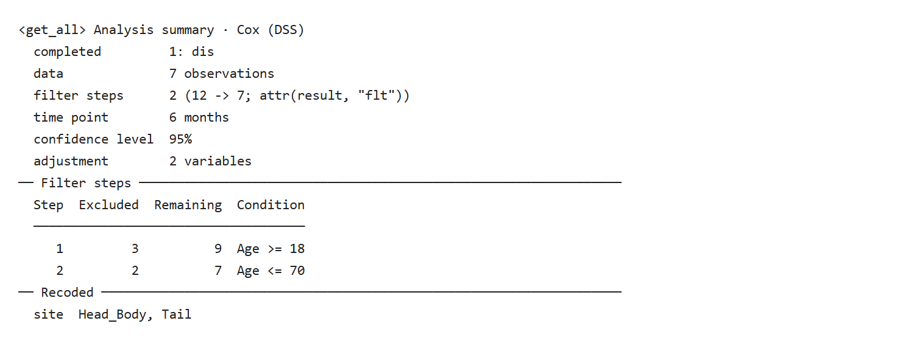{fig-alt="实际get_all输出显示仅启用分布块、七条观察和筛选历史，并单列重编码后的site水平；没有运行模型拟合。"}

[原生 HTML](images/flow-guide/20261026-update-regr-analysis-summary.html)

:::

取图用 `analysis_summary26[["dis"]]`，取历史用 `attr(result,"flt")`，检查失败用 `attr(result,"failures")`。`suppressMessages()` 关闭运行提示，不关闭这些 stdout 结果表；需要分别捕获两个通道。当前 `get_facet()` 的分层提示与拟合公式提示也改用 UtilsR 消息，见[输出通道说明](../console-print/runtime-messages.qmd#cat-message)。

<!-- /update-20261026: regr_summary -->

## plt_flo()：共用设置与重要参数 {#plt-flo}

完整签名及默认值可查看 `formals(RegR::plt_flo)` 或 `?RegR::plt_flo`。以下设置最常影响流程图：

::: {.table-responsive}

| 参数 | 当前默认 / 行为 | 本页重点 |
|:--|:--|:--|
| `inclu_row` | `3`；前若干条历史归为未满足纳入条件 | `0` 把全部历史归入排除条件；`1` 将第一步与后两步分开 |
| `cohort` | `list(sel_his = "differentiated thyroid carcinoma", year_var = "Yea", label = NULL)` | 本例是 MTC，显式指定 `label`；自定义标签会覆盖组织学与年份标题，人数仍自动追加 |
| `analysis_label` | `NULL` 使用默认分析框标题 | 自定义文字；人数仍来自最终筛选数据 |
| `name_map` | `NULL` | 按历史中的 `var` 映射移除原因；不改变筛选条件或人数 |
| `count_style` | `"prefix"` | 四种人数位置 / 对齐方式，见下一节 |
| `exc_args` | 排除框的命名 list | 汇总、百分比、字号、缩进、留白与箭头 |
| `box_args` | `list(text_fs = 10, corner_radius = 0.08, equal_width = FALSE)` | 主框及分组等框的字号 / 圆角；等宽只作用于起始框和分析框 |
| `split_var / split_label / split_N` | 均为 `NULL` | 自动分组或手动提供标签与人数 |
| `split2` | `list(label = NULL, N = NULL, merge = NULL)` | 一一对应的第二级分组与汇合框 |
| `content_labels` | `NULL` | 分组之后的研究内容框 |
| `gap_args` | `list(group = NULL, content = 0.3)` | 分组 / 内容框间的横向间距，单位英寸 |
| `phase_labels, phase_style` | 无阶段标签；`"box"` | 当前 `79bb436` 支持 box / bracket / fill / band / arrow，见[阶段样式](#phase-styles-20261027) |
| `content_lines` | `"auto"` | 当前为顶层参数；NULL 保留手工换行 |
| `fixed_size` | `TRUE` | 保持推荐物理尺寸；`FALSE` 适配绘图区；正数指定宽度，单位英寸 |
| `return_data` | `FALSE` 返回 ggplot | `TRUE` 保留原数据用于管道 |
| `save` | `list()` 无保存副作用 | 命名 list 转交 `save_plt()`；只指定文件名时使用流程图推荐尺寸 |

:::

### 纳入与排除分开显示 {#inclusion}

`inclu_row` 只改变历史如何归类显示，不会重新筛选数据。本例 `inclu_row = 1` 将 138 人归为未满足年龄纳入条件，把后两步共 643 人归为满足排除条件，总移除人数仍为 781。

::: {.panel-tabset}

### 全部作为排除条件 {.unnumbered}

<!-- flow-run: basic -->
```r
do.call(plt_flo, flow_args)
```

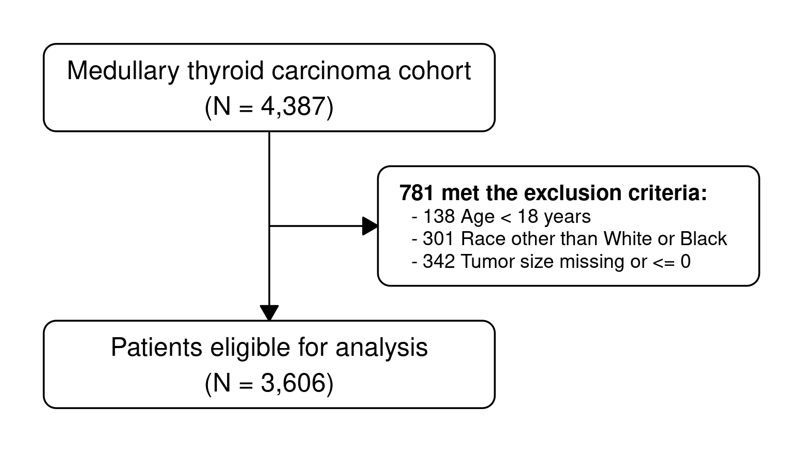{fig-alt="起始 4387 人，三步移除 138、301、342 人，最终 3606 人。"}

### 纳入与排除分开 {.unnumbered}

同时演示 `header_style = "n_suffix"` 的汇总格式和起始样本百分比。`bullet` 仅用于明细行；`summary_fs_bump` 的两项分别增加总汇总与分块汇总的字号。

<!-- flow-run: inclusion -->
```r
do.call(plt_flo, modifyList(flow_args, list(
  inclu_row = 1, count_style = "prefix_aligned",
  exc_args = list(
    header_style = "n_suffix", pct = TRUE, bullet = "- ",
    detail_indent = 3, count_gap = 3, sub_header_gap = 0.6,
    summary_fs_bump = c(2, 1)
  )
)))
```

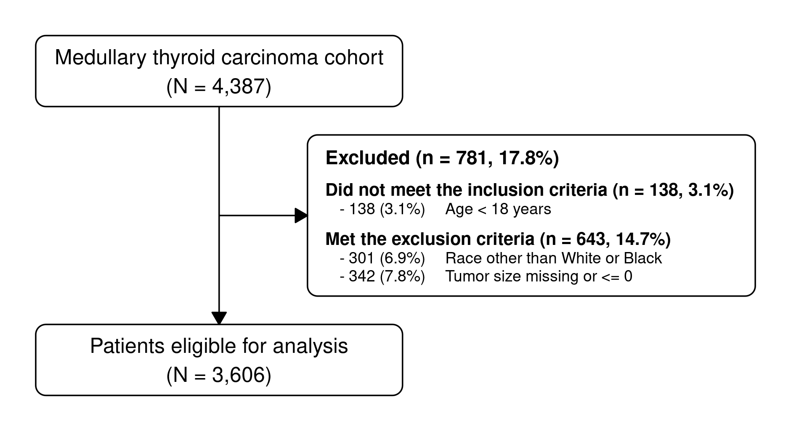{fig-alt="移除合计 781 人，占起始样本 17.8%；按纳入与排除原因分块。"}

:::

## 计数位置、对齐与百分比 {#counts}

四个标签页固定同一份筛选历史与 `pct = TRUE`，只改变 `count_style`。**百分比始终以起始 4,387 人为分母**，不是每一步筛选前的人数。138、301、342 人对应 3.1%、6.9%、7.8%，总计 17.8%；分别四舍五入后，明细百分比之和不一定等于显示的总百分比。

`prefix_aligned` 对齐人数后的原因列；`suffix_aligned` 对齐原因后的人数列。`exc_args$count_gap` 是这两列间的近似空格宽度，只在 `_aligned` 模式中生效；它不是英寸或像素。

::: {.panel-tabset}

### prefix：人数在前 {.unnumbered}

<!-- flow-run: count-prefix -->
```r
do.call(plt_flo, modifyList(flow_args, list(
  count_style = "prefix", exc_args = list(pct = TRUE)
)))
```

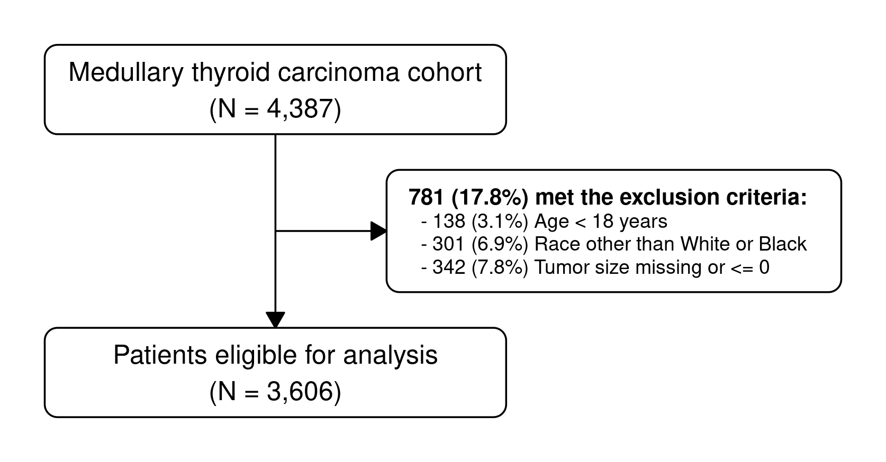{fig-alt="人数在前，百分比使用起始样本为分母。"}

### prefix_aligned：对齐原因 {.unnumbered}

<!-- flow-run: count-prefix-aligned -->
```r
do.call(plt_flo, modifyList(flow_args, list(
  count_style = "prefix_aligned",
  exc_args = list(pct = TRUE, count_gap = 3)
)))
```

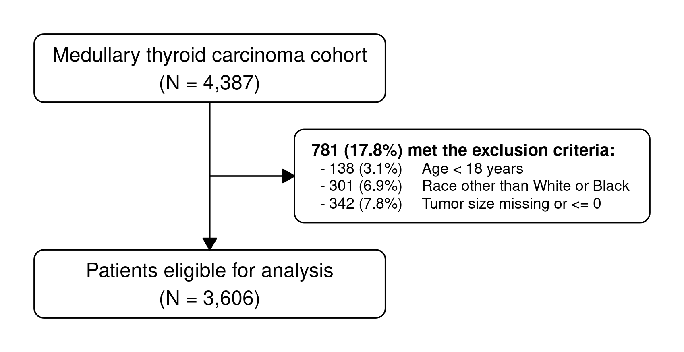{fig-alt="人数及百分比在前，原因从统一位置开始。"}

### suffix：人数在后 {.unnumbered}

<!-- flow-run: count-suffix -->
```r
do.call(plt_flo, modifyList(flow_args, list(
  count_style = "suffix", exc_args = list(pct = TRUE)
)))
```

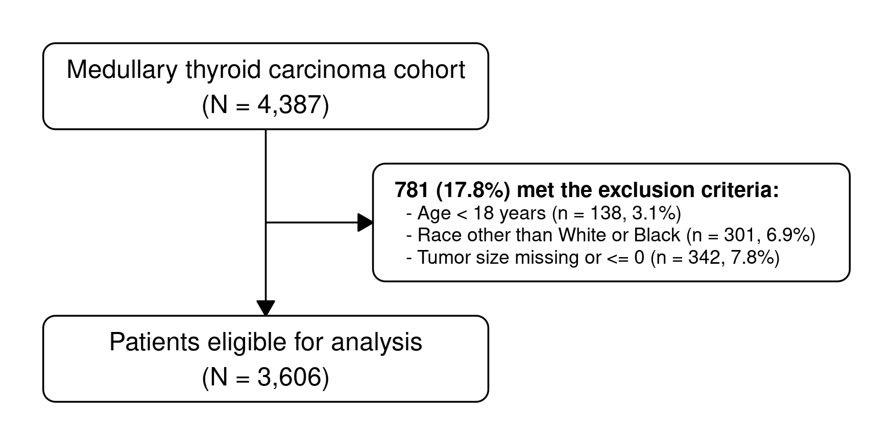{fig-alt="原因之后附人数和起始样本百分比。"}

### suffix_aligned：对齐人数 {.unnumbered}

<!-- flow-run: count-suffix-aligned -->
```r
do.call(plt_flo, modifyList(flow_args, list(
  count_style = "suffix_aligned",
  exc_args = list(pct = TRUE, count_gap = 3)
)))
```

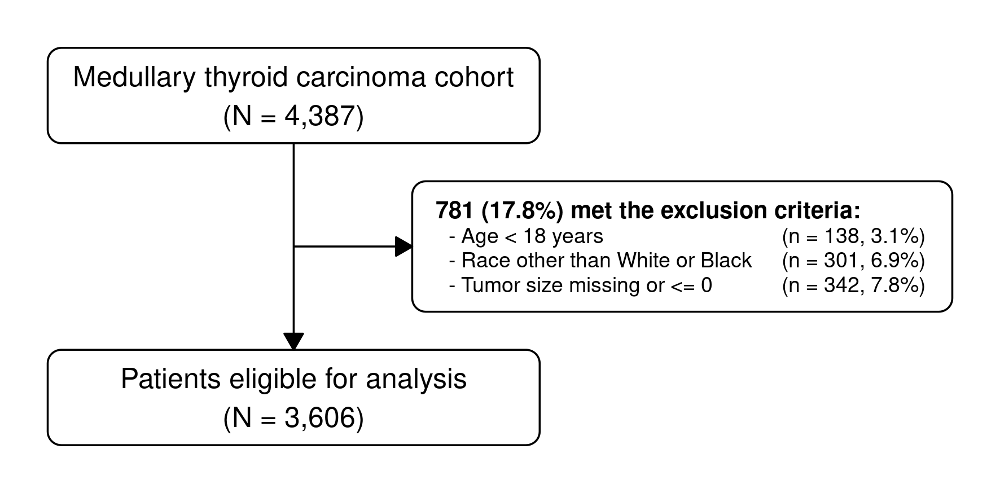{fig-alt="原因之后的 n 和百分比从统一位置开始。"}

:::

## 自动分组、手动计数与第二级分组 {#groups}

最终数据中 Female **2,114 人**、Male **1,492 人**。`split_var` 从数据自动生成标签与人数；若不提供 `split_var`，必须同时提供 `split_label` 和 `split_N`。提供自动分组列后，也可以只覆盖标签或人数。

手动人数必须为非负、有限的整数，长度与标签一致；函数检查结构，不替用户验证这些数字是否与分析数据一致。本页所有手动人数均从同一份 `cohort` 计算。

::: {.panel-tabset}

### 按列自动计数 {.unnumbered}

<!-- flow-run: split-auto -->
```r
do.call(plt_flo, modifyList(flow_args, list(split_var = "Sex")))
```

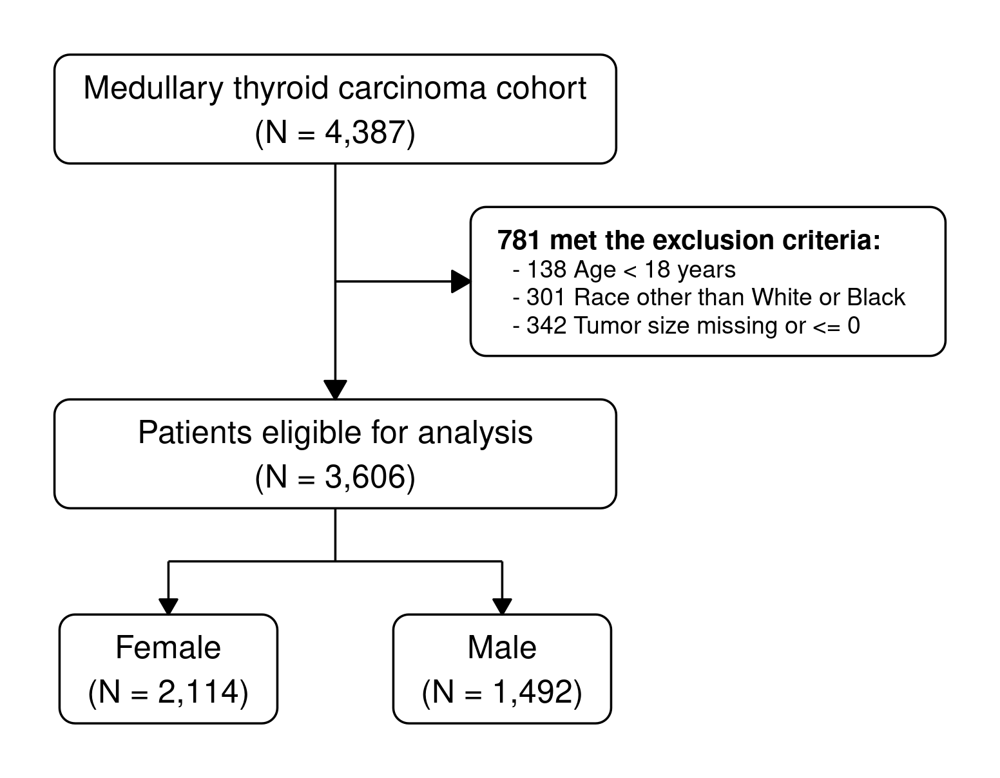{fig-alt="女性 2114 人，男性 1492 人，合计 3606 人。"}

### 手动指定标签与人数 {.unnumbered}

<!-- flow-run: split-manual -->
```r
groups <- c("Female", "Male")
group_n <- vapply(groups, function(sex) {
  sum(cohort[["Sex"]] == sex, na.rm = TRUE)
}, integer(1))

do.call(plt_flo, modifyList(flow_args, list(
  split_label = c("Female patients", "Male patients"),
  split_N = group_n,
  gap_args = list(group = 0.5)
)))
```

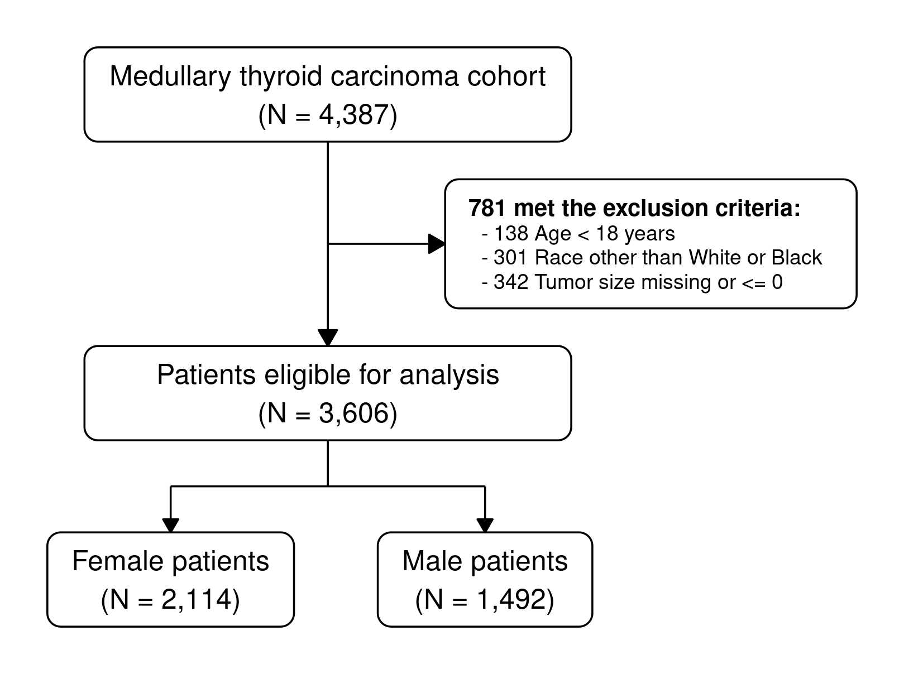{fig-alt="两个分组的标签改变，人数仍为女性 2114、男性 1492。"}

### 第二级分组与汇合 {.unnumbered}

第二行演示各性别中记录的随访时间满 60 个月的样本：Female **1,408 人**、Male **886 人**，合计 **2,294 人**。这只是二级分组的计数与排版示例，并未拟合生存模型。

`split2$label` 与第一行一一对应；`N = NULL` 沿用第一行人数，本例则显式给出重新计算的人数。`merge` 设置汇合框文字；研究内容框接在汇合框之后。

<!-- flow-run: split-second -->
```r
groups <- c("Female", "Male")
group_n <- vapply(groups, function(sex) {
  sum(cohort[["Sex"]] == sex, na.rm = TRUE)
}, integer(1))
followup_n <- vapply(groups, function(sex) {
  sum(cohort[["Sex"]] == sex & cohort[["time"]] >= 60, na.rm = TRUE)
}, integer(1))

do.call(plt_flo, modifyList(flow_args, list(
  split_label = c("Female patients", "Male patients"), split_N = group_n,
  split2 = list(
    label = c("Female: follow-up >= 60 months", "Male: follow-up >= 60 months"),
    N = followup_n,
    merge = sprintf("Follow-up subset (N = %s)",
                    format(sum(followup_n), big.mark = ",", trim = TRUE))
  ),
  content_labels = c("Clinical characteristics", "Survival endpoints"),
  gap_args = list(group = 0.5, content = 0.5),
  phase_labels = c("Patient selection", "Follow-up groups", "Study contents"),
  phase_style = "box"
)))
```

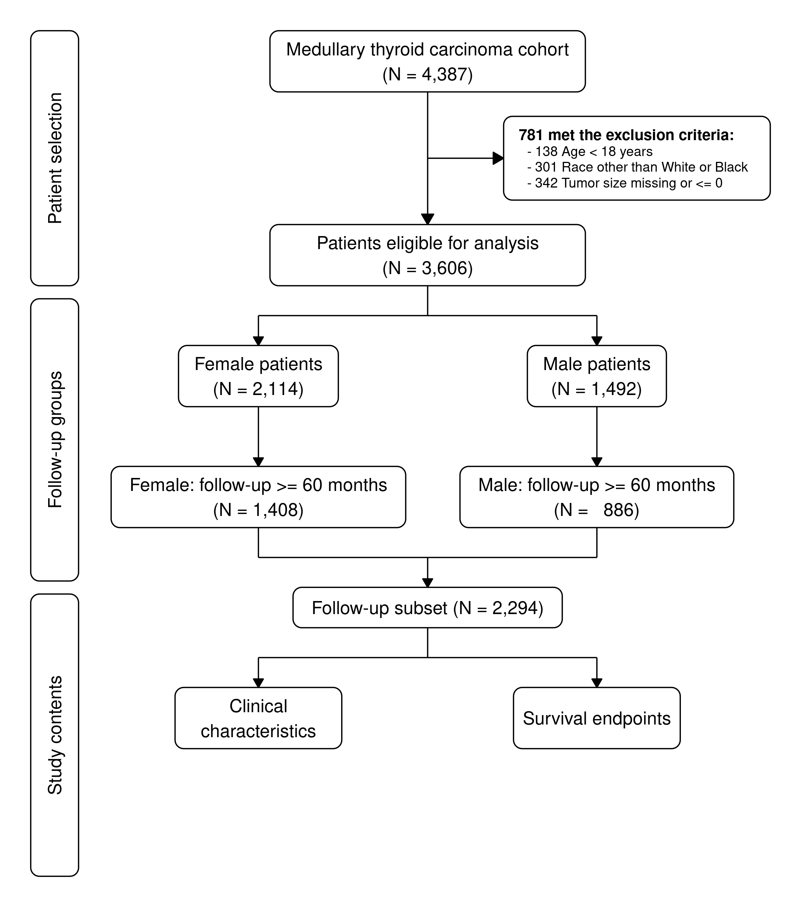{fig-alt="第二级女性 1408 人、男性 886 人，汇合为 2294 人，连接临床特征和生存结局内容框。"}

:::

## 研究内容与阶段标记 {#phases}

`content_labels` 在分组之后增加研究内容框；没有分组时不会单独生成这些内容框。省略 `split2$merge` 时，分组通过中央汇合连接线接到研究内容。`phase_labels` 按**纳排、分组、研究内容**的结构顺序给出，最多使用三个阶段。

两个标签页只切换 `phase_style`，其他设置相同。长阶段标签可用 `\n` 换行；阶段框需要容纳旋转后的文字，较长的标签会增加整图的推荐尺寸。

::: {.panel-tabset}

### 方括号阶段标记 {.unnumbered}

<!-- flow-run: phase-bracket -->
```r
do.call(plt_flo, modifyList(flow_args, list(
  split_var = "Sex",
  content_labels = c("Clinical characteristics", "Survival analysis"),
  phase_labels = c("Patient selection", "Sex subgroups", "Study contents"),
  phase_style = "bracket", count_style = "suffix_aligned",
  exc_args = list(pct = TRUE)
)))
```

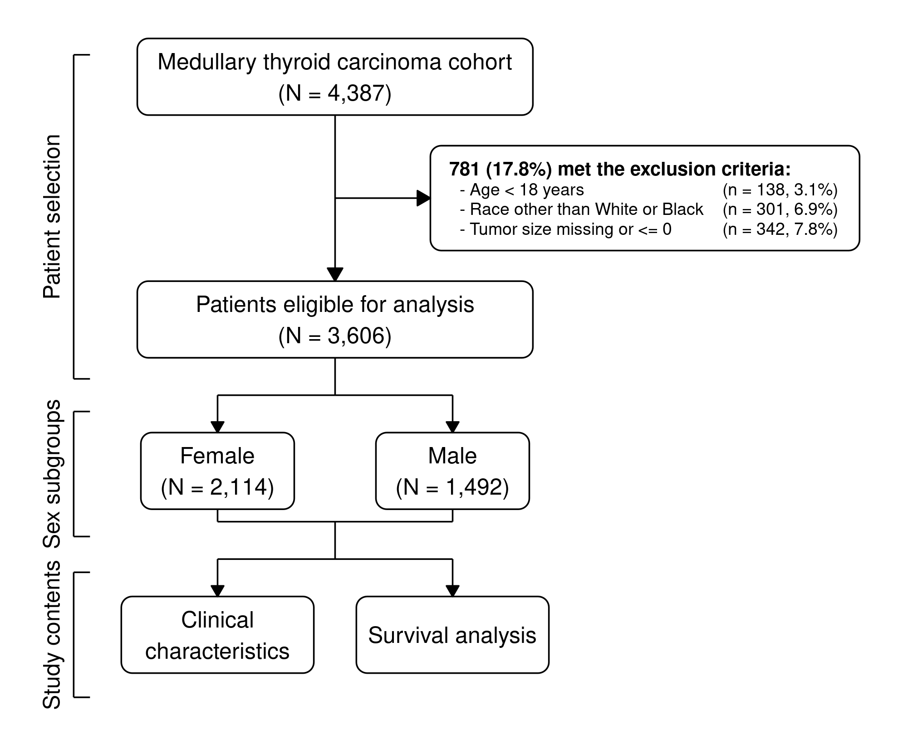{fig-alt="纳排、性别分组、研究内容使用左侧方括号和旋转标签。"}

### 阶段框 {.unnumbered}

<!-- flow-run: phase-box -->
```r
do.call(plt_flo, modifyList(flow_args, list(
  split_var = "Sex",
  content_labels = c("Clinical characteristics", "Survival analysis"),
  phase_labels = c("Patient selection", "Sex subgroups", "Study contents"),
  phase_style = "box", count_style = "suffix_aligned",
  exc_args = list(pct = TRUE)
)))
```

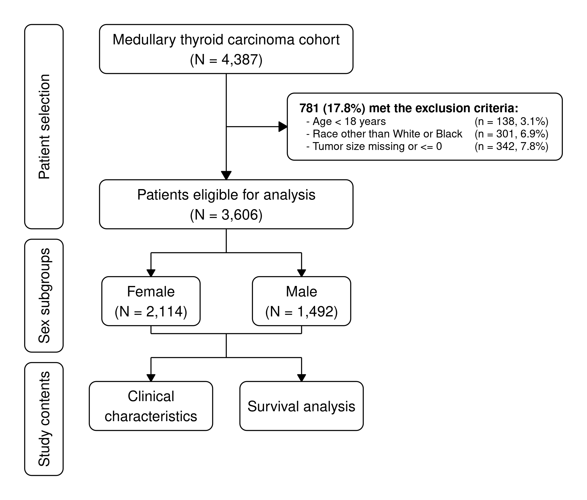{fig-alt="与方括号示例相同的计数、分组和研究内容，左侧改为阶段框。"}

:::

### 研究内容和排除框自适应布局（2026-10-27） {#adaptive-flow-20261027}

<!-- update-20261027: regr_flow_layout -->

按已推送 RegR `212a156`，`plt_flo()` 根据文本与分组数量安排研究内容框、排除框及组间距离，人数使用千位分隔并避免科学计数与对齐填充。下例 1,200 行输入全部为合成数据，布局参数只改变显示，不重新筛选队列。

```r
library(RegR)
flow_data27 <- data.frame(Age = rep(1:100, 12), Eligible = rep(c(TRUE, TRUE, TRUE, FALSE), 300),
  Arm = factor(rep(c("A", "B"), each = 600)))
flow_selected27 <- get_flt(flow_data27, Eligible, Age >= 18, Age <= 80)
flow_before27 <- flow_selected27
flow_content27 <- c(
  "**Model development**\nClinical variables and extended marker models",
  "**Validation**\nIndependent cohorts and sensitivity analyses",
  "**Interpretation**\nModel explanation and robustness checks")
flow_auto27 <- plt_flo(flow_selected27, inclu_row = 1,
  cohort = list(label = "Synthetic cohort"), split_var = "Arm",
  content_labels = flow_content27, box_args = list(content_lines = "auto"))
flow_lines27 <- plt_flo(flow_selected27, inclu_row = 1,
  cohort = list(label = "Synthetic cohort"), split_var = "Arm",
  content_labels = c("**Development**\nClinical model\nExtended model",
    "**Validation**\nIndependent cohort\nSensitivity analysis",
    "**Interpretation**\nFeature effects\nRobustness"),
  box_args = list(content_lines = NULL, equal_width = TRUE),
  exc_args = list(header_style = "n_suffix"), count_style = "suffix")
flow_size27 <- attr(flow_auto27, "flo_size")
flow_lines_size27 <- attr(flow_lines27, "flo_size")
ggplot2::ggsave(file.path(tempdir(), "20261027-update-flow-adaptive.pdf"), flow_auto27,
  width = flow_size27[1], height = flow_size27[2], device = grDevices::cairo_pdf)
ggplot2::ggsave(file.path(tempdir(), "20261027-update-flow-explicit-lines.pdf"), flow_lines27,
  width = flow_lines_size27[1], height = flow_lines_size27[2], device = grDevices::cairo_pdf)
```

自动模式会按行数预算重新换行，显式 `\n` 可能被重排；`content_lines=NULL` 才保留手工换行。整行的 `**标题**` 可加粗并对齐标题与正文，不能在一行中间随意插入 `**`。默认主框可以按文字宽度不同；`equal_width=TRUE` 统一主框宽度，研究内容框本身仍共用紧凑宽度。

本小节保留 RegR `212a156` 的历史执行快照，代码中的 `content_lines` 位于 `box_args` 内。图中 Eligible 未提供名称映射，默认的 missing 是标签占位，不能把这 300 行解读为缺失；新版示例已显式给出排除理由。后续已发布版本迁移到顶层，见下方[当前参数与阶段样式](#phase-styles-20261027)；新安装先核对 `formals(plt_flo)`，按对应版本使用。

::: {.callout-note collapse="true" title="复核代码"}

```r
flow_labels27 <- function(p) unlist(lapply(ggplot2::ggplot_build(p)[["data"]],
  function(x) if ("label" %in% names(x)) as.character(x[["label"]])))
flow_return27 <- plt_flo(flow_selected27, inclu_row = 1,
  cohort = list(label = "Synthetic cohort"), return_data = TRUE)
stopifnot(identical(flow_selected27, flow_before27), identical(flow_return27, flow_selected27),
  any(grepl("1,200", flow_labels27(flow_auto27), fixed = TRUE)),
  all(is.finite(flow_size27)), all(flow_size27 > 0),
  tail(attr(flow_selected27, "flt")[["res_pat"]], 1) == nrow(flow_selected27))
validation_values <- list(n_start = nrow(flow_data27), n_final = nrow(flow_selected27),
  by_arm = as.integer(table(flow_selected27[["Arm"]])),
  history = attr(flow_selected27, "flt"), unchanged = identical(flow_selected27, flow_before27))
```
:::

::: {.panel-tabset}

#### 自动安排内容框 {.unnumbered}

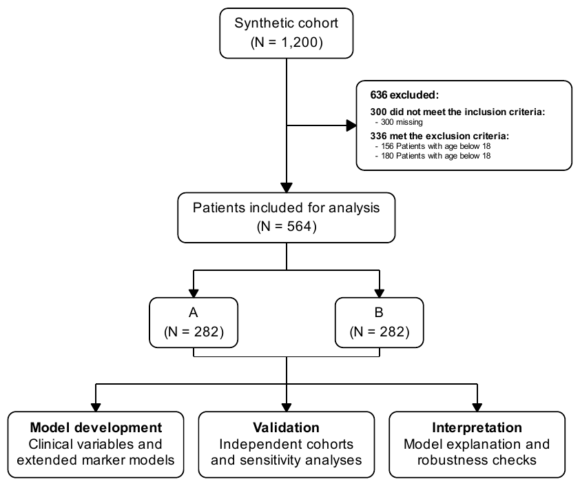{fig-alt="1,200 行合成输入的筛选流程，两组分析队列连接三个研究内容框；排除数、人数格式和内容换行按原生布局生成。"}

[PDF](images/flow-guide/20261027-update-flow-adaptive.pdf)

#### 显式换行与 CONSORT 式计数 {.unnumbered}

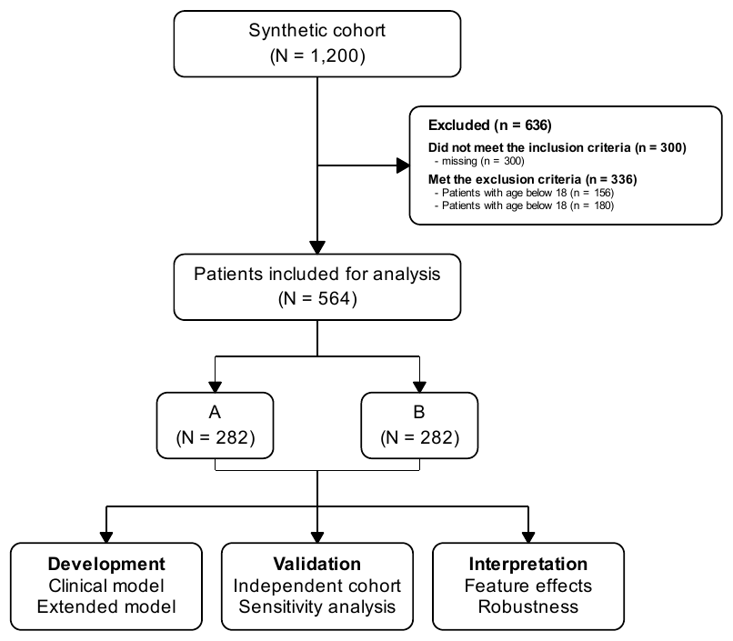{fig-alt="同一合成队列保留三行研究内容标签，主框等宽，排除标题和各行人数采用后缀格式；不改变筛选历史或组人数。"}

[PDF](images/flow-guide/20261027-update-flow-explicit-lines.pdf)

:::

`content_width` 用于显式宽度控制，不能与显式 `content_lines` 同时设置；`gap_args` 未指定时按组数及内容行宽自适应，显式值则按英寸控制。保存时优先使用 `attr(p,"flo_size")` 的推荐尺寸，避免把固定面板硬塞进过小设备。人数换行和框宽优化没有新增统计估计量，也未重算本页其他历史图。

<!-- /update-20261027: regr_flow_layout -->


### 顶层换行参数与阶段样式（2026-10-27） {#phase-styles-20261027}

<!-- update-20261027: regr_latest_flow -->

RegR `79bb436` 已发布 `content_lines` 的顶层迁移，位置紧随 `content_labels`；旧的 `box_args$content_lines` 不再属于该版本的合法字段。默认仍为 `"auto"`，`NULL` 保留手工换行；指定顶层行数时不能同时指定 `box_args$content_width`。

`phase_style` 当前默认 **`"box"`**，另外支持 `"bracket"`、`"fill"`、`"band"`、`"arrow"`。`band` 用蓝、浅沙、浅绿区分结构阶段，左侧较深的标签块与文字在各自分区内居中；`arrow` 以逐段加深的箭头串联阶段。阶段名称对应实际存在的筛选、分组和研究内容，最多三个；配色与形状不改变分析样本。

```r
library(RegR)
phase_data27 <- data.frame(Age = rep(1:100, 12),
  Eligible = rep(c(TRUE, TRUE, TRUE, FALSE), 300),
  Arm = factor(rep(c("A", "B"), each = 600)))
phase_selected27 <- get_flt(phase_data27, Eligible == TRUE, Age >= 18, Age <= 80)
phase_before27 <- phase_selected27
phase_args27 <- list(data = phase_selected27, inclu_row = 1,
  cohort = list(label = "Synthetic cohort"), split_var = "Arm",
  name_map = c(Eligible = "Not eligible"),
  content_labels = c("**Development**\nClinical model\nExtended model",
    "**Validation**\nIndependent cohort\nSensitivity analyses",
    "**Interpretation**\nFeature effects\nRobustness"),
  content_lines = NULL, box_args = list(equal_width = TRUE),
  phase_labels = c("Selection", "Groups", "Study contents"))
phase_plots27 <- list(box = do.call(plt_flo, phase_args27),
  band = do.call(plt_flo, c(phase_args27, list(phase_style = "band"))),
  arrow = do.call(plt_flo, c(phase_args27, list(phase_style = "arrow"))))
for (style in names(phase_plots27)) {
  p <- phase_plots27[[style]]
  size <- attr(p, "flo_size")
  ggplot2::ggsave(file.path(tempdir(), paste0("20261027-update-flow-phase-", style, ".pdf")),
    p, width = size[["width"]], height = size[["height"]], device = grDevices::cairo_pdf)
}
```

::: {.panel-tabset}

#### 默认框 {.unnumbered}

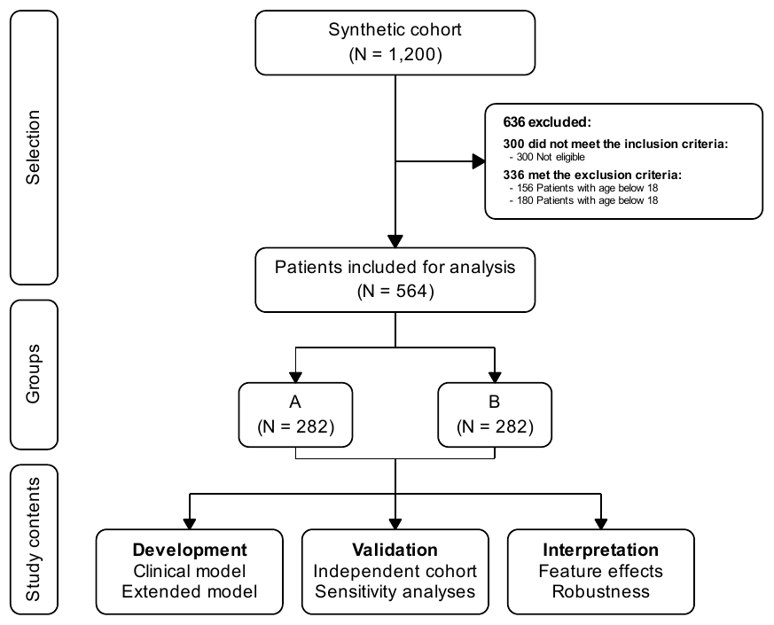{fig-alt="RegR 79bb436 默认 box 样式的合成队列流程，三阶段使用左侧圆角框，内容框保留显式换行。"}

[原生 PDF](images/flow-guide/20261027-update-flow-phase-box.pdf)

#### 分区底色 {.unnumbered}

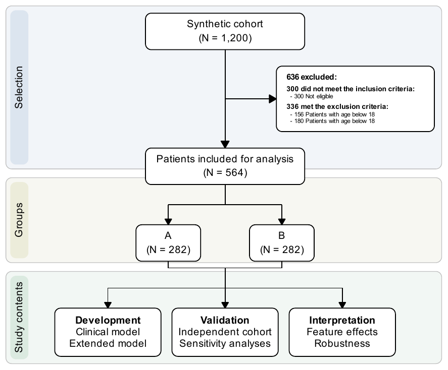{fig-alt="相同筛选结果的 band 样式，蓝、浅沙和浅绿阶段分区分别承载居中的深色标签块，不改筛选人数。"}

[原生 PDF](images/flow-guide/20261027-update-flow-phase-band.pdf)

#### 流程箭头 {.unnumbered}

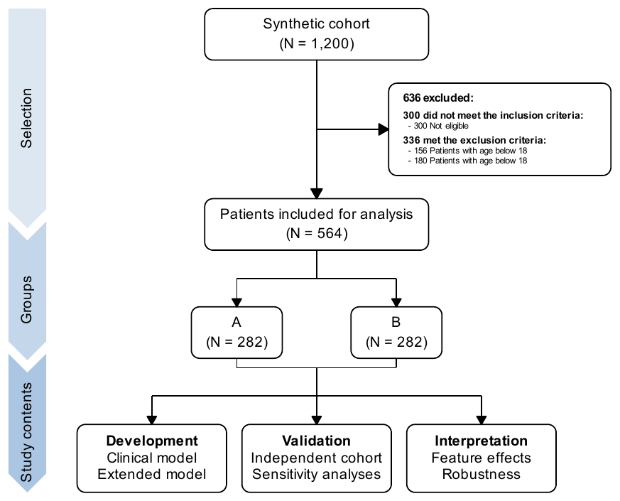{fig-alt="相同分析队列的 arrow 阶段标识，三个左侧箭头依次加深，保持同一主流程与分组人数。"}

[原生 PDF](images/flow-guide/20261027-update-flow-phase-arrow.pdf)

:::

::: {.callout-note collapse="true" title="复核代码"}

```r
phase_formals27 <- formals(plt_flo)
stopifnot(identical(phase_formals27[["content_lines"]], "auto"),
  "content_lines" %in% names(phase_formals27),
  !"content_lines" %in% names(eval(phase_formals27[["box_args"]])),
  eval(phase_formals27[["phase_style"]])[[1]] == "box",
  identical(phase_selected27, phase_before27), nrow(phase_selected27) == 564L,
  identical(as.integer(table(phase_selected27[["Arm"]])), c(282L, 282L)))
phase_labels27 <- lapply(phase_plots27, function(p) {
  unlist(lapply(ggplot2::ggplot_build(p)[["data"]], function(d) {
    if ("label" %in% names(d)) as.character(d[["label"]])
  }))
})
for (labels in phase_labels27) stopifnot(any(grepl("1,200", labels, fixed = TRUE)),
  all(c("Selection", "Groups", "Study contents") %in% labels),
  any(grepl("Not eligible", labels, fixed = TRUE)), !any(grepl("missing", labels, ignore.case = TRUE)))
phase_rejected_args27 <- phase_args27
phase_rejected_args27[["box_args"]] <- list(content_lines = NULL)
phase_rejected27 <- tryCatch(do.call(plt_flo, phase_rejected_args27), error = conditionMessage)
phase_conflict_args27 <- phase_args27
phase_conflict_args27[["content_lines"]] <- 3
phase_conflict_args27[["box_args"]] <- list(content_width = 2)
phase_conflict27 <- tryCatch(do.call(plt_flo, phase_conflict_args27), error = conditionMessage)
stopifnot(grepl("content_lines", phase_rejected27), grepl("only one", phase_conflict27),
  identical(phase_selected27, phase_before27))
validation_values <- list(n_start = 1200L, n_final = nrow(phase_selected27),
  by_arm = as.integer(table(phase_selected27[["Arm"]])), styles = names(phase_plots27),
  unchanged = TRUE, default = "box", top_level = TRUE)
```
:::

本例实际导出默认框、分区底色与箭头；`fill` 和 `bracket` 的选项按源码核对，旧方括号图保留原快照。保存继续使用 `attr(p,"flo_size")`，阶段标签过长时先用换行控制尺寸。配色、行数和阶段标签不重新建队列，也没有新的统计或速度结论。

<!-- /update-20261027: regr_latest_flow -->

## 字号、框形、间距与 PDF 保存 {#layout-save}

::: {.table-responsive}

| 设置 | 单位 / 作用 |
|:--|:--|
| `exc_args$text_fs` | pt；排除明细字号，不控制主框字号 |
| `exc_args$summary_fs_bump` | pt；在排除明细字号基础上增加汇总字号，默认 `c(2, 1)` |
| `exc_args$bold_summary` | 默认 `TRUE`；只将汇总行加粗 |
| `exc_args$detail_indent` | 近似空格宽度；控制明细相对汇总行的缩进 |
| `exc_args$sub_header_gap` | 明细行高的倍数；增加纳入 / 排除分块标题前的间距 |
| `exc_args$right_gap` | 英寸；排除文字与框右边缘的内留白，默认 `0.14` |
| `exc_args$arrow_length` | 英寸；主轴到排除框的水平箭头长度，默认 `0.7` |
| `box_args$text_fs` | pt；主框、分组、汇合、研究内容与阶段标签字号 |
| `box_args$corner_radius` | 英寸；默认 `0.08`，`0` 为方角 |
| `box_args$equal_width` | 仅统一顶部队列框与分析框宽度；不把所有框统一为一个宽度 |
| `gap_args$group, gap_args$content` | 英寸；相邻分组框和研究内容框的横向间距 |

:::

下面在前一节的综合流程上增加箭头长度和排除框留白，并改用方角。只指定 PDF 文件名时，`plt_flo()` 会把该图的推荐宽高交给 `save_plt()`，无需套用通用的设备尺寸。

<!-- flow-run: layout-save -->
```r
# 可把 pdf_file 改为自己的输出路径。
pdf_file <- file.path(tempdir(), "cohort-flow.pdf")
p <- do.call(plt_flo, modifyList(flow_args, list(
  split_var = "Sex",
  content_labels = c("Clinical characteristics", "Survival analysis"),
  phase_labels = c("Patient selection", "Sex subgroups", "Study contents"),
  phase_style = "bracket", count_style = "suffix_aligned",
  exc_args = list(pct = TRUE, text_fs = 10, right_gap = 0.22, arrow_length = 0.9),
  box_args = list(corner_radius = 0),
  gap_args = list(group = 0.8, content = 0.5),
  fixed_size = TRUE,
  save = list(filename = pdf_file)
)))
attr(p, "flo_size")  # 推荐宽高，单位英寸
pdf_file             # 查看已保存的 PDF 路径
p
```

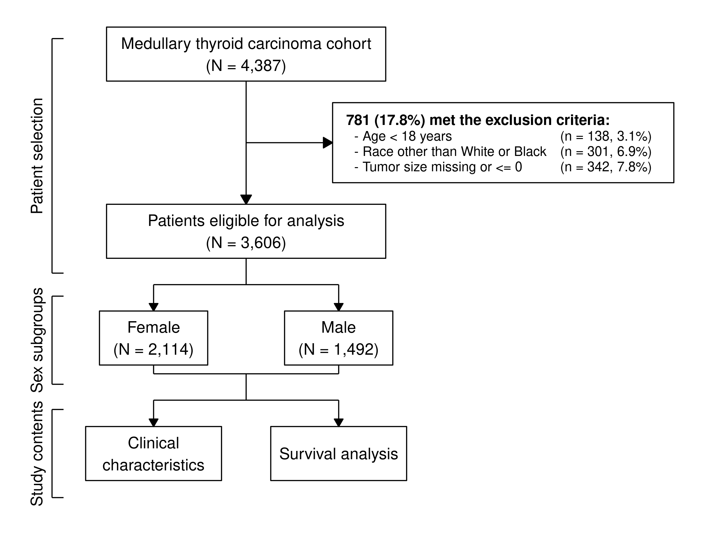{fig-alt="方角主框与分组框，排除框使用更长箭头和更大右侧留白，按推荐尺寸保存 PDF。"}

[下载此例生成的 PDF](images/flow-guide/cohort-flow.pdf)。

`fixed_size = TRUE` 保持布局的物理宽度；设备过窄会裁剪，放大设备主要增加空白。`FALSE` 可让图适配较小绘图区，文字仍使用设定的 pt 字号。正数可指定绘制宽度，单位英寸；图形通过固定纵横比例保持框形，不会任意拉伸高度。

保存 PNG 时也可读取推荐尺寸：

<!-- flow-run: save-png -->
```r
size <- attr(p, "flo_size")
ggsave(file.path(tempdir(), "cohort-flow.png"), p,
       width = size[["width"]], height = size[["height"]],
       units = "in", dpi = 300, bg = "white")
```

## 管道返回与复现检查 {#return-checks}

如果后续步骤还需要筛选后的数据，可使用 `return_data = TRUE`。保存功能仍然可以使用；默认的 `FALSE` 则返回 ggplot 对象供排版或保存。

<!-- flow-run: return-data -->
```r
same_data <- do.call(plt_flo, modifyList(flow_args, list(return_data = TRUE)))

h <- attr(cohort, "flt")
```

::: {.callout-note collapse="true" title="复核代码"}
生成本页时运行的检查，接在上面的代码之后运行；只读教程可以跳过。

```r
stopifnot(identical(same_data, cohort))
stopifnot(
  all(h[["all_pat"]] - h[["res_pat"]] == h[["del_pat"]]),
  all(cumsum(h[["del_pat"]]) == h[["del_pat_sum"]]),
  sum(h[["del_pat"]]) == nrow(start) - nrow(cohort)
)
```
:::

复现时先确认安装版本支持页面使用的命名 list 字段。常见核对点包括：

- **历史是否连续：** 同一流程连续通过 `get_flt()` 记录，不清除有效历史；外部增删行会触发人数不符提醒。确实重新定义起始队列时另建筛选链，明确新分母，不能用清除属性掩盖漏记步骤。
- **标签是否准确：** `name_map` 按 `var` 映射；同一变量出现多次时会同步替换那些历史行的标签，不能把不同阈值都写成同一个移除原因。
- **人数是否可追溯：** 手动分组人数要从相应数据计算；更改显示参数不会重新筛选或验证分析队列。
- **内容与阶段是否有对应结构：** 研究内容依附于分组；阶段标签应对应实际存在的结构。
- **图是否被裁剪：** 使用推荐尺寸保存，或在小绘图区采用 `fixed_size = FALSE`；不要仅靠改变文字大小修正设备尺寸。

## get_all：先筛选，再重编码（2026-10-24） {#all-preprocess-20261024}

<!-- update-20261025: cohort_lists -->

2026-10-25 按已推送 RegR `a121af8`、UtilsR 0.6.10 `0e4cffe` 在 Windows / WSL R 4.4.3 执行。`dis.args` 已改用 `label_args`、`flow_args`、`stratum_args`、`facet_args`、`legend_args`，原顶层 `label/gap/curve_type` 不再适用；下例已迁移并重绘。公共入口现在可在 `com.args` 内直接写 `get_flt` 条件与 `fct_cat` 重编码；正式筛选字段为 `get_flt`，短暂使用过的 `flt` 不作为兼容入口。返回对象的 `attr(result,"flt")` 仍叫 `flt`，不要把**参数字段**与**历史属性**混淆。

### 继续已有筛选链，保留逐步人数

```r
library(RegR)
library(UtilsR)
d_all24 <- data.frame(Arm = factor(rep(c("No", "Yes"), each = 24)),
  site = factor(rep(c("Head", "Body", "Tail", "Other"), 12), levels = c("Head", "Body", "Tail", "Other")),
  Age = rep(c(16, 25, 40, 65, 80, 55), 8), size = rep(c(10, 20, 30, 40, 50, 60), 8),
  time = 1:48, DSS = rep(c(0L, 1L, 0L, 1L, 1L, 0L), 8))
d_all24[["DSS"]][c(3, 14, 34)] <- NA_integer_
original_all24 <- d_all24
quiet_all24 <- function(expr) { invisible(capture.output(ans <- force(expr))); ans }
base_all24 <- quiet_all24(get_flt(d_all24, Age >= 18))
log_all24 <- capture.output(all24 <- get_all(
  com.args = list(data = base_all24,
    get_flt = site != "Other",
    get_flt = list(Age <= 75),
    fct_cat = list(c(site, Head_Body = c("Head", "Body")),
      c(Size_3 = size, breaks = c(20, 40), labels = c("S", "M", "L")),
      c(Arm, reverse = TRUE)),
    adj_var = c("Age", "size", "Size_3", "site"), surv = TRUE, time = 24),
  tbl.args = list(cat_var = "Arm"),
  dis.args = list(dis_var = c("Size_3", "site"), type = "bar",
    label_args = list(style = "count_percent_wrap", pct_accuracy = 1),
    legend_args = list(position = "bottom", ncol = 2))))
# 显式的同一处理顺序作为对照；只在局部副本上操作。
manual_all24 <- quiet_all24(get_flt(base_all24, site != "Other", Age <= 75))
manual_all24[["site"]] <- fct_cat(manual_all24[["site"]], Head_Body = c("Head", "Body"))
manual_all24[["Size_3"]] <- fct_num(manual_all24[["size"]], breaks = c(20, 40), labels = c("S", "M", "L"))
manual_all24[["Arm"]] <- fct_cat(manual_all24[["Arm"]], reverse = TRUE)
manual_all24 <- manual_all24[complete.cases(manual_all24[c("time", "DSS")]), , drop = FALSE]
manual_table24 <- quiet_all24(get_gt_cat(manual_all24, cat_var = "Arm", com_var = c("Age", "size", "Size_3", "site")))
history_all24 <- attr(all24, "flt")
gt::gtsave(gt::gt(as.data.frame(history_all24[c("order", "filter", "all_pat", "res_pat", "del_pat")])),
  file.path(tempdir(), "20261025-update-all-history.html"))
gt::gtsave(all24[["cat_gt"]], file.path(tempdir(), "20261025-update-all-table.html"))
ggplot2::ggsave(file.path(tempdir(), "20261025-update-all-distribution.pdf"), all24[["dis"]], width = 6.5, height = 4)
```

::: {.callout-note collapse="true" title="复核代码"}
生成本页时运行的检查，接在上面的代码之后运行；只读教程可以跳过。

```r
stopifnot(is.null(attr(all24, "failures")), identical(d_all24, original_all24),
  isTRUE(all.equal(all24[["cat_gt"]][["_data"]], manual_table24[["_data"]], check.attributes = FALSE)),
  identical(history_all24[["order"]], 1:4),
  identical(history_all24[["filter"]], c("Age >= 18", 'site != "Other"', "Age <= 75", "!is.na(time) & !is.na(DSS)")),
  tail(history_all24[["res_pat"]], 1) == nrow(manual_all24),
  is.numeric(manual_all24[["size"]]), is.factor(manual_all24[["Size_3"]]),
  sum(all24[["dis"]][["data"]][["n"]]) == nrow(manual_all24))
```
:::

::: {.panel-tabset}

### 逐步人数 {.unnumbered}

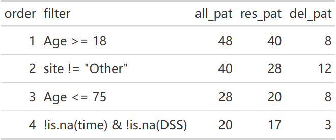{fig-alt="原生筛选历史表，顺序为年龄至少18、排除Other部位、年龄不超过75、去除缺失time或DSS；每步显示筛选前后人数。"}

[原生 HTML](images/flow-guide/20261025-update-all-history.html)

### 同一处理后队列的表格 {.unnumbered}

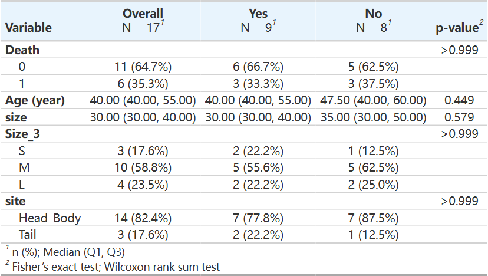{fig-alt="原生基线表同时保留size与Size_3分箱，以及重编码site；Arm水平由Yes开始，人数与筛选历史末步一致。"}

[原生 HTML](images/flow-guide/20261025-update-all-table.html)

### 同一处理后队列的分布 {.unnumbered}

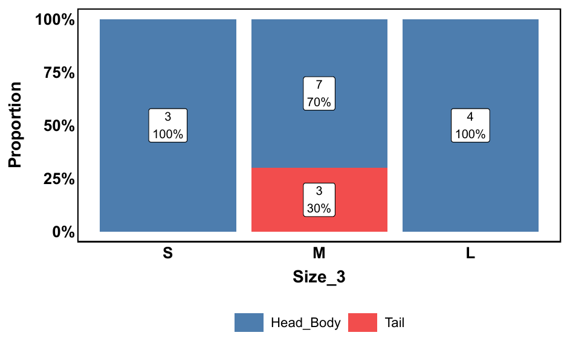{fig-alt="Size_3的S、M、L分箱中Head_Body与Tail的构成，计数与同一分析队列一致。"}

[下载 PDF](images/flow-guide/20261025-update-all-distribution.pdf)

:::

顺序是：先执行全部 `get_flt` → 按书写顺序重编码 → 删除本模型所需的缺失结局 → 执行分析。重复的 `get_flt` 字段会逐步保留历史，已有 `get_flt()` 历史继续接上；即使把 `fct_cat` 写在筛选字段前面，筛选仍先执行。位置索引按**筛选后**剩余因子水平计数，稳定对比建议用水平名称。

`fct_cat=list(c(...),c(...))` 将多项重编码集中写；列名不命名会覆盖该列，`c(Size_3=size,...)` 则写入新列，原 size 保持数值。带 `breaks` / `nbins` 时转给 `fct_num()`；其余参数转给 `fct_cat()`，嵌套的水平向量不会被展开。合法切点、标签数和参考组规则沿用 [UtilsR 因子教程](../utilsr/factor-guide.qmd)。控制台 Recoded 摘要显示列与新水平，筛选步骤另按人数对齐。

### 预先构造参数列表时使用表达式或字符串

```r
common_all24 <- list(data = base_all24,
  get_flt = rlang::exprs(site != "Other", Age <= 75),
  fct_cat = list(list("site", Head_Body = c("Head", "Body")),
    list(Size_3 = "size", breaks = c(20, 40), labels = c("S", "M", "L")),
    list("Arm", reverse = TRUE)),
  adj_var = c("Age", "size", "Size_3", "site"), surv = TRUE, time = 24)
prebuilt_all24 <- quiet_all24(get_all(com.args = common_all24, tbl.args = list(cat_var = "Arm")))
bad_field24 <- tryCatch(get_all(com.args = list(data = d_all24, flt = TRUE)), error = identity)
```

::: {.callout-note collapse="true" title="复核代码"}
生成本页时运行的检查，接在上面的代码之后运行；只读教程可以跳过。

```r
stopifnot(identical(attr(prebuilt_all24, "flt"), history_all24),
  isTRUE(all.equal(prebuilt_all24[["cat_gt"]][["_data"]], all24[["cat_gt"]][["_data"]], check.attributes = FALSE)))
stopifnot(inherits(bad_field24, "error"))
validation_values <- list(history = as.data.frame(history_all24), table = all24[["cat_gt"]][["_data"]],
  distribution = as.data.frame(all24[["dis"]][["data"]]), rows = nrow(manual_all24),
  levels = lapply(manual_all24[c("Arm", "site", "Size_3")], levels))
```
:::

也可把 `get_flt` 写成 `c('site != "Other"','Age <= 75')`。不能在预先构造的普通 `list()` 中让裸列条件提前求值；重编码的首个列名同样需用字符串 `list("site",...)`。调用环境中的阈值可在条件中引用，数据列优先由数据掩码解析。

`dis_var` 仍由 get_all 适配为 `plt_dist()` 的 `dis_vars`；其余 list 原样转发，细节见[分布图迁移表](../utilsr/flow-guide.qmd#distribution-lists-20261025)。已给公共 `split_var` 时，它用于分面；`facet_args` 只管面板排法，不改变分层变量。当前 RegR 已把 UtilsR (>=0.6.10) 作为硬依赖，不能只更新 RegR 而沿用旧 UtilsR。

本例只启用 `tbl.args` 与 `dis.args`，没有拟合回归或自动启动其余分析。模拟年龄与大小含并列值，表格检验提示不能计算精确 P 值/区间，按当前检验使用近似结果；本节用于核对队列与接口。字段名错误会在分析前报错；某个已启用分析内部失败则检查 `attr(result,"failures")`，不能仅凭有返回值认定所有步骤成功。原始逐步筛选与[流程图绘制](#get-flt)继续可独立使用。

<!-- /update-20261025: cohort_lists -->

## plt_flo2()：彩色研究流程 {#plt-flo2}

`plt_flo2()` 的左侧是彩色阶段框，右侧是自动编号的说明框；还可以在顶部增加队列筛选，在左边增加旋转的阶段标签。输入是**阶段文字和队列人数**，`get_flt()` 的历史需要转换成 `cohorts` 后再传入。

:::: {.table-responsive tabindex="0" role="region" aria-label="表格，可横向滚动"}

| 函数 | 输入 | 主要展示内容 |
|:--|:--|:--|
| `plt_flo()` | 带 `flt` 历史的数据 | 连续筛选、排除明细、分组与汇合 |
| `plt_flo2()` | `stages` 与可选的 `cohorts` | 队列选择与数据准备、建模、验证、解释等研究阶段 |

::::

下面的建模阶段是**研究流程文字示例**；本页实际执行的是队列筛选和绘图，并未拟合、验证模型或计算 SHAP。

### 共用阶段与队列人数 {#flo2-setup}

先运行 [共用准备代码](#data)，再运行以下代码。`stages` 必须有名称：名称是阶段标题，值是该阶段的一条或多条说明；两者的顺序决定图中的顺序。

<!-- flow2-run: setup -->
```r
stages <- list(
  "Data preparation" = c(
    "Check variables, missingness and outcome definition",
    "Separate development and validation data before preprocessing",
    "Estimate transformations using development data only"
  ),
  "Model selection" = c(
    "Compare candidate algorithms with cross-validation",
    "Choose tuning parameters within the development data"
  ),
  "Model development" = "Fit the selected model with the chosen parameters",
  "Model validation" = c(
    "Evaluate discrimination and calibration on held-out data",
    "Report performance and uncertainty"
  ),
  "Model explanation" = "Summarize feature contributions with SHAP"
)

# 从前面三步连续筛选的历史提取互不重复的移除人数。
h <- attr(cohort, "flt")
excluded <- setNames(h[["del_pat"]], unname(reasons[h[["var"]]]))
cohort_spec <- list(
  label = "Medullary thyroid carcinoma cohort",
  N = nrow(start),
  exclude = excluded,
  final_label = "Patients eligible for analysis"
)

# 标签页用这份参数组合添加单队列与两个阶段标签。
workflow_args <- list(
  stages = stages,
  cohorts = cohort_spec,
  phase_labels = c("Patient selection", "Study workflow")
)
```

::: {.callout-note collapse="true" title="复核代码"}
生成本页时运行的检查，接在上面的代码之后运行；只读教程可以跳过。

```r
stopifnot(cohort_spec[["N"]] - sum(excluded) == nrow(cohort))
```
:::

本例起始 **4,387 人**，三项移除人数分别为 **138、301、342**，最终 **3,606 人**。`cohorts$exclude` 会从 `N` 中减去各项人数，必须使用连续筛选的新增移除人数，避免把同一患者在多个条件下重复计数。

### 阶段、单队列与双队列 {#flo2-cohorts}

::: {.panel-tabset}

#### 仅研究阶段 {.unnumbered}

`cohorts = NULL` 是默认值，适合只展示研究步骤。左侧标题自动换行，右侧说明按条目编号，默认统一说明框高度。

<!-- flow2-run: flo2-basic -->
```r
plt_flo2(stages = stages)
```

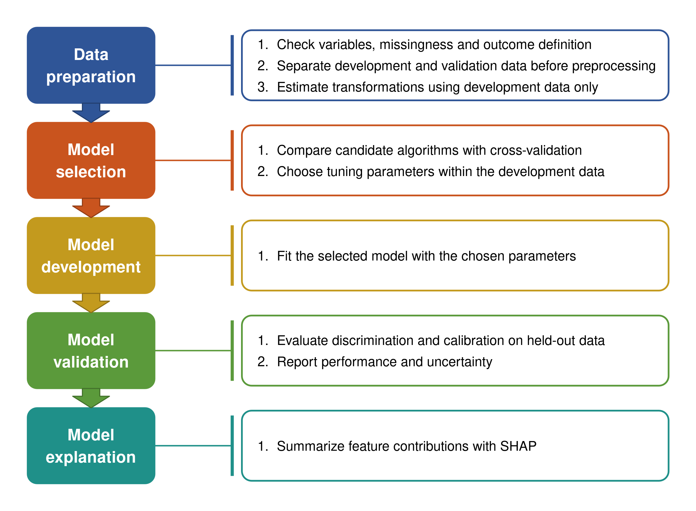{fig-alt="五个彩色阶段框用块状箭头连接，右侧对应编号说明，说明框默认等高。"}

#### 单队列与阶段标签 {.unnumbered}

单队列可直接传入一份 specification，无需再包一层 list。`phase_labels` 按**顶部队列区、下方研究步骤区**对应两个标签；它不会逐个标记五个建模步骤。

<!-- flow2-run: flo2-cohort -->
```r
do.call(plt_flo2, workflow_args)
```

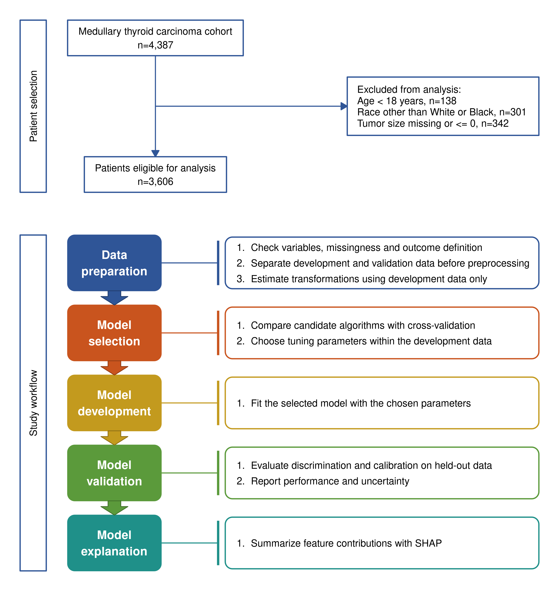{fig-alt="顶部队列从4387人排除三项合计781人后纳入3606人，下方绘制五个研究步骤。"}

#### 双队列并列 {.unnumbered}

传入外层 list 后，各队列从左到右独立绘制。本例分别在原始女性、男性子集中重新执行相同筛选；两个队列均是同一示例数据的性别子集，不能据此称为独立外部验证队列。

<!-- flow2-run: flo2-cohorts -->
```r
sex_cohorts <- lapply(c("Female", "Male"), function(sex) {
  d <- start[start[["Sex"]] == sex & !is.na(start[["Sex"]]), ]
  attr(d, "flt") <- NULL
  kept <- get_flt(d, Age >= 18, Race %in% c("White", "Black"),
                  !is.na(Tum) & Tum > 0)
  history <- attr(kept, "flt")
  removed <- setNames(history[["del_pat"]],
                      unname(reasons[history[["var"]]]))
  stopifnot(nrow(d) - sum(removed) == nrow(kept))
  list(label = paste(sex, "MTC patients"), N = nrow(d), exclude = removed,
       final_label = paste(sex, "patients included"))
})
plt_flo2(stages = stages, cohorts = sex_cohorts,
         phase_labels = c("Patient selection", "Study workflow"))
```

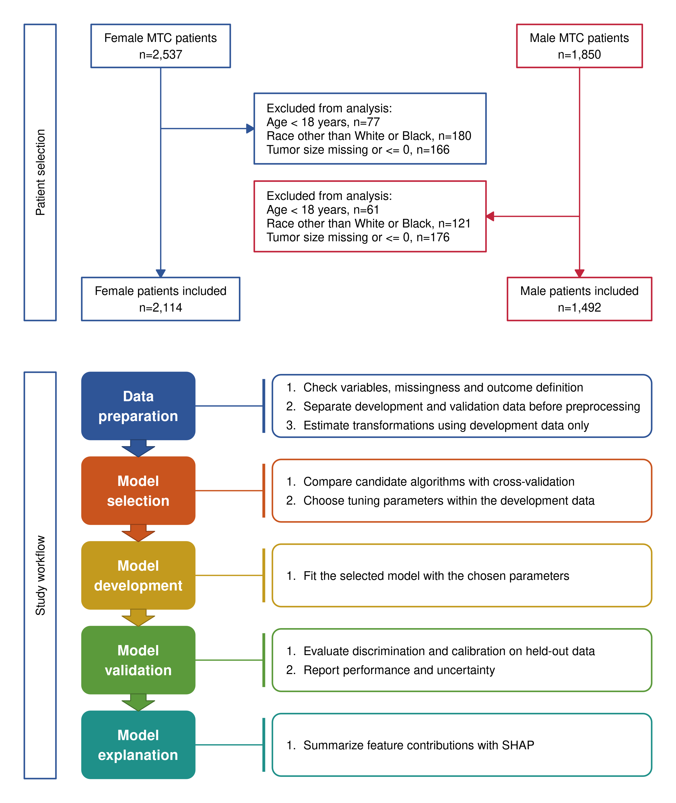{fig-alt="女性与男性子队列各自显示起始人数、三项排除人数和最终人数，女性2114人、男性1492人。"}

:::

### 配色、换行与框高 {#flo2-boxes}

::: {.panel-tabset}

#### 配色与方角 {.unnumbered}

`palette` 同时控制阶段框、块状箭头、横线和说明框边框；颜色不足时循环使用。队列默认取调色板首尾颜色，也可通过每个 specification 的 `color` 单独指定。`corner_radius = 0` 把阶段框和说明框改成方角；队列与阶段标签框始终为方角。

<!-- flow2-run: flo2-palette -->
```r
do.call(plt_flo2, modifyList(workflow_args, list(
  palette = c("#264653", "#287271", "#8E3B46"),
  cohorts = list(color = "#65518A"),
  box_args = list(corner_radius = 0)
)))
```

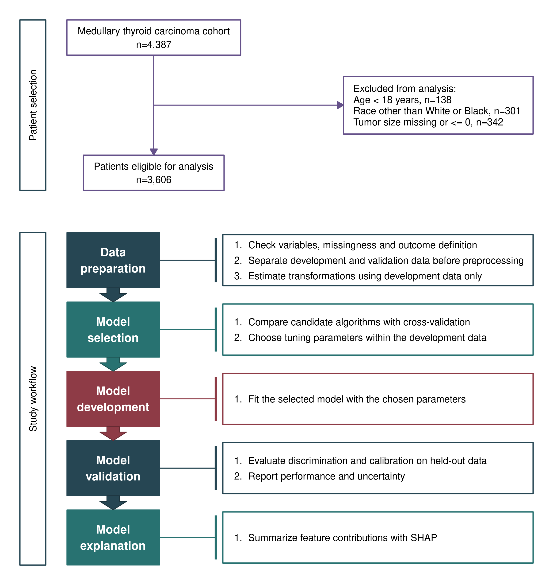{fig-alt="五个研究阶段循环使用三色调色板，顶部队列使用紫色，阶段与说明框均为方角。"}

#### 控制文本换行 {.unnumbered}

`stage_width` 指定标题内宽；`desc_width` 与 `exc_width` 是说明、排除文字的换行上限，单位都是英寸。后两者并不强制框宽：实际框仍按最长的换行文本贴合。排除行的宽度包含末尾的 `n=...`，续行自动悬挂缩进。

<!-- flow2-run: flo2-wrap -->
```r
do.call(plt_flo2, modifyList(workflow_args, list(
  box_args = list(stage_width = 1.5, desc_width = 3.2, exc_width = 2.2)
)))
```

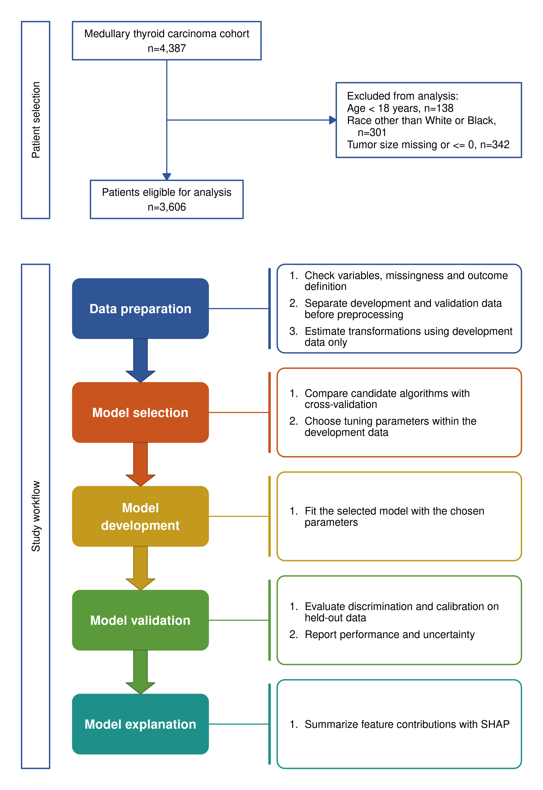{fig-alt="标题使用1.5英寸内宽，说明按3.2英寸上限换行，排除原因按2.2英寸上限换行并保留缩进。"}

#### 说明框随内容收紧 {.unnumbered}

与 [默认等高示例](#flo2-cohorts) 比较：`equal_height = FALSE` 让每个说明框贴合自身内容，单条说明的框更矮，多条说明的框更高。阶段框仍保持统一高度，垂直箭头随行高变化。

<!-- flow2-run: flo2-height -->
```r
plt_flo2(stages = stages, box_args = list(equal_height = FALSE))
```

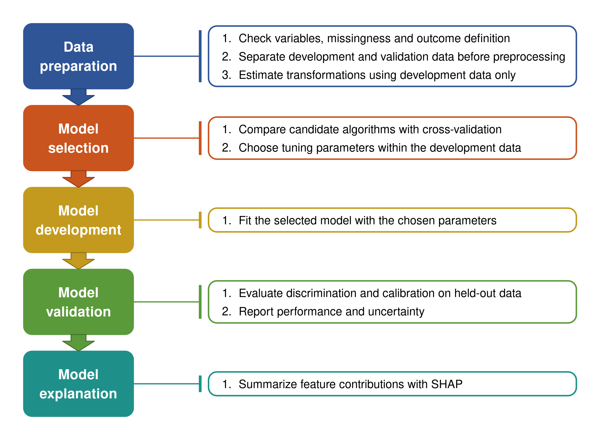{fig-alt="数据准备阶段的三项说明框较高，模型开发与解释的单项说明框较矮。"}

:::

### 字号、间距与保存 {#flo2-save}

::: {.panel-tabset}

#### 加大字号与间距，保存 PDF {.unnumbered}

字号用 **pt**，宽度和间距用**英寸**。增大 `text_fs` 时，应同步增大 `gap_args$line`，它不会自动随字号调整。

<!-- flow2-run: flo2-spacing-save -->
```r
pdf_file2 <- file.path(tempdir(), "flo2-workflow.pdf")
p_flo2 <- do.call(plt_flo2, modifyList(workflow_args, list(
  box_args = list(text_fs = 12, stage_fs = 14, desc_width = 4.8),
  gap_args = list(connector = 1, row = 0.35, line = 0.20,
                  item = 0.32, exclude = 0.8, section = 0.8),
  fixed_size = TRUE,
  save = list(filename = pdf_file2)
)))
attr(p_flo2, "flo_size")  # 推荐宽高，单位英寸
pdf_file2
p_flo2
```

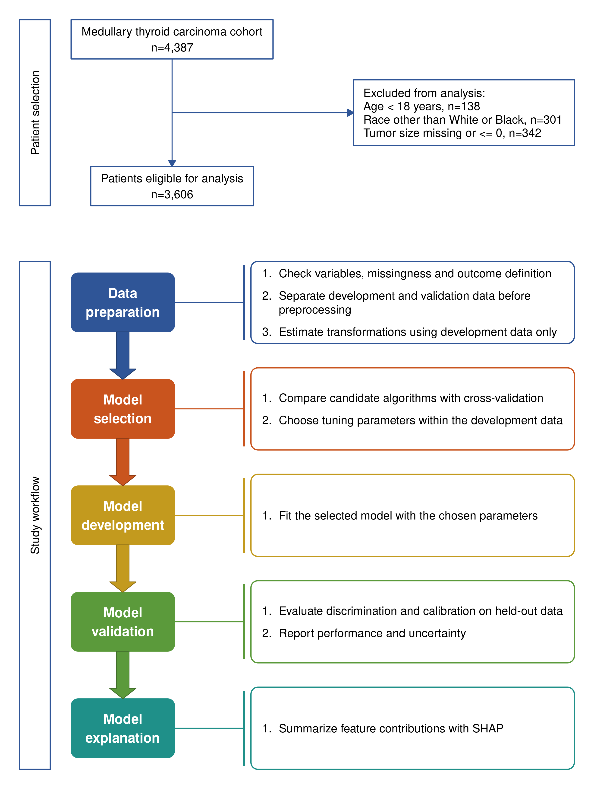{fig-alt="研究流程使用12pt正文字号和14pt阶段标题，扩大连线、行、条目与队列区间距。"}

[下载此例生成的 PDF](images/flow-guide/flo2-workflow.pdf)。只指定文件名时，保存功能自动采用 `flo_size` 的推荐尺寸；`save = list()` 或 `NULL` 不保存文件。

#### 小设备整体缩放 {.unnumbered}

默认 `fixed_size = TRUE` 的对象带有 `flo2_plot` 打印方法：小设备会把**图形、文字和线宽一起缩小**，完整显示布局。下面把单队列示例保存到 4 × 4 英寸 PNG；点击图片可放大查看。

<!-- flow2-run: flo2-small-device -->
```r
p_small <- do.call(plt_flo2, workflow_args)
ggsave(file.path(tempdir(), "flo2-small-device.png"), p_small,
       width = 4, height = 4, units = "in", dpi = 300, bg = "white")
p_small
```

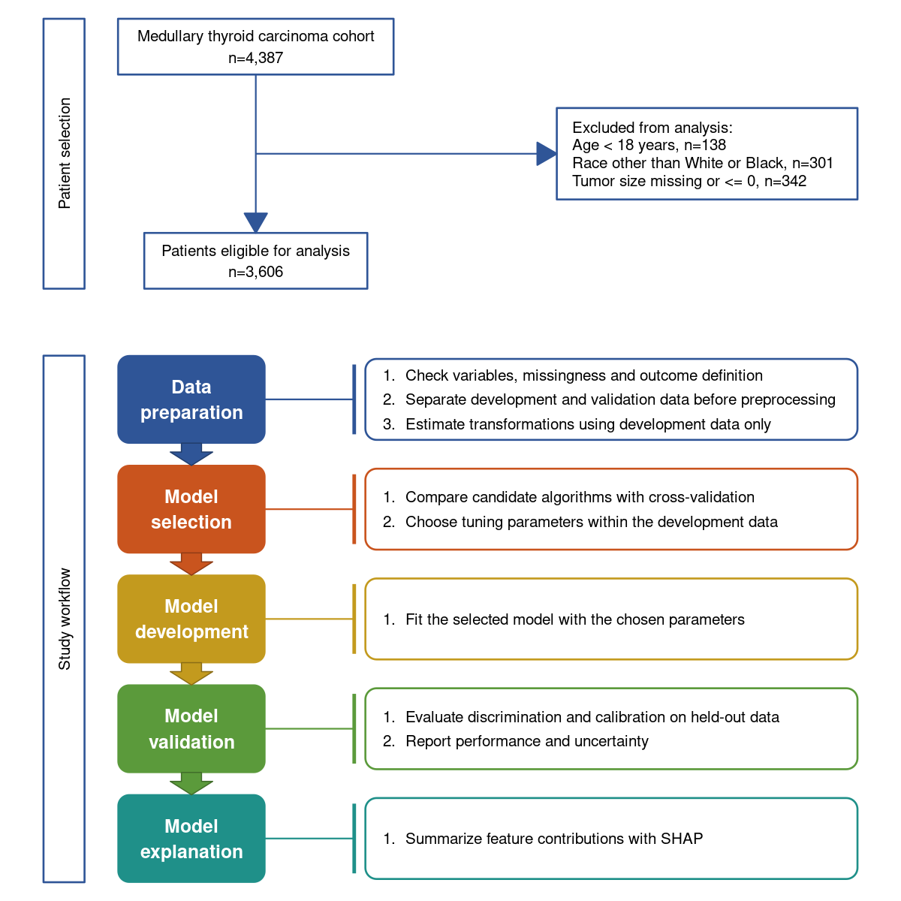{fig-alt="默认固定尺寸研究流程在4乘4英寸设备上整体缩放，文字、框和箭头保持相对比例。"}

`fixed_size = FALSE` 返回普通 ggplot，布局随设备变化，但文字保留 pt 字号，可能超出框。正数可指定固定面板宽度，单位英寸；常规保存建议使用默认值和 `flo_size`，需要更小的输出时直接指定保存设备的宽高。

:::

:::: {.table-responsive tabindex="0" role="region" aria-label="表格，可横向滚动"}

| 参数 | 默认值与作用 |
|:--|:--|
| `gap_args$connector` | `0.8` 英寸；阶段框到说明框前竖线的横向连线长度 |
| `gap_args$row` | `0.2` 英寸；相邻阶段行的最小垂直间距 |
| `gap_args$line` | `0.145` 英寸；同一说明条目内的换行间距，不影响队列和阶段标签的行距 |
| `gap_args$item` | `0.22` 英寸；当前条目末行到下一条目首行的间距 |
| `gap_args$exclude` | `0.5` 英寸；队列主轴到排除框的最小箭头长度 |
| `gap_args$section` | `0.6` 英寸；队列区到研究步骤区的垂直间距 |
| `box_args$text_fs / stage_fs` | `10 / 12` pt；说明、队列和阶段标签 / 彩色阶段标题的字号 |
| `box_args$stage_width` | `NULL`；按最宽单词自动换行；数值指定标题内宽 |
| `box_args$desc_width / exc_width` | `5.5 / 3.5` 英寸；说明 / 排除文字的换行上限 |
| `box_args$corner_radius` | `0.1` 英寸；阶段框与说明框圆角半径 |
| `box_args$equal_height` | `TRUE`；说明框统一为最高说明框的高度 |

::::

## plt_flo3()：多队列、分组与研究内容 {#plt-flo3}

`plt_flo3()` 适合开发 / 验证队列并行筛选，再连接终末分组和研究内容。函数不读取患者数据或执行筛选，所有人数由 `cohorts` 提供。下面使用模拟计数，与本页前方真实MTC筛选人数无关。

本节按包含 `9e4b9e8` 及后续布局修复的本机源码实际绘制，2026-10-13复核时该接口已包含于已推送基线 `a3881fa`（版本0.1.3）。旧 `plt_flo()` / `plt_flo2()` 图和筛选记录保留原快照。

```r
cohorts3 <- list(
  list(label = "Development cohort\n2011-2020", N = 900,
    exclude = c("Missing predictors" = 150, "No follow-up" = 50),
    split = c("Low risk" = 280, "Intermediate risk" = 220, "High risk" = 200),
    final_label = "Development sample"),
  list(label = "Validation cohort\n2021-2023", N = 420,
    exclude = c("Missing predictors" = 40, "No follow-up" = 20),
    split = c("Low risk" = 160, "Intermediate risk" = 120, "High risk" = 80),
    final_label = "Validation sample")
)
contents3 <- c("Group characteristics", "Survival comparison", "Model evaluation")
phases3 <- c("Selection", "Risk groups", "Study content")
```

::: {.panel-tabset}

### 每个队列各自分组

```r
p_flo3_separate <- plt_flo3(cohorts3, split_layout = "separate",
  content_labels = contents3, phase_labels = phases3)
p_flo3_separate
```

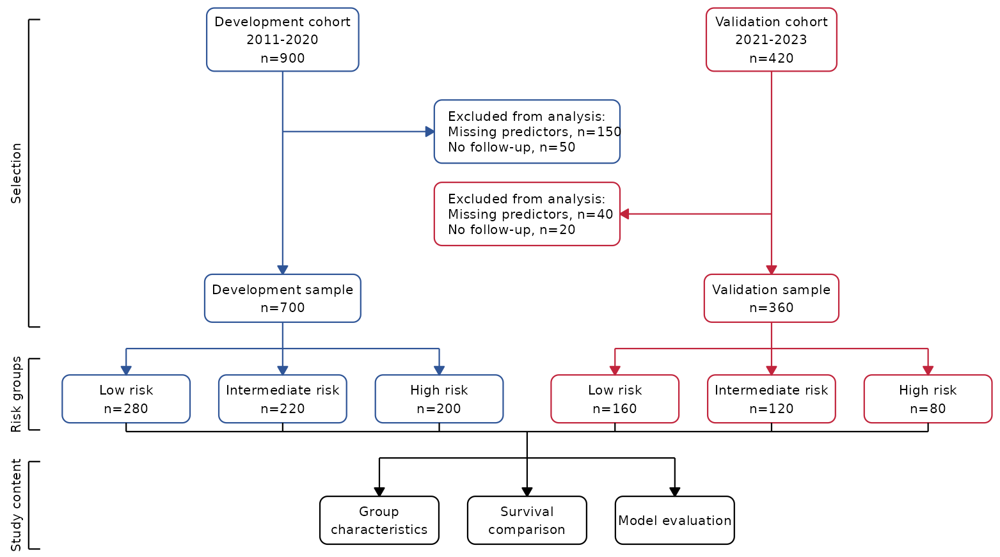{fig-alt="开发900人筛除200后为700，验证420人筛除60后为360；两个队列分别连接三个风险组。"}

### 同一行汇总各队列人数

```r
p_flo3_pooled <- plt_flo3(cohorts3, split_layout = "pooled",
  content_labels = contents3, phase_labels = phases3,
  save = list(filename = file.path(tempdir(), "flo3-pooled.pdf")))
p_flo3_pooled
```

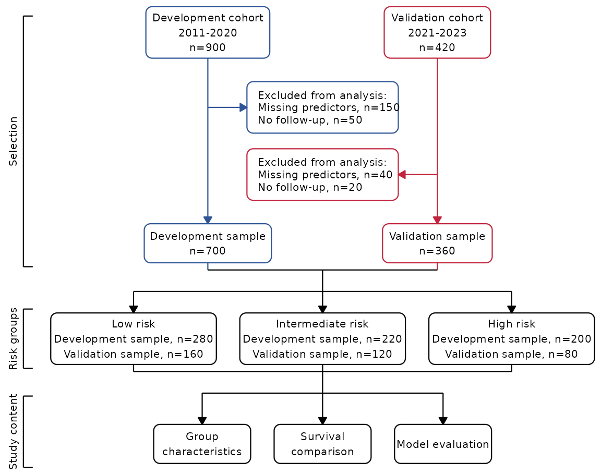{fig-alt="开发和验证队列汇入同一排风险组框，每组明确显示两个队列各自人数。"}

### 仅首个队列分组

```r
cohorts_first <- cohorts3
cohorts_first[[2]][["split"]] <- NULL
p_flo3_first <- plt_flo3(cohorts_first, split_layout = "first",
  content_labels = contents3, phase_labels = phases3)
p_flo3_first
```

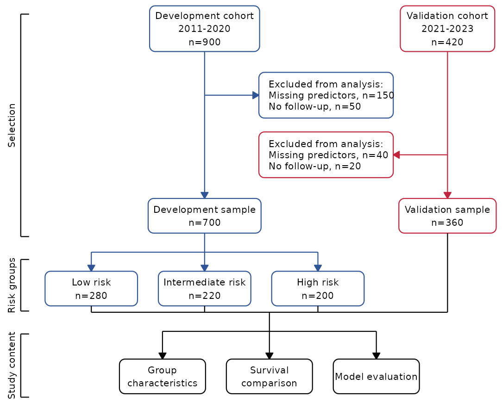{fig-alt="只有开发队列连接三个风险组，验证队列不显示分组，直接接入共同研究内容。"}

### 阶段框、换行与间距

```r
p_flo3_style <- plt_flo3(cohorts3, split_layout = "separate",
  content_labels = c("Baseline\ncharacteristics", "Survival\ncomparison", "Model evaluation"),
  phase_labels = phases3, phase_style = "box",
  gap_args = list(group = 0.45, content = 0.45, content_arrow = 0.7),
  box_args = list(equal_group_width = FALSE, content_width = 1.8, text_fs = 10))
p_flo3_style
```

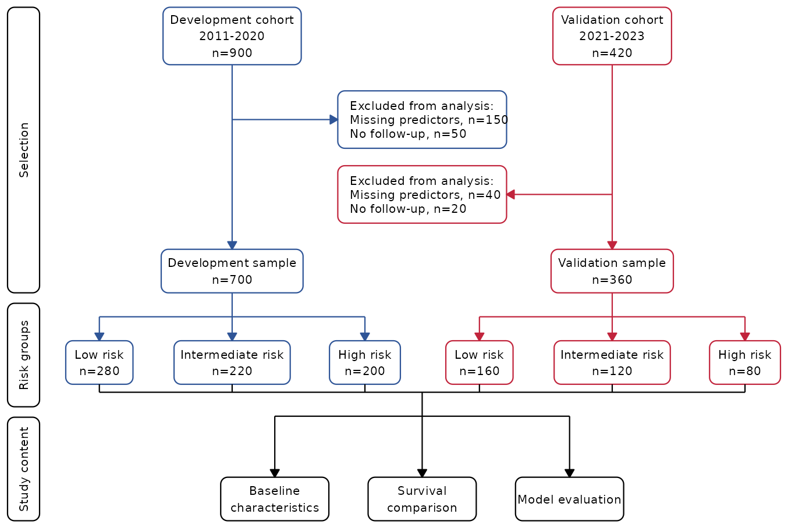{fig-alt="矩形阶段标签的双队列流程，风险框按各自文字宽度，研究内容保留手工换行。"}

:::

[下载本次实际导出的 pooled PDF](images/flow-guide/flo3-pooled.pdf)。保存未指定宽高时使用 `attr(p,"flo_size")` 的自然尺寸；PNG也按该尺寸导出，避免在大画布上留下大片空白。

:::: {.table-responsive}

| 设置 | 当前合同 |
|:--|:--|
| `cohorts` | 每项含label、N，以及可选exclude、split、final_label、exclude_header、color；未知或重复字段报错 |
| 人数 | N、排除人数和分组人数须为非负整数；排除和不能超过N，分组和须等于筛后人数 |
| `split_layout="pooled"` | 所有队列须提供同名且同顺序的split；图中逐队列列数，不由数据自动汇总 |
| `split_layout="first"` | 只使用首队列split；其他split会被忽略并警告，示例明确移除它们 |
| `phase_style` | bracket / box；phase_labels按实际出现的筛选、分组、内容阶段依次使用 |
| `gap_args` | exclude=0.5、group=NULL、content=0.3、content_arrow=0.4；部分list局部覆盖 |
| `box_args` | text_fs=10、exc_width=3.5、content_width=NULL、corner_radius=0.08、equal_group_width=TRUE |
| `fixed_size` | TRUE按自然尺寸，正数固定整图宽度；FALSE由设备伸展 |
| `save` | list() / NULL不保存；非空list交给save_plt，返回对象保持图形 |

::::

分组来自RPA时，先用 [get_rpa_new](rpa-guide.qmd#fixed-rpa-groups) 固定开发规则，再从实际分组数据计算人数后填入流程参数。

## PDF 设备与特殊字符 {#pdf-device}

当前 `RegR::save_plt()` 默认 `device = "cairo"`，支持普通文本标签里的 ≥、± 和希腊字母，并嵌入字体。宽高以英寸计，默认 10 × 11；文件名没有扩展名时补 `.pdf`，其他扩展名会报错。图形采用测量布局时，优先用前面的推荐尺寸。

```r
p_unicode <- ggplot(data.frame(x = 1:3, y = c(0.8, 1, 1.2)), aes(x, y)) +
  geom_point(size = 3) + theme_minimal(base_size = 13) +
  labs(title = "Unicode labels: α, β, Δ ± 1", x = "Value ≥ 1", y = "Ratio")
pdf_unicode <- file.path(tempdir(), "unicode-cairo.pdf")
RegR::save_plt(p_unicode, filename = pdf_unicode, width = 7, height = 4.5)
```

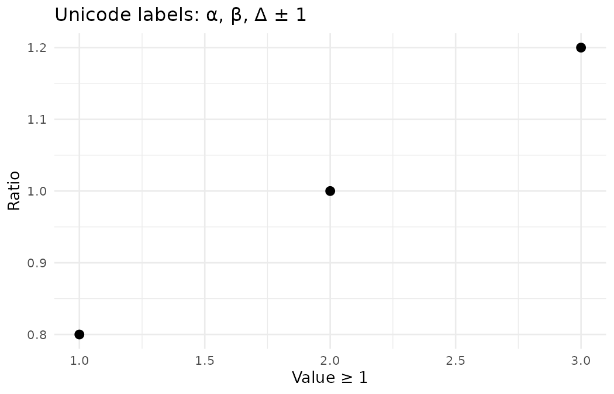{fig-alt="散点图标题含 α、β、Δ 和 ±，横轴标题含 ≥，对应 PDF 已读回确认字符与嵌入字体。"}

[下载本例 Cairo PDF](images/flow-guide/unicode-cairo.pdf)。本次读回确认 **1 页、7 × 4.5 英寸**，文本提取包含上述字符，字体已嵌入；PNG 用于网页预览，PDF 为独立矢量输出。

需要旧版设备时，在独立保存调用中使用 `device = "pdf"`。它通常使用未嵌入的 base-14 字体，不能可靠保存普通字符串中的 Unicode；plotmath 表达式仍可用于两种设备。R 没有 Cairo 支持时，默认调用会发出警告并回退到 pdf。

函数内部的 `save` 接受哪些子项，应看该函数的帮助页；例如 `plt_couple()` 当前只接受 filename / width / height，选择设备可先取得图，再调用 `save_plt()`。`save = list()` / NULL 不保存；保存不会代替函数原本的返回对象。

帮助页：[`save_plt()`](https://hui950319.github.io/RegR/reference/save_plt.html)（PDF 保存与设备选择）。相关示例见 [RPA 直接保存](rpa-guide.qmd#rpa-time-unit)。

本站只提供上述汇总表、图形和调用代码，不提供患者级数据下载。

## 当前内容框：整行粗体与手动换行 {#bold-20261018}

2026-10-18按已推送RegR `7265b31`，在Windows / WSL R 4.4.3实际绘制。plt_flo与plt_flo3的content_labels可用`**...**`标记整行粗体，一对标记也可跨越多行；普通说明行保持常规字重。它不是通用Markdown，不能把句中任意单词加粗。手动换行用`\n`，函数按各行字重测量内容框。

```r
d_flow <- data.frame(Age = 20:119, Tx = factor(rep(c("No", "Yes"), 50)),
  Marker = c(NA, seq_len(99)))
selected_flow <- d_flow |> get_flt(Age >= 30) |> get_flt(!is.na(Marker))
contents_current <- c("**Survival analysis**\n(curves and models)",
  "**Model\nchecking**\n(calibration)")
p_flow <- plt_flo(selected_flow, inclu_row = 0,
  cohort = list(label = "Simulated records"), split_var = "Tx",
  content_labels = contents_current, exc_args = list(bold_summary = FALSE),
  name_map = c(Age = "Age < 30 years", Marker = "Missing marker"))
p_flow
```

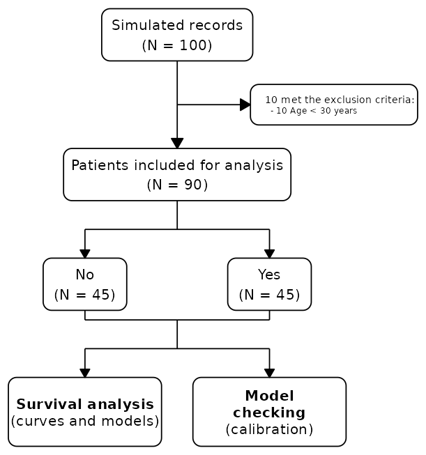{fig-alt="100条模拟记录排除10条小于30岁的记录，90条分成No和Yes各45条，底部两个内容框展示整行粗体和跨行粗体。"}

筛选条件表示保留谁，`name_map`写排除原因，必须与条件相符。Marker缺失所在行已在第一步排除，本例第二步新增排除数为0；不能把每步移除数重复相加。

```r
cohorts_current <- list(
  list(label = "Development", N = 120, exclude = c("Missing" = 20),
    split = c("Low" = 60, "High" = 40)),
  list(label = "Validation", N = 80, exclude = c("Missing" = 10),
    split = c("Low" = 40, "High" = 30)))
p_flow3 <- plt_flo3(cohorts_current, content_labels = contents_current)
p_flow3
# 按各图返回的flo_size保存；不要用更小设备挤压内容。
attr(p_flow, "flo_size")
attr(p_flow3, "flo_size")
```

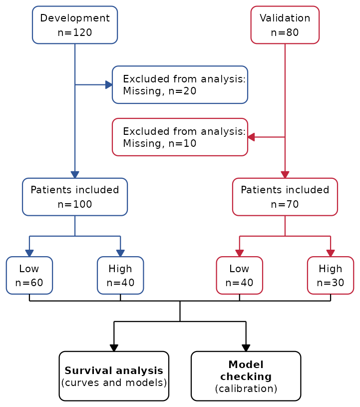{fig-alt="模拟开发和验证队列分别纳入100和70条记录，再分Low与High；下方共用带整行粗体的研究内容框。"}

### 粗体标题闭合后的说明自动另起一行（2026-10-28） {#bold-close-20261028}

<!-- update-20261028: regr_bold_close -->

RegR `c44a602` 的 `plt_flo()`、`plt_flo3()` 现在将 `"**Title** description"` 解释为粗体标题加下一行常规说明，与 `"**Title**\ndescription"` 等价。自动生成的断行也按手工断行处理，避免自动宽度计算再次压挤标题。它仍不是通用 Markdown：粗体须从行首开启并闭合，不能在普通句子中任意加粗。

下面 100 行合成记录排除 10 行后保留 90 行，No/Yes 各 45；多队列图的 Development 与 Validation 分别保留 100、70 行。两图都使用不含显式换行的标题写法。

```r
library(RegR)
flow_data28 <- data.frame(Age = 20:119, Tx = factor(rep(c("No", "Yes"), 50)))
flow_kept28 <- get_flt(flow_data28, Age >= 30)
flow_inline28 <- c("**Survival analysis** (curves and models)",
  "**Model checking** (calibration and discrimination)")
flow_plot28 <- plt_flo(flow_kept28, inclu_row = 0, cohort = list(label = "Synthetic records"),
  split_var = "Tx", content_labels = flow_inline28, content_lines = NULL,
  exc_args = list(bold_summary = FALSE), name_map = c(Age = "Age below 30"))
flow_cohorts28 <- list(
  list(label = "Development", N = 120, exclude = c("Excluded" = 20), split = c("Low" = 50, "High" = 50)),
  list(label = "Validation", N = 80, exclude = c("Excluded" = 10), split = c("Low" = 35, "High" = 35)))
flow_multi28 <- plt_flo3(flow_cohorts28, content_labels = flow_inline28)
flow_size28 <- attr(flow_plot28, "flo_size")
flow_multi_size28 <- attr(flow_multi28, "flo_size")
ggplot2::ggsave(file.path(tempdir(), "20261028-update-flow-inline-title.pdf"), flow_plot28,
  width = flow_size28[[1]], height = flow_size28[[2]])
ggplot2::ggsave(file.path(tempdir(), "20261028-update-flow3-inline-title.pdf"), flow_multi28,
  width = flow_multi_size28[[1]], height = flow_multi_size28[[2]])
```

::: {.panel-tabset}

#### 单队列 {.unnumbered}

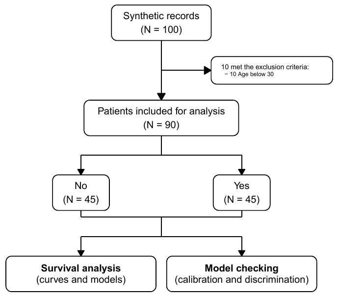{fig-alt="100 行合成输入排除 10 行后 No 与 Yes 各 45 行，底部 Survival analysis 与 Model checking 为粗体标题，闭合标记后的说明自动放到下一行。"}

[原生 PDF](images/flow-guide/20261028-update-flow-inline-title.pdf)

#### 多队列 {.unnumbered}

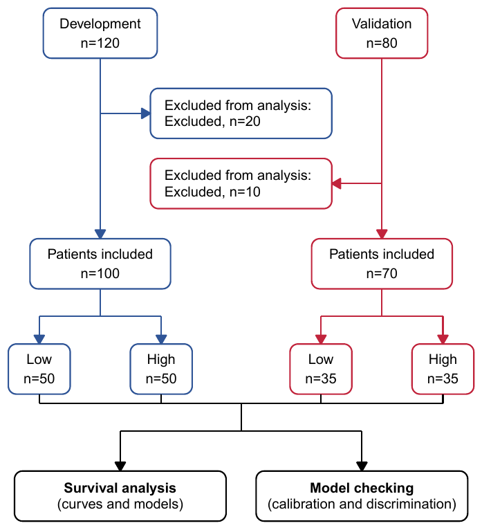{fig-alt="Development 保留 100 行、Validation 保留 70 行，多队列底部共用内容框的粗体标题和说明自动分行，与显式换行的几何数据一致。"}

[原生 PDF](images/flow-guide/20261028-update-flow3-inline-title.pdf)

:::

::: {.callout-note collapse="true" title="复核代码"}

```r
flow_broken28 <- sub("** ", "**\n", flow_inline28, fixed = TRUE)
flow_explicit28 <- plt_flo(flow_kept28, inclu_row = 0, cohort = list(label = "Synthetic records"),
  split_var = "Tx", content_labels = flow_broken28, content_lines = NULL,
  exc_args = list(bold_summary = FALSE), name_map = c(Age = "Age below 30"))
flow_multi_explicit28 <- plt_flo3(flow_cohorts28, content_labels = flow_broken28)
flow_labels28 <- function(p) do.call(rbind, lapply(ggplot2::ggplot_build(p)[["data"]], function(d) {
  if (all(c("label", "fontface", "x", "y") %in% names(d)))
    data.frame(label = d[["label"]], face = as.character(d[["fontface"]]), x = d[["x"]], y = d[["y"]])
}))
stopifnot(nrow(flow_kept28) == 90L, all(table(flow_kept28[["Tx"]]) == 45L),
  identical(flow_labels28(flow_plot28), flow_labels28(flow_explicit28)),
  identical(flow_labels28(flow_multi28), flow_labels28(flow_multi_explicit28)),
  identical(attr(flow_plot28, "flo_size"), attr(flow_explicit28, "flo_size")),
  identical(attr(flow_multi28, "flo_size"), attr(flow_multi_explicit28, "flo_size")))
flow_bad28 <- vapply(c("Ordinary **bold** text", "**Unclosed title"), function(label) {
  message <- tryCatch(plt_flo3(flow_cohorts28, content_labels = label), error = conditionMessage)
  is.character(message) && grepl("whole lines", message)
}, logical(1))
stopifnot(all(flow_bad28))
validation_values <- list(n_input = 100L, n_kept = 90L, groups = as.integer(table(flow_kept28[["Tx"]])),
  inline_matches_explicit = TRUE, multi_matches_explicit = TRUE, invalid_rejected = flow_bad28)
```
:::

`plt_flo(content_lines=NULL)` 保留这些断行；显式设置行数仍会按行预算重新排版，不能把两种控制同时理解成强制保留原布局。本节在 Windows / WSL R 4.4.3 逐项比较各自平台的文字坐标、字重和画布尺寸；历史图保留旧执行快照。

<!-- /update-20261028: regr_bold_close -->

### 因子水平晚出现也要保留 {#factor-20261018}

get_flt先检查每个因子前10,000行是否包含全部水平；没出现齐时会回查完整结果，再只清理真正空的水平。这里实际验证late仅在第20,001行出现仍被保留，unused被移除：

```r
late <- data.frame(flag = factor(c(rep("common", 20000), "late"),
  levels = c("common", "late", "unused")))
kept <- get_flt(late, flag != "unused")
```

::: {.callout-note collapse="true" title="复核代码"}
生成本页时运行的检查，接在上面的代码之后运行；只读教程可以跳过。

```r
stopifnot(nrow(kept) == 20001L, identical(levels(kept[["flag"]]), c("common", "late")))
```
:::

这是水平清理的计算路径调整，不是只分析前10,000行，也不会恢复已被条件排除的记录。本轮未进行新计时。[`get_flt()` 帮助页](https://hui950319.github.io/RegR/reference/get_flt.html) · [`plt_flo()` 帮助页](https://hui950319.github.io/RegR/reference/plt_flo.html)

## 更新记录 {#page-updates}

::: {.callout-note collapse="true" title="本页更新记录"}
- 2026-10-28：追加 [累计历史与行数边界](#history-rows-20261028b)，复核程序化列名、列表不可见返回、新增步骤打印及缺失排除标签。
- 2026-10-28：补充 [粗体标题闭合后自动断行](#bold-close-20261028)的单队列、多队列 PDF 与显式换行等价核对。
- 2026-10-27：跟进已发布 RegR `79bb436` 的[顶层 content_lines 与五种阶段样式](#phase-styles-20261027)，新增三张原生 PDF。
- 2026-10-27：补充[自适应研究内容与排除框](#adaptive-flow-20261027)的两张实际流程图，固定已推送参数位置。
- 2026-10-27：补充[get_all 返回类、种子与中断保留](#dispatcher-20261027)的实际调用和模拟中断核对。
- 2026-10-26：补充[get_flt 与 get_all 摘要的实际输出](#summary-20261026)，区分返回对象、筛选历史与消息通道。
- 2026-10-24：[get_all：先筛选，再重编码](#all-preprocess-20261024)
:::
