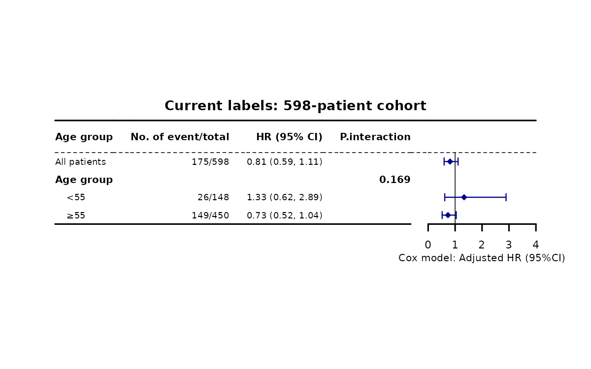
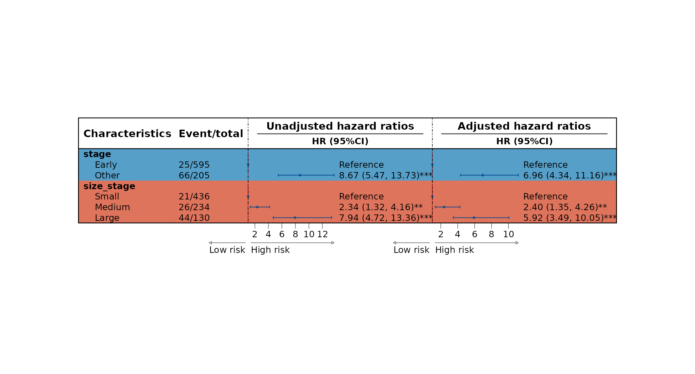
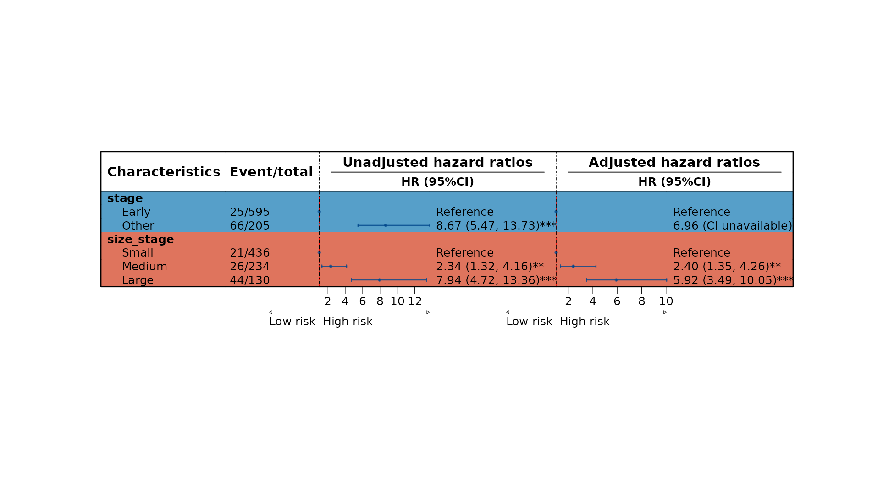
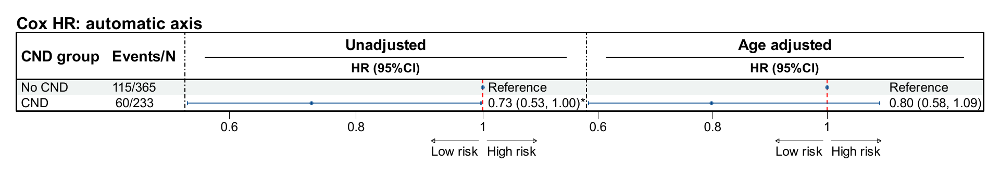
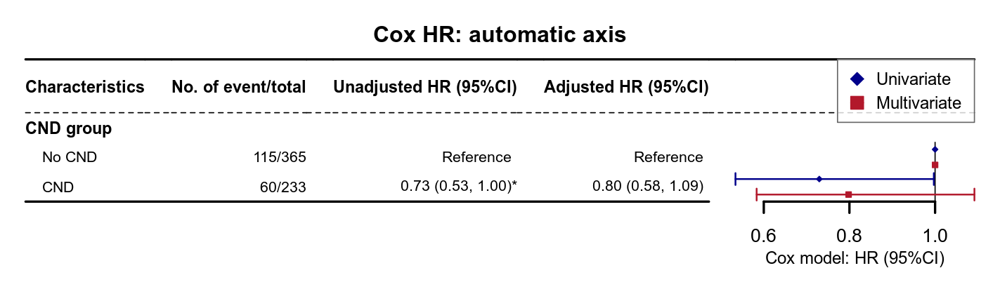
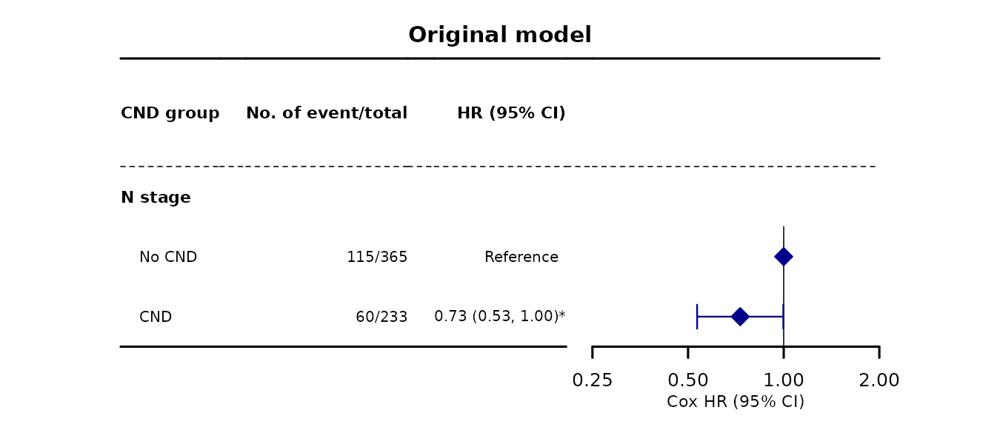
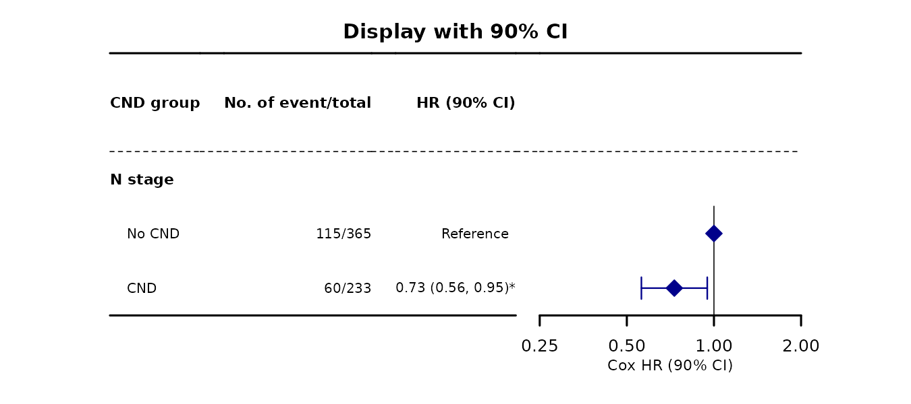
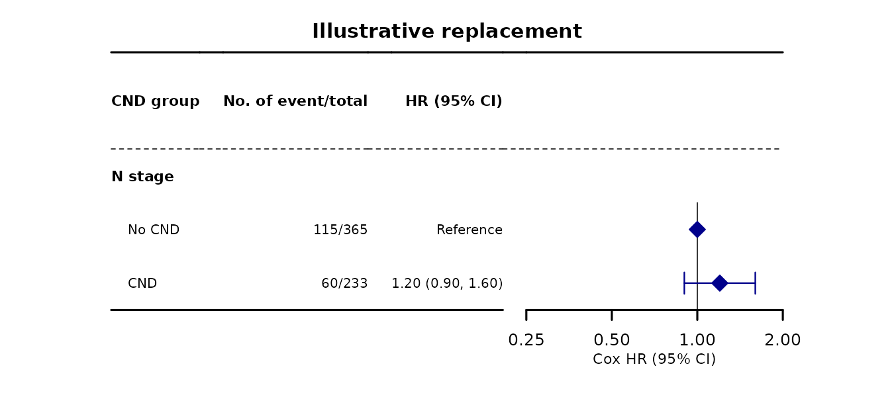
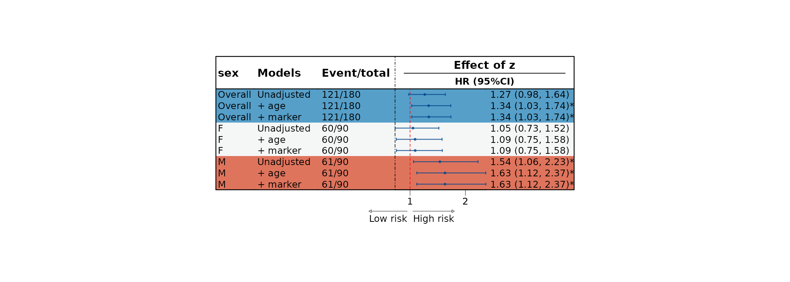

先用 `get_eff()` 生成效应表，再根据展示目的选择森林图函数。本页沿用 [SHAP 示例页](../mlr/shap-guide.qmd) 的方式：每个绘图入口配实际图形和代码，关键参数放在标签页中比较；点击图片可以放大。

::: {.callout-note collapse="true" title="版本与复现记录"}
**版本与执行范围：** 接口按 RegR **0.1.3**（2026-10-09 源码 `40515e1`）核对，使用 WSL R **4.4.3** 重新拟合并绘制下方 **24 张主教程图**；set_eff 与分期方案补充图保留各自注明的执行记录。页面显示已保存的结果；代码可在装有 RegR、ToyData 及相关依赖的 R 环境中复现。

24 张主教程图已于 2026-10-09 更新；此前执行记录不再用于说明当前默认后端或区间。下方 `cat_var_rpa` 补充示例按 2026-10-05 源码 `3411eb0` 实际运行，使用另外的 800 人 MTC 演示样本。

2026-10-19（RegR `c903aae`）起，`get_eff()` 的 `show_surdiff` 改名为 `show_sur`，默认改为 `FALSE`；旧名已在 `571dc88` 删除，再传会报 `unused argument`。本页代码已同步改名，用到概率表的调用写明 `show_sur = TRUE`；图形未因改名重新生成。
:::

## 示例数据与读图规则 {#data}

使用 `ToyData::toy_ptc_m1_cnd`，即之前整理的 **598 人、95 列 M1 乳头状甲状腺癌（PTC）队列**。数据来源、筛选流程及字段边界见 [ToyData 数据介绍](../toydata/index.qmd)。CND / No CND 是原研究依据登记的淋巴结字段定义的操作性分组。

::: {.table-responsive}

| 内容 | 本页的数据与设置 |
|:--|:--|
| CND / No CND | 233 / 365 人；分析副本将 **No CND 设为参考水平** |
| 结局 | 甲状腺癌死亡 175 人，其他原因死亡 95 人，存活 / 删失 328 人 |
| 随访 | `time`，单位月；范围 1–239 |
| 主要暴露与亚组 | `N_4`；`Sex` 与 `age_55` |
| 年龄分组 | 当前标签为 `<55` 与 `≥55`，55岁进入上组；分别148与450人 |
| 调整变量 | `Age`、`Sex`、`Race`、`Tum_3`；当前亚组变量由函数从该层的调整项中处理 |
| 概率时间点 | 60 月；原有图使用 95% CI，set_eff 小节另示 90% 显示区间 |
| 缺失值 | 本页使用的分析列无缺失；其他原始列仍可能有缺失，未对整份数据插补 |

:::

### 比值、概率差与概率

::: {.table-responsive}

| 图上的量 | 含义 | 无效应值 / 范围 |
|:--|:--|:--|
| HR | Cox 模型中的危险比；本页 CND 相对 No CND | 1 |
| sHR | Fine–Gray 模型中的亚分布危险比 | 1；不能当作普通 HR 或风险比 |
| OR | Logistic 模型中的优势比；本页不拟合此模式 | 1 |
| $\Delta S(60)$ | `S(CND) - S(No CND)` | 0；正值表示 CND 组的 S 更高 |
| $\Delta CIF(60)$ | `CIF(CND) - CIF(No CND)` | 0；正值表示 CND 组的目标事件概率更高 |
| `S(60)` / `CIF(60)` | 各组在 60 月的生存概率 / 目标事件累积发生概率 | 0–1 |

:::

概率和概率差都以 **0–1 的原始比例**显示。例如 $\Delta S=0.10$ 表示 10 个百分点；它不是 HR，也不是相对增加 10%。比值图可用对数轴，概率差图使用线性轴。

本页 `surv = TRUE` 以 DSS 为事件，将其他原因死亡作为删失，得到疾病特异生存尺度；`surv = FALSE` 将其他原因死亡作为竞争事件，得到甲状腺癌 CIF。存在竞争事件时，**这里的 DSS 生存概率并不等于 $1-CIF_{\mathrm{DSS}}$**。Aalen–Johansen 和竞争风险状态概率的定义可参见 [survival 官方竞争风险教程](https://cran.r-project.org/web/packages/survival/vignettes/compete.pdf)。

::: {.callout-note}
这些图展示观察性队列的模型结果和接口行为，不能仅凭 HR、P 值或某一亚组的星号认定 CND 的因果效果。亚组间差异应检查交互检验，不能用“一组显著、另一组不显著”代替交互检验。图中的通用 `Low risk / High risk` 箭头是绘图模板标签；读概率差时，应以上表的组别方向和正负值为准。
:::

### 数据标签与年龄归属（2026-10-18） {#labels-20261018}

2026-10-18 读取当前 ToyData 数据，并用已推送 RegR `7265b31` 在 Windows / WSL R 4.4.3 运行本节调用。队列仍为598人，CND / No CND仍为233 / 365人；`age_55`为`<55` / `≥55`，事件数为26 / 149，人数为148 / 450。

```r
d_labels <- as.data.frame(ToyData::toy_ptc_m1_cnd)
d_labels[["N_4"]] <- stats::relevel(d_labels[["N_4"]], ref = "No CND")
eff_labels <- run_quiet(get_eff(d_labels, cat_var = "N_4", sub_var = "age_55",
  adj_var = c("Age", "Sex"), surv = TRUE, methods = "direct",
  subgroup_model = "interaction", show_sur = FALSE))
plt_eff2(eff_labels, which = 1L,
  header_list = list(label = "Age group", effect = "HR (95% CI)"),
  label_column_list = list(age_55 = "Age group"), base_size = 11,
  title = "Current labels: 598-patient cohort")
```

{fig-alt="598人M1 PTC队列的CND相对No CND调整Cox森林图，年龄组显示小于55及大于等于55，事件与人数为26/148和149/450。"}

这张图调整Age和Sex，只核验当前数据及接口展示，不与其他调整模型的旧图逐项比较。旧图中`Below 55` / `Above 55`是当时的显示快照；复制本页代码运行当前数据时会使用新标签。

`age_cut3/4/5`还改变了边界年龄的实际分组归属，不能照搬旧亚组估计值。新旧人数及50/60/70岁归属见 [数据边界核对](../toydata/index.qmd#age-cut-current)。`Tum_3`当前为`≤20 / 21-40 / 41-90 / Unknown`；`Che="No"`仍含原未知治疗信息。修改显示名称不等于重新确认了治疗情况。

## get_eff()：从分析设置到结果表 {#get-eff}

`get_eff()` 负责模型拟合、概率估计、亚组与分层组织，返回带有绘图元数据的结果表。森林图函数读取这些表中的数值，调整布局和文字。

多模型 `surv` 会返回“每模型一份完整结果”的外层 list，绘图时先取其中一个元素；它与 `get_eff_cat()` 的“每结局一张模型比较表”不同，见[多模型返回结构](forest-plot-guide.qmd#models-20261019)。`split_var=list(...)` 表示逐变量独立分层，字符向量表示交叉分层，见[分层对照](eff-cat-guide.qmd#strata-20261019)。

### 当前接口

```r
get_eff(
  data,
  cat_var = NULL, sub_var = NULL, adj_var = NULL,
  surv = TRUE,
  methods = c("unadj", "direct"),
  methods_haz = methods, methods_sur = methods,
  conf_level = 0.95,
  cif_args = list(model = c("FGR", "CSC", "CRR")),
  time = 120, show_sur = FALSE,
  group_1 = NULL, group_2 = NULL,
  all = "Age",
  cat_var_combine = NULL, cat_var_rpa = NULL, split_var = NULL,
  direct_replace = NULL,
  subgroup_model = c("separate", "interaction")
)
```

### 变量与任务选择

::: {.table-responsive}

| 参数 | 作用与选择方式 |
|:--|:--|
| `data` | 数据框；列名与结局编码必须符合所选任务 |
| `cat_var` | 主要暴露或待估计变量的列名向量；分类变量的首水平为参考组。数值型且不同取值超过 5 个时按连续变量处理 |
| `sub_var = NULL` | 单因素 / 多因素变量效应表；`direct` 的多因素模型同时包含选定的 `cat_var` 和调整项 |
| `sub_var` 非空 | 主要暴露在各亚组中的效应；不是把亚组变量本身当成暴露 |
| `adj_var` | 调整项列名；主要暴露、外层分层变量及当前亚组变量不会重复充当同一项调整变量 |
| `surv = TRUE` | Cox 路径：要求 `time` 与 0/1 的 `DSS` |
| `surv = FALSE` | 竞争风险路径：`time`、`status` 与 `event`；本页 0 = 删失，1 = 甲状腺癌死亡，2 = 其他原因死亡 |
| `surv = "结局列名"` | 二分类 Logistic 路径，输出 OR；必须核对事件与参考编码 |
| `time` | 指定概率 / 概率差的时间点；不代表把 Cox 随访截断到这个时间 |
| `group_1, group_2` | 概率差的组别方向；本页明确指定 CND 减 No CND |

:::

连续暴露主要用于比值估计，不能直接套用分类暴露的组间概率差流程。分类变量水平、事件编码、时间单位应在拟合前确认；绘图时改标签不会重新定义参考组或重算模型。

### 方法与估计目标

::: {.table-responsive}

| 方法 | `haz_*` 比值表 | `sur_*` 概率与差值表 | 需要理解的边界 |
|:--|:--|:--|:--|
| `unadj` | 未调整的 Cox / Fine–Gray / Logistic 效应 | 生存模式 KM；竞争风险模式 Aalen–Johansen | 描述性组间比较 |
| `direct` | 协变量调整后的回归系数 | 结局模型标准化后的组别概率与差值 | 调整后的回归系数与标准化概率是不同的量 |
| `iptw` | 倾向评分加权后的效应 | 加权概率与差值 | 当前默认二分类与多分类均以 ATE 为目标；须检查权重、重叠与平衡 |
| `psm` | 匹配后的效应 | 匹配后概率与差值 | 当前二分类匹配为 1:1、ATT；有效分析样本可能减少 |

:::

`methods` 是两个结果家族的默认方法列表。默认只给比值（`show_sur = FALSE`）；要概率结果加 `show_sur = TRUE`，只要概率结果时再用 `methods_haz = character()` 并指定 `methods_sur`。本页实际比较 **unadj 与 direct**；加权 / 匹配示例还需要完成相应设计和诊断。

默认 `FGR` 与 `CSC` 的选择控制 **竞争风险的 direct 概率路径**：`FGR` 默认用 `mets::cifregFG()` 拟合、`mets::survivalG()` 标准化，使用影响函数标准误构造 Wald 区间；只有该路径失败时才尝试兼容后端及 bootstrap。`CSC` 使用各原因 Cox 模型标准化和 `riskRegression::ate()` 的解析方差。这不把 `haz_direct` 的 sHR 改成原因特异 HR。后端、耗时与区间的详细比较见 [CIF 的 FGR 与 CSC](get-eff-cif-benchmark.qmd)。本页竞争风险概率图实际使用未调整的 Aalen–Johansen 结果。新增的 `CRR` 则会把该次调用的 Fine–Gray 比值、交互与 direct CIF 切到旧 crr/FGR 路线；它不只是更换概率区间，见[当前后端边界](get-eff-cif-benchmark.qmd#current-backend)。

### 区间、拟合信息与输入边界 {#current-inference}

直接标准化的 Cox / CSC 组间概率差使用 `riskRegression::ate()` 的联合推断：差值方差包含两个组估计之间的协方差，不能把两组标准误平方直接相加。更新前后的点估计可以相同，但置信区间和 P 值会改变；本页主教程图已按当前实现重绘。

每张效应表的 `fit_info` 属性记录实际模型、公式、估计目标、完整案例样本量和事件数；匹配/加权路径还记录匹配人数、ESS 或权重摘要，以及发生的后端回退。`subgroup_model = "interaction"` 的亚组行来自共享交互模型，当前不会逐行登记；不要把缺少记录解释成没有拟合。检查这些信息时应读取结果属性，不能把原始队列人数直接当成每个模型的分析人数。

```r
info <- attr(eff_um[["haz_direct"]], "fit_info")
str(info, max.level = 2)
# 各表独立保存记录，批量读取时保留表名。
fit_records <- lapply(eff_um, attr, which = "fit_info")
```

当前输入检查按 `surv` 明确选择 Cox、竞争风险或 Logistic；结局编码、目标事件、正时间点、方法名称和 `conf_level` 必须有效。无目标事件的分析层，以及无非事件的 Logistic 分析层，会明确报错。非标准列名应先整理为合法列名再调用。

HR/OR 为 0 或无限大等不可估计结果显示为 `Not estimable`，对应数值字段置为 `NA`；图上缺少点或区间不应解释为“没有效应”。生存表的原始 Wald P 值保存在 `p.value_0.95`，非 95% 显示区间下的 `p_value` 仍沿用本页下方解释的兼容合同。

倾向评分模型只在同一次调用内复用；对比不同数据、调整项或分析设计时仍会分别拟合。性能复用不改变 ATE/ATT 的定义，也不能代替平衡与重叠诊断。

### 亚组模型、交互与外层分层

::: {.table-responsive}

| 设置 | 实际分析方式 | 适合展示 |
|:--|:--|:--|
| `subgroup_model = "separate"` | 在各亚组内分别拟合暴露效应；交互指标另由交互模型计算 | 各亚组分别建模的结果 |
| `subgroup_model = "interaction"` | 对每个亚组变量建立暴露 × 亚组模型，再提取各水平的简单效应和交互指标 | 同一模型中的亚组效应与层级交互 |
| `split_var = "age_55"` | 先分成两个年龄层，各层独立分析，再合并结果表并保留分层列 | 年龄块内的 Sex 亚组结果 |
| `all` | 控制二分类亚组路径的总体行；默认 `"Age"` 要求数据有 Age。此路径可用 NULL 省略总体行 | 汇总行；不等于“所有协变量” |

:::

本页采用 `interaction` 生成可比较的简单效应、全局交互 P 值和层级交互信息。当前该模式要求单个二分类主要暴露，亚组至少有两个观测水平，且比值方法为 `unadj` / `direct`。多水平亚组的 `p_inter` 是整体 Wald 检验；`stra_p_inter` 比较某层与亚组参考层的交互。

`MS` 为乘法交互指标，参考值为 1；`RERI` 为模型比值尺度计算的加法交互指标，参考值为 0。Cox / Fine–Gray 下，它们来自 HR / sHR 的组合，不能直接称为绝对风险尺度的交互。调整后的全局 Sex 交互 P 值在本页为 0.932，年龄组为 0.182；切换布局不会改变这些数值。

`split_var` 与 `sub_var` 有不同含义：前者让模型在各外层数据子集中分别拟合，后者定义某个分析中的效应修饰变量。缺失的分层值不进入该层分析，层内不变的调整变量会被去除。

另有两个针对特定任务的参数：`cat_var_combine` 将多列组合为联合分类变量，联合类别本身不等于交互检验；`direct_replace` 为单因素 / 多因素比值路径指定目标变量的调整组合，不同步改变概率表。

### 多个分期方案分别调整 {#cat-var-rpa}

`cat_var_rpa` 用于比较多列分期方案：每一列与 `adj_var` 分别建立 direct 模型。普通 `cat_var = c(...)` 在多因素路径中把这些列同时放入模型；`cat_var_combine` 则交叉成联合暴露。三者回答的问题不同。`cat_var_rpa` 与 `cat_var_combine` 不能同时指定；若同时提供 `cat_var`，函数提示并优先采用 `cat_var_rpa`。

下面使用 RegR 自带 MTC 队列，演示分期与大小分组的独立模型，未使用前面的 598 人 PTC 队列。

```r
d_scheme <- as.data.frame(RegR::seer_thyroid_mtc_2026)
used <- c("time", "DSS", "Age", "Tum", "Sex", "Race", "T_stage", "Sur")
d_scheme <- droplevels(d_scheme[complete.cases(d_scheme[used]) &
  d_scheme[["time"]] > 0 & d_scheme[["Tum"]] > 0 & d_scheme[["Tum"]] < 200, ])
d_scheme[["DSS"]] <- as.integer(as.character(d_scheme[["DSS"]]))
d_scheme[["Sex"]] <- factor(d_scheme[["Sex"]], levels = c("Female", "Male"))
d_scheme[["stage"]] <- factor(ifelse(d_scheme[["T_stage"]] %in% c("T1", "T2"),
                                      "Early", "Other"))
d_scheme[["size_stage"]] <- cut(d_scheme[["Tum"]], c(0, 20, 40, Inf),
                                  labels = c("Small", "Medium", "Large"))
set.seed(20261005)
d_scheme <- droplevels(d_scheme[sample.int(nrow(d_scheme), 800L), ])
eff_scheme <- run_quiet(get_eff(d_scheme,
  cat_var_rpa = c("stage", "size_stage"), adj_var = c("Age", "Sex"),
  show_sur = FALSE))
plt_eff(eff_scheme, show.sur = FALSE, fixed_size = FALSE)
```

{fig-alt="stage 与 size_stage 的独立 Cox 模型森林图。"}

调整表的实际数值如下。已核对两列方案的估计与分别调用 `get_eff(cat_var = ...)` 一致；此处没有把两个方案互相调整。

::: {.table-responsive}

| label | estimate | conf.low | conf.high |
| :-- | :-- | :-- | :-- |
| stage |  |  |  |
| Early | 1 | 1 | 1 |
| Other | 6.96 | 4.34 | 11.16 |
| size_stage |  |  |  |
| Small | 1 | 1 | 1 |
| Medium | 2.395 | 1.346 | 4.261 |
| Large | 5.923 | 3.49 | 10.05 |

:::

方案类别和切点仅用于接口演示；较大的 HR 不代表方案的预测性能更好。若方案来自同一数据的 RPA 选树，节点效应仍是选择后的样本内估计。

### plt_eff()：缺失或无穷区间的展示 {#missing-bounds}

2026-10-05 的森林图实现会把非有限区间端点作为缺失处理；数值列保留点估计，缺失端点不会变成有限区间；后端可能同时省去对应的图形标记。默认横轴没有可用范围时，会结合有限点估计展开画布。后端仍可能提示缺失区间；图能画出不意味着该区间可以解释。

下面复用[分期方案示例](#cat-var-rpa)的 `eff_scheme`，**人为修改一个区间，仅测试显示**。这张图不是新的临床估计。

```r
plot_fixture <- eff_scheme
z <- plot_fixture[["haz_direct"]]
i <- which(is.finite(z[["estimate"]]) & z[["estimate"]] != 1)[1]
z[["conf.low"]][i] <- NA_real_
z[["conf.high"]][i] <- Inf
z[["effect"]][i] <- paste0(round(z[["estimate"]][i], 2), " (CI unavailable)")
plot_fixture[["haz_direct"]] <- z
plt_eff(plot_fixture, show.sur = FALSE, fixed_size = FALSE)
```

{fig-alt="人为修改区间的森林图显示测试，与原始估计区分。"}

`fixed_size = FALSE` 让此网页示例随导出画布缩放。默认 `TRUE` 固定底层表格尺寸；需要导出时，应按函数提示的尺寸或更大尺寸保存，并检查最终图片。

### 返回对象及字段

本页的 `eff_sub` 返回以下四张表：

```r
names(eff_sub)
# "haz_unadj" "haz_direct" "sur_unadj" "sur_direct"

# 原始数值用于森林区，格式化文字用于表格。
eff_sub[["haz_direct"]][c("label", "estimate", "conf.low", "conf.high")]
attr(eff_sub[["haz_direct"]], "ci_range")
# c(0.54, 3.06)
```

::: {.table-responsive}

| 字段 / 属性 | 用途 |
|:--|:--|
| `estimate, conf.low, conf.high` | 比值或概率差的数值与置信区间；森林区直接读取 |
| `effect` | 带 CI、可能含星号的格式化效应文字 |
| `num1, eve1, eve12` | 人数 / 比例、目标事件 / 总人数、目标事件 / 其他事件 / 总人数的汇总 |
| 分组概率列与 CI | `sur_*` 表还保存每组 S(t) 或 CIF(t)，供 `plt_eff_sur()` 使用 |
| `p_inter, stra_p_inter, MS, RERI` | 可用的交互列由拟合模式决定，绘图参数只负责选择显示 |
| `model, method, measure, time` 等属性 | 标识模型、方法、量纲和时间点，用于图标题、轴与分组 |
| `ci_range` / `ci_range_sur` | 区间范围提示；前者为当前效应轴，后者在适用表中为组别概率轴 |

:::

建议保留完整 R 对象，例如使用 `saveRDS()`；CSV 往返会丢掉模型、量纲和分层等属性。本页实际调整模型的总体 HR 为 **0.87（95% CI 0.63–1.19）**；此处只是一个核对示例，不是治疗结论。

当前实现会根据置信区间重算显示用的 `p_value`，原 95% P 值另存为 `p.value_0.95`。非 95% 的 `conf_level` 会影响显示 P 值与星号，因此本页固定 0.95，不把不同置信水平的 P 值当作同一检验比较。人数列是数据汇总，其他数据的缺失值仍可能让具体模型的有效人数与汇总人数不同。

### 概率开关与自动森林坐标（2026-10-19） {#defaults-auto-20261019}

2026-10-19 使用已推送 RegR `4034a97`，在 Windows / WSL R 4.4.3 核验本节。这里重新读取当前598人 PTC 队列，将 No CND 设为参考；两张新图使用同一份未调整及年龄调整 Cox 结果。既有图保留各自注明的执行快照。

<!-- rnotes-refresh: forest -->
```r
dat_now <- as.data.frame(ToyData::toy_ptc_m1_cnd)
dat_now[["N_4"]] <- stats::relevel(dat_now[["N_4"]], ref = "No CND")
eff_ratio <- run_quiet(get_eff(dat_now, cat_var = "N_4",
  methods = "unadj", all = NULL))
names(eff_ratio)  # "haz_unadj"：默认不生成 sur_* 表
eff_prob <- run_quiet(get_eff(dat_now, cat_var = "N_4",
  methods = "unadj", all = NULL, time = 60, show_sur = TRUE))
names(eff_prob)   # "haz_unadj" "sur_unadj"

eff_axes <- run_quiet(get_eff(dat_now, cat_var = "N_4", adj_var = "Age",
  methods = c("unadj", "direct"), all = NULL))
p_axis <- plt_eff(eff_axes, xlim = "auto", fixed_size = 12, base_size = 11,
  header_list = list(label = "CND group", eve1 = "Events/N",
    header_title = c("Unadjusted", "Age adjusted")),
  title = "Cox HR: automatic axis")
p_classic_axis <- plt_eff2(eff_axes, which = c("haz_unadj", "haz_direct"),
  axis_args = list(xlim = "auto"),
  label_column_list = list(N_4 = "CND group"),
  header_list = list(effect = "HR (95% CI)"),
  title = "Cox HR: automatic axis")
```

::: {.panel-tabset}

#### 组合森林图 {.unnumbered}

{fig-alt="598人PTC队列中CND相对No CND的未调整及年龄调整Cox危险比分列显示，自动坐标包含参考值1与置信区间。"}

#### 经典森林图 {.unnumbered}

{fig-alt="相同两份Cox结果在经典森林图叠加，自动选择范围、刻度和小数位数。"}

:::

[组合图 PDF](images/forest-guide/20261019-refresh-axis.pdf) · [经典图 PDF](images/forest-guide/20261019-refresh-axis-classic.pdf)

`xlim = "auto"` 使用结果打印时推荐的范围，向外取整并包含参考线，给出约2–3个易读刻度及相应小数位数；`plt_eff2()` 必须写在 `axis_args` 内。显式提供 `ticks_at`（经典图为 `xticks`）或 `ticks_digits` 时保留该设置。它只改变显示，不重算模型或区间。

本轮实测 `forestploter 1.1.3` 下，`plt_eff()` 的单森林面板配 `xlim = "auto"` 会报范围校验错误；本节使用已通过验证的双方法布局。只有一个面板时先用数值范围（例如 `plt_eff(eff_ratio, xlim = c(0.5, 1.1), fixed_size = FALSE)`，须按自己的区间调整），或使用 `plt_eff2(axis_args = list(xlim = "auto"))`。

| 任务 | 当前写法 |
|:--|:--|
| 只需 HR/sHR/OR | 默认 `show_sur = FALSE`；不要再读取 `sur_*` |
| 需要概率、概率差或 `plt_eff_sur()` | 原始数据调用显式加 `show_sur = TRUE` |
| 只需概率表 | `show_sur = TRUE, methods_haz = character(), methods_sur = "unadj"` |
| 未命名的多模型 | `surv = list(TRUE, FALSE, "DSS")` 自动命名为 `sur / cif / log_DSS` |

`get_facet()` 仍默认 `show_sur = TRUE`，不能照搬 `get_eff()` 的默认值；`get_cat()` 没有此开关。旧名 `show_surdiff` 已移除，只有更换参数名并重新拟合才能给旧对象补出缺失的概率表。

### Fine–Gray：完整病例中的常量与奇异诊断（2026-10-21） {#fg-design-20261021}

<!-- refresh-20261021: fg_design -->

2026-10-21 按已推送 RegR `338a664` 在 Windows / WSL R 4.4.3 执行。下面的 grade 在 late 层全部是 Unknown，但 age 仍变化。Fine–Gray 共用拟合器会在**该模型完整病例**中检查协变量：单独作为主效应、只剩一个值的项会被移除，并发出 `RegR_empty_levels` 消息。不要将这个结果描述为仍调整了 grade。

```r
library(RegR)
set.seed(317)
fd <- data.frame(group = factor(sample(c("A", "B"), 600, TRUE)), age = rnorm(600))
t1 <- rexp(600, exp(0.35 * fd[["age"]] + 0.18 * as.integer(fd[["group"]])) / 80)
t2 <- rexp(600, 1 / 130)
tc <- rexp(600, 1 / 160)
fd[["time"]] <- pmin(t1, t2, tc) + 0.2
fd[["event"]] <- ifelse(t1 < t2 & t1 < tc, 1L, ifelse(t2 < tc, 2L, 0L))
fd[["DSS"]] <- as.integer(fd[["event"]] == 1L)
fd[["era"]] <- factor(rep(c("early", "late"), 300))
fd[["grade"]] <- factor(ifelse(fd[["era"]] == "late", "Unknown",
                                rep(c("G1", "G2", "Unknown"), 200)))
drop_messages <- character()
fg_constant <- withCallingHandlers(
  get_eff(fd, "group", sub_var = "era", adj_var = c("age", "grade"), surv = FALSE,
    methods_haz = "direct", methods_sur = character(), all = NULL),
  RegR_empty_levels = function(m) {
    drop_messages <<- c(drop_messages, cli::ansi_strip(conditionMessage(m)))
    invokeRestart("muffleMessage")
  })
fg_reduced <- get_eff(fd[fd[["era"]] == "late", ], "group", adj_var = "age", surv = FALSE,
  methods_haz = "direct", methods_sur = character(), all = NULL)
a <- fg_constant[["haz_direct"]]
b <- fg_reduced[["haz_direct"]]
drop_messages
```

::: {.callout-note collapse="true" title="复核代码"}
生成本页时运行的检查，接在上面的代码之后运行；只读教程可以跳过。

```r
stopifnot(any(grepl("single value", drop_messages, fixed = TRUE)),
  isTRUE(all.equal(a[["estimate"]][a[["label"]] %in% "late"],
                   b[["estimate"]][b[["label"]] %in% "B"], tolerance = 1e-10)))
```
:::

late 层有 300 个完整病例；实算与仅保留 age 的简化模型相同。此处理针对剩余的主效应项，不会自动改写任意交互项，也不保证把所有常量项移除后仍有可拟合模型。上方“候选调整项全为常量时提前报错”的边界仍成立。相同拟合器也用于[直接标准化 CIF](cat-guide.qmd#fg-constant-20261021)。

#### 奇异错误会指出亚组和共线列

```r
set.seed(1)
fd[["x1"]] <- factor(sample(c("a", "b"), nrow(fd), TRUE))
fd[["x2"]] <- fd[["x1"]]
early <- fd[["era"]] == "early"
set.seed(2)
fd[["x2"]][early] <- sample(c("a", "b"), sum(early), TRUE)
singular_now <- tryCatch(
  get_eff(fd, "group", sub_var = "era", adj_var = c("age", "x1", "x2"), surv = FALSE,
    methods_haz = "direct", methods_sur = character(), all = NULL),
  error = identity)
diagnosis <- cli::ansi_strip(conditionMessage(singular_now))
cat(diagnosis)
```

::: {.callout-note collapse="true" title="复核代码"}
生成本页时运行的检查，接在上面的代码之后运行；只读教程可以跳过。

```r
stopifnot(inherits(singular_now, "RegR_singular_design"),
          grepl("era = late", diagnosis, fixed = TRUE),
          grepl("300 complete cases", diagnosis, fixed = TRUE),
          grepl("`x2b` = `x1b`", diagnosis, fixed = TRUE))
```
:::

本例仅 late 层的 x2 完全复制 x1；错误给出 `era = late`、模型右端项、300 个完整病例、目标事件数、共线列关系和原始底层错误。诊断也会列出没有完整病例或没有目标事件的分类水平；未发现这些原因时会说明无法定位，不把诊断当成已修复。

这类模型仍停止拟合。应按变量定义和分析方案决定保留哪个项，核对完整病例与各层事件数后重算；不要只删错误消息中的列来追求模型成功，也不要把未获得的估计画成零效应。

<!-- /refresh-20261021: fg_design -->

## 可复现的分析准备 {#prepare}

只在副本 `d` 上修改参考水平和竞争风险编码，ToyData 中保存的对象保持原样。图中的短英文名称只用于展示。

```r
library(RegR)
library(ToyData)

d <- as.data.frame(ToyData::toy_ptc_m1_cnd)
d[["N_4"]] <- stats::relevel(d[["N_4"]], ref = "No CND")
d[["status"]] <- factor(d[["event"]], levels = 0:2)

adj <- c("Age", "Sex", "Race", "Tum_3")
labels <- list(
  N_4 = "CND", Sex = "Sex", age_55 = "Age group",
  Tum_3 = "Tumor size", Race = "Race"
)

# 多变量比值表：direct 同时包含 N_4、Sex、Tum_3、Age 和 Race。
eff_um <- get_eff(
  d, cat_var = c("N_4", "Sex", "Tum_3"), adj_var = c("Age", "Race"),
  surv = TRUE, methods = c("unadj", "direct"), show_sur = FALSE
)

# 二分类暴露的亚组：HR 与 60 月生存概率差。
eff_sub <- get_eff(
  d, cat_var = "N_4", sub_var = c("Sex", "age_55"), adj_var = adj,
  surv = TRUE, methods = c("unadj", "direct"), time = 60,
  group_1 = "CND", group_2 = "No CND", subgroup_model = "interaction", show_sur = TRUE
)

# 外层按年龄分层，内层看 Sex 亚组。
eff_split <- get_eff(
  d, cat_var = "N_4", sub_var = "Sex", adj_var = adj,
  split_var = "age_55", surv = TRUE, methods = c("unadj", "direct"),
  show_sur = FALSE, subgroup_model = "interaction"
)

# Fine–Gray 比值；本调用关闭调整后的 CIF 概率表。
eff_cif <- get_eff(
  d, cat_var = "N_4", sub_var = c("Sex", "age_55"), adj_var = adj,
  surv = FALSE, methods = c("unadj", "direct"), show_sur = FALSE,
  subgroup_model = "interaction"
)

# Aalen–Johansen 组别 CIF；关闭比值结果。
eff_cif_prob <- get_eff(
  d, cat_var = "N_4", sub_var = c("Sex", "age_55"), surv = FALSE,
  methods_haz = character(), methods_sur = "unadj", time = 60,
  group_1 = "CND", group_2 = "No CND", show_sur = TRUE
)

# 多水平主要分组：用于四组概率展示。
eff_multi_prob <- get_eff(
  d, cat_var = "Tum_3", sub_var = "Sex", surv = TRUE,
  methods_haz = character(), methods_sur = "unadj", time = 60, all = NULL, show_sur = TRUE
)

# 同一个队列的三种调整方案。
eff_crude <- get_eff(
  d, cat_var = "N_4", surv = TRUE, methods = "unadj", show_sur = FALSE
)
eff_age <- get_eff(
  d, cat_var = "N_4", adj_var = "Age", surv = TRUE,
  methods = "direct", show_sur = FALSE
)
eff_full <- get_eff(
  d, cat_var = "N_4", adj_var = adj, surv = TRUE,
  methods = "direct", show_sur = FALSE
)
model_blocks <- list(
  Crude = eff_crude, "Age adjusted" = eff_age, "Full model" = eff_full
)
```

`eff_multi_prob` 走多水平概率路径，当前返回中仍有总体行；不要假定该路径的 `all = NULL` 与二分类亚组路径行为完全一致。需要在图上隐藏总体行时，可使用绘图函数的 `del_AllPatients = TRUE`。

## set_eff()：改写结果与调整区间 {#set-eff}

本节于 2026-10-01 按当前源码补充，并在 WSL R 4.4.3 运行。复用前文 598 人队列与 eff_crude；原有 24 张参数图之外，再增加三张对照图和数值表。

set_eff **会改变结果表的数值**，适用于注明来源的外部估计或敏感性展示，不重新拟合模型。默认 inplace=TRUE 会写回传入变量；以下均显式设为 FALSE，保留原对象。多个比值表时必须指定 which；sur_* 概率差表不支持。

::: {.table-responsive}

| 输入 | 实际行为 |
|:--|:--|
| CND="1.20 (0.90, 1.60)" | 将字符串视为 95% 比值区间，重写点估计、上下限、P 值、星号与 effect 文本 |
| CND=1.20 / estimate=list(CND=1.20) | 保留由原 95% 区间推算的 log-SE，移动点估计和区间，重新计算 P 值 |
| CND="conf_0.90" | 点估计不变，改变该行显示置信水平；原模型 p.value_0.95 保留 |
| effect=list(N_4=c(CND="conf_0.90")) | 按“标题块→行标签”定位；重复标签时比直接按 label 更明确 |
| header / 数字名称 | header 限定标签所在块；数字名称为行号，包含标题行，数据变化后需重新核对 |

:::

**P 值边界：** 由区间反推使用 log 正态近似，受输入小数精度影响。非 95% 展示时 p_value/星号遵循当前显示区间，不能直接当作原来的模型 P 值；原 95% 值见 p.value_0.95。数字 0.90 是新比值，字符串 conf_0.90 才是置信水平。区间换级记录在 conf_level_rows 属性中；重排行后不应继续沿用该属性。

以下改用 plt_eff2(header_list=list(effect=...)) 明确写出显示区间水平；set_eff 不会自动把所有绘图模板中的 95% 表头改成该行的实际水平。

```r
eff_crude <- run_quiet(get_eff(d, cat_var = "N_4", surv = TRUE,
  methods = "unadj", show_sur = FALSE))
eff90 <- set_eff(eff_crude, CND = "conf_0.90", which = "haz_unadj", inplace = FALSE)
# 只用于说明替换接口的虚拟敏感性结果，不是重新拟合的临床估计。
eff_scenario <- set_eff(eff_crude, CND = "1.20 (0.90, 1.60)",
  which = "haz_unadj", inplace = FALSE)
```

::: {.panel-tabset}

### 原始估计 {.unnumbered}

598 人原始 Cox HR 和 95% CI；由模型拟合所得。

```r
p <- plt_eff2(eff_crude, which = "haz_unadj",
  header_list = list(label = "CND group", eve1 = "DSS/N", effect = "HR (95% CI)"),
  title = "Original model", base_size = 12, graph_args = list(width = 0.3), xlab = "Cox HR (95% CI)",
  axis_args = list(xlim = c(0.25, 2), xticks = c(0.25, 0.5, 1, 2),
    ticks_digits = 2, x_trans = "log"), fixed_size = FALSE)
print(p)
```

{fig-alt="598 人原始 Cox HR 和 95% CI；由模型拟合所得。"}

### 90% 显示区间 {.unnumbered}

点估计未改变；仅该行换成 90% 区间，不能与前文的 95% CI 混称。

```r
p <- plt_eff2(eff90, which = "haz_unadj",
  header_list = list(label = "CND group", eve1 = "DSS/N", effect = "HR (90% CI)"),
  title = "Display with 90% CI", base_size = 12, graph_args = list(width = 0.3), xlab = "Cox HR (90% CI)",
  axis_args = list(xlim = c(0.25, 2), xticks = c(0.25, 0.5, 1, 2),
    ticks_digits = 2, x_trans = "log"), fixed_size = FALSE)
print(p)
```

{fig-alt="点估计未改变；仅该行换成 90% 区间，不能与前文的 95% CI 混称。"}

### 虚拟替换结果 {.unnumbered}

人为输入 1.20 (0.90, 1.60)，只说明替换行为，不能当作本队列临床估计。

```r
p <- plt_eff2(eff_scenario, which = "haz_unadj",
  header_list = list(label = "CND group", eve1 = "DSS/N", effect = "HR (95% CI)"),
  title = "Illustrative replacement", base_size = 12, graph_args = list(width = 0.3), xlab = "Cox HR (95% CI)",
  axis_args = list(xlim = c(0.25, 2), xticks = c(0.25, 0.5, 1, 2),
    ticks_digits = 2, x_trans = "log"), fixed_size = FALSE)
print(p)
```

{fig-alt="人为输入 1.20 (0.90, 1.60)，只说明替换行为，不能当作本队列临床估计。"}

:::

## 数值同步核对

下表只保留 CND 那一行。患者数、标签与拟合对象没有随字符串修改而重新估计；需要新的分析结果时，应回到 get_eff 重新拟合。

实际返回值核对：点估计、区间、显示 P 值和原 95% P 值。

```r
objects <- list(Original = eff_crude, CI90 = eff90, Scenario = eff_scenario)
do.call(rbind, lapply(names(objects), function(nm) {
  z <- objects[[nm]][["haz_unadj"]]
  z <- z[z[["label"]] == "CND", , drop = FALSE]
  data.frame(display = nm, z[, c("estimate", "conf.low", "conf.high",
    "p_value", "p.value_0.95", "effect")], row.names = NULL)
}))
```

::: {.table-responsive}

<div id="wmaagdgvnn" style="padding-left:0px;padding-right:0px;padding-top:10px;padding-bottom:10px;overflow-x:auto;overflow-y:auto;width:auto;height:auto;">

  <table class="gt_table" data-quarto-disable-processing="false" data-quarto-bootstrap="false" style="-webkit-font-smoothing: antialiased; -moz-osx-font-smoothing: grayscale; font-family: system-ui, 'Segoe UI', Roboto, Helvetica, Arial, sans-serif, 'Apple Color Emoji', 'Segoe UI Emoji', 'Segoe UI Symbol', 'Noto Color Emoji'; display: table; border-collapse: collapse; line-height: normal; margin-left: auto; margin-right: auto; color: #333333; font-size: 16px; font-weight: normal; font-style: normal; background-color: #FFFFFF; width: auto; border-top-style: solid; border-top-width: 2px; border-top-color: #A8A8A8; border-right-style: none; border-right-width: 2px; border-right-color: #D3D3D3; border-bottom-style: solid; border-bottom-width: 2px; border-bottom-color: #A8A8A8; border-left-style: none; border-left-width: 2px; border-left-color: #D3D3D3;" bgcolor="#FFFFFF">
  <thead style="border-style: none;">
    <tr class="gt_col_headings" style="border-style: none; border-top-style: solid; border-top-width: 2px; border-top-color: #D3D3D3; border-bottom-style: solid; border-bottom-width: 2px; border-bottom-color: #D3D3D3; border-left-style: none; border-left-width: 1px; border-left-color: #D3D3D3; border-right-style: none; border-right-width: 1px; border-right-color: #D3D3D3;">
      <th class="gt_col_heading gt_columns_bottom_border gt_left" rowspan="1" colspan="1" scope="col" id="display" style="border-style: none; color: #333333; background-color: #FFFFFF; font-size: 100%; font-weight: normal; text-transform: inherit; border-left-style: none; border-left-width: 1px; border-left-color: #D3D3D3; border-right-style: none; border-right-width: 1px; border-right-color: #D3D3D3; vertical-align: bottom; padding-top: 5px; padding-bottom: 6px; padding-left: 5px; padding-right: 5px; overflow-x: hidden; text-align: left;" bgcolor="#FFFFFF" valign="bottom" align="left">display</th>
      <th class="gt_col_heading gt_columns_bottom_border gt_right" rowspan="1" colspan="1" scope="col" id="estimate" style="border-style: none; color: #333333; background-color: #FFFFFF; font-size: 100%; font-weight: normal; text-transform: inherit; border-left-style: none; border-left-width: 1px; border-left-color: #D3D3D3; border-right-style: none; border-right-width: 1px; border-right-color: #D3D3D3; vertical-align: bottom; padding-top: 5px; padding-bottom: 6px; padding-left: 5px; padding-right: 5px; overflow-x: hidden; text-align: right; font-variant-numeric: tabular-nums;" bgcolor="#FFFFFF" valign="bottom" align="right">estimate</th>
      <th class="gt_col_heading gt_columns_bottom_border gt_right" rowspan="1" colspan="1" scope="col" id="conf.low" style="border-style: none; color: #333333; background-color: #FFFFFF; font-size: 100%; font-weight: normal; text-transform: inherit; border-left-style: none; border-left-width: 1px; border-left-color: #D3D3D3; border-right-style: none; border-right-width: 1px; border-right-color: #D3D3D3; vertical-align: bottom; padding-top: 5px; padding-bottom: 6px; padding-left: 5px; padding-right: 5px; overflow-x: hidden; text-align: right; font-variant-numeric: tabular-nums;" bgcolor="#FFFFFF" valign="bottom" align="right">conf.low</th>
      <th class="gt_col_heading gt_columns_bottom_border gt_right" rowspan="1" colspan="1" scope="col" id="conf.high" style="border-style: none; color: #333333; background-color: #FFFFFF; font-size: 100%; font-weight: normal; text-transform: inherit; border-left-style: none; border-left-width: 1px; border-left-color: #D3D3D3; border-right-style: none; border-right-width: 1px; border-right-color: #D3D3D3; vertical-align: bottom; padding-top: 5px; padding-bottom: 6px; padding-left: 5px; padding-right: 5px; overflow-x: hidden; text-align: right; font-variant-numeric: tabular-nums;" bgcolor="#FFFFFF" valign="bottom" align="right">conf.high</th>
      <th class="gt_col_heading gt_columns_bottom_border gt_right" rowspan="1" colspan="1" scope="col" id="p_value" style="border-style: none; color: #333333; background-color: #FFFFFF; font-size: 100%; font-weight: normal; text-transform: inherit; border-left-style: none; border-left-width: 1px; border-left-color: #D3D3D3; border-right-style: none; border-right-width: 1px; border-right-color: #D3D3D3; vertical-align: bottom; padding-top: 5px; padding-bottom: 6px; padding-left: 5px; padding-right: 5px; overflow-x: hidden; text-align: right; font-variant-numeric: tabular-nums;" bgcolor="#FFFFFF" valign="bottom" align="right">p_value</th>
      <th class="gt_col_heading gt_columns_bottom_border gt_right" rowspan="1" colspan="1" scope="col" id="p.value_0.95" style="border-style: none; color: #333333; background-color: #FFFFFF; font-size: 100%; font-weight: normal; text-transform: inherit; border-left-style: none; border-left-width: 1px; border-left-color: #D3D3D3; border-right-style: none; border-right-width: 1px; border-right-color: #D3D3D3; vertical-align: bottom; padding-top: 5px; padding-bottom: 6px; padding-left: 5px; padding-right: 5px; overflow-x: hidden; text-align: right; font-variant-numeric: tabular-nums;" bgcolor="#FFFFFF" valign="bottom" align="right">p.value_0.95</th>
      <th class="gt_col_heading gt_columns_bottom_border gt_right" rowspan="1" colspan="1" scope="col" id="effect" style="border-style: none; color: #333333; background-color: #FFFFFF; font-size: 100%; font-weight: normal; text-transform: inherit; border-left-style: none; border-left-width: 1px; border-left-color: #D3D3D3; border-right-style: none; border-right-width: 1px; border-right-color: #D3D3D3; vertical-align: bottom; padding-top: 5px; padding-bottom: 6px; padding-left: 5px; padding-right: 5px; overflow-x: hidden; text-align: right; font-variant-numeric: tabular-nums;" bgcolor="#FFFFFF" valign="bottom" align="right">effect</th>
    </tr>
  </thead>
  <tbody class="gt_table_body" style="border-style: none; border-top-style: solid; border-top-width: 2px; border-top-color: #D3D3D3; border-bottom-style: solid; border-bottom-width: 2px; border-bottom-color: #D3D3D3;">
    <tr style="border-style: none;"><td headers="display" class="gt_row gt_left" style="border-style: none; padding-top: 8px; padding-bottom: 8px; padding-left: 5px; padding-right: 5px; margin: 10px; border-top-style: solid; border-top-width: 1px; border-top-color: #D3D3D3; border-left-style: none; border-left-width: 1px; border-left-color: #D3D3D3; border-right-style: none; border-right-width: 1px; border-right-color: #D3D3D3; vertical-align: middle; overflow-x: hidden; text-align: left;" valign="middle" align="left">Original</td>
<td headers="estimate" class="gt_row gt_right" style="border-style: none; padding-top: 8px; padding-bottom: 8px; padding-left: 5px; padding-right: 5px; margin: 10px; border-top-style: solid; border-top-width: 1px; border-top-color: #D3D3D3; border-left-style: none; border-left-width: 1px; border-left-color: #D3D3D3; border-right-style: none; border-right-width: 1px; border-right-color: #D3D3D3; vertical-align: middle; overflow-x: hidden; text-align: right; font-variant-numeric: tabular-nums;" valign="middle" align="right">0.7296147</td>
<td headers="conf.low" class="gt_row gt_right" style="border-style: none; padding-top: 8px; padding-bottom: 8px; padding-left: 5px; padding-right: 5px; margin: 10px; border-top-style: solid; border-top-width: 1px; border-top-color: #D3D3D3; border-left-style: none; border-left-width: 1px; border-left-color: #D3D3D3; border-right-style: none; border-right-width: 1px; border-right-color: #D3D3D3; vertical-align: middle; overflow-x: hidden; text-align: right; font-variant-numeric: tabular-nums;" valign="middle" align="right">0.5338983</td>
<td headers="conf.high" class="gt_row gt_right" style="border-style: none; padding-top: 8px; padding-bottom: 8px; padding-left: 5px; padding-right: 5px; margin: 10px; border-top-style: solid; border-top-width: 1px; border-top-color: #D3D3D3; border-left-style: none; border-left-width: 1px; border-left-color: #D3D3D3; border-right-style: none; border-right-width: 1px; border-right-color: #D3D3D3; vertical-align: middle; overflow-x: hidden; text-align: right; font-variant-numeric: tabular-nums;" valign="middle" align="right">0.9970768</td>
<td headers="p_value" class="gt_row gt_right" style="border-style: none; padding-top: 8px; padding-bottom: 8px; padding-left: 5px; padding-right: 5px; margin: 10px; border-top-style: solid; border-top-width: 1px; border-top-color: #D3D3D3; border-left-style: none; border-left-width: 1px; border-left-color: #D3D3D3; border-right-style: none; border-right-width: 1px; border-right-color: #D3D3D3; vertical-align: middle; overflow-x: hidden; text-align: right; font-variant-numeric: tabular-nums;" valign="middle" align="right">0.04789079</td>
<td headers="p.value_0.95" class="gt_row gt_right" style="border-style: none; padding-top: 8px; padding-bottom: 8px; padding-left: 5px; padding-right: 5px; margin: 10px; border-top-style: solid; border-top-width: 1px; border-top-color: #D3D3D3; border-left-style: none; border-left-width: 1px; border-left-color: #D3D3D3; border-right-style: none; border-right-width: 1px; border-right-color: #D3D3D3; vertical-align: middle; overflow-x: hidden; text-align: right; font-variant-numeric: tabular-nums;" valign="middle" align="right">0.04789079</td>
<td headers="effect" class="gt_row gt_right" style="border-style: none; padding-top: 8px; padding-bottom: 8px; padding-left: 5px; padding-right: 5px; margin: 10px; border-top-style: solid; border-top-width: 1px; border-top-color: #D3D3D3; border-left-style: none; border-left-width: 1px; border-left-color: #D3D3D3; border-right-style: none; border-right-width: 1px; border-right-color: #D3D3D3; vertical-align: middle; overflow-x: hidden; text-align: right; font-variant-numeric: tabular-nums;" valign="middle" align="right">0.73 (0.53, 1.00)*</td></tr>
    <tr style="border-style: none;"><td headers="display" class="gt_row gt_left" style="border-style: none; padding-top: 8px; padding-bottom: 8px; padding-left: 5px; padding-right: 5px; margin: 10px; border-top-style: solid; border-top-width: 1px; border-top-color: #D3D3D3; border-left-style: none; border-left-width: 1px; border-left-color: #D3D3D3; border-right-style: none; border-right-width: 1px; border-right-color: #D3D3D3; vertical-align: middle; overflow-x: hidden; text-align: left;" valign="middle" align="left">CI90</td>
<td headers="estimate" class="gt_row gt_right" style="border-style: none; padding-top: 8px; padding-bottom: 8px; padding-left: 5px; padding-right: 5px; margin: 10px; border-top-style: solid; border-top-width: 1px; border-top-color: #D3D3D3; border-left-style: none; border-left-width: 1px; border-left-color: #D3D3D3; border-right-style: none; border-right-width: 1px; border-right-color: #D3D3D3; vertical-align: middle; overflow-x: hidden; text-align: right; font-variant-numeric: tabular-nums;" valign="middle" align="right">0.7296147</td>
<td headers="conf.low" class="gt_row gt_right" style="border-style: none; padding-top: 8px; padding-bottom: 8px; padding-left: 5px; padding-right: 5px; margin: 10px; border-top-style: solid; border-top-width: 1px; border-top-color: #D3D3D3; border-left-style: none; border-left-width: 1px; border-left-color: #D3D3D3; border-right-style: none; border-right-width: 1px; border-right-color: #D3D3D3; vertical-align: middle; overflow-x: hidden; text-align: right; font-variant-numeric: tabular-nums;" valign="middle" align="right">0.5613905</td>
<td headers="conf.high" class="gt_row gt_right" style="border-style: none; padding-top: 8px; padding-bottom: 8px; padding-left: 5px; padding-right: 5px; margin: 10px; border-top-style: solid; border-top-width: 1px; border-top-color: #D3D3D3; border-left-style: none; border-left-width: 1px; border-left-color: #D3D3D3; border-right-style: none; border-right-width: 1px; border-right-color: #D3D3D3; vertical-align: middle; overflow-x: hidden; text-align: right; font-variant-numeric: tabular-nums;" valign="middle" align="right">0.9482483</td>
<td headers="p_value" class="gt_row gt_right" style="border-style: none; padding-top: 8px; padding-bottom: 8px; padding-left: 5px; padding-right: 5px; margin: 10px; border-top-style: solid; border-top-width: 1px; border-top-color: #D3D3D3; border-left-style: none; border-left-width: 1px; border-left-color: #D3D3D3; border-right-style: none; border-right-width: 1px; border-right-color: #D3D3D3; vertical-align: middle; overflow-x: hidden; text-align: right; font-variant-numeric: tabular-nums;" valign="middle" align="right">0.01840673</td>
<td headers="p.value_0.95" class="gt_row gt_right" style="border-style: none; padding-top: 8px; padding-bottom: 8px; padding-left: 5px; padding-right: 5px; margin: 10px; border-top-style: solid; border-top-width: 1px; border-top-color: #D3D3D3; border-left-style: none; border-left-width: 1px; border-left-color: #D3D3D3; border-right-style: none; border-right-width: 1px; border-right-color: #D3D3D3; vertical-align: middle; overflow-x: hidden; text-align: right; font-variant-numeric: tabular-nums;" valign="middle" align="right">0.04789079</td>
<td headers="effect" class="gt_row gt_right" style="border-style: none; padding-top: 8px; padding-bottom: 8px; padding-left: 5px; padding-right: 5px; margin: 10px; border-top-style: solid; border-top-width: 1px; border-top-color: #D3D3D3; border-left-style: none; border-left-width: 1px; border-left-color: #D3D3D3; border-right-style: none; border-right-width: 1px; border-right-color: #D3D3D3; vertical-align: middle; overflow-x: hidden; text-align: right; font-variant-numeric: tabular-nums;" valign="middle" align="right">0.73 (0.56, 0.95)*</td></tr>
    <tr style="border-style: none;"><td headers="display" class="gt_row gt_left" style="border-style: none; padding-top: 8px; padding-bottom: 8px; padding-left: 5px; padding-right: 5px; margin: 10px; border-top-style: solid; border-top-width: 1px; border-top-color: #D3D3D3; border-left-style: none; border-left-width: 1px; border-left-color: #D3D3D3; border-right-style: none; border-right-width: 1px; border-right-color: #D3D3D3; vertical-align: middle; overflow-x: hidden; text-align: left;" valign="middle" align="left">Scenario</td>
<td headers="estimate" class="gt_row gt_right" style="border-style: none; padding-top: 8px; padding-bottom: 8px; padding-left: 5px; padding-right: 5px; margin: 10px; border-top-style: solid; border-top-width: 1px; border-top-color: #D3D3D3; border-left-style: none; border-left-width: 1px; border-left-color: #D3D3D3; border-right-style: none; border-right-width: 1px; border-right-color: #D3D3D3; vertical-align: middle; overflow-x: hidden; text-align: right; font-variant-numeric: tabular-nums;" valign="middle" align="right">1.2000000</td>
<td headers="conf.low" class="gt_row gt_right" style="border-style: none; padding-top: 8px; padding-bottom: 8px; padding-left: 5px; padding-right: 5px; margin: 10px; border-top-style: solid; border-top-width: 1px; border-top-color: #D3D3D3; border-left-style: none; border-left-width: 1px; border-left-color: #D3D3D3; border-right-style: none; border-right-width: 1px; border-right-color: #D3D3D3; vertical-align: middle; overflow-x: hidden; text-align: right; font-variant-numeric: tabular-nums;" valign="middle" align="right">0.9000000</td>
<td headers="conf.high" class="gt_row gt_right" style="border-style: none; padding-top: 8px; padding-bottom: 8px; padding-left: 5px; padding-right: 5px; margin: 10px; border-top-style: solid; border-top-width: 1px; border-top-color: #D3D3D3; border-left-style: none; border-left-width: 1px; border-left-color: #D3D3D3; border-right-style: none; border-right-width: 1px; border-right-color: #D3D3D3; vertical-align: middle; overflow-x: hidden; text-align: right; font-variant-numeric: tabular-nums;" valign="middle" align="right">1.6000000</td>
<td headers="p_value" class="gt_row gt_right" style="border-style: none; padding-top: 8px; padding-bottom: 8px; padding-left: 5px; padding-right: 5px; margin: 10px; border-top-style: solid; border-top-width: 1px; border-top-color: #D3D3D3; border-left-style: none; border-left-width: 1px; border-left-color: #D3D3D3; border-right-style: none; border-right-width: 1px; border-right-color: #D3D3D3; vertical-align: middle; overflow-x: hidden; text-align: right; font-variant-numeric: tabular-nums;" valign="middle" align="right">0.21418199</td>
<td headers="p.value_0.95" class="gt_row gt_right" style="border-style: none; padding-top: 8px; padding-bottom: 8px; padding-left: 5px; padding-right: 5px; margin: 10px; border-top-style: solid; border-top-width: 1px; border-top-color: #D3D3D3; border-left-style: none; border-left-width: 1px; border-left-color: #D3D3D3; border-right-style: none; border-right-width: 1px; border-right-color: #D3D3D3; vertical-align: middle; overflow-x: hidden; text-align: right; font-variant-numeric: tabular-nums;" valign="middle" align="right">0.21418199</td>
<td headers="effect" class="gt_row gt_right" style="border-style: none; padding-top: 8px; padding-bottom: 8px; padding-left: 5px; padding-right: 5px; margin: 10px; border-top-style: solid; border-top-width: 1px; border-top-color: #D3D3D3; border-left-style: none; border-left-width: 1px; border-left-color: #D3D3D3; border-right-style: none; border-right-width: 1px; border-right-color: #D3D3D3; vertical-align: middle; overflow-x: hidden; text-align: right; font-variant-numeric: tabular-nums;" valign="middle" align="right">1.20 (0.90, 1.60)</td></tr>
  </tbody>

</table>
</div>


:::

本次补充内容对应的函数：`set_eff()`（RegR 函数参考站点尚未收录）。

<!-- forest-extension: end -->

## 统一入口的累计调整路线 {#get-all-step-current}

2026-10-15按RegR `2d4d83c` 实际执行本节模拟数据；路由与Overall改动已包含于已推送基线 `ef4ecda`。get_eff()结果仍按原默认布局展示；带model_labels的get_eff_cat()结果在未显式给display时合并为一张森林图，显式display="v"仍分行。详见 [累计模型对照](eff-cat-guide.qmd#step-current)。

::: {.panel-tabset}

### get_all转入累计调整并添加Overall

eff.args$adj_var_step把该分支切换为get_eff_cat()；这时不使用com.args$adj_var。分层时默认add_overall=TRUE，可显式关闭；仅此路线接受该开关。methods/show_sur沿用模板时会剔除，自定义不兼容值会报错。

```r
set.seed(20261015)
n_step <- 360L
d_step <- data.frame(z = factor(rep(c("No", "Yes"), each = 180)),
  age = rnorm(n_step, 55, 10), marker = rnorm(n_step),
  sex = factor(rep(c("F", "M"), 180)))
d_step$time <- rexp(n_step, exp(-4.5 + 0.4 * (d_step$z == "Yes") + 0.015 * (d_step$age - 55)))
d_step$DSS <- rbinom(n_step, 1, 0.65)
options(RegR.eff_cat.plot = FALSE)
all_step <- get_all(com.args = list(data = d_step, split_var = "sex", surv = TRUE),
  eff.args = list(cat_var = "z", adj_var_step = c("age", "marker"),
    plot_params = list(fixed_size = FALSE)))
all_step$eff
```

{fig-alt="get_all转入累计调整并添加Overall的固定输入参数对照实图。"}

:::

## 筛选后的空水平与单水平暴露 {#empty-levels-current}

2026-10-17 按已推送 RegR `197faa2`，在 WSL R 4.4.3 核验：`get_eff()` 拟合前会移除暴露及亚组因子的空水平，并给出提示。空水平指有定义但没有记录的水平；它与筛选后只有一个实际观测水平不同。

以下给合成数据增加没有记录的因子水平，比较当前函数与显式 `droplevels()`。同样的输入可复用本节代码独立执行。

```r
set.seed(1017)
n_view <- 600L
d_view <- data.frame(Age = runif(n_view, 25, 80), Marker = rnorm(n_view),
  Sex = factor(sample(c("Female", "Male"), n_view, TRUE)))
d_view$Treat <- factor(ifelse(runif(n_view) < plogis(-0.7 +
  0.02 * (d_view$Age - 50) + 0.3 * d_view$Marker), "Yes", "No"), levels = c("No", "Yes"))
d_view$time <- rexp(n_view, exp(-4 + 1.4 * (d_view$Age > 55) + 0.3 * d_view$Marker))
d_view$DSS <- rbinom(n_view, 1, 0.75)
d_view$Outcome <- factor(ifelse(runif(n_view) < plogis(-1.5 +
  3 * (d_view$Age > 55) + 0.5 * d_view$Marker), "Yes", "No"), levels = c("No", "Yes"))
```

```r
d_sparse <- d_view
d_sparse$Treat <- factor(d_sparse$Treat, levels = c("No", "Yes", "Unused treatment"))
d_sparse$Sex <- factor(d_sparse$Sex, levels = c("Female", "Male", "Unused subgroup"))
eff_sparse <- get_eff(d_sparse, cat_var = "Treat", sub_var = "Sex", adj_var = "Age",
  surv = TRUE, methods = "direct", show_sur = FALSE, all = NULL)
eff_clean <- get_eff(droplevels(d_sparse), cat_var = "Treat", sub_var = "Sex", adj_var = "Age",
  surv = TRUE, methods = "direct", show_sur = FALSE, all = NULL)
isTRUE(all.equal(eff_sparse, eff_clean, check.attributes = FALSE))  # TRUE
```


本轮两份效应结果一致。实际表中是各 Sex 亚组内 Treat 的 Yes 对 No 的调整 HR，Sex 不是这张表的暴露对比；Sex 行是亚组标题，其 NA 不表示某个亚组拟合失败。

::: {.table-responsive}

|label  |effect            |eve1    |   p_value|
|:------|:-----------------|:-------|---------:|
|Sex    |NA                |        |        NA|
|Female |0.89 (0.68, 1.16) |245/298 | 0.3769191|
|Male   |0.92 (0.69, 1.24) |227/302 | 0.5917170|

:::

本例的交互分解会提示至少一个暴露为预防性，并可能出现对数运算警告；上表仅用于核对 Cox 亚组效应与删空水平的结果一致，不解释这些交互分解的区间。

```r
d_one <- d_sparse[d_sparse$Treat == "Yes", ]
tryCatch(
  get_eff(d_one, cat_var = "Treat", adj_var = "Age", surv = TRUE,
    methods = "iptw", show_sur = FALSE),
  error = function(e) conditionMessage(e)
)
```


实际返回的报错明确指出 `Treat` 只有一个不同值，IPTW 要求至少两个值。删掉空标签不会创造缺少的比较组，遇到此情况应检查筛选后的分析样本。

`get_cat()` 的曲线路径还会移除没有完整随访记录的暴露水平；这不会填补结局或生成缺少的曲线。应结合提示核对实际纳入水平和完整病例人数。

## 更新记录 {#page-updates}

::: {.callout-note collapse="true" title="本页更新记录"}
- 2026-10-21：[Fine–Gray：完整病例中的常量与奇异诊断](#fg-design-20261021)
- 2026-10-19：[概率开关与自动森林坐标](#defaults-auto-20261019)
- 2026-10-18：[数据标签与年龄归属](#labels-20261018)
:::
