本页接[效应估计](forest-guide.qmd)，用同一组效应结果画森林图。绘图沿用该页[可复现的分析准备](forest-guide.qmd#prepare)生成的 `eff_um`、`eff_sub`、`eff_split`、`eff_cif`、`eff_cif_prob`、`eff_multi_prob`、`labels` 和 `model_blocks`，请先运行那一节；[示例数据与读图规则](forest-guide.qmd#data)同样适用于本页。

::: {.callout-note collapse="true" title="版本与复现记录"}
本轮补充按已推送 RegR `6d15ecd`（0.1.3）及 UtilsR `ce17def`（0.6.13）导出源码，使用 Windows / WSL R 4.4.3 独立运行；合成数据与新增输出在对应小节说明，既有图表保留原执行快照。

:::

## 四个绘图入口怎么选 {#plot-choice}

::: {.table-responsive}

| 函数 | 主要用途 | 输入与返回 | 主参数示例图数 |
|:--|:--|:--|--:|
| `plt_eff()` | 多个结果表并列、上下 / 左右布局；比值与概率差一起展示 | `get_eff()` 结果；ggplot / patchwork | 7 |
| `plt_eff2()` | 经典森林图；单表、多方法叠加、命名模型分块 | 比值表或模型结果列表；forestplot 对象 | 6 |
| `plt_eff_pair()` | 多方法共用森林区；HR / sHR 与差值联合展示 | 选定的结果子列表；ggplot / patchwork | 6 |
| `plt_eff_sur()` | 在同一行画各组 S(t) / CIF(t)，支持多水平组别 | 含分组概率的 `sur_*` 表；ggplot | 5 |

:::

以下代码仅改变显示设置。除示例准备中明确区分的模型外，同一标签组使用同一批结果表。

## plt_eff()：多表布局与字段展示 {#plt-eff}

适合在一张图中同时展示未调整、调整后的效应与时间点概率差。原始 `eff_sub` 的表序为 `haz_unadj, haz_direct, sur_unadj, sur_direct`；`display` 决定这些表的组织方式。

::: {.table-responsive}

| 参数 | 作用 |
|:--|:--|
| `display` | `c` 按输入顺序合并；四表时 `c_order` 按同方法配对，`v` 上下，`h` 左右。少于四表时合并显示 |
| `summary_vars` | 左侧汇总字段，例如 `c("label", "eve1")` |
| `show_event_bylevel` | 二分类亚组表中把事件 / 总人数分成各暴露组的列 |
| `show_pinter` | `p_inter`、`stra_p_inter`、`MS`、`RERI` 或 `none`；必须先有对应结果列 |
| `header_list` / `label_column_list` | 前者改列头与面板标题，后者映射行标签；不改变参考组或估计值 |
| `forest_nchar` / `core_size` | 森林区预留宽度与单元格留白；多面板和长 CI 文字时可增加 |
| `xlim, ticks_at, ticks_digits, x_trans` | 轴范围、刻度与变换；本入口默认线性轴，HR 可设 `log2` |
| `type` / `fill_col` | `h` 按变量 / 分层块，`v` 按面板，`i` / `i2` 交替行底色，`n` 无底色 |
| `del_AllPatients, forest_position, show_side_border` | 总体行、森林区前后位置与左右边框 |
| `show.sur` | 将森林区切换到组别概率；专门的概率展示也可直接用 `plt_eff_sur()` |

:::

### 坐标与参考水平

::: {.panel-tabset}

#### 线性坐标

HR 的无效应值是 1；线性轴上相同的数值差占相同距离。

```r
plt_eff(eff_um, display = "c", type = "h",
  label_column_list = labels, forest_nchar = 40,
  xlim = c(0.4, 5.5), ticks_at = c(0.5, 1, 2, 4, 5),
  ticks_digits = 1, x_trans = "none", base_size = 10, core_size = c(6, 3),
  fill_col = c("#EAF2F8", "#F9F1E7"),
  header_list = list(label = "Variable", eve1 = "Deaths/N",
                     header_title = c("Unadjusted", "Adjusted")))
```

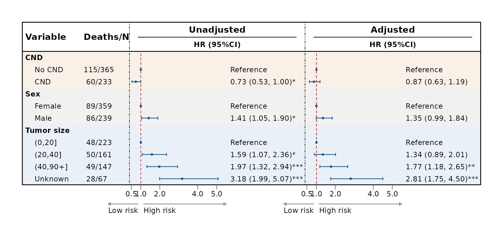{#fig-eff-um-linear fig-alt="plt_eff：线性坐标；598 人 M1 PTC 队列"}

#### 对数坐标

模型结果与上一图相同。对数轴使 0.5 与 2 相对 1 呈对称距离；刻度仍显示原始 HR。

```r
plt_eff(eff_um, display = "c", type = "h",
  label_column_list = labels, forest_nchar = 40,
  xlim = c(0.5, 8), ticks_at = c(0.5, 1, 2, 4, 8),
  ticks_digits = 1, x_trans = "log2", base_size = 10, core_size = c(6, 3),
  fill_col = c("#EAF2F8", "#F9F1E7"),
  header_list = list(label = "Variable", eve1 = "Deaths/N",
                     header_title = c("Unadjusted", "Adjusted")))
```

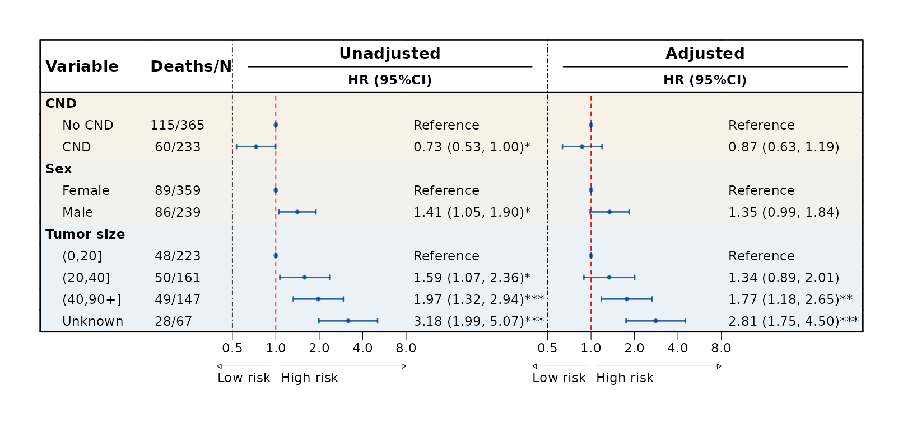{#fig-eff-um-log fig-alt="plt_eff：对数坐标；598 人 M1 PTC 队列"}

:::

### 四表布局

三张图使用相同的 HR、两组 S(60) 与 $\Delta S(60)$。四表较宽，点击放大查看文字；正文中的 `v` 布局更适合逐行阅读。

::: {.panel-tabset}

#### 同方法相邻

display = c_order 将未调整的 HR 与 ΔS 放在一起，再放调整后的两项结果；每项指标保留自己的轴。

```r
plt_eff(eff_sub, display = "c_order", type = "v", fill_col = c("#EAF2F8", "#F9F1E7"),
  label_column_list = labels, forest_nchar = 36, base_size = 10, core_size = c(6, 3),
  header_list = list(label = "Variable", eve1 = "Deaths/N", p_inter1 = "P(inter)", p_inter2 = "P(inter)",
    header_title = c("Unadjusted HR", "Adjusted HR", "Unadjusted Delta S", "Adjusted Delta S")))
```

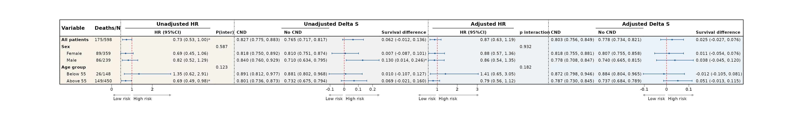{#fig-eff-sub-combined fig-alt="plt_eff：同方法相邻；598 人 M1 PTC 队列"}

#### 上下布局

当前四表输入下，v 的上排是调整结果，下排是未调整结果。HR 的参考值为 1，ΔS 的参考值为 0。

```r
plt_eff(eff_sub, display = "v", type = "v", fill_col = c("#EAF2F8", "#F9F1E7"),
  label_column_list = labels, forest_nchar = 36, base_size = 10, core_size = c(6, 3),
  header_list = list(label = "Variable", eve1 = "Deaths/N", p_inter1 = "P(inter)", p_inter2 = "P(inter)",
    header_title = c("Unadjusted HR", "Adjusted HR", "Unadjusted Delta S", "Adjusted Delta S")))
```

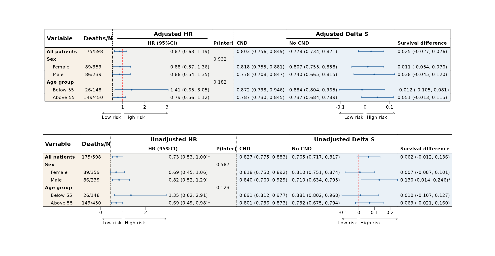{#fig-eff-sub-vertical fig-alt="plt_eff：上下布局；598 人 M1 PTC 队列"}

#### 左右布局

当前四表输入下，h 的左侧是调整结果，右侧是未调整结果；两个分组各含 HR 与 ΔS。

```r
plt_eff(eff_sub, display = "h", type = "v", fill_col = c("#EAF2F8", "#F9F1E7"),
  label_column_list = labels, forest_nchar = 36, base_size = 10, core_size = c(6, 3),
  header_list = list(label = "Variable", eve1 = "Deaths/N", p_inter1 = "P(inter)", p_inter2 = "P(inter)",
    header_title = c("Unadjusted HR", "Adjusted HR", "Unadjusted Delta S", "Adjusted Delta S")))
```

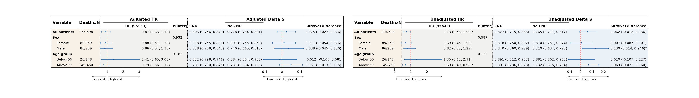{#fig-eff-sub-horizontal fig-alt="plt_eff：左右布局；598 人 M1 PTC 队列"}

:::

### 外层分层与精简展示

`split_var` 的模型已经在分析准备时分别拟合；绘图只能显示或隐藏分层信息。删除总体行也不会重新拟合其余亚组。

::: {.panel-tabset}

#### 外层分层

split_var 的年龄层分别拟合模型；每一块内部再按 Sex 展示 CND 效应。事件/人数可分 CND 与 No CND 两列。

```r
plt_eff(eff_split, display = "c", type = "h",
  show_event_bylevel = TRUE, label_column_list = labels,
  forest_nchar = 40, xlim = c(0.25, 8),
  ticks_at = c(0.25, 0.5, 1, 2, 4, 8), x_trans = "log2", base_size = 10, core_size = c(6, 3))
```

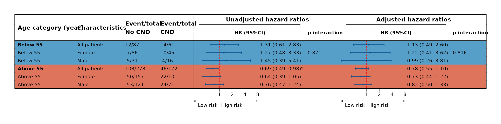{#fig-eff-split fig-alt="plt_eff：外层分层；598 人 M1 PTC 队列"}

#### 精简亚组表

只选调整后的 HR；删除总体行，显示层级交互 P 值，森林区移到文本之后，并去掉左右边框。

```r
plt_eff(eff_sub["haz_direct"], type = "i",
  show_event_bylevel = TRUE, show_pinter = "stra_p_inter",
  del_AllPatients = TRUE, forest_position = "after",
  show_side_border = FALSE, label_column_list = labels,
  forest_nchar = 40, base_size = 10, core_size = c(6, 3))
```

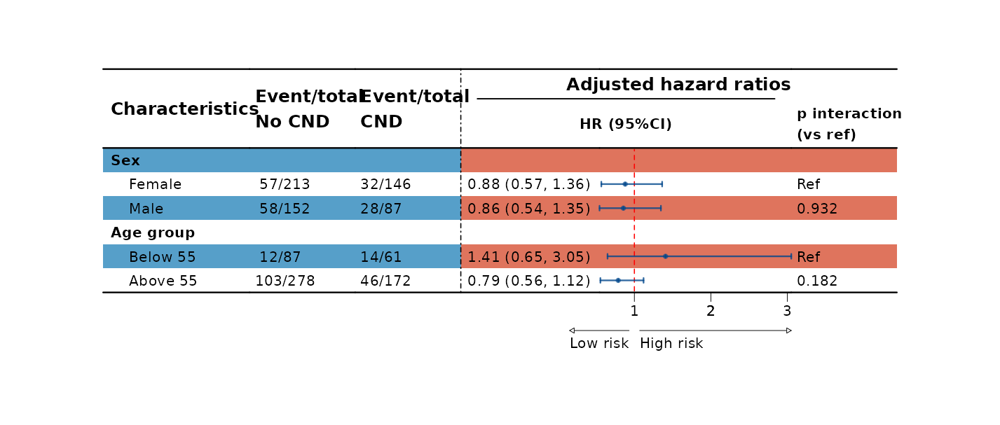{#fig-eff-clean fig-alt="plt_eff：精简亚组表；598 人 M1 PTC 队列"}

:::

### 分层亚组森林：每层独立标记（2026-10-20） {#split-forest-20261020}

2026-10-20 按已推送 RegR `da6157be`（修复自 `9c9d0f1`），在 Windows / WSL R 4.4.3 实际拟合和导出本节。现在 `del_AllPatients = TRUE` 删除每一层的总体行，各层保留自己的交互 P 值，`split_var` 为 list 时每个分层块的首行标签也会加粗。`plt_eff_pair()` 的相同开关也作用于全部层。

<!-- refresh-20261020: split_forest -->
```r
library(RegR)
set.seed(20261020)
d_refresh <- expand.grid(Tx = factor(c("No", "Yes")),
  Group = factor(c("Low", "High"), levels = c("Low", "High")),
  Site = factor(c("A", "B")), id = 1:60)
d_refresh[["Age"]] <- rnorm(nrow(d_refresh), 55, 10)
tx <- as.integer(d_refresh[["Tx"]] == "Yes")
gr <- as.integer(d_refresh[["Group"]] == "High")
event_time <- rexp(nrow(d_refresh), exp(-3.8 + 0.6 * tx + 0.4 * gr +
  0.2 * tx * gr + 0.01 * (d_refresh[["Age"]] - 55)))
censor_time <- rexp(nrow(d_refresh), 0.012)
d_refresh[["time"]] <- pmin(event_time, censor_time)
d_refresh[["DSS"]] <- as.integer(event_time <= censor_time)
d_refresh[["Outcome"]] <- factor(ifelse(runif(nrow(d_refresh)) < plogis(
  -1 + 0.7 * tx + 0.4 * gr + 0.02 * (d_refresh[["Age"]] - 55)), "Yes", "No"),
  levels = c("No", "Yes"))
eff_split <- get_eff(d_refresh, cat_var = "Tx", sub_var = "Group", adj_var = "Age",
  split_var = list("Site"), methods = c("unadj", "direct"), all = NULL)
p_split <- plt_eff(eff_split, del_AllPatients = TRUE,
  fixed_size = TRUE, base_size = 10, xlim = c(0.5, 6),
  save = list(filename = file.path(tempdir(), "20261020-refresh-split-forest.pdf")))
```
<!-- /refresh-20261020: split_forest -->

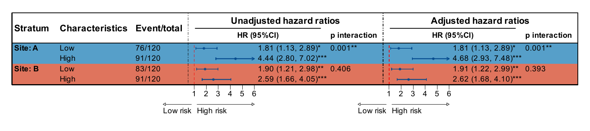{fig-alt="480行模拟生存记录按Site分层的Tx效应森林图，分层标签加粗，两个层的All patients行均删除，各层显示自己的Group交互P值。"}

[下载 PDF](images/forest-guide/20261020-refresh-split-forest.pdf)

这只修复行筛选、交互 P 值定位和字体，不改变原始效应估计。检查图片时应逐层看行标签，不能只确认第一层没有总体行。分层内的样本与事件数量仍来自本层模型，不把总队列人数重复当作各层人数。

### 第五个面板与正文右边距（2026-10-21） {#forest-five-20261021}

后续已推送 RegR `e217f1c` 修复了五个及以上面板时第五个 CI 列显示 `fs5...` 占位名的问题，并按正文文字的实际起点加宽文字列，给最长效应及星号留出右边距。[Overall 加两列亚组的五面板实图](eff-cat-guide.qmd#sub-columns-20261021)已在 Windows / WSL R 4.4.3 运行，提供原生 PDF；更新的是表头与布局，不重新定义模型或置信区间。上方两模型预览保留 `90ad6d8` 的原执行记录，宽图仍应按推荐尺寸保存。

## plt_eff2()：经典森林图、叠加与模型分块 {#plt-eff2}

此入口使用 `forestplot` 后端，返回 `eff_gforge_forestplot / forestplot` 对象。它读取比值类表，适合 HR、OR、sHR；`sur_*` 概率差表应选其他入口。

::: {.table-responsive}

| 参数 | 作用与关系 |
|:--|:--|
| `which` | NULL 取首张比值表；单个名称 / 索引选单表；多个名称 / 索引叠加同一行的不同方法 |
| `num_per, show_pvalue` | 人数比例替代事件人数；单表可加 P 值列 |
| `axis_args` | `xlim, xticks, ticks_digits, x_trans`；本页明确设 `x_trans = "log"`。显式 xlim 下 `auto` 不保证对数轴 |
| `ci_shape, box_col, legend_labels` | 每个序列的菱形 / 方形、颜色和图例；顺序跟随 `which` |
| `effect_args` | `overlap` 将多方法文字堆在一列；`lineheight` 与 `align` 控制堆叠文字 |
| `ci_args` | `vertices, vertices_height, lwd, lty, gap` 控制 CI；gap 是叠加序列间距占行高的比例 |
| `row_args` | `height, fit_text, header`；堆叠文本时增加行高并允许按文本扩展 |
| `graph_args` | `pos, width` 为森林区的位置和占总图宽度的比例 |
| `fill_type` | `none`、`zebra`、`var`，分别为无底色、交替行、变量块 |
| `label_column_list, header_list` | 行标签映射与列头替换；模型分块必须有一致的列及列头 |

:::

多方法叠加的表应具有一致的行键和量纲。普通交互 P 值取第一张选中表；`MS` / `RERI` 则可堆叠展示各方法。不能为叠加而把不同患者群、不同暴露对比或概率差混进 HR 轴。

### 单表、CI 形状与轴截断

::: {.panel-tabset}

#### 菱形与变量底色

which 明确选择调整后的 HR。P 值列可显示，fill_type = var 用底色划分变量块。

```r
plt_eff2(eff_um, which = "haz_direct",
  show_pvalue = TRUE, fill_type = "var", fill_col = c("#EAF2F8", "#F9F1E7"), label_column_list = labels,
  axis_args = list(xlim = c(0.5, 8), xticks = c(0.5, 1, 2, 4, 8),
                   x_trans = "log"),
  title = "Adjusted Cox model", base_size = 12,
  header_list = list(label = "Variable", count1 = "Deaths/N\nNo CND",
                     count2 = "Deaths/N\nCND", p.interaction = "Interaction P"))
```

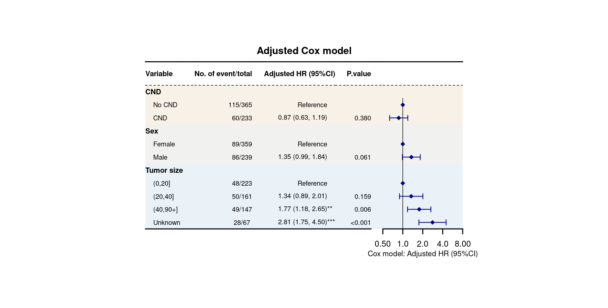{#fig-fp-basic fig-alt="plt_eff2：菱形与变量底色；598 人 M1 PTC 队列"}

#### 方形、左置与截断

CI 形状改为 normal，森林区放左侧，缩窄横轴以展示超界箭头。文本中的完整 CI 不随裁剪改变。

```r
plt_eff2(eff_sub, which = "haz_direct",
  ci_shape = "normal", graph_args = list(pos = "left"), fill_type = "zebra",
  label_column_list = labels,
  axis_args = list(xlim = c(0.6, 1.6),
                   xticks = c(0.6, 0.8, 1, 1.2, 1.6), x_trans = "log"), base_size = 12,
  header_list = list(label = "Variable", count1 = "Deaths/N\nNo CND",
                     count2 = "Deaths/N\nCND", p.interaction = "Interaction P"))
```

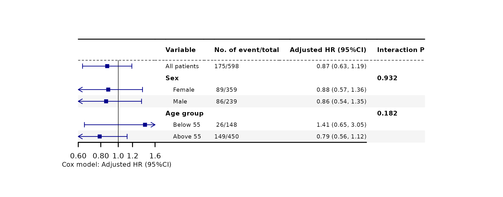{#fig-fp-normal fig-alt="plt_eff2：方形、左置与截断；598 人 M1 PTC 队列"}

:::

### 双方法叠加与行高

`ci_args` 的 `gap` 分离同一行的图形，`effect_args` 的 `lineheight` 控制文字间距；二者不互相替代。

::: {.panel-tabset}

#### 双方法叠加

which 的顺序同时决定图例、颜色与第一张表的交互 P 值来源。本图先放调整结果。

```r
plt_eff2(eff_sub, which = c("haz_direct", "haz_unadj"),
  show_event_bylevel = TRUE, label_column_list = labels,
  legend_labels = c("Adjusted", "Unadjusted"),
  ci_shape = c("diamond", "normal"), box_col = c("#2166AC", "#B35806"),
  axis_args = list(xlim = c(0.4, 4), xticks = c(0.5, 1, 2, 4),
                   x_trans = "log"), base_size = 12,
  header_list = list(label = "Variable", count1 = "Deaths/N\nNo CND",
                     count2 = "Deaths/N\nCND", p.interaction = "Interaction P"))
```

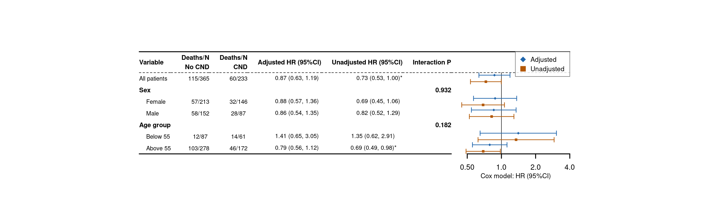{#fig-fp-overlay fig-alt="plt_eff2：双方法叠加；598 人 M1 PTC 队列"}

#### 效应文本堆叠

同一行的两个区间用 `ci_args` 的 `gap` 分开；效应文字放进同一列，row_args 扩展行高以容纳两行文本。

```r
plt_eff2(eff_sub, which = c("haz_direct", "haz_unadj"),
  show_event_bylevel = TRUE, label_column_list = labels,
  legend_labels = c("Adjusted", "Unadjusted"),
  box_col = c("#2166AC", "#B35806"), fill_type = "var", fill_col = c("#EAF2F8", "#F9F1E7"),
  effect_args = list(overlap = TRUE, lineheight = 1.1, align = "left"),
  ci_args = list(gap = 0.35),
  row_args = list(height = 1.7, fit_text = TRUE, header = 2.1),
  axis_args = list(xlim = c(0.4, 4), xticks = c(0.5, 1, 2, 4),
                   x_trans = "log"), base_size = 12,
  header_list = list(label = "Variable", count1 = "Deaths/N\nNo CND",
                     count2 = "Deaths/N\nCND", p.interaction = "Interaction P"))
```

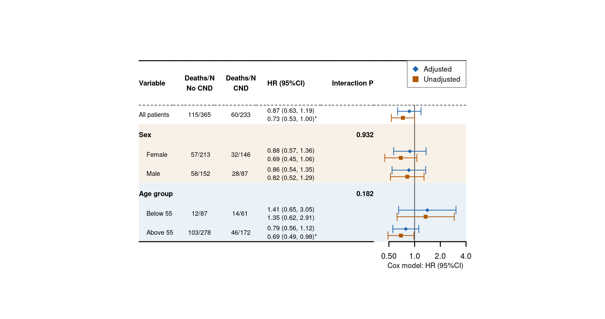{#fig-fp-overlap fig-alt="plt_eff2：效应文本堆叠；598 人 M1 PTC 队列"}

:::

### 命名模型分块与年龄层

`model_blocks` 三块来自同一队列，分别为未调整、仅调整年龄、完整调整。它们不是三个独立研究，不能把此图当作荟萃分析。未调整与调整模型的默认效应列标题不同，示例用 `header_list = list(effect = "HR (95% CI)")` 统一列头后组合。

::: {.panel-tabset}

#### 三个模型分块

命名 list 的名称成为块标题。which = 1L 对每个结果取第一张表；header_list 统一效应列标题，使未调整与调整模型的表列保持一致。

```r
plt_eff2(model_blocks, which = 1L,
  show_pvalue = TRUE, num_per = TRUE,
  label_column_list = labels, fill_type = "var", fill_col = c("#EAF2F8", "#F9F1E7"), graph_args = list(width = 0.35),
  axis_args = list(xlim = c(0.4, 2), xticks = c(0.5, 1, 2),
                   x_trans = "log"),
  title = "Three Cox models", base_size = 12,
  header_list = list(label = "Variable", effect = "HR (95% CI)", count1 = "Deaths/N\nNo CND",
                     count2 = "Deaths/N\nCND", p.interaction = "Interaction P"))
```

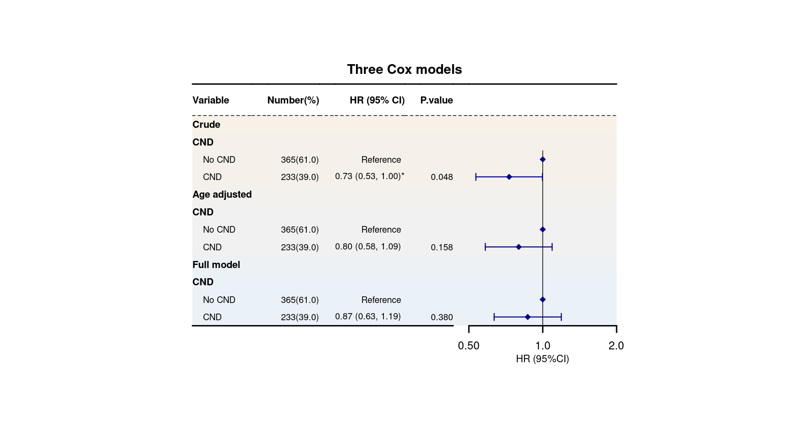{#fig-fp-modelblocks fig-alt="plt_eff2：三个模型分块；598 人 M1 PTC 队列"}

#### 年龄层与层级交互

split_var 的信息保留为前置分层列；show_pinter = stra_p_inter 展示交互模型中的层级检验。

```r
plt_eff2(eff_split, which = "haz_direct",
  show_event_bylevel = TRUE, show_pinter = "stra_p_inter",
  label_column_list = labels, fill_type = "var", fill_col = c("#EAF2F8", "#F9F1E7"),
  axis_args = list(xlim = c(0.25, 8),
                   xticks = c(0.25, 0.5, 1, 2, 4, 8), x_trans = "log"), base_size = 12,
  header_list = list(label = "Variable", count1 = "Deaths/N\nNo CND",
                     count2 = "Deaths/N\nCND", p.interaction = "Interaction P"))
```

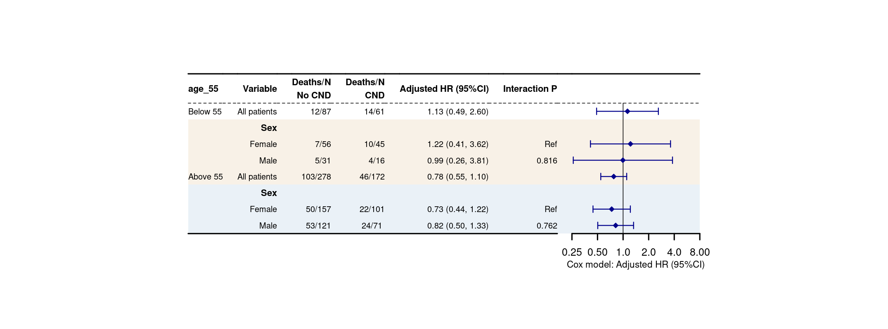{#fig-fp-split fig-alt="plt_eff2：年龄层与层级交互；598 人 M1 PTC 队列"}

:::

## plt_eff_pair()：方法配对与双指标展示 {#plt-eff-pair}

多种方法共用一个森林区，点和区间使用不同颜色 / 形状。当前接口没有 `methods` 参数；用 `eff_sub[c(...)]` 选择和排序输入表，函数读取输入中所有可用的方法。可展示两种或更多方法。

::: {.table-responsive}

| 参数 | 作用 |
|:--|:--|
| `measure = "hr"` | 比值类选择器，按模型属性显示 HR / OR / sHR；参考线默认 1 |
| `measure = "dif"` | 概率差；参考线默认 0，线性轴 |
| `measure = "haz_diff"` | 左表共用，右侧同时放比值与概率差两个指标区 |
| `measure = c("hr", "dif")` | 分别生成两个完整森林表，再按 `layout` 组合 |
| `method_labels, colors, nudge_y` | 方法名称、颜色与同一行的序列偏移 |
| `effect_overlap, effect_text_lineheight` | 效应文字分列 / 堆叠与行间距 |
| `show_effect_text` | 可隐藏 CI 文字，仅保留图形和汇总 |
| `xlim, ticks_at, ticks_digits, x_trans, ref_line` | 可传统一值，也可按 `hr` / `dif` 命名 list 分开控制 |
| `show_pinter` | 全局 / 层级交互 P 值或 MS / RERI；普通 P 值由第一方法提供 |

:::

`haz_diff` 输入中两类表的**方法顺序必须一致**，例如均为 direct 再 unadj。叠加是展示同一问题的不同估计，不自动检验两种方法之间是否有统计学差异。

### HR 配对、堆叠文字与层级交互

::: {.panel-tabset}

#### HR 叠加

先对子结果列表选表，再传给绘图函数；两种方法共享一个 HR 森林区。

```r
plt_eff_pair(eff_sub[c("haz_direct", "haz_unadj")], measure = "hr",
  method_labels = c("Adjusted", "Unadjusted"),
  colors = c("#2166AC", "#B35806"), type = "h", fill_col = "#EDF3F8",
  label_column_list = labels, forest_nchar = 40,
  xlim = c(0.4, 4), ticks_at = c(0.5, 1, 2, 4), ticks_digits = 1, base_size = 10, core_size = c(10, 3))
```

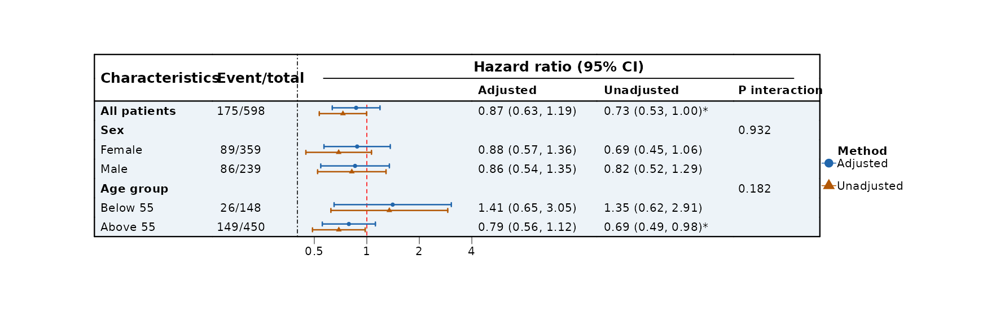{#fig-pair-hr fig-alt="plt_eff_pair：HR 叠加；598 人 M1 PTC 队列"}

#### 文本叠加与交互列

effect_overlap 把方法结果堆在一列；层级交互 P 值来自第一张表，即本图的调整模型。

```r
plt_eff_pair(eff_sub[c("haz_direct", "haz_unadj")], measure = "hr",
  method_labels = c("Adjusted", "Unadjusted"),
  colors = c("#2166AC", "#B35806"), label_column_list = labels,
  effect_overlap = TRUE, effect_text_lineheight = 1.1,
  show_pinter = "stra_p_inter", nudge_y = 0.3, forest_nchar = 40,
  xlim = c(0.4, 4), ticks_at = c(0.5, 1, 2, 4), ticks_digits = 1, base_size = 10, core_size = c(10, 3))
```

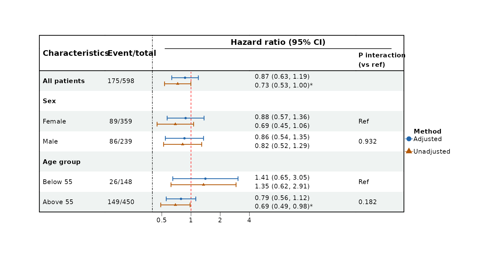{#fig-pair-overlap fig-alt="plt_eff_pair：文本叠加与交互列；598 人 M1 PTC 队列"}

:::

### 概率差与双指标布局

$\Delta S(60)$ 的方向是 CND 减 No CND，与 HR 的“较小比值”含义不同。联合展示时为每种量指定自己的轴。

::: {.panel-tabset}

#### 60 月生存概率差

dif 读取概率差，采用线性轴与零参考线；0.10 表示 10 个百分点，不能作为 HR 读取。

```r
plt_eff_pair(eff_sub[c("sur_direct", "sur_unadj")], measure = "dif",
  method_labels = c("Adjusted", "Unadjusted"),
  colors = c("#2166AC", "#B35806"), label_column_list = labels,
  forest_nchar = 40, xlim = c(-0.15, 0.30),
  ticks_at = c(-0.1, 0, 0.1, 0.2, 0.3), ticks_digits = 2, base_size = 10, core_size = c(10, 3))
```

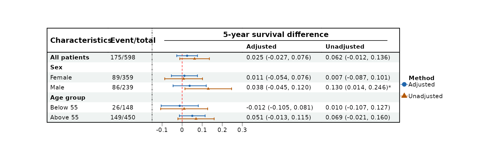{#fig-pair-difference fig-alt="plt_eff_pair：60 月生存概率差；598 人 M1 PTC 队列"}

#### 共享表、两个指标区

haz_diff 共用左侧汇总表，同时展示 HR 与 ΔS。haz 与 sur 的方法顺序必须一致。

```r
plt_eff_pair(
  eff_sub[c("haz_direct", "haz_unadj", "sur_direct", "sur_unadj")],
  measure = "haz_diff", show_event_bylevel = TRUE, effect_overlap = TRUE,
  method_labels = c("Adjusted", "Unadjusted"),
  colors = c("#2166AC", "#B35806"), label_column_list = labels,
  forest_nchar = 40,
  xlim = list(hr = c(0.4, 4), dif = c(-0.15, 0.30)),
  ticks_at = list(hr = c(0.5, 1, 2, 4), dif = c(-0.1, 0, 0.1, 0.2, 0.3)),
  ticks_digits = list(hr = 1, dif = 2), base_size = 10, core_size = c(10, 3))
```

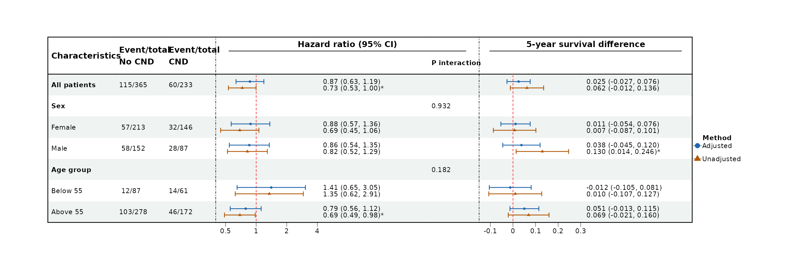{#fig-pair-hazdiff fig-alt="plt_eff_pair：共享表、两个指标区；598 人 M1 PTC 队列"}

#### 两个独立森林图

measure 同时选择 hr 与 dif 时，各自生成完整的森林表，再用 layout = v 上下组合。

```r
plt_eff_pair(
  eff_sub[c("haz_direct", "haz_unadj", "sur_direct", "sur_unadj")],
  measure = c("hr", "dif"), layout = "v",
  method_labels = c("Adjusted", "Unadjusted"),
  colors = c("#2166AC", "#B35806"), label_column_list = labels,
  forest_nchar = 40,
  xlim = list(hr = c(0.4, 4), dif = c(-0.15, 0.30)),
  ticks_at = list(hr = c(0.5, 1, 2, 4), dif = c(-0.1, 0, 0.1, 0.2, 0.3)),
  ticks_digits = list(hr = 1, dif = 2), base_size = 10, core_size = c(10, 3))
```

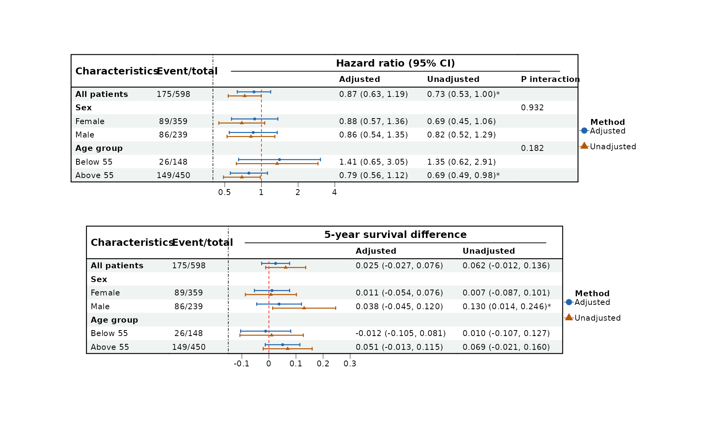{#fig-pair-measures fig-alt="plt_eff_pair：两个独立森林图；598 人 M1 PTC 队列"}

:::

### 竞争风险比值与 MS

虽然选择器写 `measure = "hr"`，下图读取的是 Fine–Gray 结果，标题和文字显示 **sHR**。图中的 MS 来自模型比值，不是组别 CIF 差的交互。

::: {.panel-tabset}

#### Fine–Gray 与 MS 列

hr 是比值类表的选择器；本图依据模型属性显示 sHR。MS 是相对效应尺度的乘法交互指标，不是绝对风险交互。

```r
plt_eff_pair(eff_cif[c("haz_direct", "haz_unadj")], measure = "hr",
  method_labels = c("Adjusted", "Unadjusted"), show_pinter = "MS",
  colors = c("#2166AC", "#B35806"), label_column_list = labels,
  effect_overlap = TRUE, forest_nchar = 40,
  xlim = c(0.4, 4), ticks_at = c(0.5, 1, 2, 4), ticks_digits = 1, base_size = 10, core_size = c(10, 3))
```

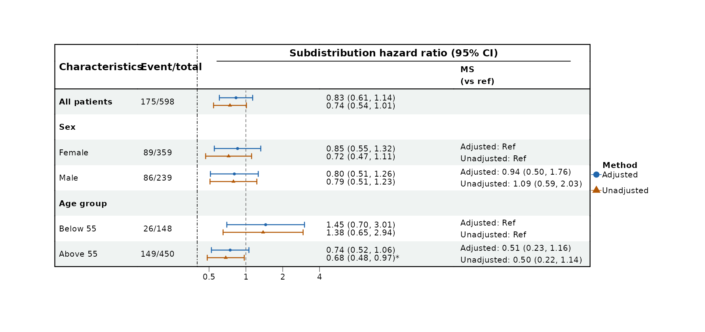{#fig-pair-cif fig-alt="plt_eff_pair：Fine–Gray 与 MS 列；598 人 M1 PTC 队列"}

:::

### KM 推断、表头和叠加样式（2026-10-12） {#current-forest}

本次在 WSL R 4.4.3 使用 RegR 本机开发源码 `d54e60f` 重新拟合本页 `eff_sub`，刷新含 KM 生存差值的森林图与组别概率图。Greenwood 标准误修复会改变未调整 / PSM 生存差值的区间和 P 值，组别概率、其区间、HR、direct 与 IPTW 不受此修复影响。历史 `get_eff()` 对象应从原始数据重算，单独重画旧表无法修复推断。

`plt_eff_pair()` 现在支持 `header_list`、`legend_position` 和 `type="v"/"i"/"i2"`；默认参考线显示为红色。`plt_eff_sur()` 支持替换表头与方法标题，概率时间标题从实际时点生成，90月为7.5年，不能把它写成10年。

::: {.callout-note}
2026-10-13复核：上述更新已包含于已推送基线 `a3881fa`，版本号仍是0.1.3。下列新图已实际执行，既有经典森林图与CIF图保留原执行快照。复现前应核对所安装源码是否包含这些提交。
:::

## plt_eff_sur()：各组概率森林图 {#plt-eff-sur}

本入口从 `sur_*` 表中读取各组 S(t) 或 CIF(t)。每种方法一个面板，在同一行用颜色区分主要暴露的各组；二分类和多水平主要分组均可展示。传完整 `get_eff()` 结果时，比值表会被筛掉。

::: {.table-responsive}

| 参数 | 作用 |
|:--|:--|
| `summary_vars` | 默认 `label1, eve1`；本页用 `label, eve1` 保持单行标签 |
| `label_column_list` | 映射行标签；不改组别编码与概率 |
| `xlim, ticks_at, ticks_digits` | 概率轴；可统一指定，也可按 `sur_unadj` / `sur_direct` 等表名设 list |
| `forest_nchar, core_size, base_size` | 绘图区宽度、单元格留白和字体大小 |
| `fill_col, del_AllPatients` | 行底色与总体行的显示 |

:::

自动范围主要依据概率点估计，未必覆盖每个 CI；需要完整概率域时显式设置 `xlim = c(0, 1)`。CI 超出范围时看截断箭头，文字仍显示完整区间。

当前模板的左侧列头固定为 `Age groups`，图例可能保留 `N_4 groups` / `Tum_3 groups` 这样的原始变量名。实际分组以行标签和图例水平为准；这不会把 Sex 亚组变成年龄组，也不会改变数值。

### 范围、单方法与底色

::: {.panel-tabset}

#### 自动概率范围

每种方法一个森林区，每个区间展示 CND 与 No CND 的 60 月 S(t)，不是两组的差值。

```r
plt_eff_sur(eff_sub, summary_vars = c("label", "eve1"),
  label_column_list = labels, forest_nchar = 40, base_size = 10, core_size = c(10, 3))
```

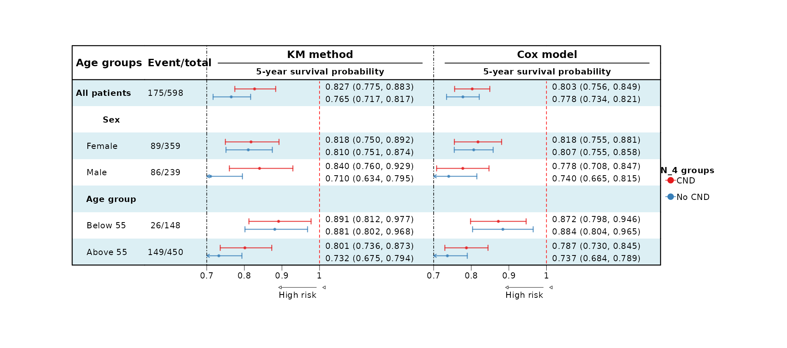{#fig-sur-two fig-alt="plt_eff_sur：自动概率范围；598 人 M1 PTC 队列"}

#### 完整 0–1 范围

两张表与上一图完全相同；固定 0–1 范围让不同分析的概率图有共同坐标。

```r
plt_eff_sur(eff_sub, summary_vars = c("label", "eve1"),
  label_column_list = labels, forest_nchar = 40,
  xlim = c(0, 1), ticks_at = seq(0, 1, by = 0.2), ticks_digits = 1, base_size = 10, core_size = c(10, 3))
```

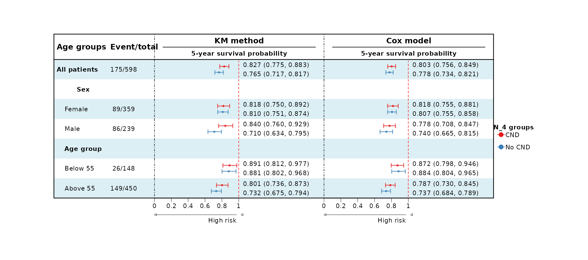{#fig-sur-fullrange fig-alt="plt_eff_sur：完整 0–1 范围；598 人 M1 PTC 队列"}

#### 单方法与底色

只显示调整后的标准化生存概率，删除总体行，并使用统一底色。

```r
plt_eff_sur(eff_sub["sur_direct"], summary_vars = c("label", "eve1"),
  label_column_list = labels, del_AllPatients = TRUE,
  fill_col = "#EAF2F8", forest_nchar = 40,
  xlim = c(0.5, 1), ticks_at = c(0.5, 0.75, 1), ticks_digits = 2, base_size = 10, core_size = c(10, 3))
```

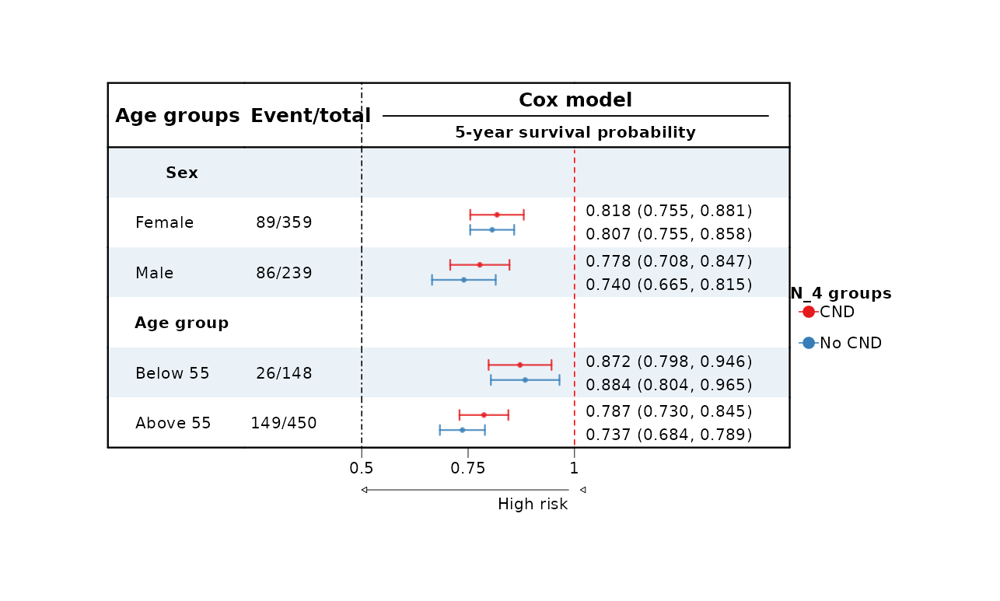{#fig-sur-single fig-alt="plt_eff_sur：单方法与底色；598 人 M1 PTC 队列"}

:::

### CIF 与多水平组别

CIF 图的“death probability”是**甲状腺癌死亡的累积发生概率**。四组图则改用 `Tum_3` 作为主要分组，每个 Sex 水平有四个生存概率区间；它不是 CND 两组比较。

::: {.panel-tabset}

#### 甲状腺癌 CIF

Aalen–Johansen 估计纳入其他原因死亡这一竞争事件，显示 60 月甲状腺癌累积发生概率。

```r
plt_eff_sur(eff_cif_prob, summary_vars = c("label", "eve1"),
  label_column_list = labels, forest_nchar = 40,
  xlim = c(0, 0.6), ticks_at = c(0, 0.2, 0.4, 0.6), ticks_digits = 1, base_size = 10, core_size = c(10, 3))
```

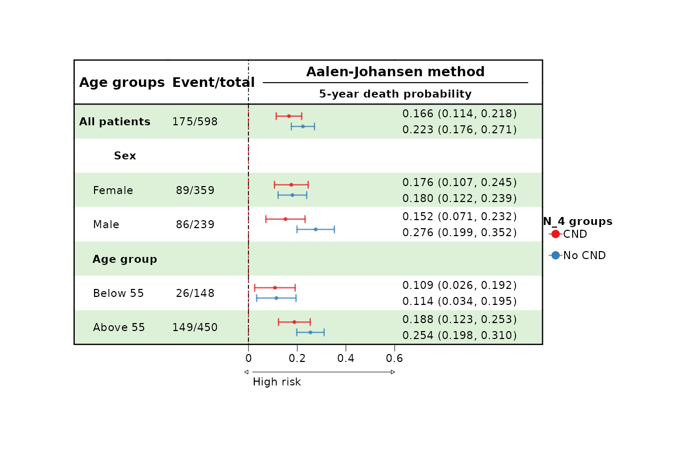{#fig-sur-cif fig-alt="plt_eff_sur：甲状腺癌 CIF；598 人 M1 PTC 队列"}

#### 四组肿瘤大小

此例把主要分组变量改为 Tum_3，在 Sex 的各层同时展示四组 S(t)；Unknown 是数据水平，不是肿瘤大小区间。

```r
plt_eff_sur(eff_multi_prob, summary_vars = c("label", "eve1"),
  label_column_list = labels, forest_nchar = 50,
  xlim = c(0, 1), ticks_at = c(0, 0.25, 0.5, 0.75, 1), ticks_digits = 2, base_size = 10, core_size = c(10, 3))
```

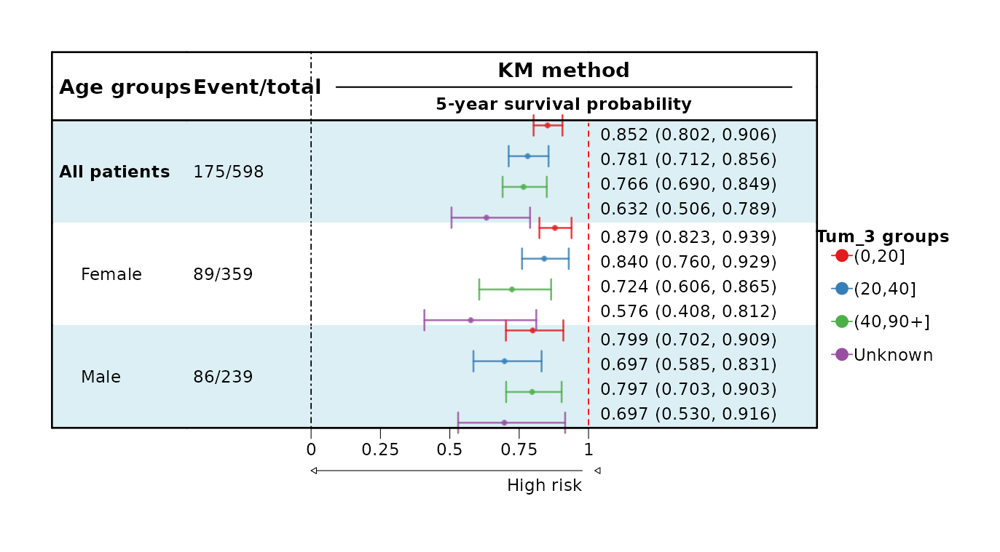{#fig-sur-multigroup fig-alt="plt_eff_sur：四组肿瘤大小；598 人 M1 PTC 队列"}

:::

<!-- forest-extension: start -->

## 多模型返回结构与逐模型绘图 {#models-20261019}

2026-10-19 按已推送 RegR `f26e137` 在 Windows / WSL R 4.4.3 执行。下面只计算未调整的比值效应，继续使用本页 598 人队列；HR、sHR、OR 是不同估计量。

<!-- rnotes-20261019: eff-models -->
```r
eff_models <- run_quiet(get_eff(d, cat_var = "N_4",
  surv = list(sur = TRUE, cif = FALSE, log = "DSS"),
  methods = "unadj", show_sur = FALSE, all = NULL))
names(eff_models)  # "sur" "cif" "log"
names(eff_models[["sur"]])
p_eff_sur <- plt_eff(eff_models[["sur"]], fixed_size = FALSE,
  title = "Cox: CND versus No CND")
p_eff_cif <- plt_eff(eff_models[["cif"]], fixed_size = FALSE,
  title = "Fine-Gray: CND versus No CND")
```

::: {.panel-tabset}

### Cox {.unnumbered}

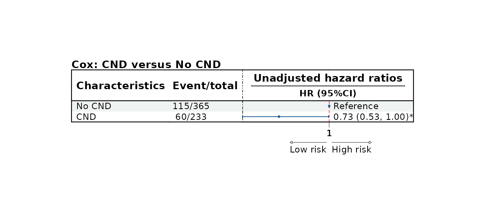{fig-alt="get_eff多模型结果的sur元素绘制CND相对No CND的未调整Cox危险比。"}

### Fine–Gray {.unnumbered}

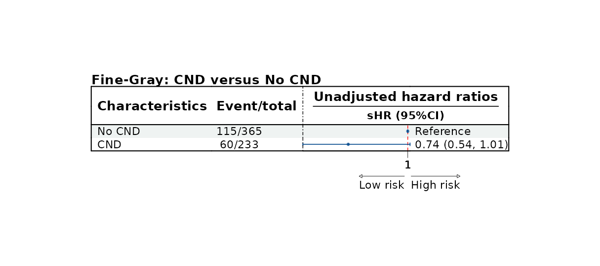{fig-alt="同一次多模型调用的cif元素绘制目标死亡的亚分布危险比，与Cox模型分别展示。"}

:::

| 入口 | 多模型返回结构 | 后续处理 |
|:--|:--|:--|
| `get_eff()` | `surv_models` 命名 list，每个元素是完整 `eff_res` | 直接 `plt_eff(eff_models)` / `plt_eff2(eff_models)`，或提取单模型 |
| `get_eff_cat()` | 一个 `eff_res`，内部按结局组织 `haz_*` 模型比较表 | `plt_eff()` 按结局分别返回图，见[效应比较](eff-cat-guide.qmd#sub-inter-20261020) |
| `get_facet/get_cat/get_inter()` | `surv_models`，每个元素是对应模型的完整结果 | 使用各入口的多模型重绘或导出接口 |

示例显式命名模型，后续索引不依赖自动命名规则。各模型分别筛选自身所需变量的完整案例；不能默认人数相同。逻辑值与结局列混用时写 `list(TRUE,FALSE,"DSS")`；`c(TRUE,FALSE,"DSS")` 会把逻辑值转成字符串并报错。仅逻辑值的 `c(TRUE,FALSE)` 可用。Logistic 的 OR 不处理删失，不与 HR 或 sHR 合并为同一统计目标。

### 多模型森林、名称映射与区间口径（2026-10-20） {#models-ci-20261020}

2026-10-20 按已推送 RegR `a2f2553` 在 Windows / WSL R 4.4.3 运行。`get_eff()` 的多模型结果现带 `surv_models` 类；`plt_eff()`、`plt_eff2()` 均直接逐模型绘制，返回同名的图列表。下方早期示例手动提取 `[["sur"]]` 的写法仍可用。

<!-- latest-20261020: forest_models -->
```r
library(RegR)
set.seed(20261020)
d_models <- data.frame(NACT = factor(rep(c("No", "Yes"), 240)),
  Sex = factor(rep(c("Female", "Male"), each = 240)), Age = rnorm(480, 55, 10),
  Grade_3 = factor(sample(c("Low", "High"), 480, replace = TRUE)))
t1 <- rexp(480, exp(-3.8 + 0.45 * (d_models[["NACT"]] == "Yes") +
  0.02 * (d_models[["Age"]] - 55)))
t2 <- rexp(480, 0.008); tc <- rexp(480, 0.012)
d_models[["time"]] <- pmin(t1, t2, tc)
d_models[["event"]] <- ifelse(t1 <= pmin(t2, tc), 1L, ifelse(t2 <= tc, 2L, 0L))
d_models[["DSS"]] <- as.integer(d_models[["event"]] == 1L)
eff_new <- get_eff(d_models, cat_var = c("NACT", "Age", "Grade_3"),
  adj_var = c("Age", "Grade_3"), surv = c(TRUE, FALSE),
  methods = c("unadj", "direct"), show_sur = FALSE, all = NULL)
plots_combined <- plt_eff(eff_new, display = "c", fixed_size = TRUE,
  title = list("Cox model", "Fine-Gray model"), base_size = 10,
  save = list(filename = file.path(tempdir(), c(
    "20261020-latest-forest-sur.pdf", "20261020-latest-forest-cif.pdf"))))
plots_classic <- plt_eff2(eff_new, which = c("haz_unadj", "haz_direct"),
  axis_args = list(xlim = list(c(0, 4), c(0, 4))), fixed_size = TRUE,
  save = list(filename = file.path(tempdir(), c(
    "20261020-latest-forest-classic-sur.pdf", "20261020-latest-forest-classic-cif.pdf"))))
```

::: {.callout-note collapse="true" title="复核代码"}
生成本页时运行的检查，接在上面的代码之后运行；只读教程可以跳过。

```r
stopifnot(inherits(eff_new, "surv_models"), identical(names(eff_new), c("sur", "cif")))
stopifnot(inherits(plots_combined, "surv_models"), inherits(plots_classic, "surv_models"),
  identical(names(plots_classic), names(eff_new)))
```
:::

<!-- /latest-20261020: forest_models -->

::: {.panel-tabset}

#### plt_eff：Cox {.unnumbered}

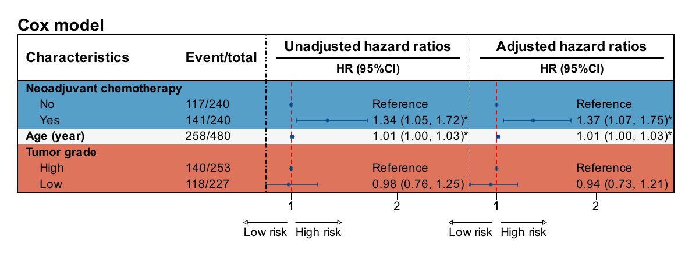{fig-alt="自动逐模型绘制的Cox森林，NACT、Age、Grade_3使用Neoadjuvant chemotherapy、Age year、Tumor grade名称，未调整与调整分列。"}

[下载 PDF](images/forest-guide/20261020-latest-forest-sur.pdf)

#### plt_eff：Fine–Gray {.unnumbered}

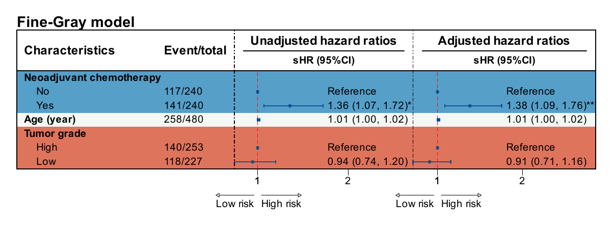{fig-alt="同一多模型结果的Fine-Gray森林单独展示sHR及区间，使用与Cox相同的变量字典。"}

[下载 PDF](images/forest-guide/20261020-latest-forest-cif.pdf)

#### plt_eff2：Cox {.unnumbered}

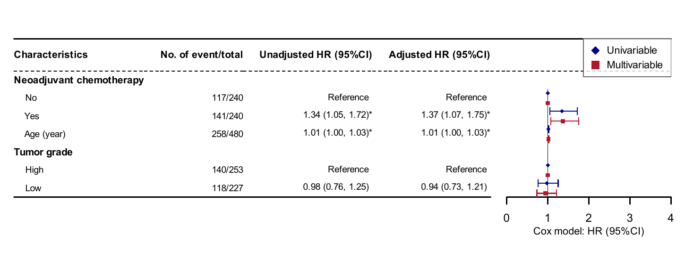{fig-alt="plt_eff2返回的Cox经典森林，图例使用Univariable与Multivariable，横轴范围单独指定0至4。"}

[下载 PDF](images/forest-guide/20261020-latest-forest-classic-sur.pdf)

#### plt_eff2：Fine–Gray {.unnumbered}

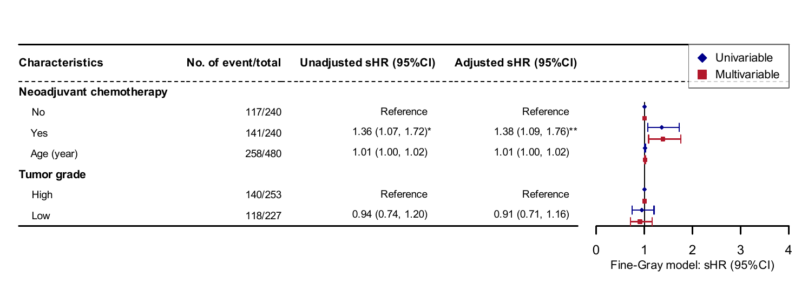{fig-alt="plt_eff2单独返回的Fine-Gray森林，轴标题为Fine-Gray model sHR，未调整与调整区间叠加。"}

[下载 PDF](images/forest-guide/20261020-latest-forest-classic-cif.pdf)

:::

设置为命名 list 时按模型名匹配，无名 list 按模型顺序匹配；`save$filename` 的无名向量同样按顺序。本例 `axis_args$xlim` 的两个范围分别给 sur / cif。`plt_eff()` 的无名 `xlim` / `ticks_at` list 仍表示每个面板，按模型指定时须写 `xlim=list(sur=c(...),cif=c(...))`。旧版保存的 `get_eff()` 普通 list 可重新计算，或在确认结构后显式加 `class(eff)<-c("surv_models","list")`；`plt_eff2(unclass(eff_new),...)` 则明确恢复单图模型分块。

`plt_eff()`、`plt_eff2()`、`plt_eff_pair()` 现在共同使用 `name_map_seer`，与 `get_tb_gtsummary()` 的字典一致。默认可识别 Age、NACT、Grade_3 等名称；`label_column_list` 只覆盖给出的键，其余继续用字典。若要保留原名，可映射到自身，如 `c(Grade_3="Grade_3")`。`plt_eff2()` 默认图例现为 Univariable / Multivariable，`legend_labels` 可覆盖。标签变化不改变模型、参考组或原结果字段。

#### 非 95% 区间的显示 P 值

<!-- latest-20261020: forest_ci -->
```r
library(RegR)
set.seed(20261021)
ci_data <- data.frame(Tx = factor(rep(c("No", "Yes"), 240)), Age = rnorm(480, 55, 10))
failure <- rexp(480, exp(-3.8 + 0.2 * (ci_data[["Tx"]] == "Yes") + 0.02 * (ci_data[["Age"]] - 55)))
censor <- rexp(480, 0.012)
ci_data[["time"]] <- pmin(failure, censor)
ci_data[["DSS"]] <- as.integer(failure <= censor)
ci80 <- get_eff(ci_data, "Tx", adj_var = "Age", methods = "direct",
  conf_level = 0.8, show_sur = FALSE, all = NULL)[["haz_direct"]]
rows <- which(ci80[["row_type"]] == "level" & is.finite(ci80[["estimate"]]) &
  ci80[["conf.high"]] > ci80[["conf.low"]])
estimate <- ci80[["estimate"]][rows]
lower <- ci80[["conf.low"]][rows]; upper <- ci80[["conf.high"]][rows]
p_display <- 2 * pnorm(-abs(log(estimate) / ((log(upper) - log(lower)) / (2 * 1.96))))
validation_values <- data.frame(estimate = estimate, actual_conf_level = 0.8,
  display_p = ci80[["p_value"]][rows], original_wald_p = ci80[["p.value_0.95"]][rows])
validation_values
```

::: {.callout-note collapse="true" title="复核代码"}
生成本页时运行的检查，接在上面的代码之后运行；只读教程可以跳过。

```r
stopifnot(isTRUE(all.equal(ci80[["p_value"]][rows], p_display)))
```
:::

<!-- /latest-20261020: forest_ci -->

兼容规则使用未舍入区间和**固定 1.96**回推 `p_value`，比值在 log 尺度、差值在原尺度计算。非对称区间取朝向无效值一侧的半宽；零宽、不包含估计或缺失的无效区间返回 NA，不产生星号。95% 时保留原模型检验，交互单元的星号也不再先把 P 舍入到五位小数。上例 80% 区间的显示 P 为 0.00005143，原 Wald P 为 0.00810948；两者不可互换。非 95% 时显示 P 不是原模型检验，原值另存 `p.value_0.95`；不要用改变置信水平后的星号声称显著性增强。

当前多个图表模板的表头固定写 95% CI，即使 `conf_level` 设为其他值。区间实际水平必须看调用及元数据；需要其他水平时显式改可覆盖的表头或轴标题，并在图注记录，不能仅复制默认标题。`get_facet_diff()` 的森林星号仍用原 Wald P，不套用上述显示 P 规则。

### Cox/Logistic 提示与逐模型森林（2026-10-21） {#forest-controls-20261021}

<!-- controls-20261021: forest_controls -->

以下按已推送 RegR `90ad6d8` 在 Windows / WSL R 4.4.3 执行。此前只有 Fine–Gray 的诊断说明；现在 Cox/Logistic 拟合遇到 NA 系数，也会说明未参与估计的设计列、原因、公式和完整病例数，亚组调用会加上所属层。

#### 拟合完成仍需核对实际调整项

```r
library(RegR)
set.seed(831)
forest_data <- data.frame(Tx = factor(sample(c("No", "Yes"), 600, TRUE)),
  Sex = factor(sample(c("F", "M"), 600, TRUE)), Age = rnorm(600, 55, 10))
t1 <- rexp(600, exp(0.3 * (forest_data[["Tx"]] == "Yes") +
  0.3 * (forest_data[["Sex"]] == "M") + 0.02 * (forest_data[["Age"]] - 55)) / 60)
t2 <- rexp(600, 1 / 120)
tc <- rexp(600, 1 / 160)
forest_data[["time"]] <- pmin(t1, t2, tc) + 0.2
forest_data[["event"]] <- ifelse(t1 < t2 & t1 < tc, 1L, ifelse(t2 < tc, 2L, 0L))
forest_data[["DSS"]] <- as.integer(forest_data[["event"]] == 1L)
forest_data[["response"]] <- rbinom(600, 1, plogis(-0.5 +
  0.4 * (forest_data[["Tx"]] == "Yes") + 0.03 * (forest_data[["Age"]] - 55)))
forest_data[["era"]] <- factor(rep(c("early", "late"), 300))
forest_data[["grade"]] <- factor(ifelse(forest_data[["era"]] == "late", "Unknown",
                                         rep(c("G1", "G2", "Unknown"), 200)))
forest_data[["Age_copy"]] <- forest_data[["Age"]]
collect_alias <- function(expr) {
  notes <- character()
  result <- withCallingHandlers(expr, RegR_aliased_coef = function(m) {
    notes <<- c(notes, cli::ansi_strip(conditionMessage(m)))
    invokeRestart("muffleMessage")
  })
  list(result = result, notes = notes)
}
cox_alias <- collect_alias(get_eff(forest_data, "Tx", sub_var = "era",
  adj_var = c("Age", "grade"), surv = TRUE,
  methods_haz = "direct", methods_sur = character(), all = NULL))
log_alias <- collect_alias(tryCatch(get_eff(forest_data, "Tx", sub_var = "era",
  adj_var = c("Age", "Age_copy"), surv = "response",
  methods_haz = "direct", methods_sur = character(), all = NULL), error = identity))
cat(paste(cox_alias[["notes"]], collapse = "\n"))
conditionMessage(log_alias[["result"]])
log_age <- get_eff(forest_data, "Tx", sub_var = "era", adj_var = "Age",
  surv = "response", methods_haz = "direct", methods_sur = character(), all = NULL)
```

::: {.callout-note collapse="true" title="复核代码"}
生成本页时运行的检查，接在上面的代码之后运行；只读教程可以跳过。

```r
stopifnot(length(cox_alias[["notes"]]) >= 1L, length(log_alias[["notes"]]) >= 1L,
          any(grepl("era = late", cox_alias[["notes"]], fixed = TRUE)),
          any(grepl("300 complete cases", cox_alias[["notes"]], fixed = TRUE)),
          any(grepl("Age_copy", log_alias[["notes"]], fixed = TRUE)),
          inherits(log_alias[["result"]], "error"),
          grepl("conf.low", conditionMessage(log_alias[["result"]]), fixed = TRUE))
stopifnot(inherits(log_age, "eff_res"))
```
:::

late 层有 300 个完整病例，Cox 模型的 grade 全为 Unknown；设计矩阵中的 G2 列全 0，Unknown 列全 1，相应常量由基线风险吸收。Logistic 示例则让 Age_copy 完全复制 Age，消息给出共线关系。消息类为 `RegR_aliased_coef`，也继承 `RegR_empty_levels`，不是“已修复所有变量”的保证。只有一个观察水平的因子仍可能在 Logistic 构建设计矩阵时直接报 contrasts 错误，不能假定一定能完成拟合并给出 NA 提示。

本例 Cox 返回结果；Logistic 在提示 Age_copy 共线后，当前版本仍会在整理系数与置信区间时因列长度不一致而报错，上面的 `tryCatch()` 用于保留并检查这个错误，不会生成有效效应表。末尾移除重复列、仅调整 Age 后成功返回；实际分析需先按研究方案核对调整集合，再重新拟合，不要仅消除提示后继续使用失败对象。

这与患者数据缺失导致的完整病例减少不同。即使拟合正常返回，也不能据此写“已调整所有请求变量”，或把 NA 系数改成零效应。相关 Cox 入口（如 `get_cat()`、`get_fit()`、`get_roc_cox()`）复用此提示，bootstrap 重拟合保持安静；Fine–Gray 的常量移除和奇异错误仍按[下方合同](forest-guide.qmd#fg-design-20261021)处理。

#### 每个模型使用自己的背景配色

```r
forest_models <- get_eff(forest_data, "Tx", sub_var = "Sex", adj_var = "Age",
  surv = list(sur = TRUE, cif = FALSE), subgroup_model = "interaction",
  methods_haz = c("unadj", "direct"), methods_sur = character(), all = NULL)
colored <- plt_eff(forest_models,
  fill_col = c(sur = "pal_div[[5]][3:5]", cif = "pal_div[[5]][7:9]"),
  type = "i", label_column_list = c(F = "Female", M = "Male"),
  xlim = c(0.2, 4), fixed_size = TRUE, base_size = 10,
  save = list(filename = c(sur = file.path(tempdir(), "20261021-controls-forest-sur.pdf"),
                           cif = file.path(tempdir(), "20261021-controls-forest-cif.pdf"))))
```

::: {.callout-note collapse="true" title="复核代码"}
生成本页时运行的检查，接在上面的代码之后运行；只读教程可以跳过。

```r
stopifnot(identical(names(colored), c("sur", "cif")))
```
:::

::: {.panel-tabset}

#### Cox {.unnumbered}

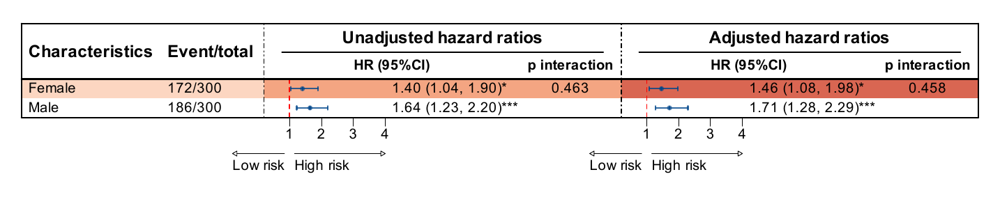{fig-alt="600条模拟记录的Cox亚组森林，未调整与年龄调整分列，交互P值按当前居中布局显示。"}

[下载 PDF](images/forest-guide/20261021-controls-forest-sur.pdf)

#### Fine–Gray {.unnumbered}

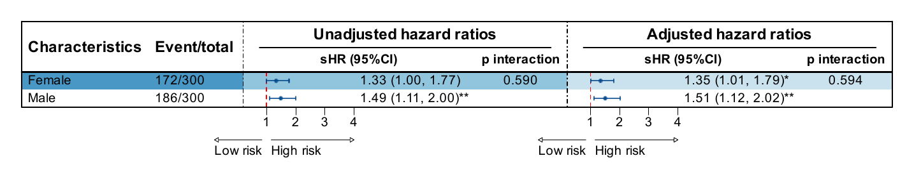{fig-alt="相同输入的Fine-Gray森林独立显示sHR，并按cif模型名称匹配第二组背景配色。"}

[下载 PDF](images/forest-guide/20261021-controls-forest-cif.pdf)

:::

命名调色板表达式向量按模型名匹配，无名向量按模型顺序；普通颜色向量（如 `c("#F4A582","#92C5DE")`）仍是所有模型共用的一套配色。不要把两个普通颜色误当成逐模型设置。配色不重新拟合，也不改变估计或 P 值。

`plt_eff()` 的交互 P 列现在让表头居中、数字作为左对齐整体居中，标题下横线也覆盖该列。0.05–0.1 的 P 值不再追加末尾小点，例如显示 `0.052`；较小 P 值的星号仍保留。该显示整理不改变检验、显著性阈值或 `plt_eff2()` 的合同。

#### 经典森林打印到不同页面

```r
classic_models <- plt_eff2(forest_models, which = c("haz_unadj", "haz_direct"),
  label_column_list = c(F = "Female", M = "Male"),
  axis_args = list(xlim = list(sur = c(0.2, 4), cif = c(0.2, 4)), x_trans = "none"))
(function() {
  grDevices::cairo_pdf(file.path(tempdir(), "20261021-controls-classic-pages.pdf"),
                       width = 11, height = 6, family = "Arial")
  on.exit(grDevices::dev.off(), add = TRUE)
  print(classic_models)
})()
```

::: {.callout-note collapse="true" title="复核代码"}
生成本页时运行的检查，接在上面的代码之后运行；只读教程可以跳过。

```r
stopifnot(inherits(classic_models, "surv_models"),
          all(vapply(classic_models, inherits, logical(1), "gforge_forestplot")))
```
:::

::: {.panel-tabset}

#### 打印第 1 页 {.unnumbered}

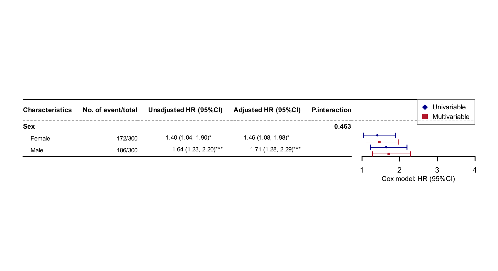{fig-alt="多模型经典森林打印到PDF的第一页，只包含Cox HR。"}

#### 打印第 2 页 {.unnumbered}

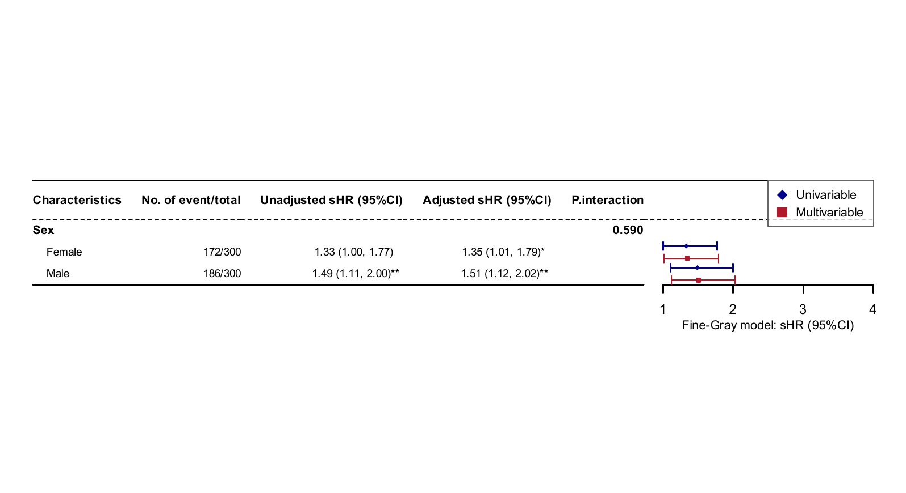{fig-alt="同一PDF第二页只包含Fine-Gray sHR，没有叠加到Cox森林上。"}

:::

[下载两页打印 PDF](images/forest-guide/20261021-controls-classic-pages.pdf)

当前 `print()` 会让第二张及后续 `gforge_forestplot` 开新页；旧版在 Plots 面板中可能覆盖前图。本例用真实 PDF 设备核对两页输出；`save` 原本的逐模型文件保存不受这一修复影响。仍需保留返回对象的 `surv_models` 类；不要仅为了打印而去掉类。

<!-- /controls-20261021: forest_controls -->

### 森林标题与轴设置的分派（2026-10-23） {#forest-dispatch-20261023}

<!-- update-20261023: forest_dispatch -->

2026-10-23 按已推送 RegR `aaeda5f` 在 Windows / WSL R 4.4.3 执行本节，原有图保留各自的执行记录。

`plt_eff()` 与 `plt_eff2()` 的 `title` 都支持每模型一个字符串，`plt_eff2()` 的 `xlab` 同样支持。下面从同一组效应结果分别导出两类森林图，不重新拟合。

```r
library(RegR)
set.seed(1023)
d_multi <- expand.grid(Tx = factor(c("No", "Yes")),
  Sex = factor(c("Female", "Male")), id = 1:90)
d_multi[["Age"]] <- rnorm(360, 55, 10)
t1 <- rexp(360, exp(.35 * (d_multi[["Tx"]] == "Yes") +
  .25 * (d_multi[["Sex"]] == "Male") + .02 * (d_multi[["Age"]] - 55)) / 80)
t2 <- rexp(360, 1 / 130); tc <- rexp(360, 1 / 160)
d_multi[["time"]] <- pmin(t1, t2, tc) + .2
d_multi[["event"]] <- ifelse(t1 < t2 & t1 < tc, 1L, ifelse(t2 < tc, 2L, 0L))
d_multi[["DSS"]] <- as.integer(d_multi[["event"]] == 1L)
eff_multi <- get_eff(d_multi, cat_var = c("Tx", "Age", "Sex"),
  adj_var = c("Age", "Sex"), surv = c(TRUE, FALSE),
  methods = c("unadj", "direct"), show_sur = FALSE, all = NULL)
eff_pdf <- file.path(tempdir(), c("20261023-update-eff-sur.pdf", "20261023-update-eff-cif.pdf"))
eff_plots <- plt_eff(eff_multi, display = "c", show_pinter = "none",
  title = c("Cox model", "Fine-Gray model"), fill_col = list(NULL, "pal_div[[5]][8]"),
  xlim = list(c(.2, 4), c(.2, 4)), save = list(filename = eff_pdf))
classic_pdf <- file.path(tempdir(), c("20261023-update-classic-sur.pdf", "20261023-update-classic-cif.pdf"))
classic_plots <- plt_eff2(eff_multi, which = c("haz_unadj", "haz_direct"),
  title = c("Cox model", "Fine-Gray model"), xlab = c(cif = "sHR (95% CI)", sur = "HR (95% CI)"),
  axis_args = list(xlim = list(c(.2, 4), c(.2, 3.5)), x_trans = "none"),
  save = list(filename = classic_pdf))
reject_forest <- function(expr) inherits(tryCatch(force(expr), error = identity), "error")
```

::: {.callout-note collapse="true" title="复核代码"}
生成本页时运行的检查，接在上面的代码之后运行；只读教程可以跳过。

```r
stopifnot(identical(names(eff_plots), c("sur", "cif")),
  identical(names(classic_plots), c("sur", "cif")), all(file.exists(c(eff_pdf, classic_pdf))),
  reject_forest(plt_eff(eff_multi, title = c("a", "b", "c"))),
  reject_forest(plt_eff2(eff_multi, xlab = c("a", "b", "c"))),
  reject_forest(plt_eff_pair(eff_multi)), reject_forest(plt_eff_sur(eff_multi)),
  reject_forest(set_eff(eff_multi)))
validation_values <- data.frame(model = names(eff_plots), classic_axis = c("HR", "sHR"))
```
:::

::: {.panel-tabset}

#### 组合森林：Cox {.unnumbered}

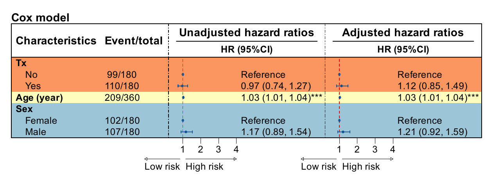{fig-alt="360条模拟记录的Cox效应森林，Tx、Age、Sex的未调整与调整效应分列，标题为Cox model。"}

[下载 PDF](images/forest-guide/20261023-update-eff-sur.pdf)

#### 组合森林：Fine–Gray {.unnumbered}

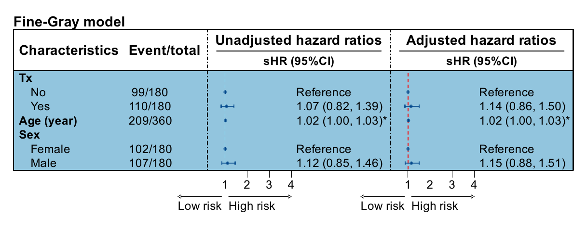{fig-alt="同一队列的Fine-Gray效应森林，标题为Fine-Gray model，显示sHR。"}

[下载 PDF](images/forest-guide/20261023-update-eff-cif.pdf)

#### 经典森林：Cox {.unnumbered}

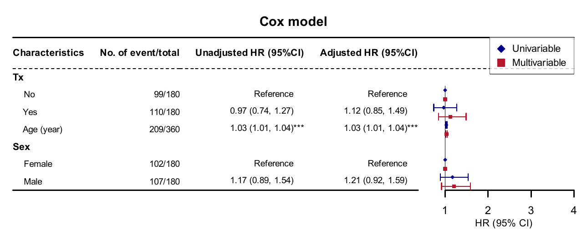{fig-alt="经典森林两列显示未调整与调整Cox估计，横轴标题为HR 95% CI。"}

[下载 PDF](images/forest-guide/20261023-update-classic-sur.pdf)

#### 经典森林：Fine–Gray {.unnumbered}

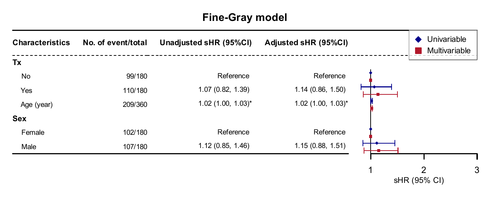{fig-alt="经典森林显示Fine-Gray估计，横轴标题为sHR 95% CI，范围为0.2至3.5。"}

[下载 PDF](images/forest-guide/20261023-update-classic-cif.pdf)

:::

两函数的同名字段不全有相同的无名 list 语义：`plt_eff(xlim = list(...))` / `ticks_at` 按面板共享；要逐模型用 `list(sur=...,cif=...)`。`plt_eff2(axis_args = list(xlim = list(...)))` 则按模型顺序分派。普通颜色向量仍共享；`fill_col = list(NULL,...)` 表达第一模型采用默认配色、第二模型使用指定设置，NULL 不等于关闭填色。

仅 `surv_models` 自动拆图；`plt_eff2()` 的普通命名结果列表仍堆叠成一张森林。`plt_eff_pair()`、`plt_eff_sur()`、`set_eff()` 明确拒绝多模型输入，需提取一个结果，避免静默选错模型。

<!-- /update-20261023: forest_dispatch -->

## 叠加森林图：表头、图例与背景 {#pair-current}

这些图沿用本页重新拟合的 `eff_sub`，不再次拟合。背景按汇总列及效应面板分块；`i` 填奇数正文行、`i2` 填偶数正文行。表头变更只改变文字，不能改变估计量、比较方向或单位。

::: {.panel-tabset}

### 自定义表头与顶部图例

```r
p_pair_header <- plt_eff_pair(eff_sub, measure = "haz_diff",
  header_list = list(label = "Variables", eve1 = "Deaths / N",
    header_title = c("Hazard ratio (95% CI)", "Survival difference at 60 months")),
  legend_position = "top", type = "v", label_column_list = labels,
  forest_nchar = 40, base_size = 10, core_size = c(10, 3))
p_pair_header
```

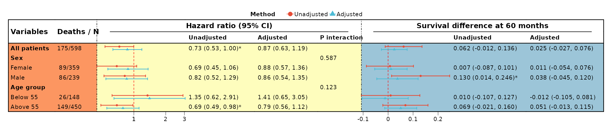{fig-alt="具有自定义标题和顶部方法图例的两面板叠加森林图，竖向底色按面板分块。"}

### 奇数行底色

```r
p_pair_odd <- plt_eff_pair(eff_sub, measure = "haz_diff",
  type = "i", legend_position = "bottom", label_column_list = labels,
  forest_nchar = 40, base_size = 10, core_size = c(10, 3))
p_pair_odd
```

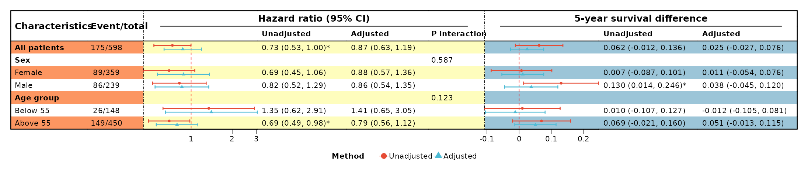{fig-alt="i背景叠加森林图在奇数行填色，红色参考线分别位于HR1和概率差0。"}

### 偶数行底色

```r
p_pair_even <- plt_eff_pair(eff_sub, measure = "haz_diff",
  type = "i2", legend_position = "right", label_column_list = labels,
  forest_nchar = 40, base_size = 10, core_size = c(10, 3))
p_pair_even
```

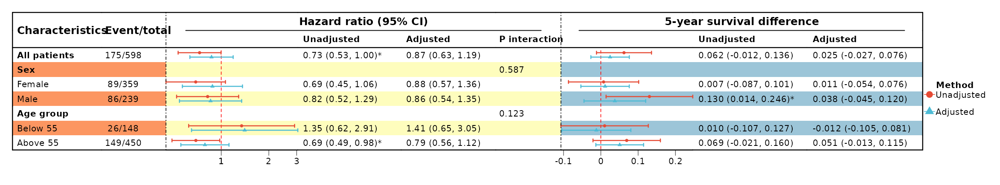{fig-alt="i2背景叠加森林图在偶数行填色，方法图例位于右侧。"}

### 90月概率与方法标题

```r
eff90_prob <- run_quiet(get_eff(d, cat_var = "N_4", sub_var = "Sex", surv = TRUE,
  methods_haz = character(), methods_sur = "unadj", time = 90, show_sur = TRUE))
p_sur_header <- plt_eff_sur(eff90_prob,
  header_list = list(label = "Groups", header_title = "Unadjusted KM"),
  forest_nchar = 40, base_size = 10, core_size = c(10, 3))
p_sur_header
```

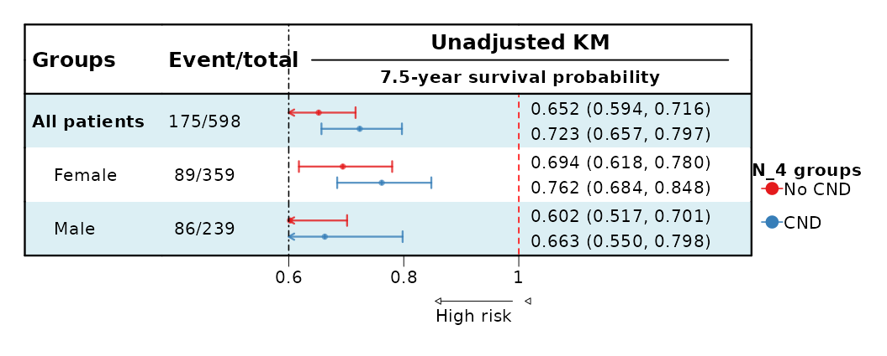{fig-alt="未调整组别生存概率森林图的时间列为7.5年，方法标题和分组列标题可自定义。"}

:::

`header_list` 使用完整字段名；未知或重复字段会报错。`legend_position="none"` 隐藏方法图例；叠加区间仍需在图注说明方法。组别概率列的自动时间标题不能通过 `header_list` 任意改写。

调整项在分析前会移除空水平；数据筛选后仍应检查因子是否只剩一个观测水平。`get_eff()` 在候选调整项全为常量时明确报错，避免将无法调整的结果标成调整后；不要把报错当作已成功完成模型拟合。层内常量与缺失水平的处理另见 [分层重拟合](facet-guide.qmd#current-strata)。


<!-- update-20261029e: regr_eff_data_plot -->

### 数据列表：按子集绘图与保存（2026-10-29） {#data-list-20261029e}

本节独立于前面的 598 人历史队列，请先运行[多个数据框示例](forest-guide.qmd#data-list-20261029e)，得到 `cohorts29e` 和 `eff_runs29e`。外层 `eff_data_list` 的元素是 N1a、N1b 两份 160 行分析；它与[按模型分派](#models-20261019)的含义不同，绘图仍返回同名的 `eff_data_list`。

`plt_eff()` 与 `plt_eff2()` 对该对象各绘制一图／子集。标题、文件名及其他允许的逐项设置可按子集命名，或按列表顺序给值。下面给文件名显式命名，便于核对输出；图中分别展示未调整／调整面板和调整模型的经典森林。

```r
data_titles29e <- c(N1a = "Synthetic N1a versus N0", N1b = "Synthetic N1b versus N0")
data_pdf29e <- file.path(tempdir(),
  c("20261029e-update-data-panels-N1a.pdf", "20261029e-update-data-panels-N1b.pdf"))
names(data_pdf29e) <- names(cohorts29e)
data_plots29e <- plt_eff(eff_runs29e, title = data_titles29e,
  show_pinter = "none", forest_nchar = 18,
  save = list(filename = data_pdf29e))
classic_pdf29e <- file.path(tempdir(),
  c("20261029e-update-data-classic-N1a.pdf", "20261029e-update-data-classic-N1b.pdf"))
names(classic_pdf29e) <- names(cohorts29e)
classic_plots29e <- plt_eff2(eff_runs29e, which = "haz_direct",
  title = data_titles29e, xlab = "HR (95% CI)", show_pinter = "none",
  save = list(filename = classic_pdf29e))
```

::: {.panel-tabset}
#### plt_eff：N1a {.unnumbered}

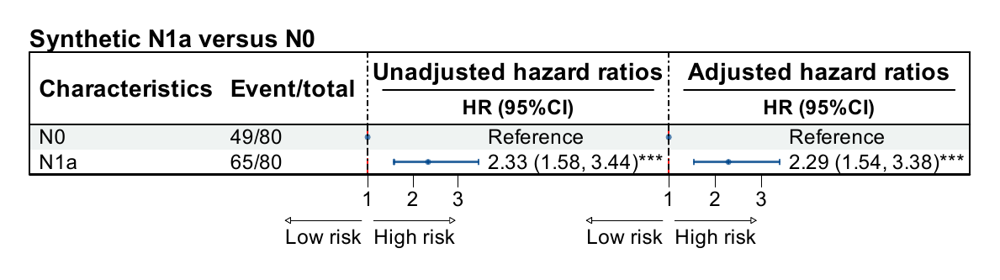{fig-alt="N1a子集的两张模型面板，以N0为参考，展示真实模拟数据拟合出的HR与区间。"}

[下载 PDF](images/forest-plot-guide/20261029e-update-data-panels-N1a.pdf)

#### plt_eff：N1b {.unnumbered}

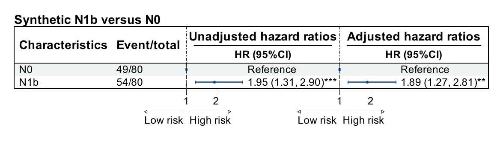{fig-alt="N1b子集单独拟合的Cox森林图，标题与输出文件按子集名称选择。"}

[下载 PDF](images/forest-plot-guide/20261029e-update-data-panels-N1b.pdf)

#### plt_eff2：N1a {.unnumbered}

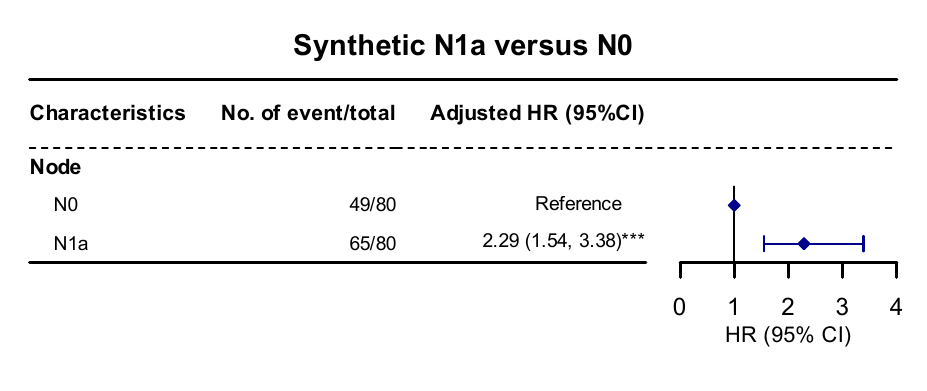{fig-alt="plt_eff2读取N1a的haz_direct表，返回数据列表中的第一份经典森林图。"}

[下载 PDF](images/forest-plot-guide/20261029e-update-data-classic-N1a.pdf)

#### plt_eff2：N1b {.unnumbered}

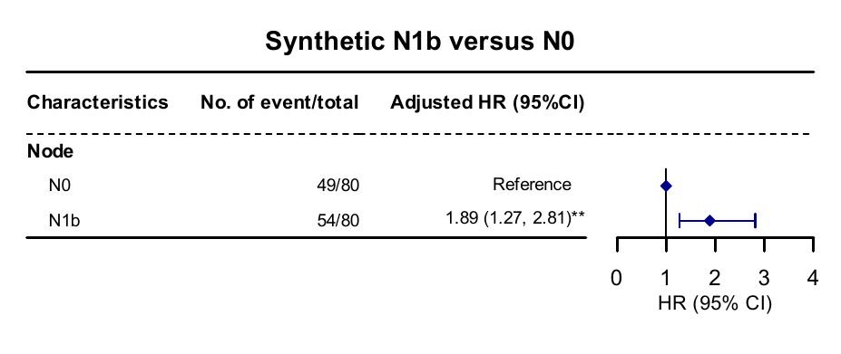{fig-alt="plt_eff2读取N1b的haz_direct表，保存为第二个命名PDF文件。"}

[下载 PDF](images/forest-plot-guide/20261029e-update-data-classic-N1b.pdf)
:::

经典森林图显式使用较短的 `xlab="HR (95% CI)"`，便于在固定输出尺寸下完整显示；图标题和表头仍交代子集及调整模型。

普通命名结果列表在两个绘图入口的含义有区别：`plt_eff(unclass(eff_runs29e))` 仍逐数据框绘图；`plt_eff2(unclass(eff_runs29e))` 保留原来的单图分块行为。需要逐份绘图时保留 `eff_data_list` 类；需要取一个结果时写 `eff_runs29e$N1a`。`plt_eff_pair()` 等单结果入口会提示先取出一个元素，不能把数据层与模型层混作一层。

::: {.callout-note collapse="true" title="复核代码"}
```r
stopifnot(inherits(data_plots29e, "eff_data_list"),
  inherits(classic_plots29e, "eff_data_list"),
  identical(names(data_plots29e), names(cohorts29e)),
  identical(names(classic_plots29e), names(cohorts29e)),
  all(file.exists(c(data_pdf29e, classic_pdf29e))))
data_plain29e <- plt_eff(unclass(eff_runs29e), show_pinter = "none")
classic_plain29e <- plt_eff2(unclass(eff_runs29e), which = "haz_direct",
  show_pinter = "none")
pair_error29e <- tryCatch({plt_eff_pair(eff_runs29e); ""}, error = conditionMessage)
stopifnot(inherits(data_plain29e, "eff_data_list"),
  !inherits(classic_plain29e, "eff_data_list"),
  grepl("one per data frame", pair_error29e))
validation_values <- list(cohorts = cohort_audit29e, names = names(data_plots29e),
  panels_class = lapply(data_plots29e, class),
  classic_class = lapply(classic_plots29e, class),
  plain_classic_class = class(classic_plain29e), pair_error = pair_error29e)
```
:::

<!-- /update-20261029e: regr_eff_data_plot -->

## 尺寸、保存与复用 {#save}

森林图的文字表需要足够的宽度。先用 `forest_nchar` / `graph_args` 的 `width` 调整图形空间，再用字体、留白与行高调整可读性；只增加导出分辨率不会解决文字挤压。

四个入口均有末尾的 `save = list()`。空 list 不保存；非空配置交给 `RegR::save_plt()`。默认 `fixed_size = TRUE` 固定自然绘图尺寸，`attr(p, "plot_size")` 返回以英寸为单位的 width / height；数值型 fixed_size 指定整图宽度，FALSE 让图随设备伸展。

```r
# 最后一个参数统一用于保存 PDF。
p <- plt_eff_pair(
  eff_sub[c("haz_direct", "haz_unadj")],
  measure = "hr",
  save = list(filename = "CND-forest.pdf")
)

attr(p, "plot_size")
```

`plt_eff2()` 返回 forestplot 对象，输出 PNG 时可直接使用绘图设备并 `print()`，不直接当作 ggplot 调用 `ggsave()`。本页为经典森林图额外留出导出边距，防止长标题、图例或轴文字接近画布边缘。

```r
p2 <- plt_eff2(
  eff_sub, which = c("haz_direct", "haz_unadj"),
  label_column_list = labels
)
size <- attr(p2, "plot_size")

ragg::agg_png(
  "CND-classic-forest.png",
  width = size[["width"]] + 4,
  height = size[["height"]] + 0.7,
  units = "in", res = 170, background = "white"
)
grid::grid.newpage()
print(p2)
grDevices::dev.off()
```

本页以保存的汇总图形提供浏览，未公开患者级数据文件。完整函数帮助见 [RegR 参考文档](https://hui950319.github.io/RegR/reference/index.html)。本页示例按上述本机源码快照验证，公开参考文档与安装版本的接口可能有差异。

## 当前模型对比：去重对比行，保留效应单位 {#pair-20261018}

2026-10-18按已推送RegR `7265b31`，在Windows / WSL R 4.4.3实际拟合和绘制。get_eff_cat模型比较表中的单个对比标题行没有估计值，plt_eff_pair现在自动去掉该冗余行；这不会删除Unadjusted、Adjusted等真实结果行。自定义主表头后，CI列第二行仍显示从所有叠加表汇总的效应单位，Cox与Fine–Gray混合为`HR/sHR (95% CI)`。

```r
data("toy_ptc_m1_cnd", package = "ToyData")
d_pair <- as.data.frame(toy_ptc_m1_cnd)
d_pair[["N_4"]] <- relevel(d_pair[["N_4"]], ref = "No CND")
models_current <- run_quiet(get_eff_cat(d_pair, cat_var = "N_4", adj_var = c("Age", "Sex"),
  surv = list(Cox = TRUE, FineGray = FALSE)))
p_pair <- plt_eff_pair(models_current, measure = "hr", summary_vars = "label",
  header_list = list(label = "Model", header_title = "Models"),
  method_labels = c("Cox", "Fine-Gray"), legend_position = "bottom",
  show_effect_text = FALSE, base_size = 10, core_size = c(5, 2), forest_nchar = 45)
p_pair
```

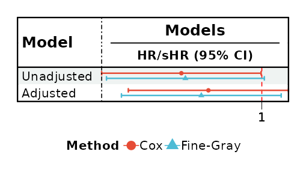{fig-alt="598人队列中CND相对No CND的未调整和调整后两行估计，叠加Cox和Fine–Gray区间；Models下方仍有HR/sHR的95%CI单位，冗余对比标题行已移除。"}

本图关闭数值文字以突出表头和区间，原models_current仍保存完整估计；需要数值列时恢复show_effect_text并留足列间距。图中HR与sHR来自不同模型，不能因共用坐标就当作同一统计目标；CND分组仍是本页注明的登记字段操作性定义。

[`plt_eff_pair()` 帮助页](https://hui950319.github.io/RegR/reference/plt_eff_pair.html)

## 更新记录 {#page-updates}

::: {.callout-note collapse="true" title="本页更新记录"}
- 2026-10-29：[数据列表逐份绘图](#data-list-20261029e)：补充两种森林图、四份PDF与普通命名列表的区别。
- 2026-10-23：[森林标题与轴设置的分派](#forest-dispatch-20261023)
- 2026-10-21：[Cox/Logistic 提示与逐模型森林](#forest-controls-20261021)
- 2026-10-21：[第五个面板与正文右边距](#forest-five-20261021)
- 2026-10-20：[多模型森林、名称映射与区间口径](#models-ci-20261020)
- 2026-10-20：[分层亚组森林：每层独立标记](#split-forest-20261020)
- 2026-10-12：[KM 推断、表头和叠加样式](#current-forest)
:::
