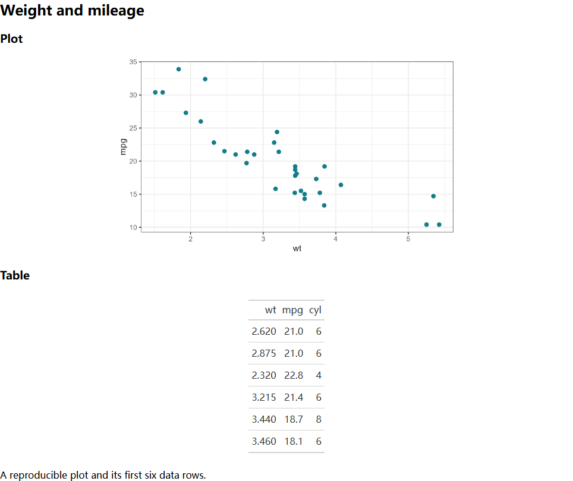
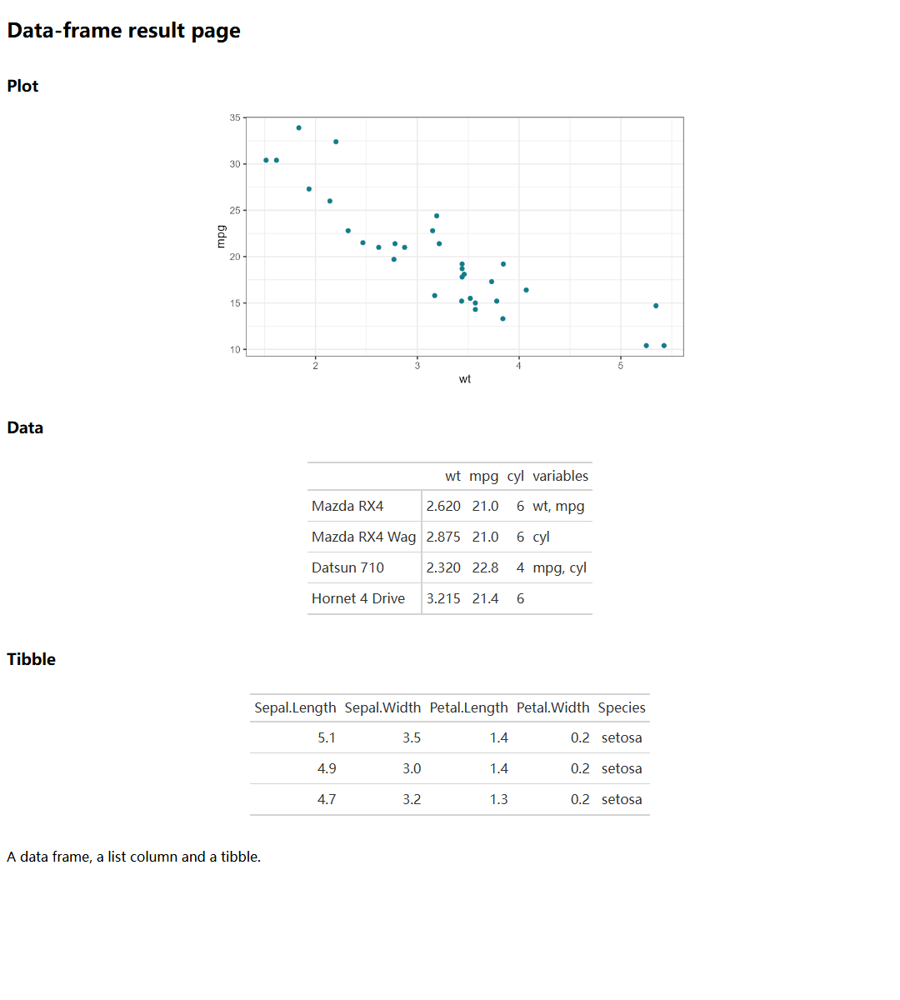
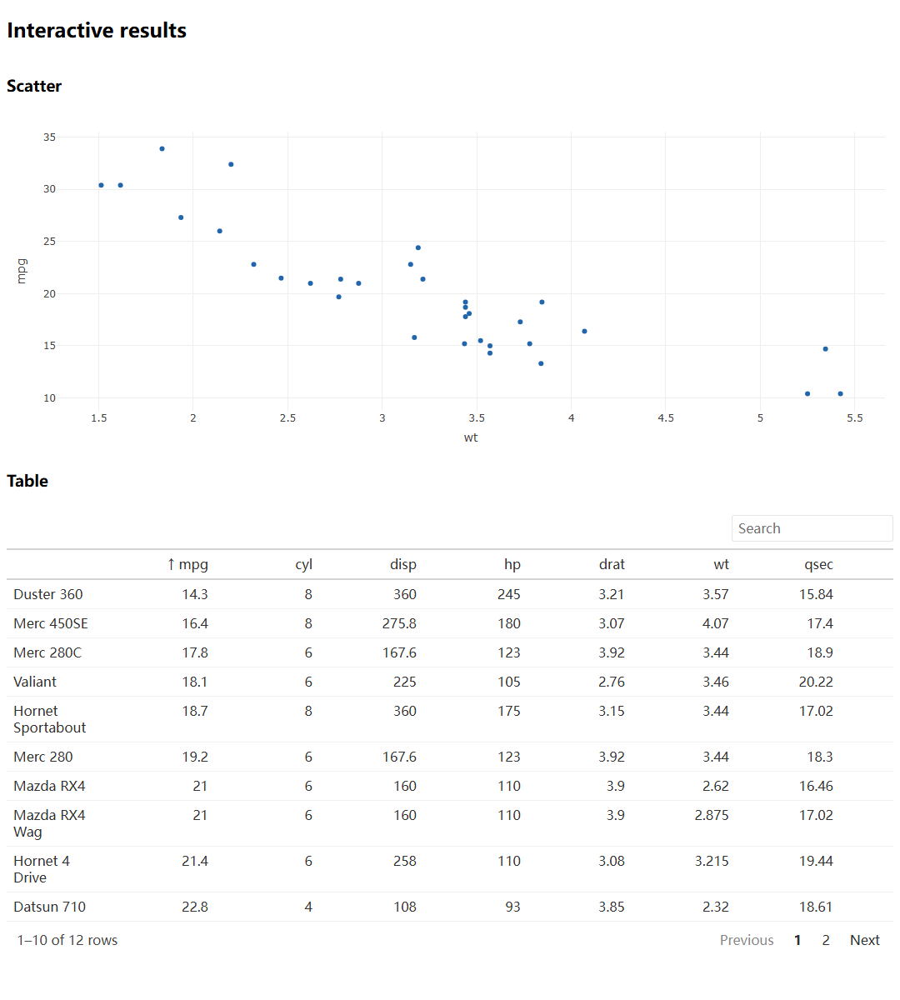

临床回归工具箱：队列筛选、基线表、效应估计、生存曲线、变量选择、交互与非线性展示。

本页集中展示三张图：先看功能总览，再查接口索引，最后看处理流程与返回对象。**点击图片可放大查看**，也可下载图源继续编辑。

[下载 draw.io 图源](../assets/module-maps/regr/regr-package-mindmap.drawio){.btn .btn-outline-primary download="regr-package-mindmap.drawio"}
[下载三页 PDF](../assets/module-maps/regr/regr-package-mindmap.drawio.pdf){.btn .btn-outline-secondary download="regr-package-mindmap.drawio.pdf"}

图谱快照：**2026-09-13**。对应包版本：**0.1.3**。具体参数和返回值以当前安装版本的帮助页为准。

函数示例：[队列筛选与流程图：plt_flo / plt_flo2 / plt_flo3](flow-guide.qmd) · [效应估计与森林图](forest-guide.qmd) · [KM/CIF 组合图：get_cat 与 plt_cat1/2/3](cat-guide.qmd) · [交互分析、绝对风险与 Word 表格导出](interaction-guide.qmd)。各页均提供参数标签页、实际图形与可复现代码。

::: {.callout-note title="历史图谱与当前导出目录"}
下方三张图和可下载draw.io/PDF保留2026-09-13的106项接口快照。本次按本机 `NAMESPACE` 核对，当前有118项显式导出（含兼容入口）；新增接口使用下面的文字目录检索。2026-10-13复核的已推送基线 `a3881fa` 已包含 `get_rpa_new()`、`plt_flo3()`及本轮更新；不能只凭0.1.3版本号判断旧安装是否具备这些接口。
:::

## 功能总览

{width=100% fig-alt="RegR 的功能总览；点击图片可放大阅读。"}

[查看原尺寸 PNG](../assets/module-maps/regr/regr-package-mindmap-p1.drawio.png)

## 导出目录：118项 {#current-export-index}

导出目录于2026-10-16按RegR a8a6eb8核对为118项；新增fmt_page已包含于核对时远端1dc3b2f。历史图谱仍为106项，不作为当前导出数量。目录逐项对应本机 `NAMESPACE` 的显式export，包含带点的兼容入口；按功能链接到本站教程，参数以实际安装源码的帮助页为准。公开参考站点可能尚未包含本机开发接口。

:::: {.table-responsive tabindex="0" role="region" aria-label="导出函数目录，可横向滚动"}

| 功能与教程 | 导出接口 |
|:--|:--|
| [队列与流程图](flow-guide.qmd) | `get_flo()`, `get_flt()`, `plt_flo()`, `plt_flo2()`, `plt_flo3()` |
| [效应估计与森林图](forest-guide.qmd) | `get_eff()`, `get_eff_cat()`, `get_eff_inter()`, `plt_eff()`, `plt_eff2()`, `plt_eff_pair()`, `plt_eff_sur()`, `set_eff()` |
| [KM、CIF与分面](cat-guide.qmd) | `check_inter()`, `get_cat()`, `get_facet()`, `get_facet_diff()`, `plt_cat1()`, `plt_cat2()`, `plt_cat3()` |
| [交互检验与导出](interaction-guide.qmd) | `fmt_eff_inter_gt()`, `fmt_inter()`, `fmt_inter_ft()`, `fmt_inter_gt()`, `get_fit_ms()`, `get_int()`, `get_inter()`, `get_inter_abs()`, `plt_inter()`, `save_tb_inter()` |
| [RCS、风险曲线与条件生存](rcs-guide.qmd) | `fmt_rcs()`, `get_cs()`, `get_cs_time()`, `get_hzd()`, `get_hzd_adj()`, `get_hzd_group()`, `get_pnl_curve()`, `get_rcs()`, `get_rcs_all()` |
| [切点分析](cut-guide.qmd) | `get_cut()`, `get_cut_ci()`, `get_cut_plot()`, `save_tb_cut()` |
| [RPA与新队列分组](rpa-guide.qmd) | `get_rpa()`, `get_rpa_mp1()`, `get_rpa_mp2()`, `get_rpa_new()`, `get_rpa_pair()`, `plt_rpa()`, `plt_rpa_heat()`, `plt_rpa_km()`, `plt_rpa_tab()` |
| [模型拟合、评价与验证](model-evaluation-guide.qmd) | `get_fit()`, `get_fit_stats()`, `get_msr()`, `get_score()`, `get_score_stage()`, `get_score_summary()`, `plt_score()` |
| [列线图与性能曲线](nomogram-guide.qmd) | `get_cal_cox()`, `get_cal_log()`, `get_dca_cox()`, `get_dca_log()`, `get_nom_cox()`, `get_nom_log()`, `get_roc_cox()`, `get_roc_log()` |
| [变量选择](variable-selection-guide.qmd) | `Fil_con()`, `Plt_CorVIF()`, `check_adj()`, `get_boruta()`, `get_cor()`, `get_lasso()`, `get_var_sel()`, `plot_coef_path()`, `plot_cv_glmnet()`, `plt_boruta()` |
| [轨迹分析](gbtm-guide.qmd) | `get_GBTM()`, `get_GBTM_data()`, `get_GBTM_plot()`, `get_GBTM_tb()`, `get_GBTMclass_plot()` |
| [倾向评分](ps-guide.qmd) | `get_iptw()`, `get_ps()`, `get_psm()`, `get_psm_iptw()` |
| [临床表与单多因素](table-guide.qmd) | `get_gt_cat()`, `get_tb_autoreg()`, `get_tb_gtsummary()`, `get_tb_survival()`, `get_tb_ums()`, `get_um()`, `plt_tb_ums()`, `plt_tbl()` |
| [描述性效应比较](effect-comparison-guide.qmd) | `plt_cohen()`, `plt_compare()`, `plt_dot()`, `plt_heatmap()`, `plt_radar()`, `stat_cohen()`, `stat_smd()` |
| [分类变量编码与标签](effect-comparison-guide.qmd#coding-current) | `encode_vars()`, `encode_labels()` |
| [工作流、命名与保存](flow-guide.qmd#pdf-device) | `.rename()`, `.set_label()`, [`get_all()`](forest-guide.qmd#get-all-step-current), [`fmt_page()`](#fmt-page-current), `insert_plot()`, `name_map_filter()`, `name_map_filter2()`, `name_map_oc()`, `name_map_seer()`, `oo_cores()`, `oo_pblapply()`, `run_quiet()`, `save_gt()`, `save_plt()`, `save_tb()` |

::::

2026-10-16复核：已推送5956139包含上述117项导出及get_int()的公共参数、默认六种亚组树、Viewer/Plots显示，并新增get_all(intc.args=...)入口，详见 [联合交互](interaction-guide.qmd#get-int-current) 和 [统一画布入口](interaction-guide.qmd#intc-current)。5956139未修改2d4d83c的显式导出集合，S3打印方法单独注册，不重复计数。

本轮重点：[多队列流程图](flow-guide.qmd#plt-flo3)、[固定RPA分组](rpa-guide.qmd#fixed-rpa-groups)、[新队列模型评价](model-evaluation-guide.qmd#external-cohort)、[分面列名与默认值](facet-guide.qmd#current-defaults)、[KM区间更新](cat-guide.qmd#km-greenwood)、[图例与保存](effect-comparison-guide.qmd#comparison-current)。

## 历史图谱接口索引

{width=100% fig-alt="RegR 的完整函数索引；点击图片可放大阅读。"}

[查看原尺寸 PNG](../assets/module-maps/regr/regr-package-mindmap-p2.drawio.png)

## 分析流程与对象流

{width=100% fig-alt="RegR 的分析流程与对象流；点击图片可放大阅读。"}

[查看原尺寸 PNG](../assets/module-maps/regr/regr-package-mindmap-p3.drawio.png)

三页分别用于了解模块分工、定位公共接口和衔接输入输出。图中的流程分支按具体任务选择。

## get_all()：保留成功层并报告失败层 {#get-all-partial}

当前 `get_all()` 在递归分层分析中隔离层内失败。下面复用[森林图补充例子的 800 人 `d_scheme`](forest-guide.qmd#cat-var-rpa)，把一层的 Age 人为设为常量，演示 RCS 无法取得足够节点时的行为。

```r
d_all <- d_scheme
d_all[["demo_stratum"]] <- factor(rep(c("Good", "Constant"), each = 400L))
d_all[["Age"]][d_all[["demo_stratum"]] == "Constant"] <- 50
all_res <- get_all(
  com.args = list(data = d_all, adj_var = "Sex", split_var = "demo_stratum", time = 60),
  rcs.args = list(rcs_var = "Age", n = 3L, panel_show = "haz_poi"))
names(all_res)                    # "rcs"
all_res[["rcs"]]                 # 保留 Good 层图形
```

本次实际运行的摘要保留 `Completed 1 analyses: rcs`，并明确输出 `Failed strata: 1: rcs.args [Constant]`；同时发出层内失败警告。Constant 层缺失不是“效应为零”，应随报告说明失败原因。

未传入的分析块默认跳过，不能因为 `formals()` 显示完整 list 模板就认为它们自动执行。各块未全部成功时，也不能把返回对象解释为全队列完整结果。

## 2026-10-05 接口更新目录 {#latest-functions}

| 更新功能 | 当前示例 |
|:--|:--|
| 建树、规则与三种节点图、节点对比 | [get_rpa、plt_rpa、plt_rpa_km、plt_rpa_tab、get_rpa_pair](rpa-guide.qmd) |
| 指标、bootstrap 与分期评分 | [get_score、get_msr、get_fit_stats、get_score_stage](model-evaluation-guide.qmd) |
| 多暴露曲线、曲线网格与 ATE | [get_cat、plt_cat1](cat-guide.qmd#get-cat-multiple) |
| 独立分期模型、森林图缺失区间 | [get_eff、plt_eff](forest-guide.qmd#cat-var-rpa) |
| PS 相对效应的方差口径 | [get_eff_cat](eff-cat-guide.qmd#ps-precision) |
| Word 整数计数格式 | [save_tb](table-guide.qmd#save-tb-format) |

以上是当前教程入口；三张模块图仍保留其标明的历史快照，不把旧图当作最新导出清单。

## RCS 与切点分析教程

- [RCS 组合图：get_rcs_all 的 7 种模式，16 张实际图形](rcs-guide.qmd)
- [get_cut、get_cut_ci 与 get_cut_plot：两段模型、曲线切点与 bootstrap 区间](cut-guide.qmd)

## 新增教程目录

以下页面按 RegR 0.1.3 当前源码核对，使用 WSL R 4.4.3 实际运行示例。沿用 SHAP 页的参数标签页、代码与实际结果展示方式；表格页面直接嵌入汇总表。

| 分析任务 | 页面与主要入口 |
|:--|:--|
| 计算性能评估 | [性能评估目录：FGR/CSC、RPA 生存路径与 Windows/Linux Cox/CIF 优化](performance-evaluation.qmd)；[get_score 的 Windows/WSL 对照与四项优化](get-score-optimization-20261007.qmd) |
| 完整评分性能 | [get_score：R=0与100次bootstrap，1万到10万行实测](get-score-benchmark-20261003.qmd) |
| 递归分区与节点结局 | [RPA：get_rpa、树图、节点曲线与汇总](rpa-guide.qmd) |
| 倾向评分、匹配与加权 | [PS：get_psm、get_iptw、get_ps 与平衡诊断](ps-guide.qmd) |
| 变量筛选 | [筛选、LASSO、Boruta、相关性与 VIF](variable-selection-guide.qmd) |
| 描述性与模型表格 | [基线表、回归表与生存汇总](table-guide.qmd) |
| 单因素与多因素模型 | [get_um 的变量选择、比值与绝对效应](um-guide.qmd) |
| 同一暴露的多个模型 | [get_eff_cat：调整集合、结局与分层](eff-cat-guide.qmd) |
| 模型评价 | [AUC、Brier、AIC 与独立留出样本](model-evaluation-guide.qmd) |
| 预测模型可视化 | [Cox/Logistic 列线图、ROC、校准与 DCA](nomogram-guide.qmd) |
| 条件生存 | [get_cs、get_cs_time 与 KM 比值](conditional-survival-guide.qmd) |
| 瞬时风险 | [get_hzd、get_hzd_group 与协变量标准化](hazard-guide.qmd) |
| 纵向分组轨迹 | [GBTM：拟合、组数比较与后验分类](gbtm-guide.qmd) |
| 组间特征差异 | [SMD、Cohen's d、点图、雷达图与类别格图](effect-comparison-guide.qmd) |

三个原有页面同时补充了[森林图的 set_eff](forest-guide.qmd#set-eff)、[亚组效应与交互合并表](interaction-guide.qmd#get-eff-inter)和[分面概率差曲线](facet-guide.qmd#facet-diff)。各页单独说明参考水平、估计量、时间单位及当前实现的限制。

## get_all()：评分入口、返回值与 Quarto 输出 {#get-all-current}

2026-10-09 按 RegR 0.1.3 源码 `40515e1` 核对，下面的评分块在 WSL R 4.4.3 中实际执行。

`msr.args` 现在调用 `get_score()`；当前返回值是 `res[["msr"]][["AUC.BS.AIC"]]` 和 `res[["msr"]][["ft"]]`，不能继续按旧 `get_msr()` 结构取值。默认指标使用 Score 路径，其他指标可通过 `metrics` 显式选择；不支持的参数如 `cause` 会在拟合前报错。

```r
library(RegR)
library(ToyData)
d_score <- as.data.frame(ToyData::toy_ptc_m1_cnd)
all_score <- get_all(
  com.args = list(data = d_score, surv = TRUE, time = 60),
  msr.args = list(vars = c("Age", "Sex"), R = 0,
    metrics = c("AUC_score", "BS_score", "AIC")))
names(all_score)
all_score[["msr"]][["AUC.BS.AIC"]]
```

:::: {.table-responsive tabindex="0" role="region" aria-label="表格，可横向滚动"}

|model |AUC_score            |AUC_score_60         |BS_score             |BS_score_60          |AIC     |
|:-----|:--------------------|:--------------------|:--------------------|:--------------------|:-------|
|Age   |0.744 (0.701, 0.788) |0.659 (0.600, 0.719) |0.156 (0.144, 0.169) |0.158 (0.137, 0.179) |1938.19 |
|Sex   |0.549 (0.500, 0.598) |0.538 (0.481, 0.594) |0.189 (0.180, 0.199) |0.165 (0.144, 0.187) |1984.39 |

::::


上例未显式设置 `msr.args$times`，因此公共 `time = 60` 在随访范围内时会加入一个命名评分时间列；显式 `times = NULL` 则不追加。公共块和各分析块的未知参数、矛盾分层设置会先检查。分层内恒定调整变量的处理可读 `attr(res, "adj_var_dropped")`，应随分析报告说明实际调整集合。

`get_all()` 在各分析完成时打印主要结果一次，赋值不阻止这一输出，返回对象本身为 invisible。Quarto 中表格不要在函数内部反复打印；将返回表放进单独代码块，例如：

```r
# Quarto 文档中的独立表格代码块
all_score[["msr"]][["ft"]]
# 开启其他模块时，分别使用 res$cat_gt 或 fmt_inter_gt(res$interTable)。
```

交互会话里耗时超过 0.5 秒的图会显示 150 dpi 整图预览；返回对象仍是原始图，可用于矢量保存。该显示路径与 knitr 的输出处理分开，详情见 [三种栅格化后端](../utilsr/composition-guide.qmd#current-raster)。

## 2026-10-09 新增与修正入口 {#current-functions}

:::: {.table-responsive tabindex="0" role="region" aria-label="表格，可横向滚动"}

| 功能 | 当前教程 |
|:--|:--|
| 保留多分类/连续编码的整体交互检验 | [get_fit_ms](interaction-guide.qmd#get-fit-ms) |
| 各队列分别调整、匹配或加权的敏感性场景 | [get_eff_cat 的 dat_adj_ps](eff-cat-guide.qmd#dat-adj-ps) |
| 联合区间、实际样本与后端记录 | [get_eff 与 fit_info](forest-guide.qmd#current-inference) |
| 层内恒定协变量及概率差 | [get_facet / get_facet_diff](facet-guide.qmd#current-strata) |

::::

三张模块图是注明日期的历史快照；最新新增入口以本节和当前包导出为准。

## get_all的13个入口与二阶ALE {#all-ale2-current}

2026-10-16核对RegR a8a6eb8；下述入口已包含于远端1dc3b2f。get_all新增ale2.args，显式提供才启用，返回res$ale2。仅设置exp_var时继承model="xgboost"、scale="link"、grid_size=20；模型选项向量不是同时拟合多个模型，省略时取首项。com.args提供公共数据、调整变量、结局和预测时间。实际模拟数据、6/16网格对照及完整调用见 [二阶ALE](../mlr/vpd-guide.qmd#ale-grid-current)。

当前入口为tbl.args、dis.args、imp.args、shp.args、rcs.args、vpd.args、ale2.args、eff.args、int.args、intc.args、rpa.args、msr.args、fac.args；返回字段依次为cat_gt、dis、imp、shp.obj、rcs、vd_pd、ale2、eff、interTable、interCanvas、rpa、msr、facet。省略某块或传NULL均跳过；Usage中的list仅是可复制模板，不自动启动所有分析。

## fmt_page：图表与文字结果页 {#fmt-page-current}

2026-10-16按RegR a8a6eb8固定快照在Windows R 4.4.3实际运行；fmt_page已包含于核对时远端1dc3b2f。复用本页介绍该函数，图谱下载件仍保留其历史快照。

`fmt_page()`按输入顺序组合图、表和文字；命名项成为小标题，NULL项略过。支持ggplot/patchwork/grob、gt、gtsummary、flextable、data.frame/tibble、htmltools标签及htmlwidget。普通list应拆开传，例如 `do.call(fmt_page,res[c("combined","gt")])`，不能把整个分析结果list当一块图传入。

```r
fmt_page(..., title=NULL, plot_size=c(7,5),
  dpi=150, save=list())
```


### 图、表、文字组合成结果页

复用现有目录页介绍RegR::fmt_page。图会嵌入PNG，表格保留HTML；名称变成小标题，NULL项略过。保存为一个HTML文件，网页依赖仍可能需要联网，不能把PNG图当作矢量图。

```r
p_page <- ggplot(mtcars,aes(wt,mpg))+geom_point(colour="#137C8B",size=2)+theme_bw()
page_html <- fmt_page(Plot=p_page,Table=gt::gt(head(mtcars[,c("wt","mpg","cyl")],6)),
  "A reproducible plot and its first six data rows.",NULL,
  title="Weight and mileage",plot_size=c(6,3.5),
  save=list(filename=file.path(tempdir(),"results-page")))
saveRDS(page_html,file.path(tempdir(),"results-page.rds"))
# 在交互会话显示；在Quarto独立代码块中直接写page_html。
# page_html
p_page
```

{fig-alt="图、表、文字组合成结果页；固定输入、按注明源码快照实际运行的示例。"}

[打开本例的完整HTML](images/function-modules/20261016-results-page.html){target="_blank"} · [下载HTML](images/function-modules/20261016-results-page.html){download="results-page.html"}

返回值是可浏览的htmltools tagList，可保存RDS后读回。图按自身plot_size属性绘制，没有该属性才用公共plot_size；页面中的图为PNG，点击切换原尺寸。save只接受filename，省略.html会自动补齐；本地CSS/JS会内联，但仅有网页地址的外部依赖仍需联网。用htmltools::save_html另存时则可能生成旁边的lib目录。

此HTML已在Chromium检查桌面/手机显示、点击缩放及离线加载；2026-10-16 的 WSL 旧例因 V8 缺少 libnode.so.72 而改用 Windows 执行；下节的新源码与 Windows / WSL 验证另行记录。导出的PNG不是矢量图；需要矢量图时仍单独使用save_plt。

### 数据框、tibble 与已有页面复用 {#fmt-page-dataframe-current}

2026-10-17 按已推送 RegR `197faa2`，在 Windows / WSL R 4.4.3 实际运行下例。数据框与 tibble 自动转为 gt 表；字符行名成为行标题，普通行号不单独显示；list 列的每个元素用逗号连接。图的 `labs(alt=...)` 成为图片替代文本。

```r
library(RegR)
library(ggplot2)
p_page_new <- ggplot(mtcars, aes(wt, mpg)) + geom_point(colour = "#137C8B") +
  theme_bw() + labs(alt = "Mileage against car weight")
d_page <- head(mtcars[, c("wt", "mpg", "cyl")], 4)
d_page$variables <- list(c("wt", "mpg"), "cyl", c("mpg", "cyl"), character())
page_new <- fmt_page(Plot = p_page_new, Data = d_page,
  Tibble = tibble::as_tibble(head(iris, 3)),
  "A data frame, a list column and a tibble.", NULL,
  title = "Data-frame result page", plot_size = c(6, 3.5),
  save = list(filename = file.path(tempdir(), "dataframe-page")))
page_new
saveRDS(page_new, file.path(tempdir(), "page-new.rds"))
fmt_page(readRDS(file.path(tempdir(), "page-new.rds")),
  save = list(filename = file.path(tempdir(), "page-resaved.html")))
```

{fig-alt="fmt_page 的实际浏览器预览，显示一张散点图与两张数据表。"}

[打开完整 HTML](images/function-modules/20261017-dataframe-page.html){target="_blank"} · [下载 HTML](images/function-modules/20261017-dataframe-page.html){download="dataframe-page.html"}

返回对象增加 `fmt_page` 类，仍兼容 htmltools。交互会话打印时显示页面；Rscript 仅打印摘要。已有页面可直接另存，不重新绘制图。保存路径的父目录须存在；本地依赖及其字体、图片等文件会嵌入，仅有远端地址的依赖仍可能需要联网。

当前 gt 渲染使用局部样式，不再经过逐单元格内联 CSS 的 V8 路径；上例已在 WSL 成功生成。HTML 已检查离线加载、手机宽度和点击缩放。本轮另用独立 Quarto 文档实际编译 HTML 与 Word：HTML 保留文档标题及两张表；Word 只嵌入图的 PNG，不包含该页面的 HTML 表格和文字。PDF 等非 HTML 格式遵循相同的图像回退接口，本轮没有编译 PDF。需要可编辑的 Word 表时，应另行输出原始 `ft` / `tbl_merge` 等表格对象。

### 交互表格与htmlwidget依赖 {#fmt-page-interactive-20261018}

2026-10-18按已推送RegR `7265b31`，在Windows / WSL R 4.4.3生成下例。当前gt交互表与htmlwidget携带的依赖会一并收集；已有fmt_page对象再次另存时直接复用，不重复绘图或嵌套页面。

```r
widget_scatter <- plotly::plot_ly(mtcars, x = ~wt, y = ~mpg,
  type = "scatter", mode = "markers", marker = list(color = "#2166AC"))
interactive_table <- gt::opt_interactive(gt::gt(head(mtcars, 12), rownames_to_stub = TRUE),
  use_search = TRUE, use_pagination = TRUE)
widget_page <- fmt_page(Scatter = widget_scatter, Table = interactive_table,
  title = "Interactive results",
  save = list(filename = file.path(tempdir(), "interactive-page.html")))
widget_copy <- fmt_page(widget_page,
  save = list(filename = file.path(tempdir(), "interactive-copy.html")))
```

::: {.callout-note collapse="true" title="复核代码"}
生成本页时运行的检查，接在上面的代码之后运行；只读教程可以跳过。

```r
stopifnot(identical(widget_page, widget_copy))
```
:::

{fig-alt="原生plotly散点图和gt交互表的完整页面，表含车型名称、搜索框与可排序列。"}

[打开交互示例](images/function-modules/20261018-interactive-page.html){target="_blank"} · [下载HTML](images/function-modules/20261018-interactive-page.html){download="interactive-page.html"}

已断开HTTP/HTTPS请求，实际检查plotly图形、表格搜索和列排序，以及390px手机宽度；本例依赖可离线运行。此结论仅适用于本例的本地依赖，引用远端数据、地图或脚本的widget仍可能联网。这里直接使用原生plotly，避免当前ggplotly/ggplot2组合的转换兼容问题。

新结果页入口另见 [GBTM](gbtm-guide.qmd#view-20261018)、[曲线切点](cut-guide.qmd#view-20261018) 和 [分面生存](facet-guide.qmd#current-20261018)。图像导出与HTML交互仍是不同交付形式。

对应函数：`fmt_page()`（RegR 函数参考站点尚未收录）。

## 接口变化记录 {#interface-changes}

### 运行合同与结果更新（2026-10-27） {#updates-20261027}

本轮按已推送 RegR **0.1.3** `212a156` 核对，显式导出仍为 **118 项**。新注册的 S3 打印方法不计作新增导出。

- `get_all()` 现在返回 `c("get_all","list")`，不可见返回方式和命名分量仍保留；再次打印只显示摘要。默认 seed=123 在每块/每层重置并恢复会话 RNG，中断时保留此前完成的分析，见[实际调用与模拟中断](flow-guide.qmd#dispatcher-20261027)。预检还会阻止重编码覆盖已有列，学习器的特征缺失行分别计数，RPA 继承公共置信水平。

下方各节是各自日期的历史接口核对，新分析以本节对应教程和当前帮助为准。

### 筛选报告与结果摘要（2026-10-26） {#summaries-20261026}

2026-10-26 按已推送 RegR `df14885` 核对，仍为 **0.1.3 / 118 项显式导出**。本轮主要整理控制台报告；S3 方法不重复计入导出数量。

- `get_flt()` 打印每一步排除数与剩余数，返回值仍是不可见的数据框；`get_all()` 在运行中打印完成模块、筛选和重编码摘要，返回值仍是不可见的结果 list。这两个入口没有改成新的 S3 结果类。[12 行合成输入与原生输出](flow-guide.qmd#summary-20261026)核对了两步筛选后剩余 7 行及返回属性。
- `get_ps()`、`get_psm()`、`get_iptw()`、`get_psm_iptw()`、`get_rpa()`、`get_var_sel()`、`get_lasso()` 和 `get_fit_stats()` 现在有专门的打印方法。先读设定与规模，再按对象的 `Components:` 提示取出完整表、模型或图；也可用 `UtilsR::pr_tree(result, max_depth=1)` 看结构。打印摘要不代替对返回字段和失败记录的检查。
- 运行提示使用从 UtilsR 导入的消息构件，`suppressMessages()` 可关闭这类提示；标准输出的结果摘要仍会保留。`get_facet()` 的分层提示和 `get_int()` 内部 SHAP 准备提示也已整理，不能把提示减少解读为少算了模型。

历史图谱及早期输出保留各自标明的源码日期；本节不覆盖其运行记录，也未重新估计旧页的统计结果。

各轮接口核对的说明，按日期从新到旧排列；模块图保留各自注明的历史快照。

### 依赖、分布参数与结果打印（2026-10-25） {#updates-20261025}

2026-10-25 按已推送 RegR `a121af8` 核对，仍为 **0.1.3 / 118 项显式导出**。UtilsR 已由可选依赖转为 **Imports (>=0.6.10)**；仅更新 RegR、仍用旧 UtilsR，可能缺少当前打印和分布接口。没有新增统计估计器。

::: {.table-responsive tabindex="0" role="region" aria-label="RegR 当前接口与打印更新入口"}

| 变化 | 当前教程与边界 |
|:--|:--|
| `get_all(dis.args)` 使用五组 list 控制 | [队列筛选、重编码与当前分布图](flow-guide.qmd#all-preprocess-20261024)；原顶层 label/gap/curve_type 已迁移 |
| 数值 `ref_idx=0` 等同 NULL，不强制合并多水平 | [比值、绝对风险与效应表验证](interaction-guide.qmd#reference-print-20261025)；二分类暴露限制继续适用 |
| 绝对交互首行显示模型和时间，设置另列；核对结果分结论、单元与摘要 | [真实拟合的原生控制台预览](interaction-guide.qmd#reference-print-20261025) |
| 效应、KM/CIF、分面、变量筛选、切点、GBTM 和多模型容器的结果打印 | 采用[共享类标签、键值与分节构件](../utilsr/function-modules.qmd#console-helpers-20261025)，完整结果仍从对象读取 |

:::

本轮示例已在 Windows / WSL R 4.4.3 执行；其他结果类的打印变化按已推送源码核对，没有据此重跑所有历史模型。模板表的置信水平、效应尺度和模型差异仍按对应教程解读；终端显示改进不改变估计或区间，也不代表新的性能测量。原三张模块图保留注明日期的历史快照。

### 筛选、参考组与表格精度（2026-10-24） {#updates-20261024}

2026-10-24 按已推送 RegR `2c01bb0` 核对，显式导出仍为 **118 项**。本轮没有新增函数，新增示例在 Windows / WSL R 4.4.3 执行，原模块图保留注明的历史快照。

| 变化 | 当前教程 |
|:--|:--|
| `get_all(com.args$get_flt)` 多个条件、历史接续与完整结局队列 | [先筛选再重编码，逐步人数核对](flow-guide.qmd#all-preprocess-20261024) |
| `com.args$fct_cat` 集中多项重编码；命名首列创建分箱列并保留原值 | [内联与预先构造参数，原生表及分布图](flow-guide.qmd#all-preprocess-20261024) |
| `ref_idx` 支持位置/水平名；`binary_ref` 警告兼容，效应表路径转发 | [参考组与亚组表](interaction-guide.qmd#reference-subgroup-20261024) |
| 单暴露与各调整变量逐对分析，连续变量在对应分析内按中位数二分 | [自动与显式逐对结果比较](interaction-guide.qmd#reference-subgroup-20261024) |
| 亚组表显示模型、对比与调整项；缺失结局不再清空整个事件单元 | [描述人数与事件分母](interaction-guide.qmd#reference-subgroup-20261024) |
| 连续摘要默认 0 位，按原列名指定精度；自动选列仅在没有结局时回退 | [表格精度与选列条件](table-guide.qmd#precision-columns-20261024) |

公共筛选字段是 `get_flt`，结果上的历史属性仍叫 `flt`。`get_all()` 的筛选先于重编码；参考组和数值分箱会改变分析定义，需核对其余参数与样本范围。`get_eff_inter()` 的描述人数也不自动等于各拟合模型样本数。

### 多模型分派与绝对交互（2026-10-23） {#updates-20261023}

2026-10-23 按已推送 RegR `aaeda5f` 核对，显式导出仍为 118 项。新增示例在 Windows / WSL R 4.4.3 执行；当前绘图与导出接口的输入区别如下。

| 任务 | 当前教程 |
|:--|:--|
| `plt_cat1()` 逐模型轴标题、list 参数与自动刻度去重 | [KM/CIF 双模型原生 PDF](cat-guide.qmd#cat-dispatch-20261023) |
| `plt_eff()` / `plt_eff2()` 标题向量与范围分派区别 | [两类森林、四张实图](forest-plot-guide.qmd#forest-dispatch-20261023) |
| `get_facet()` 识别无名缓存列表、逐模型表头与轴标题 | [事件编码准备与缓存重绘](facet-guide.qmd#facet-dispatch-20261023) |
| `get_inter_abs()` 每模型完整结果及风险/率尺度选择 | [24 月风险与人时单位验证](interaction-abs-guide.qmd#abs-models-20261023) |
| `save_tb_inter()` 无名列表推断、按模型设置与 Word 文件 | [两张原生表及独立 Word](interaction-abs-guide.qmd#abs-models-20261023) |

`plt_cat2/3()`、`plt_eff_pair/sur()`、`set_eff()`、`plt_inter()` 仍一次处理一个合适的模型结果；`get_eff_inter()` / `get_int()` 的 `surv` 也只选一个模型。普通 cat_res 列表的组合与普通 `plt_eff2()` 命名结果列表的堆叠行为保留，不要等同于 `surv_models`。

### 完整统计与模型行核对（2026-10-22） {#updates-20261022}

2026-10-22 按已推送 RegR `d24e8a0` 核对，导出仍为 118 项。核对器已由 `check_inter_facet()` 改名为 `check_inter()`，第二形参为 `target`，旧名不是别名。当前新增及复核代码均在 Windows / WSL R 4.4.3 执行，旧图保留各自的执行记录；本轮不新增速度倍数。

| 变化 | 当前教程 |
|:--|:--|
| `get_cor(return_data=TRUE)` 返回原名、原顺序的完整统计矩阵 | [系数、原始 P、调整 P 和成对 n](variable-selection-guide.qmd#cor-stats-20261022) |
| `p_adjust`、`sig_level`、`order` 控制校正、标记和显示 | [原始 P / BH / 改阈值的三张原生图](variable-selection-guide.qmd#cor-stats-20261022) |
| integer64 精度、复数虚部、源缺失标记和名称字典检查 | [明确拒绝有损转换与重复标签提示](variable-selection-guide.qmd#cor-stats-20261022) |
| `check_inter()` 可核对 `get_eff_cat(sub_inter=...)` 模型行 | [实际两模型、两列亚组的 20 单元核对](interaction-abs-guide.qmd#eff-cat-check-20261022) |
| `check_inter()` 从目标分层推断修饰变量，打印差异原因提示 | [自动推断、歧义拒绝与四种重拟合对照](interaction-abs-guide.qmd#check-target-20261022) |
| 含缺失的相关配对计数不再先复制成数值矩阵 | [逻辑矩阵与统计边界](variable-selection-guide.qmd#cor-memory-20261022) |
| `plt_cat1()` 接受按模型顺序的无名文件名向量 | [两个模型分别输出 PDF](cat-guide.qmd#cat-files-20261022) |
| `get_int()` 帮助同步焦点 H 统计量路线和剩余计算成本 | [MLR 焦点配对与回退边界](../mlr/interaction-guide.qmd#hstats-compute-20261022) |

`return_data=TRUE` 仍会绘图；校正只针对唯一非对角变量对。模型行核对只检查所选 `sub_inter` 行的显示效应，不包括 Overall、PS、概率或人数。按顺序保存文件时，模型顺序与文件顺序需共同维护。

目标同时匹配多个修饰变量时仍须显式指定 `modifier`。控制台 `hint:` 只是根据显示单元模式提出检查方向，原返回列 `facet_effect`、状态 `missing_facet` 继续保留；推断和提示不重新拟合模型。

### 相关性、森林与组合图合同（2026-10-21） {#controls-20261021}

2026-10-21 核对至已推送 RegR `e217f1c`，`NAMESPACE` 仍为 118 项显式导出。以下为既有接口更新，新增完整示例分别按 `90ad6d8` 与后续 `e217f1c` 在 Windows / WSL R 4.4.3 执行，各页明确对应快照；早期图形保留各自的源码和执行记录。

| 需要同步的变化 | 已更新教程 |
|:--|:--|
| `get_cor()` 保留原名，报告编码与转换，并检查成对样本及未定义相关 | [系数、P 值与输入边界](variable-selection-guide.qmd#cor-controls-20261021) · [计算优化与 0.05 阈值核对](variable-selection-guide.qmd#cor-compute-20261021) |
| Cox / Logistic 对 NA 系数给出原因；成功拟合不等于全部请求项均可估计 | [实际诊断及 Logistic 整理错误边界](forest-plot-guide.qmd#forest-controls-20261021) · [模型评价](model-evaluation-guide.qmd#fit-alias-20261021) · [Cox AUC](nomogram-guide.qmd#roc-alias-20261021) |
| `plt_eff()` 逐模型表达式配色与交互 P 列布局；经典多模型森林打印分新页 | [两组配色、两页原生 PDF](forest-plot-guide.qmd#forest-controls-20261021) · [第五面板与正文右边距](forest-plot-guide.qmd#forest-five-20261021) |
| `plt_cat1()` 默认自动位置与推荐尺寸，跨模型共享森林轴，联合组标题可读；三个入口支持刻度步长 | [四组 KM/CIF 及三种布局的刻度核对](cat-guide.qmd#cat-controls-20261021) |
| `check_inter()` 核对 `get_eff()` 亚组，并可一次比较多个交互结果 | [实际 Cox / Fine–Gray 的 20 个单元](interaction-abs-guide.qmd#inter-controls-20261021) |
| `get_eff_cat()` 的多个 `sub_var` 改为逐列分层，其他调整项和 PS 变量保留 | [共同缺失筛选、五个面板与逐列交互模型](eff-cat-guide.qmd#sub-columns-20261021) |

自动位置默认值和 `sur_arg$cat_label` 仅属于 `plt_cat1()`；`plt_cat3()` 仍用数值位置偏移。核对器比较已有的显示单元，不重新拟合，也不验证交互 P 或绝对风险。使用时按具体入口读取合同，避免把相似参数当成完全相同的接口。

### Fine–Gray 与行级设置（2026-10-21） {#updates-20261021}

2026-10-21 按已推送 RegR `338a664` 核对，显式导出仍为 118 项。以下更新均有 Windows / WSL R 4.4.3 的可运行对照，原有图谱保留历史快照。

| 变化 | 教程 |
|:--|:--|
| `get_eff_cat(sub_inter=...)` 保留调用者行序，避免拼接亚组改变 Fine–Gray 并列顺序 | [sHR 与区间的入口一致性](eff-cat-guide.qmd#fg-ties-20261021) |
| 完整病例中单值主效应移除，奇异模型说明亚组、事件及共线列 | [模型设计与实际调整项](forest-guide.qmd#fg-design-20261021) |
| 直接 CIF 也使用同一套常量项处理 | [与简化模型的概率表核对](cat-guide.qmd#fg-constant-20261021) |
| `get_int(hst_args=...)` 的 case.weights / inbag 随筛选和分层对齐 | [原始行级设置与手动裁剪对照](interaction-guide.qmd#hst-rows-20261021) |

稳定行序是复现记录的一部分；更新后需从原始输入重算旧缓存。自动移除常量不等于所有请求项仍参与调整，奇异错误也不代表已经得到可用估计。MLR 的 H 统计量焦点参数、覆盖率及时间规则见[对应更新](../mlr/interaction-guide.qmd#hstats-20261021)。

### 模型、布局与数值边界（2026-10-20） {#updates-20261020}

2026-10-20 按已推送 RegR `a2f2553` 核对，显式导出仍为118项；本轮没有新增公开函数，以下是既有入口的参数和返回合同更新。

| 需要处理的变化 | 当前教程 |
|:--|:--|
| `get_eff_cat(sub_inter=...)` 与按结局完整案例估计PS | [亚组来源、计数保留及PS预筛对照](eff-cat-guide.qmd#sub-inter-20261020) |
| 多模型 `get_eff()` 与两种森林绘图返回列表 | [逐模型保存、名称字典与图例](forest-plot-guide.qmd#models-ci-20261020) |
| 双方法、多分层只用两列方法 | [当前默认与显式复现旧布局](facet-guide.qmd#nested-layout-20261020) |
| 联合类别图例自动避让内嵌表 | [生存靠下、CIF靠上的真实预览](facet-guide.qmd#nested-layout-20261020) |
| 核对 `get_cat()` 联合组、层内常量与Word导出 | [12单元核对、逐模型标题及sHR表头](interaction-abs-guide.qmd#joint-cat-20261020) |
| 切点每单位HR接近1时的P值 | [未舍入Wald区间与coxph核对](cut-guide.qmd#unrounded-p-20261020) |
| 非95%区间的P值与固定模板标题 | [显示P、原Wald P及实际置信水平](forest-plot-guide.qmd#models-ci-20261020) |

新增完整例子均在 Windows / WSL R 4.4.3 执行。`plt_eff()` 的 Fine–Gray 风险方向要按数据来源区分：`get_eff_cat()` 的CIF差是比较减参照，高风险在右；`get_eff()` 的参照减比较概率差保持相反方向。以上接口变化不应只凭仍为0.1.3的版本号判断。

### 默认、PS 预设与联合分组（2026-10-20） {#defaults-20261020}

2026-10-20 按已推送 RegR `da6157be` 核对，显式导出仍为118项，新增内容为既有入口的默认值与行为。

| 需要检查的脚本 | 已实跑的教程 |
|:--|:--|
| `get_facet()` 省略 method、内嵌列或 P 值设置 | [当前默认与四组联合分面](facet-guide.qmd#defaults-20261020) |
| 联合暴露的 HR 与交互表是否对应 | [12 个联合效应单元及反序核对](interaction-abs-guide.qmd#joint-check-20261020) |
| `get_eff_cat()` 只给 ps_var、或希望选指定 PS 目标 | [五种预设、自动启用与明确关闭](eff-cat-guide.qmd#ps-presets-20261020) |
| 分层亚组森林中删除总体行、显示各层交互 P 值 | [逐层筛选与标记](forest-plot-guide.qmd#split-forest-20261020) |

本轮示例均在 Windows / WSL R 4.4.3 执行；尚未推送的本地包改动不作为本站接口依据。历史图谱与性能表仍保留各自快照。

### 接口的阅读入口（2026-10-19） {#updates-20261019}

2026-10-19 按已推送 RegR `4034a97` 重新核对，显式导出仍为118项。本轮更新的是既有函数的参数、布局和推断路径；下方三张历史图谱保留原快照。

| 任务 | 已更新教程 |
|:--|:--|
| 生成概率表、选择森林坐标 | [show_sur 默认值与自动坐标](forest-guide.qmd#defaults-auto-20261019) |
| 控制分面图例、表头、各模型范围和保存名 | [自动布局与逐模型设置](facet-guide.qmd#auto-models-20261019) |
| 自动选择KM/CIF坐标、组合在险人数表 | [自动坐标与已验证布局](cat-guide.qmd#auto-axes-20261019) |
| Word精简/完整表，核对交互与分面效应 | [保存默认值与 check_inter](interaction-export-guide.qmd#defaults-check-20261019) |
| 复现旧crr拟合，区分当前与历史计时 | [FGR、CSC、CRR的实际作用范围](get-eff-cif-benchmark.qmd#crr-20261019) |

这些补充示例已在 Windows / WSL R 4.4.3 执行；对应页面提供实际图表或数值对照。`plt_eff()` 单面板自动坐标、`plt_cat3()` 自动内嵌位置的当前限制也在教程中注明，按页面里的已验证写法使用。
