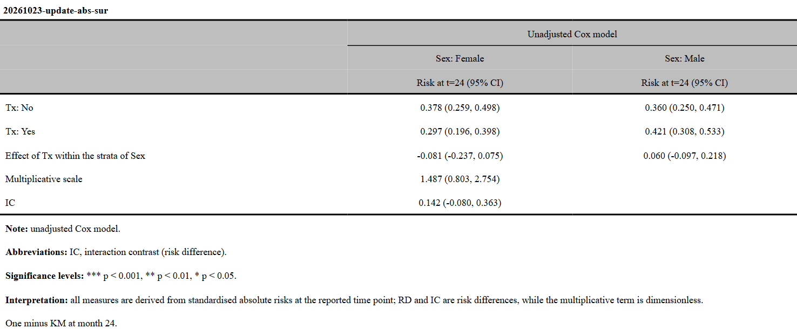
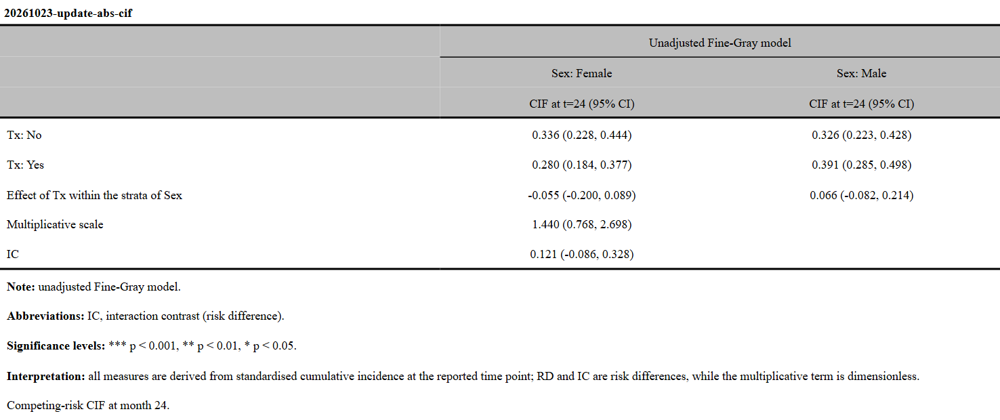
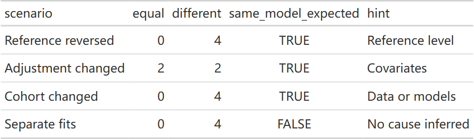

本页接[交互分析](interaction-guide.qmd)，讲加性尺度的绝对风险与交互结果核对。代码沿用该页[示例数据与分析尺度](interaction-guide.qmd#data)准备的 `inter_data` 和 `cohort`，请先运行那一节。

::: {.callout-note collapse="true" title="版本与复现记录"}
2026-10-31补充按已推送 RegR `e2926a6`（0.1.3）与 UtilsR `05f4c963`导出源码，在 Windows / WSL R4.4.3 独立运行下述合成示例。旧图保留原执行快照；此次没有重跑历史模型或安装包。

:::

## get_inter_abs()：固定时点风险与人时发生率 {#get-inter-abs}

### 当前接口

```r
# 接口签名（不执行）
get_inter_abs(
  data, exposure_names, adj_var = NULL,
  surv = TRUE, sur_time = 120, poi_time = 12 * 1000,
  conf_level = 0.95, split_var = NULL, ref_idx = NULL,
  multicat_model = c("separate", "interaction"),
  ci_method = c("delta", "boot"),
  cif_args = list(model = c("FGR", "CSC", "CRR")),
  n_boot = 500, n_cores = 1, binary_ref = NULL
)
```

这个入口在未调整与协变量调整两条路径中估计四个联合暴露状态的风险 / CIF / 发生率。调整模型通过 g-computation，将同一分析人群依次置于四个暴露状态，预测后取人群平均，再组合为 IC 等指标。

::: {.table-responsive}

| 参数 | 作用与注意点 |
|:--|:--|
| `sur_time` | 固定时点，单位与 `time` 一致；默认 120。不能把其他时间单位的数据直接称为“10 年风险” |
| `poi_time` | 显式传入即切换为完整随访的人时发生率；`sur_time = NULL` 也会切换到发生率尺度 |
| 两个时间参数 | 生存模式下，不能同时显式传入非空的 `sur_time` 与 `poi_time`；Logistic 不使用这两个参数 |
| `multicat_model` | **默认 `"separate"`**，与 `get_inter()` 的默认值不同；完整模型与逐对子集模型的标准化人群也不同 |
| `ci_method` | 默认 `"delta"`，Fine–Gray 调整分支使用 mets 的联合影响函数协方差；`"boot"` 为联合 bootstrap 百分位区间，两种设置均使用 mets 拟合与标准化 |
| `n_boot, n_cores` | bootstrap 次数与核数，默认 500 次、1 核；Fine–Gray 的 `delta` 分支不抽样，这两个参数不控制其耗时。较小抽样次数适合运行检查，正式区间需检查重复次数与稳定性 |
| `cif_args` | 固定时点CIF默认FGR/mets；可选CSC或CRR，调整分支使用联合bootstrap，`delta` 会警告并回退；后端及模型假设见[当前说明](get-eff-cif-benchmark.qmd#current-backend) |

:::

自 2026-10-02 的 `cefc1a5` 更新起，默认 Fine–Gray **调整分支可直接计算 delta 区间，无需 bootstrap**。旧版“选择 delta 仍回退 bootstrap”的说明仅适用于更新前的实现；显式选择 CSC 的调整分支仍保留回退行为。下方原有四组图展示 Cox / Logistic / Poisson，新的 CIF 示例见 [mets 优化与加速实测](#cif-mets-update)。

### 绝对尺度的数据列表返回（2026-10-31） {#subsets-20261031}

<!-- update-20261031: regr_abs_lists -->

先运行[相对尺度数据列表](interaction-guide.qmd#subsets-20261031)准备的 `inter_cohorts31`。`get_inter_abs()` 同样逐子集运行，外层 `eff_data_list` 内各保留一个 `get_inter_abs`，不是把全部数据合并后再分表。下面仍是各160行的两个合成子集，使用Logistic概率与IC；没有指定生存时点，也没有运行bootstrap。

```r
abs_lists31 <- RegR::run_quiet(RegR::get_inter_abs(inter_cohorts31,
  exposure_names = c("Tx", "Marker"), adj_var = "Age", surv = "Outcome", ci_method = "delta"))
```

::: {.callout-note collapse="true" title="复核代码"}
```r
stopifnot(inherits(abs_lists31, "eff_data_list"), identical(names(abs_lists31), c("A", "B")),
  all(vapply(abs_lists31, inherits, FALSE, "get_inter_abs")))
for (nm31 in names(inter_cohorts31)) {
  abs_single31 <- RegR::run_quiet(RegR::get_inter_abs(inter_cohorts31[[nm31]],
    exposure_names = c("Tx", "Marker"), adj_var = "Age", surv = "Outcome", ci_method = "delta"))
  stopifnot(isTRUE(all.equal(abs_lists31[[nm31]], abs_single31)))
}
validation_values <- list(rows = vapply(inter_cohorts31, nrow, 0L), class = class(abs_lists31),
  inner = vapply(abs_lists31, function(z) class(z)[1], ""), matches_separate_calls = TRUE)
```
:::

多结局、分层或多水平的原有内层形状仍保留。列表只决定“在哪份数据上重复运行”，不会把 `sur_time`、`poi_time`、参考组或置信区间方法按数据名自动改变。查看一个子集用 `abs_lists31$B`；[导出页](interaction-export-guide.qmd#subset-word-20261031)展示原生flextable和逐子集Word文件。真正生存结局的固定时点风险、CIF与人时发生率仍按本页原有尺度说明选择。

<!-- /update-20261031: regr_abs_lists -->

### 四种尺度设置

::: {.panel-tabset}

### 120 月风险 {.unnumbered}

四个联合状态的标准化事件风险与 IC。风险以 0–1 比例显示，IC 同样采用比例单位。

```r
inter_abs120 <- RegR::run_quiet({
  get_inter_abs(
    inter_data, exposure_names = c("Sex", "Age_group"),
    adj_var = "Race", surv = TRUE, sur_time = 120, ci_method = "delta"
  )
})
fmt_inter(inter_abs120, output_format = "flextable")
```

{fig-alt="性别与年龄组在 120 月的未调整和种族标准化风险，含乘性交互、IC、RERI、AP 和 SI。"}

### 60 月风险 {.unnumbered}

只修改评估时间点。即使暴露与调整项相同，四个风险及其交互也可能随时间改变；不能把 120 月的交互结论直接移到 60 月。

```r
inter_abs60 <- RegR::run_quiet({
  get_inter_abs(
    inter_data, exposure_names = c("Sex", "Age_group"),
    adj_var = "Race", surv = TRUE, sur_time = 60, ci_method = "delta"
  )
})
fmt_inter(inter_abs60, output_format = "flextable")
```

{fig-alt="与 120 月示例相同的暴露和调整项，在 60 月重新估计风险与交互。"}

### 每千人年发生率 {.unnumbered}

显式设置 `poi_time`，保留完整随访；此时使用带人时 offset 的 Poisson 模型。IC 的单位也是每 1,000 人年的事件数，不是风险百分点。

```r
inter_rate <- RegR::run_quiet({
  get_inter_abs(
    inter_data, exposure_names = c("Sex", "Age_group"),
    adj_var = "Race", surv = TRUE, poi_time = 12 * 1000,
    ci_method = "delta"
  )
})
fmt_inter(inter_rate, output_format = "flextable")
```

{fig-alt="完整随访的 Poisson 人时发生率表，每 1000 人年报告事件率与发生率交互 IC。"}

### Logistic 概率 {.unnumbered}

同样的二分类结局，在 `get_inter()` 中报告 OR，在这里报告标准化概率与概率差的差。代码不指定评估时间。

```r
inter_abs_or <- RegR::run_quiet({
  get_inter_abs(
    inter_data, exposure_names = c("Sex", "Age_group"),
    adj_var = "Race", surv = "DSS", ci_method = "delta"
  )
})
fmt_inter(inter_abs_or, output_format = "flextable")
```

{fig-alt="Logistic 标准化的四组概率与 IC，未使用随访时间，不表示固定年限风险。"}

:::

返回对象带 `get_inter_abs` 类与相应的 `inter_type`。二分类单结果仍分为 `Unadj` / `Adjus`，表为 **9×4**，比相对尺度多 IC 一行；多对比与分层结果可继续交给同一套格式化与 Word 导出函数。`plt_inter()` 的 8×4 比值表输入要求不适用于这些绝对结果。

### 未调整生存绝对交互：Greenwood 更新 {#km-delta-current}

本次在 WSL R 4.4.3 使用包含 `d54e60f` 的 RegR 本机开发源码，重新拟合120月和60月绝对交互，并更新对应表格及IC导出预览。未调整生存概率的 `ci_method="delta"` 现在使用 `S(t)` 的 Greenwood 标准误，影响IC、AP或其他差值派生量的区间与P值；四组风险点估计、乘性交互、调整后的direct、Logistic及CIF不因这个修复改变。

旧分析对象需从原始数据重新调用 `get_inter_abs()`；格式化旧对象不会重新计算协方差。下方两种时点的原主示例已经重跑，其他表格与运行时间记录保留原执行快照。


2026-10-13复核：这些接口更新已包含于已推送基线 `a3881fa`；包版本号0.1.3不足以区分源码状态。

### 绝对交互：逐模型计算与导出（2026-10-23） {#abs-models-20261023}

<!-- update-20261023: abs_models -->

2026-10-23 按已推送 RegR `aaeda5f`（扩展 `fbad080`）在 Windows / WSL R 4.4.3 执行。`get_inter_abs()` 现在与 `get_inter()` 一样，按 `surv` 的每个模型分别返回完整结果；旧版多值输入可能只走一个分支。这里使用 360 条模拟记录，不调整协变量，比较 24 月的 `1-KM` 风险与 Aalen–Johansen CIF，不能将前者当成竞争风险累计发生率。

```r
library(RegR)
set.seed(1023)
d_multi <- expand.grid(Tx = factor(c("No", "Yes")),
  Sex = factor(c("Female", "Male")), id = 1:90)
d_multi[["Age"]] <- rnorm(360, 55, 10)
t1 <- rexp(360, exp(.35 * (d_multi[["Tx"]] == "Yes") +
  .25 * (d_multi[["Sex"]] == "Male") + .02 * (d_multi[["Age"]] - 55)) / 80)
t2 <- rexp(360, 1 / 130); tc <- rexp(360, 1 / 160)
d_multi[["time"]] <- pmin(t1, t2, tc) + .2
d_multi[["event"]] <- ifelse(t1 < t2 & t1 < tc, 1L, ifelse(t2 < tc, 2L, 0L))
d_multi[["DSS"]] <- as.integer(d_multi[["event"]] == 1L)
abs_multi <- get_inter_abs(d_multi, c("Tx", "Sex"), adj_var = NULL,
  surv = c(TRUE, FALSE), sur_time = 24)
abs_sur <- get_inter_abs(d_multi, c("Tx", "Sex"), adj_var = NULL,
  surv = TRUE, sur_time = 24)
abs_cif <- get_inter_abs(d_multi, c("Tx", "Sex"), adj_var = NULL,
  surv = FALSE, sur_time = 24)
```

::: {.callout-note collapse="true" title="复核代码"}
生成本页时运行的检查，接在上面的代码之后运行；只读教程可以跳过。

```r
stopifnot(inherits(abs_multi, "surv_models"), identical(names(abs_multi), c("sur", "cif")),
  identical(attr(abs_multi[["sur"]], "risks"), attr(abs_sur, "risks")),
  identical(attr(abs_multi[["cif"]], "estimates"), attr(abs_cif, "estimates")))
```
:::

#### 无名结果列表仍可识别模型

```r
abs_plain <- unname(unclass(abs_multi))
word_paths <- file.path(tempdir(), c("20261023-update-abs-sur", "20261023-update-abs-cif"))
abs_tables <- save_tb_inter(abs_plain, title = word_paths,
  layout = list("vertical", "horizontal"), landscape = list(FALSE, TRUE),
  show_model = "unadjusted", font_size = list(9, 9),
  note = c(cif = "Competing-risk CIF at month 24.", sur = "One minus KM at month 24."))
flextable::save_as_html(abs_tables[["sur"]], path = paste0(word_paths[[1]], ".html"))
flextable::save_as_html(abs_tables[["cif"]], path = paste0(word_paths[[2]], ".html"))
```

::: {.callout-note collapse="true" title="复核代码"}
生成本页时运行的检查，接在上面的代码之后运行；只读教程可以跳过。

```r
stopifnot(identical(names(abs_tables), c("sur", "cif")),
  all(vapply(abs_tables, inherits, logical(1), "flextable")),
  all(file.exists(paste0(word_paths, ".docx"))))
```
:::

::: {.panel-tabset}

#### 生存风险表 {.unnumbered}

{fig-alt="原生flextable网页预览，展示Tx与Sex四个联合组的24月风险、风险差及绝对交互IC；脚注说明使用1减KM。"}

[下载 Word](images/interaction-guide/20261023-update-abs-sur.docx) · [原生表格预览](images/interaction-guide/20261023-update-abs-sur.html)

#### 竞争风险表 {.unnumbered}

{fig-alt="原生flextable网页预览，相同联合组的目标事件CIF及IC，脚注注明竞争风险CIF，Word文件为横向页面。"}

[下载 Word](images/interaction-guide/20261023-update-abs-cif.docx) · [原生表格预览](images/interaction-guide/20261023-update-abs-cif.html)

:::

无名列表依各结果的 `attr(.,"surv")` 命名；较旧结果缺少该记录时，用 `list(sur=...,cif=...)`。`title` 向量逐模型分配路径，同时其 basename 是表题。其他逐模型设置可用命名 list 或同模型数的无名 list。**无名 `note` 字符向量仍是每个表共用的多行脚注**；要逐模型脚注，像上例按模型命名，或使用 list。错误长度会报错。

#### 风险时点与人时单位不能混传

```r
abs_rates <- get_inter_abs(d_multi, c("Tx", "Sex"), adj_var = NULL,
  surv = list(DSS_rate = TRUE, Cause1_rate = FALSE), poi_time = 12 * 1000)
rate_labels <- vapply(abs_rates, function(x) attr(x, "info")[["measure_label"]], character(1))
bad_scale <- tryCatch(get_inter_abs(d_multi, c("Tx", "Sex"), surv = c(TRUE, FALSE),
  sur_time = 24, poi_time = 12000), error = identity)
bad_note <- tryCatch(save_tb_inter(abs_multi, font_size = list(9)), error = identity)
```

::: {.callout-note collapse="true" title="复核代码"}
生成本页时运行的检查，接在上面的代码之后运行；只读教程可以跳过。

```r
stopifnot(all(rate_labels == "Rate"),
  all(vapply(abs_rates, function(x) identical(attr(x, "info")[["scale"]], "rate"), logical(1))))
stopifnot(inherits(bad_scale, "error"), inherits(bad_note, "error"))
validation_values <- list(risks_sur = attr(abs_multi[["sur"]], "risks"),
  risks_cif = attr(abs_multi[["cif"]], "risks"),
  estimates_sur = attr(abs_multi[["sur"]], "estimates"),
  estimates_cif = attr(abs_multi[["cif"]], "estimates"), rate_labels = rate_labels)
```
:::

本例随访单位为月，`poi_time = 12*1000` 表示每千人年发生率；此分支采用 Poisson 人时率，并非 Cox HR 或 Fine–Gray sHR。示例中 `DSS` 恰等于 `event==1`，两个分支的事件计数相同。显式给 `poi_time` 才切到率；默认或单独给 `sur_time` 是固定时点风险，不能同时给两个非空值。多模型分派保留这一判断，不擅自把默认值变成显式参数。

本节的无协变量示例用于验证接口，未改写已调整 CIF 的 mets 联合 delta / bootstrap 方法；[推断方法与限制](#cif-mets-update)继续适用。`plt_inter()` 仍接受单个合适的比值交互表，不能直接画多模型列表或绝对交互对象；`get_eff_inter()`、`get_int()` 的 `surv` 仍一次选择一个模型，需分别调用。

<!-- /update-20261023: abs_models -->

## 竞争风险更新：mets 联合 CIF 与加速实测 {#cif-mets-update}

### 默认 delta 为什么不再需要抽样？

`get_inter_abs(surv = FALSE)` 默认使用 Fine–Gray 工作模型。调整分支先用 `mets::cifregFG()` 拟合联合暴露状态与协变量，再用 `mets::survivalG()` 将同一人群标准化到四个暴露状态。它同时获得四个 CIF 的点估计与**完整的联合协方差**；未调整分支仍为各联合组的 Aalen–Johansen CIF。

联合协方差保留不同标准化风险之间的相关性，也包含模型拟合与经验标准化人群分布的不确定性。不能把四个风险的标准误平方放在对角线上，就视为调整分支的完整协方差。令 $\mathbf p=(p_{00},p_{01},p_{10},p_{11})^\top$，$\mathbf a=(1,-1,-1,1)^\top$，则：

$$
\mathrm{IC}=\mathbf a^\top\mathbf p,\qquad
\operatorname{Var}(\mathrm{IC})=\mathbf a^\top V\mathbf a.
$$

默认 `ci_method = "delta"` 从 $V$ 计算 IC、RERI、AP、SI 与乘性交互的区间；乘性项与 SI 使用对数尺度近似。这个分支不执行 bootstrap，因此提高 `n_boot` 或 `n_cores` 不会让它进行更多抽样。`mets::survivalG()` 的标准化风险与影响函数接口见 [官方帮助](https://kkholst.github.io/mets/reference/survivalG.html)。

`ci_method = "boot"` 则在每次患者级联合重抽样后，通过同一 mets 模型重新拟合，并对该次抽样人群标准化；四个暴露状态使用同一次抽样，再组合交互指标。无法估计的抽样会整次剔除并警告。显式 `cif_args = list(model = "CSC")` 的调整分支仍使用 bootstrap，选择 `delta` 时会警告并回退。

### 两种区间方法：同一队列的实际结果

本节单独按 `time`、`event`、`Sex`、`Age`、`Race` 完整病例且 `time > 0` 筛选，得到 **4,387 人**：删失 3,207 人、目标事件 597 人、竞争事件 583 人。比较性别与年龄组，调整连续年龄与种族，在 **120 月**估计目标事件 CIF。连续年龄和年龄分组同时出现，是本次计时固定的调整设置；研究分析应按问题预先确定协变量。

```r
# 本节代码共用的数据；event: 0=删失，1=目标事件，2=竞争事件
inter_cif_data <- as.data.frame(RegR::seer_thyroid_mtc_2026)
cif_vars <- c("time", "event", "Sex", "Age", "Race")
inter_cif_data <- inter_cif_data[
  complete.cases(inter_cif_data[, cif_vars]) & inter_cif_data$time > 0,
  cif_vars
]
inter_cif_data$Sex <- factor(inter_cif_data$Sex, levels = c("Female", "Male"))
inter_cif_data$AgeH <- factor(
  ifelse(inter_cif_data$Age >= 55, "ge55", "lt55"),
  levels = c("lt55", "ge55")
)
```

::: {.panel-tabset}

### delta：默认方法 {.unnumbered}

```r
inter_cif_delta <- RegR::run_quiet({
  get_inter_abs(
    inter_cif_data, exposure_names = c("Sex", "AgeH"),
    adj_var = c("Age", "Race"), surv = FALSE, sur_time = 120,
    ci_method = "delta", cif_args = list(model = "FGR")
  )
})
fmt_inter_gt(inter_cif_delta)
```

以下为该次调用中四个风险与主要加性交互 IC 的摘要。CIF 乘以 100 显示为百分比；IC 乘以 100 显示为百分点。括号内为 95% CI。

:::: {.table-responsive tabindex="0" role="region" aria-label="表格，可横向滚动"}

| 状态或指标 | 未调整 | 调整年龄与种族 |
|:--|--:|--:|
| Female，<55：CIF（%） | 7.67（5.95，9.39） | 10.30（7.83，12.77） |
| Female，≥55：CIF（%） | 12.78（10.71，14.86） | 10.59（8.80，12.38） |
| Male，<55：CIF（%） | 16.83（13.78，19.87） | 23.12（18.54，27.69） |
| Male，≥55：CIF（%） | 25.17（22.13，28.21） | 20.58（17.66，23.49） |
| IC（百分点） | 3.23（−1.85，8.31） | −2.82（−8.32，2.67） |

::::

### boot：可选方法 {.unnumbered}

```r
set.seed(171)
inter_cif_boot <- RegR::run_quiet({
  get_inter_abs(
    inter_cif_data, exposure_names = c("Sex", "AgeH"),
    adj_var = c("Age", "Race"), surv = FALSE, sur_time = 120,
    ci_method = "boot", cif_args = list(model = "FGR"),
    n_boot = 50, n_cores = 1
  )
})
fmt_inter_gt(inter_cif_boot)
```

这里 **50 次抽样仅用于示例与计时**，不作为正式分析的重复次数建议。正式分析可提高 `n_boot`，并检查随机种子、区间端点与成功抽样数的稳定性。

:::: {.table-responsive tabindex="0" role="region" aria-label="表格，可横向滚动"}

| 状态或指标 | 未调整 | 调整年龄与种族 |
|:--|--:|--:|
| Female，<55：CIF（%） | 7.67（5.93，9.86） | 10.30（8.36，12.24） |
| Female，≥55：CIF（%） | 12.78（10.53，14.59） | 10.59（8.80，12.22） |
| Male，<55：CIF（%） | 16.83（14.08，19.90） | 23.12（20.19，25.76） |
| Male，≥55：CIF（%） | 25.17（22.30，27.77） | 20.58（17.91，22.71） |
| IC（百分点） | 3.23（−2.88，8.76） | −2.82（−7.42，1.38） |

::::

:::

两种方法的点估计完全一致，区间方法不同。该例调整后的 IC 为 **−2.82 个百分点**，两种区间均跨 0；应结合估计量、时间点与调整设置解释。bootstrap 不会自动解决分母接近 0、稀疏联合组或工作模型不合适的问题，尤其 SI 等比值可能不稳定。

### 优化前后的完整调用耗时 {#cif-mets-timing}

2026-10-02 在 WSL Ubuntu-22.04、R **4.4.3**、mets **1.3.13** 下实测。比较更新前模块 `aac87ba` 与更新后模块 `cefc1a5`；其余依赖相同。每种设置在独立进程中顺序运行，`n_cores = 1`，BLAS / OpenMP 线程数均设为 1。预热后计时覆盖完整 `get_inter_abs()` 调用及其自动表格格式化，不计包加载、数据准备与结果保存。

:::: {.table-responsive tabindex="0" role="region" aria-label="表格，可横向滚动"}

| 样本量 | 区间设置 | 优化前（秒） | 优化后（秒） | 加速倍数 | 时间减少 |
|--:|:--|--:|--:|--:|--:|
| 1,000 | `delta`，旧版回退 50 次抽样 | 2.740 | 0.231 | 11.9× | 91.57% |
| 1,000 | 两版均 `boot`，50 次 | 2.984 | 2.981 | 1.00× | 0.10% |
| 4,387 | `delta`，旧版回退 50 次抽样 | 18.863 | 0.390 | 48.4× | 97.93% |
| 4,387 | 两版均 `boot`，50 次 | 19.305 | 9.211 | 2.10× | 52.29% |
| **4,387** | **默认 `delta`，旧版回退 500 次抽样** | **185.535** | **0.411** | **451.4×** | **99.78%** |

::::

50 次抽样的各项分别重复 **3 次**，表中为中位数。默认 500 次的旧版实测 **1 次**，新版重复 **3 次**、范围 **0.338–0.504 秒**；这些是实际计时，未按 50 次结果外推。1,000 人是同一完整队列按 `set.seed(20261002)` 固定抽取的无放回子样本。单次结果展示与计时的调用种子从 171 起。

::: {.callout-note title="如何理解 451 倍加速"}
最大的收益来自默认路径省去了 500 次 bootstrap，改用联合协方差计算 delta 区间。因此 **451 倍包含区间方法变化的收益**；它不表示单次 Fine–Gray 拟合加速了 451 倍。相同 50 次 bootstrap 下，完整队列约快 **2.1 倍**，1,000 人子样本没有明显提速。具体耗时受样本量、事件数、协变量、机器与抽样次数影响。

数值核对中，新版 `delta` / `boot` 的点估计完全一致；新旧未调整风险一致，调整后风险最大差异约 **0.030 个百分点**。新后端在请求时间恰逢事件时纳入该时间全部并列事件，且不跨越下一个事件时间；仅核对点估计不能证明两种区间具有相同覆盖率。
:::

[下载计时汇总 CSV](bench/inter_abs_mets_timing.csv) · [下载逐次计时 CSV](bench/inter_abs_mets_raw.csv)

本机复测新版时，可在上述数据准备后运行以下代码。固定 `n_boot = 50` 使 bootstrap 检查较快；`delta` 不使用这个抽样次数。包加载和首次预热不计入后续计时，返回的是当前机器的运行结果。

```r
measure_cif <- function(mode) {
  RegR::run_quiet({
    get_inter_abs(
      inter_cif_data, exposure_names = c("Sex", "AgeH"),
      adj_var = c("Age", "Race"), surv = FALSE, sur_time = 120,
      ci_method = mode, n_boot = 50, n_cores = 1
    )
  })
}
invisible(measure_cif("delta"))
invisible(measure_cif("boot"))
cif_timing <- do.call(rbind, lapply(c("delta", "boot"), function(mode) {
  times <- vapply(1:3, function(i) {
    gc()
    set.seed(170 + i)
    unname(system.time(invisible(measure_cif(mode)))["elapsed"])
  }, numeric(1))
  data.frame(ci_method = mode, median_seconds = median(times))
}))
cif_timing
```

## 交互结果核对：check_inter() {#check-inter}

`check_inter()`（原名 `check_inter_facet()`）把 `get_inter()` 的交互结果与 `get_facet()`、`get_eff()`、`get_eff_cat()`、`get_cat()` 的分层或联合结果配对，逐单元核对是否一致。以下各小节按日期收录。

### 联合组核对、常量协变量与导出（2026-10-20） {#joint-cat-20261020}

2026-10-20 按已推送 RegR `a2f2553` 在 Windows / WSL R 4.4.3 运行。新增的 `get_cat()` 核对入口检查同一全队列的联合效应；原有 `get_facet()` 核对仍可用于分层结果。

#### 对照 get_cat 的三个非参考组合

<!-- latest-20261020: inter_current -->
```r
library(RegR)
set.seed(20261023)
d_check <- expand.grid(Tx = factor(c("No", "Yes")),
  Sex = factor(c("Female", "Male")), Site = factor(c("A", "B")), id = 1:60)
d_check[["Age"]] <- rnorm(480, 55, 10)
t1 <- rexp(480, exp(-3.8 + 0.5 * (d_check[["Tx"]] == "Yes") +
  0.3 * (d_check[["Sex"]] == "Male") + 0.02 * (d_check[["Age"]] - 55)))
t2 <- rexp(480, 0.008); tc <- rexp(480, 0.012)
d_check[["time"]] <- pmin(t1, t2, tc)
d_check[["event"]] <- ifelse(t1 <= pmin(t2, tc), 1L, ifelse(t2 <= tc, 2L, 0L))
d_check[["status"]] <- factor(d_check[["event"]], levels = 0:2)
d_check[["DSS"]] <- as.integer(d_check[["event"]] == 1L)
inter_current <- get_inter(d_check, c("Tx", "Sex"), adj_var = "Age", surv = c(TRUE, FALSE))
cat_current <- get_cat(d_check, cat_var_combine = c("Tx", "Sex"), adj_var = "Age",
  surv = c(TRUE, FALSE), methods = c("unadj", "direct"),
  methods_obj = "unadj", methods_sur = character(), timepoint = 24,
  curve_args = list(ci = FALSE, max_times = 30L))
checked <- check_inter(inter_current, cat_current)
reversed_cat <- get_cat(d_check, cat_var_combine = c("Sex", "Tx"), adj_var = "Age",
  surv = c(TRUE, FALSE), methods = c("unadj", "direct"),
  methods_obj = "unadj", methods_sur = character(), timepoint = 24,
  curve_args = list(ci = FALSE, max_times = 30L))
```

::: {.callout-note collapse="true" title="复核代码"}
生成本页时运行的检查，接在上面的代码之后运行；只读教程可以跳过。

```r
stopifnot(all(vapply(checked, function(x) isTRUE(x[["consistent"]]), logical(1))),
  all(vapply(checked, function(x) nrow(x[["comparison"]]) == 6L, logical(1))))
stopifnot(all(vapply(check_inter(inter_current, reversed_cat),
  function(x) isTRUE(x[["consistent"]]), logical(1))))
```
:::

本例 Cox 与 Fine–Gray 各核对 3 个非参考组合 × 2 种调整方法，共 12 个单元，反转组合顺序也一致。对 `get_cat()` 只比较格式化效应与区间，忽略两侧星号；这不是原始数值逐位相等的证明，也不核对 P、MS/RERI、曲线、概率或人数。结果列在 `checked[["sur"]][["comparison"]]`。没有联合暴露的 `get_cat()` 或带 `split_var` 的 `get_inter()` 不能使用此配对。

省略两个对象时，会先寻找 `inter_<后缀>` / `facet_<后缀>`；没有对应 facet 时再找 `cat_<后缀>`，裸名 `inter` / `cat` 同样支持。下例限定在局部环境，避免混入其他项目的对象：

```r
discovered <- local({
  inter_whole <- inter_current
  cat_whole <- cat_current
  check_inter()
})
names(discovered)
```

::: {.callout-note collapse="true" title="复核代码"}
生成本页时运行的检查，接在上面的代码之后运行；只读教程可以跳过。

```r
stopifnot(length(discovered) == 2L,
  all(vapply(discovered, function(x) isTRUE(x[["consistent"]]), logical(1))))
```
:::

#### 层内常量调整项会提示后移除

```r
d_check[["Grade"]] <- factor(ifelse(d_check[["Site"]] == "B", "Unknown",
  sample(c("I", "II", "Unknown"), 480, replace = TRUE)))
stratified <- get_inter(d_check, c("Tx", "Sex"),
  adj_var = c("Age", "Grade"), split_var = "Site", surv = TRUE)
manual_B <- get_inter(d_check[d_check[["Site"]] == "B", , drop = FALSE],
  c("Tx", "Sex"), adj_var = "Age", surv = TRUE)
```

::: {.callout-note collapse="true" title="复核代码"}
生成本页时运行的检查，接在上面的代码之后运行；只读教程可以跳过。

```r
stopifnot(!is.null(stratified[[1]][[2]]),
  identical(as.matrix(stratified[[1]][[2]][["Adjus"]]), as.matrix(manual_B[["Adjus"]])))
```
:::

Site B 的 Grade 全部是 Unknown，没有可估计的层内系数，函数提示后只在该层去掉 Grade；上例结果与手动去掉 Grade 相同。其他层仍按各自可用的调整项拟合。仍不能估计的层会带层名警告并留空，不能把空单元解释为没有效应；应同时报告各层实际调整集合与失败原因。

#### Word 标题向量与 Fine–Gray 标签

```r
tables_current <- save_tb_inter(inter_current,
  title = file.path(tempdir(), c("20261020-latest-inter-sur.docx", "20261020-latest-inter-cif.docx")),
  note = c("Synthetic data; interface demonstration.", "Confidence level: 95%."))
for (model in names(tables_current)) {
  flextable::save_as_html(tables_current[[model]],
    path = file.path(tempdir(), paste0("20261020-latest-inter-", model, ".html")))
}
validation_values <- data.frame(model = names(checked),
  compared_cells = vapply(checked, function(x) nrow(x[["comparison"]]), integer(1)),
  consistent = vapply(checked, function(x) x[["consistent"]], logical(1)))
validation_values
```

::: {.callout-note collapse="true" title="复核代码"}
生成本页时运行的检查，接在上面的代码之后运行；只读教程可以跳过。

```r
stopifnot(identical(names(tables_current), c("sur", "cif")),
  all(vapply(tables_current, inherits, logical(1), "flextable")))
```
:::

<!-- /latest-20261020: inter_current -->

[下载 Cox Word 表](images/interaction-guide/20261020-latest-inter-sur.docx) · [下载 Fine–Gray Word 表](images/interaction-guide/20261020-latest-inter-cif.docx)

::: {.panel-tabset}

#### Cox 汇总表 {.unnumbered}

{fig-alt="480行模拟数据的Cox交互汇总表，使用未调整与调整HR列，并保留MS与RERI行。"}

#### Fine–Gray 汇总表 {.unnumbered}

{fig-alt="同一数据的Fine-Gray交互汇总表，效应列为sHR 95% CI，表内模型与脚注使用Fine-Gray名称。"}

:::

无名 `title` 向量按模型顺序逐一匹配，长度必须一致；命名向量仍按名称匹配。无名 `note` 向量的每项是**同一份共享脚注的一行**，不是一模型一条。二分类 Fine–Gray 单表、逐对表与分层表的表头现为 sHR (95% CI)，脚注定义 sHR，模型名称写 Fine–Gray；已有结果交给当前格式化函数也会采用新标签。Word 需在当前工作目录可写的环境保存，本例只公开汇总表。

实跑还出现一条预防性暴露提示；这类结果应先核对参考编码，再解读 RERI / SI，不应静默翻转分组来追求某种交互方向。常量协变量的提示也保留在运行输出中。

#### 区间与星号使用未舍入数值

交互表在 95% 时也直接用未舍入 P 标星，避免把 0.001001 先舍成 0.001 后多加一个星号。非 95% 时按未舍入区间、固定 1.96 回推显示 P，非对称区间取朝向无效值的一侧，无效区间不标星；`pvalue_lis` 保留该显示口径。详见[数值对照与原 Wald P](forest-plot-guide.qmd#models-ci-20261020)。

`get_inter()` 多分类表、`get_inter_abs()` 风险/RD 列，以及 `get_int()` 的 MS/RERI 轴与详情列，当前模板都固定写 95% CI；`conf_level` / `conf.level` 仍决定实际区间。若使用其他水平，必须在可覆盖的标题与脚注中明确标出实际值，不能把模板文字当成分析参数。

### 联合组核对：检查联合效应（2026-10-20） {#joint-check-20261020}

2026-10-20 按已推送 RegR `da6157be`（接口自 `578d444`、`835bd54`），在 Windows / WSL R 4.4.3 重新拟合下例。`cat_var_combine` 的四条曲线对应四个组合，检查对象是三个非参考组合相对于参考组合的 HR/sHR，不能按上节的层内简单效应读取。

<!-- refresh-20261020: joint_check -->
```r
library(RegR)
set.seed(20261020)
d_refresh <- expand.grid(Tx = factor(c("No", "Yes")),
  Group = factor(c("Low", "High"), levels = c("Low", "High")),
  Site = factor(c("A", "B")), id = 1:60)
d_refresh[["Age"]] <- rnorm(nrow(d_refresh), 55, 10)
tx <- as.integer(d_refresh[["Tx"]] == "Yes")
gr <- as.integer(d_refresh[["Group"]] == "High")
event_time <- rexp(nrow(d_refresh), exp(-3.8 + 0.6 * tx + 0.4 * gr +
  0.2 * tx * gr + 0.01 * (d_refresh[["Age"]] - 55)))
censor_time <- rexp(nrow(d_refresh), 0.012)
d_refresh[["time"]] <- pmin(event_time, censor_time)
d_refresh[["DSS"]] <- as.integer(event_time <= censor_time)
d_refresh[["Outcome"]] <- factor(ifelse(runif(nrow(d_refresh)) < plogis(
  -1 + 0.7 * tx + 0.4 * gr + 0.02 * (d_refresh[["Age"]] - 55)), "Yes", "No"),
  levels = c("No", "Yes"))
inter_joint <- get_inter(d_refresh, exposure_names = c("Tx", "Group"),
  split_var = "Site", adj_var = "Age", surv = TRUE)
facet_joint <- get_facet(d_refresh, split_var = "Site",
  cat_var_combine = c("Tx", "Group"), adj_var = "Age", surv = TRUE,
  show_sur = FALSE, timepoint = 24, max_t = 60, parallel = 1,
  table_params = list(insert_table = FALSE))
joint_check <- check_inter(inter_joint, facet_joint)
joint_cells <- joint_check[["comparison"]]
joint_cells[c("outer_stratum", "modifier_level", "method", "status")]
# 改变组合顺序，仍按各组合的实际标签匹配。
facet_reversed <- get_facet(d_refresh, split_var = "Site",
  cat_var_combine = c("Group", "Tx"), adj_var = "Age", surv = TRUE,
  show_sur = FALSE, timepoint = 24, max_t = 60, parallel = 1,
  table_params = list(insert_table = FALSE))
```

::: {.callout-note collapse="true" title="复核代码"}
生成本页时运行的检查，接在上面的代码之后运行；只读教程可以跳过。

```r
stopifnot(isTRUE(joint_check[["consistent"]]), nrow(joint_cells) == 12L,
          all(joint_cells[["same_model_expected"]]), all(joint_cells[["status"]] == "equal"))
stopifnot(isTRUE(check_inter(inter_joint, facet_reversed)[["consistent"]]))
```
:::

<!-- /refresh-20261020: joint_check -->

实跑为 2 个 Site × 3 个非参考组合 × 2 种方法，共 12 个显示单元相等；反转组合顺序也通过。无分层时需 `get_inter()` 的 single 结构，有分层时需相同 `split_var` 的 grid、单个二元 × 二元对比。多分类等其他形状会报错，不能据此宣称已经验证。

若仅在 facet 数据中把层标签改为 `"Site: A"`，没有精确同名项时会尝试冒号后文本；仍找不到的标签报告 missing。这里依然只比较已格式化比值文本，不比较 P 值、RERI、概率或人数，也不重新拟合。联合分面实例见[分面教程](facet-guide.qmd)。

### get_eff 亚组与多个交互结果（2026-10-21） {#inter-controls-20261021}

<!-- controls-20261021: inter_controls -->

以下按已推送 RegR `90ad6d8` 在 Windows / WSL R 4.4.3 执行。`check_inter()` 现在接受 `get_eff(sub_var = ...)` 作为第二个对象，也可以一次传入多个 `get_inter()` 结果；多个模型按名称配对，逐项返回核对表。

#### 同一交互模型的简单效应

```r
library(RegR)
set.seed(833)
d_eff_check <- expand.grid(Tx = factor(c("No", "Yes")),
  Sex = factor(c("Female", "Male")), Site = factor(c("A", "B", "C")), id = 1:60)
d_eff_check[["Age"]] <- rnorm(720, 55, 10)
t1 <- rexp(720, exp(0.3 * (d_eff_check[["Tx"]] == "Yes") +
  0.2 * (d_eff_check[["Sex"]] == "Male") + 0.02 * (d_eff_check[["Age"]] - 55)) / 80)
t2 <- rexp(720, 1 / 130)
tc <- rexp(720, 1 / 160)
d_eff_check[["time"]] <- pmin(t1, t2, tc) + 0.2
d_eff_check[["event"]] <- ifelse(t1 < t2 & t1 < tc, 1L, ifelse(t2 < tc, 2L, 0L))
d_eff_check[["DSS"]] <- as.integer(d_eff_check[["event"]] == 1L)
d_eff_check[["status"]] <- factor(d_eff_check[["event"]], levels = 0:2)
eff_checked <- get_eff(d_eff_check, "Tx", sub_var = c("Sex", "Site"), adj_var = "Age",
  surv = list(sur = TRUE, cif = FALSE), subgroup_model = "interaction",
  methods_haz = c("unadj", "direct"), methods_sur = character(), all = NULL)
inter_sex <- get_inter(d_eff_check, c("Tx", "Sex"), adj_var = "Age",
  surv = list(sur = TRUE, cif = FALSE), multicat_model = "interaction")
inter_site <- get_inter(d_eff_check, c("Tx", "Site"), adj_var = "Age",
  surv = list(sur = TRUE, cif = FALSE), multicat_model = "interaction")
paired_eff <- check_inter(list(sex = inter_sex, site = inter_site), eff_checked)
validation_values <- data.frame(pair = names(paired_eff),
  cells = vapply(paired_eff, function(x) nrow(x[["comparison"]]), integer(1)),
  equal = vapply(paired_eff, function(x) sum(x[["comparison"]][["status"]] == "equal"), integer(1)))
validation_values
```

::: {.callout-note collapse="true" title="复核代码"}
生成本页时运行的检查，接在上面的代码之后运行；只读教程可以跳过。

```r
stopifnot(identical(names(paired_eff), c("sex$sur", "sex$cif", "site$sur", "site$cif")),
  all(vapply(paired_eff, function(x) isTRUE(x[["consistent"]]), logical(1))),
  all(vapply(paired_eff, function(x) all(x[["comparison"]][["same_model_expected"]]), logical(1))))
stopifnot(identical(unname(validation_values[["cells"]]), c(4L, 4L, 6L, 6L)),
          sum(validation_values[["equal"]]) == 20L)
```
:::

| 实际配对 | 比较单元 | 相同单元 |
|:--|--:|--:|
| `sex$sur`：Cox，Sex 两水平 | 4 | 4 |
| `sex$cif`：Fine–Gray，Sex 两水平 | 4 | 4 |
| `site$sur`：Cox，Site 三水平 | 6 | 6 |
| `site$cif`：Fine–Gray，Site 三水平 | 6 | 6 |

每个水平分别核对未调整与年龄调整 HR/sHR；Cox 与 Fine–Gray 在这里都实际拟合，未拿同一对象复制成两个模型。示例的 `event` 与 `status` 表示同一套 0/1/2 编码，分别供效应和交互入口读取。`sub_var = c("Sex","Site")` 表示分别拟合 Tx×Sex 与 Tx×Site 两个交互模型，不是 Tx×Sex×Site 三重交互；Site 使用完整多分类交互，而不是多次二分类子集比较。

本例 `same_model_expected = TRUE` 表示两侧应来自同一模型策略；仍须核对队列、缺失处理、变量编码、调整项与区间水平。`consistent = TRUE` 只说明已有表中可比较的格式化效应单元一致，不证明原始浮点数逐位相等，也不比较交互 P、MS/RERI、曲线、绝对概率、人数或事件数。与 `get_eff()` 的配对仍比较星号；[get_cat 联合效应核对](#joint-cat-20261020)才会忽略星号。

#### 分层重拟合并不要求数值相等

```r
eff_separate <- get_eff(d_eff_check, "Tx", sub_var = "Sex", adj_var = "Age",
  surv = TRUE, subgroup_model = "separate",
  methods_haz = c("unadj", "direct"), methods_sur = character(), all = NULL)
checked_separate <- check_inter(inter_sex[["sur"]], eff_separate)
checked_separate[["comparison"]][c("modifier_level", "method", "same_model_expected", "status")]
```

::: {.callout-note collapse="true" title="复核代码"}
生成本页时运行的检查，接在上面的代码之后运行；只读教程可以跳过。

```r
stopifnot(!any(checked_separate[["comparison"]][["same_model_expected"]]))
```
:::

默认的 `subgroup_model = "separate"` 在各层重新拟合，Cox 的层内基线风险和协变量系数可以不同；此时 `same_model_expected = FALSE`，出现 `different` 本身不能判为函数错误，偶然相等也不等于两种模型策略相同。不能为消除差异而混换分析人群或调整集合。

`get_eff()` 这一路核对要求两侧没有外层 `split_var`，第二个对象也不能使用 `cat_var_combine`。若要核对联合组，使用已有的 `get_cat()` / `get_facet()` 联合效应入口。省略两个对象的环境发现仍只查 `inter_*` / `facet_*` / `cat_*`，不会自动找 `eff_*`，因此上例显式传第二个对象。多个配对中失败项会保留错误信息；应逐项读结果及 `attr(result,"unmatched")`，不能只看列表长度。

<!-- /controls-20261021: inter_controls -->

### 自动选分层变量与差异提示（2026-10-22） {#check-target-20261022}

<!-- update-20261022: check_target -->

2026-10-22 按已推送 RegR `d24e8a0` 在 Windows / WSL R 4.4.3 核验。自 `22e4a3c` 起，公共函数由 `check_inter_facet()` 改名为 `check_inter()`，第二个形参由 `facet` 改为 `target`，旧名不是兼容别名。当前写法为 `check_inter(inter, target, cat_var=NULL, modifier=NULL)`；本页早期图表保留历史执行记录，已改名的调用需要新版 RegR。

#### 一个交互结果含多个修饰变量时

```r
library(RegR)
set.seed(20261024)
d_target <- expand.grid(Tx = factor(c("No", "Yes")),
  Sex = factor(c("Female", "Male")), Site = factor(c("A", "B")), id = 1:50)
d_target[["Age"]] <- rnorm(400, 55, 10)
d_target[["Marker"]] <- 0.8 * (d_target[["Tx"]] == "Yes") + rnorm(400)
t1 <- rexp(400, exp(0.7 * (d_target[["Tx"]] == "Yes") +
  0.3 * (d_target[["Sex"]] == "Male") + 0.04 * (d_target[["Age"]] - 55)) / 80)
t2 <- rexp(400, 1 / 130); tc <- rexp(400, 1 / 160)
d_target[["time"]] <- pmin(t1, t2, tc) + 0.2
d_target[["event"]] <- ifelse(t1 < t2 & t1 < tc, 1L, ifelse(t2 < tc, 2L, 0L))
d_target[["DSS"]] <- as.integer(d_target[["event"]] == 1L)
d_target[["status"]] <- factor(d_target[["event"]], levels = 0:2)
fit_sex_effect <- function(data, adjust = "Age", strategy = "interaction") {
  get_eff(data, "Tx", sub_var = "Sex", adj_var = adjust, surv = TRUE,
    subgroup_model = strategy, methods_haz = c("unadj", "direct"),
    methods_sur = character(), all = NULL)
}
invisible(utils::capture.output(inter_many <- get_inter(d_target,
  c("Tx", "Sex", "Site"), adj_var = "Age", surv = TRUE,
  multicat_model = "separate")))
eff_sex <- fit_sex_effect(d_target)
invisible(utils::capture.output(facet_sex <- get_facet(d_target,
  split_var = "Sex", cat_var = "Tx", adj_var = "Age", surv = TRUE,
  method = "both", subgroup_model = "interaction")))
eff_both <- get_eff(d_target, "Tx", sub_var = c("Sex", "Site"),
  adj_var = "Age", surv = TRUE, subgroup_model = "interaction",
  methods_haz = c("unadj", "direct"), methods_sur = character(), all = NULL)

from_eff <- check_inter(inter_many, target = eff_sex)
from_facet <- check_inter(inter_many, target = facet_sex)
explicit <- check_inter(inter_many, target = eff_sex,
  cat_var = "Tx", modifier = "Sex")
ambiguous <- tryCatch(check_inter(inter_many, eff_both), error = identity)
```

::: {.callout-note collapse="true" title="复核代码"}
生成本页时运行的检查，接在上面的代码之后运行；只读教程可以跳过。

```r
stopifnot(isTRUE(from_eff[["consistent"]]), isTRUE(from_facet[["consistent"]]),
  identical(from_eff[["modifier"]], "Sex"), identical(from_facet[["modifier"]], "Sex"),
  identical(from_eff[["comparison"]], explicit[["comparison"]]),
  inherits(ambiguous, "error"),
  grepl("could not be inferred uniquely", conditionMessage(ambiguous), fixed = TRUE),
  identical(names(formals(RegR::check_inter)), c("inter", "target", "cat_var", "modifier")))
```
:::

上例显式用 `multicat_model="separate"` 生成 Tx×Sex、Tx×Site 逐对结果；当前默认的 `"interaction"` 只接受两个暴露。`target` 只按 Sex 分层时，函数自动选择 Sex。`get_facet()` 从分层列推断，`get_eff()` / `get_eff_cat()` 从 `sub_var` 推断。若两个候选修饰变量都出现在目标对象中，仍须明确写 `modifier="Sex"` 或 `"Site"`；它不会逐项猜选，也不会改成三重交互模型。

#### 差异提示来自单元模式，仍须回查分析设置

```r
invisible(utils::capture.output(inter_one <- get_inter(d_target,
  c("Tx", "Sex"), adj_var = "Age", surv = TRUE)))
d_reversed <- d_target
d_reversed[["Tx"]] <- stats::relevel(d_reversed[["Tx"]], ref = "Yes")
targets <- list(
  reference = fit_sex_effect(d_reversed),
  adjustment = fit_sex_effect(d_target, adjust = "Marker"),
  cohort = fit_sex_effect(d_target[d_target[["Age"]] > 55, , drop = FALSE]),
  separate = fit_sex_effect(d_target, strategy = "separate"))
checks <- lapply(targets, function(x) check_inter(inter_one, target = x))
printed <- lapply(checks, function(x) paste(trimws(utils::capture.output(print(x))),
  collapse = " "))
diagnostic_summary <- data.frame(
  scenario = c("Reference reversed", "Adjustment changed", "Cohort changed", "Separate fits"),
  equal = vapply(checks, function(x) sum(x[["comparison"]][["status"]] == "equal"), integer(1)),
  different = vapply(checks, function(x) sum(x[["comparison"]][["status"]] == "different"), integer(1)),
  same_model_expected = vapply(checks, function(x)
    all(x[["comparison"]][["same_model_expected"]]), logical(1)),
  hint = c("Reference level", "Covariates", "Data or models", "No cause inferred"),
  row.names = NULL)
gt::gtsave(gt::gt(diagnostic_summary),
  file.path(tempdir(), "20261022-update-inter-diagnostics.html"))
diagnostic_summary
```

::: {.callout-note collapse="true" title="复核代码"}
生成本页时运行的检查，接在上面的代码之后运行；只读教程可以跳过。

```r
stopifnot(grepl("reference level", printed[["reference"]], fixed = TRUE),
  grepl("different covariates", printed[["adjustment"]], fixed = TRUE),
  grepl("different data", printed[["cohort"]], fixed = TRUE),
  !grepl("hint:", printed[["separate"]], fixed = TRUE),
  all(checks[["adjustment"]][["comparison"]][["status"]][
    checks[["adjustment"]][["comparison"]][["method"]] == "unadj"] == "equal"))
validation_values <- list(modifiers = c(from_eff[["modifier"]], from_facet[["modifier"]]),
  inferred_cells = c(nrow(from_eff[["comparison"]]), nrow(from_facet[["comparison"]])),
  ambiguity_rejected = inherits(ambiguous, "error"), diagnostics = diagnostic_summary)
```
:::

{fig-alt="check_inter实际结果汇总：参考水平反转、调整集合改变、队列改变和分层重拟合四种场景，列出一致及不同单元数、same_model_expected和提示类别。"}

[查看实际汇总 HTML](images/interaction-guide/20261022-update-inter-diagnostics.html)

所有差异单元的效应与区间均近似倒数时，控制台提示参考水平可能相反；在 `same_model_expected=TRUE` 时，未调整一致、仅调整后不同提示调整集合可能不同，未调整也不同则提示数据或模型可能不同。上例分别重新拟合了这三种设置，没有手工改核对表。`same_model_expected=FALSE` 时不推测后两类原因，但仍可提示倒数模式。

`hint:` 是控制台的辅助提示，不是错误原因的证明，也没有新增返回字段。`comparison` 仍保留 `inter_effect`、`facet_effect` 和 `missing_facet` 等名称；第二个形参改名不等于这些列也改名。`consistent` 只反映格式化显示单元，不能验证原始数据、浮点估计、交互 P、概率或人数。

本例实际运行包含保护性暴露及 `NaNs produced` 的加性交互提示，另有旧绘图接口和曲线范围提示；这里读取的 HR 核对通过，不代表同一对象中的 RERI/AP/SI 也都有可用估计。

| 目标结果 | 实际比较的内容 |
|:--|:--|
| `get_facet(split_var=...)` | 面板中暴露的简单效应；可带匹配的外层分层 |
| `get_facet(cat_var_combine=...)` / `get_cat(cat_var_combine=...)` | 非参考联合组效应；get_cat 配对不比较星号 |
| `get_eff(sub_var=...)` | 对应亚组水平行 |
| `get_eff_cat(sub_var=..., sub_inter=...)` | 所选未调整及唯一调整模型行，见下方双模型示例 |

`check_inter()` 无参数时按调用环境内的 `inter_*` / `facet_*` / `cat_*` 名称配对，不自动发现 `eff_*`；`get_eff()` / `get_eff_cat()` 应显式传入。多模型仍按 `sur`、`cif`、`log_<结局>` 配对，不合并不同模型的单元。逐项读取错误和 `unmatched`；不能把没有可比较单元当作一致。

<!-- /update-20261022: check_target -->

### get_eff_cat 的 sub_inter 模型行（2026-10-22） {#eff-cat-check-20261022}

<!-- sync-20261022: inter_eff_cat -->

2026-10-22 按已推送 RegR `d24e8a0` 在 Windows / WSL R 4.4.3 重新执行以下新名称调用，20 个单元仍一致。`check_inter()` 可以把 `get_eff_cat()` 的逐层面板拆成模型后，与一个或多个 `get_inter()` 对照；不再把这种列表误当成不兼容的多模型结构。

```r
library(RegR)
set.seed(924)
d_check_cat <- expand.grid(Tx = factor(c("No", "Yes")),
  Sex = factor(c("Female", "Male")), Site = factor(c("A", "B", "C")), id = 1:60)
d_check_cat[["Age"]] <- rnorm(720, 55, 10)
t1 <- rexp(720, exp(0.4 * (d_check_cat[["Tx"]] == "Yes") +
  0.2 * (d_check_cat[["Sex"]] == "Male") + 0.02 * (d_check_cat[["Age"]] - 55)) / 80)
t2 <- rexp(720, 1 / 130); tc <- rexp(720, 1 / 160)
d_check_cat[["time"]] <- pmin(t1, t2, tc) + 0.2
d_check_cat[["event"]] <- ifelse(t1 < t2 & t1 < tc, 1L, ifelse(t2 < tc, 2L, 0L))
d_check_cat[["DSS"]] <- as.integer(d_check_cat[["event"]] == 1L)
d_check_cat[["status"]] <- factor(d_check_cat[["event"]], levels = 0:2)
models_cat <- list(`Cox model` = TRUE, `Fine-Gray model` = FALSE)
cat_eff_checked <- get_eff_cat(d_check_cat, "Tx", sub_var = c("Sex", "Site"),
  adj_var = list(Adjusted = "Age"), surv = models_cat, add_overall = TRUE,
  sub_inter = c("Unadjusted", "Adjusted"))
invisible(utils::capture.output(inter_sex_cat <- get_inter(d_check_cat, c("Tx", "Sex"),
  adj_var = "Age", surv = list(sur = TRUE, cif = FALSE), multicat_model = "interaction")))
invisible(utils::capture.output(inter_site_cat <- get_inter(d_check_cat, c("Tx", "Site"),
  adj_var = "Age", surv = list(sur = TRUE, cif = FALSE), multicat_model = "interaction")))
cat_checks <- check_inter(list(sex = inter_sex_cat, site = inter_site_cat), cat_eff_checked)
validation_values <- data.frame(pair = names(cat_checks),
  compared = vapply(cat_checks, function(x) nrow(x[["comparison"]]), integer(1)),
  equal = vapply(cat_checks, function(x) sum(x[["comparison"]][["status"]] == "equal"), integer(1)))
validation_values
```

::: {.callout-note collapse="true" title="复核代码"}
生成本页时运行的检查，接在上面的代码之后运行；只读教程可以跳过。

```r
stopifnot(identical(names(cat_checks), c("sex$sur", "sex$cif", "site$sur", "site$cif")),
  all(vapply(cat_checks, function(x) isTRUE(x[["consistent"]]), logical(1))),
  all(vapply(cat_checks, function(x) all(x[["comparison"]][["same_model_expected"]]), logical(1))),
  length(attr(cat_checks, "unmatched")) == 0L)
stopifnot(identical(unname(validation_values[["compared"]]), c(4L, 4L, 6L, 6L)),
          sum(validation_values[["equal"]]) == 20L)
```
:::

| 结果 | 比较单元 | 一致单元 |
|:--|--:|--:|
| `sex$sur` / `sex$cif` | 各 4 | 各 4 |
| `site$sur` / `site$cif` | 各 6 | 各 6 |

两种模型都实际拟合，Sex 两层、Site 三层各比较未调整和年龄调整效应，共 20 个显示单元。`get_eff_cat()` 可以使用可读模型名，核对器按模型类型对应 `sur`、`cif`，Logistic 则对应 `log_<结局列名>`。对 `cat_eff_checked` 的每一列亚组单独提取简单效应，Overall 面板不进入比较。

本例显式把 `Unadjusted` 和唯一的 `Adjusted` 都列入 `sub_inter`，协变量与 `get_inter(adj_var="Age")` 相同。核对仅选择进入 `sub_inter` 的模型行，不比较其他调整模型、PS 行或绝对效应。未启用 `sub_inter` 的结果会要求重新拟合；同时选择多个调整模型则会报错，应先明确要与哪个调整集合对照。

这里仍核对格式化效应与区间及其星号，不比较原始浮点值、交互 P、MS/RERI、概率或人数。每个配对单独返回状态，失败项与 `unmatched` 必须一起检查；不能只看列表长度。此前的 [get_eff 亚组核对](#inter-controls-20261021) 和 [get_cat 联合效应核对](#joint-cat-20261020)继续保留各自的输入和统计范围。

<!-- /sync-20261022: inter_eff_cat -->

## 更新记录 {#page-updates}

::: {.callout-note collapse="true" title="本页更新记录"}
- 2026-10-31：[补充绝对尺度的数据列表返回与独立调用核对](#subsets-20261031)。
- 2026-10-23：[绝对交互：逐模型计算与导出](#abs-models-20261023)
- 2026-10-22：[自动选分层变量与差异提示](#check-target-20261022)
- 2026-10-22：[get_eff_cat 的 sub_inter 模型行](#eff-cat-check-20261022)
- 2026-10-21：[get_eff 亚组与多个交互结果](#inter-controls-20261021)
- 2026-10-20：[联合组核对、常量协变量与导出](#joint-cat-20261020)
- 2026-10-20：[联合组核对：检查联合效应](#joint-check-20261020)
- [未调整生存绝对交互：Greenwood 更新](#km-delta-current)
:::
