先选择交互分析的尺度，再把原始结果交给格式化、保存或绘图函数。本页沿用 [SHAP 示例页](../mlr/shap-guide.qmd) 的展示方式：关键参数放在标签页中对照，每个示例配代码和实际结果，点击图片可以放大。

**版本与执行范围：** 接口按 RegR **0.1.3** 的本机源码快照 `0add2bb` 核对，使用 WSL R **4.4.3** 实际拟合模型，生成 **21 张不同的结果图**，并验证 3 份 Word 导出文件。页面展示已保存的汇总结果；代码可在装有相应版本 RegR 及依赖的 R 环境中复现。

**2026-10-02 更新：** [竞争风险绝对交互的 mets 优化](#cif-mets-update) 按 RegR 源码快照 `cefc1a5`、mets **1.3.13** 补充，包含默认 `delta` 与可选 `boot` 的真实结果、完整调用计时及可下载记录。该节更新了下文 Fine–Gray 区间的计算说明。

Word 保存函数的正式名称是 **`save_tb_inter()`**；当前没有 `save_inter_tb` 这个别名。下文统一使用实际接口。

## 当前更新：联合组核对、常量协变量与导出 {#joint-cat-20261020}

2026-10-20 按已推送 RegR `a2f2553` 在 Windows / WSL R 4.4.3 运行。新增的 `get_cat()` 核对入口检查同一全队列的联合效应；原有 `get_facet()` 核对仍可用于分层结果。

### 对照 get_cat 的三个非参考组合

<!-- latest-20261020: inter_current -->
```r
library(RegR)
set.seed(20261023)
d_check <- expand.grid(Tx = factor(c("No", "Yes")),
  Sex = factor(c("Female", "Male")), Site = factor(c("A", "B")), id = 1:60)
d_check[["Age"]] <- rnorm(480, 55, 10)
t1 <- rexp(480, exp(-3.8 + 0.5 * (d_check[["Tx"]] == "Yes") +
  0.3 * (d_check[["Sex"]] == "Male") + 0.02 * (d_check[["Age"]] - 55)))
t2 <- rexp(480, 0.008); tc <- rexp(480, 0.012)
d_check[["time"]] <- pmin(t1, t2, tc)
d_check[["event"]] <- ifelse(t1 <= pmin(t2, tc), 1L, ifelse(t2 <= tc, 2L, 0L))
d_check[["status"]] <- factor(d_check[["event"]], levels = 0:2)
d_check[["DSS"]] <- as.integer(d_check[["event"]] == 1L)
inter_current <- get_inter(d_check, c("Tx", "Sex"), adj_var = "Age", surv = c(TRUE, FALSE))
cat_current <- get_cat(d_check, cat_var_combine = c("Tx", "Sex"), adj_var = "Age",
  surv = c(TRUE, FALSE), methods = c("unadj", "direct"),
  methods_obj = "unadj", methods_sur = character(), timepoint = 24,
  curve_args = list(ci = FALSE, max_times = 30L))
checked <- check_inter_facet(inter_current, cat_current)
stopifnot(all(vapply(checked, function(x) isTRUE(x[["consistent"]]), logical(1))),
  all(vapply(checked, function(x) nrow(x[["comparison"]]) == 6L, logical(1))))
reversed_cat <- get_cat(d_check, cat_var_combine = c("Sex", "Tx"), adj_var = "Age",
  surv = c(TRUE, FALSE), methods = c("unadj", "direct"),
  methods_obj = "unadj", methods_sur = character(), timepoint = 24,
  curve_args = list(ci = FALSE, max_times = 30L))
stopifnot(all(vapply(check_inter_facet(inter_current, reversed_cat),
  function(x) isTRUE(x[["consistent"]]), logical(1))))
```

本例 Cox 与 Fine–Gray 各核对 3 个非参考组合 × 2 种调整方法，共 12 个单元，反转组合顺序也一致。对 `get_cat()` 只比较格式化效应与区间，忽略两侧星号；这不是原始数值逐位相等的证明，也不核对 P、MS/RERI、曲线、概率或人数。结果列在 `checked[["sur"]][["comparison"]]`。没有联合暴露的 `get_cat()` 或带 `split_var` 的 `get_inter()` 不能使用此配对。

省略两个对象时，会先寻找 `inter_<后缀>` / `facet_<后缀>`；没有对应 facet 时再找 `cat_<后缀>`，裸名 `inter` / `cat` 同样支持。下例限定在局部环境，避免混入其他项目的对象：

```r
discovered <- local({
  inter_whole <- inter_current
  cat_whole <- cat_current
  check_inter_facet()
})
stopifnot(length(discovered) == 2L,
  all(vapply(discovered, function(x) isTRUE(x[["consistent"]]), logical(1))))
names(discovered)
```

### 层内常量调整项会提示后移除

```r
d_check[["Grade"]] <- factor(ifelse(d_check[["Site"]] == "B", "Unknown",
  sample(c("I", "II", "Unknown"), 480, replace = TRUE)))
stratified <- get_inter(d_check, c("Tx", "Sex"),
  adj_var = c("Age", "Grade"), split_var = "Site", surv = TRUE)
manual_B <- get_inter(d_check[d_check[["Site"]] == "B", , drop = FALSE],
  c("Tx", "Sex"), adj_var = "Age", surv = TRUE)
stopifnot(!is.null(stratified[[1]][[2]]),
  identical(as.matrix(stratified[[1]][[2]][["Adjus"]]), as.matrix(manual_B[["Adjus"]])))
```

Site B 的 Grade 全部是 Unknown，没有可估计的层内系数，函数提示后只在该层去掉 Grade；上例结果与手动去掉 Grade 相同。其他层仍按各自可用的调整项拟合。仍不能估计的层会带层名警告并留空，不能把空单元解释为没有效应；应同时报告各层实际调整集合与失败原因。

### Word 标题向量与 Fine–Gray 标签

```r
tables_current <- save_tb_inter(inter_current,
  title = file.path(tempdir(), c("20261020-latest-inter-sur.docx", "20261020-latest-inter-cif.docx")),
  note = c("Synthetic data; interface demonstration.", "Confidence level: 95%."))
stopifnot(identical(names(tables_current), c("sur", "cif")),
  all(vapply(tables_current, inherits, logical(1), "flextable")))
for (model in names(tables_current)) {
  flextable::save_as_html(tables_current[[model]],
    path = file.path(tempdir(), paste0("20261020-latest-inter-", model, ".html")))
}
validation_values <- data.frame(model = names(checked),
  compared_cells = vapply(checked, function(x) nrow(x[["comparison"]]), integer(1)),
  consistent = vapply(checked, function(x) x[["consistent"]], logical(1)))
validation_values
```
<!-- /latest-20261020: inter_current -->

[下载 Cox Word 表](images/interaction-guide/20261020-latest-inter-sur.docx) · [下载 Fine–Gray Word 表](images/interaction-guide/20261020-latest-inter-cif.docx)

::: {.panel-tabset}

### Cox 汇总表 {.unnumbered}

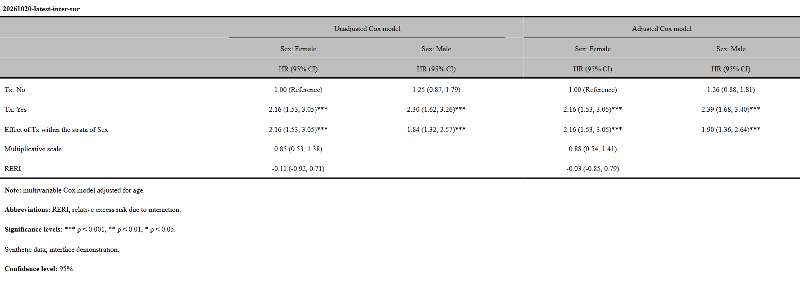{fig-alt="480行模拟数据的Cox交互汇总表，使用未调整与调整HR列，并保留MS与RERI行。"}

### Fine–Gray 汇总表 {.unnumbered}

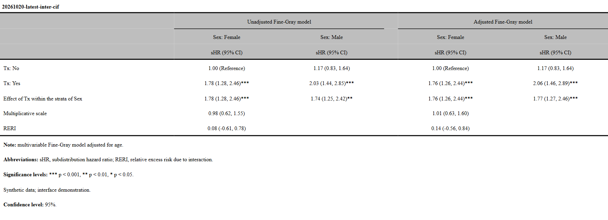{fig-alt="同一数据的Fine-Gray交互汇总表，效应列为sHR 95% CI，表内模型与脚注使用Fine-Gray名称。"}

:::

无名 `title` 向量按模型顺序逐一匹配，长度必须一致；命名向量仍按名称匹配。无名 `note` 向量的每项是**同一份共享脚注的一行**，不是一模型一条。二分类 Fine–Gray 单表、逐对表与分层表的表头现为 sHR (95% CI)，脚注定义 sHR，模型名称写 Fine–Gray；已有结果交给当前格式化函数也会采用新标签。Word 需在当前工作目录可写的环境保存，本例只公开汇总表。

实跑还出现一条预防性暴露提示；这类结果应先核对参考编码，再解读 RERI / SI，不应静默翻转分组来追求某种交互方向。常量协变量的提示也保留在运行输出中。

### 区间与星号使用未舍入数值

交互表在 95% 时也直接用未舍入 P 标星，避免把 0.001001 先舍成 0.001 后多加一个星号。非 95% 时按未舍入区间、固定 1.96 回推显示 P，非对称区间取朝向无效值的一侧，无效区间不标星；`pvalue_lis` 保留该显示口径。详见[数值对照与原 Wald P](forest-guide.qmd#models-ci-20261020)。

`get_inter()` 多分类表、`get_inter_abs()` 风险/RD 列，以及 `get_int()` 的 MS/RERI 轴与详情列，当前模板都固定写 95% CI；`conf_level` / `conf.level` 仍决定实际区间。若使用其他水平，必须在可覆盖的标题与脚注中明确标出实际值，不能把模板文字当成分析参数。

## 当前联合组核对：检查联合效应 {#joint-check-20261020}

2026-10-20 按已推送 RegR `da6157be`（接口自 `578d444`、`835bd54`），在 Windows / WSL R 4.4.3 重新拟合下例。`cat_var_combine` 的四条曲线对应四个组合，检查对象是三个非参考组合相对于参考组合的 HR/sHR，不能按上节的层内简单效应读取。

<!-- refresh-20261020: joint_check -->
```r
library(RegR)
set.seed(20261020)
d_refresh <- expand.grid(Tx = factor(c("No", "Yes")),
  Group = factor(c("Low", "High"), levels = c("Low", "High")),
  Site = factor(c("A", "B")), id = 1:60)
d_refresh[["Age"]] <- rnorm(nrow(d_refresh), 55, 10)
tx <- as.integer(d_refresh[["Tx"]] == "Yes")
gr <- as.integer(d_refresh[["Group"]] == "High")
event_time <- rexp(nrow(d_refresh), exp(-3.8 + 0.6 * tx + 0.4 * gr +
  0.2 * tx * gr + 0.01 * (d_refresh[["Age"]] - 55)))
censor_time <- rexp(nrow(d_refresh), 0.012)
d_refresh[["time"]] <- pmin(event_time, censor_time)
d_refresh[["DSS"]] <- as.integer(event_time <= censor_time)
d_refresh[["Outcome"]] <- factor(ifelse(runif(nrow(d_refresh)) < plogis(
  -1 + 0.7 * tx + 0.4 * gr + 0.02 * (d_refresh[["Age"]] - 55)), "Yes", "No"),
  levels = c("No", "Yes"))
inter_joint <- get_inter(d_refresh, exposure_names = c("Tx", "Group"),
  split_var = "Site", adj_var = "Age", surv = TRUE)
facet_joint <- get_facet(d_refresh, split_var = "Site",
  cat_var_combine = c("Tx", "Group"), adj_var = "Age", surv = TRUE,
  show_sur = FALSE, timepoint = 24, max_t = 60, parallel = 1,
  table_params = list(insert_table = FALSE))
joint_check <- check_inter_facet(inter_joint, facet_joint)
joint_cells <- joint_check[["comparison"]]
stopifnot(isTRUE(joint_check[["consistent"]]), nrow(joint_cells) == 12L,
          all(joint_cells[["same_model_expected"]]), all(joint_cells[["status"]] == "equal"))
joint_cells[c("outer_stratum", "modifier_level", "method", "status")]
# 改变组合顺序，仍按各组合的实际标签匹配。
facet_reversed <- get_facet(d_refresh, split_var = "Site",
  cat_var_combine = c("Group", "Tx"), adj_var = "Age", surv = TRUE,
  show_sur = FALSE, timepoint = 24, max_t = 60, parallel = 1,
  table_params = list(insert_table = FALSE))
stopifnot(isTRUE(check_inter_facet(inter_joint, facet_reversed)[["consistent"]]))
```
<!-- /refresh-20261020: joint_check -->

实跑为 2 个 Site × 3 个非参考组合 × 2 种方法，共 12 个显示单元相等；反转组合顺序也通过。无分层时需 `get_inter()` 的 single 结构，有分层时需相同 `split_var` 的 grid、单个二元 × 二元对比。多分类等其他形状会报错，不能据此宣称已经验证。

若仅在 facet 数据中把层标签改为 `"Site: A"`，没有精确同名项时会尝试冒号后文本；仍找不到的标签报告 missing。这里依然只比较已格式化比值文本，不比较 P 值、RERI、概率或人数，也不重新拟合。联合分面实例见[分面教程](facet-guide.qmd)。

## 未调整生存绝对交互：Greenwood 更新 {#km-delta-current}

本次在 WSL R 4.4.3 使用包含 `d54e60f` 的 RegR 本机开发源码，重新拟合120月和60月绝对交互，并更新对应表格及IC导出预览。未调整生存概率的 `ci_method="delta"` 现在使用 `S(t)` 的 Greenwood 标准误，影响IC、AP或其他差值派生量的区间与P值；四组风险点估计、乘性交互、调整后的direct、Logistic及CIF不因这个修复改变。

旧分析对象需从原始数据重新调用 `get_inter_abs()`；格式化旧对象不会重新计算协方差。下方两种时点的原主示例已经重跑，其他表格与运行时间记录保留原执行快照。


2026-10-13复核：这些接口更新已包含于已推送基线 `a3881fa`；包版本号0.1.3不足以区分源码状态。

## 示例数据与分析尺度 {#data}

本页使用 RegR 自带的 `seer_thyroid_mtc_2026`，即 **4,387 人的甲状腺髓样癌（MTC）队列**。它与 [森林图示例](forest-guide.qmd) 使用的 M1 乳头状甲状腺癌（PTC）队列不同。

示例比较性别与种族、性别与年龄组的交互。`Female`、`White`、`<55` 显式设为参考水平；年龄组的 `>=55` 包含恰好 55 岁。按所用变量完整病例及正随访筛选，不对整个数据集插补。

```r
library(RegR)

data("seer_thyroid_mtc_2026", package = "RegR")
cohort <- as.data.frame(seer_thyroid_mtc_2026)
inter_data <- cohort[
  complete.cases(cohort[, c("Sex", "Age", "Race", "DSS", "time")]) &
    cohort$time > 0,
]
inter_data <- droplevels(inter_data)
inter_data$DSS <- as.numeric(inter_data$DSS)
inter_data$Sex <- factor(inter_data$Sex, levels = c("Female", "Male"))
inter_data$Race <- stats::relevel(factor(inter_data$Race), ref = "White")
inter_data$Age_group <- factor(
  ifelse(inter_data$Age < 55, "<55", ">=55"),
  levels = c("<55", ">=55")
)
```

### 当前未调整KM示例

```r
inter_abs_unadj <- run_quiet(get_inter_abs(inter_data,
  exposure_names = c("Sex", "Age_group"), adj_var = NULL,
  surv = TRUE, sur_time = 120, ci_method = "delta"))
fmt_inter(inter_abs_unadj, output_format = "flextable")
```

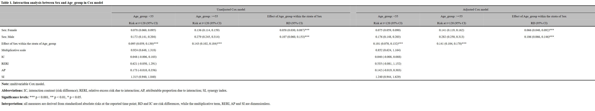{fig-alt="四组未调整生存风险及绝对交互表，区间基于S(t)的Greenwood标准误。"}


下文代码共用这份 `inter_data`。各标签页分别建立有明确名称的分析对象；格式化、Word 导出和绘图部分继续使用这些对象。`run_quiet()` 只控制控制台输出，不改变模型计算。

::: {.table-responsive}

| 入口与设置 | 估计量 | 时间与结局的含义 |
|:--|:--|:--|
| `get_inter(surv = TRUE)` | Cox HR，以及基于 HR 的乘性与加性指标 | 使用 `time` 与 0/1 的 `DSS`；其他原因死亡作为删失 |
| `get_inter(surv = FALSE)` | Fine–Gray sHR，以及基于 sHR 的交互指标 | 使用 `time` 与 `event`；0 为删失、1 为目标事件、其他事件为竞争事件 |
| `get_inter(surv = "DSS")` | Logistic OR，以及基于 OR 的交互指标 | 将 `DSS` 当作二分类结局，未利用随访时间 |
| `get_inter_abs(surv = TRUE, sur_time = 120)` | 标准化的 Cox 事件风险及风险交互 | 本数据时间单位为月；120 月为 10 年，风险为 `1 - S(120)` |
| `get_inter_abs(surv = FALSE, sur_time = 120)` | 标准化的目标事件 CIF 及其交互 | 保留竞争事件；CIF 与上一行的 `1 - S` 不是同一个量 |
| `get_inter_abs(poi_time = 12 * 1000)` | Poisson 人时发生率及发生率交互 | 使用完整随访；本数据按每 1,000 人年报告 |
| `get_inter_abs(surv = "DSS")` | 标准化的 Logistic 概率及概率交互 | 对观察到的二分类结局建模；不能标为某个固定随访年限的风险 |

:::

::: {.callout-note title="读数与解释边界"}
`surv = FALSE` 选择竞争风险路径；选择 Logistic 应传入结局列名字符串。

HR、sHR、OR 是三个不同的比值尺度。由它们计算的 RERI / AP / SI 不能直接当作风险差；尤其 HR / sHR 上的加性指标并不等于固定时点的绝对风险交互。OR 也不能普遍当作风险比使用。

本页用于说明观察性队列的模型与接口行为。模型交互依赖参考组、调整项与所选尺度，不自动建立因果识别；“一组显著、另一组不显著”不能替代交互检验。
:::

## get_fit_ms()：保留完整编码的整体乘法交互检验 {#get-fit-ms}

本节按 RegR 0.1.3 源码 `40515e1` 核对，复用本页完整案例队列，在 WSL R 4.4.3 中实际执行。`get_fit_ms()` 不把多分类变量拆成多次二分类比较，而是为每个“暴露 × 修饰变量”拟合嵌套模型，检验全部交互项。

```r
get_fit_ms(data, exposure_names, adj_var = NULL, surv = TRUE,
  test = c("LRT", "Wald"))
```

`exposure_names` 的第一个变量是暴露，其余变量按顺序逐一作为修饰变量。二分类、多分类、连续 × 分类、连续 × 连续均保留完整编码；数字编码的分类变量应先转为 factor，否则按线性连续项建模。

Cox / Logistic 默认使用 LRT；Fine–Gray 使用联合 Wald 检验，显式要求 LRT 会提示并改用 Wald。输出给出实际使用的 `test`、`statistic`、`df`、`p.value`、`n` 与 `events`。同一变量对的未调整和调整模型使用同一批完整案例，保证差异来自调整设置。

```r
ms_cox <- get_fit_ms(inter_data, exposure_names = c("Sex", "Race", "Age"),
  adj_var = "Age", surv = TRUE)
inter_data[["status"]] <- factor(inter_data[["event"]], levels = 0:2)
ms_fg <- get_fit_ms(inter_data, exposure_names = c("Age", "Race"),
  adj_var = "Sex", surv = FALSE, test = "Wald")
```

### Cox：二分类 × 三分类 / 连续变量

:::: {.table-responsive tabindex="0" role="region" aria-label="表格，可横向滚动"}

|exposure |modifier |model |type           |    n| events|test | statistic| df| p.value|
|:--------|:--------|:-----|:--------------|----:|------:|:----|---------:|--:|-------:|
|Sex      |Race     |Unadj |2 x 3          | 4387|    597|LRT  |     0.960|  2|   0.619|
|Sex      |Race     |Adjus |2 x 3          | 4387|    597|LRT  |     1.198|  2|   0.549|
|Sex      |Age      |Unadj |2 x continuous | 4387|    597|LRT  |     0.416|  1|   0.519|

::::


### Fine–Gray：连续变量 × 三分类

:::: {.table-responsive tabindex="0" role="region" aria-label="表格，可横向滚动"}

|exposure |modifier |model |type           |    n| events|test | statistic| df| p.value|
|:--------|:--------|:-----|:--------------|----:|------:|:----|---------:|--:|-------:|
|Age      |Race     |Unadj |continuous x 3 | 4387|    597|Wald |     1.212|  2|   0.546|
|Age      |Race     |Adjus |continuous x 3 | 4387|    597|Wald |     0.825|  2|   0.662|

::::


这是模型比值尺度上的整体交互检验，不给出 RERI、AP、SI，也不等于绝对风险差的交互检验。若要展示每个组合的效应和加法指标，继续使用本页的 `get_inter()` / `get_inter_abs()`；若要判断保留完整编码后的整体乘法交互，使用 `get_fit_ms()`。

空组合会导致不可估计项被剔除并减少实际 df；分类组合内无事件或无非事件会使 Wald 统计量和 P 值成为 NA 并给出提示。不能把 NA 当作“不存在交互”。

## 函数与结果对象总览 {#workflow}

::: {.table-responsive}

| 函数 | 输入与职责 | 返回值与下一步 |
|:--|:--|:--|
| [`get_fit_ms()`](#get-fit-ms) | 保留分类与连续编码，检验全部乘法交互项 | 含统计量、实际 df、P 值、分析 N 和事件数的 data.frame；不返回加性交互指标 |
| [`get_inter()`](#get-inter) | 从数据拟合比值尺度的交互 | `get_inter` 结果；交给 `fmt_inter()` / `save_tb_inter()`，单个 8×4 表可交给 `plt_inter()` |
| [`get_inter_abs()`](#get-inter-abs) | 从数据估计标准化风险、CIF 或发生率的交互 | `get_inter_abs` 结果；含主要加性指标 IC，可格式化或导出 |
| [`fmt_inter()`](#fmt-inter) | 自动识别结果形状，选择表格后端 | 默认 `flextable`；也可返回 `gt_tbl` 或相应 `gt_group` |
| [`fmt_inter_ft()`](#fmt-inter-ft) | 直接选择 Word 表格后端 | `flextable`；继续排版或交给 `save_tb_inter()` |
| [`fmt_inter_gt()`](#fmt-inter-gt) | 直接选择网页表格后端 | `gt_tbl`；单结果分开显示时可为 `gt_group` |
| [`save_tb_inter()`](#save-tb-inter) | 组织发表用表格并按需写入 Word | 始终返回 `flextable`；`title` 非空时另写 `.docx` |
| [`plt_inter()`](#plt-inter) | 从一个二分类×二分类的 8×4 交互表绘图 | `stack`、`line`、`add`、`combined` 四个图对象 |

:::

### 比值尺度与绝对尺度的加性交互

令两个二分类暴露为 $A,B$，`00` 为共同参考组。比值尺度中，联合效应为 $\theta_{11}$，单独效应为 $\theta_{10},\theta_{01}$，参考值 $\theta_{00}=1$：

$$
\begin{aligned}
M &= \frac{\theta_{11}}{\theta_{10}\theta_{01}},\\
\mathrm{RERI} &= \theta_{11}-\theta_{10}-\theta_{01}+1,\\
\mathrm{AP} &= \frac{\mathrm{RERI}}{\theta_{11}},\\
\mathrm{SI} &= \frac{\theta_{11}-1}{\theta_{10}+\theta_{01}-2}.
\end{aligned}
$$

`M` 的无交互值为 1，RERI / AP 为 0，SI 为 1。SI 的分母接近 0 时可能不稳定；保护性效应或改变参考组也会影响这些指标的含义，不能仅凭一行星号归纳交互。

绝对尺度则先估计四个标准化量 $p_{00},p_{10},p_{01},p_{11}$，再计算：

$$
\mathrm{IC}=p_{11}-p_{10}-p_{01}+p_{00}.
$$

风险 / CIF 模式的 IC 是**概率差的差**，无加性交互值为 0。例如 IC 为 0.05 表示额外 5 个百分点；发生率模式的 IC 带有人时发生率单位。绝对结果中的 RERI 是 IC 相对 $p_{00}$ 的归一化量，AP 是 IC 相对 $p_{11}$ 的归一化量，两者均不同于 IC 本身。

## get_inter()：比值尺度与模型组织 {#get-inter}

### 当前接口

```r
# 接口签名（不执行）
get_inter(
  data, exposure_names, adj_var = NULL,
  surv = TRUE, conf_level = 0.95,
  cif_args = list(model = c("FGR", "CSC", "CRR")),
  split_var = NULL, binary_ref = NULL,
  multicat_model = c("interaction", "separate"),
  eff_inter = FALSE
)
```

::: {.table-responsive}

| 参数 | 使用方式与影响 |
|:--|:--|
| `exposure_names` | 两个列名对应一对暴露。多于两个时，第一个为二分类主暴露，其余逐一作为修饰变量；此时需 `multicat_model = "separate"` |
| `adj_var` | 调整变量列名；结果保留 `Unadj` 与 `Adjus` 模型。修改调整项会重算模型 |
| `surv` | `TRUE` 为 Cox，`FALSE` 为 Fine–Gray，结局列名字符串为 Logistic |
| `conf_level` | 置信水平，默认 0.95；影响区间和显著性显示 |
| `cif_args` | Fine–Gray 拟合后端；默认FGR/mets，CRR使用 `tidycmprsk::crr()`；本入口的CSC仍使用mets比值拟合 |
| `split_var` | 先按一个或多个变量分层，再在层内计算交互；分层变量从调整项移除 |
| `binary_ref` | 按多水平因子的参考水平**索引**合并成二分类，其余水平归为 `Oth`；会改变研究对比，不是只改显示名称 |
| `multicat_model` | 二分类×多水平时，`"interaction"` 用一个完整交互模型；`"separate"` 用 K−1 个参考组对照的子集模型 |
| `eff_inter` | 默认 `FALSE` 返回交互指标表；`TRUE` 转发至 `get_eff_inter()` 的效应表路径，返回合同随之改变 |

:::

`multicat_model = "interaction"` 是当前默认值。二分类×二分类保持单个结果；二分类×多水平从一个包含所有联合水平的模型中提取对比，并保存总体 K−1 自由度 Wald 交互检验。`"separate"` 每次只保留参考水平与一个非参考水平，各模型的样本和估计值可能不同。

### 五种设置对照

::: {.panel-tabset}

### 完整多水平模型 {.unnumbered}

性别×种族，调整年龄。所有种族水平共同进入一个模型，结果类型为 `multicat`；表内各水平以 White 为参考。

```r
inter_multi <- RegR::run_quiet({
  get_inter(
    inter_data, exposure_names = c("Sex", "Race"),
    adj_var = "Age", surv = TRUE, multicat_model = "interaction"
  )
})
fmt_inter_gt(inter_multi)
```

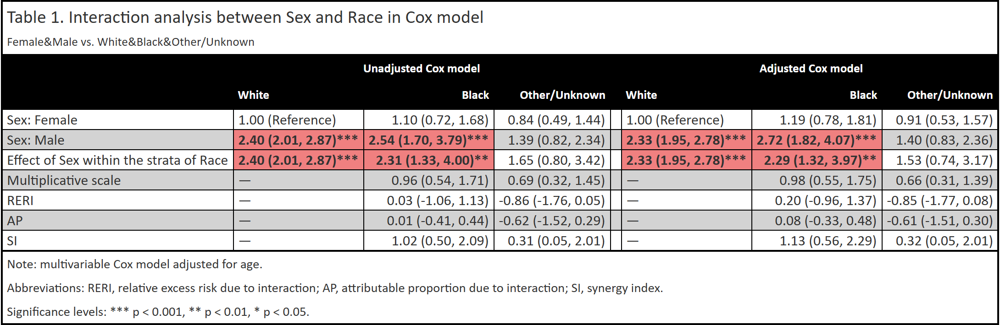{fig-alt="完整多水平交互模型，显示未调整和年龄调整后的 HR、乘性交互以及 RERI、AP、SI。"}

### 二分类组合 {.unnumbered}

性别×年龄组，调整种族，返回 `single`。共同参考组为 Female 且年龄 <55 岁；联合效应与层内效应的参考关系应分别阅读。

```r
inter_single <- RegR::run_quiet({
  get_inter(
    inter_data, exposure_names = c("Sex", "Age_group"),
    adj_var = "Race", surv = TRUE
  )
})
fmt_inter_gt(inter_single)
```

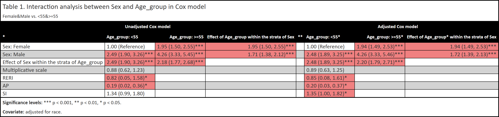{fig-alt="二分类乘积模型，Female 与小于 55 岁为参考水平，显示种族调整前后的 HR 交互。"}

### 逐对模型 {.unnumbered}

把完整多水平模型切换为 `"separate"`，分别拟合 White vs Black、White vs Other/Unknown。两份子集模型合并展示，结果类型为 `mul`。与第一个标签页的差别来自模型与样本，不只是布局。

```r
inter_pairs <- RegR::run_quiet({
  get_inter(
    inter_data, exposure_names = c("Sex", "Race"),
    adj_var = "Age", surv = TRUE, multicat_model = "separate"
  )
})
fmt_inter_gt(inter_pairs)
```

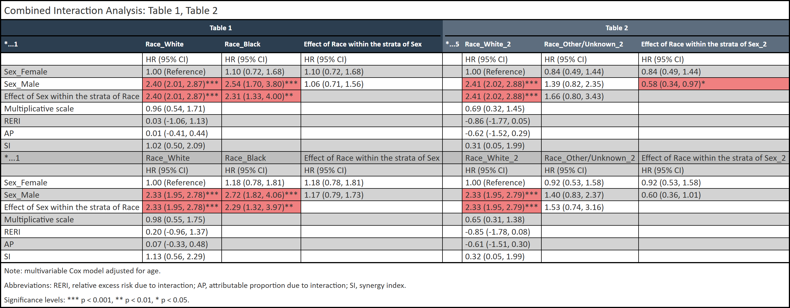{fig-alt="性别与种族的两份逐对交互模型，White 为共同的种族参考组，各模型使用对应的两水平子集。"}

### 分层分析 {.unnumbered}

按 Race 分层，再分别估计性别×年龄组，调整连续年龄。这里“按种族分层”和“种族作为交互变量”是不同的分析。

```r
inter_grid <- RegR::run_quiet({
  get_inter(
    inter_data, exposure_names = c("Sex", "Age_group"),
    adj_var = "Age", surv = TRUE, split_var = "Race"
  )
})
fmt_inter_gt(inter_grid)
```

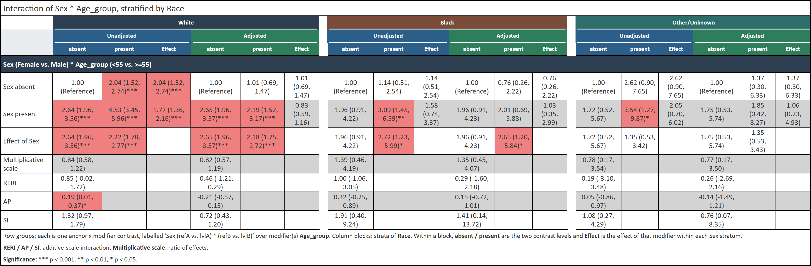{fig-alt="按 White、Black、Other/Unknown 分层，分别显示性别与年龄组交互的未调整和年龄调整模型。"}

### Logistic 结局 {.unnumbered}

将 `surv` 改为结局列名，估计观察到的疾病特异死亡的 OR。此模型没有利用随访时间，因此与前面 Cox HR 的数值和含义均不同。

```r
inter_or <- RegR::run_quiet({
  get_inter(
    inter_data, exposure_names = c("Sex", "Age_group"),
    adj_var = "Race", surv = "DSS"
  )
})
fmt_inter_gt(inter_or)
```

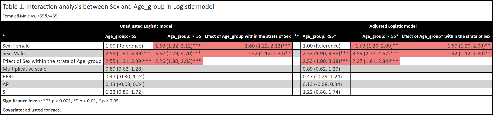{fig-alt="以 DSS 为二分类结局、调整种族的 Logistic 交互表，联合效应与交互指标基于 OR。"}

:::

### 返回对象与下游选择

::: {.table-responsive}

| `attr(result, "inter_type")` | 组织方式 | 读取与使用 |
|:--|:--|:--|
| `single` | `list(Unadj, Adjus)`；每个表 8×4 | 整体交给格式化 / 保存函数；一个表交给 `plt_inter()` |
| `mul` | 每个修饰变量 / 水平对比一个 `list(Unadj, Adjus)` | `table_names` 等元数据提供各对比标签 |
| `grid` | `result[[contrast]][[stratum]]` | 退化单元为 `NULL`；对比与层分别保存名称属性 |
| `multicat` | `list(Unadj, Adjus)`；每表 7 行，多水平对应列 | 单个表的 `estimates` 保存未四舍五入的对比，`global_interaction` 保存总体检验 |
| `multicat_grid` | 按层命名的完整多水平结果列表 | 每一层独立拟合一个完整交互模型 |

:::

```r
attr(inter_single, "inter_type")
dim(inter_single[["Adjus"]])
attr(inter_multi[["Adjus"]], "global_interaction")
attr(inter_multi[["Adjus"]], "estimates")
```

多重分层由分层变量水平的组合形成，缺失层值和空层会被丢弃；层内暴露缺少水平的单元可能为空。只观察到一个非空层时，函数会警告并忽略 `split_var`。这些情况需要检查样本构成，空白不表示“无交互”。

`eff_inter = TRUE` 是另一种结果路径：第一个暴露传为 `cat_var`，其余传为 `sub_var`，采用完整交互模型的层内效应表，而非上述 RERI / AP / SI 指标表；可返回数据框或分层的 `eff_inter_split` 对象，且不接受 `binary_ref`。这一路径与 [效应估计与森林图](forest-guide.qmd) 的工作流衔接。

## get_inter_abs()：固定时点风险与人时发生率 {#get-inter-abs}

### 当前接口

```r
# 接口签名（不执行）
get_inter_abs(
  data, exposure_names, adj_var = NULL,
  surv = TRUE, sur_time = 120, poi_time = 12 * 1000,
  conf_level = 0.95, split_var = NULL, binary_ref = NULL,
  multicat_model = c("separate", "interaction"),
  ci_method = c("delta", "boot"),
  cif_args = list(model = c("FGR", "CSC", "CRR")),
  n_boot = 500, n_cores = 1
)
```

这个入口在未调整与协变量调整两条路径中估计四个联合暴露状态的风险 / CIF / 发生率。调整模型通过 g-computation，将同一分析人群依次置于四个暴露状态，预测后取人群平均，再组合为 IC 等指标。

::: {.table-responsive}

| 参数 | 作用与注意点 |
|:--|:--|
| `sur_time` | 固定时点，单位与 `time` 一致；默认 120。不能把其他时间单位的数据直接称为“10 年风险” |
| `poi_time` | 显式传入即切换为完整随访的人时发生率；`sur_time = NULL` 也会切换到发生率尺度 |
| 两个时间参数 | 生存模式下，不能同时显式传入非空的 `sur_time` 与 `poi_time`；Logistic 不使用这两个参数 |
| `multicat_model` | **默认 `"separate"`**，与 `get_inter()` 的默认值不同；完整模型与逐对子集模型的标准化人群也不同 |
| `ci_method` | 默认 `"delta"`，Fine–Gray 调整分支使用 mets 的联合影响函数协方差；`"boot"` 为联合 bootstrap 百分位区间，两种设置均使用 mets 拟合与标准化 |
| `n_boot, n_cores` | bootstrap 次数与核数，默认 500 次、1 核；Fine–Gray 的 `delta` 分支不抽样，这两个参数不控制其耗时。较小抽样次数适合运行检查，正式区间需检查重复次数与稳定性 |
| `cif_args` | 固定时点CIF默认FGR/mets；可选CSC或CRR，调整分支使用联合bootstrap，`delta` 会警告并回退；后端及模型假设见[当前说明](get-eff-cif-benchmark.qmd#current-backend) |

:::

自 2026-10-02 的 `cefc1a5` 更新起，默认 Fine–Gray **调整分支可直接计算 delta 区间，无需 bootstrap**。旧版“选择 delta 仍回退 bootstrap”的说明仅适用于更新前的实现；显式选择 CSC 的调整分支仍保留回退行为。下方原有四组图展示 Cox / Logistic / Poisson，新的 CIF 示例见 [mets 优化与加速实测](#cif-mets-update)。

### 四种尺度设置

::: {.panel-tabset}

### 120 月风险 {.unnumbered}

四个联合状态的标准化事件风险与 IC。风险以 0–1 比例显示，IC 同样采用比例单位。

```r
inter_abs120 <- RegR::run_quiet({
  get_inter_abs(
    inter_data, exposure_names = c("Sex", "Age_group"),
    adj_var = "Race", surv = TRUE, sur_time = 120, ci_method = "delta"
  )
})
fmt_inter(inter_abs120, output_format = "flextable")
```

{fig-alt="性别与年龄组在 120 月的未调整和种族标准化风险，含乘性交互、IC、RERI、AP 和 SI。"}

### 60 月风险 {.unnumbered}

只修改评估时间点。即使暴露与调整项相同，四个风险及其交互也可能随时间改变；不能把 120 月的交互结论直接移到 60 月。

```r
inter_abs60 <- RegR::run_quiet({
  get_inter_abs(
    inter_data, exposure_names = c("Sex", "Age_group"),
    adj_var = "Race", surv = TRUE, sur_time = 60, ci_method = "delta"
  )
})
fmt_inter(inter_abs60, output_format = "flextable")
```

{fig-alt="与 120 月示例相同的暴露和调整项，在 60 月重新估计风险与交互。"}

### 每千人年发生率 {.unnumbered}

显式设置 `poi_time`，保留完整随访；此时使用带人时 offset 的 Poisson 模型。IC 的单位也是每 1,000 人年的事件数，不是风险百分点。

```r
inter_rate <- RegR::run_quiet({
  get_inter_abs(
    inter_data, exposure_names = c("Sex", "Age_group"),
    adj_var = "Race", surv = TRUE, poi_time = 12 * 1000,
    ci_method = "delta"
  )
})
fmt_inter(inter_rate, output_format = "flextable")
```

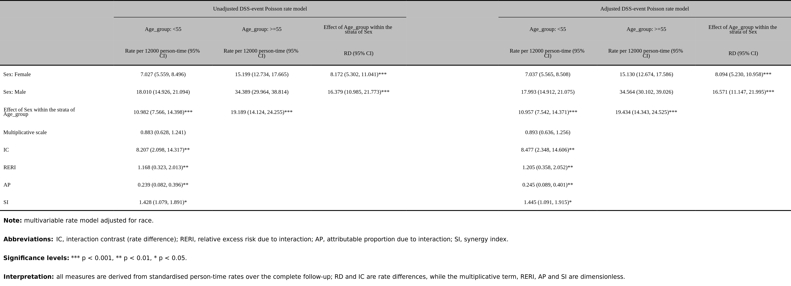{fig-alt="完整随访的 Poisson 人时发生率表，每 1000 人年报告事件率与发生率交互 IC。"}

### Logistic 概率 {.unnumbered}

同样的二分类结局，在 `get_inter()` 中报告 OR，在这里报告标准化概率与概率差的差。代码不指定评估时间。

```r
inter_abs_or <- RegR::run_quiet({
  get_inter_abs(
    inter_data, exposure_names = c("Sex", "Age_group"),
    adj_var = "Race", surv = "DSS", ci_method = "delta"
  )
})
fmt_inter(inter_abs_or, output_format = "flextable")
```

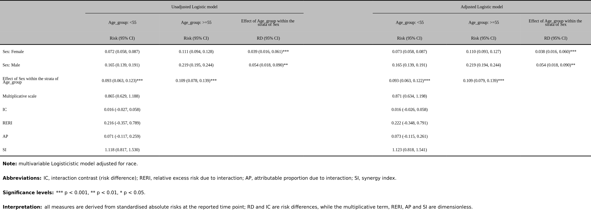{fig-alt="Logistic 标准化的四组概率与 IC，未使用随访时间，不表示固定年限风险。"}

:::

返回对象带 `get_inter_abs` 类与相应的 `inter_type`。二分类单结果仍分为 `Unadj` / `Adjus`，表为 **9×4**，比相对尺度多 IC 一行；多对比与分层结果可继续交给同一套格式化与 Word 导出函数。`plt_inter()` 的 8×4 比值表输入要求不适用于这些绝对结果。

## 竞争风险更新：mets 联合 CIF 与加速实测 {#cif-mets-update}

### 默认 delta 为什么不再需要抽样？

`get_inter_abs(surv = FALSE)` 默认使用 Fine–Gray 工作模型。调整分支先用 `mets::cifregFG()` 拟合联合暴露状态与协变量，再用 `mets::survivalG()` 将同一人群标准化到四个暴露状态。它同时获得四个 CIF 的点估计与**完整的联合协方差**；未调整分支仍为各联合组的 Aalen–Johansen CIF。

联合协方差保留不同标准化风险之间的相关性，也包含模型拟合与经验标准化人群分布的不确定性。不能把四个风险的标准误平方放在对角线上，就视为调整分支的完整协方差。令 $\mathbf p=(p_{00},p_{01},p_{10},p_{11})^\top$，$\mathbf a=(1,-1,-1,1)^\top$，则：

$$
\mathrm{IC}=\mathbf a^\top\mathbf p,\qquad
\operatorname{Var}(\mathrm{IC})=\mathbf a^\top V\mathbf a.
$$

默认 `ci_method = "delta"` 从 $V$ 计算 IC、RERI、AP、SI 与乘性交互的区间；乘性项与 SI 使用对数尺度近似。这个分支不执行 bootstrap，因此提高 `n_boot` 或 `n_cores` 不会让它进行更多抽样。`mets::survivalG()` 的标准化风险与影响函数接口见 [官方帮助](https://kkholst.github.io/mets/reference/survivalG.html)。

`ci_method = "boot"` 则在每次患者级联合重抽样后，通过同一 mets 模型重新拟合，并对该次抽样人群标准化；四个暴露状态使用同一次抽样，再组合交互指标。无法估计的抽样会整次剔除并警告。显式 `cif_args = list(model = "CSC")` 的调整分支仍使用 bootstrap，选择 `delta` 时会警告并回退。

### 两种区间方法：同一队列的实际结果

本节单独按 `time`、`event`、`Sex`、`Age`、`Race` 完整病例且 `time > 0` 筛选，得到 **4,387 人**：删失 3,207 人、目标事件 597 人、竞争事件 583 人。比较性别与年龄组，调整连续年龄与种族，在 **120 月**估计目标事件 CIF。连续年龄和年龄分组同时出现，是本次计时固定的调整设置；研究分析应按问题预先确定协变量。

```r
# 本节代码共用的数据；event: 0=删失，1=目标事件，2=竞争事件
inter_cif_data <- as.data.frame(RegR::seer_thyroid_mtc_2026)
cif_vars <- c("time", "event", "Sex", "Age", "Race")
inter_cif_data <- inter_cif_data[
  complete.cases(inter_cif_data[, cif_vars]) & inter_cif_data$time > 0,
  cif_vars
]
inter_cif_data$Sex <- factor(inter_cif_data$Sex, levels = c("Female", "Male"))
inter_cif_data$AgeH <- factor(
  ifelse(inter_cif_data$Age >= 55, "ge55", "lt55"),
  levels = c("lt55", "ge55")
)
```

::: {.panel-tabset}

### delta：默认方法 {.unnumbered}

```r
inter_cif_delta <- RegR::run_quiet({
  get_inter_abs(
    inter_cif_data, exposure_names = c("Sex", "AgeH"),
    adj_var = c("Age", "Race"), surv = FALSE, sur_time = 120,
    ci_method = "delta", cif_args = list(model = "FGR")
  )
})
fmt_inter_gt(inter_cif_delta)
```

以下为该次调用中四个风险与主要加性交互 IC 的摘要。CIF 乘以 100 显示为百分比；IC 乘以 100 显示为百分点。括号内为 95% CI。

:::: {.table-responsive tabindex="0" role="region" aria-label="表格，可横向滚动"}

| 状态或指标 | 未调整 | 调整年龄与种族 |
|:--|--:|--:|
| Female，<55：CIF（%） | 7.67（5.95，9.39） | 10.30（7.83，12.77） |
| Female，≥55：CIF（%） | 12.78（10.71，14.86） | 10.59（8.80，12.38） |
| Male，<55：CIF（%） | 16.83（13.78，19.87） | 23.12（18.54，27.69） |
| Male，≥55：CIF（%） | 25.17（22.13，28.21） | 20.58（17.66，23.49） |
| IC（百分点） | 3.23（−1.85，8.31） | −2.82（−8.32，2.67） |

::::

### boot：可选方法 {.unnumbered}

```r
set.seed(171)
inter_cif_boot <- RegR::run_quiet({
  get_inter_abs(
    inter_cif_data, exposure_names = c("Sex", "AgeH"),
    adj_var = c("Age", "Race"), surv = FALSE, sur_time = 120,
    ci_method = "boot", cif_args = list(model = "FGR"),
    n_boot = 50, n_cores = 1
  )
})
fmt_inter_gt(inter_cif_boot)
```

这里 **50 次抽样仅用于示例与计时**，不作为正式分析的重复次数建议。正式分析可提高 `n_boot`，并检查随机种子、区间端点与成功抽样数的稳定性。

:::: {.table-responsive tabindex="0" role="region" aria-label="表格，可横向滚动"}

| 状态或指标 | 未调整 | 调整年龄与种族 |
|:--|--:|--:|
| Female，<55：CIF（%） | 7.67（5.93，9.86） | 10.30（8.36，12.24） |
| Female，≥55：CIF（%） | 12.78（10.53，14.59） | 10.59（8.80，12.22） |
| Male，<55：CIF（%） | 16.83（14.08，19.90） | 23.12（20.19，25.76） |
| Male，≥55：CIF（%） | 25.17（22.30，27.77） | 20.58（17.91，22.71） |
| IC（百分点） | 3.23（−2.88，8.76） | −2.82（−7.42，1.38） |

::::

:::

两种方法的点估计完全一致，区间方法不同。该例调整后的 IC 为 **−2.82 个百分点**，两种区间均跨 0；应结合估计量、时间点与调整设置解释。bootstrap 不会自动解决分母接近 0、稀疏联合组或工作模型不合适的问题，尤其 SI 等比值可能不稳定。

### 优化前后的完整调用耗时 {#cif-mets-timing}

2026-10-02 在 WSL Ubuntu-22.04、R **4.4.3**、mets **1.3.13** 下实测。比较更新前模块 `aac87ba` 与更新后模块 `cefc1a5`；其余依赖相同。每种设置在独立进程中顺序运行，`n_cores = 1`，BLAS / OpenMP 线程数均设为 1。预热后计时覆盖完整 `get_inter_abs()` 调用及其自动表格格式化，不计包加载、数据准备与结果保存。

:::: {.table-responsive tabindex="0" role="region" aria-label="表格，可横向滚动"}

| 样本量 | 区间设置 | 优化前（秒） | 优化后（秒） | 加速倍数 | 时间减少 |
|--:|:--|--:|--:|--:|--:|
| 1,000 | `delta`，旧版回退 50 次抽样 | 2.740 | 0.231 | 11.9× | 91.57% |
| 1,000 | 两版均 `boot`，50 次 | 2.984 | 2.981 | 1.00× | 0.10% |
| 4,387 | `delta`，旧版回退 50 次抽样 | 18.863 | 0.390 | 48.4× | 97.93% |
| 4,387 | 两版均 `boot`，50 次 | 19.305 | 9.211 | 2.10× | 52.29% |
| **4,387** | **默认 `delta`，旧版回退 500 次抽样** | **185.535** | **0.411** | **451.4×** | **99.78%** |

::::

50 次抽样的各项分别重复 **3 次**，表中为中位数。默认 500 次的旧版实测 **1 次**，新版重复 **3 次**、范围 **0.338–0.504 秒**；这些是实际计时，未按 50 次结果外推。1,000 人是同一完整队列按 `set.seed(20261002)` 固定抽取的无放回子样本。单次结果展示与计时的调用种子从 171 起。

::: {.callout-note title="如何理解 451 倍加速"}
最大的收益来自默认路径省去了 500 次 bootstrap，改用联合协方差计算 delta 区间。因此 **451 倍包含区间方法变化的收益**；它不表示单次 Fine–Gray 拟合加速了 451 倍。相同 50 次 bootstrap 下，完整队列约快 **2.1 倍**，1,000 人子样本没有明显提速。具体耗时受样本量、事件数、协变量、机器与抽样次数影响。

数值核对中，新版 `delta` / `boot` 的点估计完全一致；新旧未调整风险一致，调整后风险最大差异约 **0.030 个百分点**。新后端在请求时间恰逢事件时纳入该时间全部并列事件，且不跨越下一个事件时间；仅核对点估计不能证明两种区间具有相同覆盖率。
:::

[下载计时汇总 CSV](bench/inter_abs_mets_timing.csv) · [下载逐次计时 CSV](bench/inter_abs_mets_raw.csv)

本机复测新版时，可在上述数据准备后运行以下代码。固定 `n_boot = 50` 使 bootstrap 检查较快；`delta` 不使用这个抽样次数。包加载和首次预热不计入后续计时，返回的是当前机器的运行结果。

```r
measure_cif <- function(mode) {
  RegR::run_quiet({
    get_inter_abs(
      inter_cif_data, exposure_names = c("Sex", "AgeH"),
      adj_var = c("Age", "Race"), surv = FALSE, sur_time = 120,
      ci_method = mode, n_boot = 50, n_cores = 1
    )
  })
}
invisible(measure_cif("delta"))
invisible(measure_cif("boot"))
cif_timing <- do.call(rbind, lapply(c("delta", "boot"), function(mode) {
  times <- vapply(1:3, function(i) {
    gc()
    set.seed(170 + i)
    unname(system.time(invisible(measure_cif(mode)))["elapsed"])
  }, numeric(1))
  data.frame(ci_method = mode, median_seconds = median(times))
}))
cif_timing
```

## fmt_inter()：自动选择表格后端 {#fmt-inter}

```r
# 接口签名（不执行）
fmt_inter(
  df_inter, table_map = NULL,
  output_format = c("flextable", "gt"),
  layout = c("auto", "horizontal", "vertical"),
  table_names = NULL, gt_args = list(), ft_args = list()
)
```

这个入口识别比值 / 绝对尺度以及 single / mul / grid / multicat 等形状。更改 `output_format` 只选择渲染后端，不重新拟合模型。后端特有选项放在命名 list 中：`gt_args` 支持 `show_combine`、`spanner_colors`，`ft_args` 支持 `show_subeffect`、`show_measure`；未知、重复或未命名字段会被拒绝。

::: {.panel-tabset}

### flextable {.unnumbered}

默认后端适合 Word 排版。下面与 `fmt_inter_ft(inter_single)` 使用同一份 Cox 结果。

```r
fmt_inter(inter_single, output_format = "flextable")
```

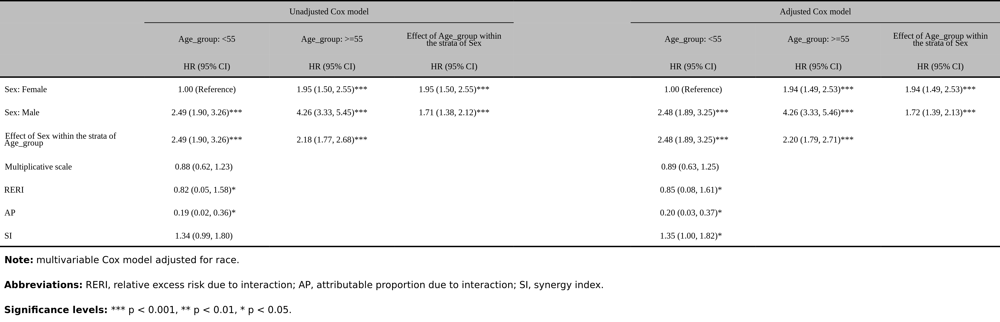{fig-alt="fmt_inter 的默认 flextable 输出，展示未调整与种族调整后的二分类交互结果。"}

### gt {.unnumbered}

网页表格后端；单个结果默认将未调整和调整模型合并在一个 `gt_tbl` 中。

```r
fmt_inter(inter_single, output_format = "gt")
```

{fig-alt="与 flextable 标签页使用相同的原始结果，fmt_inter 的 gt 后端合并两个模型。"}

:::

## fmt_inter_ft()：Word 表格的细节控制 {#fmt-inter-ft}

```r
# 接口签名（不执行）
fmt_inter_ft(
  df_inter, table_map = NULL,
  layout = c("auto", "horizontal", "vertical"),
  table_names = NULL,
  show_subeffect = c("both", "column", "row", "none"),
  show_measure = c("above_header", "below_header", "none")
)
```

`show_subeffect` 控制两个层内效应摘要：`"column"` 保留效应列，`"row"` 保留主暴露效应行，`"both"` 两者都保留，`"none"` 两者都隐藏。隐藏摘要不会改写模型。

`show_measure` 控制 HR / Risk 等度量行的位置：`"above_header"` 在表头，`"below_header"` 在表体首行，`"none"` 不显示。`layout` 组织多对比 / 分层表；完整多水平结果使用固定的模型并排布局。

::: {.panel-tabset}

### 默认摘要 {.unnumbered}

保留两类层内效应，度量行位于表头。

```r
fmt_inter_ft(inter_single)
```

{fig-alt="flextable 默认布局，包含联合效应、两个层内效应摘要及交互指标。"}

### 精简表格 {.unnumbered}

隐藏两类层内摘要，将度量行放在表体。联合效应和交互指标仍来自同一份分析。

```r
fmt_inter_ft(
  inter_single, show_subeffect = "none", show_measure = "below_header"
)
```

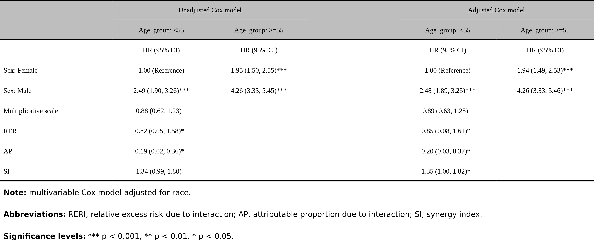{fig-alt="设置 show_subeffect 为 none 和 show_measure 为 below_header 的精简交互表。"}

:::

## fmt_inter_gt()：网页表格与分组表头 {#fmt-inter-gt}

```r
# 接口签名（不执行）
fmt_inter_gt(
  df_inter, table_map = NULL,
  layout = c("auto", "horizontal", "vertical"),
  show_combine = TRUE, table_names = NULL,
  spanner_colors = c("#2C3E50", "#5D6D7E", "#7B4B3A", "#4A6155")
)
```

`show_combine = TRUE` 将单个交互结果的 Unadjusted / Adjusted 合成一个 `gt_tbl`；`FALSE` 返回 `gt_group`。`table_names` 用于多对比标签，`spanner_colors` 循环应用于 `mul` 的分组表头。`layout = "auto"` 对带 `table_names` 的多修饰变量结果采用纵向，其余通常横向；`single` / `grid` 的 gt 渲染不使用这个布局开关。

::: {.panel-tabset}

### 完整多水平表 {.unnumbered}

直接识别 `multicat`，并排显示未调整与调整模型，不需要先拆成逐对表。

```r
fmt_inter_gt(inter_multi)
```

{fig-alt="fmt_inter_gt 自动识别完整多水平结果，使用各种族水平作为列。"}

### 逐对表与颜色 {.unnumbered}

对 `mul` 结果选择纵向布局，用两种紫色区分对比表头。颜色与布局只改变显示。

```r
fmt_inter_gt(
  inter_pairs, layout = "vertical",
  spanner_colors = c("#5B3F8C", "#7857A4")
)
```

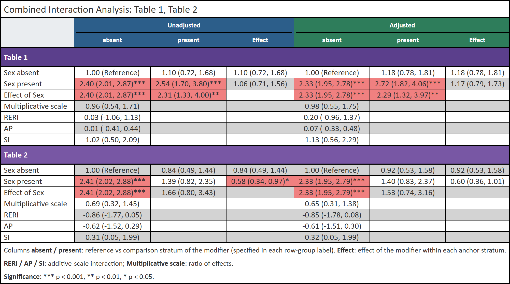{fig-alt="两份种族逐对交互结果采用纵向布局与自定义紫色分组表头。"}

:::

## save_tb_inter()：Word 导出与发表用表 {#save-tb-inter}

### 当前接口

```r
# 接口签名（不执行）
save_tb_inter(
  inter_result, title = NULL,
  layout = c("vertical", "horizontal"),
  table_map = NULL, note = NULL, note_covar = NULL,
  landscape = FALSE, note_below = TRUE, show_ap_si = FALSE,
  show_subeffect = c("row", "both", "column", "none"),
  show_measure = c("above_header", "below_header", "none"),
  show_model = c("both", "unadjusted", "adjusted"),
  covar_map = name_map_seer,
  font_name = "Times New Roman", font_size = 8
)
```

函数接受原始交互结果，也接受已经排好的 `flextable`。返回值始终是 `flextable`，因此可以先预览，再保存；**`title = NULL` 不写文件**。非空 `title` 为输出路径，可带或不带 `.docx`，目录决定保存位置，去掉扩展名后的文件名用于表题。下面的文件示例写入 R 的临时目录；实际使用时换成自己的输出路径。

::: {.table-responsive}

| 参数 | 用途与适用范围 |
|:--|:--|
| `layout` | 默认 `"vertical"`，对比 / 层向下堆叠；`"horizontal"` 横向排列。完整多水平表保留固定布局 |
| `landscape` | Word 页面横向；独立于表格的横 / 纵布局 |
| `show_model` | 两个模型都保留，或只保留 `"unadjusted"` / `"adjusted"` |
| `show_ap_si = FALSE` | 当前默认；比值结果保留乘性交互与主要加性指标 RERI，绝对结果保留乘性交互与 IC；TRUE保留其他加性指标 |
| `show_subeffect, show_measure` | 保存入口默认 `show_subeffect = "row"`；`fmt_inter_ft()` 仍默认 `"both"`，两者选项含义相同 |
| `table_map` | 变量 / 水平文字映射；是正则子串替换，不改变编码、参考组或估计值 |
| `covar_map, note_covar` | 调整项注释的名称映射与手动覆盖；`note_covar` 覆盖显示文字，不能改变已拟合的调整模型 |
| `note` | 在标准注释之后追加说明 |
| `note_below` | 默认在 Word 表格下写可编辑段落；返回的 flextable 仍以 footer 行预览注释。缺少相关注释元数据的单表会回退到 footer |
| `font_name, font_size` | 默认 Times New Roman、8 pt；本页预览使用 10 pt |

:::

传入已经格式化的 `flextable` 时，函数保留其布局；`layout`、`table_map`、`show_subeffect`、`show_measure` 不重新应用。不显式传 `show_ap_si` 时保留既有行；显式传 FALSE 会警告并忽略，因为它不能再筛选原始指标。需要精简时应直接传原始分析结果。`show_model` 可用于已有表，但应确认模型标识仍完整。

### 五种导出与预览设置

::: {.panel-tabset}

### 纵向 Word 表 {.unnumbered}

下面五幅历史预览显式保留原行列设置；当前默认效果见[新默认值对照](#defaults-check-20261019)。这里按种族对比向下排，两个模型并排，写入 `Table 1. Sex by race.docx` 并返回表格。

```r
table <- save_tb_inter(
  inter_pairs, title = file.path(tempdir(), "Table 1. Sex by race"),
  show_ap_si = TRUE, show_subeffect = "both",
  layout = "vertical", font_size = 10
)
table
```

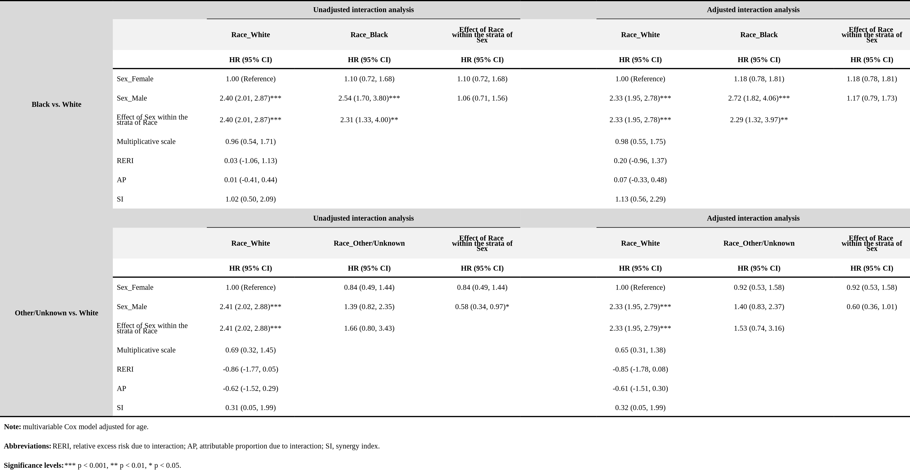{fig-alt="用于 Word 导出的纵向种族逐对交互表，保留未调整与年龄调整模型及注释。"}

### 横向表与横向页面 {.unnumbered}

`layout` 改表内排列，`landscape` 改 Word 纸张方向。宽表应同时考虑这两个设置。

```r
table <- save_tb_inter(
  inter_pairs, title = file.path(tempdir(), "Table 2. Horizontal interaction"),
  show_ap_si = TRUE, show_subeffect = "both",
  layout = "horizontal", landscape = TRUE, font_size = 10
)
table
```

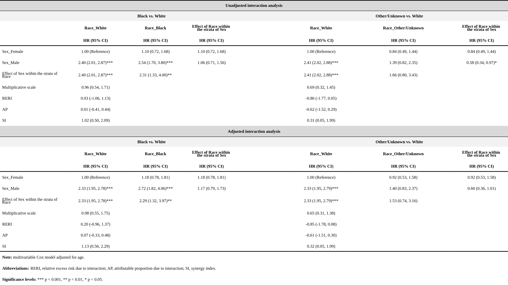{fig-alt="种族对比横向排列，并使用横向 Word 页面保存；页面方向不改变估计值。"}

### 只显示调整模型 {.unnumbered}

保留 Adjusted 的模型标识与调整项注释。`title = NULL` 只预览，不产生 Word 文件。

```r
table <- save_tb_inter(
  inter_pairs, title = NULL, show_model = "adjusted", font_size = 10,
  show_ap_si = TRUE, show_subeffect = "both"
)
table
```

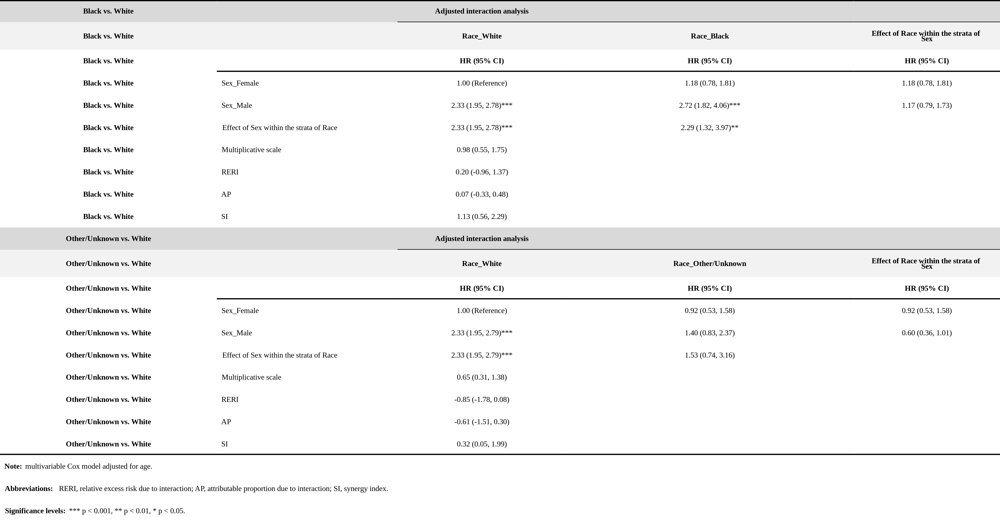{fig-alt="show_model 为 adjusted，仅保留年龄调整后的种族逐对交互及协变量注释。"}

### 绝对结果保留 IC {.unnumbered}

传入 120 月的风险结果，关闭次要加性指标；此时保留的是 IC，不能按相对尺度的 RERI 解释。

```r
table <- save_tb_inter(
  inter_abs120, title = NULL, show_ap_si = FALSE, font_size = 10,
  show_subeffect = "both"
)
table
```

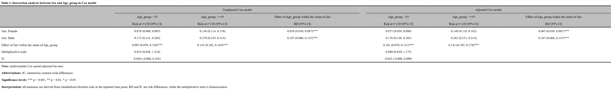{fig-alt="120 月风险表设置 show_ap_si 为 FALSE，保留乘性交互与 IC，并同步指标注释。"}

### 分层结果导出 {.unnumbered}

按种族分层的结果纵向排版，保存为横向 Word 页面；保留层标签、模型标签和注释。

```r
table <- save_tb_inter(
  inter_grid, title = file.path(tempdir(), "Table 3. Stratified interaction"),
  show_ap_si = TRUE, show_subeffect = "both",
  layout = "vertical", landscape = TRUE, font_size = 10
)
table
```

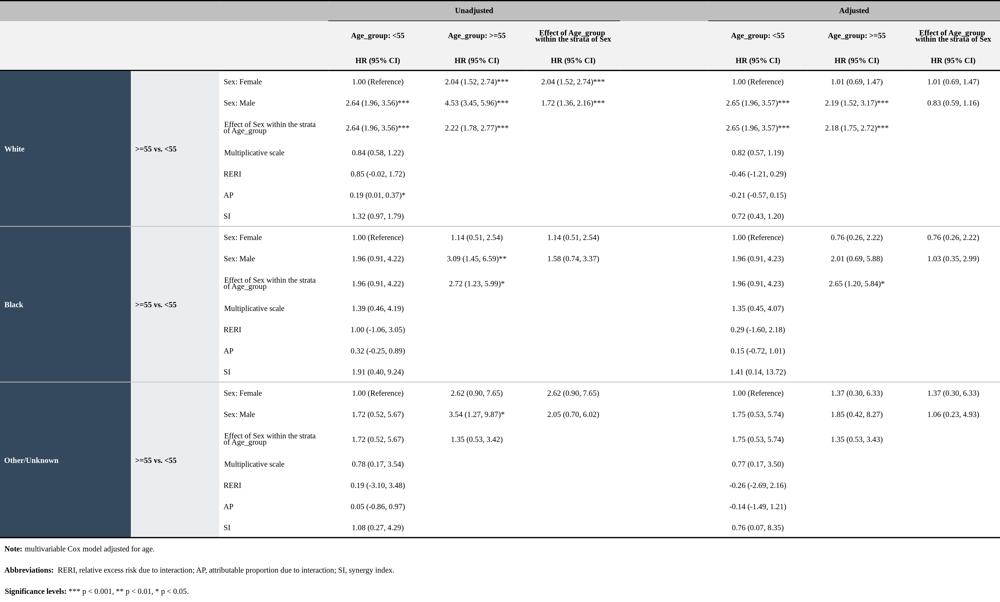{fig-alt="按种族分层的性别与年龄组交互表纵向排版，并导出到横向 Word 页面。"}

:::

图片展示的是返回表格的内容。实际 Word 导出另外核验了文档内的表格与横向页面设置；`note_below` 的段落编码只影响 Word 文件，图片无法单独证明这一文件结构。

## plt_inter()：组合图、分解与热图 {#plt-inter}

```r
# 接口签名（不执行）
plt_inter(table_result, theme_use = UtilsR::theme_my, base_size = 14)
```

输入必须是**一个二分类×二分类的 8×4 比值交互表**，例如 `inter_or[["Adjus"]]`；不能直接传整个分析列表、完整多水平结果、分层 grid 或 `get_inter_abs()` 的 9×4 表。

当前图形坐标标题固定为 **OR**，所以本节使用前面的 **Logistic** 结果，避免把 Cox HR 图按 OR 标注。图从显示表中的已四舍五入数值构造，适合展示交互形态；精确统计报告仍应读取原始模型与未舍入估计。

```r
plots <- plt_inter(inter_or[["Adjus"]])
```

::: {.panel-tabset}

### 组合图 {.unnumbered}

左侧为加性分解，右侧为乘性交互折线。两张图描述同一份 Logistic 比值结果的不同组合方式。

```r
plots[["combined"]]
```

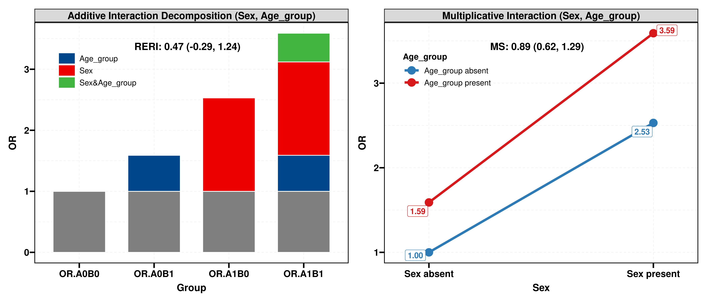{fig-alt="调整种族后的 Logistic OR 交互图，左侧四组加性分解、右侧性别与年龄组交互折线。"}

### 联合效应热图 {.unnumbered}

四个暴露组合相对于共同参考组的 OR。颜色展示数值大小，不单独检验交互。

```r
plots[["add"]]
```

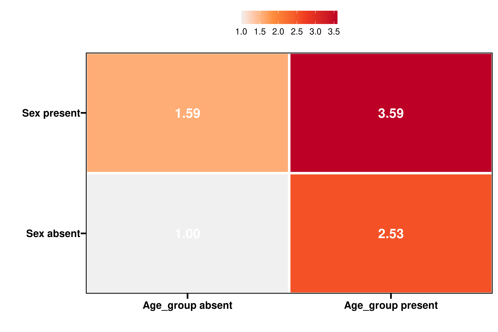{fig-alt="Female 与小于 55 岁为共同参考组，展示性别与年龄组四个联合状态的 Logistic OR。"}

### 加性分解 {.unnumbered}

按 Reference、OnlyB、OnlyA、RERI 分解联合比值。这里的 RERI 基于 OR；柱高不能读成死亡概率或人数。

```r
plots[["stack"]]
```

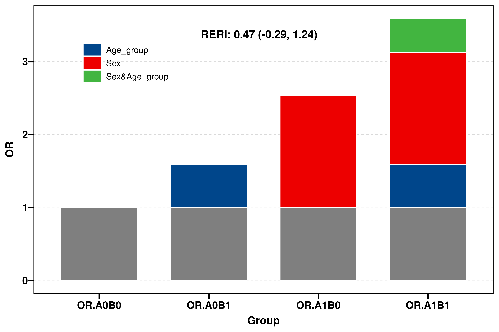{fig-alt="Logistic OR 的参考项、两个单独效应项与 RERI 堆叠分解，数值不是绝对死亡风险。"}

### 乘性交互折线 {.unnumbered}

用线条比较年龄组内的性别联合 OR。图形受坐标尺度影响，是否存在交互应结合模型检验与区间阅读。

```r
plots[["line"]]
```

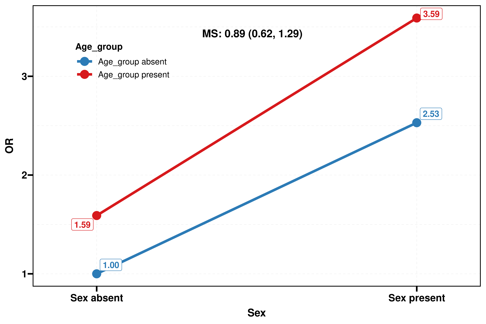{fig-alt="以性别为横轴，按年龄组连接 Logistic 联合 OR，展示乘性交互形态。"}

:::

`stack`、`line`、`add` 返回 ggplot，`combined` 为 patchwork，可以继续调整主题或保存。`theme_use` 接受主题对象、主题函数或函数名字符串，`base_size` 设置基础字号。这些参数不重新拟合模型。

<!-- interaction-extension: start -->

## get_eff_inter()：把亚组效应与交互放进一张表 {#get-eff-inter}

本节于 2026-10-01 按当前源码补充，使用前文同一 RegR MTC 完整病例队列，实际运行以下 Cox 示例。get_eff_inter 将 get_eff 的亚组效应与 get_inter 的乘法交互、RERI 整理到同一张表；它不是 get_inter_abs 的绝对风险输出。

cat_var 必须是单个二分类暴露，sub_var 指定一个或多个分类修饰变量。默认 subgroup_model="separate" 的亚组效应分别拟合；本节显式设为 "interaction"，从同一完整交互模型提取简单效应和交互指标。Age_group 的每行 HR 均表示该年龄层内 Male 对 Female 的效应，不能读成该年龄层本身的 HR。

返回 data.frame，带 attr(...,"eff") 和 attr(...,"inter") 保存原始结果；split_var 非空时返回按外层层级命名的 list，每层独立分析。函数会自动打印 gt 表，run_quiet 仅抑制打印；再次调用 fmt_eff_inter_gt 不拟合模型。

当前比值模式支持 Cox、Fine–Gray、Logistic；Fine–Gray 表格底层字段仍以 HR 命名，但格式化显示 sHR。这里实际执行 Cox，RERI 基于 HR 组合，不能直接称为绝对风险交互。inter_adjust 在当前源码中是保留但未使用的参数，不能通过它切换调整策略；选择 interaction 时交互与简单效应来自所选完整模型。

默认 all="Age" 需要 Age 列；event_by_group=TRUE 将事件数按 cat_var 两组分列，FALSE 则显示合并的事件/总人数。

```r
eff_inter <- run_quiet(get_eff_inter(inter_data, cat_var = "Sex",
  sub_var = c("Age_group", "Race"), adj_var = c("Age", "Race"),
  surv = TRUE, subgroup_model = "interaction"))
eff_inter_split <- run_quiet(get_eff_inter(inter_data, cat_var = "Sex",
  sub_var = "Age_group", adj_var = "Age", split_var = "Race",
  surv = TRUE, subgroup_model = "interaction"))
```

::: {.panel-tabset}

### 效应与交互 {.unnumbered}

实际 Cox 表：未调整和调整两个模型块；组别事件数分别显示。

```r
fmt_eff_inter_gt(eff_inter)
```

::: {.table-responsive}



:::

### 样式与合并事件数 {.unnumbered}

同一结果，关闭星号底色并合并事件数；改变表头色不改变估计。

```r
fmt_eff_inter_gt(eff_inter, show_color = FALSE, event_by_group = FALSE,
  uni_fill = "#355C7D", mul_fill = "#567D46", desc_fill = "#4A5568")
```

::: {.table-responsive}



:::

### 外层分层表 {.unnumbered}

按 Race 外层分层，各层内比较年龄组；list 被排成并列表格。

```r
fmt_eff_inter_gt(eff_inter_split, show_color = FALSE, event_by_group = FALSE)
```

::: {.table-responsive}



:::

:::

## 合并表的阅读顺序

先读各亚组内暴露效应，再读相对修饰变量参考层的 Multiplicative/RERI。Reference 是交互的基准层，不表示该亚组暴露没有效应；空白的标题/总体交互单元格也不是零。多水平修饰变量的逐水平结果与全局交互检验不同，不能用单行星号代替全局检验。按许多层级并排会产生宽表，本页使用横向滚动，正式发表前应选择必要层级。

本次补充内容对应的帮助页：[`get_eff_inter()`](https://hui950319.github.io/RegR/reference/get_eff_inter.html)、[`fmt_eff_inter_gt()`](https://hui950319.github.io/RegR/reference/fmt_eff_inter_gt.html)。

<!-- interaction-extension: end -->

## 选择入口与复现 {#reproduce}

::: {.table-responsive}

| 要回答的问题 | 使用入口与检查点 |
|:--|:--|
| HR / sHR / OR 尺度是否存在交互？ | `get_inter()`；先明确 `surv`、参考水平和完整模型 / 逐对模型 |
| 在某个时间点，两个暴露是否产生额外风险？ | `get_inter_abs(sur_time = ...)`；报告 IC、时间点、概率单位与标准化人群 |
| 完整随访的人时发生率交互？ | `get_inter_abs(poi_time = ...)`；报告发生率单位，区分固定时点风险 |
| 多水平修饰变量的总体交互？ | 显式选择 `multicat_model = "interaction"`；检查总体 Wald 检验及逐水平对比 |
| 同一结果需要网页与 Word 两种展示？ | `fmt_inter()` 选后端，或直接 `fmt_inter_gt()` / `fmt_inter_ft()`；格式化不改变分析 |
| 只导出调整模型，附协变量注释？ | 原始结果传给 `save_tb_inter(show_model = "adjusted", title = ...)` |
| 展示二分类 OR 的交互形态？ | 单个 Logistic 8×4 表传给 `plt_inter()`，结合数值表与统计检验解释 |

:::

页面仅公开汇总表格和图形，不提供患者级数据文件。完整函数帮助见 [RegR 参考文档](https://hui950319.github.io/RegR/reference/index.html)。复现时请核对安装版本；同一版本号下的本机开发快照与公开参考文档也可能存在接口差异。

## get_int：统一分析与分层画布 {#get-int-current}

前两张图按2026-10-15的RegR `2d4d83c` 在WSL执行。2026-10-16复核：已推送5956139包含这些接口；按该提交重新运行轻量例，table统计量与前快照逐项一致。当前默认已开启亚组树，下面代码显式设置tree_args=NULL；只凭0.1.3版本号不能判断旧安装。

两图只开启MS和标准交互分支；没有训练SHAP/HTE或树。先运行第一标签页，再运行分层标签页。返回的table保留统计量、contrast和model，results保留各分支对象，combined是画布、gt是完整交互表；分层返回strata、combined和gt，各层结果放在strata中。

mean_rank按已运行分析的伙伴强度平均排名，first按首分析，none保留vars顺序；排名不能当作因果证据。此模拟中函数提示有预防性暴露，解释RERI前须核对参照编码及比值方向。默认cont_cut="median"只改变规定分支，不是所有模型都统一二分类。

::: {.panel-tabset}

### 统一交互面板并保留原始结果

当前5956139默认开启MS、标准交互、SHAP、HTE及亚组树；H统计量和paired-VIMP默认关闭。NULL关闭对应分析，list()使用默认值，命名list传控制参数。本例显式关闭SHAP和HTE，只计算MS及乘法/加法交互；各量不是同一效应尺度。

```r
set.seed(20261015)
d_int <- data.frame(z = rep(0:1, 240), x = rnorm(480), marker = rnorm(480),
  sex = factor(rep(c("F", "F", "M", "M"), 120)), region = factor(rep(c("North", "South"), each = 240)))
d_int$outcome <- rbinom(480, 1, plogis(-0.3 + 0.4 * d_int$z + 0.5 * d_int$x + 0.8 * d_int$z * d_int$x))
int_basic <- get_int(d_int, int_var = "z", vars = c("x", "sex", "marker"),
  adj_var = c("x", "sex", "marker"), surv = "outcome", shp_args = NULL,
  hte_args = NULL, tree_args = NULL, order_by = "mean_rank", detail = "table")
int_basic$combined
```

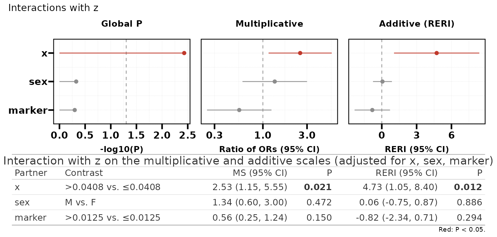{fig-alt="统一交互面板并保留原始结果的固定输入参数对照实图。"}

### 分层画布共享伙伴顺序

split_var对每个层独立分析，但每个伙伴跨层放在同一行。连续伙伴默认按全数据中位数切分用于标准交互和亚组森林，MS等分支保留各自分析定义。top_n只限制画图，table仍保留完整结果；无法估计的伙伴或分层可记录于failures。

```r
int_split <- get_int(d_int, int_var = "z", vars = c("x", "sex", "marker"),
  adj_var = c("x", "sex", "marker"), split_var = "region", surv = "outcome",
  shp_args = NULL, hte_args = NULL, tree_args = NULL, top_n = 3, detail = "table")
int_split$combined
```

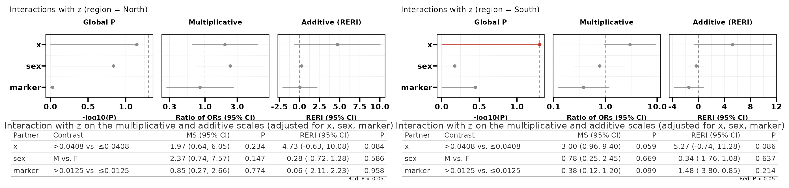{fig-alt="分层画布共享伙伴顺序的固定输入参数对照实图。"}

:::


当前已推送公共控制的补充：`vars=NULL`取adj_var；vars/adj_var中的int_var及split_var会剔除。surv=TRUE时use.DSS=FALSE改用OS；time默认120月，conf.level默认0.95，分支list的time/conf_level可覆盖公共值。5956139已包含这些参数。

tree_args当前默认list()，NULL明确关闭。默认六法为maxt、ctree_rel、ctree_abs、ctree_dr、ctree_r、ctree_cate；后者基于森林CATE的两阶段分裂P值偏乐观，只作探索。也可显式选择其他带检验的mob_*或ctree_*方法。后续树复用首棵的森林背景，树图在画布底部按宽度换行。需要二分类int_var、非Fine–Gray结局及相应grf/partykit/ggparty依赖。

省略tree_args时走默认安静模式：只有至少一棵树分裂才显示树行；无分裂的树仍保留在results/table，分裂P不加入伙伴排名，失败或缺包用message报告。显式传list()则请求正常树行为，与省略参数不完全相同。完整默认调用可能明显更耗时。

当前交互式print在Viewer显示整张画布并附完整表，可滚动、点击看原尺寸，同时在Plots中将整张PNG缩小显示；非交互会输出表并画图。导出应读取combined或使用save=list(filename="...")，按plot_size保留原尺寸，避免把Plots缩略预览当成导出质量。本页实图直接导出combined，没有打开RStudio Viewer。

## get_all交互画布与紧凑gt表格 {#intc-current}

2026-10-16按已推送RegR `5956139` 实际运行以下新例。intc.args调用get_int()并返回interCanvas；原int.args仍是get_inter()统计表分支，返回interTable。data、adj_var、surv、time、conf.level来自com.args，use.DSS也在公共层处理；共同split_var优先，分支只能重复相同值。

fmt_eff_inter_gt()同样支持compact。5956139还改为按模型项定位get_inter()的交互系数，旧结果对象须重新计算才会使用新逻辑。本节新例已重算，其他历史结果保留其原快照。

::: {.panel-tabset}

### 统一入口的轻量画布

复用前节d_int，显式关闭SHAP、HTE和树。返回的interCanvas保留table/results/gt/combined。

```r
int_from_all <- get_all(com.args = list(data = d_int, surv = "outcome",
  adj_var = c("x", "sex", "marker")),
  intc.args = list(int_var = "z", vars = c("x", "sex", "marker"),
    shp_args = NULL, hte_args = NULL, tree_args = NULL, detail = NULL))
int_from_all$interCanvas$combined
```

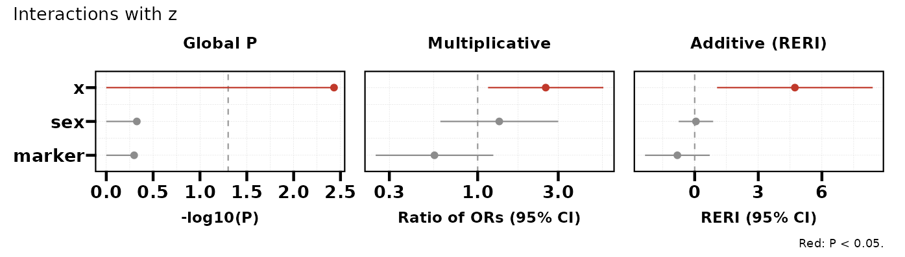{fig-alt="统一入口的轻量画布的固定输入参数对照实图。"}

### 默认紧凑gt

新建1600人的独立模拟数据作样式对照；两表使用同一结果，核对底层数据完全相同且没有NaN估计。compact=TRUE默认使用13px和较小单元格间距，只控制视觉密度。

```r
set.seed(20261016)
d_table <- data.frame(a = rep(0:1, 800), b = rep(c(0, 0, 1, 1), 400), score = rnorm(1600))
d_table$outcome <- rbinom(1600, 1, plogis(-2 + 0.8 * d_table$a + 0.9 * d_table$b +
  0.7 * d_table$a * d_table$b + 0.1 * d_table$score))
inter_table_new <- get_inter(d_table, exposure_names = c("a", "b"),
  adj_var = "score", surv = "outcome")
gt_compact <- fmt_inter_gt(inter_table_new)
gt_spaced <- fmt_inter_gt(inter_table_new, compact = FALSE)
gt_compact
```

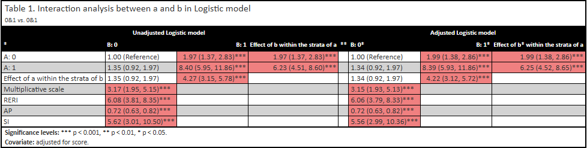{fig-alt="默认紧凑gt的固定输入参数对照实图。"}

### 恢复gt常规间距

复用前一标签页的gt_spaced；两表统计量和区间一致。

```r
gt_spaced
```

{fig-alt="恢复gt常规间距的固定输入参数对照实图。"}

:::


## 分层前检查与可保存结果页 {#int-view-current}

2026-10-16按RegR a8a6eb8核对。至少两层的提前检查和结果环境整理已包含于远端1dc3b2f：split_var过滤缺失后若仅剩一层，会在任何拟合前报错。应先检查完整病例中的层数，不能等待运行完再将单层结果称为“分层分析”。结果不再因局部工作环境意外保存整份调用数据；results中的拟合、表和图仍有分析所需信息，不是匿名化对象。

get_int/get_int_split现在另有view字段，由fmt_page(combined,gt)构建。打印view可重显结果页，saveRDS保留该页；HTML导出用fmt_page的save。split结果的顶层有整页，各strata内部通常view=NULL，避免重复保存同一画布。缺htmltools或结果页构建失败时view可为NULL，应检查消息和该字段。

```r
# 接前面int_basic，交互会话或Quarto独立代码块中显示：
int_basic$view
# 保存完整图与表的HTML；不会重新拟合模型。
page_int <- fmt_page(int_basic$combined,int_basic$gt,
  save=list(filename=file.path(tempdir(),"interaction-results")))
```

完整执行、可下载HTML与PNG/矢量边界见 [结果页教程](function-modules.qmd#fmt-page-current)。前面的combined实图保留原执行提交；本轮只补新返回字段与提前检查说明。

## 当前 H 统计量：行权重随筛选和分层对齐 {#hst-rows-20261021}

<!-- refresh-20261021: int_rows -->

2026-10-21 按已推送 RegR `338a664` 与 MLR `8d94e59` 在 Windows / WSL R 4.4.3 执行。`hst_args$case.weights` 和每个 `hst_args$inbag` 向量都应按 `get_int()` **原始输入的全部行**传入。统一完整病例筛选和 `split_var` 分层会同步裁剪这些设置，不能提前只保留某一层或非缺失行。

### 分层结果与手动裁剪对照

```r
library(RegR)
library(MLR)
set.seed(721)
di <- data.frame(Tx = factor(rep(c("No", "Yes"), 90)), Marker = rnorm(180),
  Sex = factor(rep(c("F", "F", "M", "M"), 45)),
  Site = factor(rep(c("A", "B"), each = 90)))
di[["Outcome"]] <- factor(ifelse(runif(180) < plogis(
  di[["Marker"]] + (di[["Tx"]] == "Yes")), "Yes", "No"), levels = c("No", "Yes"))
di[["Marker"]][c(3, 111)] <- NA_real_
original_weights <- seq_len(nrow(di))
hst_settings <- list(num.trees = 30, Num.sample = 60, importance = "impurity",
  class = "Yes", case.weights = original_weights, num.threads = 1,
  hstats_args = list(approx = TRUE, grid_size = 8, n_max = 35))
rows_now <- get_int(di, "Tx", vars = c("Marker", "Sex"), split_var = "Site",
  surv = "Outcome", seed = 721, detail = character(),
  ms_args = NULL, inter_args = NULL, shp_args = NULL, hte_args = NULL, tree_args = NULL,
  hst_args = hst_settings)
check_rows <- lapply(c("A", "B"), function(site) {
  keep <- which(di[["Site"]] == site & complete.cases(di[c("Tx", "Marker", "Sex", "Outcome")]))
  manual <- MLR::get_hstats(di[keep, ], c("Tx", "Marker", "Sex"),
    surv = "Outcome", class = "Yes", int_var = "Tx", seed = 721,
    num.trees = 30, Num.sample = 60, importance = "impurity", num.threads = 1,
    case.weights = original_weights[keep], verbose = FALSE,
    hstats_args = list(approx = TRUE, grid_size = 8, n_max = 35))
  got <- rows_now[["strata"]][[site]][["results"]][["hst"]]
  stopifnot(!is.null(got),
    isTRUE(all.equal(attr(got, "interaction_raw"), attr(manual, "interaction_raw"), tolerance = 1e-10)))
  data.frame(site = site, original_complete_rows = length(keep),
             forest_training_rows = attr(got, "settings")[["n_train"]])
})
do.call(rbind, check_rows)
```

本例每层 90 人，各排除 1 个 Marker 缺失行后剩 89 人，再各抽 60 行训练；两个分层结果的原始交互矩阵与手动裁剪输入、权重后直接调用 MLR 一致。返回森林 `settings$train_rows` 是**该次传给 MLR 的层内完整病例输入**的位置；要回溯至原表，应再用上面的 `keep` 映射，不能把它直接当作原表行号。

### 逐树 inbag 与长度检查

```r
inbag_settings <- hst_settings
inbag_settings[["case.weights"]] <- NULL
inbag_settings[["inbag"]] <- replicate(30, rep(1L, nrow(di)), simplify = FALSE)
inbag_now <- get_int(di, "Tx", vars = c("Marker", "Sex"), surv = "Outcome",
  seed = 721, detail = character(), ms_args = NULL, inter_args = NULL,
  shp_args = NULL, hte_args = NULL, tree_args = NULL, hst_args = inbag_settings)
stopifnot(!is.null(inbag_now[["results"]][["hst"]]))
bad_settings <- hst_settings
bad_settings[["case.weights"]] <- original_weights[-1]
length_error <- tryCatch(get_int(di, "Tx", vars = c("Marker", "Sex"), surv = "Outcome",
  ms_args = NULL, inter_args = NULL, shp_args = NULL, hte_args = NULL, tree_args = NULL,
  hst_args = bad_settings), error = identity)
stopifnot(inherits(length_error, "error"),
          grepl("per input row", conditionMessage(length_error), fixed = TRUE))
```

`inbag` 列表仍须符合 ranger 的逐树设置；本例每棵树在保留行上均使用一次，只用于验证传递，不是推荐的重采样设计，也不用于 OOB 误差。权重和 inbag 的统计含义由调用者决定；这里只同步行位置，不把它们迁移到回归、SHAP 或 HTE 分支。

当前 MLR 支持 `int_var` 时，`get_int()` 自动只保留 Tx 的焦点配对；旧 MLR 没有该参数时会计算全矩阵。`hst_args` 仍默认关闭，需显式给列表启用。H² 是预测交互强度，画布 `score` 另做显示缩放；原值见 `results$hst` 的 `interaction_raw`，其覆盖率与固定时间规则见 [MLR 交互教程](../mlr/interaction-guide.qmd#hstats-20261021)。

<!-- /refresh-20261021: int_rows -->

## 当前随机种子与计算复用 {#seed-20261018}

2026-10-18按已推送RegR `7265b31`，在Windows / WSL R 4.4.3实际运行下面含随机森林的轻量示例。公共`seed`现在默认123；各随机分析由该值初始化，分支`*_args$seed`可局部覆盖。非NULL公共seed下调用后恢复调用者随机状态。

```r
set.seed(1018)
n <- 180L
d_seed <- data.frame(Tx = factor(sample(c("No", "Yes"), n, TRUE)),
  Sex = factor(sample(c("Female", "Male"), n, TRUE)), Marker = rnorm(n))
d_seed[["time"]] <- rexp(n, exp(-3.5 + 0.4 * d_seed[["Marker"]] * (d_seed[["Tx"]] == "Yes")))
d_seed[["DSS"]] <- rbinom(n, 1, 0.7)
int_call <- function() get_int(d_seed, int_var = "Tx", vars = c("Sex", "Marker"), time = 24,
  ms_args = list(), inter_args = NULL, shp_args = NULL, hte_args = NULL, tree_args = NULL,
  hst_args = list(num.trees = 80, Num.sample = 100,
    hstats_args = list(approx = TRUE, grid_size = 10, n_max = 60)))
seed_before <- .Random.seed
int_seeded <- int_call()
int_repeat <- int_call()
stopifnot(identical(.Random.seed, seed_before),
  isTRUE(all.equal(int_seeded[["table"]], int_repeat[["table"]], check.attributes = FALSE)))
int_seeded[["combined"]]
```

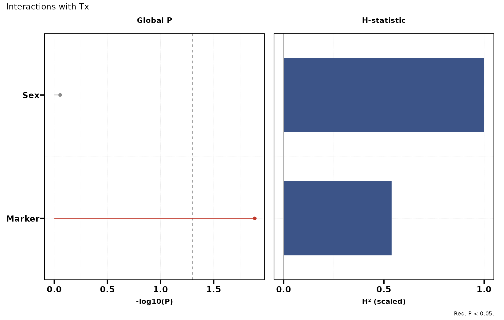{fig-alt="180条模拟生存记录的整体交互P值与H统计量对照，Sex和Marker按相同伙伴行对齐。"}

两平台均通过随机状态恢复和重复table一致断言。本例只实际计算MS和H统计量，未训练SHAP、HTE或亚组树；H²经过画布缩放，不是临床效应或因果交互量。`seed=NULL`表示不统一固定：SHAP使用并推进会话随机状态，其他分支沿用各自默认种子，不能继续断言全部重复一致。

树分支继续复用首个方法的森林，但当前返回结果仅在第一棵保留供后续reuse使用的森林背景。把后面的树单独传给复用接口时可能需要重新拟合，不能把它当成每棵都携带完整森林的缓存。该内存组织变化与本例的H统计量验证范围分开。

### get_all在knitr中按需构建页面 {#knitr-view-20261018}

`get_all(intc.args=...)`在knitr里先返回分析对象，延后整页view构建，因此`interCanvas$view`可为NULL。图和表应在各自代码块显示；确实需要单页HTML时再调用fmt_page，不必重拟合：

```r
# 置于Quarto/R Markdown的分析代码块中：
all_knit <- get_all(com.args = list(data = d_seed, surv = TRUE, time = 24),
  intc.args = list(int_var = "Tx", vars = c("Sex", "Marker"), inter_args = NULL,
    shp_args = NULL, hte_args = NULL, tree_args = NULL))
all_knit[["interCanvas"]][["combined"]]  # 放在单独图代码块
all_knit[["interCanvas"]][["gt"]]        # 放在单独表代码块
# 需要整页时显式组合；不是直接打印可能为NULL的view。
fmt_page(Plot = all_knit[["interCanvas"]][["combined"]],
  Table = all_knit[["interCanvas"]][["gt"]],
  save = list(filename = file.path(tempdir(), "interaction-page.html")))
```

本轮在独立R进程模拟`knitr.in.progress=TRUE`，实际确认view为NULL且分析正常完成；没有重跑整本笔记或用户RStudio会话。对应函数：`get_int()`（RegR 函数参考站点尚未收录）。

## 多模型交互分析与逐模型 Word 导出 {#models-20261019}

2026-10-19 按已推送 RegR `f26e137` 在 Windows / WSL R 4.4.3 执行。沿用本页 `inter_data`、Sex 与 Age_group 的参考组；比较 Cox HR 与 Fine–Gray sHR 的模型比值尺度交互。

<!-- rnotes-20261019: inter-models -->
```r
inter_models <- run_quiet(get_inter(inter_data,
  exposure_names = c("Sex", "Age_group"), adj_var = "Age",
  surv = list(sur = TRUE, cif = FALSE)))
inter_tables <- save_tb_inter(inter_models,
  title = c(sur = file.path(tempdir(), "interaction-sur.docx"),
            cif = file.path(tempdir(), "interaction-cif.docx")),
  note = c(sur = "Cox HR; other-cause deaths are censored.",
           cif = "Fine-Gray sHR; other-cause deaths compete."),
  show_ap_si = TRUE, show_subeffect = "both")
names(inter_tables)  # "sur" "cif"
```

::: {.panel-tabset}

### Cox {.unnumbered}

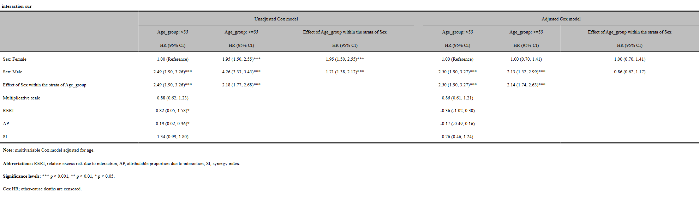{fig-alt="Cox模型的Sex与Age_group交互表，保留RERI、AP、SI及行列内效应；结果来自本节实际拟合。"}

[查看 HTML](images/interaction-guide/20261019-model-sur.html){target="_blank"} · [下载 Word](images/interaction-guide/20261019-model-sur.docx)

### Fine–Gray {.unnumbered}

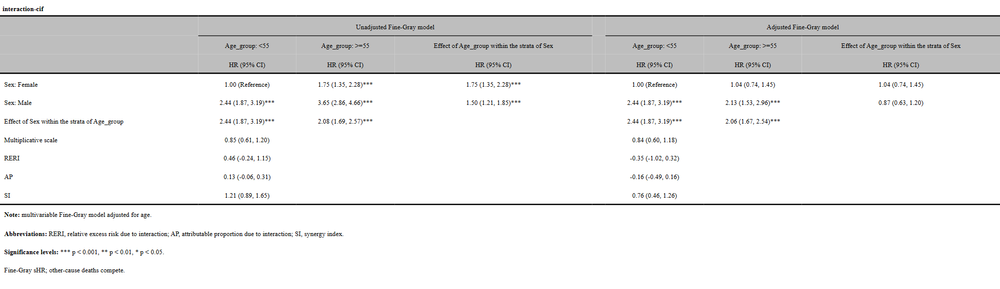{fig-alt="同一多模型调用的Fine–Gray交互表，使用sHR并保留RERI、AP、SI，脚注说明竞争事件处理。"}

[查看 HTML](images/interaction-guide/20261019-model-cif.html){target="_blank"} · [下载 Word](images/interaction-guide/20261019-model-cif.docx)

:::

`get_inter()` 返回带 `surv_models` 类的命名 list；`save_tb_inter()` 识别该结果，分别返回 flextable 并输出 Word。`title`、`note` 可用按模型命名的字符向量或 list，其他参数按模型分别设置时使用同名 list。单个已有 flextable 的保存行为不变。

本节显式设置 AP/SI 和行列摘要，复现时不依赖默认显示选项。模型各自使用其所需变量的完整案例；HR 与 sHR 的加法派生指标不等于绝对风险交互。需要后者时继续使用本页 `get_inter_abs()` 的原始数据工作流，本节不把它作为多模型接口示例。

## 当前 Word 默认值与多模型核对 {#defaults-check-20261019}

2026-10-19 按已推送 RegR `4034a97` 在 Windows / WSL R 4.4.3 实际运行。`save_tb_inter()` 当前默认 `show_ap_si = FALSE, show_subeffect = "row"`，只保留主要加性指标和主暴露的层内效应行。要恢复历史完整显示，显式使用 TRUE / `"both"`；这不改变模型拟合。`fmt_inter_ft()` 的默认仍是 `"both"`。

本节另取598人 PTC 队列，以 No CND、Female 为参考，分析 CND × Sex，调整 Age；与前面的 MTC 表不是同一分析。Cox HR 与 Fine–Gray sHR 的 RERI 均为比值尺度派生指标，不能读作绝对风险差。保护性暴露的提示仍需结合参考组解释。

<!-- rnotes-refresh: inter -->
```r
dat_now <- as.data.frame(ToyData::toy_ptc_m1_cnd)
dat_now[["N_4"]] <- stats::relevel(dat_now[["N_4"]], ref = "No CND")
dat_now[["Sex"]] <- stats::relevel(dat_now[["Sex"]], ref = "Female")
inter_check <- run_quiet(get_inter(dat_now,
  exposure_names = c("N_4", "Sex"), adj_var = "Age", surv = c(TRUE, FALSE)))
facet_check <- run_quiet(get_facet(dat_now,
  split_var = "Sex", cat_var = "N_4", adj_var = "Age",
  surv = c(TRUE, FALSE), method = c("unadj", "direct"),
  show_sur = FALSE, max_t = 120, parallel = 1,
  plot_params = list(conf_int = FALSE),
  table_params = list(insert_table = FALSE, add_p_value = "none")))
audit_models <- check_inter_facet(inter_check, facet_check,
  cat_var = "N_4", modifier = "Sex")
lapply(audit_models, function(x) x[["consistent"]])

default_file <- file.path(tempdir(), "20261019-refresh-inter-default.docx")
full_file <- file.path(tempdir(), "20261019-refresh-inter-full.docx")
ft_default <- save_tb_inter(inter_check[["sur"]],
  title = default_file, font_size = 10)
ft_full <- save_tb_inter(inter_check[["sur"]],
  title = full_file, font_size = 10,
  show_ap_si = TRUE, show_subeffect = "both")
```

::: {.panel-tabset}

### 当前默认 {.unnumbered}

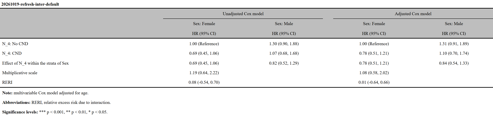{fig-alt="同一Cox交互分析的精简Word表，保留主要加性指标RERI和CND的层内效应行，省略AP、SI及另一方向的效应摘要。"}

[查看 HTML](images/interaction-guide/20261019-refresh-inter-default.html){target="_blank"} · [下载 Word](images/interaction-guide/20261019-refresh-inter-default.docx)

### 完整显示 {.unnumbered}

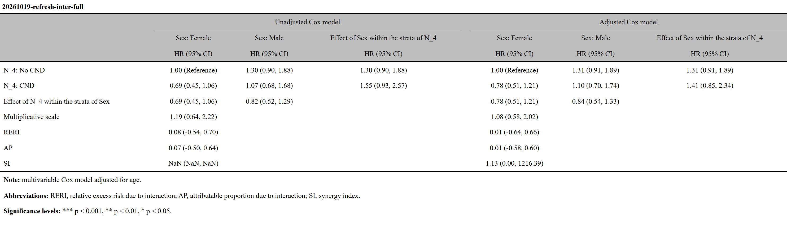{fig-alt="相同Cox结果使用show_ap_si TRUE和show_subeffect both，显示AP、SI及行列两个方向的效应摘要；估计来源不变。"}

[查看 HTML](images/interaction-guide/20261019-refresh-inter-full.html){target="_blank"} · [下载 Word](images/interaction-guide/20261019-refresh-inter-full.docx)

:::

### check_inter_facet() 的核对范围

本例完整表的未调整 SI 为 `NaN`，调整后的 SI 区间也很宽，反映该编码下指标不可估计或不稳定，不能填成0或解释为没有交互。精简显示不会修复这一统计问题。

当前入口支持一对 `surv_models`，按名称分别检查 Cox 与 Fine–Gray；本例两模型均通过。`audit_models[["cif"]][["comparison"]]` 可查看逐单元结果。它比较的是已格式化的分层 HR/sHR 显示文本，只规范首尾及重复空白，不重新拟合。

[下载本例逐单元核对结果](images/interaction-guide/20261019-refresh-inter-check.csv)。

| 检查项目 | 当前行为 |
|:--|:--|
| 同名模型 | 逐一比较，返回 `check_inter_facet_pairs` |
| 只有一边存在的模型 | 记录在 `attr(audit_models, "unmatched")`，不算已通过 |
| 一边多模型、一边单结果 | 报错；两边都先选择同一模型再比较 |
| 不显式传两个对象 | 在调用环境按 `inter_*` / `facet_*` 后缀配对；正式核验宜明确传对象 |
| `status` | `equal / different / missing_inter / missing_facet / not_estimable`，须查看具体单元 |

该检查不覆盖交互P值、RERI、曲线、概率差或人数，也不证明两条分析路径在未舍入数值上完全相同。若使用不同模型、参考组或逐对拆分策略，先核对 `same_model_expected` 与设置，不能为了得到 TRUE 而改写显示文本。

`get_inter()` 现也接受 `cif_args`，放在 `conf_level` 后。`"CRR"` 让 Fine–Gray 比值与交互拟合回到 `tidycmprsk::crr()`；`"CSC"` 在这个不绘制 direct CIF 的入口中仍沿用默认 mets 比值拟合。`get_inter_abs()` 的固定时点 CIF 另有概率路径和区间要求，见[后端边界](get-eff-cif-benchmark.qmd#current-backend)。
