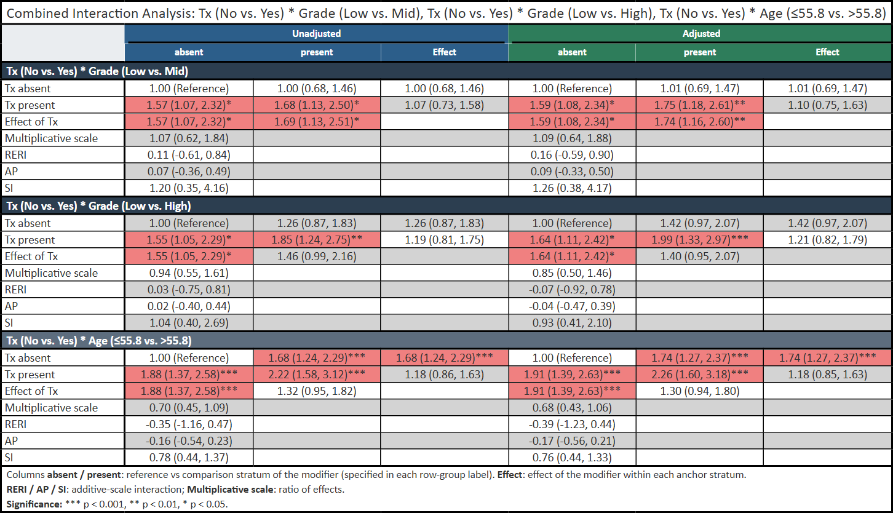
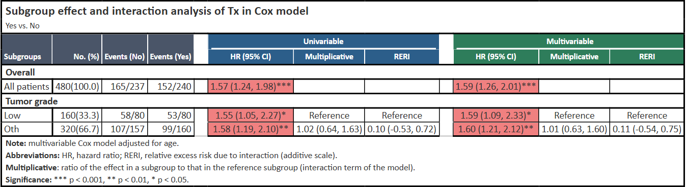
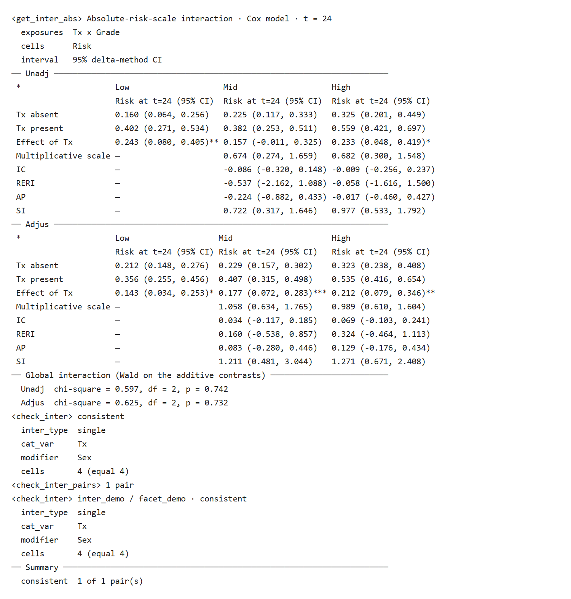

先选择交互分析的尺度，再把原始结果交给格式化、保存或绘图函数。本页沿用 [SHAP 示例页](../mlr/shap-guide.qmd) 的展示方式：关键参数放在标签页中对照，每个示例配代码和实际结果，点击图片可以放大。

Word 保存函数的正式名称是 **`save_tb_inter()`**；当前没有 `save_inter_tb` 这个别名。下文统一使用实际接口。

::: {.callout-note collapse="true" title="版本与复现记录"}
**版本与执行范围：** 接口按 RegR **0.1.3** 的本机源码快照 `0add2bb` 核对，使用 WSL R **4.4.3** 实际拟合模型，生成 **21 张不同的结果图**，并验证 3 份 Word 导出文件。页面展示已保存的汇总结果；代码可在装有相应版本 RegR 及依赖的 R 环境中复现。

**2026-10-02 更新：** [竞争风险绝对交互的 mets 优化](interaction-abs-guide.qmd#cif-mets-update) 按 RegR 源码快照 `cefc1a5`、mets **1.3.13** 补充，包含默认 `delta` 与可选 `boot` 的真实结果、完整调用计时及可下载记录。该节更新了下文 Fine–Gray 区间的计算说明。
:::

## 示例数据与分析尺度 {#data}

本页使用 RegR 自带的 `seer_thyroid_mtc_2026`，即 **4,387 人的甲状腺髓样癌（MTC）队列**。它与 [森林图示例](forest-guide.qmd) 使用的 M1 乳头状甲状腺癌（PTC）队列不同。

示例比较性别与种族、性别与年龄组的交互。`Female`、`White`、`<55` 显式设为参考水平；年龄组的 `>=55` 包含恰好 55 岁。按所用变量完整病例及正随访筛选，不对整个数据集插补。

```r
library(RegR)

data("seer_thyroid_mtc_2026", package = "RegR")
cohort <- as.data.frame(seer_thyroid_mtc_2026)
inter_data <- cohort[
  complete.cases(cohort[, c("Sex", "Age", "Race", "DSS", "time")]) &
    cohort$time > 0,
]
inter_data <- droplevels(inter_data)
inter_data$DSS <- as.numeric(inter_data$DSS)
inter_data$Sex <- factor(inter_data$Sex, levels = c("Female", "Male"))
inter_data$Race <- stats::relevel(factor(inter_data$Race), ref = "White")
inter_data$Age_group <- factor(
  ifelse(inter_data$Age < 55, "<55", ">=55"),
  levels = c("<55", ">=55")
)
```

### 当前未调整KM示例

```r
inter_abs_unadj <- run_quiet(get_inter_abs(inter_data,
  exposure_names = c("Sex", "Age_group"), adj_var = NULL,
  surv = TRUE, sur_time = 120, ci_method = "delta"))
fmt_inter(inter_abs_unadj, output_format = "flextable")
```

{fig-alt="四组未调整生存风险及绝对交互表，区间基于S(t)的Greenwood标准误。"}


下文代码共用这份 `inter_data`。各标签页分别建立有明确名称的分析对象；格式化、Word 导出和绘图部分继续使用这些对象。`run_quiet()` 只控制控制台输出，不改变模型计算。

::: {.table-responsive}

| 入口与设置 | 估计量 | 时间与结局的含义 |
|:--|:--|:--|
| `get_inter(surv = TRUE)` | Cox HR，以及基于 HR 的乘性与加性指标 | 使用 `time` 与 0/1 的 `DSS`；其他原因死亡作为删失 |
| `get_inter(surv = FALSE)` | Fine–Gray sHR，以及基于 sHR 的交互指标 | 使用 `time` 与 `event`；0 为删失、1 为目标事件、其他事件为竞争事件 |
| `get_inter(surv = "DSS")` | Logistic OR，以及基于 OR 的交互指标 | 将 `DSS` 当作二分类结局，未利用随访时间 |
| `get_inter_abs(surv = TRUE, sur_time = 120)` | 标准化的 Cox 事件风险及风险交互 | 本数据时间单位为月；120 月为 10 年，风险为 `1 - S(120)` |
| `get_inter_abs(surv = FALSE, sur_time = 120)` | 标准化的目标事件 CIF 及其交互 | 保留竞争事件；CIF 与上一行的 `1 - S` 不是同一个量 |
| `get_inter_abs(poi_time = 12 * 1000)` | Poisson 人时发生率及发生率交互 | 使用完整随访；本数据按每 1,000 人年报告 |
| `get_inter_abs(surv = "DSS")` | 标准化的 Logistic 概率及概率交互 | 对观察到的二分类结局建模；不能标为某个固定随访年限的风险 |

:::

::: {.callout-note title="读数与解释边界"}
`surv = FALSE` 选择竞争风险路径；选择 Logistic 应传入结局列名字符串。

HR、sHR、OR 是三个不同的比值尺度。由它们计算的 RERI / AP / SI 不能直接当作风险差；尤其 HR / sHR 上的加性指标并不等于固定时点的绝对风险交互。OR 也不能普遍当作风险比使用。

本页用于说明观察性队列的模型与接口行为。模型交互依赖参考组、调整项与所选尺度，不自动建立因果识别；“一组显著、另一组不显著”不能替代交互检验。
:::

## get_fit_ms()：保留完整编码的整体乘法交互检验 {#get-fit-ms}

本节按 RegR 0.1.3 源码 `40515e1` 核对，复用本页完整案例队列，在 WSL R 4.4.3 中实际执行。`get_fit_ms()` 不把多分类变量拆成多次二分类比较，而是为每个“暴露 × 修饰变量”拟合嵌套模型，检验全部交互项。

```r
get_fit_ms(data, exposure_names, adj_var = NULL, surv = TRUE,
  test = c("LRT", "Wald"))
```

`exposure_names` 的第一个变量是暴露，其余变量按顺序逐一作为修饰变量。二分类、多分类、连续 × 分类、连续 × 连续均保留完整编码；数字编码的分类变量应先转为 factor，否则按线性连续项建模。

Cox / Logistic 默认使用 LRT；Fine–Gray 使用联合 Wald 检验，显式要求 LRT 会提示并改用 Wald。输出给出实际使用的 `test`、`statistic`、`df`、`p.value`、`n` 与 `events`。同一变量对的未调整和调整模型使用同一批完整案例，保证差异来自调整设置。

```r
ms_cox <- get_fit_ms(inter_data, exposure_names = c("Sex", "Race", "Age"),
  adj_var = "Age", surv = TRUE)
inter_data[["status"]] <- factor(inter_data[["event"]], levels = 0:2)
ms_fg <- get_fit_ms(inter_data, exposure_names = c("Age", "Race"),
  adj_var = "Sex", surv = FALSE, test = "Wald")
```

### Cox：二分类 × 三分类 / 连续变量

:::: {.table-responsive tabindex="0" role="region" aria-label="表格，可横向滚动"}

|exposure |modifier |model |type           |    n| events|test | statistic| df| p.value|
|:--------|:--------|:-----|:--------------|----:|------:|:----|---------:|--:|-------:|
|Sex      |Race     |Unadj |2 x 3          | 4387|    597|LRT  |     0.960|  2|   0.619|
|Sex      |Race     |Adjus |2 x 3          | 4387|    597|LRT  |     1.198|  2|   0.549|
|Sex      |Age      |Unadj |2 x continuous | 4387|    597|LRT  |     0.416|  1|   0.519|

::::


### Fine–Gray：连续变量 × 三分类

:::: {.table-responsive tabindex="0" role="region" aria-label="表格，可横向滚动"}

|exposure |modifier |model |type           |    n| events|test | statistic| df| p.value|
|:--------|:--------|:-----|:--------------|----:|------:|:----|---------:|--:|-------:|
|Age      |Race     |Unadj |continuous x 3 | 4387|    597|Wald |     1.212|  2|   0.546|
|Age      |Race     |Adjus |continuous x 3 | 4387|    597|Wald |     0.825|  2|   0.662|

::::


这是模型比值尺度上的整体交互检验，不给出 RERI、AP、SI，也不等于绝对风险差的交互检验。若要展示每个组合的效应和加法指标，继续使用本页的 `get_inter()` / `get_inter_abs()`；若要判断保留完整编码后的整体乘法交互，使用 `get_fit_ms()`。

空组合会导致不可估计项被剔除并减少实际 df；分类组合内无事件或无非事件会使 Wald 统计量和 P 值成为 NA 并给出提示。不能把 NA 当作“不存在交互”。

## 函数与结果对象总览 {#workflow}

::: {.table-responsive}

| 函数 | 输入与职责 | 返回值与下一步 |
|:--|:--|:--|
| [`get_fit_ms()`](#get-fit-ms) | 保留分类与连续编码，检验全部乘法交互项 | 含统计量、实际 df、P 值、分析 N 和事件数的 data.frame；不返回加性交互指标 |
| [`get_inter()`](#get-inter) | 从数据拟合比值尺度的交互 | `get_inter` 结果；交给 `fmt_inter()` / `save_tb_inter()`，单个 8×4 表可交给 `plt_inter()` |
| [`get_inter_abs()`](interaction-abs-guide.qmd#get-inter-abs) | 从数据估计标准化风险、CIF 或发生率的交互 | `get_inter_abs` 结果；含主要加性指标 IC，可格式化或导出 |
| [`fmt_inter()`](interaction-export-guide.qmd#fmt-inter) | 自动识别结果形状，选择表格后端 | 默认 `flextable`；也可返回 `gt_tbl` 或相应 `gt_group` |
| [`fmt_inter_ft()`](interaction-export-guide.qmd#fmt-inter-ft) | 直接选择 Word 表格后端 | `flextable`；继续排版或交给 `save_tb_inter()` |
| [`fmt_inter_gt()`](interaction-export-guide.qmd#fmt-inter-gt) | 直接选择网页表格后端 | `gt_tbl`；单结果分开显示时可为 `gt_group` |
| [`save_tb_inter()`](interaction-export-guide.qmd#save-tb-inter) | 组织发表用表格并按需写入 Word | 始终返回 `flextable`；`title` 非空时另写 `.docx` |
| [`plt_inter()`](interaction-export-guide.qmd#plt-inter) | 从一个二分类×二分类的 8×4 交互表绘图 | `stack`、`line`、`add`、`combined` 四个图对象 |

:::

### 比值尺度与绝对尺度的加性交互

令两个二分类暴露为 $A,B$，`00` 为共同参考组。比值尺度中，联合效应为 $\theta_{11}$，单独效应为 $\theta_{10},\theta_{01}$，参考值 $\theta_{00}=1$：

$$
\begin{aligned}
M &= \frac{\theta_{11}}{\theta_{10}\theta_{01}},\\
\mathrm{RERI} &= \theta_{11}-\theta_{10}-\theta_{01}+1,\\
\mathrm{AP} &= \frac{\mathrm{RERI}}{\theta_{11}},\\
\mathrm{SI} &= \frac{\theta_{11}-1}{\theta_{10}+\theta_{01}-2}.
\end{aligned}
$$

`M` 的无交互值为 1，RERI / AP 为 0，SI 为 1。SI 的分母接近 0 时可能不稳定；保护性效应或改变参考组也会影响这些指标的含义，不能仅凭一行星号归纳交互。

绝对尺度则先估计四个标准化量 $p_{00},p_{10},p_{01},p_{11}$，再计算：

$$
\mathrm{IC}=p_{11}-p_{10}-p_{01}+p_{00}.
$$

风险 / CIF 模式的 IC 是**概率差的差**，无加性交互值为 0。例如 IC 为 0.05 表示额外 5 个百分点；发生率模式的 IC 带有人时发生率单位。绝对结果中的 RERI 是 IC 相对 $p_{00}$ 的归一化量，AP 是 IC 相对 $p_{11}$ 的归一化量，两者均不同于 IC 本身。

## get_inter()：比值尺度与模型组织 {#get-inter}

### 当前接口

```r
# 接口签名（不执行）
get_inter(
  data, exposure_names, adj_var = NULL,
  surv = TRUE, conf_level = 0.95,
  cif_args = list(model = c("FGR", "CSC", "CRR")),
  split_var = NULL, ref_idx = NULL,
  multicat_model = c("interaction", "separate"),
  eff_inter = FALSE, binary_ref = NULL
)
```

::: {.table-responsive}

| 参数 | 使用方式与影响 |
|:--|:--|
| `exposure_names` | 一个列名时与各 `adj_var` 逐对分析；两个列名对应一对暴露。多于两个时，第一个为二分类主暴露，其余逐一作为修饰变量；此时需 `multicat_model = "separate"` |
| `adj_var` | 调整变量列名；结果保留 `Unadj` 与 `Adjus` 模型。修改调整项会重算模型 |
| `surv` | `TRUE` 为 Cox，`FALSE` 为 Fine–Gray，结局列名字符串为 Logistic |
| `conf_level` | 置信水平，默认 0.95；影响区间和显著性显示 |
| `cif_args` | Fine–Gray 拟合后端；默认FGR/mets，CRR使用 `tidycmprsk::crr()`；本入口的CSC仍使用mets比值拟合 |
| `split_var` | 先按一个或多个变量分层，再在层内计算交互；分层变量从调整项移除 |
| `ref_idx` | 按水平名称或位置合并多水平变量的参考组，其余为 `Oth`；旧名 `binary_ref` 警告兼容，两者不能同给。会改变研究对比 |
| `multicat_model` | 二分类×多水平时，`"interaction"` 用一个完整交互模型；`"separate"` 用 K−1 个参考组对照的子集模型 |
| `eff_inter` | 默认 `FALSE` 返回交互指标表；`TRUE` 转发至 `get_eff_inter()` 的效应表路径，返回合同随之改变 |

:::

`multicat_model = "interaction"` 是当前默认值。二分类×二分类保持单个结果；二分类×多水平从一个包含所有联合水平的模型中提取对比，并保存总体 K−1 自由度 Wald 交互检验。`"separate"` 每次只保留参考水平与一个非参考水平，各模型的样本和估计值可能不同。

### 五种设置对照

::: {.panel-tabset}

### 完整多水平模型 {.unnumbered}

性别×种族，调整年龄。所有种族水平共同进入一个模型，结果类型为 `multicat`；表内各水平以 White 为参考。

```r
inter_multi <- RegR::run_quiet({
  get_inter(
    inter_data, exposure_names = c("Sex", "Race"),
    adj_var = "Age", surv = TRUE, multicat_model = "interaction"
  )
})
fmt_inter_gt(inter_multi)
```

{fig-alt="完整多水平交互模型，显示未调整和年龄调整后的 HR、乘性交互以及 RERI、AP、SI。"}

### 二分类组合 {.unnumbered}

性别×年龄组，调整种族，返回 `single`。共同参考组为 Female 且年龄 <55 岁；联合效应与层内效应的参考关系应分别阅读。

```r
inter_single <- RegR::run_quiet({
  get_inter(
    inter_data, exposure_names = c("Sex", "Age_group"),
    adj_var = "Race", surv = TRUE
  )
})
fmt_inter_gt(inter_single)
```

{fig-alt="二分类乘积模型，Female 与小于 55 岁为参考水平，显示种族调整前后的 HR 交互。"}

### 逐对模型 {.unnumbered}

把完整多水平模型切换为 `"separate"`，分别拟合 White vs Black、White vs Other/Unknown。两份子集模型合并展示，结果类型为 `mul`。与第一个标签页的差别来自模型与样本，不只是布局。

```r
inter_pairs <- RegR::run_quiet({
  get_inter(
    inter_data, exposure_names = c("Sex", "Race"),
    adj_var = "Age", surv = TRUE, multicat_model = "separate"
  )
})
fmt_inter_gt(inter_pairs)
```

{fig-alt="性别与种族的两份逐对交互模型，White 为共同的种族参考组，各模型使用对应的两水平子集。"}

### 分层分析 {.unnumbered}

按 Race 分层，再分别估计性别×年龄组，调整连续年龄。这里“按种族分层”和“种族作为交互变量”是不同的分析。

```r
inter_grid <- RegR::run_quiet({
  get_inter(
    inter_data, exposure_names = c("Sex", "Age_group"),
    adj_var = "Age", surv = TRUE, split_var = "Race"
  )
})
fmt_inter_gt(inter_grid)
```

{fig-alt="按 White、Black、Other/Unknown 分层，分别显示性别与年龄组交互的未调整和年龄调整模型。"}

### Logistic 结局 {.unnumbered}

将 `surv` 改为结局列名，估计观察到的疾病特异死亡的 OR。此模型没有利用随访时间，因此与前面 Cox HR 的数值和含义均不同。

```r
inter_or <- RegR::run_quiet({
  get_inter(
    inter_data, exposure_names = c("Sex", "Age_group"),
    adj_var = "Race", surv = "DSS"
  )
})
fmt_inter_gt(inter_or)
```

{fig-alt="以 DSS 为二分类结局、调整种族的 Logistic 交互表，联合效应与交互指标基于 OR。"}

:::

### 返回对象与下游选择

::: {.table-responsive}

| `attr(result, "inter_type")` | 组织方式 | 读取与使用 |
|:--|:--|:--|
| `single` | `list(Unadj, Adjus)`；每个表 8×4 | 整体交给格式化 / 保存函数；一个表交给 `plt_inter()` |
| `mul` | 每个修饰变量 / 水平对比一个 `list(Unadj, Adjus)` | `table_names` 等元数据提供各对比标签 |
| `grid` | `result[[contrast]][[stratum]]` | 退化单元为 `NULL`；对比与层分别保存名称属性 |
| `multicat` | `list(Unadj, Adjus)`；每表 7 行，多水平对应列 | 单个表的 `estimates` 保存未四舍五入的对比，`global_interaction` 保存总体检验 |
| `multicat_grid` | 按层命名的完整多水平结果列表 | 每一层独立拟合一个完整交互模型 |

:::

```r
attr(inter_single, "inter_type")
dim(inter_single[["Adjus"]])
attr(inter_multi[["Adjus"]], "global_interaction")
attr(inter_multi[["Adjus"]], "estimates")
```

多重分层由分层变量水平的组合形成，缺失层值和空层会被丢弃；层内暴露缺少水平的单元可能为空。只观察到一个非空层时，函数会警告并忽略 `split_var`。这些情况需要检查样本构成，空白不表示“无交互”。

`eff_inter = TRUE` 是另一种结果路径：第一个暴露传为 `cat_var`，其余传为 `sub_var`，采用完整交互模型的层内效应表，而非上述 RERI / AP / SI 指标表；可返回数据框或分层的 `eff_inter_split` 对象，并转发 `ref_idx` 合并多水平变量。这一路径与 [效应估计与森林图](forest-guide.qmd) 的工作流衔接。

### 参考组、连续变量与亚组表（2026-10-24） {#reference-subgroup-20261024}

<!-- update-20261024: inter_reference -->

2026-10-24 按已推送 RegR `2c01bb0` 在 Windows / WSL R 4.4.3 执行。比值交互与绝对交互入口均以 `ref_idx` 为正式参数，支持当前水平名称或位置；`binary_ref` 仍警告兼容，不能与新名同给。`get_eff_inter()` 新增 `ref_idx`，`get_inter(eff_inter=TRUE)` 也会转发。下面用模拟 Cox 数据核对。

#### 一个暴露自动逐对分析，连续变量先二分

```r
library(RegR)
set.seed(102401)
d_ref <- expand.grid(Tx = factor(c("No", "Yes")),
  Grade = factor(c("Low", "Mid", "High"), levels = c("Low", "Mid", "High")),
  Sex = factor(c("Female", "Male")), id = 1:40)
d_ref[["Age"]] <- rnorm(nrow(d_ref), 55, 9)
d_ref[["time"]] <- rexp(nrow(d_ref), exp(.5 * (d_ref[["Tx"]] == "Yes") +
  .02 * (d_ref[["Age"]] - 55) + .4 * (d_ref[["Grade"]] == "High")) / 60) + .1
d_ref[["DSS"]] <- rbinom(nrow(d_ref), 1, .65)
d_ref[["event"]] <- d_ref[["DSS"]]
quiet_ref <- function(expr) { invisible(capture.output(ans <- force(expr))); ans }
cells_ref <- function(x) unname(as.matrix(x[, -1L, drop = FALSE]))
one_ref <- quiet_ref(get_inter(d_ref, "Tx", adj_var = c("Grade", "Age"), surv = TRUE))
pair_ref <- quiet_ref(get_inter(d_ref, c("Tx", "Grade"), adj_var = "Age",
  surv = TRUE, multicat_model = "separate"))
cut_ref <- median(d_ref[["Age"]])
cut_levels <- paste0(c("≤", ">"), format(signif(cut_ref, 3L)))
d_cut <- d_ref
d_cut[["Age_cut"]] <- factor(cut_levels[1L + (d_ref[["Age"]] > cut_ref)], levels = cut_levels)
age_ref <- quiet_ref(get_inter(d_cut, c("Tx", "Age_cut"), adj_var = "Grade", surv = TRUE))
gt::gtsave(fmt_inter_gt(one_ref),
  file.path(tempdir(), "20261024-update-inter-one.html"))
```

::: {.callout-note collapse="true" title="复核代码"}
生成本页时运行的检查，接在上面的代码之后运行；只读教程可以跳过。

```r
stopifnot(identical(attr(one_ref, "inter_type"), "mul"), length(one_ref) == 3L,
  identical(cells_ref(one_ref[[1]][["Adjus"]]), cells_ref(pair_ref[[1]][["Adjus"]])),
  identical(cells_ref(one_ref[[2]][["Adjus"]]), cells_ref(pair_ref[[2]][["Adjus"]])),
  identical(cells_ref(one_ref[[3]][["Adjus"]]), cells_ref(age_ref[["Adjus"]])))
```
:::

{fig-alt="原生交互表，Tx与Grade的Low对Mid、Low对High两组对比，以及Tx与按中位数分组Age的对比，均含未调整和调整模型。"}

[原生 HTML 表](images/interaction-guide/20261024-update-inter-one.html)

`exposure_names="Tx"` 时，`adj_var` 同时提供候选修饰变量；每对模型仍调整其余变量。Grade 的两对分析保留连续 Age 调整；只有 Tx×Age 那一对把 Age 二分为 `≤中位数` 和 `>中位数`。有三个以上取值的数值暴露会这样二分，中位数取本次完整病例；并列中位数属于低组。不要把数字分类编码留作连续值。自动二分会改变研究问题，预设临床切点应先显式分箱。

#### 合并参考组后，表题与事件分母一起核对

```r
d_miss <- d_ref
d_miss[["DSS"]][c(5, 93, 255)] <- NA_integer_
d_miss[["event"]] <- d_miss[["DSS"]]
eff_ref <- quiet_ref(get_eff_inter(d_miss, "Tx", "Grade", adj_var = "Age",
  surv = TRUE, ref_idx = "Low", subgroup_model = "interaction"))
via_ref <- quiet_ref(get_inter(d_miss, c("Tx", "Grade"), adj_var = "Age",
  surv = TRUE, ref_idx = 1L, eff_inter = TRUE))
overall_ref <- which(eff_ref[["subgroup"]] == "All patients")
want_events <- paste0(sum(d_miss[["DSS"]] == 1L, na.rm = TRUE), "/", sum(!is.na(d_miss[["DSS"]])))
gt::gtsave(fmt_eff_inter_gt(eff_ref),
  file.path(tempdir(), "20261024-update-eff-reference.html"))
```

::: {.callout-note collapse="true" title="复核代码"}
生成本页时运行的检查，接在上面的代码之后运行；只读教程可以跳过。

```r
stopifnot(isTRUE(all.equal(as.data.frame(eff_ref), as.data.frame(via_ref), check.attributes = FALSE)),
  identical(eff_ref[["subgroup"]][eff_ref[["variable"]] %in% "Grade"], c("Grade", "Low", "Oth")))
stopifnot(length(overall_ref) == 1L,
  identical(gsub(" ", "", eff_ref[["event"]][overall_ref]), want_events),
  grepl(as.character(nrow(d_miss)), eff_ref[["n"]][overall_ref], fixed = TRUE))
validation_values <- list(cut = cut_ref, labels = attr(one_ref, "table_names"),
  adjusted = lapply(one_ref, function(x) as.data.frame(x[["Adjus"]])),
  effects = as.data.frame(eff_ref), total_rows = nrow(d_miss), observed_outcomes = sum(!is.na(d_miss[["DSS"]])))
```
:::

{fig-alt="Tx的Cox亚组效应原生表，标题说明模型，副标题Yes对No，Grade合并为Low和Oth，底部注明Age调整。"}

[原生 HTML 表](images/interaction-guide/20261024-update-eff-reference.html)

多水平 `cat_var` / `sub_var` 在外层分层前合并，二分类变量保持原状；同一 `ref_idx` 会应用到所有需要合并的变量，名称必须在各变量中存在。表头 `Subgroups`、可读的变量分组名、模型与对比方向帮助区分层级；分组名加粗，`show_color=TRUE` 时带显著交互单元的分组名标红。红色仍需结合原检验、模型和多重比较解读。

本例描述性 No.(%) 计全部 480 行；事件分母只计 477 个非缺失结局，缺失结局不再把整个亚组的事件格变为空白。拟合仍按相应模型完整病例进行，描述人数不等于模型样本数。示例出现预防性暴露提示，解读 RERI 前需核对参考编码和比值方向；HR 上的 RERI 不能直接当作绝对风险交互。固定 95% 的模板表头与非 95% 参数之间的限制仍见[此前说明](interaction-abs-guide.qmd#joint-cat-20261020)。

<!-- /update-20261024: inter_reference -->

### 不合并开关与结果打印（2026-10-25） {#reference-print-20261025}

<!-- update-20261025: inter_print -->

2026-10-25 按已推送 RegR `a121af8`、UtilsR 0.6.10 `0e4cffe` 在 Windows / WSL R 4.4.3 执行。`get_inter()`、`get_inter_abs()`、`get_eff_inter()` 的**单个数值 `ref_idx=0` 与 `NULL` 等价**，不主动把多水平变量合并成参考组与 Oth。原来只接受二分类的路径仍有相同限制；零不表示选择第一个水平。

#### 保留三个水平，不悄悄改成二分类

```r
library(RegR)
set.seed(102501)
d_print25 <- expand.grid(Tx = factor(c("No", "Yes")),
  Grade = factor(c("Low", "Mid", "High"), levels = c("Low", "Mid", "High")),
  Sex = factor(c("Female", "Male")), id = 1:30)
d_print25[["Age"]] <- rnorm(nrow(d_print25), 55, 8)
d_print25[["time"]] <- rexp(nrow(d_print25), exp(.5 * (d_print25[["Tx"]] == "Yes") +
  .3 * (d_print25[["Grade"]] == "High")) / 60) + .1
d_print25[["DSS"]] <- rbinom(nrow(d_print25), 1, .7)
original_print25 <- d_print25
quiet_print25 <- function(expr) { invisible(capture.output(ans <- force(expr))); ans }
ratio_none25 <- quiet_print25(get_inter(d_print25, c("Tx", "Grade"), adj_var = "Age",
  surv = TRUE, ref_idx = NULL, multicat_model = "separate"))
ratio_zero25 <- quiet_print25(get_inter(d_print25, c("Tx", "Grade"), adj_var = "Age",
  surv = TRUE, ref_idx = 0, multicat_model = "separate"))
abs_none25 <- quiet_print25(get_inter_abs(d_print25, c("Tx", "Grade"), surv = TRUE,
  sur_time = 24, ref_idx = NULL, multicat_model = "interaction"))
abs_zero25 <- quiet_print25(get_inter_abs(d_print25, c("Tx", "Grade"), surv = TRUE,
  sur_time = 24, ref_idx = 0, multicat_model = "interaction"))
eff_zero25 <- lapply(list(NULL, 0), function(ref)
  quiet_print25(get_eff_inter(d_print25, "Tx", "Grade", adj_var = "Age", ref_idx = ref)))
eff_errors25 <- lapply(list(NULL, 0), function(ref) tryCatch(
  quiet_print25(get_eff_inter(d_print25, "Grade", "Sex", adj_var = "Age", ref_idx = ref)), error = identity))
```

::: {.callout-note collapse="true" title="复核代码"}
生成本页时运行的检查，接在上面的代码之后运行；只读教程可以跳过。

```r
stopifnot(isTRUE(all.equal(ratio_none25, ratio_zero25, check.attributes = FALSE)),
  isTRUE(all.equal(abs_none25, abs_zero25, check.attributes = FALSE)),
  identical(levels(d_print25[["Grade"]]), c("Low", "Mid", "High")),
  identical(original_print25, d_print25))
stopifnot(isTRUE(all.equal(eff_zero25[[1]], eff_zero25[[2]], check.attributes = FALSE)))
stopifnot(all(vapply(eff_errors25, inherits, logical(1), "error")),
  identical(conditionMessage(eff_errors25[[1]]), conditionMessage(eff_errors25[[2]])))
```
:::

这里比值交互保留 Low 对 Mid、Low 对 High 的逐对结果；绝对风险使用多水平交互模型及其对比。`get_eff_inter()` 可保留三水平的 `sub_var="Grade"`，但其 `cat_var` 仍须二分类；把 Grade 作为 `cat_var` 时，`0` 与 `NULL` 同样拒绝。需要合并时明确指定 `ref_idx="Low"`。字符 `"0"` 是名称匹配，规则见[UtilsR 因子示例](../utilsr/factor-guide.qmd#zero-reference-20261025)。

#### 类标签、参数块与核对结论分层显示

`get_inter_abs()` 首行保留模型和时间，暴露名称、风险单元及区间方法放在键值块；下方再列各结果表。`check_inter()` 的结论、单元状态与不共享模型的提示也使用同一套构件。下面打印**实际拟合返回对象**，不是手工拼接的控制台样式。

```r
ratio_binary25 <- quiet_print25(get_inter(d_print25, c("Tx", "Sex"), adj_var = "Age", surv = TRUE))
facet_binary25 <- quiet_print25(get_facet(d_print25, split_var = "Sex", cat_var = "Tx",
  adj_var = "Age", surv = TRUE, method = "both", subgroup_model = "interaction"))
check_print25 <- check_inter(ratio_binary25, target = facet_binary25)
pairs_print25 <- local({ inter_demo <- ratio_binary25; facet_demo <- facet_binary25; check_inter() })
abs_before_print25 <- abs_zero25
console_inter25 <- withr::with_options(list(cli.num_colors = 1, cli.width = 100, width = 100),
  capture.output({ print(abs_zero25); print(check_print25); print(pairs_print25) }))
```

::: {.callout-note collapse="true" title="复核代码"}
生成本页时运行的检查，接在上面的代码之后运行；只读教程可以跳过。

```r
stopifnot(isTRUE(check_print25[["consistent"]]), length(pairs_print25) == 1L,
  isTRUE(pairs_print25[[1]][["consistent"]]))
stopifnot(identical(abs_before_print25, abs_zero25),
  !withVisible(print(check_print25))[["visible"]],
  any(grepl("Cox model", console_inter25, fixed = TRUE)),
  any(grepl("t = 24", console_inter25, fixed = TRUE)))
save_console25 <- function(lines, name) {
  body <- paste(fansi::sgr_to_html(htmltools::htmlEscape(lines)), collapse = "\n")
  writeLines(paste0('<!doctype html><meta charset="utf-8"><style>',
    'body{margin:0;background:white;color:#222}pre{margin:0;padding:20px;',
    'font:15px/1.6 Consolas,"DejaVu Sans Mono",monospace;white-space:pre}',
    '</style><pre data-native-console>', body, '</pre>'),
    file.path(tempdir(), paste0("20261025-update-", name, ".html")), useBytes = TRUE)
}
save_console25(console_inter25, "inter-console")
validation_values <- list(ratio = lapply(ratio_zero25, function(x) lapply(x, as.data.frame)),
  absolute = lapply(abs_zero25, as.data.frame),
  checks = check_print25[["comparison"]], zero_keeps_levels = levels(d_print25[["Grade"]]),
  unchanged = identical(original_print25, d_print25))
```
:::

{fig-alt="实际R输出先显示get_inter_abs类名、Cox模型和24月，再列暴露与区间设置及结果；check_inter和check_inter_pairs分别显示一致单元和配对总计。"}

[原生 HTML 输出](images/interaction-guide/20261025-update-inter-console.html)

显示更新不改变统计尺度或返回对象。`consistent` 表示所比较单元在相应模型合同下一致，不是模型正确、无偏或存在交互的证明；自动配对的未匹配对象和 `not checked` 仍需逐项处理。不同模型重拟合预期会产生差异时，应结合 `same_model_expected` 与提示核对，详见[现有诊断例子](interaction-abs-guide.qmd#check-target-20261022)。本例保留预防性暴露提示；get_facet 同时触发既有 ggplot 弃用和缺失置信带行提示，本节只核对返回的数值单元与打印，不把该绘图当作已通过的新预览。

<!-- /update-20261025: inter_print -->

## get_eff_inter()：把亚组效应与交互放进一张表 {#get-eff-inter}

本节于 2026-10-01 按当前源码补充，使用前文同一 RegR MTC 完整病例队列，实际运行以下 Cox 示例。get_eff_inter 将 get_eff 的亚组效应与 get_inter 的乘法交互、RERI 整理到同一张表；它不是 get_inter_abs 的绝对风险输出。

cat_var 必须是单个二分类暴露，sub_var 指定一个或多个分类修饰变量。默认 subgroup_model="separate" 的亚组效应分别拟合；本节显式设为 "interaction"，从同一完整交互模型提取简单效应和交互指标。Age_group 的每行 HR 均表示该年龄层内 Male 对 Female 的效应，不能读成该年龄层本身的 HR。

返回 data.frame，带 attr(...,"eff") 和 attr(...,"inter") 保存原始结果；split_var 非空时返回按外层层级命名的 list，每层独立分析。函数会自动打印 gt 表，run_quiet 仅抑制打印；再次调用 fmt_eff_inter_gt 不拟合模型。

当前比值模式支持 Cox、Fine–Gray、Logistic；Fine–Gray 表格底层字段仍以 HR 命名，但格式化显示 sHR。这里实际执行 Cox，RERI 基于 HR 组合，不能直接称为绝对风险交互。inter_adjust 在当前源码中是保留但未使用的参数，不能通过它切换调整策略；选择 interaction 时交互与简单效应来自所选完整模型。

默认 all="Age" 需要 Age 列；event_by_group=TRUE 将事件数按 cat_var 两组分列，FALSE 则显示合并的事件/总人数。

```r
eff_inter <- run_quiet(get_eff_inter(inter_data, cat_var = "Sex",
  sub_var = c("Age_group", "Race"), adj_var = c("Age", "Race"),
  surv = TRUE, subgroup_model = "interaction"))
eff_inter_split <- run_quiet(get_eff_inter(inter_data, cat_var = "Sex",
  sub_var = "Age_group", adj_var = "Age", split_var = "Race",
  surv = TRUE, subgroup_model = "interaction"))
```

::: {.panel-tabset}

### 效应与交互 {.unnumbered}

实际 Cox 表：未调整和调整两个模型块；组别事件数分别显示。

```r
fmt_eff_inter_gt(eff_inter)
```

::: {.table-responsive}



:::

### 样式与合并事件数 {.unnumbered}

同一结果，关闭星号底色并合并事件数；改变表头色不改变估计。

```r
fmt_eff_inter_gt(eff_inter, show_color = FALSE, event_by_group = FALSE,
  uni_fill = "#355C7D", mul_fill = "#567D46", desc_fill = "#4A5568")
```

::: {.table-responsive}



:::

### 外层分层表 {.unnumbered}

按 Race 外层分层，各层内比较年龄组；list 被排成并列表格。

```r
fmt_eff_inter_gt(eff_inter_split, show_color = FALSE, event_by_group = FALSE)
```

::: {.table-responsive}



:::

:::

## 合并表的阅读顺序

先读各亚组内暴露效应，再读相对修饰变量参考层的 Multiplicative/RERI。Reference 是交互的基准层，不表示该亚组暴露没有效应；空白的标题/总体交互单元格也不是零。多水平修饰变量的逐水平结果与全局交互检验不同，不能用单行星号代替全局检验。按许多层级并排会产生宽表，本页使用横向滚动，正式发表前应选择必要层级。

本次补充内容对应的帮助页：[`get_eff_inter()`](https://hui950319.github.io/RegR/reference/get_eff_inter.html)、[`fmt_eff_inter_gt()`](https://hui950319.github.io/RegR/reference/fmt_eff_inter_gt.html)。

<!-- interaction-extension: end -->

## 选择入口与复现 {#reproduce}

::: {.table-responsive}

| 要回答的问题 | 使用入口与检查点 |
|:--|:--|
| HR / sHR / OR 尺度是否存在交互？ | `get_inter()`；先明确 `surv`、参考水平和完整模型 / 逐对模型 |
| 在某个时间点，两个暴露是否产生额外风险？ | `get_inter_abs(sur_time = ...)`；报告 IC、时间点、概率单位与标准化人群 |
| 完整随访的人时发生率交互？ | `get_inter_abs(poi_time = ...)`；报告发生率单位，区分固定时点风险 |
| 多水平修饰变量的总体交互？ | 显式选择 `multicat_model = "interaction"`；检查总体 Wald 检验及逐水平对比 |
| 同一结果需要网页与 Word 两种展示？ | `fmt_inter()` 选后端，或直接 `fmt_inter_gt()` / `fmt_inter_ft()`；格式化不改变分析 |
| 只导出调整模型，附协变量注释？ | 原始结果传给 `save_tb_inter(show_model = "adjusted", title = ...)` |
| 展示二分类 OR 的交互形态？ | 单个 Logistic 8×4 表传给 `plt_inter()`，结合数值表与统计检验解释 |

:::

页面仅公开汇总表格和图形，不提供患者级数据文件。完整函数帮助见 [RegR 参考文档](https://hui950319.github.io/RegR/reference/index.html)。复现时请核对安装版本；同一版本号下的本机开发快照与公开参考文档也可能存在接口差异。

## get_int：统一分析与分层画布 {#get-int-current}

前两张图按2026-10-15的RegR `2d4d83c` 在WSL执行。2026-10-16复核：已推送5956139包含这些接口；按该提交重新运行轻量例，table统计量与前快照逐项一致。当前默认已开启亚组树，下面代码显式设置tree_args=NULL；只凭0.1.3版本号不能判断旧安装。

两图只开启MS和标准交互分支；没有训练SHAP/HTE或树。先运行第一标签页，再运行分层标签页。返回的table保留统计量、contrast和model，results保留各分支对象，combined是画布、gt是完整交互表；分层返回strata、combined和gt，各层结果放在strata中。

mean_rank按已运行分析的伙伴强度平均排名，first按首分析，none保留vars顺序；排名不能当作因果证据。此模拟中函数提示有预防性暴露，解释RERI前须核对参照编码及比值方向。默认cont_cut="median"只改变规定分支，不是所有模型都统一二分类。

::: {.panel-tabset}

### 统一交互面板并保留原始结果

当前5956139默认开启MS、标准交互、SHAP、HTE及亚组树；H统计量和paired-VIMP默认关闭。NULL关闭对应分析，list()使用默认值，命名list传控制参数。本例显式关闭SHAP和HTE，只计算MS及乘法/加法交互；各量不是同一效应尺度。

```r
set.seed(20261015)
d_int <- data.frame(z = rep(0:1, 240), x = rnorm(480), marker = rnorm(480),
  sex = factor(rep(c("F", "F", "M", "M"), 120)), region = factor(rep(c("North", "South"), each = 240)))
d_int$outcome <- rbinom(480, 1, plogis(-0.3 + 0.4 * d_int$z + 0.5 * d_int$x + 0.8 * d_int$z * d_int$x))
int_basic <- get_int(d_int, int_var = "z", vars = c("x", "sex", "marker"),
  adj_var = c("x", "sex", "marker"), surv = "outcome", shp_args = NULL,
  hte_args = NULL, tree_args = NULL, order_by = "mean_rank", detail = "table")
int_basic$combined
```

{fig-alt="统一交互面板并保留原始结果的固定输入参数对照实图。"}

### 分层画布共享伙伴顺序

split_var对每个层独立分析，但每个伙伴跨层放在同一行。连续伙伴默认按全数据中位数切分用于标准交互和亚组森林，MS等分支保留各自分析定义。top_n只限制画图，table仍保留完整结果；无法估计的伙伴或分层可记录于failures。

```r
int_split <- get_int(d_int, int_var = "z", vars = c("x", "sex", "marker"),
  adj_var = c("x", "sex", "marker"), split_var = "region", surv = "outcome",
  shp_args = NULL, hte_args = NULL, tree_args = NULL, top_n = 3, detail = "table")
int_split$combined
```

{fig-alt="分层画布共享伙伴顺序的固定输入参数对照实图。"}

:::


当前已推送公共控制的补充：`vars=NULL`取adj_var；vars/adj_var中的int_var及split_var会剔除。surv=TRUE时use.DSS=FALSE改用OS；time默认120月，conf.level默认0.95，分支list的time/conf_level可覆盖公共值。5956139已包含这些参数。

tree_args当前默认list()，NULL明确关闭。默认六法为maxt、ctree_rel、ctree_abs、ctree_dr、ctree_r、ctree_cate；后者基于森林CATE的两阶段分裂P值偏乐观，只作探索。也可显式选择其他带检验的mob_*或ctree_*方法。后续树复用首棵的森林背景，树图在画布底部按宽度换行。需要二分类int_var、非Fine–Gray结局及相应grf/partykit/ggparty依赖。

省略tree_args时走默认安静模式：只有至少一棵树分裂才显示树行；无分裂的树仍保留在results/table，分裂P不加入伙伴排名，失败或缺包用message报告。显式传list()则请求正常树行为，与省略参数不完全相同。完整默认调用可能明显更耗时。

当前交互式print在Viewer显示整张画布并附完整表，可滚动、点击看原尺寸，同时在Plots中将整张PNG缩小显示；非交互会输出表并画图。导出应读取combined或使用save=list(filename="...")，按plot_size保留原尺寸，避免把Plots缩略预览当成导出质量。本页实图直接导出combined，没有打开RStudio Viewer。

## get_all交互画布与紧凑gt表格 {#intc-current}

2026-10-16按已推送RegR `5956139` 实际运行以下新例。intc.args调用get_int()并返回interCanvas；原int.args仍是get_inter()统计表分支，返回interTable。data、adj_var、surv、time、conf.level来自com.args，use.DSS也在公共层处理；共同split_var优先，分支只能重复相同值。

fmt_eff_inter_gt()同样支持compact。5956139还改为按模型项定位get_inter()的交互系数，旧结果对象须重新计算才会使用新逻辑。本节新例已重算，其他历史结果保留其原快照。

::: {.panel-tabset}

### 统一入口的轻量画布

复用前节d_int，显式关闭SHAP、HTE和树。返回的interCanvas保留table/results/gt/combined。

```r
int_from_all <- get_all(com.args = list(data = d_int, surv = "outcome",
  adj_var = c("x", "sex", "marker")),
  intc.args = list(int_var = "z", vars = c("x", "sex", "marker"),
    shp_args = NULL, hte_args = NULL, tree_args = NULL, detail = NULL))
int_from_all$interCanvas$combined
```

{fig-alt="统一入口的轻量画布的固定输入参数对照实图。"}

### 默认紧凑gt

新建1600人的独立模拟数据作样式对照；两表使用同一结果，核对底层数据完全相同且没有NaN估计。compact=TRUE默认使用13px和较小单元格间距，只控制视觉密度。

```r
set.seed(20261016)
d_table <- data.frame(a = rep(0:1, 800), b = rep(c(0, 0, 1, 1), 400), score = rnorm(1600))
d_table$outcome <- rbinom(1600, 1, plogis(-2 + 0.8 * d_table$a + 0.9 * d_table$b +
  0.7 * d_table$a * d_table$b + 0.1 * d_table$score))
inter_table_new <- get_inter(d_table, exposure_names = c("a", "b"),
  adj_var = "score", surv = "outcome")
gt_compact <- fmt_inter_gt(inter_table_new)
gt_spaced <- fmt_inter_gt(inter_table_new, compact = FALSE)
gt_compact
```

{fig-alt="默认紧凑gt的固定输入参数对照实图。"}

### 恢复gt常规间距

复用前一标签页的gt_spaced；两表统计量和区间一致。

```r
gt_spaced
```

{fig-alt="恢复gt常规间距的固定输入参数对照实图。"}

:::

## 分层前检查与可保存结果页 {#int-view-current}

2026-10-16按RegR a8a6eb8核对。至少两层的提前检查和结果环境整理已包含于远端1dc3b2f：split_var过滤缺失后若仅剩一层，会在任何拟合前报错。应先检查完整病例中的层数，不能等待运行完再将单层结果称为“分层分析”。结果不再因局部工作环境意外保存整份调用数据；results中的拟合、表和图仍有分析所需信息，不是匿名化对象。

get_int/get_int_split现在另有view字段，由fmt_page(combined,gt)构建。打印view可重显结果页，saveRDS保留该页；HTML导出用fmt_page的save。split结果的顶层有整页，各strata内部通常view=NULL，避免重复保存同一画布。缺htmltools或结果页构建失败时view可为NULL，应检查消息和该字段。

```r
# 接前面int_basic，交互会话或Quarto独立代码块中显示：
int_basic$view
# 保存完整图与表的HTML；不会重新拟合模型。
page_int <- fmt_page(int_basic$combined,int_basic$gt,
  save=list(filename=file.path(tempdir(),"interaction-results")))
```

完整执行、可下载HTML与PNG/矢量边界见 [结果页教程](function-modules.qmd#fmt-page-current)。前面的combined实图保留原执行提交；本轮只补新返回字段与提前检查说明。

## 当前 H 统计量：行权重随筛选和分层对齐 {#hst-rows-20261021}

<!-- refresh-20261021: int_rows -->

2026-10-21 按已推送 RegR `338a664` 与 MLR `8d94e59` 在 Windows / WSL R 4.4.3 执行。`hst_args$case.weights` 和每个 `hst_args$inbag` 向量都应按 `get_int()` **原始输入的全部行**传入。统一完整病例筛选和 `split_var` 分层会同步裁剪这些设置，不能提前只保留某一层或非缺失行。

### 分层结果与手动裁剪对照

```r
library(RegR)
library(MLR)
set.seed(721)
di <- data.frame(Tx = factor(rep(c("No", "Yes"), 90)), Marker = rnorm(180),
  Sex = factor(rep(c("F", "F", "M", "M"), 45)),
  Site = factor(rep(c("A", "B"), each = 90)))
di[["Outcome"]] <- factor(ifelse(runif(180) < plogis(
  di[["Marker"]] + (di[["Tx"]] == "Yes")), "Yes", "No"), levels = c("No", "Yes"))
di[["Marker"]][c(3, 111)] <- NA_real_
original_weights <- seq_len(nrow(di))
hst_settings <- list(num.trees = 30, Num.sample = 60, importance = "impurity",
  class = "Yes", case.weights = original_weights, num.threads = 1,
  hstats_args = list(approx = TRUE, grid_size = 8, n_max = 35))
rows_now <- get_int(di, "Tx", vars = c("Marker", "Sex"), split_var = "Site",
  surv = "Outcome", seed = 721, detail = character(),
  ms_args = NULL, inter_args = NULL, shp_args = NULL, hte_args = NULL, tree_args = NULL,
  hst_args = hst_settings)
check_rows <- lapply(c("A", "B"), function(site) {
  keep <- which(di[["Site"]] == site & complete.cases(di[c("Tx", "Marker", "Sex", "Outcome")]))
  manual <- MLR::get_hstats(di[keep, ], c("Tx", "Marker", "Sex"),
    surv = "Outcome", class = "Yes", int_var = "Tx", seed = 721,
    num.trees = 30, Num.sample = 60, importance = "impurity", num.threads = 1,
    case.weights = original_weights[keep], verbose = FALSE,
    hstats_args = list(approx = TRUE, grid_size = 8, n_max = 35))
  got <- rows_now[["strata"]][[site]][["results"]][["hst"]]
  stopifnot(!is.null(got),
    isTRUE(all.equal(attr(got, "interaction_raw"), attr(manual, "interaction_raw"), tolerance = 1e-10)))
  data.frame(site = site, original_complete_rows = length(keep),
             forest_training_rows = attr(got, "settings")[["n_train"]])
})
do.call(rbind, check_rows)
```

本例每层 90 人，各排除 1 个 Marker 缺失行后剩 89 人，再各抽 60 行训练；两个分层结果的原始交互矩阵与手动裁剪输入、权重后直接调用 MLR 一致。返回森林 `settings$train_rows` 是**该次传给 MLR 的层内完整病例输入**的位置；要回溯至原表，应再用上面的 `keep` 映射，不能把它直接当作原表行号。

### 逐树 inbag 与长度检查

```r
inbag_settings <- hst_settings
inbag_settings[["case.weights"]] <- NULL
inbag_settings[["inbag"]] <- replicate(30, rep(1L, nrow(di)), simplify = FALSE)
inbag_now <- get_int(di, "Tx", vars = c("Marker", "Sex"), surv = "Outcome",
  seed = 721, detail = character(), ms_args = NULL, inter_args = NULL,
  shp_args = NULL, hte_args = NULL, tree_args = NULL, hst_args = inbag_settings)
bad_settings <- hst_settings
bad_settings[["case.weights"]] <- original_weights[-1]
length_error <- tryCatch(get_int(di, "Tx", vars = c("Marker", "Sex"), surv = "Outcome",
  ms_args = NULL, inter_args = NULL, shp_args = NULL, hte_args = NULL, tree_args = NULL,
  hst_args = bad_settings), error = identity)
```

::: {.callout-note collapse="true" title="复核代码"}
生成本页时运行的检查，接在上面的代码之后运行；只读教程可以跳过。

```r
stopifnot(!is.null(inbag_now[["results"]][["hst"]]))
stopifnot(inherits(length_error, "error"),
          grepl("per input row", conditionMessage(length_error), fixed = TRUE))
```
:::

`inbag` 列表仍须符合 ranger 的逐树设置；本例每棵树在保留行上均使用一次，只用于验证传递，不是推荐的重采样设计，也不用于 OOB 误差。权重和 inbag 的统计含义由调用者决定；这里只同步行位置，不把它们迁移到回归、SHAP 或 HTE 分支。

当前 MLR 支持 `int_var` 时，`get_int()` 向 paired-VIMP 和 H 统计量入口传递焦点变量；旧 MLR 没有该参数时会计算全矩阵。RegR `ea58a2b` 已把帮助中的旧“所有 H 配对都计算”说明同步到这条路线；MLR `71c2753` 还会直接构造焦点配对，但边际、补集及不兼容缓存的全配对回退仍可能占用计算，见[最新实测合同](../mlr/interaction-guide.qmd#hstats-compute-20261022)。`hst_args` 仍默认关闭，需显式给列表启用。H² 是预测交互强度，画布 `score` 另做显示缩放；原值见 `results$hst` 的 `interaction_raw`，其覆盖率与固定时间规则见 [MLR 交互教程](../mlr/interaction-guide.qmd#hstats-20261021)。

<!-- /refresh-20261021: int_rows -->

## 当前随机种子与计算复用 {#seed-20261018}

2026-10-18按已推送RegR `7265b31`，在Windows / WSL R 4.4.3实际运行下面含随机森林的轻量示例。公共`seed`现在默认123；各随机分析由该值初始化，分支`*_args$seed`可局部覆盖。非NULL公共seed下调用后恢复调用者随机状态。

```r
set.seed(1018)
n <- 180L
d_seed <- data.frame(Tx = factor(sample(c("No", "Yes"), n, TRUE)),
  Sex = factor(sample(c("Female", "Male"), n, TRUE)), Marker = rnorm(n))
d_seed[["time"]] <- rexp(n, exp(-3.5 + 0.4 * d_seed[["Marker"]] * (d_seed[["Tx"]] == "Yes")))
d_seed[["DSS"]] <- rbinom(n, 1, 0.7)
int_call <- function() get_int(d_seed, int_var = "Tx", vars = c("Sex", "Marker"), time = 24,
  ms_args = list(), inter_args = NULL, shp_args = NULL, hte_args = NULL, tree_args = NULL,
  hst_args = list(num.trees = 80, Num.sample = 100,
    hstats_args = list(approx = TRUE, grid_size = 10, n_max = 60)))
seed_before <- .Random.seed
int_seeded <- int_call()
int_repeat <- int_call()
int_seeded[["combined"]]
```

::: {.callout-note collapse="true" title="复核代码"}
生成本页时运行的检查，接在上面的代码之后运行；只读教程可以跳过。

```r
stopifnot(identical(.Random.seed, seed_before),
  isTRUE(all.equal(int_seeded[["table"]], int_repeat[["table"]], check.attributes = FALSE)))
```
:::

{fig-alt="180条模拟生存记录的整体交互P值与H统计量对照，Sex和Marker按相同伙伴行对齐。"}

两平台均通过随机状态恢复和重复table一致断言。本例只实际计算MS和H统计量，未训练SHAP、HTE或亚组树；H²经过画布缩放，不是临床效应或因果交互量。`seed=NULL`表示不统一固定：SHAP使用并推进会话随机状态，其他分支沿用各自默认种子，不能继续断言全部重复一致。

树分支继续复用首个方法的森林，但当前返回结果仅在第一棵保留供后续reuse使用的森林背景。把后面的树单独传给复用接口时可能需要重新拟合，不能把它当成每棵都携带完整森林的缓存。该内存组织变化与本例的H统计量验证范围分开。

### get_all在knitr中按需构建页面 {#knitr-view-20261018}

`get_all(intc.args=...)`在knitr里先返回分析对象，延后整页view构建，因此`interCanvas$view`可为NULL。图和表应在各自代码块显示；确实需要单页HTML时再调用fmt_page，不必重拟合：

```r
# 置于Quarto/R Markdown的分析代码块中：
all_knit <- get_all(com.args = list(data = d_seed, surv = TRUE, time = 24),
  intc.args = list(int_var = "Tx", vars = c("Sex", "Marker"), inter_args = NULL,
    shp_args = NULL, hte_args = NULL, tree_args = NULL))
all_knit[["interCanvas"]][["combined"]]  # 放在单独图代码块
all_knit[["interCanvas"]][["gt"]]        # 放在单独表代码块
# 需要整页时显式组合；不是直接打印可能为NULL的view。
fmt_page(Plot = all_knit[["interCanvas"]][["combined"]],
  Table = all_knit[["interCanvas"]][["gt"]],
  save = list(filename = file.path(tempdir(), "interaction-page.html")))
```

本轮在独立R进程模拟`knitr.in.progress=TRUE`，实际确认view为NULL且分析正常完成；没有重跑整本笔记或用户RStudio会话。对应函数：`get_int()`（RegR 函数参考站点尚未收录）。

## 更新记录 {#page-updates}

::: {.callout-note collapse="true" title="本页更新记录"}
- 2026-10-25：[不合并开关与结果打印](#reference-print-20261025)
- 2026-10-24：[参考组、连续变量与亚组表](#reference-subgroup-20261024)
:::
