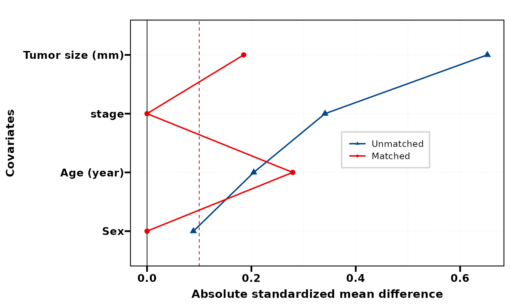
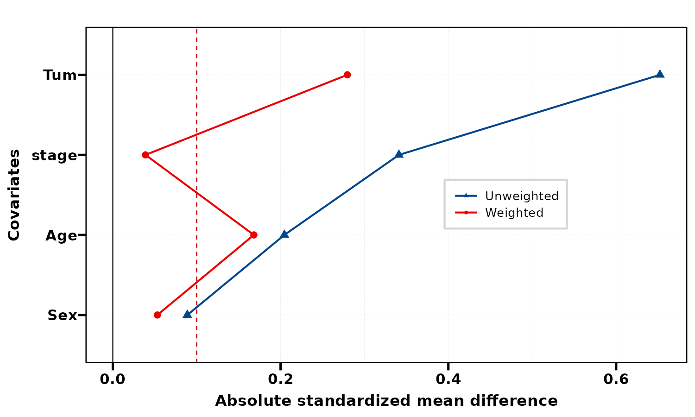
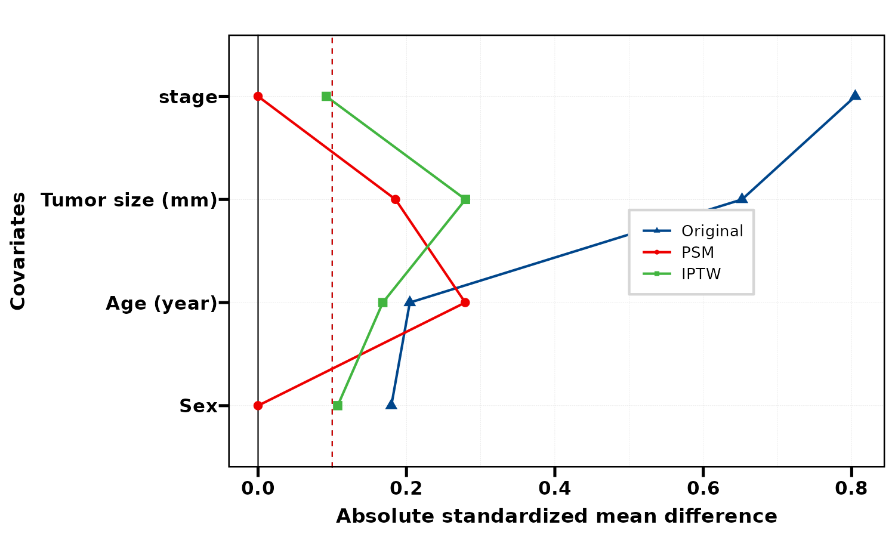
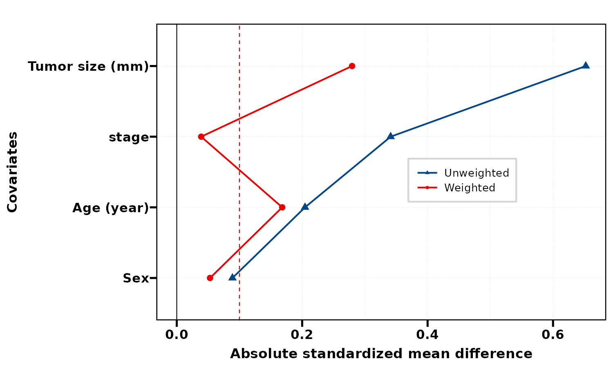
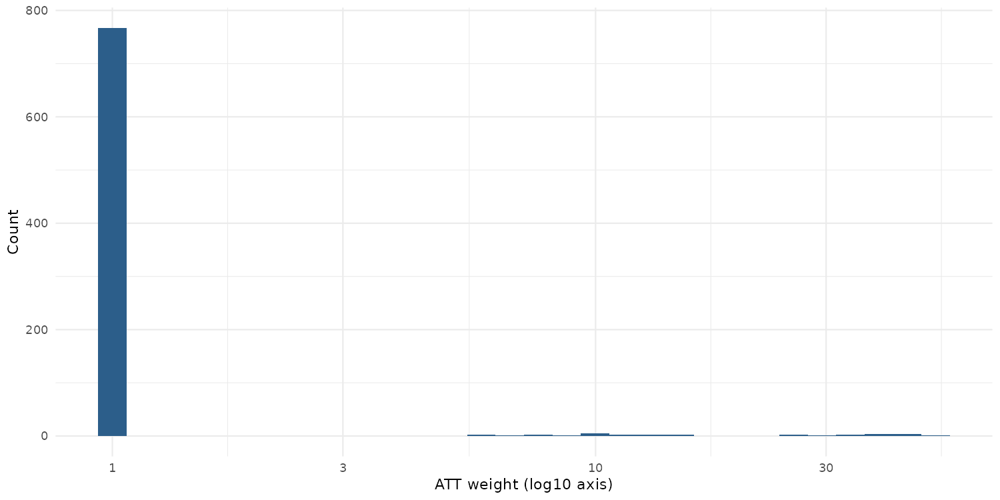
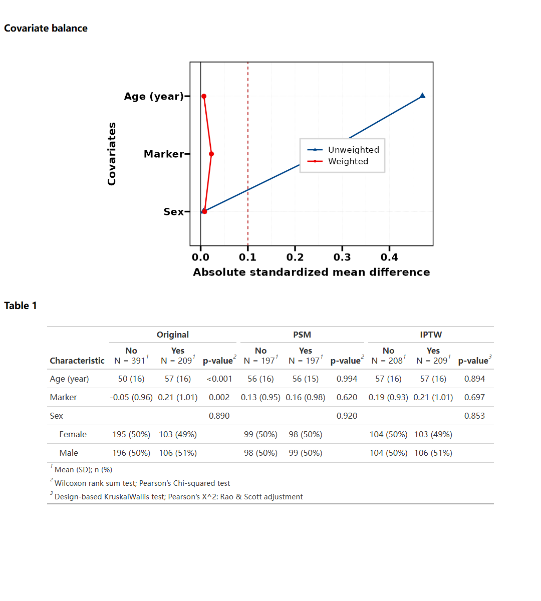
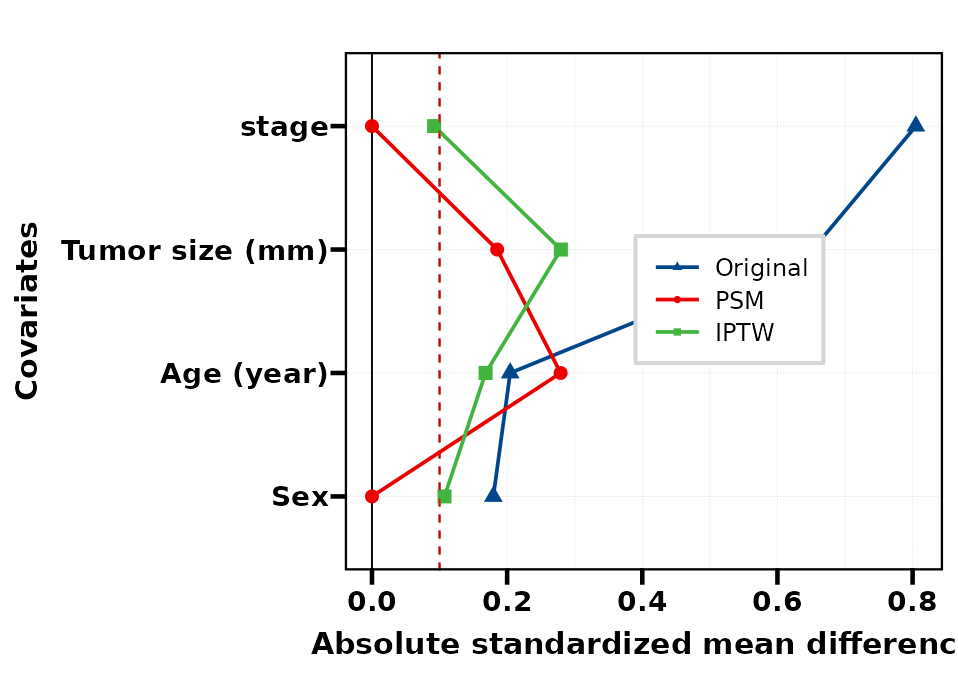

先定义要比较的人群和估计目标，再选择匹配或加权。这个页面围绕平衡诊断组织四个接口：底层结果保留匹配/加权对象及分析数据，get_ps() 则便于分别选择 Love plot 与基线表。参数标签页使用同一演示队列。

**版本与执行范围：** 按 RegR 0.1.3 当前源码核对，使用 WSL R 4.4.3 实际运行下面的示例并保存汇总输出。示例用于理解接口和输出；不构成外部验证或临床效果结论。

## 结局缺失与 PS 效应比较的当前边界 {#outcome-cases-20261020}

2026-10-20 按已推送 RegR `a2f2553` 核对，`get_eff_cat(ps_methods=...)` 的倾向评分行现在先取各结局的完整案例：Cox 使用 time+DSS，Fine–Gray 使用 time+event/status，Logistic 使用对应结局列，再估计 PS、匹配或加权。它避免匹配后再丢掉结局缺失患者，也使稳健加权拟合的权重与分析行对齐；存在结局缺失时，与旧版在全部记录上估计 PS 的结果可能不同。这项变化不表示本页所有独立 PS 设计函数都自动按未指定的结局筛选。

[效应比较页的同队列对照](eff-cat-guide.qmd#sub-inter-20261020)已在 Windows / WSL R 4.4.3 核对：480行输入中，Cox / Fine–Gray 各476行、Logistic 477行，IPTW 与匹配的效应及区间均与手动预筛一致。仍需另外检查权重、平衡、有效样本量及缺失机制；不同结局不能默认对应同一分析人群。

同页新增的 `sub_inter` 只切换未调整或协变量调整行的亚组相对效应；PS 行仍在各层分别估计，不能列入 `sub_inter`。需要共用某个 PS 设计时，应先明确目标人群与设计，再选择相应接口。

## 数据准备与复现


使用 RegR 自带的 SEER 甲状腺髓样癌队列。保留完整模型变量、正随访时间及肿瘤大小在 0–200 mm 内的记录，再固定种子抽取最多 800 人。`stage` 合并为 T1/T2 与其余分期，`surgery` 为无手术与任一手术。它们是本页的演示编码。时间单位沿用原始队列的月。只发布汇总结果。

```r
library(RegR)
library(ggplot2)
library(survival)
data("seer_thyroid_mtc_2026", package = "RegR")
d <- as.data.frame(seer_thyroid_mtc_2026)
d[["DSS"]] <- as.integer(as.character(d[["DSS"]]))
d[["OS"]] <- as.integer(as.character(d[["OS"]]))
needed <- c("time", "DSS", "OS", "Age", "Tum", "Sex", "Race", "T_stage", "Sur")
d <- d[complete.cases(d[needed]) & d[["time"]] > 0 &
       d[["Tum"]] > 0 & d[["Tum"]] < 200, , drop = FALSE]
d[["stage"]] <- factor(ifelse(d[["T_stage"]] %in% c("T1", "T2"), "Early", "Other"))
d[["surgery"]] <- factor(ifelse(d[["Sur"]] == "No surgery", "No", "Yes"),
                          levels = c("No", "Yes"))
set.seed(20261001)
d <- droplevels(d[sample.int(nrow(d), min(800L, nrow(d))), , drop = FALSE])
```


## 共用计算与返回对象


`surgery` 的首水平 No 是参照，Yes 是暴露组。所有默认接口以 ATT 为第一选择，不应看到 IPTW 名称就默认是 ATE。匹配后保留的是可匹配子样本；加权仍需检查权重和有效样本量。原始数据包含治疗信息未知及未测混杂，本页不将这些比较解释为手术因果效果。

```r
covariates <- c("Age", "Tum", "Sex", "stage")
psm <- run_quiet({get_psm(d, cat_var = "surgery", mat_var = covariates,
                         estimand = "ATT", caliper = 0.1, onehot = TRUE)})
iptw <- run_quiet({get_iptw(d, cat_var = "surgery", mat_var = covariates,
                           estimand = "ATT", onehot = TRUE)})
iptw_ate <- run_quiet({get_iptw(d, cat_var = "surgery", mat_var = covariates,
                               estimand = "ATE", onehot = TRUE)})
combined <- run_quiet({get_psm_iptw(d, cat_var = "surgery", mat_var = covariates,
                                  estimand = "ATT")})
mixed <- run_quiet({get_ps(d, cat_var = "surgery", mat_var = covariates,
                         plt_method = "iptw", plt_onehot = FALSE,
                         tbl_method = "psm_iptw", tbl_onehot = TRUE,
                         estimand = "ATT")})
```


## 接口与返回合同


::: {.table-responsive}

| 接口 | 默认规格 | 返回的关键组件 |
|:--|:--|:--|
| get_psm | nearest、ATT、ratio=1、caliper=0.1 | obj、dat_raw、dat、plt、tbl_smd、tbl_p、tbl_merge、view |
| get_iptw | glm、ATT、stabilize=FALSE | obj、dat、plt、tbl_smd、tbl_merge、view |
| get_psm_iptw | 两种方法共用 estimand | obj_psm/obj_iptw、dat_psm/dat_iptw、plt、tbl_smd、tbl_merge、view |
| get_ps | 图与表可分别选方法和 onehot | plt、tbl_merge、view |

:::

`method`、`estimand` 的组合仍受 MatchIt/WeightIt 支持范围约束。`psm_args` 的默认字段为 method/ratio/caliper；`iptw_args` 为 method/stabilize。`onehot` 影响设计矩阵及诊断中的分类水平；它不是新的调整变量选择策略。下游结局分析需要底层的分析数据和权重，不能把 get_ps() 的图表当成已经拟合的结局模型。

## Love plot：匹配、加权与联合比较


横轴为绝对标准化差异。联合图按 estimand 选择共用标准化分母，二分类和连续变量也按标准化差异绘制。0.1 参考线只是常用诊断阈值；平衡性改善不能证明无未测混杂。这个实际示例中，PSM 后 Age/Tum、IPTW 后 Age/Tum/Sex 仍有超过 0.1 的差异，因此不能报告“已达到平衡”。

::: {.panel-tabset}


### PSM {.unnumbered}


ATT 最近邻匹配前后平衡；卡钳限制可能使部分暴露组无法匹配。

```r
psm[["plt"]]
```


{fig-alt="PSM；ATT 最近邻匹配前后平衡；卡钳限制可能使部分暴露组无法匹配。"}


### IPTW ATT {.unnumbered}


ATT 权重后的平衡诊断；与匹配结果对应的人群权重不同。

```r
iptw[["plt"]]
```


{fig-alt="IPTW ATT；ATT 权重后的平衡诊断；与匹配结果对应的人群权重不同。"}


### 三种样本 {.unnumbered}


原始、匹配、加权三组 SMD 使用同一标准化规则比较。

```r
combined[["plt"]]
```


{fig-alt="三种样本；原始、匹配、加权三组 SMD 使用同一标准化规则比较。"}


### IPTW ATE {.unnumbered}


改为 ATE 后重新计算权重和平衡；不能只把 ATT 图的标题改成 ATE。

```r
iptw_ate[["plt"]]
```


{fig-alt="IPTW ATE；改为 ATE 后重新计算权重和平衡；不能只把 ATT 图的标题改成 ATE。"}


### 按变量展示 {.unnumbered}


get_ps() 选择 IPTW 图且 plt_onehot=FALSE；表格可以另选方法和分类水平展示。

```r
mixed[["plt"]]
```


{fig-alt="按变量展示；get_ps() 选择 IPTW 图且 plt_onehot=FALSE；表格可以另选方法和分类水平展示。"}


:::


## 权重与有效样本量


极端权重提示支持区域不足或倾向模型问题。ESS=(sum w)^2/sum(w^2) 衡量权重集中程度，应按组报告。不能仅凭加权行数仍为 800 就认为精度保持不变。本次无手术组仅 33 人，ATT 加权 ESS 约 23.2，最大权重约 50.6；这些结果提示设计仍需评估。

::: {.panel-tabset}


### 权重分布 {.unnumbered}


ATT 权重分布；对数横轴帮助识别较大权重。

```r
wd <- data.frame(weight = iptw[["obj"]][["weights"]])
ggplot(wd, aes(x = weight)) + geom_histogram(bins = 30, fill = "#2C5E8A") +
  scale_x_log10() + labs(x = "ATT weight (log10 axis)", y = "Count") + theme_minimal()
```


{fig-alt="权重分布；ATT 权重分布；对数横轴帮助识别较大权重。"}


### 分组 ESS {.unnumbered}


同一权重对象的组别人数、权重和、ESS 与最大权重；都是汇总统计。

```r
w <- iptw[["obj"]][["weights"]]
do.call(rbind, lapply(levels(d[["surgery"]]), function(g) {
  z <- w[d[["surgery"]] == g]
  data.frame(group = g, n = length(z), sum_weights = sum(z),
             ESS = sum(z)^2 / sum(z^2), max_weight = max(z))
}))
```


::: {.table-responsive}





:::


:::


## 调整前后基线表


图和表要说明来自哪种设计。get_ps() 允许选择不同输出规格，混合输出应在图题、表头明确标注；本页最后一个例子就是 IPTW 图与联合表。

::: {.panel-tabset}


### PSM 基线表 {.unnumbered}


匹配前后的实际基线表，匹配后人数来自保留的子队列。

```r
psm[["tbl_merge"]]
```


::: {.table-responsive}





:::


### 联合基线表 {.unnumbered}


get_ps() 的联合基线表，独立于它选择的 IPTW Love plot。

```r
mixed[["tbl_merge"]]
```


::: {.table-responsive}





:::


:::


## 使用边界、保存与复现记录


这四个接口建立和诊断倾向评分设计，不自动完成效应估计。结局模型应使用对应匹配/加权数据并处理适当的不确定性；匹配子样本的 ATT 与全体暴露组 ATT 可能因丢弃样本而不同。stabilize 不等于权重截断，本页未做截断，也未以平衡诊断选择最有利的效果结果。诊断数据必须与结局模型使用的队列、因子编码和 estimand 一致。

绘图调色、字体和布局只改变展示；模型、编码、样本、预测时间或权重改变后需要重新计算。带 `save` 的接口按帮助页传入保存配置；其余返回图可用 `ggplot2::ggsave()` 或 `RegR::save_plt()`，表格按返回类型使用 `save_tb()` / `save_gt()`。重采样示例的预算仅用于演示，应结合实际分析目的增加并报告失败与收敛情况。

## 相关页面与源码


- [效应估计与森林图](forest-guide.qmd)

- [RegR 函数参考](https://hui950319.github.io/RegR/reference/index.html)

- 倾向评分函数帮助页：[`get_ps()`](https://hui950319.github.io/RegR/reference/get_ps.html)、[`get_psm()`](https://hui950319.github.io/RegR/reference/get_psm.html)、[`get_iptw()`](https://hui950319.github.io/RegR/reference/get_iptw.html)、[`get_psm_iptw()`](https://hui950319.github.io/RegR/reference/get_psm_iptw.html)


```r
packageVersion("RegR")
sessionInfo()
```

## 平衡图与表格的结果页 {#viewer-20261017}

2026-10-17 按已推送 RegR `197faa2`，在 WSL R 4.4.3 核验四个倾向评分入口的 `view`。新页面把 Love plot 放在上方，表格放在下方；图的尺寸随协变量行数和标签宽度适配。统计计算、估计目标及原来的返回字段保持各自含义。

以下使用 600 行合成数据展示接口；`Treat` 的 No / Yes 顺序明确指定。三个结局字段用于同系列结果页演示，没有进入本例倾向评分公式。

```r
set.seed(1017)
n_view <- 600L
d_view <- data.frame(Age = runif(n_view, 25, 80), Marker = rnorm(n_view),
  Sex = factor(sample(c("Female", "Male"), n_view, TRUE)))
d_view$Treat <- factor(ifelse(runif(n_view) < plogis(-0.7 +
  0.02 * (d_view$Age - 50) + 0.3 * d_view$Marker), "Yes", "No"), levels = c("No", "Yes"))
d_view$time <- rexp(n_view, exp(-4 + 1.4 * (d_view$Age > 55) + 0.3 * d_view$Marker))
d_view$DSS <- rbinom(n_view, 1, 0.75)
d_view$Outcome <- factor(ifelse(runif(n_view) < plogis(-1.5 +
  3 * (d_view$Age > 55) + 0.5 * d_view$Marker), "Yes", "No"), levels = c("No", "Yes"))
```

```r
cov_view <- c("Age", "Marker", "Sex")
ps_match <- get_psm(d_view, "Treat", cov_view, estimand = "ATT")
ps_weight <- get_iptw(d_view, "Treat", cov_view, estimand = "ATE")
ps_joint <- get_psm_iptw(d_view, "Treat", cov_view, estimand = "ATT")
ps_mixed <- get_ps(d_view, "Treat", cov_view,
  plt_method = "iptw", tbl_method = "psm_iptw", estimand = "ATT")
ps_mixed$view
fmt_page(ps_mixed$view,
  save = list(filename = file.path(tempdir(), "propensity-results.html")))
```

{fig-alt="合成队列的 get_ps 结果页截图，显示协变量平衡图与匹配、加权比较表。"}

[打开完整 HTML](images/ps-guide/20261017-ps-view.html){target="_blank"} · [下载 HTML](images/ps-guide/20261017-ps-view.html){download="propensity-results.html"}

`get_psm()` 的页面含 `tbl_merge`、`tbl_smd`、`tbl_p`；`get_iptw()` 和 `get_psm_iptw()` 含 `tbl_merge`、`tbl_smd`；`get_ps()` 的页面只组合其最终 `plt` 与 `tbl_merge`，内部调用不重复建页。本例已核验四个 `view` 均为 `fmt_page`，并检查保存后的离线加载、手机显示与图片缩放。

Love plot 可能混用连续变量的标准化差与二分类变量的原始比例差，应结合横轴与 cobalt 提示阅读，不能把所有行一律称为同一种 SMD。没有 htmltools 或页面构建失败时 `view` 可为 NULL，计算结果仍应从原字段核对。Quarto HTML 用独立代码块写 `ps_mixed$view`；Word 中另行写 `ps_mixed$tbl_merge`，保留原表格输出。

## Love plot 的内置保存与结果页边界 {#save-20261019}

2026-10-19 按已推送 RegR `f26e137` 在 Windows / WSL R 4.4.3 执行，沿用本页 800 人演示样本、surgery 分组与候选协变量。

<!-- rnotes-20261019: ps-save -->
```r
ps_saved <- run_quiet(get_ps(d, cat_var = "surgery", mat_var = covariates,
  estimand = "ATT", plt_method = "psm_iptw", tbl_method = "psm_iptw",
  save = list(filename = file.path(tempdir(), "propensity-balance.pdf"))))
attr(ps_saved[["plt"]], "plot_size")
```

{fig-alt="同一演示数据中未调整、匹配与加权后的协变量平衡图，由get_ps新增save接口保存；图中SMD只用于平衡诊断。"}

[下载实际生成的 PDF](images/ps-guide/20261019-balance-save.pdf)

`get_psm/get_iptw/get_psm_iptw/get_ps` 均支持 `save=list()`。`get_ps()` 保存的是 `plt`，不是包含 Table 1 的整个 `view`；HTML 结果页继续使用本页 `fmt_page()` 示例，Word 表格使用表格保存接口。仅给文件名时，PDF 尺寸与结果页展示 Love plot 的尺寸一致，随协变量行数及最长标签变化。空 list 或 NULL 不保存，显式宽高可覆盖。该接口不改变 ATT 目标、匹配/加权设置或平衡判断。

## get_eff_cat 的当前 PS 预设 {#presets-20261020}

2026-10-20 已推送 RegR `da6157be` 给效应比较入口补齐预设选择：`ps_methods` 可传预设名称的字符向量。只给非空 `ps_var` 而省略 `ps_methods` 时，二分类暴露自动拟合五种预设，多分类只拟合 ATE / ATO；用 `ps_methods = list()` 明确关闭。`dat_adj_ps` 场景仍需各自指定，不自动启用。

[预设规格与实跑森林图](eff-cat-guide.qmd#ps-presets-20261020)已在 Windows / WSL 核对二分类自动启用、指定子集、明确关闭、多分类及场景例外。这里的变化属于 `get_eff_cat()`，不改变本页 `get_ps()` / `get_psm()` / `get_iptw()` 的默认设计；同名 ATE、ATT、ATO、EW 代表不同目标人群，选择前仍需平衡和支持区域诊断。
