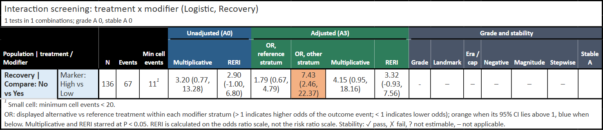
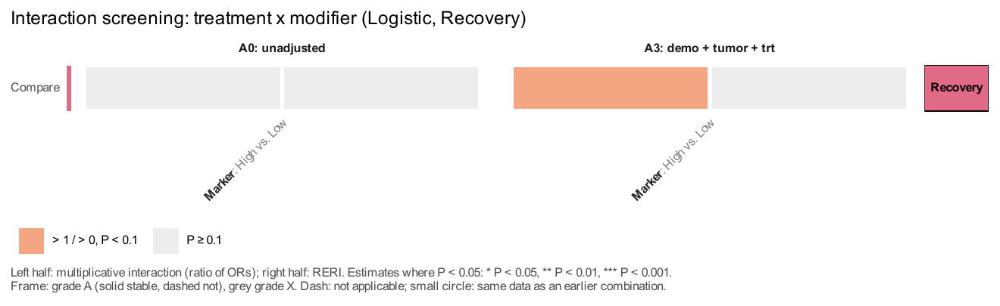
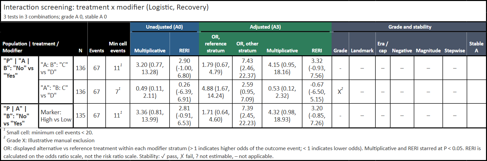
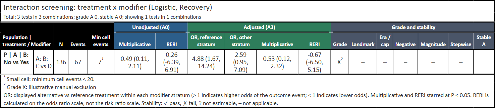
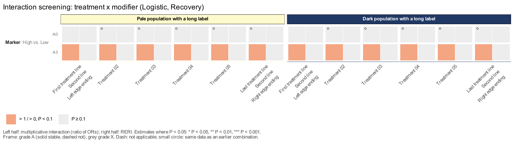
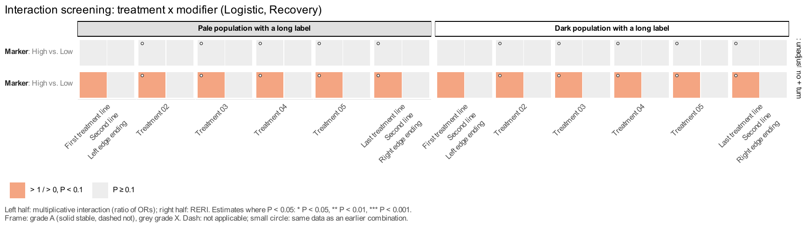

用 `get_screens()` 一次组织多个人群、治疗对比和修饰变量，再用 `get_screens_grade()` 调整分级、`fmt_screens_gt()` 生成表格、`plt_screens()` 绘制热图。默认 `surv=TRUE` 用 Cox；`surv="Recovery"` 等列名用 Logistic，输出 OR。单个交互模型及 HR / RERI 的解释见[交互分析](interaction-guide.qmd#binary-wald-20261029)。本页独立构造数据，无需先运行其他教程。

::: {.callout-note collapse="true" title="版本与复现记录"}
原有 720 行 Cox 示例依据已推送 RegR 0.1.3 `2abf7761c8afbec915b6285bf9c948b2e364f6fb`，以及 UtilsR 0.6.13 `ce17defcc47c2f8a8d5b5ae0cce240414f463caa`，在 Windows / WSL R 4.4.3 执行。固定种子 20261029，720 行合成数据，串行 `n_cores=1`；展示实际生成的 gt 表格、两份原生 PDF 及预览。没有使用真实患者记录，没有运行论文队列、并行性能基准或整个站点的历史模型。

新增 [Logistic 示例](#binary-20261029c)依据已推送 RegR `847d71d6bc5504ce88abbb6adc96785cdc44af5f`，同样使用 UtilsR `ce17def`；原有图和统计量保留各自的执行快照。

对应源码为 `R/screens-get.R`、`R/screens-plt.R` 与 `R/inter-get.R`；热图需要 UtilsR 0.6.13 的[固定面板色条修复](../utilsr/format-guide.qmd#axis-pins-20261029)。
:::

<!-- update-20261029: regr_screening -->

## 先写清人群、对比与参考水平 {#cards}

`pops`、`trts`、`mods` 都是有名字的 list。治疗卡的 `ref` / `alt` 决定实际对比：本例两种治疗均明确写 **No 对 Yes**，所以层内 HR 是未接受相对接受治疗，不能只凭治疗卡名字读方向。修饰变量必须是 factor，首水平为参考。

::: {.table-responsive tabindex="0" role="region" aria-label="卡片字段，可横向滚动"}
| 卡片 | 主要字段 | 实际作用 |
|:--|:--|:--|
| 人群 `pops` | `data`、`trt`、`mod` | 指定各人群自己的数据、治疗卡顺序、修饰变量卡 |
| 人群调整项 | `adj=list(demo=..., tumor=..., trt=...)` | A1 为 demo，A2 再加 tumor，A3 再加 trt；A0 不调整 |
| 治疗 `trts` | `var`、`ref`、`alt`、`type` | `type` 必须是 `both`、`do_vs_not` 或 `add_on`，会影响版本规则 |
| 治疗补充 | `filter`、`parent`、`survive` | 数据内筛选、治疗派生的父变量、是否必须存活到治疗时点 |
| 修饰变量 `mods` | `class`、`parent`、`start`、`cut_group` | 变量类别、派生来源、开始记录年份、同一变量的切点组 |
:::

治疗、修饰变量及其 `parent` 会从每套调整项中去除。**同一组合的 A0–A3 共用 A3 的完整病例**，不是每套模型各自删除缺失行。治疗 `filter` 在完整人群数据中先执行，因此可引用没有放进调整模型的列；NA 筛选值会丢弃该行。SPSS 用户定义缺失先变成普通 NA，不能把 999 等特殊缺失码当作有效协变量。

```r
library(RegR)
set.seed(20261029)
screen_data29 <- expand.grid(TxA = c("Yes", "No"), TxB = c("Yes", "No"),
  Marker = c("Low", "Mid", "High"), replicate = seq_len(60),
  KEEP.OUT.ATTRS = FALSE, stringsAsFactors = FALSE)
screen_data29[["TxA"]] <- factor(screen_data29[["TxA"]], c("Yes", "No"))
screen_data29[["TxB"]] <- factor(screen_data29[["TxB"]], c("Yes", "No"))
screen_data29[["Marker"]] <- factor(screen_data29[["Marker"]], c("Low", "Mid", "High"))
screen_data29[["TxMirror"]] <- screen_data29[["TxA"]]
screen_data29[["Age"]] <- rnorm(720, 60, 8)
screen_data29[["Sex"]] <- factor(sample(c("Female", "Male"), 720, TRUE))
screen_data29[["Yea"]] <- sample(2010:2022, 720, TRUE)
screen_data29[["Tumor"]] <- runif(720, 1, 5)
screen_lp29 <- .5 * (screen_data29[["TxA"]] == "No") +
  .3 * (screen_data29[["TxB"]] == "No") +
  .4 * (screen_data29[["Marker"]] == "Mid") + .8 * (screen_data29[["Marker"]] == "High") +
  .5 * (screen_data29[["TxA"]] == "No" & screen_data29[["Marker"]] == "Mid") +
  1.1 * (screen_data29[["TxA"]] == "No" & screen_data29[["Marker"]] == "High") +
  .015 * (screen_data29[["Age"]] - 60)
screen_event29 <- rexp(720, exp(screen_lp29) / 40)
screen_other29 <- rexp(720, 1 / 180)
screen_censor29 <- rexp(720, 1 / 80)
screen_data29[["time"]] <- pmin(screen_event29, screen_other29, screen_censor29)
screen_data29[["DSS"]] <- as.integer(screen_event29 <= screen_other29 & screen_event29 <= screen_censor29)
screen_data29[["status"]] <- factor(ifelse(screen_data29[["DSS"]] == 1, "Disease",
  ifelse(screen_other29 <= screen_censor29, "Other", "Alive")),
  levels = c("Alive", "Disease", "Other"))
screen_data29[["Age"]][1:4] <- 999
screen_data29[["Age"]] <- haven::labelled_spss(screen_data29[["Age"]], na_values = 999)

screen_adj29 <- list(demo = c("Age", "Sex", "Yea"), tumor = "Tumor", trt = c("TxA", "TxB"))
full_card29 <- list(data = screen_data29, adj = screen_adj29,
  trt = c("TherapyA", "TherapyB"), mod = c("Marker", "TxMirror"),
  era_cut = 2016, early_death = TRUE, neg_control = TRUE)
half_card29 <- full_card29
half_card29[["data"]] <- screen_data29[screen_data29[["replicate"]] %% 2 == 0, ]
half_card29[["trt"]] <- c("TherapyB", "TherapyA")
duplicate_card29 <- full_card29
duplicate_card29[["trt"]] <- "TherapyA"
duplicate_card29[["mod"]] <- "Marker"
missing_ref_card29 <- duplicate_card29
missing_ref_card29[["data"]] <- screen_data29[screen_data29[["Marker"]] != "Low", ]
pops29 <- list(Full = full_card29, Half = half_card29,
  Duplicate = duplicate_card29, MissingRef = missing_ref_card29)
trts29 <- list(
  TherapyA = list(var = "TxA", ref = "Yes", alt = "No", type = "do_vs_not",
    filter = quote(.data[["replicate"]] >= 1L)),
  TherapyB = list(var = "TxB", ref = "Yes", alt = "No", type = "do_vs_not", survive = TRUE))
mods29 <- list(Marker = list(class = "tumor"),
  TxMirror = list(class = "treatment", parent = "TxA"))
screens29 <- withr::with_options(list(RegR.screens.print = FALSE),
  get_screens(pops29, trts29, mods29, n_cores = 1))
```

本例故意保留四种情况：Full 为完整合成人群；Half 是每个联合单元格都取偶数 replicate 的 360 行子集，并把治疗卡顺序反过来；Duplicate 重复 Full 的 TherapyA × Marker；MissingRef 删除所有 Low 记录但保留 Low 这个声明的参考水平。TxMirror 派生自 TxA，不能拿它修饰自身治疗。

### 发布前的输入检查与计算复用（2026-10-29） {#checks-20261029b}

RegR `2abf776` 追加核对9次已推送提交。与前面的普通 NA 不同，分析因子若具有真正的 **NA 水平**（如 `addNA()` 生成的水平），现在会在拟合前指出列名并拒绝；请先明确改成普通缺失，或有实际含义的文字标签，不能把它误报为一个失败模型。`adj_swap` 的来源名必须唯一、非缺失且非空，替换列名也不能为空；非 NULL 的空 palette 会报错，默认配色请传 NULL。

带名字的标量卡片字段、月份或阈值按其值处理，不改变版本与分级。只有计划拟合二分类修饰变量时才提前要求 msm；纯多水平模型使用既有解析梯度。筛选公式先在完整人群执行，预先算好的行掩码保留，但不再把公式的调用环境发给 PSOCK worker；多水平筛查也不再构造用不到的显示表。这些是执行路径优化，不改变模型、区间或警告，不据此新增提速倍数。

下面的两端重跑保留了原来716行主模型、46次拟合与全部未舍入结果；未开展多 worker 性能或序列化内存基准。热图的长标题测量也改为尊重有效的顶部条带主题。

## 读懂模型版本、人数与重复组合 {#versions}

`screens29[["all"]]` 每个组合、每个非参考修饰水平一行；`screens29[["specs"]]` 每个版本、每个非参考水平一行。三水平 Marker 用**一个完整交互模型**，分别对 Mid、High 对 Low 的乘法交互和 RERI 评级；不是 K−1 次二分类子集拟合。`n` 是该完整模型人数，四个 `n00/n10/n01/n11` 只描述当前这行的两水平对比，多水平时不一定加总到 `n`。

Full 的 TherapyA 主模型使用 716 行：4 个 SPSS 特殊缺失值被排除，A0–A3 均用这些行。TherapyB 的 `survive=TRUE` 还会按主 landmark 3 月筛选并将随访原点移到该月，不能沿用 716 作为它的模型人数。

::: {.table-responsive tabindex="0" role="region" aria-label="版本规则，可横向滚动"}
| 版本 | 数据与模型规则 |
|:--|:--|
| A0–A3 | 主队列的四套调整模型；每套都去除治疗、修饰变量及其父变量 |
| landmark | survive 治疗用 6 月；否则 early_death 人群用 3 月，均重新计算对应样本 |
| era1 / era2 | 按 era_cut 划分；模型去掉 Yea 与 era_adj。并非所有修饰变量都会触发 |
| cap | era 类修饰变量按默认 36 月截断随访；本例没有 era 修饰变量，因此不触发 |
| negative | 按规则把结局改为 status 的 Other；原疾病死亡作删失，不能继续解释成原结局 HR |
| swap | 配置 adj_swap 后按 A3 的排除规则换调整变量；本例未配置 |
:::

版本月份可通过 `version_args` 部分覆盖；主 landmark 不得晚于 long landmark。`neg_args` 可指定其他原因死亡列及其事件值，必须在数据里真实出现。随访需是数值且非缺失值有限；矩阵、list、complex、integer64、日历 period 等分析列应先明确转换。

`planned="alias"` 的重复组合通过 `alias_of` 指向原组合，`counted=FALSE`；统计时按 `counted` 计算，不能把重复行当成独立发现。治疗类型、survive 和版本规则不同的组合不会仅因数据一样就合并。`planned="n/a"` 是不适用；版本 `status="NA"` 是已触发但不可估计，两者与“无交互”不同。声明的参考水平缺失时保留该参考并报告 n/a，不偷偷把 Mid 改成参考。

```r
screens29[["all"]][, c("pop", "trt", "mod", "mod_ref", "mod_alt", "planned",
  "alias_of", "counted", "n", "events", "grade", "reason")]
screens29[["specs"]][, c("id", "mod_alt", "version", "status", "n", "events",
  "adj_used", "adj_dropped", "reason", "warnings")]
screen_gt29 <- fmt_screens_gt(screens29)
gt::gtsave(screen_gt29, file.path(tempdir(), "20261029-update-screening-table.html"))
```

{fig-alt="合成筛查的原生gt表，显示实际模型人数、事件数、A0和A3的交互估计、分级及五项稳定性状态。"}

[查看完整原生表格](images/screening-guide/20261029-update-screening-table.html)。表格展示 counted 的检验；all 中的 alias、不适用条目仍保留供追溯。层内 HR 的色彩方向是实际 alt 对 ref，其他治疗比较不能一律写成“未治疗对治疗”。不可估计版本可能保留原始估计供诊断，表格会取消其星号和方向底色并附原因。


<!-- update-20261029c: regr_screen_binary -->

## 二分类结局：Logistic 与 OR（2026-10-29） {#binary-20261029c}

`surv` 现在可指定二分类结局列。因子的**第一声明水平是非事件**，其他观测水平编码为事件；也接受 logical 或 0/1。每个人群编码后都要实际观察到事件和非事件，空的首水平不能自动改成别的参考。这里把康复作为事件，OR 大于 1 表示康复的 odds 较高，不表示结局更坏。OR 不是风险比；基于 OR 的 RERI 在常见结局下会夸大风险尺度的加性交互，不能当作绝对风险差。

下面独立生成 480 行合成数据。`time`、`DSS` 仅用于展示治疗筛选会读取**原始列**，不会先被内部 Logistic 工作列覆盖；若 filter 不用这两列，二分类筛查不需要它们。这里的 `DSS=8` 是人为的筛选标签，与生存事件无关。

```r
library(RegR)
options(RegR.screens.print = FALSE)
set.seed(20261030)
binary_data29c <- expand.grid(Tx = c("Yes", "No"), Marker = c("Low", "High"),
  replicate = seq_len(120), KEEP.OUT.ATTRS = FALSE, stringsAsFactors = FALSE)
binary_data29c$Tx <- factor(binary_data29c$Tx, c("Yes", "No"))
binary_data29c$Marker <- factor(binary_data29c$Marker, c("Low", "High"))
binary_data29c$Age <- rnorm(480, 60, 8)
binary_data29c$time <- binary_data29c$replicate
binary_data29c$DSS <- 7L + as.integer(binary_data29c$replicate %% 3L == 0L)
binary_probability29c <- plogis(-0.5 + 0.5 * (binary_data29c$Tx == "No") +
  0.3 * (binary_data29c$Marker == "High") +
  0.6 * (binary_data29c$Tx == "No" & binary_data29c$Marker == "High") +
  0.02 * (binary_data29c$Age - 60))
binary_data29c$Recovery <- factor(ifelse(runif(480) < binary_probability29c,
  "Recovered", "Not recovered"), levels = c("Not recovered", "Recovered"))
binary_pops29c <- list(Recovery = list(data = binary_data29c,
  trt = "Compare", mod = "Marker", adj = list(demo = "Age")))
binary_trts29c <- list(Compare = list(var = "Tx", ref = "Yes", alt = "No",
  type = "do_vs_not", filter = quote(time >= 20 & DSS == 8)))
binary_mods29c <- list(Marker = list(class = "tumor"))
binary_screen29c <- get_screens(binary_pops29c, binary_trts29c, binary_mods29c,
  surv = "Recovery", n_cores = 1)
binary_gt29c <- fmt_screens_gt(binary_screen29c)
gt::gtsave(binary_gt29c, file.path(tempdir(), "20261029c-update-binary-table.html"))
binary_plot29c <- plt_screens(binary_screen29c, version = c("A0", "A3"),
  version_layout = "panel", fixed_size = 9,
  save = list(filename = file.path(tempdir(), "20261029c-update-binary-heatmap.pdf")))
```

::: {.panel-tabset}
### 结局事件与表格 {.unnumbered}

{fig-alt="合成康复结局的Logistic交互筛查，显示136个完整病例及A0 A3的OR和RERI。"}

[完整原生表格](images/screening-guide/20261029c-update-binary-table.html)

### OR 交互热图 {.unnumbered}

{fig-alt="康复结局Logistic模型的A0 A3交互热图，左半为OR之比，右半为基于OR的RERI。"}

[原生 PDF](images/screening-guide/20261029c-update-binary-heatmap.pdf)
:::

筛选后有 **136 行**，A0–A3 继续共用 A3 完整病例。本例用数值型 `fixed_size=9` 给两个版本标题留出宽度。二分类结果的 `all$measure` 为 `"OR"`，但为兼容历史对象，层内估计字段仍叫 `hr_ref` / `hr_alt`，不能只看字段名判为 HR。`landmark`、`cap`、`negative` 版本为 n/a；有诊断年份与 `era_cut` 时，非 era 修饰变量仍可拟合 era1 / era2。`survive=TRUE` 或 `early_death=TRUE` 会直接报错。`surv=FALSE` 不用于批量 Fine–Gray，单个 Fine–Gray 模型请用 [get_inter](interaction-guide.qmd)。

以下用同一 136 行独立拟合 `glm`，对照未舍入层内 OR、乘法交互、Wald P 与 delta-method RERI 区间；另核对某个单元全为事件时应为不可估计。

::: {.callout-note collapse="true" title="复核代码"}
```r
binary_manual_data29c <- subset(binary_data29c, time >= 20 & DSS == 8)
binary_fit29c <- glm(Recovery ~ Tx * Marker + Age,
  family = binomial(), data = binary_manual_data29c)
binary_names29c <- c("TxNo", "MarkerHigh", "TxNo:MarkerHigh")
binary_b29c <- coef(binary_fit29c)[binary_names29c]
binary_v29c <- vcov(binary_fit29c)[binary_names29c, binary_names29c]
binary_joint29c <- exp(sum(binary_b29c))
binary_reri29c <- binary_joint29c - exp(binary_b29c[1]) - exp(binary_b29c[2]) + 1
binary_gradient29c <- c(binary_joint29c - exp(binary_b29c[1]),
  binary_joint29c - exp(binary_b29c[2]), binary_joint29c)
binary_se29c <- sqrt(drop(t(binary_gradient29c) %*% binary_v29c %*% binary_gradient29c))
binary_row29c <- binary_screen29c$all[binary_screen29c$all$counted, ]
binary_close29c <- function(x, y) isTRUE(all.equal(as.numeric(x), as.numeric(y), tolerance = 1e-8))
stopifnot(nrow(binary_manual_data29c) == 136L, binary_row29c$n == 136L,
  identical(unique(binary_screen29c$all$measure), "OR"),
  binary_close29c(binary_row29c$hr_ref, exp(binary_b29c[1])),
  binary_close29c(binary_row29c$hr_alt, exp(binary_b29c[1] + binary_b29c[3])),
  binary_close29c(binary_row29c$mult, exp(binary_b29c[3])),
  binary_close29c(binary_row29c$p_mult, 2 * pnorm(-abs(binary_b29c[3] / sqrt(binary_v29c[3, 3])))),
  binary_close29c(binary_row29c$reri, binary_reri29c),
  binary_close29c(binary_row29c$reri_lo, binary_reri29c - qnorm(.975) * binary_se29c),
  binary_close29c(binary_row29c$reri_hi, binary_reri29c + qnorm(.975) * binary_se29c))
binary_versions29c <- subset(binary_screen29c$specs, version %in% c("landmark", "cap", "negative"))
stopifnot(all(binary_versions29c$fit_status == "n/a"))
binary_bad_cell29c <- binary_pops29c
binary_bad_cell29c$Recovery$data$Recovery[binary_data29c$Tx == "No" &
  binary_data29c$Marker == "High"] <- "Recovered"
binary_nonestimable29c <- get_screens(binary_bad_cell29c, binary_trts29c,
  binary_mods29c, surv = "Recovery", n_cores = 1)
binary_bad_a329c <- subset(binary_nonestimable29c$specs, version == "A3")
stopifnot(all(binary_bad_a329c$fit_status == "NA"),
  all(grepl("no non-events", binary_bad_a329c$fit_reason, fixed = TRUE)))
validation_values <- list(input_n = 480, model_n = binary_row29c$n,
  events = binary_row29c$events, measure = binary_row29c$measure,
  mult = binary_row29c$mult, p_mult = binary_row29c$p_mult,
  reri = binary_row29c$reri, reri_lo = binary_row29c$reri_lo,
  reri_hi = binary_row29c$reri_hi, nonestimable_reason = binary_bad_a329c$fit_reason)
```
:::

<!-- /update-20261029c: regr_screen_binary -->


<!-- update-20261029c: regr_screen_inputs -->

### 先检查列名、单位与真正触发的版本（2026-10-29） {#inputs-20261029c}

以下继续使用[上节](#binary-20261029c)的合成数据，转成 Cox 输入来检查按需规则；实际运行快照为 RegR `847d71d`。生存随访必须先转换为明确的**数值月数**，不能把 `difftime` 的秒或天当成月。按研究定义完成换算后，再把普通数值放入 `time`。二分类路径不使用随访，但其 filter 仍可引用原始列。

列名必须唯一；`time`、`DSS` 不允许放入 `adj` 或 `adj_swap` 的替换值；治疗公式筛选只接受单侧公式。`AsIs` 等字符类会规范为普通字符串，不应影响卡片类型、参考水平或版本触发。

```r
input_data29c <- binary_data29c
input_data29c$DSS <- as.integer(input_data29c$Recovery == "Recovered")
input_pops29c <- list(All = list(data = input_data29c, trt = "T", mod = "Marker",
  adj = list(demo = "Age"), neg_control = TRUE))
input_trts29c <- list(T = list(var = "Tx", ref = "Yes", alt = "No", type = "both"))
input_mods29c <- list(Marker = list(class = "tumor"))
input_screen29c <- get_screens(input_pops29c, input_trts29c, input_mods29c, n_cores = 1)
```

这组 Cox 模型使用全部 **480 行**。虽然人群卡设置 `neg_control=TRUE`，但 `type="both"` 且修饰变量不是 social，没有触发负对照，所以不要求无用的 `status` 列。若改成 `do_vs_not` / `add_on` 或 social，才检查负对照列与其他原因事件。触发 cap 时要求 `cap` **严格晚于主 landmark**，不是与长 landmark 比较；未触发的 cap 以及二分类结局均为 n/a。

组合去重还会考虑有效 `adj_swap` 替换项的 parent 排除规则：主队列相同而 swap 不同，不能共用同一个拟合结果。切点方向也按人群、治疗、cut_group 三列分别分组；显示名含空格不能把不相关分析合在一起。这两项按本轮源码与对应测试核对，没有新增性能倍数。

::: {.callout-note collapse="true" title="复核代码"}
```r
input_error29c <- function(expr) tryCatch({ force(expr); NA_character_ }, error = conditionMessage)
input_errors29c <- character()
input_bad29c <- input_pops29c
input_bad29c$All$data$copy <- input_bad29c$All$data$Age
names(input_bad29c$All$data)[ncol(input_bad29c$All$data)] <- "Age"
input_errors29c["duplicate"] <- input_error29c(get_screens(input_bad29c,
  input_trts29c, input_mods29c, n_cores = 1))
input_bad29c <- input_pops29c
input_bad29c$All$adj$demo <- c("Age", "time")
input_errors29c["reserved"] <- input_error29c(get_screens(input_bad29c,
  input_trts29c, input_mods29c, n_cores = 1))
input_bad29c <- input_pops29c
input_bad29c$All$data$time <- as.difftime(input_bad29c$All$data$time, units = "days")
input_errors29c["units"] <- input_error29c(get_screens(input_bad29c,
  input_trts29c, input_mods29c, n_cores = 1))
input_bad_trts29c <- input_trts29c
input_bad_trts29c$T$filter <- Recovery ~ Age >= 60
input_errors29c["formula"] <- input_error29c(get_screens(input_pops29c,
  input_bad_trts29c, input_mods29c, n_cores = 1))
input_bad_trts29c <- input_trts29c
input_bad_trts29c$T$type <- "do_vs_not"
input_errors29c["negative"] <- input_error29c(get_screens(input_pops29c,
  input_bad_trts29c, input_mods29c, n_cores = 1))
input_bad_trts29c <- input_trts29c
input_bad_trts29c$T$survive <- TRUE
input_cap_mods29c <- list(Marker = list(class = "era"))
input_errors29c["cap"] <- input_error29c(get_screens(input_pops29c,
  input_bad_trts29c, input_cap_mods29c,
  version_args = list(landmark = 6, landmark_long = 9, cap = 6), n_cores = 1))
input_binary_bad29c <- binary_pops29c
input_binary_bad29c$Recovery$data$Recovery <- factor(
  as.character(binary_data29c$Recovery),
  levels = c("Unused non-event", "Not recovered", "Recovered"))
input_errors29c["event_reference"] <- input_error29c(get_screens(input_binary_bad29c,
  binary_trts29c, binary_mods29c, surv = "Recovery", n_cores = 1))
input_negative29c <- subset(input_screen29c$specs, version == "negative")
stopifnot(input_screen29c$all$n == 480L,
  all(input_negative29c$fit_status == "n/a"), !anyNA(input_errors29c),
  grepl("duplicate column names", input_errors29c["duplicate"], fixed = TRUE),
  grepl("cannot be adjustment", input_errors29c["reserved"], fixed = TRUE),
  grepl("numeric follow-up in months", input_errors29c["units"], fixed = TRUE),
  grepl("one-sided formula", input_errors29c["formula"], fixed = TRUE),
  grepl("status", input_errors29c["negative"], fixed = TRUE),
  grepl("greater than", input_errors29c["cap"], fixed = TRUE),
  grepl("observed events and non-events", input_errors29c["event_reference"], fixed = TRUE))
validation_values <- list(cox_n = input_screen29c$all$n,
  negative_status = input_negative29c$fit_status, rejected = as.list(input_errors29c))
```
:::

<!-- /update-20261029c: regr_screen_inputs -->

## 重新分级与保留人工排除 {#regrade}

分级使用未经舍入的 P 值，默认 `alpha=.05`、`null_p=.1`。A 表示 A0 与 A3 至少各有一个尺度显著，B 为仅 A3，C 为仅 A0；N 为 A3 两个 P 都不小于 null_p，其他情形为 `-`。显著尺度冲突，或 A0 与 A3 在同一比较尺度上方向冲突，可判 X；不能把乘法比值直接与 RERI 的数值比较方向。

五项稳定性依次检查 landmark、era/cap、negative、magnitude、stepwise。`pass/fail/NA/n/a` 含义不同，`stable_A` 也不能代替逐项审阅。多水平 Marker 的 Mid、High 不是两个切点，`cut_direction="single"`，不会拿它们作切点方向一致性检验。

`get_screens_grade()` 不重新拟合。`x_list` 用 **id=原因** 追加人工 X 排除；改变阈值会保留已有人工排除，新列表只更新其中点名的 id，空原因才移除相应人工排除。移除后仍可能因统计规则得到 X。

```r
manual_id29 <- "Full__TherapyA__Marker"
manual_screen29 <- get_screens_grade(screens29,
  x_list = stats::setNames("Synthetic design exclusion for demonstration", manual_id29))
strict_screen29 <- get_screens_grade(manual_screen29, grade_args = list(alpha = .01))
released_screen29 <- get_screens_grade(strict_screen29, grade_args = list(alpha = .01),
  x_list = stats::setNames("", manual_id29))
empty_gt29 <- fmt_screens_gt(strict_screen29, grade = character())
gt::gtsave(empty_gt29, file.path(tempdir(), "20261029-update-screening-empty.html"))
```

{fig-alt="筛选grade为空的gt表，保留总体筛查计数并明确没有符合选中分级的检验。"}

[查看空筛选表格](images/screening-guide/20261029-update-screening-empty.html)。`fmt_screens_gt(grade=...)` 过滤展示行，副标题区分总体与展示计数；空结果不报 row zero 错误。星号和底色遵循当前评级 alpha，`show_color` / `compact` 必须是单个非缺失逻辑值。

这些等级用于整理探索性模型结果，不是证据质量评级；这里没有额外做多重检验校正，也不能由“某亚组显著、另一亚组不显著”推断有交互或治疗因果效应。


<!-- update-20261029c: regr_screen_table -->

### 让脚注和重名分组可追溯（2026-10-29） {#table-notes-20261029c}

RegR `847d71d` 的表格会把 `x_reason` 写进 X 等级的脚注，并在最小单元事件数旁标出 `grade_args$small_cell` 阈值。`show_color=FALSE` 仍保留这些提示；**小单元警告不等于自动改成 X**。先审阅计数和原因，再决定人工排除，不能把缺色当成没有警告。

下面复用[二分类例子](#binary-20261029c)的 136 行数据，独立重拟合三个组合，特意保留包含 `|` 和 `:` 的名称。表格会给冲突的组名或修饰变量名加引号，区分 `"P" | "A | B"` 与 `"P | A" | "B"`，以及 `"A: B": "C"` 与 `"A": "B: C"`。卡片顺序、各组人数和原估计仍分别保留。

```r
table_data29c <- binary_manual_data29c
table_data29c[["A: B"]] <- factor(ifelse(table_data29c$Marker == "High", "C", "D"), c("D", "C"))
table_data29c$A <- factor(ifelse(table_data29c$Age >= median(table_data29c$Age), "B: C", "D"),
  c("D", "B: C"))
table_pops29c <- list(
  P = list(data = table_data29c, trt = "A | B", mod = c("A: B", "A"), adj = list(demo = "Age")),
  `P | A` = list(data = table_data29c[-1, ], trt = "B", mod = "Marker", adj = list(demo = "Age")))
table_card29c <- list(var = "Tx", ref = "Yes", alt = "No", type = "both")
table_screen29c <- get_screens(table_pops29c, list(`A | B` = table_card29c, B = table_card29c),
  list(`A: B` = list(class = "tumor"), A = list(class = "tumor"), Marker = list(class = "tumor")),
  surv = "Recovery", n_cores = 1)
table_manual_id29c <- table_screen29c$all$id[table_screen29c$all$pop == "P" &
  table_screen29c$all$mod == "A"]
table_review29c <- get_screens_grade(table_screen29c,
  grade_args = list(small_cell = 20),
  x_list = setNames("Illustrative manual exclusion", table_manual_id29c))
table_gt29c <- fmt_screens_gt(table_review29c, show_color = FALSE)
table_x_gt29c <- fmt_screens_gt(table_review29c, grade = "X", show_color = FALSE)
gt::gtsave(table_gt29c, file.path(tempdir(), "20261029c-update-screening-notes.html"))
gt::gtsave(table_x_gt29c, file.path(tempdir(), "20261029c-update-screening-x.html"))
```

::: {.panel-tabset}
### 三个实际拟合的组合 {.unnumbered}

{fig-alt="三个合成Logistic交互检验，人数136 136 135，带引号的冲突名称分别显示，小单元和人工排除原因保留脚注。"}

[完整原生表格](images/screening-guide/20261029c-update-screening-notes.html)

### 仅显示 X {.unnumbered}

{fig-alt="筛选X等级后的交互表，脚注明确人工排除原因，并保留实际事件数及小单元提示。"}

[完整 X 表格](images/screening-guide/20261029c-update-screening-x.html)
:::

`grade=NULL` 显示所有已计数的检验；`grade=character()` 选择空集；拼写错误、NA 或非字符值会报错。重名检查在等级筛选后进行，只剩一个标签时可以恢复普通写法。不可估计脚注按 A0 / A3 及修饰水平匹配，连续相同原因会合并以减少重复格式化调用；旧保存结果中的 NA 水平仍应保留原失败原因。这些展示操作不会重新拟合模型。

::: {.callout-note collapse="true" title="复核代码"}
```r
table_rows29c <- table_gt29c[["_data"]]
table_html29c <- gt::as_raw_html(table_gt29c)
table_x_html29c <- gt::as_raw_html(table_x_gt29c)
table_labels29c <- vapply(table_gt29c[["_stub_df"]]$group_label, as.character, character(1))
table_stubs29c <- c('"A: B": "C" vs "D"', '"A": "B: C" vs "D"', "Marker: High vs Low")
stopifnot(sum(table_review29c$all$counted) == 3L,
  identical(as.numeric(table_rows29c$n), c(136, 136, 135)),
  length(unique(table_rows29c$.group)) == 2L,
  identical(table_rows29c$.stub, table_stubs29c),
  grepl('"P" | "A | B":', table_labels29c[1], fixed = TRUE),
  grepl('"P | A" | "B":', table_labels29c[3], fixed = TRUE),
  grepl("Small cell: minimum cell events &lt; 20", table_html29c, fixed = TRUE),
  grepl("Grade X: Illustrative manual exclusion", table_html29c, fixed = TRUE),
  grepl("Grade X: Illustrative manual exclusion", table_x_html29c, fixed = TRUE),
  nrow(fmt_screens_gt(table_review29c, grade = character())[["_data"]]) == 0L)
table_bad_grade29c <- tryCatch(fmt_screens_gt(table_review29c, grade = "Typo"), error = conditionMessage)
stopifnot(is.character(table_bad_grade29c), grepl("grade", table_bad_grade29c, fixed = TRUE))
validation_values <- list(n = table_rows29c$n, groups = unique(table_rows29c$.group),
  labels = table_labels29c, stubs = table_rows29c$.stub,
  x_reasons = table_review29c$all$x_reason[table_review29c$all$grade == "X"],
  min_cell_events = table_rows29c$cell,
  small_cell_threshold = attr(table_review29c, "grade_args")$small_cell,
  grade_error = table_bad_grade29c)
```
:::

<!-- /update-20261029c: regr_screen_table -->

## 两种热图布局与可靠保存 {#heatmap}

每格左半是乘法交互，右半是 RERI；红/蓝分别表示相对无交互值 1 / 0 的方向，颜色深浅依赖当前 alpha 与 null_p。深色半格显示估计和星号，A 级框实/虚线区分 stable_A；灰框标 X。短横线为不适用，深灰为不可估计，别名的小圆点提示重复组合。没有选择显示的分级也会变灰，所以灰色不能一律解释为 P 大于阈值。

`version` 可选 A0–A3，并固定按 A0、A1、A2、A3 排列。`panel` 将调整集分面，`stack` 把每格拆成按调整集排列的小行。各人群保留**自己**的治疗卡顺序：Full 为 A/B，Half 为 B/A。

```r
population_colors29 <- c(Full = "#2F5597", Half = "#C9541E",
  Duplicate = "#5B9A3B", MissingRef = "#8064A2")
screen_panel29 <- plt_screens(screens29, version = c("A0", "A3"),
  version_layout = "panel", palette = population_colors29,
  save = list(filename = file.path(tempdir(), "20261029-update-screening-panel.pdf")))
screen_stack29 <- plt_screens(screens29, version = c("A3", "A0", "A2", "A1"),
  version_layout = "stack", grade = c("A", "B", "X"), palette = population_colors29,
  save = list(filename = file.path(tempdir(), "20261029-update-screening-stack.pdf")))
attr(screen_stack29, "plot_size")
```

::: {.panel-tabset}
### 调整集分面 {.unnumbered}

{fig-alt="合成筛查的A0与A3热图，按人群和治疗组织，格内左侧乘法交互、右侧RERI，保留别名与不适用标记。"}

[原生 PDF](images/screening-guide/20261029-update-screening-panel.pdf)

### 格内逐层堆叠 {.unnumbered}

{fig-alt="A0 A1 A2 A3依次排列的交互热图，仅着色A B X分级，Full治疗顺序A B而Half为B A。"}

[原生 PDF](images/screening-guide/20261029-update-screening-stack.pdf)
:::

默认 `fixed_size=TRUE` 将单格固定到 0.46 × 0.42 英寸并报告推荐画布。数值型 fixed_size 指定总宽度，但图题或图例仍可能要求更宽，且单格不能窄于 0.40 英寸；不接受带 class 的数值。FALSE 则随设备伸缩且无推荐尺寸。默认保存优先用 `attr(p,"plot_size")`，避免裁掉倾斜轴标签、底部图例或脚注。

命名 palette 必须覆盖所有绘图人群，名字唯一且非空，可以额外带其他人群供子集复用。固定面板下，较长的人群条带标签会按宽度换行；整体留白按实际主题测量。`grade` 拼写错误会报错，不会悄悄把所有格子染灰。


<!-- update-20261029c: regr_screen_layout -->

### 长标签、浅色条带与 HTML 画布（2026-10-29） {#layout-20261029c}

RegR `847d71d` 会同时测量倾斜标签两端、多行文字的实际行高和面板间距；条带文字根据底色选黑或白，透明色按主题背景计算。不同条带使用不同文字颜色时，粗体与水平角度仍保留。图的统计值、别名和等级不会因配色改变。

以下继续使用[二分类例子](#binary-20261029c)。两个不同人群各列出六张相同治疗卡，因此只有 **2 个计数组合**，其余 **10 个是别名**；这是展示版面复用，不是 12 个独立发现。第一、末张治疗卡使用三行名称，浅黄和深蓝条带用来核对文字对比。数值型 `fixed_size=12` 调整单格宽度以容纳这些标签；默认 TRUE 则保持原单格尺寸，增加保存宽度只会增加留白。

```r
layout_treatments29c <- c("First treatment line\nSecond line\nLeft edge ending",
  "Treatment 02", "Treatment 03", "Treatment 04", "Treatment 05",
  "Last treatment line\nSecond line\nRight edge ending")
layout_card29c <- list(var = "Tx", ref = "Yes", alt = "No", type = "both")
layout_trts29c <- setNames(rep(list(layout_card29c), length(layout_treatments29c)), layout_treatments29c)
layout_names29c <- c("Pale population with a long label", "Dark population with a long label")
layout_pops29c <- setNames(list(
  list(data = binary_manual_data29c, trt = layout_treatments29c, mod = "Marker", adj = list(demo = "Age")),
  list(data = binary_manual_data29c[-seq_len(4), ], trt = layout_treatments29c, mod = "Marker", adj = list(demo = "Age"))),
  layout_names29c)
layout_screen29c <- get_screens(layout_pops29c, layout_trts29c, binary_mods29c,
  surv = "Recovery", n_cores = 1)
layout_palette29c <- setNames(c("#FFFACD", "#203864"), layout_names29c)
layout_theme29c <- ggplot2::theme_minimal(base_size = 10) +
  ggplot2::theme(axis.text.x.bottom = ggplot2::element_text(lineheight = 1.3))
layout_stack29c <- plt_screens(layout_screen29c, version = c("A0", "A3"),
  version_layout = "stack", palette = layout_palette29c, theme_use = layout_theme29c,
  fixed_size = 12,
  save = list(filename = file.path(tempdir(), "20261029c-update-labels-stack.pdf")))
layout_panel29c <- plt_screens(layout_screen29c, version = c("A0", "A3"),
  version_layout = "panel", palette = setNames(c("#00000020", "#FFFFFF80"), layout_names29c),
  theme_use = layout_theme29c, fixed_size = 12,
  save = list(filename = file.path(tempdir(), "20261029c-update-labels-panel.pdf")))
layout_page29c <- fmt_page(Heatmap = layout_stack29c,
  Table = fmt_screens_gt(layout_screen29c), title = "Synthetic screening report",
  dpi = 100, save = list(filename = file.path(tempdir(), "20261029c-update-screening-page.html")))
```

::: {.panel-tabset}
### 深浅条带和堆叠版本 {.unnumbered}

{fig-alt="两个合成人群各六张治疗卡的堆叠热图，三行首尾标签保留，浅黄条带黑字、深蓝条带白字，重复卡片有别名标记。"}

[原生 PDF](images/screening-guide/20261029c-update-labels-stack.pdf)

### 透明条带和分面版本 {.unnumbered}

{fig-alt="A0 A3分面热图使用透明人口条带，文字按主题背景选取黑色，首尾三行治疗标签完整显示。"}

[原生 PDF](images/screening-guide/20261029c-update-labels-panel.pdf)
:::

[下载自包含 HTML 结果页](images/screening-guide/20261029c-update-screening-page.html)。`fmt_page()` 对带 `plot_size` 的图，按实际 PNG 设备字体测量固定元素所需尺寸，必要时扩宽、扩高，避免在 Linux 字体较宽时裁边。没有该属性的图仍使用 `plot_size` 参数；保存 HTML 不重新拟合模型。这里的两端尺寸可以因字体不同而略有差异，不能据此判定统计结果不同。

::: {.callout-note collapse="true" title="复核代码"}
```r
layout_texts29c <- function(x) {
  if (inherits(x, "text")) return(list(x))
  children <- if (!is.null(x$grobs)) x$grobs else x$children
  unlist(lapply(children, layout_texts29c), recursive = FALSE)
}
layout_grob29c <- ggplot2::ggplotGrob(layout_stack29c)
layout_strips29c <- lapply(layout_texts29c(layout_grob29c), function(x) {
  label <- gsub("[[:space:]]+", " ", as.character(x$label))
  if (length(label) != 1L || !label %in% layout_names29c) return(NULL)
  data.frame(label = label, colour = x$gp$col, face = unname(x$gp$font), angle = x$rot)
})
layout_strips29c <- do.call(rbind, layout_strips29c)
layout_expected29c <- ifelse(layout_strips29c$label == layout_names29c[1], "black", "white")
layout_image29c <- htmltools::tagQuery(layout_page29c)$find("img")$selectedTags()[[1]]
layout_image_size29c <- dim(png::readPNG(base64enc::base64decode(
  sub("^data:image/png;base64,", "", layout_image29c$attribs$src))))[2:1]
layout_size29c <- unname(attr(layout_stack29c, "plot_size"))
stopifnot(sum(layout_screen29c$all$counted) == 2L,
  sum(layout_screen29c$all$planned == "alias") == 10L,
  identical(sort(unique(layout_screen29c$all$n)), c(132L, 136L)),
  setequal(layout_strips29c$label, layout_names29c),
  all(layout_strips29c$face == 2L), all(layout_strips29c$angle == 0),
  identical(unname(grDevices::col2rgb(layout_strips29c$colour)), unname(grDevices::col2rgb(layout_expected29c))),
  all(layout_image_size29c >= round(100 * layout_size29c) - 1))
validation_values <- list(counted = sum(layout_screen29c$all$counted),
  aliases = sum(layout_screen29c$all$planned == "alias"),
  population_n = sort(unique(layout_screen29c$all$n)), strips = layout_strips29c,
  pdf_size_inches = layout_size29c, html_image_pixels = layout_image_size29c)
```
:::

<!-- /update-20261029c: regr_screen_layout -->

::: {.callout-note collapse="true" title="复核代码"}
```r
screen_all29 <- screens29[["all"]]
screen_specs29 <- screens29[["specs"]]
main_rows29 <- screen_all29[["id"]] == "Full__TherapyA__Marker"
alias_rows29 <- screen_all29[["pop"]] == "Duplicate"
missing_rows29 <- screen_all29[["pop"]] == "MissingRef"
stopifnot(inherits(screens29, "get_screens"), nrow(screen_all29) == 16L,
  sum(screen_all29[["counted"]]) == 10L,
  all(screen_all29[["n"]][main_rows29] == 716L),
  all(screen_all29[["cut_direction"]][main_rows29] == "single"),
  all(screen_all29[["planned"]][alias_rows29] == "alias"),
  !any(screen_all29[["counted"]][alias_rows29]),
  all(screen_all29[["alias_of"]][alias_rows29] == "Full__TherapyA__Marker"),
  all(screen_all29[["planned"]][missing_rows29] == "n/a"),
  all(screen_all29[["mod_ref"]][missing_rows29] == "Low"),
  all(strict_screen29[["all"]][["grade"]][main_rows29] == "X"),
  all(strict_screen29[["all"]][["x_reason"]][main_rows29] ==
    "Synthetic design exclusion for demonstration"),
  all(released_screen29[["all"]][["grade"]][main_rows29] ==
    released_screen29[["all"]][["grade_stat"]][main_rows29]),
  identical(attr(screens29, "fits"), attr(strict_screen29, "fits")),
  isTRUE(all.equal(screens29[["specs"]], strict_screen29[["specs"]])),
  nrow(empty_gt29[["_data"]]) == 0L,
  all(is.finite(attr(screen_panel29, "plot_size"))),
  all(is.finite(attr(screen_stack29, "plot_size"))))

# 独立完整 Cox 模型：三水平 Marker，保留完整的716个病例。
manual_screen_data29 <- screen_data29
manual_screen_data29[["Age"]] <- as.numeric(haven::zap_missing(manual_screen_data29[["Age"]]))
manual_screen_data29 <- manual_screen_data29[stats::complete.cases(
  manual_screen_data29[c("time", "DSS", "TxA", "Marker", "Age", "Sex", "Yea", "Tumor", "TxB")]), ]
manual_screen_fit29 <- survival::coxph(survival::Surv(time, DSS) ~ TxA * Marker +
  Age + Sex + Yea + Tumor + TxB, data = manual_screen_data29, ties = "efron", x = TRUE)
manual_beta29 <- stats::coef(manual_screen_fit29)
for (level29 in c("Mid", "High")) {
  row29 <- screen_all29[main_rows29 & screen_all29[["mod_alt"]] == level29, ]
  interaction_term29 <- paste0("TxANo:Marker", level29)
  expected_mult29 <- exp(manual_beta29[[interaction_term29]])
  expected_reri29 <- exp(manual_beta29[["TxANo"]] + manual_beta29[[paste0("Marker", level29)]] +
    manual_beta29[[interaction_term29]]) - exp(manual_beta29[["TxANo"]]) -
    exp(manual_beta29[[paste0("Marker", level29)]]) + 1
  stopifnot(isTRUE(all.equal(row29[["mult"]], unname(expected_mult29), tolerance = 1e-8)),
    isTRUE(all.equal(row29[["reri"]], unname(expected_reri29), tolerance = 1e-8)))
}
validation_values <- list(input_n = nrow(screen_data29), counted = sum(screen_all29[["counted"]]),
  fits = attr(screens29, "fits"), all = screen_all29, specs = screen_specs29,
  strict = strict_screen29[["all"]][, c("id", "mod_alt", "grade", "x_reason")])
```
:::


::: {.callout-note collapse="true" title="复核代码"}
```r
bad_factor_pops29 <- pops29
bad_factor_pops29[["Full"]][["data"]][["Marker"]] <- addNA(screen_data29[["Marker"]])
bad_factor_error29 <- tryCatch(get_screens(bad_factor_pops29, trts29, mods29, n_cores = 1),
  error = function(e) conditionMessage(e))
bad_swap_pops29 <- pops29
bad_swap_pops29[["Full"]][["adj_swap"]] <- c(Age = "Tumor", Age = "TxB")
bad_swap_error29 <- tryCatch(get_screens(bad_swap_pops29, trts29, mods29, n_cores = 1),
  error = function(e) conditionMessage(e))
empty_palette_error29 <- tryCatch(plt_screens(screens29, palette = character()),
  error = function(e) conditionMessage(e))
named_trts29 <- trts29
named_trts29[["TherapyA"]][["type"]] <- c(card = "do_vs_not")
named_mods29 <- mods29
named_mods29[["Marker"]][["class"]] <- c(card = "tumor")
named_screens29 <- withr::with_options(list(RegR.screens.print = FALSE),
  get_screens(pops29, named_trts29, named_mods29,
    year_var = c(column = "Yea"), version_args = list(landmark = c(month = 3)),
    grade_args = list(alpha = c(threshold = .05)), n_cores = 1))
stopifnot(is.character(bad_factor_error29), grepl("explicit NA level", bad_factor_error29, fixed = TRUE),
  grepl("Marker", bad_factor_error29, fixed = TRUE),
  is.character(bad_swap_error29), grepl("adj_swap", bad_swap_error29, fixed = TRUE),
  is.character(empty_palette_error29), grepl("at least one colour", empty_palette_error29, fixed = TRUE),
  isTRUE(all.equal(named_screens29[["all"]], screens29[["all"]])),
  isTRUE(all.equal(named_screens29[["specs"]], screens29[["specs"]])))
validation_values[["late_checks"]] <- list(factor_error = bad_factor_error29,
  swap_error = bad_swap_error29, palette_error = empty_palette_error29, named_values_match = TRUE)
```
:::

<!-- /update-20261029: regr_screening -->

## 更新记录 {#page-updates}

::: {.callout-note collapse="true" title="更新记录"}
- **2026-10-29**：[长标签与 HTML 画布](#layout-20261029c)补充深浅和透明条带、多行标签及 fmt_page 设备尺寸。
- **2026-10-29**：[表格脚注与重名分组](#table-notes-20261029c)补充 X 原因、小单元阈值和等级筛选后的实际标签。
- **2026-10-29**：[输入和按需版本](#inputs-20261029c)补充重复列、随访单位、公式、事件参考与负对照、cap 预检。
- **2026-10-29**：[二分类筛查](#binary-20261029c)补充 Logistic、康复事件方向、原始列筛选与独立 glm 核对。
- 2026-10-29：新增[卡片和对比方向](#cards)、[版本与重复组合](#versions)、[重新分级](#regrade)及[热图保存](#heatmap)，并与独立 Cox 模型核对。
:::
