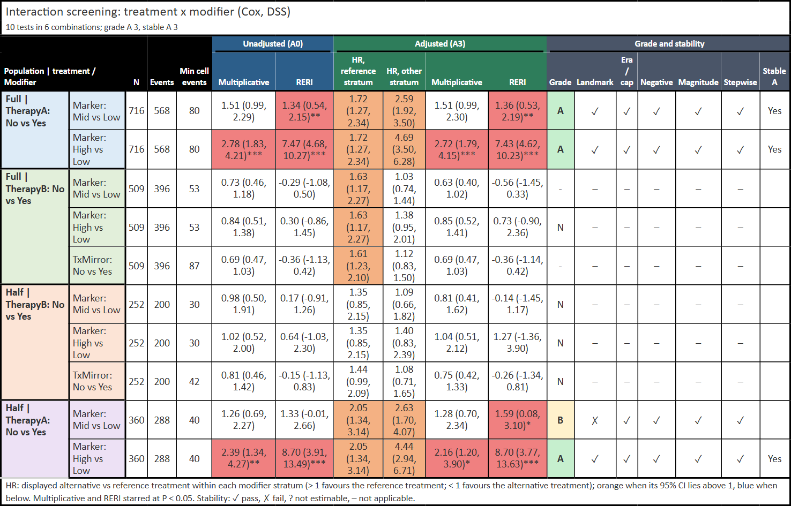
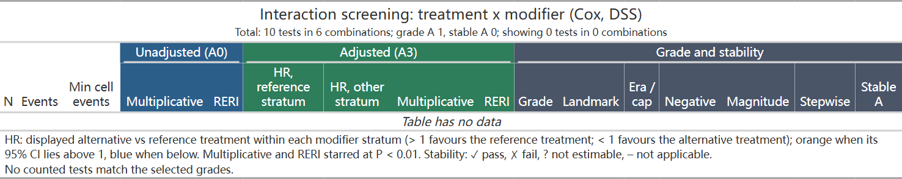
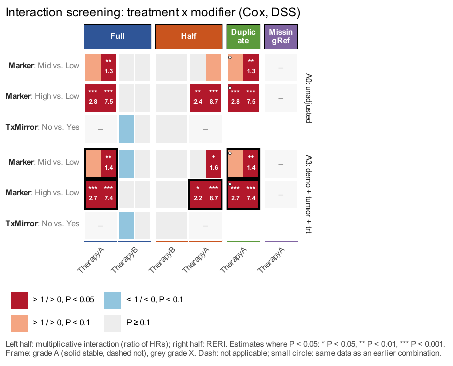
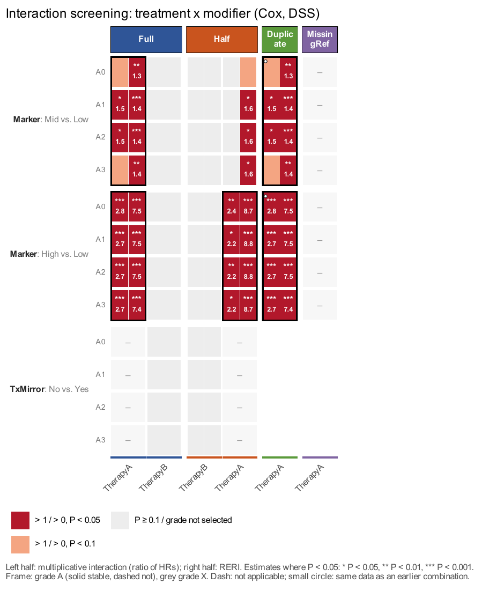

用 `get_screens()` 一次组织多个人群、治疗对比和修饰变量，再用 `get_screens_grade()` 调整分级、`fmt_screens_gt()` 生成表格、`plt_screens()` 绘制热图。单个交互模型及 HR / RERI 的解释见[交互分析](interaction-guide.qmd#binary-wald-20261029)。本页独立构造数据，无需先运行其他教程。

::: {.callout-note collapse="true" title="版本与复现记录"}
本页依据已推送 RegR 0.1.3 `2abf7761c8afbec915b6285bf9c948b2e364f6fb`，以及 UtilsR 0.6.13 `ce17defcc47c2f8a8d5b5ae0cce240414f463caa`，在 Windows / WSL R 4.4.3 执行。固定种子 20261029，720 行合成数据，串行 `n_cores=1`；展示实际生成的 gt 表格、两份原生 PDF 及预览。没有使用真实患者记录，没有运行论文队列、并行性能基准或整个站点的历史模型。

对应源码为 `R/screens-get.R`、`R/screens-plt.R` 与 `R/inter-get.R`；热图需要 UtilsR 0.6.13 的[固定面板色条修复](../utilsr/format-guide.qmd#axis-pins-20261029)。
:::

<!-- update-20261029: regr_screening -->

## 先写清人群、对比与参考水平 {#cards}

`pops`、`trts`、`mods` 都是有名字的 list。治疗卡的 `ref` / `alt` 决定实际对比：本例两种治疗均明确写 **No 对 Yes**，所以层内 HR 是未接受相对接受治疗，不能只凭治疗卡名字读方向。修饰变量必须是 factor，首水平为参考。

::: {.table-responsive tabindex="0" role="region" aria-label="卡片字段，可横向滚动"}
| 卡片 | 主要字段 | 实际作用 |
|:--|:--|:--|
| 人群 `pops` | `data`、`trt`、`mod` | 指定各人群自己的数据、治疗卡顺序、修饰变量卡 |
| 人群调整项 | `adj=list(demo=..., tumor=..., trt=...)` | A1 为 demo，A2 再加 tumor，A3 再加 trt；A0 不调整 |
| 治疗 `trts` | `var`、`ref`、`alt`、`type` | `type` 必须是 `both`、`do_vs_not` 或 `add_on`，会影响版本规则 |
| 治疗补充 | `filter`、`parent`、`survive` | 数据内筛选、治疗派生的父变量、是否必须存活到治疗时点 |
| 修饰变量 `mods` | `class`、`parent`、`start`、`cut_group` | 变量类别、派生来源、开始记录年份、同一变量的切点组 |
:::

治疗、修饰变量及其 `parent` 会从每套调整项中去除。**同一组合的 A0–A3 共用 A3 的完整病例**，不是每套模型各自删除缺失行。治疗 `filter` 在完整人群数据中先执行，因此可引用没有放进调整模型的列；NA 筛选值会丢弃该行。SPSS 用户定义缺失先变成普通 NA，不能把 999 等特殊缺失码当作有效协变量。

```r
library(RegR)
set.seed(20261029)
screen_data29 <- expand.grid(TxA = c("Yes", "No"), TxB = c("Yes", "No"),
  Marker = c("Low", "Mid", "High"), replicate = seq_len(60),
  KEEP.OUT.ATTRS = FALSE, stringsAsFactors = FALSE)
screen_data29[["TxA"]] <- factor(screen_data29[["TxA"]], c("Yes", "No"))
screen_data29[["TxB"]] <- factor(screen_data29[["TxB"]], c("Yes", "No"))
screen_data29[["Marker"]] <- factor(screen_data29[["Marker"]], c("Low", "Mid", "High"))
screen_data29[["TxMirror"]] <- screen_data29[["TxA"]]
screen_data29[["Age"]] <- rnorm(720, 60, 8)
screen_data29[["Sex"]] <- factor(sample(c("Female", "Male"), 720, TRUE))
screen_data29[["Yea"]] <- sample(2010:2022, 720, TRUE)
screen_data29[["Tumor"]] <- runif(720, 1, 5)
screen_lp29 <- .5 * (screen_data29[["TxA"]] == "No") +
  .3 * (screen_data29[["TxB"]] == "No") +
  .4 * (screen_data29[["Marker"]] == "Mid") + .8 * (screen_data29[["Marker"]] == "High") +
  .5 * (screen_data29[["TxA"]] == "No" & screen_data29[["Marker"]] == "Mid") +
  1.1 * (screen_data29[["TxA"]] == "No" & screen_data29[["Marker"]] == "High") +
  .015 * (screen_data29[["Age"]] - 60)
screen_event29 <- rexp(720, exp(screen_lp29) / 40)
screen_other29 <- rexp(720, 1 / 180)
screen_censor29 <- rexp(720, 1 / 80)
screen_data29[["time"]] <- pmin(screen_event29, screen_other29, screen_censor29)
screen_data29[["DSS"]] <- as.integer(screen_event29 <= screen_other29 & screen_event29 <= screen_censor29)
screen_data29[["status"]] <- factor(ifelse(screen_data29[["DSS"]] == 1, "Disease",
  ifelse(screen_other29 <= screen_censor29, "Other", "Alive")),
  levels = c("Alive", "Disease", "Other"))
screen_data29[["Age"]][1:4] <- 999
screen_data29[["Age"]] <- haven::labelled_spss(screen_data29[["Age"]], na_values = 999)

screen_adj29 <- list(demo = c("Age", "Sex", "Yea"), tumor = "Tumor", trt = c("TxA", "TxB"))
full_card29 <- list(data = screen_data29, adj = screen_adj29,
  trt = c("TherapyA", "TherapyB"), mod = c("Marker", "TxMirror"),
  era_cut = 2016, early_death = TRUE, neg_control = TRUE)
half_card29 <- full_card29
half_card29[["data"]] <- screen_data29[screen_data29[["replicate"]] %% 2 == 0, ]
half_card29[["trt"]] <- c("TherapyB", "TherapyA")
duplicate_card29 <- full_card29
duplicate_card29[["trt"]] <- "TherapyA"
duplicate_card29[["mod"]] <- "Marker"
missing_ref_card29 <- duplicate_card29
missing_ref_card29[["data"]] <- screen_data29[screen_data29[["Marker"]] != "Low", ]
pops29 <- list(Full = full_card29, Half = half_card29,
  Duplicate = duplicate_card29, MissingRef = missing_ref_card29)
trts29 <- list(
  TherapyA = list(var = "TxA", ref = "Yes", alt = "No", type = "do_vs_not",
    filter = quote(.data[["replicate"]] >= 1L)),
  TherapyB = list(var = "TxB", ref = "Yes", alt = "No", type = "do_vs_not", survive = TRUE))
mods29 <- list(Marker = list(class = "tumor"),
  TxMirror = list(class = "treatment", parent = "TxA"))
screens29 <- withr::with_options(list(RegR.screens.print = FALSE),
  get_screens(pops29, trts29, mods29, n_cores = 1))
```

本例故意保留四种情况：Full 为完整合成人群；Half 是每个联合单元格都取偶数 replicate 的 360 行子集，并把治疗卡顺序反过来；Duplicate 重复 Full 的 TherapyA × Marker；MissingRef 删除所有 Low 记录但保留 Low 这个声明的参考水平。TxMirror 派生自 TxA，不能拿它修饰自身治疗。

### 发布前的输入检查与计算复用（2026-10-29） {#checks-20261029b}

RegR `2abf776` 追加核对9次已推送提交。与前面的普通 NA 不同，分析因子若具有真正的 **NA 水平**（如 `addNA()` 生成的水平），现在会在拟合前指出列名并拒绝；请先明确改成普通缺失，或有实际含义的文字标签，不能把它误报为一个失败模型。`adj_swap` 的来源名必须唯一、非缺失且非空，替换列名也不能为空；非 NULL 的空 palette 会报错，默认配色请传 NULL。

带名字的标量卡片字段、月份或阈值按其值处理，不改变版本与分级。只有计划拟合二分类修饰变量时才提前要求 msm；纯多水平模型使用既有解析梯度。筛选公式先在完整人群执行，预先算好的行掩码保留，但不再把公式的调用环境发给 PSOCK worker；多水平筛查也不再构造用不到的显示表。这些是执行路径优化，不改变模型、区间或警告，不据此新增提速倍数。

下面的两端重跑保留了原来716行主模型、46次拟合与全部未舍入结果；未开展多 worker 性能或序列化内存基准。热图的长标题测量也改为尊重有效的顶部条带主题。

## 读懂模型版本、人数与重复组合 {#versions}

`screens29[["all"]]` 每个组合、每个非参考修饰水平一行；`screens29[["specs"]]` 每个版本、每个非参考水平一行。三水平 Marker 用**一个完整交互模型**，分别对 Mid、High 对 Low 的乘法交互和 RERI 评级；不是 K−1 次二分类子集拟合。`n` 是该完整模型人数，四个 `n00/n10/n01/n11` 只描述当前这行的两水平对比，多水平时不一定加总到 `n`。

Full 的 TherapyA 主模型使用 716 行：4 个 SPSS 特殊缺失值被排除，A0–A3 均用这些行。TherapyB 的 `survive=TRUE` 还会按主 landmark 3 月筛选并将随访原点移到该月，不能沿用 716 作为它的模型人数。

::: {.table-responsive tabindex="0" role="region" aria-label="版本规则，可横向滚动"}
| 版本 | 数据与模型规则 |
|:--|:--|
| A0–A3 | 主队列的四套调整模型；每套都去除治疗、修饰变量及其父变量 |
| landmark | survive 治疗用 6 月；否则 early_death 人群用 3 月，均重新计算对应样本 |
| era1 / era2 | 按 era_cut 划分；模型去掉 Yea 与 era_adj。并非所有修饰变量都会触发 |
| cap | era 类修饰变量按默认 36 月截断随访；本例没有 era 修饰变量，因此不触发 |
| negative | 按规则把结局改为 status 的 Other；原疾病死亡作删失，不能继续解释成原结局 HR |
| swap | 配置 adj_swap 后按 A3 的排除规则换调整变量；本例未配置 |
:::

版本月份可通过 `version_args` 部分覆盖；主 landmark 不得晚于 long landmark。`neg_args` 可指定其他原因死亡列及其事件值，必须在数据里真实出现。随访需是数值且非缺失值有限；矩阵、list、complex、integer64、日历 period 等分析列应先明确转换。

`planned="alias"` 的重复组合通过 `alias_of` 指向原组合，`counted=FALSE`；统计时按 `counted` 计算，不能把重复行当成独立发现。治疗类型、survive 和版本规则不同的组合不会仅因数据一样就合并。`planned="n/a"` 是不适用；版本 `status="NA"` 是已触发但不可估计，两者与“无交互”不同。声明的参考水平缺失时保留该参考并报告 n/a，不偷偷把 Mid 改成参考。

```r
screens29[["all"]][, c("pop", "trt", "mod", "mod_ref", "mod_alt", "planned",
  "alias_of", "counted", "n", "events", "grade", "reason")]
screens29[["specs"]][, c("id", "mod_alt", "version", "status", "n", "events",
  "adj_used", "adj_dropped", "reason", "warnings")]
screen_gt29 <- fmt_screens_gt(screens29)
gt::gtsave(screen_gt29, file.path(tempdir(), "20261029-update-screening-table.html"))
```

{fig-alt="合成筛查的原生gt表，显示实际模型人数、事件数、A0和A3的交互估计、分级及五项稳定性状态。"}

[查看完整原生表格](images/screening-guide/20261029-update-screening-table.html)。表格展示 counted 的检验；all 中的 alias、不适用条目仍保留供追溯。层内 HR 的色彩方向是实际 alt 对 ref，其他治疗比较不能一律写成“未治疗对治疗”。不可估计版本可能保留原始估计供诊断，表格会取消其星号和方向底色并附原因。

## 重新分级与保留人工排除 {#regrade}

分级使用未经舍入的 P 值，默认 `alpha=.05`、`null_p=.1`。A 表示 A0 与 A3 至少各有一个尺度显著，B 为仅 A3，C 为仅 A0；N 为 A3 两个 P 都不小于 null_p，其他情形为 `-`。显著尺度冲突，或 A0 与 A3 在同一比较尺度上方向冲突，可判 X；不能把乘法比值直接与 RERI 的数值比较方向。

五项稳定性依次检查 landmark、era/cap、negative、magnitude、stepwise。`pass/fail/NA/n/a` 含义不同，`stable_A` 也不能代替逐项审阅。多水平 Marker 的 Mid、High 不是两个切点，`cut_direction="single"`，不会拿它们作切点方向一致性检验。

`get_screens_grade()` 不重新拟合。`x_list` 用 **id=原因** 追加人工 X 排除；改变阈值会保留已有人工排除，新列表只更新其中点名的 id，空原因才移除相应人工排除。移除后仍可能因统计规则得到 X。

```r
manual_id29 <- "Full__TherapyA__Marker"
manual_screen29 <- get_screens_grade(screens29,
  x_list = stats::setNames("Synthetic design exclusion for demonstration", manual_id29))
strict_screen29 <- get_screens_grade(manual_screen29, grade_args = list(alpha = .01))
released_screen29 <- get_screens_grade(strict_screen29, grade_args = list(alpha = .01),
  x_list = stats::setNames("", manual_id29))
empty_gt29 <- fmt_screens_gt(strict_screen29, grade = character())
gt::gtsave(empty_gt29, file.path(tempdir(), "20261029-update-screening-empty.html"))
```

{fig-alt="筛选grade为空的gt表，保留总体筛查计数并明确没有符合选中分级的检验。"}

[查看空筛选表格](images/screening-guide/20261029-update-screening-empty.html)。`fmt_screens_gt(grade=...)` 过滤展示行，副标题区分总体与展示计数；空结果不报 row zero 错误。星号和底色遵循当前评级 alpha，`show_color` / `compact` 必须是单个非缺失逻辑值。

这些等级用于整理探索性模型结果，不是证据质量评级；这里没有额外做多重检验校正，也不能由“某亚组显著、另一亚组不显著”推断有交互或治疗因果效应。

## 两种热图布局与可靠保存 {#heatmap}

每格左半是乘法交互，右半是 RERI；红/蓝分别表示相对无交互值 1 / 0 的方向，颜色深浅依赖当前 alpha 与 null_p。深色半格显示估计和星号，A 级框实/虚线区分 stable_A；灰框标 X。短横线为不适用，深灰为不可估计，别名的小圆点提示重复组合。没有选择显示的分级也会变灰，所以灰色不能一律解释为 P 大于阈值。

`version` 可选 A0–A3，并固定按 A0、A1、A2、A3 排列。`panel` 将调整集分面，`stack` 把每格拆成按调整集排列的小行。各人群保留**自己**的治疗卡顺序：Full 为 A/B，Half 为 B/A。

```r
population_colors29 <- c(Full = "#2F5597", Half = "#C9541E",
  Duplicate = "#5B9A3B", MissingRef = "#8064A2")
screen_panel29 <- plt_screens(screens29, version = c("A0", "A3"),
  version_layout = "panel", palette = population_colors29,
  save = list(filename = file.path(tempdir(), "20261029-update-screening-panel.pdf")))
screen_stack29 <- plt_screens(screens29, version = c("A3", "A0", "A2", "A1"),
  version_layout = "stack", grade = c("A", "B", "X"), palette = population_colors29,
  save = list(filename = file.path(tempdir(), "20261029-update-screening-stack.pdf")))
attr(screen_stack29, "plot_size")
```

::: {.panel-tabset}
### 调整集分面 {.unnumbered}

{fig-alt="合成筛查的A0与A3热图，按人群和治疗组织，格内左侧乘法交互、右侧RERI，保留别名与不适用标记。"}

[原生 PDF](images/screening-guide/20261029-update-screening-panel.pdf)

### 格内逐层堆叠 {.unnumbered}

{fig-alt="A0 A1 A2 A3依次排列的交互热图，仅着色A B X分级，Full治疗顺序A B而Half为B A。"}

[原生 PDF](images/screening-guide/20261029-update-screening-stack.pdf)
:::

默认 `fixed_size=TRUE` 将单格固定到 0.46 × 0.42 英寸并报告推荐画布。数值型 fixed_size 指定总宽度，但图题或图例仍可能要求更宽，且单格不能窄于 0.40 英寸；不接受带 class 的数值。FALSE 则随设备伸缩且无推荐尺寸。默认保存优先用 `attr(p,"plot_size")`，避免裁掉倾斜轴标签、底部图例或脚注。

命名 palette 必须覆盖所有绘图人群，名字唯一且非空，可以额外带其他人群供子集复用。固定面板下，较长的人群条带标签会按宽度换行；整体留白按实际主题测量。`grade` 拼写错误会报错，不会悄悄把所有格子染灰。

::: {.callout-note collapse="true" title="复核代码"}
```r
screen_all29 <- screens29[["all"]]
screen_specs29 <- screens29[["specs"]]
main_rows29 <- screen_all29[["id"]] == "Full__TherapyA__Marker"
alias_rows29 <- screen_all29[["pop"]] == "Duplicate"
missing_rows29 <- screen_all29[["pop"]] == "MissingRef"
stopifnot(inherits(screens29, "get_screens"), nrow(screen_all29) == 16L,
  sum(screen_all29[["counted"]]) == 10L,
  all(screen_all29[["n"]][main_rows29] == 716L),
  all(screen_all29[["cut_direction"]][main_rows29] == "single"),
  all(screen_all29[["planned"]][alias_rows29] == "alias"),
  !any(screen_all29[["counted"]][alias_rows29]),
  all(screen_all29[["alias_of"]][alias_rows29] == "Full__TherapyA__Marker"),
  all(screen_all29[["planned"]][missing_rows29] == "n/a"),
  all(screen_all29[["mod_ref"]][missing_rows29] == "Low"),
  all(strict_screen29[["all"]][["grade"]][main_rows29] == "X"),
  all(strict_screen29[["all"]][["x_reason"]][main_rows29] ==
    "Synthetic design exclusion for demonstration"),
  all(released_screen29[["all"]][["grade"]][main_rows29] ==
    released_screen29[["all"]][["grade_stat"]][main_rows29]),
  identical(attr(screens29, "fits"), attr(strict_screen29, "fits")),
  isTRUE(all.equal(screens29[["specs"]], strict_screen29[["specs"]])),
  nrow(empty_gt29[["_data"]]) == 0L,
  all(is.finite(attr(screen_panel29, "plot_size"))),
  all(is.finite(attr(screen_stack29, "plot_size"))))

# 独立完整 Cox 模型：三水平 Marker，保留完整的716个病例。
manual_screen_data29 <- screen_data29
manual_screen_data29[["Age"]] <- as.numeric(haven::zap_missing(manual_screen_data29[["Age"]]))
manual_screen_data29 <- manual_screen_data29[stats::complete.cases(
  manual_screen_data29[c("time", "DSS", "TxA", "Marker", "Age", "Sex", "Yea", "Tumor", "TxB")]), ]
manual_screen_fit29 <- survival::coxph(survival::Surv(time, DSS) ~ TxA * Marker +
  Age + Sex + Yea + Tumor + TxB, data = manual_screen_data29, ties = "efron", x = TRUE)
manual_beta29 <- stats::coef(manual_screen_fit29)
for (level29 in c("Mid", "High")) {
  row29 <- screen_all29[main_rows29 & screen_all29[["mod_alt"]] == level29, ]
  interaction_term29 <- paste0("TxANo:Marker", level29)
  expected_mult29 <- exp(manual_beta29[[interaction_term29]])
  expected_reri29 <- exp(manual_beta29[["TxANo"]] + manual_beta29[[paste0("Marker", level29)]] +
    manual_beta29[[interaction_term29]]) - exp(manual_beta29[["TxANo"]]) -
    exp(manual_beta29[[paste0("Marker", level29)]]) + 1
  stopifnot(isTRUE(all.equal(row29[["mult"]], unname(expected_mult29), tolerance = 1e-8)),
    isTRUE(all.equal(row29[["reri"]], unname(expected_reri29), tolerance = 1e-8)))
}
validation_values <- list(input_n = nrow(screen_data29), counted = sum(screen_all29[["counted"]]),
  fits = attr(screens29, "fits"), all = screen_all29, specs = screen_specs29,
  strict = strict_screen29[["all"]][, c("id", "mod_alt", "grade", "x_reason")])
```
:::


::: {.callout-note collapse="true" title="复核代码"}
```r
bad_factor_pops29 <- pops29
bad_factor_pops29[["Full"]][["data"]][["Marker"]] <- addNA(screen_data29[["Marker"]])
bad_factor_error29 <- tryCatch(get_screens(bad_factor_pops29, trts29, mods29, n_cores = 1),
  error = function(e) conditionMessage(e))
bad_swap_pops29 <- pops29
bad_swap_pops29[["Full"]][["adj_swap"]] <- c(Age = "Tumor", Age = "TxB")
bad_swap_error29 <- tryCatch(get_screens(bad_swap_pops29, trts29, mods29, n_cores = 1),
  error = function(e) conditionMessage(e))
empty_palette_error29 <- tryCatch(plt_screens(screens29, palette = character()),
  error = function(e) conditionMessage(e))
named_trts29 <- trts29
named_trts29[["TherapyA"]][["type"]] <- c(card = "do_vs_not")
named_mods29 <- mods29
named_mods29[["Marker"]][["class"]] <- c(card = "tumor")
named_screens29 <- withr::with_options(list(RegR.screens.print = FALSE),
  get_screens(pops29, named_trts29, named_mods29,
    year_var = c(column = "Yea"), version_args = list(landmark = c(month = 3)),
    grade_args = list(alpha = c(threshold = .05)), n_cores = 1))
stopifnot(is.character(bad_factor_error29), grepl("explicit NA level", bad_factor_error29, fixed = TRUE),
  grepl("Marker", bad_factor_error29, fixed = TRUE),
  is.character(bad_swap_error29), grepl("adj_swap", bad_swap_error29, fixed = TRUE),
  is.character(empty_palette_error29), grepl("at least one colour", empty_palette_error29, fixed = TRUE),
  isTRUE(all.equal(named_screens29[["all"]], screens29[["all"]])),
  isTRUE(all.equal(named_screens29[["specs"]], screens29[["specs"]])))
validation_values[["late_checks"]] <- list(factor_error = bad_factor_error29,
  swap_error = bad_swap_error29, palette_error = empty_palette_error29, named_values_match = TRUE)
```
:::

<!-- /update-20261029: regr_screening -->

## 更新记录 {#page-updates}

::: {.callout-note collapse="true" title="更新记录"}
- 2026-10-29：新增[卡片和对比方向](#cards)、[版本与重复组合](#versions)、[重新分级](#regrade)及[热图保存](#heatmap)，并与独立 Cox 模型核对。
:::
