先明确表格描述什么、百分比分母是什么，再选择展示和导出形式。下面比较同一队列的中位数、均数、列/行百分比、分层基线和生存摘要；每个标签页展示实际生成的表格。

::: {.callout-note collapse="true" title="版本与复现记录"}
2026-11-06 追加按已推送 RegR `7dad336b`（0.1.3）导出源码，同时固定 RegR `7dad336b` 与 UtilsR `8ceda1e9`，在 Windows / WSL R 4.4.3 独立运行下述合成示例。旧图保留原执行快照；此次没有重跑历史模型或安装包。

2026-11-03 追加按已推送 RegR `769f460c`（0.1.3）导出源码；配套依赖固定为 RegR `769f460c`、UtilsR `7bf81d05`，在 Windows / WSL R 4.4.3 独立运行下述合成示例。旧图保留原执行快照；此次没有重跑历史模型或安装包。

2026-11-03 追加按已推送 RegR `f80e0e95`（0.1.3）导出源码；配套依赖固定为 RegR `f80e0e95`、UtilsR `680ef17d`，在 Windows / WSL R 4.4.3 独立运行下述合成示例。旧图保留原执行快照；此次没有重跑历史模型或安装包。

2026-11-03 追加按已推送 RegR `415c6453`（0.1.3）导出源码；配套依赖固定为 RegR `415c6453`、UtilsR `fafe93a3`，在 Windows / WSL R 4.4.3 独立运行下述合成示例。旧图保留原执行快照；此次没有重跑历史模型或安装包。

**版本与执行范围：** 按 RegR 0.1.3 当前源码核对，使用 WSL R 4.4.3 实际运行下面的示例并保存汇总输出。示例用于理解接口和输出；不构成外部验证或临床效果结论。
:::

## 数据准备与复现


使用 RegR 自带的 SEER 甲状腺髓样癌队列。保留完整模型变量、正随访时间及肿瘤大小在 0–200 mm 内的记录，再固定种子抽取最多 800 人。`stage` 合并为 T1/T2 与其余分期，`surgery` 为无手术与任一手术。它们是本页的演示编码。时间单位沿用原始队列的月。只发布汇总结果。

```r
library(RegR)
library(ggplot2)
library(survival)
data("seer_thyroid_mtc_2026", package = "RegR")
d <- as.data.frame(seer_thyroid_mtc_2026)
d[["DSS"]] <- as.integer(as.character(d[["DSS"]]))
d[["OS"]] <- as.integer(as.character(d[["OS"]]))
needed <- c("time", "DSS", "OS", "Age", "Tum", "Sex", "Race", "T_stage", "Sur")
d <- d[complete.cases(d[needed]) & d[["time"]] > 0 &
       d[["Tum"]] > 0 & d[["Tum"]] < 200, , drop = FALSE]
d[["stage"]] <- factor(ifelse(d[["T_stage"]] %in% c("T1", "T2"), "Early", "Other"))
d[["surgery"]] <- factor(ifelse(d[["Sur"]] == "No surgery", "No", "Yes"),
                          levels = c("No", "Yes"))
set.seed(20261001)
d <- droplevels(d[sample.int(nrow(d), min(800L, nrow(d))), , drop = FALSE])
```

## 共用计算与返回对象


表格演示另建 td，将 DSS 转为分类变量；生存模型仍使用上面数值 0/1 的 d。output_format="none" 保留 gtsummary 对象，"gt" 返回 gt 表，默认 "flextable" 适合 Word。不要把表格对象类型和统计方法混为一谈。

```r
td <- d
td[["DSS"]] <- factor(td[["DSS"]], levels = c(0, 1))
table_vars <- c("Age", "Tum", "stage", "DSS")
gtsummary::reset_gtsummary_theme()
```

## 接口选择与返回对象

:::: {.table-responsive tabindex="0" role="region" aria-label="接口与返回类型，可横向滚动"}

| 接口 | 用途 | 当前输出 |
|:--|:--|:--|
| get_tb_gtsummary | 可配置基线表、按层展开 | flextable / gt / gtsummary |
| get_gt_cat | 事件指标与所选变量按组汇总，百分比着色 | invisible(gt_tbl)，并打印 |
| get_tb_autoreg | autoReg::gaze 基线与分层表 | flextable |
| get_tb_survival | DSS 的单变量 Cox HR 与指定时点 S(t) | gtsummary |

::::

get_gt_cat() 会自动加入数据中存在的 DSS/OS/status/event 等事件列，不能把 com_var 当成唯一变量集合。get_tb_survival() 目前固定 time 与 DSS，并将时间标为 Month；原始时间必须与这个单位一致。它不是可任意更换结局列的总分派器。

## 当前名称字典与森林图一致 {#name-map-20261020}

2026-10-20 按已推送 RegR `a2f2553` 核对，`get_tb_gtsummary()` 合并 `colname_map` 的 `name_map_seer` 也用于 `plt_eff()`、`plt_eff2()` 和 `plt_eff_pair()` 的默认行名。字典补入 `NACT="Neoadjuvant chemotherapy"`；Age、Grade_3、分期等已有表格标签现在也由森林图使用，减少同一变量在图和表中的不同叫法。

用户映射仅覆盖给出的键，未列出的变量继续用字典；标签只是显示层，不修改原始列名、因子水平或参考组。需要原名时将该键映射到自身。森林图的[可运行多模型例子](forest-plot-guide.qmd#models-ci-20261020)展示了NACT、Age与Grade_3的实际输出；本页既有表格保留其原执行记录。

## 连续变量摘要与百分比分母


summary_type 改变连续变量描述；percent 改变分类变量分母。列百分比回答各组内的构成，行百分比回答某一水平分布在哪些组。它们不能在图表解读中互换。

::: {.panel-tabset}


### 中位数与列百分比 {.unnumbered}


按 Sex 分组，显示总体、P 值、SMD 与缺失相关人数。

```r
get_tb_gtsummary(td, group_var = "Sex", com_var = table_vars,
  summary_type = "median", percent = "column", digits_continuous = 2, output_format = "gt",
  add_smd = TRUE, add_n = TRUE, colname_map = c(stage = "Stage group"))
```


::: {.table-responsive}




:::


### 均数与标准差 {.unnumbered}


只改连续变量摘要和小数位；不改变样本和分组。

```r
get_tb_gtsummary(td, group_var = "Sex", com_var = table_vars,
  summary_type = "mean", digits_continuous = 1, output_format = "gt")
```


::: {.table-responsive}




:::


### 行百分比 {.unnumbered}


分类变量按行计算百分比，适合读取水平分布。

```r
get_tb_gtsummary(td, group_var = "Sex", com_var = table_vars,
  percent = "row", add_overall = FALSE, digits_continuous = 2, output_format = "gt")
```


::: {.table-responsive}




:::


:::

### 精度与自动选列（2026-10-24） {#precision-columns-20261024}

<!-- update-20261024: table_precision -->

2026-10-24 按已推送 RegR `2c01bb0` 在 Windows / WSL R 4.4.3 执行。`get_tb_gtsummary()` 的连续摘要默认改为 **0 位小数**，支持按原始列名分别指定；下方历史表保留原输出，代码显式设 2 位以复现旧精度。`get_gt_cat()` 仍自行使用 2 位，不随此默认一起改变。

#### 默认值、变量名与显示标签

```r
library(RegR)
d_digits <- data.frame(
  group = factor(rep(c("a", "b"), each = 4)),
  age = c(21.32, 24.18, 30.77, 33.29, 22.64, 25.43, 29.91, 35.12),
  time = c(10, 12, 14, 16, 20, 22, 24, 26),
  sex = factor(rep(c("f", "m"), 4)))
make_digits <- function(...) get_tb_gtsummary(d_digits, group_var = "group",
  com_var = c("age", "time", "sex"), colname_map = c(age = "Age at diagnosis"),
  output_format = "none", ...)
default_digits <- make_digits()
custom_digits <- make_digits(digits_continuous = c(.default = 2, time = 0))
one_digit <- make_digits(digits_continuous = c(age = 1))
overall_digits <- function(x, v) {
  b <- x[["table_body"]]; b[["stat_0"]][b[["variable"]] == v & b[["row_type"]] == "label"]
}
reject_digits <- function(x) inherits(tryCatch(make_digits(digits_continuous = x), error = identity), "error")
gt::gtsave(gtsummary::as_gt(custom_digits),
  file.path(tempdir(), "20261024-update-table-digits.html"))
```

::: {.callout-note collapse="true" title="复核代码"}
生成本页时运行的检查，接在上面的代码之后运行；只读教程可以跳过。

```r
stopifnot(identical(overall_digits(default_digits, "age"), "28 (23, 32)"),
  identical(overall_digits(custom_digits, "age"), "27.67 (23.41, 32.03)"),
  identical(overall_digits(custom_digits, "time"), "18 (13, 23)"),
  identical(overall_digits(one_digit, "time"), overall_digits(default_digits, "time")))
stopifnot(reject_digits(c(age = -1)), reject_digits(c(age = 1.5)),
  reject_digits(c(age = 1, age = 2)), reject_digits(c(sex = 1)),
  reject_digits(c("Age at diagnosis" = 1)))
```
:::

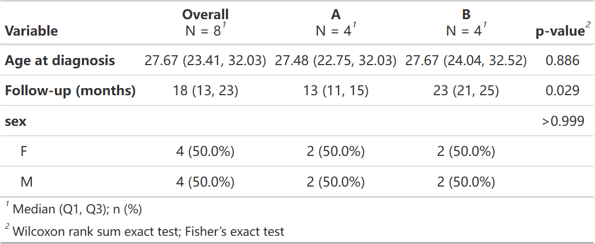{fig-alt="原生基线表，Age at diagnosis的总体摘要为27.67（23.41，32.03），time为18（13，23），性别百分比保留一位。"}

[原生 HTML 表](images/table-guide/20261024-update-table-digits.html)

命名向量中的键是 `com_var` 的**原列名**，不是 `colname_map` 改出的显示名；`.default` 省略时为 0。无名标量如 `1` 统一用于所有连续变量。每项必须是非负整数，名称唯一，不能给分类列指定连续精度。精度只影响摘要显示，不改变原数值、P 值或分类百分比。

#### 没有选择列、也没有结局列时才比较其余列

```r
quiet_cat <- function(expr) { invisible(capture.output(ans <- force(expr))); ans }
auto_cat <- quiet_cat(get_gt_cat(d_digits, cat_var = "group"))
empty_cat <- quiet_cat(get_gt_cat(d_digits, cat_var = "group", com_var = character()))
d_endpoint <- d_digits
d_endpoint[["DSS"]] <- rep(c(0L, 1L), 4)
endpoint_cat <- quiet_cat(get_gt_cat(d_endpoint, cat_var = "group"))
gt::gtsave(auto_cat, file.path(tempdir(), "20261024-update-table-fallback.html"))
```

::: {.callout-note collapse="true" title="复核代码"}
生成本页时运行的检查，接在上面的代码之后运行；只读教程可以跳过。

```r
stopifnot(setequal(unique(auto_cat[["_data"]][["variable"]]), c("age", "time", "sex")),
  identical(auto_cat[["_data"]], empty_cat[["_data"]]))
stopifnot(identical(unique(endpoint_cat[["_data"]][["variable"]]), "DSS"))
validation_values <- list(default = default_digits[["table_body"]], custom = custom_digits[["table_body"]],
  fallback = auto_cat[["_data"]], endpoints = endpoint_cat[["_data"]])
```
:::

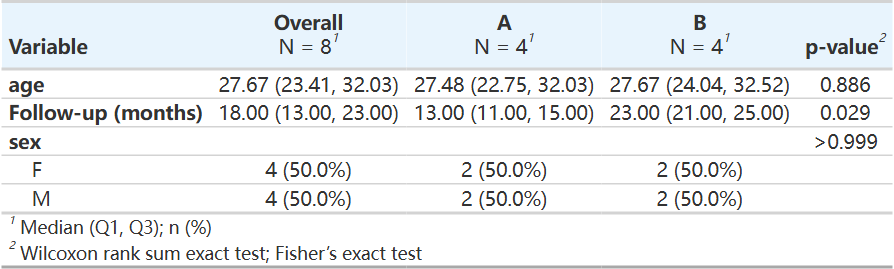{fig-alt="get_gt_cat的原生表，无显式比较列或结局列时，group以外的age、time、sex作为比较变量。"}

[原生 HTML 表](images/table-guide/20261024-update-table-fallback.html)

省略 `com_var` 与传空向量都可触发回退，但条件是自动加入的结局列也不存在。已有 DSS/OS/status/event 等列时，默认只比较这些结局；不会自动追加全部协变量。分层变量和 `cat_var` 从回退列中排除。明确的研究表格仍建议显式给 `com_var`，避免新增列后表格范围随输入改变。

<!-- /update-20261024: table_precision -->

### 模拟Fisher脚注与Word制表符（2026-11-03） {#fisher-footnote-20261103}

<!-- update-20261103: regr_fisher_note -->

`get_tb_gtsummary(simulate_fisher=TRUE)` 将Fisher模拟检验名称里的换行/制表符规范成一行，保留模拟次数。`save_tb()` 也会把任意页脚中的制表符写成空格，避免Word出现字面`<tab>`。这里只修复展示文字；没有改变Fisher模拟方法或P值定义。

下面200行、四组的稀疏分类表示例，网页和Word均由实际函数生成。固定相同模拟种子后，两个后端的分析设置相同。

```r
library(RegR)
set.seed(20261102)
fisher_data <- data.frame(G = factor(sample(c("g1", "g2", "g3", "g4"), 200, TRUE)),
  S = factor(sample(c("s1", "s2", "s3", "s4", "s5"), 200, TRUE, c(.9, .04, .03, .02, .01))))
set.seed(1103)
fisher_ft <- get_tb_gtsummary(fisher_data, group_var = "G", com_var = "S",
  simulate_fisher = TRUE, output_format = "flextable")
set.seed(1103)
fisher_gt <- get_tb_gtsummary(fisher_data, group_var = "G", com_var = "S",
  simulate_fisher = TRUE, output_format = "gt")
gt::gtsave(fisher_gt, file.path(tempdir(), "20261103-update-fisher.html"))
save_tb(fisher_ft, path = tempdir(), title = "20261103-update-fisher.docx")
```

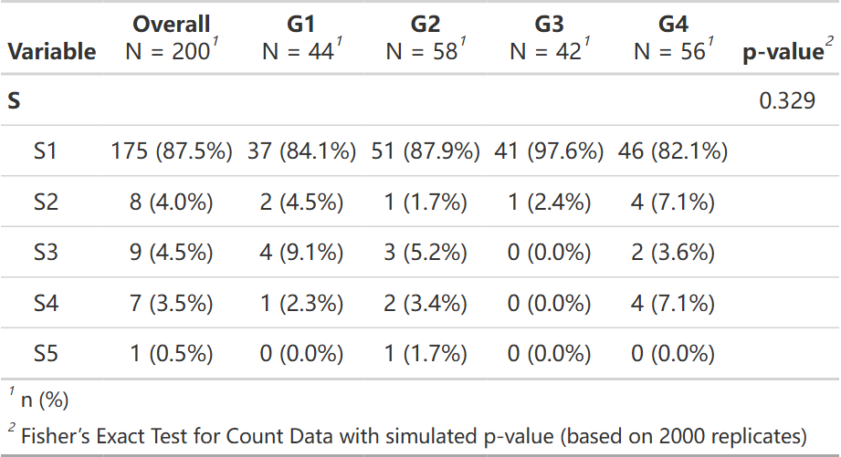{fig-alt="200行四组的原生基线表，Fisher模拟检验名称显示为一行，包含based on 2000 replicates。"}

[原生表格 HTML](images/table-guide/20261103-update-fisher.html) · [原生 Word 表格](images/table-guide/20261103-update-fisher.docx)

::: {.callout-note collapse="true" title="复核代码"}
```r
fisher_chunks <- flextable::information_data_chunk(fisher_ft)
fisher_notes <- fisher_chunks[["txt"]][fisher_chunks[[".part"]] == "footer"]
word_text <- paste(readLines(unz(file.path(tempdir(), "20261103-update-fisher.docx"),
  "word/document.xml"), warn = FALSE), collapse = "")
stopifnot(nrow(fisher_data) == 200L,
  any(grepl("simulated p-value (based on 2000 replicates)", fisher_notes, fixed = TRUE)),
  !any(fisher_notes %in% c("<tab>", "<br>")),
  !grepl("&lt;tab&gt;", word_text, fixed = TRUE),
  grepl("based on 2000 replicates", word_text, fixed = TRUE))
tab_footer <- flextable::add_footer_lines(flextable::flextable(data.frame(x = 1)), "first\n\tsecond")
save_tb(tab_footer, path = tempdir(), title = "20261103-update-footer-space.docx")
footer_word <- paste(readLines(unz(file.path(tempdir(), "20261103-update-footer-space.docx"),
  "word/document.xml"), warn = FALSE), collapse = "")
stopifnot(!grepl("&lt;tab&gt;", footer_word, fixed = TRUE), grepl("second", footer_word, fixed = TRUE))
validation_values <- list(n = 200L, counts = as.list(table(fisher_data[["G"]])), notes = fisher_notes)
```
:::

<!-- /update-20261103: regr_fisher_note -->

## 分层与期刊风格


strata_var 为每个层生成相应的基线表；它不等同于回归模型调整。journal_style 会改变 gtsummary 的全局主题，后续调用前需重置，避免参数比较混入前一张表的格式。

::: {.panel-tabset}


### 按分期分层 {.unnumbered}


在 Early/Other 两层内分别比较 Sex。

```r
get_tb_gtsummary(td, strata_var = "stage", group_var = "Sex",
  com_var = c("Age", "Tum", "DSS"), digits_continuous = 2, output_format = "gt")
```


::: {.table-responsive}




:::


### JAMA 风格 {.unnumbered}


期刊风格演示后显式重置全局主题。

```r
jama_table <- get_tb_gtsummary(td, group_var = "Sex",
  com_var = table_vars, journal_style = "jama", digits_continuous = 2, output_format = "gt")
gtsummary::reset_gtsummary_theme()
jama_table
```


::: {.table-responsive}




:::


:::

## 事件构成与 autoReg 基线表


事件构成表中的 DSS/OS 是记录期间的事件比例，不能直接解释为 60 月累计风险；删失和竞争事件需要生存方法处理。autoReg 的固定模板是另一条展示路线。

::: {.panel-tabset}


### 着色构成表 {.unnumbered}


按 Sex 汇总事件指标及选定的 Age/Tum；着色反映百分比。

```r
get_gt_cat(d, cat_var = "Sex", com_var = c("Age", "Tum"))
```


::: {.table-responsive}




:::


### autoReg 输出 {.unnumbered}


返回 flextable；本页转成 HTML 以展示相同汇总结果。

```r
get_tb_autoreg(td, group_var = "Sex", com_var = table_vars)
```


::: {.table-responsive}




:::


:::

### UMS输入校验、特殊列名与全局绑定（2026-11-03） {#ums-inputs-20261103b}

<!-- update-20261103b: regr_ums_names -->

`get_tb_ums()`和`plt_tb_ums()`接受变量名向量或tidyselect选择，内部适配autoReg后保留原始显示名。`surv`只接受TRUE（Cox）或一个结局列名（Logistic）；`threshold`是0–1的有限数值标量，`format_res`只在表格入口接受单个TRUE/FALSE。空数据、空选择和缺少必要结局列会给出明确错误。

下例用120行合成数据展示含空格的预测/结局名。`get_tb_ums()`返回数据框，运行时另打印flextable；这里从实际返回值生成同一autoReg表格后端，并导出HTML和Word。

```r
library(RegR)
set.seed(1103)
ums_data <- data.frame(x = rnorm(120), z = factor(sample(c("A", "B"), 120, TRUE)))
ums_data[["y"]] <- rbinom(120, 1, plogis(ums_data[["x"]]))
names(ums_data)[match(c("x", "y"), names(ums_data))] <- c("age years", "outcome event")
ums_raw <- run_quiet(get_tb_ums(ums_data, c("age years", "z"), surv = "outcome event",
  threshold = 1, format_res = FALSE))
ums_ft <- autoReg::myft(ums_raw, digits = 3)
flextable::save_as_html(ums_ft, path = file.path(tempdir(), "20261103b-update-ums-names.html"))
save_tb(ums_ft, path = tempdir(), title = "20261103b-update-ums-names.docx")
```

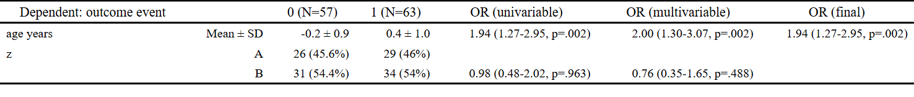{fig-alt="120行合成Logistic的实际autoReg flextable，预测和结局名称含空格，表中保留原始预测名称与OR。"}

[原生表格 HTML](images/table-guide/20261103b-update-ums-names.html) · [原生 Word](images/table-guide/20261103b-update-ums-names.docx)

::: {.callout-note collapse="true" title="复核代码"}
```r
stopifnot("age years" %in% ums_raw[["name"]], "age years" %in% ums_raw[["id"]],
  nzchar(ums_raw[["OR (univariable)"]][ums_raw[["id"]] == "age years"]))
global_binding_ok <- local({
  rlang::local_bindings(data = NULL, .env = .GlobalEnv)
  invisible(run_quiet(get_tb_ums(ums_data, c("age years", "z"), surv = "outcome event",
    threshold = 1, format_res = FALSE)))
  stopifnot(exists("data", .GlobalEnv, inherits = FALSE), is.null(get("data", .GlobalEnv)))
  errors <- lapply(list(
    quote(get_tb_ums(ums_data, "age years", surv = FALSE)),
    quote(get_tb_ums(ums_data, "age years", threshold = c(.1, .2))),
    quote(get_tb_ums(ums_data, "age years", format_res = 1))), function(call) {
      tryCatch({eval(call); ""}, error = conditionMessage)
  })
  stopifnot(all(nzchar(unlist(errors))), exists("data", .GlobalEnv, inherits = FALSE),
    is.null(get("data", .GlobalEnv)))
  TRUE
})
validation_values <- list(n = nrow(ums_data), names = ums_raw[["name"]], ids = ums_raw[["id"]],
  null_global_restored = global_binding_ok)
```
:::

这段状态复核在独立R进程执行，并在退出局部作用域时恢复原绑定。UMS为了autoReg暂存的全局`data`，现在也能在成功或失败后恢复原先存在的NULL，而不是将它删除。

<!-- /update-20261103b: regr_ums_names -->

### UMS Cox的缺失结局与二分类编码（2026-11-03） {#ums-cox-20261103b}

<!-- update-20261103b: regr_ums_cox -->

这两个autoReg入口的Cox路径要求`DSS`为0（删失）/1（事件），忽略缺失结局，且至少有一个事件。0/1/2竞争结局和全删失数据给出诊断；不要把`get_um()`的二水平标准化或Fine–Gray分派规则套用到此入口。

```r
library(RegR)
set.seed(1103)
cox_ums_data <- data.frame(x = rnorm(120), z = factor(sample(c("A", "B"), 120, TRUE)))
cox_ums_data[["time"]] <- rexp(120, exp(.7 * cox_ums_data[["x"]])) + .02
cox_ums_data[["DSS"]] <- rbinom(120, 1, .65)
cox_ums_data[["DSS"]][1] <- NA_integer_
cox_ums_table <- run_quiet(get_tb_ums(cox_ums_data, c("x", "z"), threshold = 1, format_res = FALSE))
cox_ums_plot <- run_quiet(plt_tb_ums(cox_ums_data, c("x", "z"),
  save = list(filename = file.path(tempdir(), "20261103b-update-ums-cox.pdf"), width = 10, height = 4)))
```

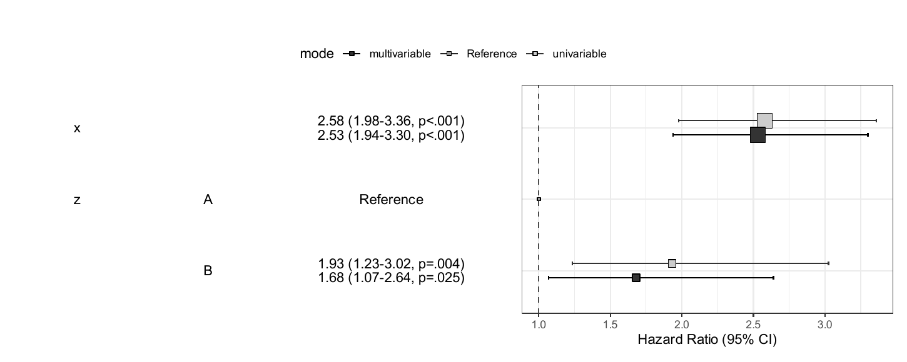{fig-alt="120行输入含一行缺失DSS，实际Cox模型基于119行可用结局绘制单因素和多因素HR森林图，仍以1为参考。"}

[原生 PDF](images/table-guide/20261103b-update-ums-cox.pdf)

::: {.callout-note collapse="true" title="复核代码"}
```r
cox_complete <- cox_ums_data[!is.na(cox_ums_data[["DSS"]]), ]
cox_manual_table <- run_quiet(get_tb_ums(cox_complete, c("x", "z"), threshold = 1, format_res = FALSE))
stopifnot(nrow(cox_complete) == 119L, identical(cox_ums_table, cox_manual_table))
cox_errors <- lapply(list(get_tb_ums, plt_tb_ums), function(fn) {
  competing <- cox_ums_data
  competing[["DSS"]] <- factor(rep(0:2, length.out = 120))
  no_events <- cox_ums_data
  no_events[["DSS"]] <- 0L
  c(competing = tryCatch({fn(competing, "x"); ""}, error = conditionMessage),
    no_events = tryCatch({fn(no_events, "x"); ""}, error = conditionMessage))
})
stopifnot(all(nzchar(unlist(cox_errors))))
validation_values <- list(input_n = nrow(cox_ums_data), complete_n = nrow(cox_complete),
  events = sum(cox_complete[["DSS"]]), errors = cox_errors)
```
:::

<!-- /update-20261103b: regr_ums_cox -->

### UMS模型人数、事件数与可继续绘制的表（2026-11-03） {#ums-cohorts-20261103c}

<!-- update-20261103c: late_ums_cohorts -->

当前`get_tb_ums()`无论`format_res`真假都返回tibble，只构建并打印最终flextable一次。`model_counts`属性保留每个模型的N和事件数，`notes`给出描述队列与拟合队列说明。Cox单因素按各预测变量可用病例拟合，调整模型按入模变量取完整病例；Logistic各模型沿用初始全模型的完整病例，不把删失或缺失规则改成另一套。

下面120行有30个x缺失，Cox描述N仍为120，x单因素与完整调整模型为90；Logistic初始完整队列为90。`plt_tbl()`现在可直接画原始或格式化UMS的HR/OR表，保留人数脚注，也不会把NACT这类标签中的NA删掉。

```r
library(RegR)
set.seed(1103)
ums_cohort_data <- data.frame(x = rnorm(120), z = factor(sample(c("A", "B"), 120, TRUE)))
ums_cohort_data[["y"]] <- rbinom(120, 1, plogis(ums_cohort_data[["x"]]))
ums_cohort_data[["time"]] <- rexp(120, exp(.7 * ums_cohort_data[["x"]])) + .02
ums_cohort_data[["DSS"]] <- rbinom(120, 1, .65)
ums_cohort_data[["x"]][1:30] <- NA_real_
ums_cox_raw <- run_quiet(get_tb_ums(ums_cohort_data, c("x", "z"), threshold = 1,
  format_res = FALSE, colname_map = list(x = "NACT")))
ums_log_formatted <- run_quiet(get_tb_ums(ums_cohort_data, c("x", "z"), surv = "y",
  threshold = 1, colname_map = list(x = "NACT")))
ums_cox_ft <- flextable::add_footer_lines(autoReg::myft(ums_cox_raw, digits = 3),
  values = attr(ums_cox_raw, "notes"))
ums_log_ft <- flextable::add_footer_lines(autoReg::myft(ums_log_formatted, digits = 3),
  values = attr(ums_log_formatted, "notes"))
flextable::save_as_html(ums_cox_ft, path = file.path(tempdir(), "20261103c-update-ums-cohort.html"))
save_tb(ums_log_ft, path = tempdir(), title = "20261103c-update-ums-cohort.docx")
ums_cox_table_plot <- plt_tbl(ums_cox_raw,
  save = list(filename = file.path(tempdir(), "20261103c-update-ums-cox-table.pdf")))
ums_log_table_plot <- plt_tbl(ums_log_formatted,
  save = list(filename = file.path(tempdir(), "20261103c-update-ums-log-table.pdf")))
```

::: {.panel-tabset}
#### Cox原始表与队列脚注 {.unnumbered}

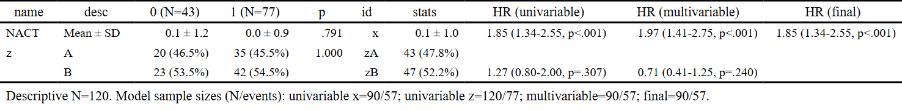{fig-alt="120行输入的实际UMS Cox表，NACT标签保留，脚注分别记录描述N120、x单因素90、z单因素120及调整模型人数与事件数。"}

[原生表格 HTML](images/table-guide/20261103c-update-ums-cohort.html)

#### plt_tbl原始HR表 {.unnumbered}

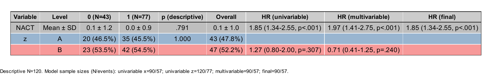{fig-alt="原始UMS HR列直接转换的ggplot文字表，含NACT标签及实际人数与事件数脚注。"}

[原生 PDF](images/table-guide/20261103c-update-ums-cox-table.pdf)

#### plt_tbl格式化OR表 {.unnumbered}

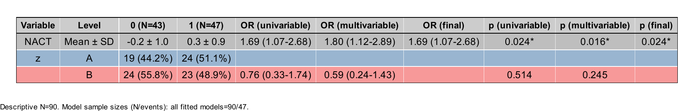{fig-alt="格式化UMS Logistic表直接绘制，OR与P符号分列，各模型N90，原始标签和队列脚注均保留。"}

[原生 PDF](images/table-guide/20261103c-update-ums-log-table.pdf) · [原生 Word](images/table-guide/20261103c-update-ums-cohort.docx)
:::

::: {.callout-note collapse="true" title="复核代码"}
```r
cox_counts <- attr(ums_cox_raw, "model_counts")
log_counts <- attr(ums_log_formatted, "model_counts")
stopifnot(inherits(ums_cox_raw, "tbl_df"), inherits(ums_log_formatted, "tbl_df"),
  cox_counts[["n"]][cox_counts[["model"]] == "univariable" & cox_counts[["variable"]] == "x"] == 90,
  cox_counts[["n"]][cox_counts[["model"]] == "univariable" & cox_counts[["variable"]] == "z"] == 120,
  cox_counts[["n"]][cox_counts[["model"]] == "multivariable"] == 90,
  all(log_counts[["n"]] == 90),
  grepl("Descriptive N=120", attr(ums_cox_raw, "notes"), fixed = TRUE))
manual_cox <- survival::coxph(survival::Surv(time, DSS) ~ x, data = ums_cohort_data)
stopifnot(cox_counts[["events"]][cox_counts[["model"]] == "univariable" &
  cox_counts[["variable"]] == "x"] == manual_cox[["nevent"]])
grob_labels <- function(grob) {
  if (!is.list(grob)) return(character())
  c(if (is.character(grob[["label"]])) grob[["label"]],
    unlist(lapply(grob[["grobs"]], grob_labels), use.names = FALSE),
    unlist(lapply(grob[["children"]], grob_labels), use.names = FALSE))
}
other_tables <- list(
  run_quiet(get_tb_ums(ums_cohort_data, c("x", "z"), threshold = 1,
    colname_map = list(x = "NACT"))),
  run_quiet(get_tb_ums(ums_cohort_data, c("x", "z"), surv = "y", threshold = 1,
    format_res = FALSE, colname_map = list(x = "NACT"))))
all_table_plots <- c(list(ums_cox_table_plot, ums_log_table_plot), lapply(other_tables, plt_tbl))
for (plot in all_table_plots) {
  stopifnot("NACT" %in% grob_labels(plot[["layers"]][[1]][["geom_params"]][["grob"]]),
    grepl("Model sample sizes", ggplot2::get_labs(plot)[["caption"]], fixed = TRUE))
  invisible(ggplot2::ggplotGrob(plot))
}
validation_values <- list(n = nrow(ums_cohort_data), cox_counts = cox_counts,
  logistic_counts = log_counts, notes = c(attr(ums_cox_raw, "notes"), attr(ums_log_formatted, "notes")))
```
:::

HTML和Word使用实际返回表的同一autoReg后端，并把返回的`notes`附为页脚；绘图返回仍为ggplot，可继续组合和保存。原有gtsummary的HR/CI入口继续保留。

<!-- /update-20261103c: late_ums_cohorts -->

### UMS原始统计量与舍入边界（2026-11-03） {#ums-precision-20261103c}

<!-- update-20261103c: late_ums_precision -->

`model_stats`现在直接从保留的模型提取未舍入HR/OR、Wald区间和P值，显著性符号也用该P值计算。不要解析显示字符串的0.05来重建星号，或把`p<.001`当成P等于0。下面用120行合成数据数值求根构造临界P值，分别核对Cox和Logistic；这是显示边界示例，不是临床结果。

```r
library(RegR)
precision_rows <- local({
  set.seed(41)
  cox_data <- data.frame(time = rexp(120), DSS = 1L)
  cox_noise <- rnorm(120)
  cox_score <- -log(cox_data[["time"]])
  cox_fit <- function(a) {
    d <- cox_data
    d[["x"]] <- cox_noise + a * cox_score
    survival::coxph(survival::Surv(time, DSS) ~ x, data = d)
  }
  cox_center <- uniroot(function(a) summary(cox_fit(a))[["coefficients"]][1, "z"],
    c(-3, 3), tol = 1e-12)[["root"]]
  set.seed(5)
  y <- rep(0:1, each = 60)
  w <- rnorm(120)
  log_center <- mean(w[y == 0]) - mean(w[y == 1])
  log_fit <- function(a) glm(y ~ x, data = data.frame(y = y, x = w + a * y), family = binomial())
  dplyr::bind_rows(lapply(c("Cox", "Logistic"), function(model) {
    fit_at <- if (model == "Cox") cox_fit else log_fit
    center <- if (model == "Cox") cox_center else log_center
    p_at <- function(a) summary(fit_at(a))[["coefficients"]][if (model == "Cox") 1 else 2, "Pr(>|z|)"]
    dplyr::bind_rows(lapply(c(.050004, .010004, .001004, .0004), function(target) {
      shift <- uniroot(function(a) p_at(a) - target, c(center, center + 3), tol = 1e-12)[["root"]]
      d <- if (model == "Cox") cox_data else data.frame(y = y)
      d[["x"]] <- if (model == "Cox") cox_noise + shift * cox_score else w + shift * y
      result <- run_quiet(get_tb_ums(d, "x", surv = if (model == "Cox") TRUE else "y", threshold = 1))
      stats <- attr(result, "model_stats")
      stats <- stats[stats[["id"]] == "x", ]
      metric <- if (model == "Cox") "HR" else "OR"
      star <- result[[paste0(metric, " (univariable)_p")]]
      reference <- summary(fit_at(shift))[["coefficients"]]
      beta <- reference[if (model == "Cox") 1 else 2, if (model == "Cox") "coef" else "Estimate"]
      stopifnot(all(abs(stats[["p"]] - p_at(shift)) < 1e-12),
        all(abs(stats[[metric]] - exp(beta)) < 1e-12),
        identical(star, UtilsR::stat_pval(p_at(shift), mode = "stars")))
      data.frame(Model = model, Target = target, P_unrounded = stats[["p"]][1],
        Display = stats[["stats"]][1], Stars = star)
    }))
  }))
})
gt::gtsave(gt::fmt_number(gt::gt(precision_rows), columns = c(Target, P_unrounded), decimals = 8),
  file.path(tempdir(), "20261103c-update-ums-precision.html"))
```

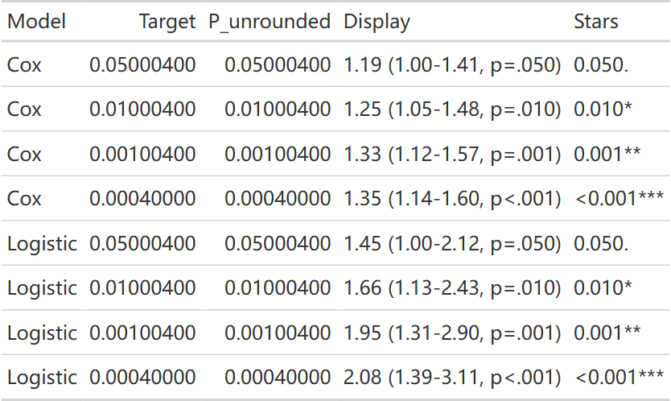{fig-alt="Cox和Logistic各四组实际模型统计，0.050004、0.010004、0.001004及0.0004的未舍入P与显示字符串和星号分列，保留小P的不等号。"}

[原生统计量表 HTML](images/table-guide/20261103c-update-ums-precision.html)

::: {.callout-note collapse="true" title="复核代码"}
```r
stopifnot(nrow(precision_rows) == 8L,
  max(abs(precision_rows[["Target"]] - precision_rows[["P_unrounded"]])) < 1e-10,
  all(precision_rows[["P_unrounded"]] > 0),
  all(grepl("p<.001", precision_rows[["Display"]][precision_rows[["Target"]] == .0004], fixed = TRUE)))
validation_values <- list(n_per_model = 120, rows = precision_rows)
```
:::

<!-- /update-20261103c: late_ums_precision -->

### UMS空筛选、编码与列类型边界（2026-11-03） {#ums-boundaries-20261103c}

<!-- update-20261103c: late_ums_boundaries -->

没有变量通过筛选时，UMS保留单因素结果，多因素和final列为空，并给出说明；不会把空公式继续交给后端。Cox筛选沿用`p <= threshold`，Logistic沿用严格`p < threshold`，不要把这两个比较符统一改写。

```r
library(RegR)
set.seed(1103)
boundary_data <- data.frame(x = rnorm(120), z = factor(sample(c("A", "B"), 120, TRUE)))
boundary_data[["y"]] <- rbinom(120, 1, plogis(boundary_data[["x"]]))
boundary_data[["time"]] <- rexp(120, exp(.7 * boundary_data[["x"]])) + .02
boundary_data[["DSS"]] <- rbinom(120, 1, .65)
empty_ums <- lapply(list(Cox = TRUE, Logistic = "y"), function(outcome) {
  run_quiet(get_tb_ums(boundary_data, c("x", "z"), surv = outcome, threshold = 0, format_res = FALSE))
})
empty_ft <- flextable::add_footer_lines(autoReg::myft(empty_ums[["Logistic"]], digits = 3),
  values = attr(empty_ums[["Logistic"]], "notes"))
flextable::save_as_html(empty_ft, path = file.path(tempdir(), "20261103c-update-ums-empty.html"))
```

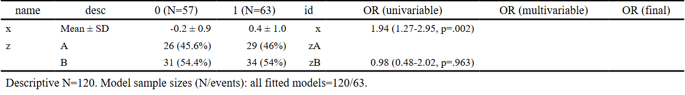{fig-alt="120行实际UMS Logistic空筛选表，单因素OR仍有估计，多因素和final列为空，没有用零值填充。"}

[原生表格 HTML](images/table-guide/20261103c-update-ums-empty.html)

::: {.callout-note collapse="true" title="复核代码"}
```r
for (model in names(empty_ums)) {
  metric <- if (model == "Cox") "HR" else "OR"
  tab <- empty_ums[[model]]
  stopifnot(inherits(tab, "tbl_df"), any(nzchar(tab[[paste0(metric, " (univariable)")]])),
    all(tab[[paste0(metric, " (multivariable)")]] == ""), all(tab[[paste0(metric, " (final)")]] == ""))
}
cox_fit <- survival::coxph(survival::Surv(time, DSS) ~ x, data = boundary_data)
exact_p <- summary(cox_fit)[["coefficients"]][1, "Pr(>|z|)"]
inclusive <- run_quiet(get_tb_ums(boundary_data, "x", threshold = exact_p))
stopifnot("multivariable" %in% attr(inclusive, "model_counts")[["model"]])
spss_data <- plain_data <- boundary_data
spss_data[["x"]] <- haven::labelled_spss(replace(spss_data[["x"]], 1:10, 999), na_values = 999)
plain_data[["x"]][1:10] <- NA_real_
stopifnot(identical(run_quiet(get_tb_ums(spss_data, c("x", "z"), surv = "y")),
  run_quiet(get_tb_ums(plain_data, c("x", "z"), surv = "y"))))
column_errors <- lapply(list(I(as.list(boundary_data[["x"]])), I(cbind(boundary_data[["x"]], boundary_data[["x"]])),
  boundary_data[["x"]] + 1i, bit64::as.integer64(rep("9007199254740993", 120)),
  lubridate::period(month = rep(1, 120))), function(value) {
    bad <- boundary_data
    bad[["x"]] <- value
    tryCatch({get_tb_ums(bad, c("x", "z"), surv = "y"); ""}, error = conditionMessage)
})
stopifnot(all(grepl("x", unlist(column_errors), fixed = TRUE)), all(nzchar(unlist(column_errors))))
collision_data <- boundary_data
names(collision_data)[names(collision_data) == "x"] <- "zB"
collision_errors <- lapply(list(get_tb_ums, plt_tb_ums), function(fn)
  tryCatch({fn(collision_data, c("zB", "z"), surv = "y"); ""}, error = conditionMessage))
bad_contrasts <- boundary_data
contrasts(bad_contrasts[["z"]]) <- stats::contr.sum(2)
contrast_errors <- lapply(list(get_tb_ums, plt_tb_ums), function(fn)
  tryCatch({fn(bad_contrasts, c("x", "z"), surv = "y"); ""}, error = conditionMessage))
stopifnot(all(grepl("term identifiers collide", unlist(collision_errors), fixed = TRUE)),
  all(grepl("contrasts", unlist(contrast_errors), fixed = TRUE)))
validation_values <- list(n = nrow(boundary_data), empty_counts = lapply(empty_ums, attr, which = "model_counts"),
  inclusive_threshold = exact_p, errors = c(column_errors, collision_errors, contrast_errors))
```
:::

UMS接受可无损转成数值的integer64、Date/POSIX时间、difftime和Duration：Date按天，POSIX/Duration按秒，difftime沿用记录单位；日历Period应先明确换算单位。SPSS用户缺失按NA处理。列表、矩阵、复数、精度会损失的integer64及显式NA因子水平需要调用方先处理。

这里的autoReg路径要求能对应水平效应的命名treatment编码；有序、sum或其他无法匹配水平的编码会拒绝。它与[get_um的编码恢复](um-guide.qmd#contrasts-20261103c)不同。若变量zB和因子z的B水平形成相同内部标识，也会在拟合前拒绝，应先消除重名，不能让两行结果错配。

本节实际执行了SPSS缺失对照、非法列、重名和sum编码错误；日期/时长单位、有序因子和其他编码类型按固定源码核对。

<!-- /update-20261103c: late_ums_boundaries -->

### UMS 缺失策略、空队列和批量输出（2026-11-06） {#ums_cohorts-20261106}

<!-- update-20261106: ums_cohorts -->

`get_tb_ums()` 的 Cox 单因素模型分别使用各候选变量的完整病例，Logistic 使用初始全模型完整病例。该策略独立于全局 `na.action`。Cox 候选变量没有共同完整病例时，保留可用的单因素结果并给出提示。原始 Cox 表的总体与分组描述使用同一描述队列。`options(RegR.ums.print = FALSE)` 可在批量分析中跳过 flextable 的构建和打印。

```r
library(RegR)
set.seed(934)
d <- data.frame(time = rexp(80, .03), DSS = rep(0:1, 40), x = rnorm(80), w = rnorm(80))
d$x[1:40] <- NA_real_
d$w[41:80] <- NA_real_
res <- withr::with_options(list(RegR.ums.print = FALSE, na.action = "na.fail"),
  get_tb_ums(d, c("x", "w"), threshold = 1, format_res = FALSE))
counts <- attr(res, "model_counts")
gt::gtsave(gt::gt(counts), file.path(tempdir(), "20261106-update-ums-cohorts.html"))
```

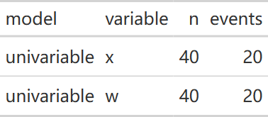{fig-alt="两个独立的 Cox 单因素模型各有 40 人，共同完整病例为零"}

[原生表格 HTML](images/table-guide/20261106-update-ums-cohorts.html)

::: {.callout-note collapse="true" title="复核代码"}
```r
expected <- withr::with_options(list(RegR.ums.print = FALSE, na.action = "na.omit"),
  get_tb_ums(d, c("x", "w"), threshold = 0, format_res = FALSE))
stopifnot(identical(res, expected), identical(counts$n, c(40L, 40L)),
          all(is.finite(attr(res, "model_stats")$HR)))
validation_values <- counts
```
:::

<!-- /update-20261106: ums_cohorts -->

## 生存摘要：HR 与时点生存概率


HR 来自各变量分别拟合的单变量 Cox 模型；时点列是 S(t)，不是 HR，也不是 CIF。show_summary 控制是否合并按 DSS 事件状态的描述列。本页 36/60 月均按原始月单位输入。

::: {.panel-tabset}


### 完整摘要 {.unnumbered}


合并描述、单变量 HR、36/60 月生存概率。

```r
get_tb_survival(d, cat_var = c("Sex", "stage"),
  times = c(36, 60), show_summary = TRUE)
```


::: {.table-responsive}




:::


### 精简摘要 {.unnumbered}


隐藏描述部分，保留 HR 与时点概率。

```r
get_tb_survival(d, cat_var = c("Sex", "stage"),
  times = c(36, 60), show_summary = FALSE)
```


::: {.table-responsive}




:::


:::

## 保留对象继续加工与导出


```r
tb <- get_tb_gtsummary(td, group_var = "Sex", com_var = table_vars,
                       digits_continuous = 2, output_format = "none")
gt_table <- gtsummary::as_gt(tb)
word_table <- gtsummary::as_flex_table(tb)
# 按保存接口帮助页设置文件名与目录。
# RegR::save_gt(gt_table, ...)
# RegR::save_tb(word_table, ...)
```

输出类型转换只影响表格载体。P 值表示当前描述/检验规格下的组间证据，SMD 是差异尺度；两者都不能证明组间不存在混杂。生存随访不足时需报告 at-risk 数和可估计性，不能仅靠把 times 拉长产生远期结论。

## save_tb()：整数计数与小数概率 {#save-tb-format}

2026-10-05 核对的 `save_tb()` 会把整列均为整数值的普通 double 数值列显示为零位小数；带小数的列仍按两位小数显示。它改变 Word 格式，保留原始数值。已有 flextable、gtsummary 或 data.frame 均可进入此保存入口。

```r
counts <- data.frame(Group = c("A", "B"), Events = c(12, 18),
                     Probability = c(0.125, 0.234))
# path 是目录；title 同时确定输出文件名，自动补 .docx。
ft <- save_tb(counts, path = tempdir(), title = "counts-and-probabilities",
              line_spacing = 1)
```

:::: {.table-responsive tabindex="0" role="region" aria-label="Word数字格式对照，可横向滚动"}

| Group | 原始 Events（double） | Word 计数 | 原始 Probability | Word 概率 |
|:--|--:|--:|--:|--:|
| A | 12 | 12 | 0.125 | 0.12 |
| B | 18 | 18 | 0.234 | 0.23 |

::::

[下载实际生成的 Word 示例](files/table-guide/counts-and-probabilities.docx){download="counts-and-probabilities.docx"}

已读回实际 DOCX 的表格内容：计数未变成 `12.00`，概率保留两位小数。该表是小型合成数据，未发布患者记录。`line_spacing` 必须是有限正数；返回值仍为格式化 flextable，后续可继续加工。

## 使用边界、保存与复现记录


本页实际运行并展示了 9 张汇总表，未发布患者记录。不同格式不保证数值位数完全相同，比较时应看未格式化数据而不是字符串。期刊主题、列名映射和首字母处理属于显示行为；建模结局、分组、缺失处理和百分比分母必须另行明确。get_tb_autoreg 内部对缺失值采用 Unknown 路线；混合数值/缺失数据要先核对类型，本页使用预先筛选的完整记录。

绘图调色、字体和布局只改变展示；模型、编码、样本、预测时间或权重改变后需要重新计算。带 `save` 的接口按帮助页传入保存配置；其余返回图可用 `ggplot2::ggsave()` 或 `RegR::save_plt()`，表格按返回类型使用 `save_tb()` / `save_gt()`。重采样示例的预算仅用于演示，应结合实际分析目的增加并报告失败与收敛情况。

## 相关页面与源码


- [倾向评分与平衡诊断](ps-guide.qmd)

- [KM/CIF 曲线与表格](cat-guide.qmd)

- [RegR 函数参考](https://hui950319.github.io/RegR/reference/index.html)

- 表格函数帮助页：[`get_tb_gtsummary()`](https://hui950319.github.io/RegR/reference/get_tb_gtsummary.html)、[`get_tb_survival()`](https://hui950319.github.io/RegR/reference/get_tb_survival.html)

- 单多因素表帮助页：[`get_tb_autoreg()`](https://hui950319.github.io/RegR/reference/get_tb_autoreg.html)、[`get_tb_ums()`](https://hui950319.github.io/RegR/reference/get_tb_ums.html)、[`plt_tb_ums()`](https://hui950319.github.io/RegR/reference/plt_tb_ums.html)

- 汇总函数帮助页：[`get_all()`](https://hui950319.github.io/RegR/reference/get_all.html)、[`get_gt_cat()`](https://hui950319.github.io/RegR/reference/get_gt_cat.html)


```r
packageVersion("RegR")
sessionInfo()
```

## 更新记录 {#page-updates}

::: {.callout-note collapse="true" title="本页更新记录"}
- 2026-11-06：[UMS 缺失策略、空队列和批量输出](#ums_cohorts-20261106)。
- 2026-11-03：[补齐空筛选、Cox阈值与列类型/编码边界](#ums-boundaries-20261103c)。
- 2026-11-03：[补齐未舍入UMS统计量和显著性边界](#ums-precision-20261103c)。
- 2026-11-03：[补齐UMS真实模型人数、事件与plt_tbl](#ums-cohorts-20261103c)。
- 2026-11-03：[补齐UMS的特殊列名、全局绑定和Cox结局校验](#ums-inputs-20261103b)。
- 2026-11-03：[补充Fisher模拟脚注与Word制表符修复](#fisher-footnote-20261103)，保留真实表格与导出文件。
- 2026-10-24：[精度与自动选列](#precision-columns-20261024)
:::
