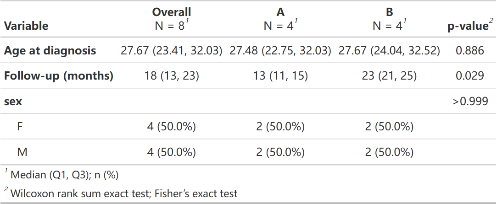
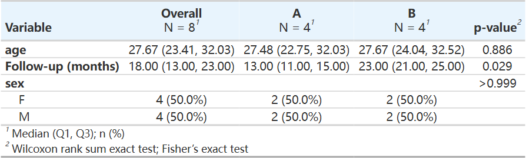

先明确表格描述什么、百分比分母是什么，再选择展示和导出形式。下面比较同一队列的中位数、均数、列/行百分比、分层基线和生存摘要；每个标签页展示实际生成的表格。

::: {.callout-note collapse="true" title="版本与复现记录"}
**版本与执行范围：** 按 RegR 0.1.3 当前源码核对，使用 WSL R 4.4.3 实际运行下面的示例并保存汇总输出。示例用于理解接口和输出；不构成外部验证或临床效果结论。
:::

## 数据准备与复现


使用 RegR 自带的 SEER 甲状腺髓样癌队列。保留完整模型变量、正随访时间及肿瘤大小在 0–200 mm 内的记录，再固定种子抽取最多 800 人。`stage` 合并为 T1/T2 与其余分期，`surgery` 为无手术与任一手术。它们是本页的演示编码。时间单位沿用原始队列的月。只发布汇总结果。

```r
library(RegR)
library(ggplot2)
library(survival)
data("seer_thyroid_mtc_2026", package = "RegR")
d <- as.data.frame(seer_thyroid_mtc_2026)
d[["DSS"]] <- as.integer(as.character(d[["DSS"]]))
d[["OS"]] <- as.integer(as.character(d[["OS"]]))
needed <- c("time", "DSS", "OS", "Age", "Tum", "Sex", "Race", "T_stage", "Sur")
d <- d[complete.cases(d[needed]) & d[["time"]] > 0 &
       d[["Tum"]] > 0 & d[["Tum"]] < 200, , drop = FALSE]
d[["stage"]] <- factor(ifelse(d[["T_stage"]] %in% c("T1", "T2"), "Early", "Other"))
d[["surgery"]] <- factor(ifelse(d[["Sur"]] == "No surgery", "No", "Yes"),
                          levels = c("No", "Yes"))
set.seed(20261001)
d <- droplevels(d[sample.int(nrow(d), min(800L, nrow(d))), , drop = FALSE])
```

## 共用计算与返回对象


表格演示另建 td，将 DSS 转为分类变量；生存模型仍使用上面数值 0/1 的 d。output_format="none" 保留 gtsummary 对象，"gt" 返回 gt 表，默认 "flextable" 适合 Word。不要把表格对象类型和统计方法混为一谈。

```r
td <- d
td[["DSS"]] <- factor(td[["DSS"]], levels = c(0, 1))
table_vars <- c("Age", "Tum", "stage", "DSS")
gtsummary::reset_gtsummary_theme()
```

## 接口选择与返回对象

:::: {.table-responsive tabindex="0" role="region" aria-label="接口与返回类型，可横向滚动"}

| 接口 | 用途 | 当前输出 |
|:--|:--|:--|
| get_tb_gtsummary | 可配置基线表、按层展开 | flextable / gt / gtsummary |
| get_gt_cat | 事件指标与所选变量按组汇总，百分比着色 | invisible(gt_tbl)，并打印 |
| get_tb_autoreg | autoReg::gaze 基线与分层表 | flextable |
| get_tb_survival | DSS 的单变量 Cox HR 与指定时点 S(t) | gtsummary |

::::

get_gt_cat() 会自动加入数据中存在的 DSS/OS/status/event 等事件列，不能把 com_var 当成唯一变量集合。get_tb_survival() 目前固定 time 与 DSS，并将时间标为 Month；原始时间必须与这个单位一致。它不是可任意更换结局列的总分派器。

## 当前名称字典与森林图一致 {#name-map-20261020}

2026-10-20 按已推送 RegR `a2f2553` 核对，`get_tb_gtsummary()` 合并 `colname_map` 的 `name_map_seer` 也用于 `plt_eff()`、`plt_eff2()` 和 `plt_eff_pair()` 的默认行名。字典补入 `NACT="Neoadjuvant chemotherapy"`；Age、Grade_3、分期等已有表格标签现在也由森林图使用，减少同一变量在图和表中的不同叫法。

用户映射仅覆盖给出的键，未列出的变量继续用字典；标签只是显示层，不修改原始列名、因子水平或参考组。需要原名时将该键映射到自身。森林图的[可运行多模型例子](forest-guide.qmd#models-ci-20261020)展示了NACT、Age与Grade_3的实际输出；本页既有表格保留其原执行记录。

## 连续变量摘要与百分比分母


summary_type 改变连续变量描述；percent 改变分类变量分母。列百分比回答各组内的构成，行百分比回答某一水平分布在哪些组。它们不能在图表解读中互换。

::: {.panel-tabset}


### 中位数与列百分比 {.unnumbered}


按 Sex 分组，显示总体、P 值、SMD 与缺失相关人数。

```r
get_tb_gtsummary(td, group_var = "Sex", com_var = table_vars,
  summary_type = "median", percent = "column", digits_continuous = 2, output_format = "gt",
  add_smd = TRUE, add_n = TRUE, colname_map = c(stage = "Stage group"))
```


::: {.table-responsive}




:::


### 均数与标准差 {.unnumbered}


只改连续变量摘要和小数位；不改变样本和分组。

```r
get_tb_gtsummary(td, group_var = "Sex", com_var = table_vars,
  summary_type = "mean", digits_continuous = 1, output_format = "gt")
```


::: {.table-responsive}




:::


### 行百分比 {.unnumbered}


分类变量按行计算百分比，适合读取水平分布。

```r
get_tb_gtsummary(td, group_var = "Sex", com_var = table_vars,
  percent = "row", add_overall = FALSE, digits_continuous = 2, output_format = "gt")
```


::: {.table-responsive}




:::


:::

### 精度与自动选列（2026-10-24） {#precision-columns-20261024}

<!-- update-20261024: table_precision -->

2026-10-24 按已推送 RegR `2c01bb0` 在 Windows / WSL R 4.4.3 执行。`get_tb_gtsummary()` 的连续摘要默认改为 **0 位小数**，支持按原始列名分别指定；下方历史表保留原输出，代码显式设 2 位以复现旧精度。`get_gt_cat()` 仍自行使用 2 位，不随此默认一起改变。

#### 默认值、变量名与显示标签

```r
library(RegR)
d_digits <- data.frame(
  group = factor(rep(c("a", "b"), each = 4)),
  age = c(21.32, 24.18, 30.77, 33.29, 22.64, 25.43, 29.91, 35.12),
  time = c(10, 12, 14, 16, 20, 22, 24, 26),
  sex = factor(rep(c("f", "m"), 4)))
make_digits <- function(...) get_tb_gtsummary(d_digits, group_var = "group",
  com_var = c("age", "time", "sex"), colname_map = c(age = "Age at diagnosis"),
  output_format = "none", ...)
default_digits <- make_digits()
custom_digits <- make_digits(digits_continuous = c(.default = 2, time = 0))
one_digit <- make_digits(digits_continuous = c(age = 1))
overall_digits <- function(x, v) {
  b <- x[["table_body"]]; b[["stat_0"]][b[["variable"]] == v & b[["row_type"]] == "label"]
}
reject_digits <- function(x) inherits(tryCatch(make_digits(digits_continuous = x), error = identity), "error")
gt::gtsave(gtsummary::as_gt(custom_digits),
  file.path(tempdir(), "20261024-update-table-digits.html"))
```

::: {.callout-note collapse="true" title="复核代码"}
生成本页时运行的检查，接在上面的代码之后运行；只读教程可以跳过。

```r
stopifnot(identical(overall_digits(default_digits, "age"), "28 (23, 32)"),
  identical(overall_digits(custom_digits, "age"), "27.67 (23.41, 32.03)"),
  identical(overall_digits(custom_digits, "time"), "18 (13, 23)"),
  identical(overall_digits(one_digit, "time"), overall_digits(default_digits, "time")))
stopifnot(reject_digits(c(age = -1)), reject_digits(c(age = 1.5)),
  reject_digits(c(age = 1, age = 2)), reject_digits(c(sex = 1)),
  reject_digits(c("Age at diagnosis" = 1)))
```
:::

{fig-alt="原生基线表，Age at diagnosis的总体摘要为27.67（23.41，32.03），time为18（13，23），性别百分比保留一位。"}

[原生 HTML 表](images/table-guide/20261024-update-table-digits.html)

命名向量中的键是 `com_var` 的**原列名**，不是 `colname_map` 改出的显示名；`.default` 省略时为 0。无名标量如 `1` 统一用于所有连续变量。每项必须是非负整数，名称唯一，不能给分类列指定连续精度。精度只影响摘要显示，不改变原数值、P 值或分类百分比。

#### 没有选择列、也没有结局列时才比较其余列

```r
quiet_cat <- function(expr) { invisible(capture.output(ans <- force(expr))); ans }
auto_cat <- quiet_cat(get_gt_cat(d_digits, cat_var = "group"))
empty_cat <- quiet_cat(get_gt_cat(d_digits, cat_var = "group", com_var = character()))
d_endpoint <- d_digits
d_endpoint[["DSS"]] <- rep(c(0L, 1L), 4)
endpoint_cat <- quiet_cat(get_gt_cat(d_endpoint, cat_var = "group"))
gt::gtsave(auto_cat, file.path(tempdir(), "20261024-update-table-fallback.html"))
```

::: {.callout-note collapse="true" title="复核代码"}
生成本页时运行的检查，接在上面的代码之后运行；只读教程可以跳过。

```r
stopifnot(setequal(unique(auto_cat[["_data"]][["variable"]]), c("age", "time", "sex")),
  identical(auto_cat[["_data"]], empty_cat[["_data"]]))
stopifnot(identical(unique(endpoint_cat[["_data"]][["variable"]]), "DSS"))
validation_values <- list(default = default_digits[["table_body"]], custom = custom_digits[["table_body"]],
  fallback = auto_cat[["_data"]], endpoints = endpoint_cat[["_data"]])
```
:::

{fig-alt="get_gt_cat的原生表，无显式比较列或结局列时，group以外的age、time、sex作为比较变量。"}

[原生 HTML 表](images/table-guide/20261024-update-table-fallback.html)

省略 `com_var` 与传空向量都可触发回退，但条件是自动加入的结局列也不存在。已有 DSS/OS/status/event 等列时，默认只比较这些结局；不会自动追加全部协变量。分层变量和 `cat_var` 从回退列中排除。明确的研究表格仍建议显式给 `com_var`，避免新增列后表格范围随输入改变。

<!-- /update-20261024: table_precision -->

## 分层与期刊风格


strata_var 为每个层生成相应的基线表；它不等同于回归模型调整。journal_style 会改变 gtsummary 的全局主题，后续调用前需重置，避免参数比较混入前一张表的格式。

::: {.panel-tabset}


### 按分期分层 {.unnumbered}


在 Early/Other 两层内分别比较 Sex。

```r
get_tb_gtsummary(td, strata_var = "stage", group_var = "Sex",
  com_var = c("Age", "Tum", "DSS"), digits_continuous = 2, output_format = "gt")
```


::: {.table-responsive}




:::


### JAMA 风格 {.unnumbered}


期刊风格演示后显式重置全局主题。

```r
jama_table <- get_tb_gtsummary(td, group_var = "Sex",
  com_var = table_vars, journal_style = "jama", digits_continuous = 2, output_format = "gt")
gtsummary::reset_gtsummary_theme()
jama_table
```


::: {.table-responsive}




:::


:::

## 事件构成与 autoReg 基线表


事件构成表中的 DSS/OS 是记录期间的事件比例，不能直接解释为 60 月累计风险；删失和竞争事件需要生存方法处理。autoReg 的固定模板是另一条展示路线。

::: {.panel-tabset}


### 着色构成表 {.unnumbered}


按 Sex 汇总事件指标及选定的 Age/Tum；着色反映百分比。

```r
get_gt_cat(d, cat_var = "Sex", com_var = c("Age", "Tum"))
```


::: {.table-responsive}




:::


### autoReg 输出 {.unnumbered}


返回 flextable；本页转成 HTML 以展示相同汇总结果。

```r
get_tb_autoreg(td, group_var = "Sex", com_var = table_vars)
```


::: {.table-responsive}




:::


:::

## 生存摘要：HR 与时点生存概率


HR 来自各变量分别拟合的单变量 Cox 模型；时点列是 S(t)，不是 HR，也不是 CIF。show_summary 控制是否合并按 DSS 事件状态的描述列。本页 36/60 月均按原始月单位输入。

::: {.panel-tabset}


### 完整摘要 {.unnumbered}


合并描述、单变量 HR、36/60 月生存概率。

```r
get_tb_survival(d, cat_var = c("Sex", "stage"),
  times = c(36, 60), show_summary = TRUE)
```


::: {.table-responsive}




:::


### 精简摘要 {.unnumbered}


隐藏描述部分，保留 HR 与时点概率。

```r
get_tb_survival(d, cat_var = c("Sex", "stage"),
  times = c(36, 60), show_summary = FALSE)
```


::: {.table-responsive}




:::


:::

## 保留对象继续加工与导出


```r
tb <- get_tb_gtsummary(td, group_var = "Sex", com_var = table_vars,
                       digits_continuous = 2, output_format = "none")
gt_table <- gtsummary::as_gt(tb)
word_table <- gtsummary::as_flex_table(tb)
# 按保存接口帮助页设置文件名与目录。
# RegR::save_gt(gt_table, ...)
# RegR::save_tb(word_table, ...)
```

输出类型转换只影响表格载体。P 值表示当前描述/检验规格下的组间证据，SMD 是差异尺度；两者都不能证明组间不存在混杂。生存随访不足时需报告 at-risk 数和可估计性，不能仅靠把 times 拉长产生远期结论。

## save_tb()：整数计数与小数概率 {#save-tb-format}

2026-10-05 核对的 `save_tb()` 会把整列均为整数值的普通 double 数值列显示为零位小数；带小数的列仍按两位小数显示。它改变 Word 格式，保留原始数值。已有 flextable、gtsummary 或 data.frame 均可进入此保存入口。

```r
counts <- data.frame(Group = c("A", "B"), Events = c(12, 18),
                     Probability = c(0.125, 0.234))
# path 是目录；title 同时确定输出文件名，自动补 .docx。
ft <- save_tb(counts, path = tempdir(), title = "counts-and-probabilities",
              line_spacing = 1)
```

:::: {.table-responsive tabindex="0" role="region" aria-label="Word数字格式对照，可横向滚动"}

| Group | 原始 Events（double） | Word 计数 | 原始 Probability | Word 概率 |
|:--|--:|--:|--:|--:|
| A | 12 | 12 | 0.125 | 0.12 |
| B | 18 | 18 | 0.234 | 0.23 |

::::

[下载实际生成的 Word 示例](files/table-guide/counts-and-probabilities.docx){download="counts-and-probabilities.docx"}

已读回实际 DOCX 的表格内容：计数未变成 `12.00`，概率保留两位小数。该表是小型合成数据，未发布患者记录。`line_spacing` 必须是有限正数；返回值仍为格式化 flextable，后续可继续加工。

## 使用边界、保存与复现记录


本页实际运行并展示了 9 张汇总表，未发布患者记录。不同格式不保证数值位数完全相同，比较时应看未格式化数据而不是字符串。期刊主题、列名映射和首字母处理属于显示行为；建模结局、分组、缺失处理和百分比分母必须另行明确。get_tb_autoreg 内部对缺失值采用 Unknown 路线；混合数值/缺失数据要先核对类型，本页使用预先筛选的完整记录。

绘图调色、字体和布局只改变展示；模型、编码、样本、预测时间或权重改变后需要重新计算。带 `save` 的接口按帮助页传入保存配置；其余返回图可用 `ggplot2::ggsave()` 或 `RegR::save_plt()`，表格按返回类型使用 `save_tb()` / `save_gt()`。重采样示例的预算仅用于演示，应结合实际分析目的增加并报告失败与收敛情况。

## 相关页面与源码


- [倾向评分与平衡诊断](ps-guide.qmd)

- [KM/CIF 曲线与表格](cat-guide.qmd)

- [RegR 函数参考](https://hui950319.github.io/RegR/reference/index.html)

- 表格函数帮助页：[`get_tb_gtsummary()`](https://hui950319.github.io/RegR/reference/get_tb_gtsummary.html)、[`get_tb_survival()`](https://hui950319.github.io/RegR/reference/get_tb_survival.html)

- 单多因素表帮助页：[`get_tb_autoreg()`](https://hui950319.github.io/RegR/reference/get_tb_autoreg.html)、[`get_tb_ums()`](https://hui950319.github.io/RegR/reference/get_tb_ums.html)、[`plt_tb_ums()`](https://hui950319.github.io/RegR/reference/plt_tb_ums.html)

- 汇总函数帮助页：[`get_all()`](https://hui950319.github.io/RegR/reference/get_all.html)、[`get_gt_cat()`](https://hui950319.github.io/RegR/reference/get_gt_cat.html)


```r
packageVersion("RegR")
sessionInfo()
```

## 更新记录 {#page-updates}

::: {.callout-note collapse="true" title="本页更新记录"}
- 2026-10-24：[精度与自动选列](#precision-columns-20261024)
:::
