不同筛选策略回答的问题不同。先比较各方法选出的变量，再读 LASSO 的交叉验证曲线和系数路径；相关性与 VIF 是另一个诊断步骤。本页把这些结果并排展示，并保留未入选与未确认变量的含义。

**版本与执行范围：** 按 RegR 0.1.3 当前源码核对，使用 WSL R 4.4.3 实际运行下面的示例并保存汇总输出。示例用于理解接口和输出；不构成外部验证或临床效果结论。

## 数据准备与复现


使用 RegR 自带的 SEER 甲状腺髓样癌队列。保留完整模型变量、正随访时间及肿瘤大小在 0–200 mm 内的记录，再固定种子抽取最多 800 人。`stage` 合并为 T1/T2 与其余分期，`surgery` 为无手术与任一手术。它们是本页的演示编码。时间单位沿用原始队列的月。只发布汇总结果。

```r
library(RegR)
library(ggplot2)
library(survival)
data("seer_thyroid_mtc_2026", package = "RegR")
d <- as.data.frame(seer_thyroid_mtc_2026)
d[["DSS"]] <- as.integer(as.character(d[["DSS"]]))
d[["OS"]] <- as.integer(as.character(d[["OS"]]))
needed <- c("time", "DSS", "OS", "Age", "Tum", "Sex", "Race", "T_stage", "Sur")
d <- d[complete.cases(d[needed]) & d[["time"]] > 0 &
       d[["Tum"]] > 0 & d[["Tum"]] < 200, , drop = FALSE]
d[["stage"]] <- factor(ifelse(d[["T_stage"]] %in% c("T1", "T2"), "Early", "Other"))
d[["surgery"]] <- factor(ifelse(d[["Sur"]] == "No surgery", "No", "Yes"),
                          levels = c("No", "Yes"))
set.seed(20261001)
d <- droplevels(d[sample.int(nrow(d), min(800L, nrow(d))), , drop = FALSE])
```


## 共用计算与返回对象


get_var_sel() 根据 time 与结局水平数分派：time=NULL 是 Logistic；有 time 的二水平结局是 Cox、三水平结局是竞争风险。默认 methods=NULL 时，Cox/Logistic 跑四类策略，竞争风险只跑 p/step 并记录 skipped。显式给竞争风险请求 lasso/boruta 会报错。这里采用 Cox DSS；5 折 CV、20 次 Boruta、100 棵树是演示预算。独立 get_lasso() 固定 10 折，不能从上面的 lasso_args 推断它也改成了 5 折。

```r
candidate <- c("Age", "Tum", "Sex", "stage")
set.seed(20261001)
selected <- run_quiet({get_var_sel(d, vars = candidate,
  methods = c("p", "step", "lasso", "boruta"),
  step_args = list(direction = c("forward", "backward"), criterion = "AIC"),
  lasso_args = list(lambda_rule = c("1se", "min"), nfolds = 5L),
  boruta_args = list(max_runs = 20L, num_trees = 100L))})

# get_lasso() 用 data.matrix()；此处显式编码二分类预测变量。
dn <- d
dn[["sex_male"]] <- as.integer(dn[["Sex"]] == "Male")
dn[["stage_other"]] <- as.integer(dn[["stage"]] == "Other")
numeric_vars <- c("Age", "Tum", "sex_male", "stage_other")
set.seed(20261001)
lasso <- run_quiet({get_lasso(dn, vars = numeric_vars)})
set.seed(20261001)
boruta <- run_quiet({get_boruta(d, vars = candidate,
  max_runs = 20L, num_trees = 100L)})
```


### 独立 LASSO：校验、命名与复用拟合（2026-10-27） {#lasso-inputs-20261027}

<!-- update-20261027: regr_lasso -->

按已推送 RegR `212a156`，独立 `get_lasso()` 仍固定 10 折、alpha=1，参数没有增加可调折数；现在先检查结局、变量类型、缺失、有限值及响应泄漏，再构造矩阵。它复用 `cv.fit$glmnet.fit`，不再为相同路径额外拟合一次。

本例是 80 行合成二分类数据，保留带空格及连字符的预测变量名。真实多水平分类变量请先按研究定义构造设计矩阵；`data.matrix()` 的类别整数编码并不自动等于 one-hot。

```r
library(RegR)
library(ggplot2)
set.seed(20261027)
lasso_data27 <- data.frame("Marker A" = rnorm(80), "Marker-B" = rnorm(80),
  Noise = rnorm(80), check.names = FALSE)
lasso_data27[["Outcome"]] <- rbinom(80, 1, plogis(.2 + lasso_data27[["Marker A"]] -
  .4 * lasso_data27[["Marker-B"]]))
lasso_vars27 <- c("Marker A", "Marker-B", "Noise")
lasso_before27 <- lasso_data27
set.seed(27)
lasso_fit27 <- get_lasso(lasso_data27, vars = lasso_vars27, surv = "Outcome")
lasso_cv27 <- plot_cv_glmnet(lasso_fit27[["cv.fit"]])
lasso_path27 <- plot_coef_path(lasso_fit27, n_labels = 3)
ggsave(file.path(tempdir(), "20261027-update-lasso-cv.pdf"), lasso_cv27,
  width = 7, height = 5, device = grDevices::cairo_pdf)
ggsave(file.path(tempdir(), "20261027-update-lasso-path.pdf"), lasso_path27,
  width = 7, height = 5, device = grDevices::cairo_pdf)
lasso_fit27[["vars_min"]]
lasso_fit27[["vars_1se"]]
```

`lambda.min` / `lambda.1se` 下的变量名来自 beta 行位置，不能把截距当作预测变量，也不能把系数路径当作 HR。两种规则可能都只选中一个特征，也可能返回空集合；空集合不等于拟合失败。

::: {.callout-note collapse="true" title="复核代码"}

```r
stopifnot(inherits(lasso_fit27, "get_lasso"), identical(lasso_data27, lasso_before27),
  isTRUE(all.equal(lasso_fit27[["fit"]][["beta"]],
    lasso_fit27[["cv.fit"]][["glmnet.fit"]][["beta"]])),
  all(c(lasso_fit27[["vars_min"]], lasso_fit27[["vars_1se"]]) %in% lasso_vars27),
  identical(lasso_fit27[["fit"]][["call"]][["family"]], "binomial"))
bad_lasso27 <- list(
  leakage = tryCatch(get_lasso(lasso_data27, vars = c(lasso_vars27, "Outcome"),
    surv = "Outcome"), error = conditionMessage),
  missing = tryCatch(get_lasso(transform(lasso_data27, Noise = NA_real_),
    vars = lasso_vars27, surv = "Outcome"), error = conditionMessage),
  selector = tryCatch(get_lasso(lasso_data27, vars = lasso_vars27, surv = FALSE),
    error = conditionMessage))
stopifnot(all(vapply(bad_lasso27, is.character, logical(1))),
  grepl("Response columns", bad_lasso27[["leakage"]], fixed = TRUE),
  grepl("missing", bad_lasso27[["missing"]], fixed = TRUE))
validation_values <- list(n = nrow(lasso_data27), classes = as.integer(table(lasso_data27[["Outcome"]])),
  vars_min = lasso_fit27[["vars_min"]], vars_1se = lasso_fit27[["vars_1se"]],
  family = "binomial", rejected = names(bad_lasso27), input_unchanged = identical(lasso_data27, lasso_before27))
```
:::

::: {.panel-tabset}

#### 十折 CV {.unnumbered}

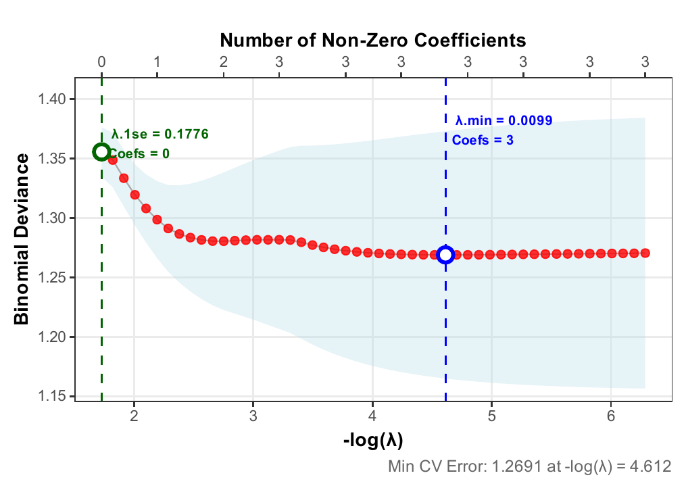{fig-alt="独立 get_lasso 仍使用固定 10 折交叉验证，展示 lambda.min 和 lambda.1se 对应的误差与非零系数数目。"}

[PDF](images/variable-selection-guide/20261027-update-lasso-cv.pdf)

#### 复用同一全数据拟合 {.unnumbered}

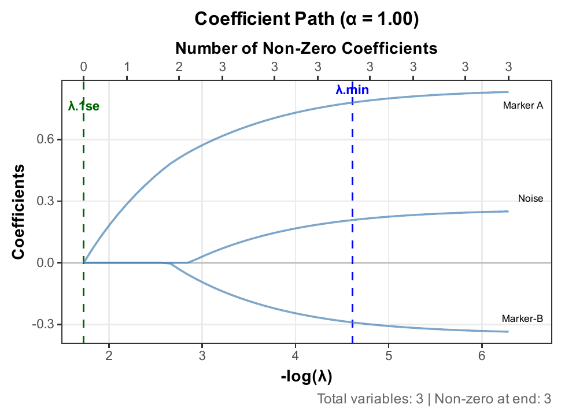{fig-alt="同一次交叉验证的全数据 glmnet 路径，保留带空格和连字符的特征名，不额外重新拟合。"}

[PDF](images/variable-selection-guide/20261027-update-lasso-path.pdf)

:::

输入不会自动删行或插补：至少 10 行、至少两个预测变量，且至少一列有变化。Cox 要求精确列名 time/DSS、正随访及至少两个事件；二分类每类至少三人，这些只是必要条件，随机十折仍可能因稀疏结局失败。重复模型列名、矩阵/list、integer64、未处理的 SPSS 用户缺失等会提前报错。

CV 错误会报告模型与数据维度，并保留原始错误；CV 成功后的绘图失败则告警且仍返回拟合。调用前的 glmnet 全局控制会恢复，保存的 family 可用于重拟合，但仍需原编码 x/y，不能只凭打印摘要恢复模型。此处没有重新计算旧页的性能倍数。

<!-- /update-20261027: regr_lasso -->

## 策略热图与可导出的摘要


summary 保留策略名称、模型式、变量数和 list 列 vars；vars 是按策略命名的变量集合。热图仅展示至少被一种策略选中的变量，因此看不到某变量不等于该变量没有被评估。

::: {.panel-tabset}


### 方法比较 {.unnumbered}


同一候选集合的实际入选矩阵；红色表示该策略入选。

```r
selected[["plot"]] + theme(text = element_text(size = 13))
```


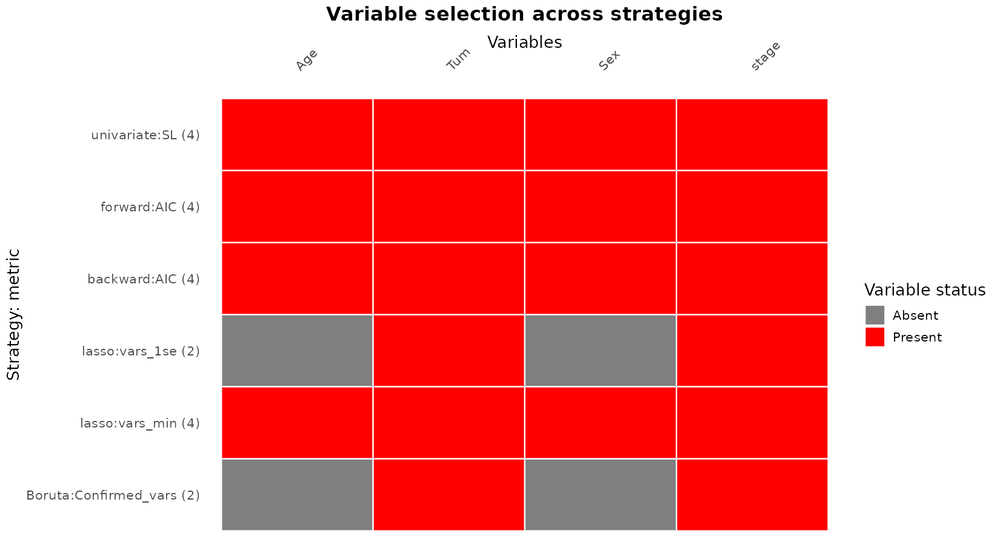{fig-alt="方法比较；同一候选集合的实际入选矩阵；红色表示该策略入选。"}


### 选择摘要 {.unnumbered}


将 list 列展开成字符，便于核对和导出。

```r
selection_table <- as.data.frame(selected[["summary"]])
selection_table[["vars"]] <- vapply(selection_table[["vars"]], paste, collapse = ", ", FUN.VALUE = character(1))
selection_table
```


::: {.table-responsive}


<div id="gvvqonzqjf" style="padding-left:0px;padding-right:0px;padding-top:10px;padding-bottom:10px;overflow-x:auto;overflow-y:auto;width:auto;height:auto;">

  <table class="gt_table" data-quarto-disable-processing="false" data-quarto-bootstrap="false" style="-webkit-font-smoothing: antialiased; -moz-osx-font-smoothing: grayscale; font-family: system-ui, 'Segoe UI', Roboto, Helvetica, Arial, sans-serif, 'Apple Color Emoji', 'Segoe UI Emoji', 'Segoe UI Symbol', 'Noto Color Emoji'; display: table; border-collapse: collapse; line-height: normal; margin-left: auto; margin-right: auto; color: #333333; font-size: 16px; font-weight: normal; font-style: normal; background-color: #FFFFFF; width: auto; border-top-style: solid; border-top-width: 2px; border-top-color: #A8A8A8; border-right-style: none; border-right-width: 2px; border-right-color: #D3D3D3; border-bottom-style: solid; border-bottom-width: 2px; border-bottom-color: #A8A8A8; border-left-style: none; border-left-width: 2px; border-left-color: #D3D3D3;" bgcolor="#FFFFFF">
  <thead style="border-style: none;">
    <tr class="gt_col_headings" style="border-style: none; border-top-style: solid; border-top-width: 2px; border-top-color: #D3D3D3; border-bottom-style: solid; border-bottom-width: 2px; border-bottom-color: #D3D3D3; border-left-style: none; border-left-width: 1px; border-left-color: #D3D3D3; border-right-style: none; border-right-width: 1px; border-right-color: #D3D3D3;">
      <th class="gt_col_heading gt_columns_bottom_border gt_center" rowspan="1" colspan="1" scope="col" id="strategy.metric" style="border-style: none; color: #333333; background-color: #FFFFFF; font-size: 100%; font-weight: normal; text-transform: inherit; border-left-style: none; border-left-width: 1px; border-left-color: #D3D3D3; border-right-style: none; border-right-width: 1px; border-right-color: #D3D3D3; vertical-align: bottom; padding-top: 5px; padding-bottom: 6px; padding-left: 5px; padding-right: 5px; overflow-x: hidden; text-align: center;" bgcolor="#FFFFFF" valign="bottom" align="center">strategy.metric</th>
      <th class="gt_col_heading gt_columns_bottom_border gt_left" rowspan="1" colspan="1" scope="col" id="model" style="border-style: none; color: #333333; background-color: #FFFFFF; font-size: 100%; font-weight: normal; text-transform: inherit; border-left-style: none; border-left-width: 1px; border-left-color: #D3D3D3; border-right-style: none; border-right-width: 1px; border-right-color: #D3D3D3; vertical-align: bottom; padding-top: 5px; padding-bottom: 6px; padding-left: 5px; padding-right: 5px; overflow-x: hidden; text-align: left;" bgcolor="#FFFFFF" valign="bottom" align="left">model</th>
      <th class="gt_col_heading gt_columns_bottom_border gt_right" rowspan="1" colspan="1" scope="col" id="num_var" style="border-style: none; color: #333333; background-color: #FFFFFF; font-size: 100%; font-weight: normal; text-transform: inherit; border-left-style: none; border-left-width: 1px; border-left-color: #D3D3D3; border-right-style: none; border-right-width: 1px; border-right-color: #D3D3D3; vertical-align: bottom; padding-top: 5px; padding-bottom: 6px; padding-left: 5px; padding-right: 5px; overflow-x: hidden; text-align: right; font-variant-numeric: tabular-nums;" bgcolor="#FFFFFF" valign="bottom" align="right">num_var</th>
      <th class="gt_col_heading gt_columns_bottom_border gt_left" rowspan="1" colspan="1" scope="col" id="vars" style="border-style: none; color: #333333; background-color: #FFFFFF; font-size: 100%; font-weight: normal; text-transform: inherit; border-left-style: none; border-left-width: 1px; border-left-color: #D3D3D3; border-right-style: none; border-right-width: 1px; border-right-color: #D3D3D3; vertical-align: bottom; padding-top: 5px; padding-bottom: 6px; padding-left: 5px; padding-right: 5px; overflow-x: hidden; text-align: left;" bgcolor="#FFFFFF" valign="bottom" align="left">vars</th>
    </tr>
  </thead>
  <tbody class="gt_table_body" style="border-style: none; border-top-style: solid; border-top-width: 2px; border-top-color: #D3D3D3; border-bottom-style: solid; border-bottom-width: 2px; border-bottom-color: #D3D3D3;">
    <tr style="border-style: none;"><td headers="strategy.metric" class="gt_row gt_center" style="border-style: none; padding-top: 8px; padding-bottom: 8px; padding-left: 5px; padding-right: 5px; margin: 10px; border-top-style: solid; border-top-width: 1px; border-top-color: #D3D3D3; border-left-style: none; border-left-width: 1px; border-left-color: #D3D3D3; border-right-style: none; border-right-width: 1px; border-right-color: #D3D3D3; vertical-align: middle; overflow-x: hidden; text-align: center;" valign="middle" align="center">univariate:SL (4)</td>
<td headers="model" class="gt_row gt_left" style="border-style: none; padding-top: 8px; padding-bottom: 8px; padding-left: 5px; padding-right: 5px; margin: 10px; border-top-style: solid; border-top-width: 1px; border-top-color: #D3D3D3; border-left-style: none; border-left-width: 1px; border-left-color: #D3D3D3; border-right-style: none; border-right-width: 1px; border-right-color: #D3D3D3; vertical-align: middle; overflow-x: hidden; text-align: left;" valign="middle" align="left">survival::Surv(time, DSS) ~ Age + Tum + Sex + stage</td>
<td headers="num_var" class="gt_row gt_right" style="border-style: none; padding-top: 8px; padding-bottom: 8px; padding-left: 5px; padding-right: 5px; margin: 10px; border-top-style: solid; border-top-width: 1px; border-top-color: #D3D3D3; border-left-style: none; border-left-width: 1px; border-left-color: #D3D3D3; border-right-style: none; border-right-width: 1px; border-right-color: #D3D3D3; vertical-align: middle; overflow-x: hidden; text-align: right; font-variant-numeric: tabular-nums;" valign="middle" align="right">4</td>
<td headers="vars" class="gt_row gt_left" style="border-style: none; padding-top: 8px; padding-bottom: 8px; padding-left: 5px; padding-right: 5px; margin: 10px; border-top-style: solid; border-top-width: 1px; border-top-color: #D3D3D3; border-left-style: none; border-left-width: 1px; border-left-color: #D3D3D3; border-right-style: none; border-right-width: 1px; border-right-color: #D3D3D3; vertical-align: middle; overflow-x: hidden; text-align: left;" valign="middle" align="left">Age, Tum, Sex, stage</td></tr>
    <tr style="border-style: none;"><td headers="strategy.metric" class="gt_row gt_center" style="border-style: none; padding-top: 8px; padding-bottom: 8px; padding-left: 5px; padding-right: 5px; margin: 10px; border-top-style: solid; border-top-width: 1px; border-top-color: #D3D3D3; border-left-style: none; border-left-width: 1px; border-left-color: #D3D3D3; border-right-style: none; border-right-width: 1px; border-right-color: #D3D3D3; vertical-align: middle; overflow-x: hidden; text-align: center;" valign="middle" align="center">forward:AIC (4)</td>
<td headers="model" class="gt_row gt_left" style="border-style: none; padding-top: 8px; padding-bottom: 8px; padding-left: 5px; padding-right: 5px; margin: 10px; border-top-style: solid; border-top-width: 1px; border-top-color: #D3D3D3; border-left-style: none; border-left-width: 1px; border-left-color: #D3D3D3; border-right-style: none; border-right-width: 1px; border-right-color: #D3D3D3; vertical-align: middle; overflow-x: hidden; text-align: left;" valign="middle" align="left">survival::Surv(time, DSS) ~ 0 + stage + Tum + Age + Sex</td>
<td headers="num_var" class="gt_row gt_right" style="border-style: none; padding-top: 8px; padding-bottom: 8px; padding-left: 5px; padding-right: 5px; margin: 10px; border-top-style: solid; border-top-width: 1px; border-top-color: #D3D3D3; border-left-style: none; border-left-width: 1px; border-left-color: #D3D3D3; border-right-style: none; border-right-width: 1px; border-right-color: #D3D3D3; vertical-align: middle; overflow-x: hidden; text-align: right; font-variant-numeric: tabular-nums;" valign="middle" align="right">4</td>
<td headers="vars" class="gt_row gt_left" style="border-style: none; padding-top: 8px; padding-bottom: 8px; padding-left: 5px; padding-right: 5px; margin: 10px; border-top-style: solid; border-top-width: 1px; border-top-color: #D3D3D3; border-left-style: none; border-left-width: 1px; border-left-color: #D3D3D3; border-right-style: none; border-right-width: 1px; border-right-color: #D3D3D3; vertical-align: middle; overflow-x: hidden; text-align: left;" valign="middle" align="left">stage, Tum, Age, Sex</td></tr>
    <tr style="border-style: none;"><td headers="strategy.metric" class="gt_row gt_center" style="border-style: none; padding-top: 8px; padding-bottom: 8px; padding-left: 5px; padding-right: 5px; margin: 10px; border-top-style: solid; border-top-width: 1px; border-top-color: #D3D3D3; border-left-style: none; border-left-width: 1px; border-left-color: #D3D3D3; border-right-style: none; border-right-width: 1px; border-right-color: #D3D3D3; vertical-align: middle; overflow-x: hidden; text-align: center;" valign="middle" align="center">backward:AIC (4)</td>
<td headers="model" class="gt_row gt_left" style="border-style: none; padding-top: 8px; padding-bottom: 8px; padding-left: 5px; padding-right: 5px; margin: 10px; border-top-style: solid; border-top-width: 1px; border-top-color: #D3D3D3; border-left-style: none; border-left-width: 1px; border-left-color: #D3D3D3; border-right-style: none; border-right-width: 1px; border-right-color: #D3D3D3; vertical-align: middle; overflow-x: hidden; text-align: left;" valign="middle" align="left">survival::Surv(time, DSS) ~ 0 + Age + Tum + Sex + stage</td>
<td headers="num_var" class="gt_row gt_right" style="border-style: none; padding-top: 8px; padding-bottom: 8px; padding-left: 5px; padding-right: 5px; margin: 10px; border-top-style: solid; border-top-width: 1px; border-top-color: #D3D3D3; border-left-style: none; border-left-width: 1px; border-left-color: #D3D3D3; border-right-style: none; border-right-width: 1px; border-right-color: #D3D3D3; vertical-align: middle; overflow-x: hidden; text-align: right; font-variant-numeric: tabular-nums;" valign="middle" align="right">4</td>
<td headers="vars" class="gt_row gt_left" style="border-style: none; padding-top: 8px; padding-bottom: 8px; padding-left: 5px; padding-right: 5px; margin: 10px; border-top-style: solid; border-top-width: 1px; border-top-color: #D3D3D3; border-left-style: none; border-left-width: 1px; border-left-color: #D3D3D3; border-right-style: none; border-right-width: 1px; border-right-color: #D3D3D3; vertical-align: middle; overflow-x: hidden; text-align: left;" valign="middle" align="left">Age, Tum, Sex, stage</td></tr>
    <tr style="border-style: none;"><td headers="strategy.metric" class="gt_row gt_center" style="border-style: none; padding-top: 8px; padding-bottom: 8px; padding-left: 5px; padding-right: 5px; margin: 10px; border-top-style: solid; border-top-width: 1px; border-top-color: #D3D3D3; border-left-style: none; border-left-width: 1px; border-left-color: #D3D3D3; border-right-style: none; border-right-width: 1px; border-right-color: #D3D3D3; vertical-align: middle; overflow-x: hidden; text-align: center;" valign="middle" align="center">lasso:vars_1se (2)</td>
<td headers="model" class="gt_row gt_left" style="border-style: none; padding-top: 8px; padding-bottom: 8px; padding-left: 5px; padding-right: 5px; margin: 10px; border-top-style: solid; border-top-width: 1px; border-top-color: #D3D3D3; border-left-style: none; border-left-width: 1px; border-left-color: #D3D3D3; border-right-style: none; border-right-width: 1px; border-right-color: #D3D3D3; vertical-align: middle; overflow-x: hidden; text-align: left;" valign="middle" align="left">survival::Surv(time, DSS) ~ Tum + stage</td>
<td headers="num_var" class="gt_row gt_right" style="border-style: none; padding-top: 8px; padding-bottom: 8px; padding-left: 5px; padding-right: 5px; margin: 10px; border-top-style: solid; border-top-width: 1px; border-top-color: #D3D3D3; border-left-style: none; border-left-width: 1px; border-left-color: #D3D3D3; border-right-style: none; border-right-width: 1px; border-right-color: #D3D3D3; vertical-align: middle; overflow-x: hidden; text-align: right; font-variant-numeric: tabular-nums;" valign="middle" align="right">2</td>
<td headers="vars" class="gt_row gt_left" style="border-style: none; padding-top: 8px; padding-bottom: 8px; padding-left: 5px; padding-right: 5px; margin: 10px; border-top-style: solid; border-top-width: 1px; border-top-color: #D3D3D3; border-left-style: none; border-left-width: 1px; border-left-color: #D3D3D3; border-right-style: none; border-right-width: 1px; border-right-color: #D3D3D3; vertical-align: middle; overflow-x: hidden; text-align: left;" valign="middle" align="left">Tum, stage</td></tr>
    <tr style="border-style: none;"><td headers="strategy.metric" class="gt_row gt_center" style="border-style: none; padding-top: 8px; padding-bottom: 8px; padding-left: 5px; padding-right: 5px; margin: 10px; border-top-style: solid; border-top-width: 1px; border-top-color: #D3D3D3; border-left-style: none; border-left-width: 1px; border-left-color: #D3D3D3; border-right-style: none; border-right-width: 1px; border-right-color: #D3D3D3; vertical-align: middle; overflow-x: hidden; text-align: center;" valign="middle" align="center">lasso:vars_min (4)</td>
<td headers="model" class="gt_row gt_left" style="border-style: none; padding-top: 8px; padding-bottom: 8px; padding-left: 5px; padding-right: 5px; margin: 10px; border-top-style: solid; border-top-width: 1px; border-top-color: #D3D3D3; border-left-style: none; border-left-width: 1px; border-left-color: #D3D3D3; border-right-style: none; border-right-width: 1px; border-right-color: #D3D3D3; vertical-align: middle; overflow-x: hidden; text-align: left;" valign="middle" align="left">survival::Surv(time, DSS) ~ Age + Tum + Sex + stage</td>
<td headers="num_var" class="gt_row gt_right" style="border-style: none; padding-top: 8px; padding-bottom: 8px; padding-left: 5px; padding-right: 5px; margin: 10px; border-top-style: solid; border-top-width: 1px; border-top-color: #D3D3D3; border-left-style: none; border-left-width: 1px; border-left-color: #D3D3D3; border-right-style: none; border-right-width: 1px; border-right-color: #D3D3D3; vertical-align: middle; overflow-x: hidden; text-align: right; font-variant-numeric: tabular-nums;" valign="middle" align="right">4</td>
<td headers="vars" class="gt_row gt_left" style="border-style: none; padding-top: 8px; padding-bottom: 8px; padding-left: 5px; padding-right: 5px; margin: 10px; border-top-style: solid; border-top-width: 1px; border-top-color: #D3D3D3; border-left-style: none; border-left-width: 1px; border-left-color: #D3D3D3; border-right-style: none; border-right-width: 1px; border-right-color: #D3D3D3; vertical-align: middle; overflow-x: hidden; text-align: left;" valign="middle" align="left">Age, Tum, Sex, stage</td></tr>
    <tr style="border-style: none;"><td headers="strategy.metric" class="gt_row gt_center" style="border-style: none; padding-top: 8px; padding-bottom: 8px; padding-left: 5px; padding-right: 5px; margin: 10px; border-top-style: solid; border-top-width: 1px; border-top-color: #D3D3D3; border-left-style: none; border-left-width: 1px; border-left-color: #D3D3D3; border-right-style: none; border-right-width: 1px; border-right-color: #D3D3D3; vertical-align: middle; overflow-x: hidden; text-align: center;" valign="middle" align="center">Boruta:Confirmed_vars (2)</td>
<td headers="model" class="gt_row gt_left" style="border-style: none; padding-top: 8px; padding-bottom: 8px; padding-left: 5px; padding-right: 5px; margin: 10px; border-top-style: solid; border-top-width: 1px; border-top-color: #D3D3D3; border-left-style: none; border-left-width: 1px; border-left-color: #D3D3D3; border-right-style: none; border-right-width: 1px; border-right-color: #D3D3D3; vertical-align: middle; overflow-x: hidden; text-align: left;" valign="middle" align="left">survival::Surv(time, DSS) ~ stage + Tum</td>
<td headers="num_var" class="gt_row gt_right" style="border-style: none; padding-top: 8px; padding-bottom: 8px; padding-left: 5px; padding-right: 5px; margin: 10px; border-top-style: solid; border-top-width: 1px; border-top-color: #D3D3D3; border-left-style: none; border-left-width: 1px; border-left-color: #D3D3D3; border-right-style: none; border-right-width: 1px; border-right-color: #D3D3D3; vertical-align: middle; overflow-x: hidden; text-align: right; font-variant-numeric: tabular-nums;" valign="middle" align="right">2</td>
<td headers="vars" class="gt_row gt_left" style="border-style: none; padding-top: 8px; padding-bottom: 8px; padding-left: 5px; padding-right: 5px; margin: 10px; border-top-style: solid; border-top-width: 1px; border-top-color: #D3D3D3; border-left-style: none; border-left-width: 1px; border-left-color: #D3D3D3; border-right-style: none; border-right-width: 1px; border-right-color: #D3D3D3; vertical-align: middle; overflow-x: hidden; text-align: left;" valign="middle" align="left">stage, Tum</td></tr>
  </tbody>

</table>
</div>


:::


:::


## 交叉验证曲线：误差带和横轴


lambda.min 对应 CV 平均误差最低点，lambda.1se 在误差容许范围内选择更强惩罚。误差带是交叉验证误差的变动，不是效应量置信区间。横轴转换不会重新拟合模型。

::: {.panel-tabset}


### 误差带 {.unnumbered}


同一个 cv.fit，用带状误差和两条 lambda 线。

```r
plot_cv_glmnet(lasso[["cv.fit"]], error_type = "ribbon")
```


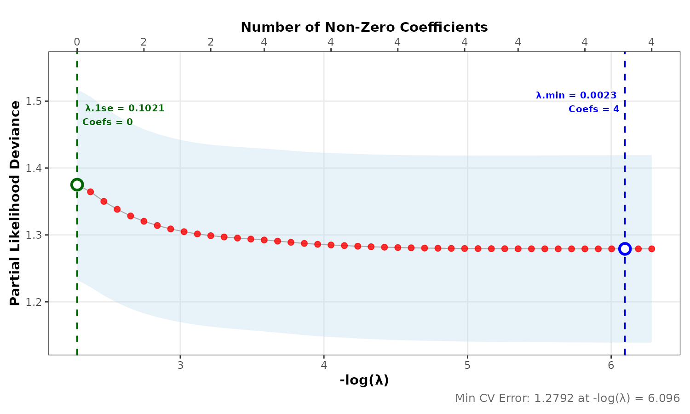{fig-alt="误差带；同一个 cv.fit，用带状误差和两条 lambda 线。"}


### 误差棒与高亮 {.unnumbered}


误差棒并高亮 lambda.min 到 lambda.1se 的区域。

```r
plot_cv_glmnet(lasso[["cv.fit"]], error_type = "errorbar", highlight_optimal = TRUE)
```


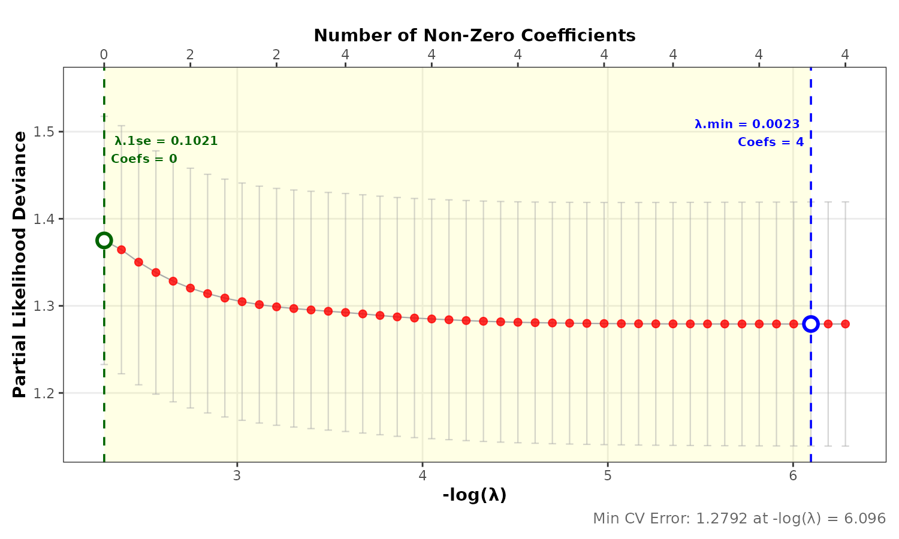{fig-alt="误差棒与高亮；误差棒并高亮 lambda.min 到 lambda.1se 的区域。"}


### log(lambda) 横轴 {.unnumbered}


改成 log(lambda)，惩罚方向需结合横轴读图。

```r
plot_cv_glmnet(lasso[["cv.fit"]], xvar = "log_lambda", error_type = "both")
```


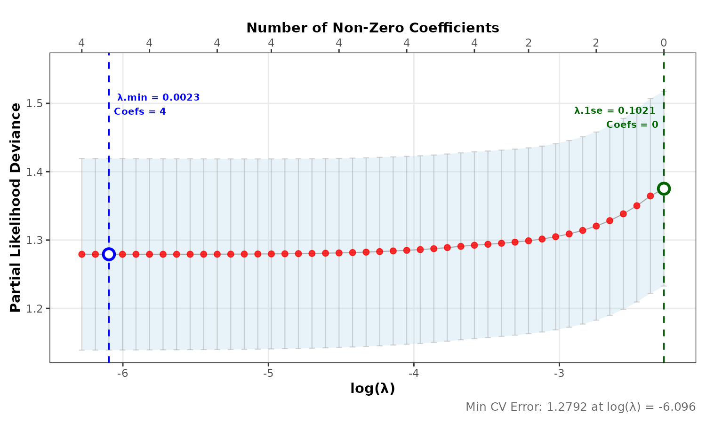{fig-alt="log(lambda) 横轴；改成 log(lambda)，惩罚方向需结合横轴读图。"}


:::


## 系数路径与变量编码


get_lasso() 直接将所选列交给 data.matrix()；多水平因子的整数编码不是哑变量设计。需要预先建立正确的数值设计矩阵，或使用 get_var_sel() 的 model.matrix 适配器。这里的二分类列显式转为 0/1；Age 与 Tum 分别保持年和 mm。

::: {.panel-tabset}


### 全部路径 {.unnumbered}


路径的纵轴是回归系数；Cox 路径不是 HR。

```r
plot_coef_path(lasso, n_labels = 4)
```


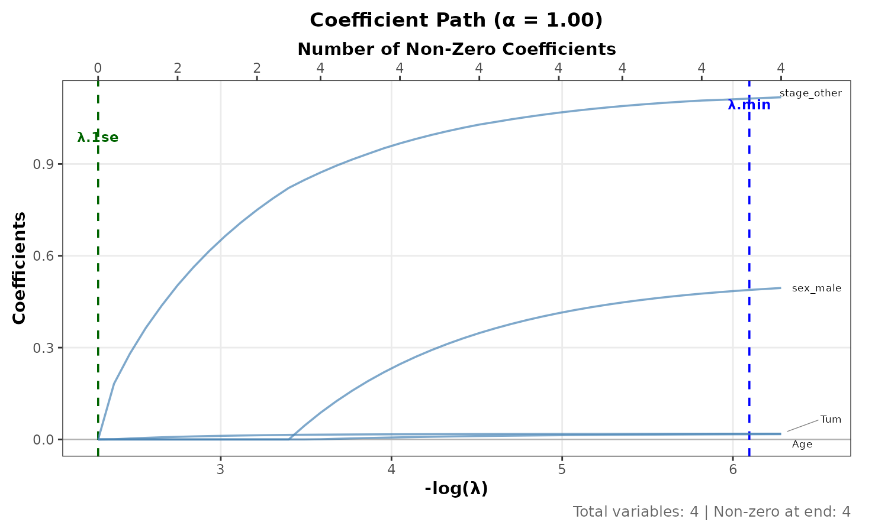{fig-alt="全部路径；路径的纵轴是回归系数；Cox 路径不是 HR。"}


### 指定变量高亮 {.unnumbered}


仅改变显示，Age 和 Tum 的变量选择结果不会因此改变。

```r
plot_coef_path(lasso, highlight_vars = c("Age", "Tum"), add_legend = TRUE, n_labels = 4)
```


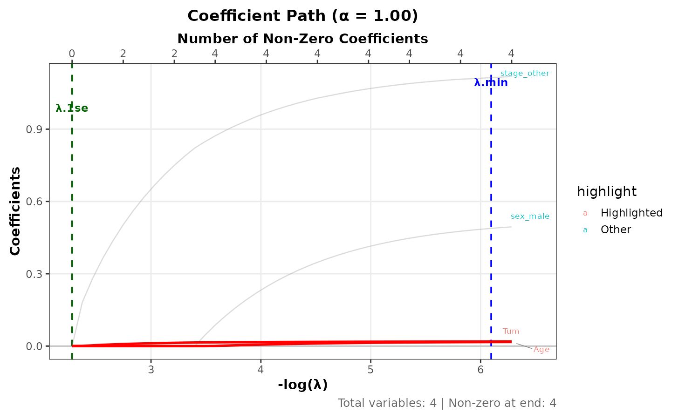{fig-alt="指定变量高亮；仅改变显示，Age 和 Tum 的变量选择结果不会因此改变。"}


### L1 范数横轴 {.unnumbered}


以 L1 范数读取系数逐渐进入模型的过程。

```r
plot_coef_path(lasso, xvar = "norm", color_by_sign = TRUE, n_labels = 4)
```


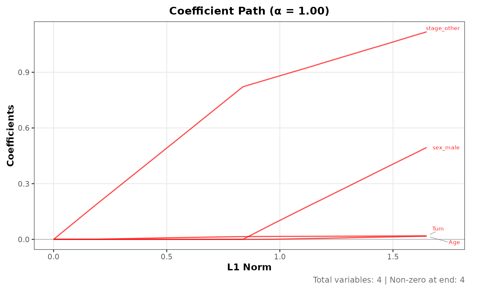{fig-alt="L1 范数横轴；以 L1 范数读取系数逐渐进入模型的过程。"}


:::


## Boruta：Confirmed、Tentative 与预算


Boruta 用影子变量作为随机基准；vars_confirmed 只保留 Confirmed，不自动包含 Tentative。有限迭代后仍待定的变量应如实报告，不宜把它们默默改成确认。

::: {.panel-tabset}


### 重要性分布 {.unnumbered}


原生 Boruta 图保留确认、拒绝、待定及影子变量。

```r
plot(boruta[["fit"]], las = 2, cex.axis = 0.8)
```


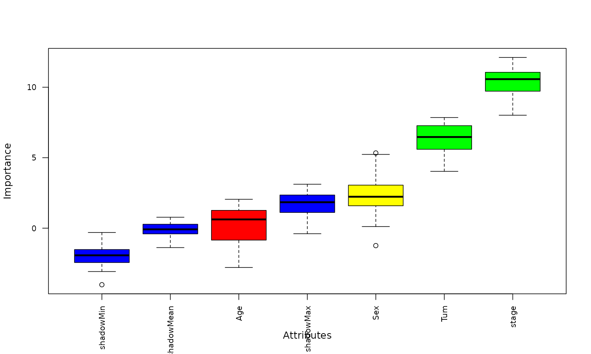{fig-alt="重要性分布；原生 Boruta 图保留确认、拒绝、待定及影子变量。"}


### 决策表 {.unnumbered}


每个候选变量的最终决策与重要性汇总。

```r
bstat <- Boruta::attStats(boruta[["fit"]])
bstat[["variable"]] <- rownames(bstat)
bstat[, c("variable", "meanImp", "medianImp", "decision")]
```


::: {.table-responsive}


<div id="ozvcnaxxwz" style="padding-left:0px;padding-right:0px;padding-top:10px;padding-bottom:10px;overflow-x:auto;overflow-y:auto;width:auto;height:auto;">

  <table class="gt_table" data-quarto-disable-processing="false" data-quarto-bootstrap="false" style="-webkit-font-smoothing: antialiased; -moz-osx-font-smoothing: grayscale; font-family: system-ui, 'Segoe UI', Roboto, Helvetica, Arial, sans-serif, 'Apple Color Emoji', 'Segoe UI Emoji', 'Segoe UI Symbol', 'Noto Color Emoji'; display: table; border-collapse: collapse; line-height: normal; margin-left: auto; margin-right: auto; color: #333333; font-size: 16px; font-weight: normal; font-style: normal; background-color: #FFFFFF; width: auto; border-top-style: solid; border-top-width: 2px; border-top-color: #A8A8A8; border-right-style: none; border-right-width: 2px; border-right-color: #D3D3D3; border-bottom-style: solid; border-bottom-width: 2px; border-bottom-color: #A8A8A8; border-left-style: none; border-left-width: 2px; border-left-color: #D3D3D3;" bgcolor="#FFFFFF">
  <thead style="border-style: none;">
    <tr class="gt_col_headings" style="border-style: none; border-top-style: solid; border-top-width: 2px; border-top-color: #D3D3D3; border-bottom-style: solid; border-bottom-width: 2px; border-bottom-color: #D3D3D3; border-left-style: none; border-left-width: 1px; border-left-color: #D3D3D3; border-right-style: none; border-right-width: 1px; border-right-color: #D3D3D3;">
      <th class="gt_col_heading gt_columns_bottom_border gt_left" rowspan="1" colspan="1" scope="col" id="variable" style="border-style: none; color: #333333; background-color: #FFFFFF; font-size: 100%; font-weight: normal; text-transform: inherit; border-left-style: none; border-left-width: 1px; border-left-color: #D3D3D3; border-right-style: none; border-right-width: 1px; border-right-color: #D3D3D3; vertical-align: bottom; padding-top: 5px; padding-bottom: 6px; padding-left: 5px; padding-right: 5px; overflow-x: hidden; text-align: left;" bgcolor="#FFFFFF" valign="bottom" align="left">variable</th>
      <th class="gt_col_heading gt_columns_bottom_border gt_right" rowspan="1" colspan="1" scope="col" id="meanImp" style="border-style: none; color: #333333; background-color: #FFFFFF; font-size: 100%; font-weight: normal; text-transform: inherit; border-left-style: none; border-left-width: 1px; border-left-color: #D3D3D3; border-right-style: none; border-right-width: 1px; border-right-color: #D3D3D3; vertical-align: bottom; padding-top: 5px; padding-bottom: 6px; padding-left: 5px; padding-right: 5px; overflow-x: hidden; text-align: right; font-variant-numeric: tabular-nums;" bgcolor="#FFFFFF" valign="bottom" align="right">meanImp</th>
      <th class="gt_col_heading gt_columns_bottom_border gt_right" rowspan="1" colspan="1" scope="col" id="medianImp" style="border-style: none; color: #333333; background-color: #FFFFFF; font-size: 100%; font-weight: normal; text-transform: inherit; border-left-style: none; border-left-width: 1px; border-left-color: #D3D3D3; border-right-style: none; border-right-width: 1px; border-right-color: #D3D3D3; vertical-align: bottom; padding-top: 5px; padding-bottom: 6px; padding-left: 5px; padding-right: 5px; overflow-x: hidden; text-align: right; font-variant-numeric: tabular-nums;" bgcolor="#FFFFFF" valign="bottom" align="right">medianImp</th>
      <th class="gt_col_heading gt_columns_bottom_border gt_center" rowspan="1" colspan="1" scope="col" id="decision" style="border-style: none; color: #333333; background-color: #FFFFFF; font-size: 100%; font-weight: normal; text-transform: inherit; border-left-style: none; border-left-width: 1px; border-left-color: #D3D3D3; border-right-style: none; border-right-width: 1px; border-right-color: #D3D3D3; vertical-align: bottom; padding-top: 5px; padding-bottom: 6px; padding-left: 5px; padding-right: 5px; overflow-x: hidden; text-align: center;" bgcolor="#FFFFFF" valign="bottom" align="center">decision</th>
    </tr>
  </thead>
  <tbody class="gt_table_body" style="border-style: none; border-top-style: solid; border-top-width: 2px; border-top-color: #D3D3D3; border-bottom-style: solid; border-bottom-width: 2px; border-bottom-color: #D3D3D3;">
    <tr style="border-style: none;"><td headers="variable" class="gt_row gt_left" style="border-style: none; padding-top: 8px; padding-bottom: 8px; padding-left: 5px; padding-right: 5px; margin: 10px; border-top-style: solid; border-top-width: 1px; border-top-color: #D3D3D3; border-left-style: none; border-left-width: 1px; border-left-color: #D3D3D3; border-right-style: none; border-right-width: 1px; border-right-color: #D3D3D3; vertical-align: middle; overflow-x: hidden; text-align: left;" valign="middle" align="left">stage</td>
<td headers="meanImp" class="gt_row gt_right" style="border-style: none; padding-top: 8px; padding-bottom: 8px; padding-left: 5px; padding-right: 5px; margin: 10px; border-top-style: solid; border-top-width: 1px; border-top-color: #D3D3D3; border-left-style: none; border-left-width: 1px; border-left-color: #D3D3D3; border-right-style: none; border-right-width: 1px; border-right-color: #D3D3D3; vertical-align: middle; overflow-x: hidden; text-align: right; font-variant-numeric: tabular-nums;" valign="middle" align="right">10.2602487</td>
<td headers="medianImp" class="gt_row gt_right" style="border-style: none; padding-top: 8px; padding-bottom: 8px; padding-left: 5px; padding-right: 5px; margin: 10px; border-top-style: solid; border-top-width: 1px; border-top-color: #D3D3D3; border-left-style: none; border-left-width: 1px; border-left-color: #D3D3D3; border-right-style: none; border-right-width: 1px; border-right-color: #D3D3D3; vertical-align: middle; overflow-x: hidden; text-align: right; font-variant-numeric: tabular-nums;" valign="middle" align="right">10.5714220</td>
<td headers="decision" class="gt_row gt_center" style="border-style: none; padding-top: 8px; padding-bottom: 8px; padding-left: 5px; padding-right: 5px; margin: 10px; border-top-style: solid; border-top-width: 1px; border-top-color: #D3D3D3; border-left-style: none; border-left-width: 1px; border-left-color: #D3D3D3; border-right-style: none; border-right-width: 1px; border-right-color: #D3D3D3; vertical-align: middle; overflow-x: hidden; text-align: center;" valign="middle" align="center">Confirmed</td></tr>
    <tr style="border-style: none;"><td headers="variable" class="gt_row gt_left" style="border-style: none; padding-top: 8px; padding-bottom: 8px; padding-left: 5px; padding-right: 5px; margin: 10px; border-top-style: solid; border-top-width: 1px; border-top-color: #D3D3D3; border-left-style: none; border-left-width: 1px; border-left-color: #D3D3D3; border-right-style: none; border-right-width: 1px; border-right-color: #D3D3D3; vertical-align: middle; overflow-x: hidden; text-align: left;" valign="middle" align="left">Sex</td>
<td headers="meanImp" class="gt_row gt_right" style="border-style: none; padding-top: 8px; padding-bottom: 8px; padding-left: 5px; padding-right: 5px; margin: 10px; border-top-style: solid; border-top-width: 1px; border-top-color: #D3D3D3; border-left-style: none; border-left-width: 1px; border-left-color: #D3D3D3; border-right-style: none; border-right-width: 1px; border-right-color: #D3D3D3; vertical-align: middle; overflow-x: hidden; text-align: right; font-variant-numeric: tabular-nums;" valign="middle" align="right">2.2066310</td>
<td headers="medianImp" class="gt_row gt_right" style="border-style: none; padding-top: 8px; padding-bottom: 8px; padding-left: 5px; padding-right: 5px; margin: 10px; border-top-style: solid; border-top-width: 1px; border-top-color: #D3D3D3; border-left-style: none; border-left-width: 1px; border-left-color: #D3D3D3; border-right-style: none; border-right-width: 1px; border-right-color: #D3D3D3; vertical-align: middle; overflow-x: hidden; text-align: right; font-variant-numeric: tabular-nums;" valign="middle" align="right">2.2315044</td>
<td headers="decision" class="gt_row gt_center" style="border-style: none; padding-top: 8px; padding-bottom: 8px; padding-left: 5px; padding-right: 5px; margin: 10px; border-top-style: solid; border-top-width: 1px; border-top-color: #D3D3D3; border-left-style: none; border-left-width: 1px; border-left-color: #D3D3D3; border-right-style: none; border-right-width: 1px; border-right-color: #D3D3D3; vertical-align: middle; overflow-x: hidden; text-align: center;" valign="middle" align="center">Tentative</td></tr>
    <tr style="border-style: none;"><td headers="variable" class="gt_row gt_left" style="border-style: none; padding-top: 8px; padding-bottom: 8px; padding-left: 5px; padding-right: 5px; margin: 10px; border-top-style: solid; border-top-width: 1px; border-top-color: #D3D3D3; border-left-style: none; border-left-width: 1px; border-left-color: #D3D3D3; border-right-style: none; border-right-width: 1px; border-right-color: #D3D3D3; vertical-align: middle; overflow-x: hidden; text-align: left;" valign="middle" align="left">Tum</td>
<td headers="meanImp" class="gt_row gt_right" style="border-style: none; padding-top: 8px; padding-bottom: 8px; padding-left: 5px; padding-right: 5px; margin: 10px; border-top-style: solid; border-top-width: 1px; border-top-color: #D3D3D3; border-left-style: none; border-left-width: 1px; border-left-color: #D3D3D3; border-right-style: none; border-right-width: 1px; border-right-color: #D3D3D3; vertical-align: middle; overflow-x: hidden; text-align: right; font-variant-numeric: tabular-nums;" valign="middle" align="right">6.3166202</td>
<td headers="medianImp" class="gt_row gt_right" style="border-style: none; padding-top: 8px; padding-bottom: 8px; padding-left: 5px; padding-right: 5px; margin: 10px; border-top-style: solid; border-top-width: 1px; border-top-color: #D3D3D3; border-left-style: none; border-left-width: 1px; border-left-color: #D3D3D3; border-right-style: none; border-right-width: 1px; border-right-color: #D3D3D3; vertical-align: middle; overflow-x: hidden; text-align: right; font-variant-numeric: tabular-nums;" valign="middle" align="right">6.4664739</td>
<td headers="decision" class="gt_row gt_center" style="border-style: none; padding-top: 8px; padding-bottom: 8px; padding-left: 5px; padding-right: 5px; margin: 10px; border-top-style: solid; border-top-width: 1px; border-top-color: #D3D3D3; border-left-style: none; border-left-width: 1px; border-left-color: #D3D3D3; border-right-style: none; border-right-width: 1px; border-right-color: #D3D3D3; vertical-align: middle; overflow-x: hidden; text-align: center;" valign="middle" align="center">Confirmed</td></tr>
    <tr style="border-style: none;"><td headers="variable" class="gt_row gt_left" style="border-style: none; padding-top: 8px; padding-bottom: 8px; padding-left: 5px; padding-right: 5px; margin: 10px; border-top-style: solid; border-top-width: 1px; border-top-color: #D3D3D3; border-left-style: none; border-left-width: 1px; border-left-color: #D3D3D3; border-right-style: none; border-right-width: 1px; border-right-color: #D3D3D3; vertical-align: middle; overflow-x: hidden; text-align: left;" valign="middle" align="left">Age</td>
<td headers="meanImp" class="gt_row gt_right" style="border-style: none; padding-top: 8px; padding-bottom: 8px; padding-left: 5px; padding-right: 5px; margin: 10px; border-top-style: solid; border-top-width: 1px; border-top-color: #D3D3D3; border-left-style: none; border-left-width: 1px; border-left-color: #D3D3D3; border-right-style: none; border-right-width: 1px; border-right-color: #D3D3D3; vertical-align: middle; overflow-x: hidden; text-align: right; font-variant-numeric: tabular-nums;" valign="middle" align="right">0.2100589</td>
<td headers="medianImp" class="gt_row gt_right" style="border-style: none; padding-top: 8px; padding-bottom: 8px; padding-left: 5px; padding-right: 5px; margin: 10px; border-top-style: solid; border-top-width: 1px; border-top-color: #D3D3D3; border-left-style: none; border-left-width: 1px; border-left-color: #D3D3D3; border-right-style: none; border-right-width: 1px; border-right-color: #D3D3D3; vertical-align: middle; overflow-x: hidden; text-align: right; font-variant-numeric: tabular-nums;" valign="middle" align="right">0.6217613</td>
<td headers="decision" class="gt_row gt_center" style="border-style: none; padding-top: 8px; padding-bottom: 8px; padding-left: 5px; padding-right: 5px; margin: 10px; border-top-style: solid; border-top-width: 1px; border-top-color: #D3D3D3; border-left-style: none; border-left-width: 1px; border-left-color: #D3D3D3; border-right-style: none; border-right-width: 1px; border-right-color: #D3D3D3; vertical-align: middle; overflow-x: hidden; text-align: center;" valign="middle" align="center">Rejected</td></tr>
  </tbody>

</table>
</div>


:::


:::


## 相关性与 VIF 参数对照


Plt_CorVIF() 仅接受数值列。method 控制相关热图；VIF 始终来自 Pearson 相关矩阵的逆矩阵对角线。vif_threshold 只画参考阈值，不自动剔除变量。高度共线或完全共线时不能仅凭颜色作决定。

::: {.panel-tabset}


### Pearson 与阈值 5 {.unnumbered}


相关热图与 VIF，使用同一完整案例样本。

```r
Plt_CorVIF(dn, vars = numeric_vars, vif_threshold = 5,
  layout_args = list(cell = 0.65, vif_width = 0.4, gap = 0.06),
  title = c("Correlation", "VIF"),
  theme_use = theme_minimal(base_size = 10) +
    theme(axis.text.x = element_text(angle = 45, hjust = 1)))
```


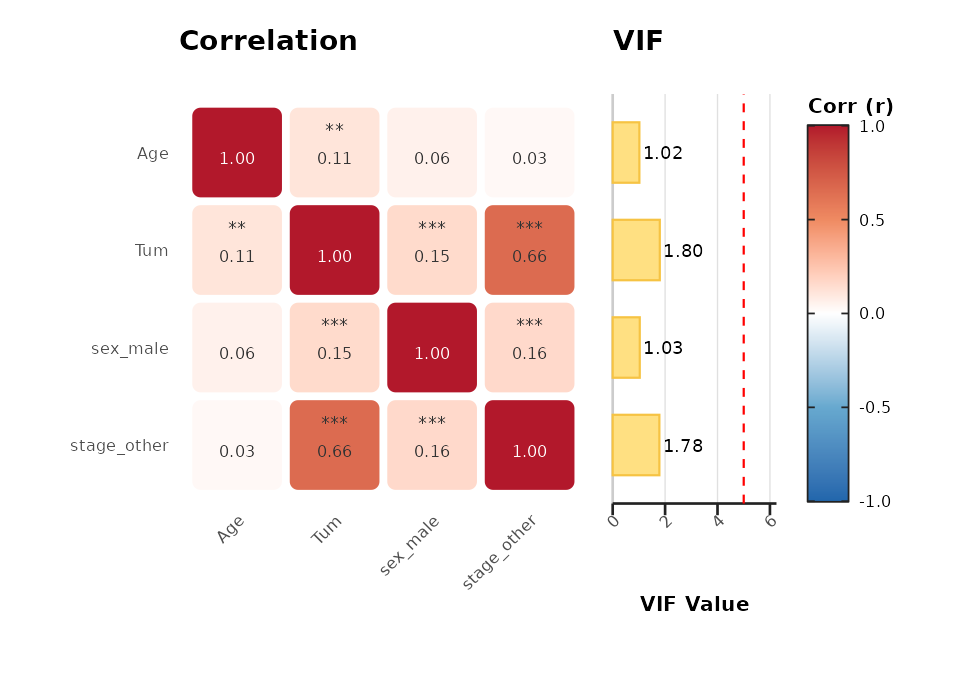{fig-alt="Pearson 与阈值 5；相关热图与 VIF，使用同一完整案例样本。"}


### Spearman 与配色 {.unnumbered}


热图换为 Spearman，VIF 的计算定义保持不变。

```r
Plt_CorVIF(dn, vars = numeric_vars, method = "spearman",
  show_star = FALSE, color = "teal_pink", vif_threshold = 5,
  layout_args = list(cell = 0.65, vif_width = 0.4, gap = 0.06),
  title = c("Correlation", "VIF"),
  theme_use = theme_minimal(base_size = 10) +
    theme(axis.text.x = element_text(angle = 45, hjust = 1)))
```


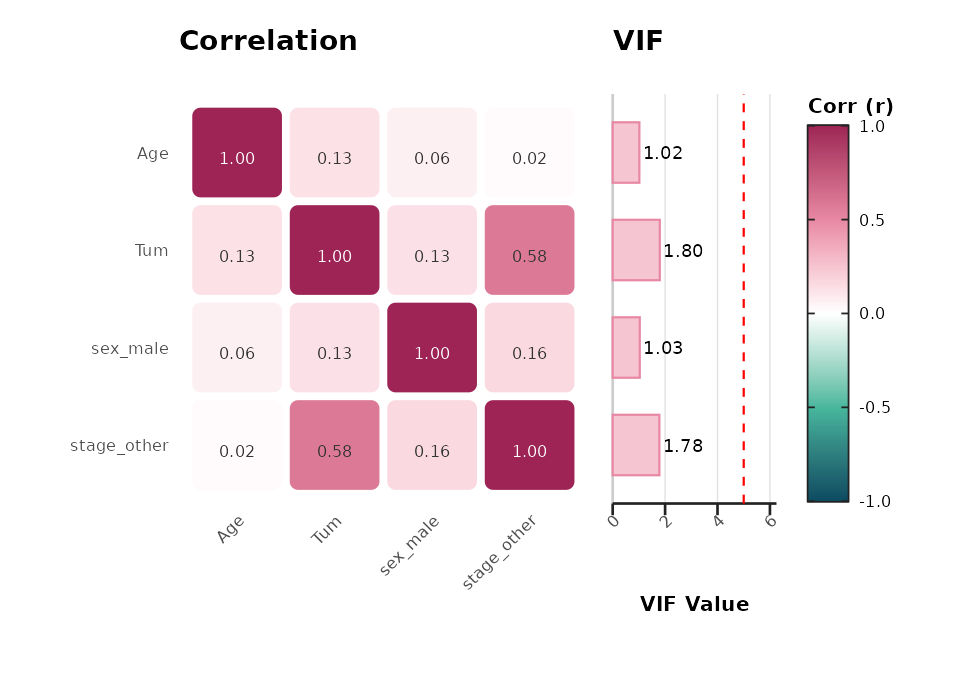{fig-alt="Spearman 与配色；热图换为 Spearman，VIF 的计算定义保持不变。"}


### 读取诊断数据 {.unnumbered}


return_data=TRUE 返回 corr、pval、vif，不再返回图对象。

```r
diag <- Plt_CorVIF(dn, vars = numeric_vars, return_data = TRUE)
data.frame(variable = names(diag[["vif"]]), VIF = unname(diag[["vif"]]))
```


::: {.table-responsive}


<div id="yqakkguunb" style="padding-left:0px;padding-right:0px;padding-top:10px;padding-bottom:10px;overflow-x:auto;overflow-y:auto;width:auto;height:auto;">

  <table class="gt_table" data-quarto-disable-processing="false" data-quarto-bootstrap="false" style="-webkit-font-smoothing: antialiased; -moz-osx-font-smoothing: grayscale; font-family: system-ui, 'Segoe UI', Roboto, Helvetica, Arial, sans-serif, 'Apple Color Emoji', 'Segoe UI Emoji', 'Segoe UI Symbol', 'Noto Color Emoji'; display: table; border-collapse: collapse; line-height: normal; margin-left: auto; margin-right: auto; color: #333333; font-size: 16px; font-weight: normal; font-style: normal; background-color: #FFFFFF; width: auto; border-top-style: solid; border-top-width: 2px; border-top-color: #A8A8A8; border-right-style: none; border-right-width: 2px; border-right-color: #D3D3D3; border-bottom-style: solid; border-bottom-width: 2px; border-bottom-color: #A8A8A8; border-left-style: none; border-left-width: 2px; border-left-color: #D3D3D3;" bgcolor="#FFFFFF">
  <thead style="border-style: none;">
    <tr class="gt_col_headings" style="border-style: none; border-top-style: solid; border-top-width: 2px; border-top-color: #D3D3D3; border-bottom-style: solid; border-bottom-width: 2px; border-bottom-color: #D3D3D3; border-left-style: none; border-left-width: 1px; border-left-color: #D3D3D3; border-right-style: none; border-right-width: 1px; border-right-color: #D3D3D3;">
      <th class="gt_col_heading gt_columns_bottom_border gt_left" rowspan="1" colspan="1" scope="col" id="variable" style="border-style: none; color: #333333; background-color: #FFFFFF; font-size: 100%; font-weight: normal; text-transform: inherit; border-left-style: none; border-left-width: 1px; border-left-color: #D3D3D3; border-right-style: none; border-right-width: 1px; border-right-color: #D3D3D3; vertical-align: bottom; padding-top: 5px; padding-bottom: 6px; padding-left: 5px; padding-right: 5px; overflow-x: hidden; text-align: left;" bgcolor="#FFFFFF" valign="bottom" align="left">variable</th>
      <th class="gt_col_heading gt_columns_bottom_border gt_right" rowspan="1" colspan="1" scope="col" id="VIF" style="border-style: none; color: #333333; background-color: #FFFFFF; font-size: 100%; font-weight: normal; text-transform: inherit; border-left-style: none; border-left-width: 1px; border-left-color: #D3D3D3; border-right-style: none; border-right-width: 1px; border-right-color: #D3D3D3; vertical-align: bottom; padding-top: 5px; padding-bottom: 6px; padding-left: 5px; padding-right: 5px; overflow-x: hidden; text-align: right; font-variant-numeric: tabular-nums;" bgcolor="#FFFFFF" valign="bottom" align="right">VIF</th>
    </tr>
  </thead>
  <tbody class="gt_table_body" style="border-style: none; border-top-style: solid; border-top-width: 2px; border-top-color: #D3D3D3; border-bottom-style: solid; border-bottom-width: 2px; border-bottom-color: #D3D3D3;">
    <tr style="border-style: none;"><td headers="variable" class="gt_row gt_left" style="border-style: none; padding-top: 8px; padding-bottom: 8px; padding-left: 5px; padding-right: 5px; margin: 10px; border-top-style: solid; border-top-width: 1px; border-top-color: #D3D3D3; border-left-style: none; border-left-width: 1px; border-left-color: #D3D3D3; border-right-style: none; border-right-width: 1px; border-right-color: #D3D3D3; vertical-align: middle; overflow-x: hidden; text-align: left;" valign="middle" align="left">Age</td>
<td headers="VIF" class="gt_row gt_right" style="border-style: none; padding-top: 8px; padding-bottom: 8px; padding-left: 5px; padding-right: 5px; margin: 10px; border-top-style: solid; border-top-width: 1px; border-top-color: #D3D3D3; border-left-style: none; border-left-width: 1px; border-left-color: #D3D3D3; border-right-style: none; border-right-width: 1px; border-right-color: #D3D3D3; vertical-align: middle; overflow-x: hidden; text-align: right; font-variant-numeric: tabular-nums;" valign="middle" align="right">1.018598</td></tr>
    <tr style="border-style: none;"><td headers="variable" class="gt_row gt_left" style="border-style: none; padding-top: 8px; padding-bottom: 8px; padding-left: 5px; padding-right: 5px; margin: 10px; border-top-style: solid; border-top-width: 1px; border-top-color: #D3D3D3; border-left-style: none; border-left-width: 1px; border-left-color: #D3D3D3; border-right-style: none; border-right-width: 1px; border-right-color: #D3D3D3; vertical-align: middle; overflow-x: hidden; text-align: left;" valign="middle" align="left">Tum</td>
<td headers="VIF" class="gt_row gt_right" style="border-style: none; padding-top: 8px; padding-bottom: 8px; padding-left: 5px; padding-right: 5px; margin: 10px; border-top-style: solid; border-top-width: 1px; border-top-color: #D3D3D3; border-left-style: none; border-left-width: 1px; border-left-color: #D3D3D3; border-right-style: none; border-right-width: 1px; border-right-color: #D3D3D3; vertical-align: middle; overflow-x: hidden; text-align: right; font-variant-numeric: tabular-nums;" valign="middle" align="right">1.797425</td></tr>
    <tr style="border-style: none;"><td headers="variable" class="gt_row gt_left" style="border-style: none; padding-top: 8px; padding-bottom: 8px; padding-left: 5px; padding-right: 5px; margin: 10px; border-top-style: solid; border-top-width: 1px; border-top-color: #D3D3D3; border-left-style: none; border-left-width: 1px; border-left-color: #D3D3D3; border-right-style: none; border-right-width: 1px; border-right-color: #D3D3D3; vertical-align: middle; overflow-x: hidden; text-align: left;" valign="middle" align="left">sex_male</td>
<td headers="VIF" class="gt_row gt_right" style="border-style: none; padding-top: 8px; padding-bottom: 8px; padding-left: 5px; padding-right: 5px; margin: 10px; border-top-style: solid; border-top-width: 1px; border-top-color: #D3D3D3; border-left-style: none; border-left-width: 1px; border-left-color: #D3D3D3; border-right-style: none; border-right-width: 1px; border-right-color: #D3D3D3; vertical-align: middle; overflow-x: hidden; text-align: right; font-variant-numeric: tabular-nums;" valign="middle" align="right">1.033075</td></tr>
    <tr style="border-style: none;"><td headers="variable" class="gt_row gt_left" style="border-style: none; padding-top: 8px; padding-bottom: 8px; padding-left: 5px; padding-right: 5px; margin: 10px; border-top-style: solid; border-top-width: 1px; border-top-color: #D3D3D3; border-left-style: none; border-left-width: 1px; border-left-color: #D3D3D3; border-right-style: none; border-right-width: 1px; border-right-color: #D3D3D3; vertical-align: middle; overflow-x: hidden; text-align: left;" valign="middle" align="left">stage_other</td>
<td headers="VIF" class="gt_row gt_right" style="border-style: none; padding-top: 8px; padding-bottom: 8px; padding-left: 5px; padding-right: 5px; margin: 10px; border-top-style: solid; border-top-width: 1px; border-top-color: #D3D3D3; border-left-style: none; border-left-width: 1px; border-left-color: #D3D3D3; border-right-style: none; border-right-width: 1px; border-right-color: #D3D3D3; vertical-align: middle; overflow-x: hidden; text-align: right; font-variant-numeric: tabular-nums;" valign="middle" align="right">1.781468</td></tr>
  </tbody>

</table>
</div>


:::


:::


## 当前 get_cor：完整统计、校正与绘图设置 {#cor-stats-20261022}

<!-- sync-20261022: cor_stats -->

以下三段代码按已推送 RegR `d24e8a0` 在 Windows / WSL R 4.4.3 重新核验，三张图保留 `70c3667` 执行产物。默认仍为未校正 P、`sig_level = 0.05`、FPC 排序，返回原来的不可见 corrplot 对象；`return_data = TRUE` 则同时返回完整统计矩阵。这个开关仍会绘图，也仍需要 corrplot 和有效配色。

### 原始 P、BH 校正与显示阈值

```r
library(RegR)
set.seed(922)
q <- qr.Q(qr(cbind(1, matrix(rnorm(64 * 4), 64, 4))))[, 2:5]
t_demo <- stats::qt(1 - 0.03 / 2, df = 62)
rho <- t_demo / sqrt(t_demo^2 + 62)
d_cor <- data.frame(MarkerA = q[, 1], MarkerB = rho * q[, 1] + sqrt(1 - rho^2) * q[, 2],
                    Noise1 = q[, 3], Noise2 = q[, 4])
chosen <- c("Noise2", "MarkerA", "Noise1", "MarkerB")
draw_cor <- function(tag, ...) {
  grDevices::cairo_pdf(file.path(tempdir(), paste0("20261022-sync-cor-", tag, ".pdf")),
    width = 6, height = 6, family = "Arial")
  on.exit(grDevices::dev.off(), add = TRUE)
  get_cor(d_cor, vars = chosen, method = "pearson", return_data = TRUE,
    name_map = c(MarkerA = "Assay A", MarkerB = "Assay B", Noise1 = "Noise 1", Noise2 = "Noise 2"), ...)
}
raw_cor <- draw_cor("raw", p_adjust = "none")
bh_cor <- draw_cor("bh", p_adjust = "BH")
original_cor <- draw_cor("original", p_adjust = "BH", sig_level = 0.2, order = "original")
upper <- upper.tri(bh_cor[["p"]])
ij <- which(upper, arr.ind = TRUE)
validation_values <- data.frame(pair = paste(chosen[ij[, 1]], chosen[ij[, 2]], sep = " / "),
  raw_p = bh_cor[["p"]][upper], bh_p = bh_cor[["p_adj"]][upper], n = bh_cor[["n"]][upper])
validation_values
```

::: {.callout-note collapse="true" title="复核代码"}
生成本页时运行的检查，接在上面的代码之后运行；只读教程可以跳过。

```r
stopifnot(identical(names(bh_cor), c("r", "p", "p_adj", "n", "method", "p_adjust", "plot")),
  identical(rownames(bh_cor[["r"]]), chosen), all(bh_cor[["n"]] == 64),
  typeof(bh_cor[["n"]]) == "double",
  isTRUE(all.equal(bh_cor[["p_adj"]][upper], stats::p.adjust(bh_cor[["p"]][upper], "BH"))),
  any(raw_cor[["p"]][upper] <= 0.05 & bh_cor[["p_adj"]][upper] > 0.05),
  identical(bh_cor[["r"]], original_cor[["r"]]), identical(bh_cor[["p_adj"]], original_cor[["p_adj"]]))
```
:::

::: {.panel-tabset}

### 原始 P，0.05 {.unnumbered}

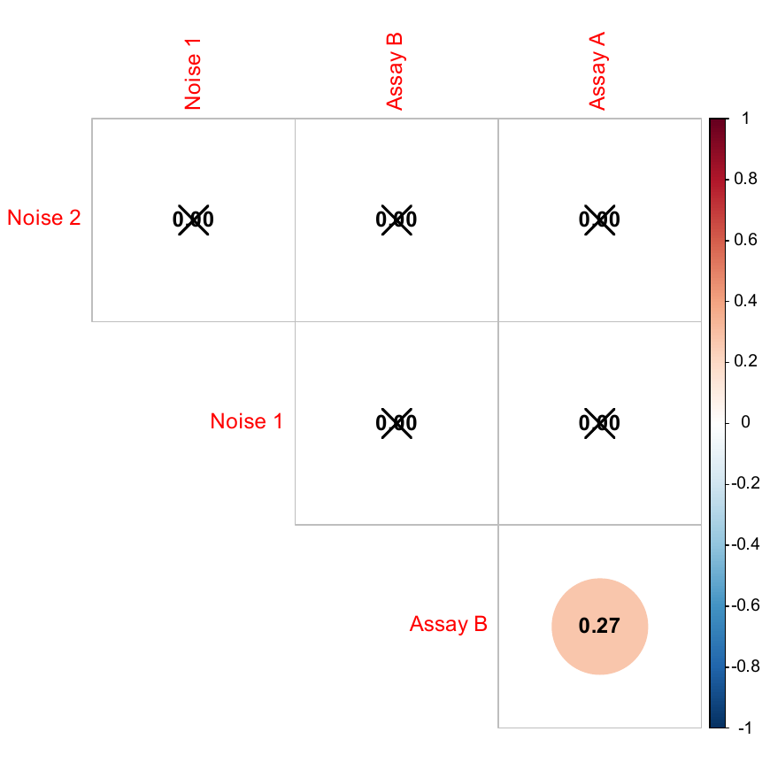{fig-alt="64行四变量模拟矩阵，Assay A与Assay B的原始Pearson P约为0.03；其余配对不显著。"}

[下载 PDF](images/variable-selection-guide/20261022-sync-cor-raw.pdf)

### BH 校正，0.05 {.unnumbered}

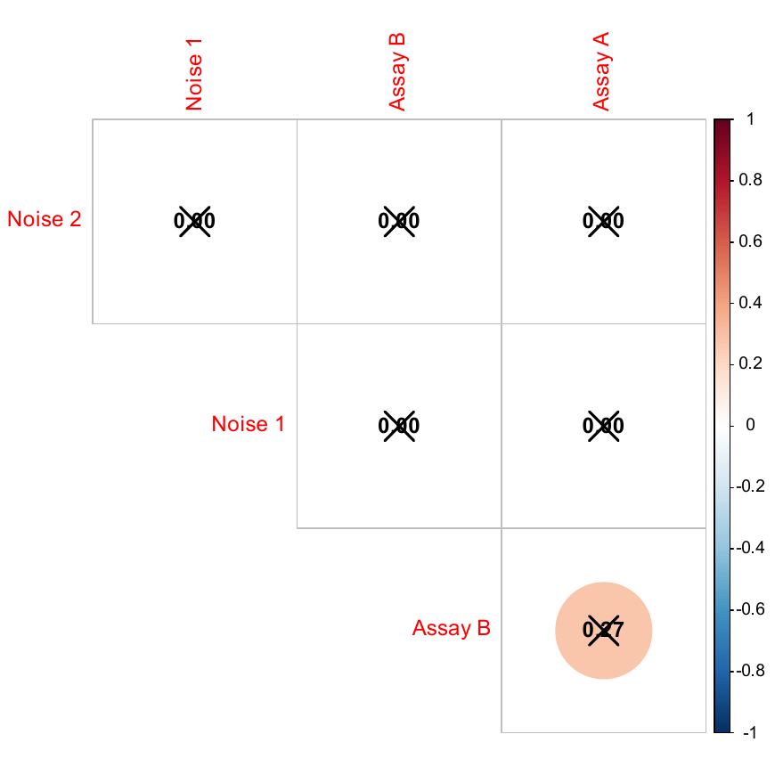{fig-alt="同一矩阵共有六个唯一变量对，Assay配对BH调整P约为0.18，在0.05阈值下加叉；相关系数保持不变。"}

[下载 PDF](images/variable-selection-guide/20261022-sync-cor-bh.pdf)

### BH 校正，0.20，原顺序 {.unnumbered}

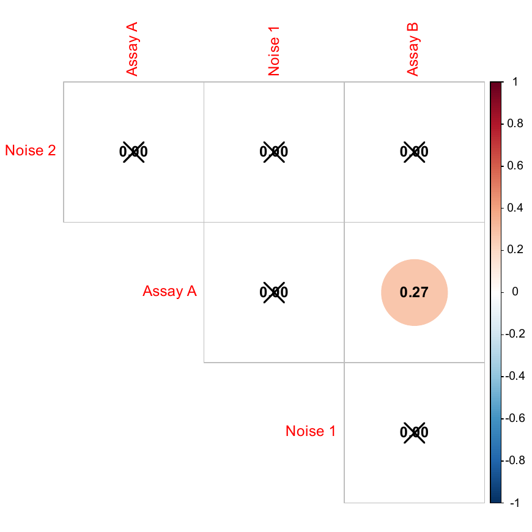{fig-alt="同一BH结果采用0.20显示阈值及调用者的选列顺序，系数、原始P和调整P均未重新定义。"}

[下载 PDF](images/variable-selection-guide/20261022-sync-cor-original.pdf)

:::

这是刻意构造一个原始 P 约为 0.03 的接口示例，不是临床数据或选择阈值的建议。四列共有 6 个唯一变量对，BH 调整后该值约为 0.18。校正只使用上三角唯一配对，排除对角线与对称重复项；`p_adjust` 支持 `stats::p.adjust.methods` 的方法，默认 `"none"`。叉号依据 `p_adj > sig_level`，相关系数仍保留。阈值可取 0–1 的有限单值；排序可用 `FPC`、`original`、`AOE`、`hclust`、`alphabet`。

| `return_data = TRUE` 字段 | 含义 |
|:--|:--|
| `r` / `p` / `p_adj` | 系数、原始双侧 P、调整 P；三者保留原列名和选列顺序，P 矩阵对角线为 0 |
| `n` | 每对的非缺失样本数，对角线是各列可用数；不代表所有配对用了同一人群 |
| `method` / `p_adjust` | 实际解析的相关方法与校正方法 |
| `plot` | 应用名称映射及显示排序后的 corrplot 结果，其中 `corrPos` 的 P 已用于图上的显著性标记 |

不要按图中位置直接索引原始统计矩阵；用原列名对齐。完整输入现在用共享行数构造 `n`，含缺失输入仍逐对计数；这项内存优化不改变矩阵类型与含义，也不提供额外的统计校正。

### 配对计数的内存路径 {#cor-memory-20261022}

2026-10-22 的后续改动 `9dcf818` 将含缺失分支写为 `crossprod(!is.na(df))`，省去先用 `as.matrix(df)` 构造整份数值矩阵的步骤。它仍需逻辑可用性矩阵与配对计数矩阵，不是零分配，也不改变成对删除的人群。下方继续用独立写法核对三种方法的 `n`、相关系数及 P 值；本轮没有重新测量耗时或峰值内存，不新增加速倍数。

### 含缺失的三种方法逐对核对

```r
(function() {
  grDevices::pdf(file = NULL)
  on.exit(grDevices::dev.off(), add = TRUE)
  d_pair <- data.frame(x = c(1:6, NA, NA), y = c(1, 3, 2, 6, 5, 4, 8, 7),
    z = c(8, 5, 7, NA, NA, NA, 2, 1))
  selected <- c("z", "x", "y")
  for (method in c("pearson", "spearman", "kendall")) {
    out <- get_cor(d_pair, vars = selected, method = method, p_adjust = "BH",
      return_data = TRUE, order = "alphabet", name_map = c(x = "Display X"))
    stopifnot(identical(rownames(out[["r"]]), selected),
      identical(out[["n"]], crossprod(!is.na(as.matrix(d_pair[selected])))))
    for (i in 1:2) for (j in seq.int(i + 1L, 3L)) {
      ref <- stats::cor.test(d_pair[[selected[i]]], d_pair[[selected[j]]], method = method)
      stopifnot(abs(out[["r"]][i, j] - unname(ref[["estimate"]])) < 1e-12,
                abs(out[["p"]][i, j] - ref[["p.value"]]) < 1e-12)
    }
    stopifnot(isTRUE(all.equal(out[["p_adj"]][upper.tri(out[["p"]])],
      stats::p.adjust(out[["p"]][upper.tri(out[["p"]])], "BH"))))
  }
})()
```

### 无损转换与名称映射

```r
(function() {
  grDevices::pdf(file = NULL)
  on.exit(grDevices::dev.off(), add = TRUE)
  reject <- function(data, ...) tryCatch(get_cor(data, vars = names(data), ...), error = identity)
  bad64 <- data.frame(x = bit64::as.integer64(c("9007199254740993", "9007199254740994", "9007199254740996")), y = 1:3)
  bad_complex <- data.frame(x = c(1 + 1i, 2 + 0i, 3 + 0i), y = 1:3)
  spss <- data.frame(x = haven::labelled_spss(c(1, 99, 2, NA, 3), na_values = 99), y = c(1, 2, 4, 5, 6))
  stopifnot(inherits(reject(bad64), "RegR_cor_precision"),
    inherits(reject(bad_complex), "RegR_cor_nonnumeric"),
    inherits(reject(spss), "RegR_cor_missing_conversion"),
    inherits(reject(data.frame(x = 1:4, y = c(1, 4, 2, 3)), name_map = c(x = "A", x = "B")), "RegR_cor_name_map"))
  spss[["x"]] <- haven::zap_missing(spss[["x"]])
  clean <- get_cor(spss, vars = c("x", "y"), method = "pearson", return_data = TRUE)
  stopifnot(clean[["n"]]["x", "y"] == 3)
  notes <- character()
  duplicate_labels <- withCallingHandlers(get_cor(data.frame(x = 1:4, y = c(1, 4, 2, 3)),
    vars = c("x", "y"), name_map = c(x = "Same", y = "Same"), return_data = TRUE),
    RegR_cor_duplicate_labels = function(w) {
      notes <<- c(notes, conditionMessage(w)); invokeRestart("muffleWarning")
    })
  stopifnot(length(notes) == 1L, identical(rownames(duplicate_labels[["r"]]), c("x", "y")))
})()
```

`integer64` 只有能精确表示为 double 的数值才允许转换；不是一律拒绝大于 2^53 的值。非零虚部会报错，零虚部可无损转成实数。SPSS 用户缺失标记若会在转换时丢失，应先显式替换成 NA；这些标记不能当作已观察值。普通 labelled 数据继续支持。

名称字典必须是字符向量、键非空且唯一、标签非空白；部分映射、NA 标签或 `character(0)` 仍回退到原名。多个变量映射成同一个显示标签会警告，返回统计矩阵仍使用原名。非法配色和缺少 corrplot 的错误现在先于转换及统计计算报告。

<!-- /sync-20261022: cor_stats -->

## 当前 get_cor：相关系数、P 值与输入边界 {#cor-controls-20261021}

<!-- controls-20261021: cor_contract -->

以下按已推送 RegR `90ad6d8` 在 Windows / WSL R 4.4.3 执行；上方筛选和 VIF 图保留原执行快照。`get_cor()` 是单独的相关矩阵入口，不计算 VIF，也不自动筛选变量。新增三图使用包内原始队列的连续变量，只发布汇总图。

### 三种方法使用同一批数据

```r
library(RegR)
data("seer_thyroid_mtc_2026_raw", package = "RegR")
cor_data <- as.data.frame(seer_thyroid_mtc_2026_raw)[c("Age", "Tum", "Yea")]
keep <- complete.cases(cor_data) & cor_data[["Age"]] >= 18 & cor_data[["Age"]] <= 100 &
  cor_data[["Tum"]] > 0 & cor_data[["Tum"]] <= 200 & cor_data[["Yea"]] >= 2000
cor_data <- head(cor_data[keep, ], 400)
cor_labels <- c(Age = "Age (years)", Tum = "Tumor size (mm)", Yea = "Diagnosis year")
cor_results <- lapply(c("spearman", "pearson", "kendall"), function(method) {
  grDevices::cairo_pdf(file.path(tempdir(), paste0("20261021-controls-cor-", method, ".pdf")),
                       width = 8, height = 7, family = "Arial")
  on.exit(grDevices::dev.off(), add = TRUE)
  result <- withVisible(get_cor(cor_data, vars = c("Age", "Tum", "Yea"),
    name_map = cor_labels, method = method, palette = "RdBu"))
  stopifnot(!result[["visible"]], identical(names(result[["value"]]), c("corr", "corrPos", "arg")))
  result[["value"]]
})
names(cor_results) <- c("spearman", "pearson", "kendall")
```

::: {.callout-note collapse="true" title="复核代码"}
生成本页时运行的检查，接在上面的代码之后运行；只读教程可以跳过。

```r
stopifnot(nrow(cor_data) == 400L)
```
:::

::: {.panel-tabset}

### Spearman {.unnumbered}

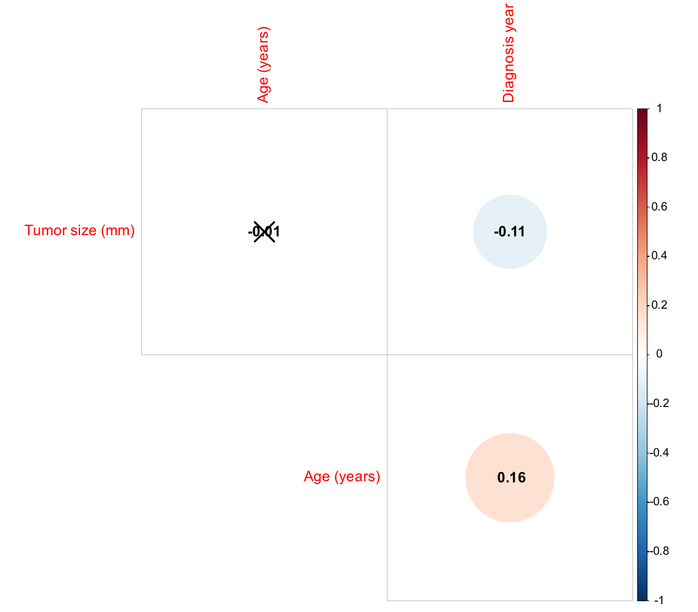{fig-alt="Age、Tum和Yea的上三角Spearman相关矩阵，变量按第一主成分排序，格内保留相关系数，P大于0.05的格子另加叉号。"}

[下载 PDF](images/variable-selection-guide/20261021-controls-cor-spearman.pdf)

### Pearson {.unnumbered}

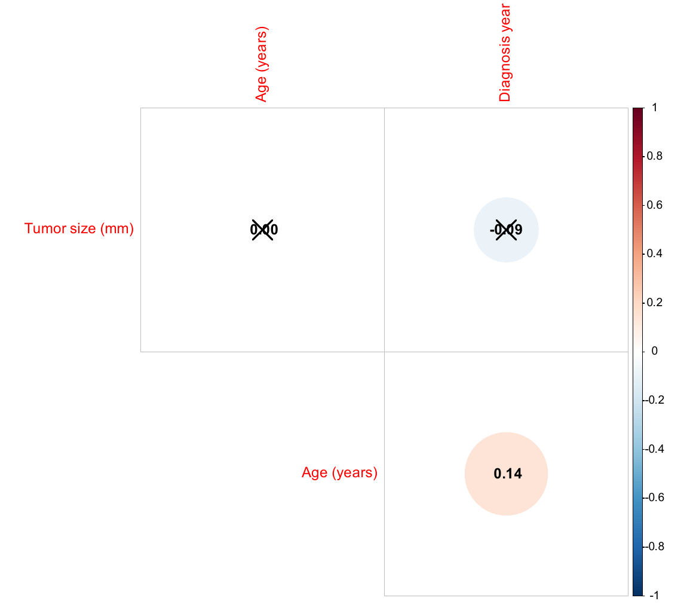{fig-alt="相同400行与三个连续变量的Pearson相关，系数尺度与秩相关不同，显示名称经过显式映射。"}

[下载 PDF](images/variable-selection-guide/20261021-controls-cor-pearson.pdf)

### Kendall {.unnumbered}

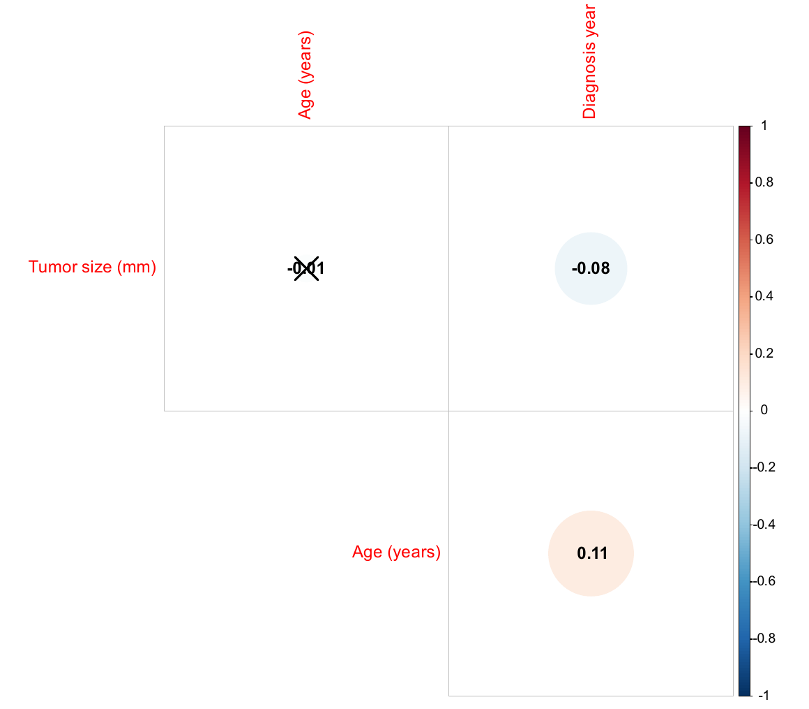{fig-alt="相同400行的Kendall相关，保留系数和非显著叉号；排序与其他方法可能不同。"}

[下载 PDF](images/variable-selection-guide/20261021-controls-cor-kendall.pdf)

:::

示例按明确的年龄、肿瘤大小和年份范围筛选，取前 400 条合格记录作接口展示；这不是随机总体抽样或临床推断。Pearson 衡量线性关系，Spearman / Kendall 基于秩，数值不能直接按同一尺度比较。秩检验遇并列值可能使用近似 P 值。本节保留未校正 P 的原执行结果，当前的显式校正入口见[上方新合同](#cor-stats-20261022)。

### 返回对象与成对数值核对

函数绘图并**不可见返回 list**，不是 NULL 或 ggplot。`corr` 是按 FPC 重排后的矩阵；`corrPos` 保存图中变量对、系数和 P 值；`arg` 记录 `type="upper"`。P>0.05 的格子保留系数并加叉，不是把系数隐藏。下面另用含缺失的小输入，与 `stats::cor.test()` 逐对核验三种方法：

```r
pair_data <- data.frame(x = c(1, NA, 3:10),
  y = c(2, 6, 1, 5, NA, 3, 8, 9, 7, 10), z = c(3, 1, 7, 2, 9, 4, 10, 6, 8, 5))
names(pair_data) <- c("blood glucose", "tumor-size", "01")
pair_checks <- lapply(c("spearman", "pearson", "kendall"), function(method) {
  result <- get_cor(pair_data, vars = names(pair_data), method = method)
  stopifnot(setequal(rownames(result[["corr"]]), names(pair_data)))
  pairs <- result[["corrPos"]]
  for (i in seq_len(nrow(pairs))) {
    x <- pair_data[[as.character(pairs[["xName"]][i])]]
    y <- pair_data[[as.character(pairs[["yName"]][i])]]
    reference <- stats::cor.test(x, y, method = method)
    stopifnot(abs(pairs[["corr"]][i] - unname(reference[["estimate"]])) < 1e-12,
              abs(pairs[["p.value"]][i] - reference[["p.value"]]) < 1e-12)
  }
  data.frame(method = method, pairs_verified = nrow(pairs))
})
do.call(rbind, pair_checks)
```

三种方法各核对 3 对，全部通过。使用 `pairwise.complete.obs`，每一对可能使用不同患者；需要同一分析人群时先显式筛选共同完整病例。原列名中的空格、标点和前导数字会保留，`name_map` 按原名匹配；未映射名称保留原名。FPC 顺序是展示排序，不是临床优先级。

### 因子、数字文本与错误输入

```r
encoding <- data.frame(grade = factor(rep(c("A", "B", "C"), each = 2)),
                       numeric_text = c("1", "2", "10", NA, "8", "4"), y = 1:6)
encoding_notes <- character()
encoded <- withCallingHandlers(get_cor(encoding, vars = c("grade", "y"), method = "pearson"),
  RegR_cor_factor_encoding = function(w) {
    encoding_notes <<- c(encoding_notes, conditionMessage(w))
    invokeRestart("muffleWarning")
  })
parsed <- get_cor(encoding, vars = c("numeric_text", "y"), method = "pearson")
bad_text <- data.frame(x = c("1", "unknown", "3"), y = 1:3)
errors <- list(
  text = tryCatch(get_cor(bad_text, c("x", "y")), error = identity),
  infinite = tryCatch(get_cor(data.frame(x = c(1, 2, Inf), y = 1:3), c("x", "y")), error = identity),
  too_few = tryCatch(get_cor(data.frame(x = 1:2, y = 2:1), c("x", "y"), method = "pearson"), error = identity),
  constant = tryCatch(get_cor(data.frame(x = rep(1, 4), y = 1:4), c("x", "y")), error = identity))
```

::: {.callout-note collapse="true" title="复核代码"}
生成本页时运行的检查，接在上面的代码之后运行；只读教程可以跳过。

```r
stopifnot(length(encoding_notes) == 1L,
  abs(encoded[["corr"]]["grade", "y"] - cor(as.numeric(encoding[["grade"]]), encoding[["y"]])) < 1e-12,
  abs(parsed[["corr"]]["numeric_text", "y"] -
      cor(as.numeric(encoding[["numeric_text"]]), encoding[["y"]], use = "complete.obs")) < 1e-12)
stopifnot(inherits(errors[["text"]], "RegR_cor_nonnumeric"),
          inherits(errors[["infinite"]], "RegR_cor_nonfinite"),
          inherits(errors[["too_few"]], "RegR_cor_insufficient"),
          inherits(errors[["constant"]], "RegR_cor_undefined"))
```
:::

数字文本按 `as.numeric()` 解析；非数字文本导致新 NA 时会点名报错。因子保留当前水平的整数编码并给警告，相关性依赖水平顺序；无序分类变量应先选择有意义的编码，不能将默认水平号当连续测量。

至少选择两列；Pearson 每对至少 3 个完整观察，Spearman / Kendall 至少 2 个。最低样本数不代表统计结果可靠；两点秩检验虽可执行，仍没有稳定推断价值。无限值、配对重叠不足及配对子集中方差为零等未定义相关，会在 FPC 排序前报出相关列，而不是在矩阵分解时才失败。

基础图形用图形设备导出，不传 `save` 或 `ggsave()`；上方 PDF 由实际设备绘制，PNG 由同一 PDF 转换。`corrplot` 为所需依赖，接口为 `get_cor(data, vars, name_map=NULL, palette=..., method=...)`。

<!-- /controls-20261021: cor_contract -->

## 后续计算优化：保留配对与显著性边界 {#cor-compute-20261021}

<!-- controls-20261021: cor_current -->

整理期间又推送了 `86e56fa`、`a7051d3`，本节按 RegR `e217f1c` 在 Windows / WSL R 4.4.3 补验。Spearman / Kendall 复用每次秩检验的系数与 P 值；Pearson 用每一对的有效样本数计算双侧 t 检验，接近绘图阈值 0.05 的配对再用 `cor.test()` 核对，避免浮点误差改变叉号。它没有改成整表共同样本数，也没有统一强制使用近似秩检验。本节不新增未经实测的加速倍数；上节三张图保留 `90ad6d8` 的原执行记录。

```r
library(RegR)
validation_values <- (function() {
  grDevices::pdf(file = NULL)
  on.exit(grDevices::dev.off(), add = TRUE)
  unequal_pairs <- data.frame(x = c(1:6, NA, NA),
    y = c(1, 3, 2, 6, 5, 4, 8, 7), z = c(8, 5, 7, NA, NA, NA, 2, 1))
  checks <- lapply(c("pearson", "spearman", "kendall"), function(method) {
    result <- get_cor(unequal_pairs, vars = names(unequal_pairs), method = method)
    cells <- result[["corrPos"]]
    rows <- lapply(seq_len(nrow(cells)), function(i) {
      x <- unequal_pairs[[as.character(cells[["xName"]][i])]]
      y <- unequal_pairs[[as.character(cells[["yName"]][i])]]
      ref <- stats::cor.test(x, y, method = method)
      stopifnot(abs(cells[["corr"]][i] - unname(ref[["estimate"]])) < 1e-12,
                abs(cells[["p.value"]][i] - ref[["p.value"]]) < 1e-12)
      data.frame(method = method, n_pair = sum(complete.cases(x, y)),
        coefficient = cells[["corr"]][i], p = cells[["p.value"]][i])
    })
    do.call(rbind, rows)
  })
  do.call(rbind, checks)
})()
validation_values <- validation_values[order(validation_values[["method"]], validation_values[["n_pair"]]), ]
rownames(validation_values) <- NULL
validation_values
```

::: {.callout-note collapse="true" title="复核代码"}
生成本页时运行的检查，接在上面的代码之后运行；只读教程可以跳过。

```r
stopifnot(identical(sort(unique(validation_values[["n_pair"]])), c(3L, 5L, 6L)))
```
:::

```r
(function() {
  grDevices::pdf(file = NULL)
  on.exit(grDevices::dev.off(), add = TRUE)
  x <- seq(-1, 1, length.out = 4)
  x <- x / sqrt(sum(x * x))
  z <- sin(seq_len(4)); z <- z - mean(z)
  z <- z - sum(z * x) * x; z <- z / sqrt(sum(z * z))
  t_cut <- stats::qt(0.975, df = 2)
  r_cut <- t_cut / sqrt(t_cut^2 + 2)
  boundary <- data.frame(x = x, y = r_cut * x + sqrt(1 - r_cut^2) * z)
  ref <- stats::cor.test(boundary[["x"]], boundary[["y"]], method = "pearson")
  got <- get_cor(boundary, vars = c("x", "y"), method = "pearson")
  perfect <- get_cor(data.frame(x = 1:3, y = -(1:3)),
    vars = c("x", "y"), method = "pearson")
  stopifnot(identical(got[["corrPos"]][["p.value"]], ref[["p.value"]]),
    identical(got[["corrPos"]][["p.value"]] > 0.05, ref[["p.value"]] > 0.05),
    perfect[["corrPos"]][["corr"]] == -1, perfect[["corrPos"]][["p.value"]] == 0)
})()
```

三种方法在有效样本数 3、5、6 的配对中均与 `cor.test()` 一致；第二段另核对 Pearson 完全负相关和阈值处的原始 P 值及叉号判定。因子编码警告、输入错误类、FPC 排序和不可见返回结构继续按上节合同读取，不能把“少算重复工作”理解为跳过输入或统计边界检查。

<!-- /controls-20261021: cor_current -->

## 使用边界、保存与复现记录


P 值筛选、逐步回归和 LASSO 的选择会受样本、编码与随机折分影响；筛选后的普通回归区间没有自动考虑选择过程。Boruta 的重要性不表示因果效应。混杂调整变量应由研究问题和因果结构决定，不能交给单变量 P 值自动删除。预测建模时，筛选、编码和惩罚选择都需要在训练折内部完成；本页没有外部验证。相关/VIF 的显著性星号也不是变量保留规则。

绘图调色、字体和布局只改变展示；模型、编码、样本、预测时间或权重改变后需要重新计算。带 `save` 的接口按帮助页传入保存配置；其余返回图可用 `ggplot2::ggsave()` 或 `RegR::save_plt()`，表格按返回类型使用 `save_tb()` / `save_gt()`。重采样示例的预算仅用于演示，应结合实际分析目的增加并报告失败与收敛情况。

## 相关页面与源码


- [森林图与回归效应](forest-guide.qmd)

- [MLR 特征筛选](../mlr/feature-selection-guide.qmd)

- [RegR 函数参考](https://hui950319.github.io/RegR/reference/index.html)

- 变量筛选函数帮助页：[`get_var_sel()`](https://hui950319.github.io/RegR/reference/get_var_sel.html)、[`get_boruta()`](https://hui950319.github.io/RegR/reference/get_boruta.html)、[`plt_boruta()`](https://hui950319.github.io/RegR/reference/plt_boruta.html)

- LASSO 函数帮助页：[`get_lasso()`](https://hui950319.github.io/RegR/reference/get_lasso.html)、[`plot_coef_path()`](https://hui950319.github.io/RegR/reference/plot_coef_path.html)、[`plot_cv_glmnet()`](https://hui950319.github.io/RegR/reference/plot_cv_glmnet.html)

- [`Plt_CorVIF()` 帮助页](https://hui950319.github.io/RegR/reference/Plt_CorVIF.html)


```r
packageVersion("RegR")
sessionInfo()
```

## 更新记录 {#page-updates}

::: {.callout-note collapse="true" title="本页更新记录"}
- 2026-10-27：补充[独立 LASSO 输入与拟合复用](#lasso-inputs-20261027)的 80 行实跑、两份 PDF 及无效输入复核。
:::
