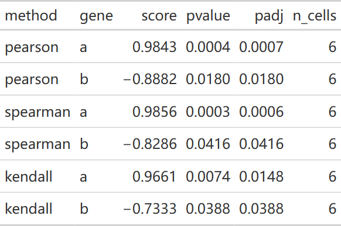
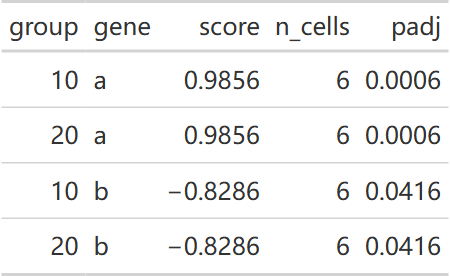
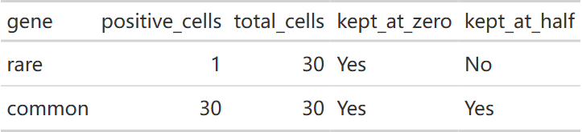

# scMMR 概览

scMMR 是基于 reticulate + PyTorch 的单细胞多任务深度学习模型，包含细胞注释、模块评分和通路分析。

**主要函数：** `DNN_*()`、`ComputeModuleScore()`、`RunPathwayAnalysis()`、`PlotPathway*()`

参考文档：<https://hui950319.github.io/scMMR/>　源码：<https://github.com/HUI950319/scMMR>

::: {.callout-note collapse="true" title="版本与复现记录"}
2026-10-26 按已推送 scMMR 0.3.1 `91d493e`，在 Windows / WSL R 4.4.3 执行 8 行普通表、17 行分组表与 30 个细胞的合成计数矩阵。只运行相关性接口，没有加载 Python 模型、训练 DNN 或调用 GPU；[模块图](function-modules.qmd)保留原快照。
:::

## 用 RunCorrelation 获取系数、P 值与配对数 {#correlation}

<!-- update-20261026: scmmr_correlation -->

### 方法与有限值配对（2026-10-26）

默认方法是 Spearman；可显式选择 Pearson 或 Kendall。每个特征只使用目标和该特征都为有限数值的行，NA、NaN、Inf 不计入该对的 `n_cells`。Spearman 在各自完整配对中重新排秩；Kendall 的 P 值考虑并列值。秩检验使用 `cor.test(...,exact=FALSE)` 的渐近推断，不是小样本精确检验。

```r
library(scMMR)
d_cor26 <- data.frame(target = 1:8,
  a = c(NA, 1, 2, NA, 4, 4, 6, 7),
  b = c(8, 5, NA, 3, 2, 4, Inf, 0))
methods_cor26 <- c("pearson", "spearman", "kendall")
results_cor26 <- setNames(lapply(methods_cor26, function(method)
  RunCorrelation(d_cor26, "target", features = c("a", "b"), method = method,
    min.cells = 3, padjust.method = "fdr", verbose = FALSE)), methods_cor26)
results_cor26[["spearman"]]
```

::: {.callout-note collapse="true" title="复核代码"}

```r
for (method in methods_cor26) for (feature in c("a", "b")) {
  paired <- is.finite(d_cor26[["target"]]) & is.finite(d_cor26[[feature]])
  reference <- stats::cor.test(d_cor26[["target"]][paired], d_cor26[[feature]][paired],
    method = method, exact = FALSE)
  actual <- results_cor26[[method]][results_cor26[[method]][["gene"]] == feature, ]
  stopifnot(nrow(actual) == 1L, actual[["n_cells"]] == sum(paired),
    isTRUE(all.equal(actual[["score"]], unname(reference[["estimate"]]))),
    isTRUE(all.equal(actual[["pvalue"]], reference[["p.value"]])))
}
table_cor26 <- do.call(rbind, lapply(methods_cor26, function(method)
  data.frame(method = method, results_cor26[[method]][c("gene", "score", "pvalue", "padj", "n_cells")], row.names = NULL)))
gt::gtsave(gt::fmt_number(gt::gt(table_cor26), columns = c("score", "pvalue", "padj"), decimals = 4),
  file.path(tempdir(), "20261026-update-scmmr-pairs.html"))
```

:::

{fig-alt="三种方法与两个合成特征的原生结果表，列出gene、相关系数、原始P值、FDR校正值及每对实际观察数。"}

[原生 HTML 表](images/index/20261026-update-scmmr-pairs.html)

结果仍是 data.frame：`gene` 为特征名，`score` 为该方法的系数，`pvalue` 为原始双侧 P，`padj` 为校正 P，`abs_score` 用于降序排列，`n_cells` 为该对的观察数。`min.cells` 默认 20，本页为展示小数据显式设为 3；每对至少需 `max(3,min.cells)` 个观察值，常量或不可估计的特征不进入有效结果。系数的正负和大小需与方法一起解释，显著性也不等于预测能力。

## 先保留分组名称，再核对校正范围 {#groups}

数字 10、20 是标签，不是列表位置。因子未观测水平 30 不产生结果；缺失组的行不归入任一组。一次调用的 `padj` 在**合并所有有效组与特征后的原始 P 值**上统一计算，不是分别在每组里校正。

```r
group_cor26 <- rbind(transform(d_cor26, group = 10), transform(d_cor26, group = 20),
  transform(d_cor26[1, ], group = NA_real_))
grouped_cor26 <- RunCorrelation(group_cor26, "target", c("a", "b"), group.by = "group",
  method = "spearman", min.cells = 3, cl = 1, verbose = FALSE)
grouped_cor26[c("group", "gene", "score", "n_cells", "padj")]
```

::: {.callout-note collapse="true" title="复核代码"}

```r
stopifnot(setequal(grouped_cor26[["group"]], c("10", "20")),
  all(grouped_cor26[["n_cells"]] == 6L),
  isTRUE(all.equal(grouped_cor26[["padj"]], stats::p.adjust(grouped_cor26[["pvalue"]], method = "fdr"))))
factor_cor26 <- group_cor26
factor_cor26[["group"]] <- factor(factor_cor26[["group"]], levels = c(20, 10, 30))
factor_result26 <- RunCorrelation(factor_cor26, "target", c("a", "b"), group.by = "group",
  method = "spearman", min.cells = 3, verbose = FALSE)
stopifnot(setequal(factor_result26[["group"]], c("10", "20")))
gt::gtsave(gt::fmt_number(gt::gt(grouped_cor26[c("group", "gene", "score", "n_cells", "padj")]),
  columns = c("score", "padj"), decimals = 4), file.path(tempdir(), "20261026-update-scmmr-groups.html"))
```

:::

{fig-alt="原生分组结果表保留10与20两组名称，各特征有六个完整有限值配对，FDR针对本次调用的所有有效比较。"}

[原生 HTML 表](images/index/20261026-update-scmmr-groups.html)

## Seurat 的表达比例筛选 {#seurat-filter}

`min.pct` 只用于 Seurat 的基因特征：按全部所选细胞中表达值大于零的比例预筛，随后才做组内完整配对与 `min.cells` 检查。它不筛掉低表达细胞，也不对普通 data.frame 的数值列做阳性比例筛选。应明确 `assay` 与 `layer`，下例使用 30 个合成细胞的 counts，无需标准化流程。

```r
counts_cor26 <- rbind(target = 1:30, rare = c(1, rep(0, 29)), common = rep(c(1, 3, 2), 10))
colnames(counts_cor26) <- paste0("cell", 1:30)
object_cor26 <- SeuratObject::CreateSeuratObject(counts = Matrix::Matrix(counts_cor26, sparse = TRUE))
unfiltered_cor26 <- RunCorrelation(object_cor26, "target", c("rare", "common"),
  assay = "RNA", layer = "counts", min.pct = 0, min.cells = 3, verbose = FALSE)
filtered_cor26 <- RunCorrelation(object_cor26, "target", c("rare", "common"),
  assay = "RNA", layer = "counts", min.pct = .5, min.cells = 3, verbose = FALSE)
filtered_cor26
```

::: {.callout-note collapse="true" title="复核代码"}

```r
stopifnot(setequal(unfiltered_cor26[["gene"]], c("rare", "common")),
  identical(filtered_cor26[["gene"]], "common"), filtered_cor26[["n_cells"]] == 30L)
filter_table26 <- data.frame(gene = c("rare", "common"),
  positive_cells = c(1L, 30L), total_cells = 30L,
  kept_at_zero = c("Yes", "Yes"), kept_at_half = c("No", "Yes"))
gt::gtsave(gt::gt(filter_table26), file.path(tempdir(), "20261026-update-scmmr-expression.html"))
validation_values <- list(methods = table_cor26, groups = grouped_cor26,
  unfiltered = unfiltered_cor26, filtered = filtered_cor26, expression_filter = filter_table26)
```

:::

{fig-alt="原生表中rare只有一个细胞表达，在min.pct为0.5时剔除；common在30个细胞中均表达而保留。"}

[原生 HTML 表](images/index/20261026-update-scmmr-expression.html)

在真实单细胞研究中，`n_cells` 不是独立供者数；细胞相关性不自动处理同一供者内的依赖。分析单位、重复结构和多重比较范围仍需按研究设计确定。`RunCorrelation()` 的结果可继续交给 `PlotRankScatter()` 展示排序，但绘图不会重新验证独立性。

<!-- /update-20261026: scmmr_correlation -->

## 更新记录 {#page-updates}

::: {.callout-note collapse="true" title="更新记录"}
- 2026-10-26：补充[三种方法与完整配对](#correlation)、[组名与 FDR](#groups)、[Seurat 表达比例筛选](#seurat-filter)的实际输出。
:::
