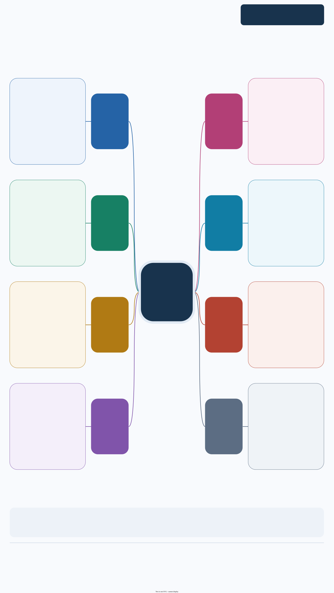
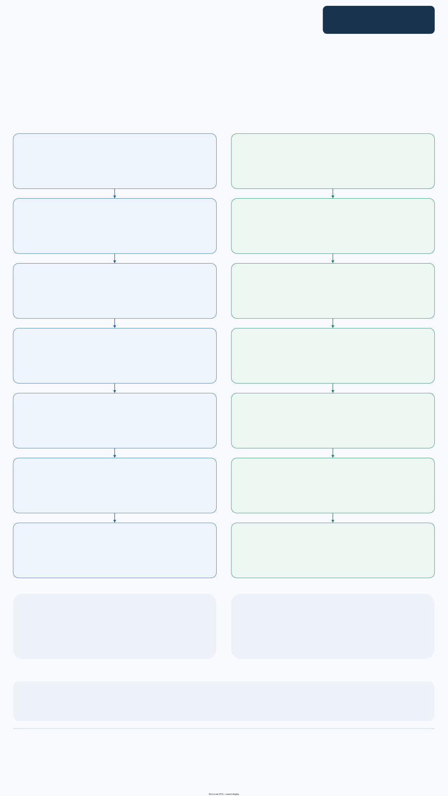

SEER 数据处理：先按癌种与导出 schema 选择入口，再核对记录、患者和分析变量。

本页集中展示三张图：先看功能总览，再查接口索引，最后看处理流程与返回对象。**点击图片可放大查看**，也可下载图源继续编辑。

[下载 draw.io 图源](../assets/module-maps/seerr/seerr-package-mindmap.drawio){.btn .btn-outline-primary download="seerr-package-mindmap.drawio"}
[下载三页 PDF](../assets/module-maps/seerr/seerr-package-mindmap.drawio.pdf){.btn .btn-outline-secondary download="seerr-package-mindmap.drawio.pdf"}

图谱快照：**2026-09-30**。对应包版本：**0.1.0**。具体参数和返回值以当前安装版本的帮助页为准。

::: {.callout-note collapse="true" title="版本与复现记录"}
2026-11-06 按已推送 seerR `4c34218e`（0.1.0）导出源码，同时固定 RegR `1ef6309c` 与 UtilsR `ea6abfa0` 核对下述接口约定。本页本次仅更新源码与接口说明，旧模型和图保留原执行快照，没有重新拟合或安装包。

:::

## 功能模块总览

{width=100% fig-alt="seerR 的功能模块总览；点击图片可放大阅读。"}

[查看原尺寸 PNG](../assets/module-maps/seerr/seerr-package-mindmap-p1.drawio.png)

## 函数与数据索引

{width=100% fig-alt="seerR 的函数与数据索引；点击图片可放大阅读。"}

[查看原尺寸 PNG](../assets/module-maps/seerr/seerr-package-mindmap-p2.drawio.png)

## 分析流程与对象流

{width=100% fig-alt="seerR 的分析流程与对象流；点击图片可放大阅读。"}

[查看原尺寸 PNG](../assets/module-maps/seerr/seerr-package-mindmap-p3.drawio.png)

三页分别用于了解模块分工、定位公共接口和衔接输入输出。图中的流程分支按具体任务选择。

## 可运行入口 {#current-examples}

2026-10-17 已补齐 [2025 / 2026 schema 的甲状腺流水线实测](index.qmd#pipeline-current)、[输出缺失检查](index.qmd#quality-current) 和 [复发标记的行顺序与并列值边界](index.qmd#recurrence-current)。按已推送 `82b0960` 在 Windows / WSL R 4.4.3 执行；上方三张图仍保留 2026-09-30 的图谱快照，具体接口以当前源码和帮助为准。

### 七类模块与两个新增入口（2026-11-06） {#modules-20261106b}

按 seerR `4c34218e` 的 NAMESPACE 核对，显式导出由 57 项增至 76 项，现有甲状腺、胰腺、肺、结直肠、CNS、脊柱和血液系统七类模块。上方三张图仍为原快照。

- 脊柱按 `seer_spine_pipeline()` → `seer_spine_select_analysis()` → `seer_spine_mutate_derived()` 衔接，对应 `seer_spine_2026`、`ICD_spine` 和 `inst/notes/zh/seer_spine_2026.md`。C41.4 包含骨盆与骶尾，骨性和椎管内分级、手术规则不同。
- 血液系统按 `seer_heme_pipeline()` → `seer_heme_select_analysis()` → `seer_heme_mutate_derived()` 衔接，对应 `seer_heme_2026`、`ICD_heme` 和 `inst/notes/zh/seer_heme_2026.md`。按组织学跨原发部位提取，保留 `Patient_ID` 与 `Sequence_number`。

本次实际运行[4 行脊柱](index.qmd#seer_spine-20261106b)与[8 行血液系统](index.qmd#seer_heme-20261106b)合成输入的专用整理函数，完整原始 CSV 流水线和包内真实队列未重跑。新版队列均为恶性记录；不能把良性与交界性肿瘤的缺失解释成零发生，记录数和去重患者数分别核对。

### 队列 Viewer 与中文说明（2026-10-27） {#viewer-20261027}

按已推送 seerR **0.1.0** `91e9de6` 核对，新增 `seer_view()`，现在为 **57 项显式导出**。输入包内队列名或筛选后的数据框，返回 RegR `fmt_page` 页面；概况和注意事项中文化，变量字典沿用英文帮助。筛选框应显式指定 `notes` 来源，说明来源不等于数据验证。[20 行合成页面](index.qmd#viewer-20261027)附原生 HTML，并区分 NA 颜色、Unknown 水平、分析行数与患者数。

RegR 保持可选依赖；旧三张图谱仍为原日期快照。新增中文说明在 `inst/notes/zh/` 与对应数据帮助共同维护，不能把变量说明或文件名当作完整队列校验。

### 三个新增癌种模块（2026-10-26） {#site-modules-20261026}

按已推送 seerR 0.1.0 `5a0f4f3` 的 NAMESPACE 核对，当前为 **56 项显式导出**。上方三张模块图仍为 2026-09-30 快照；新增入口以本节和当前帮助为准。

- 肺：`seer_lung_select_2026()` → `seer_lung_pipeline(schema="2026")` → `seer_lung_select_analysis()` → `seer_lung_mutate_derived()`；对应组织学、分期、节点、转移和治疗整理函数均使用 lung 前缀。
- 结直肠：`seer_colorectal_select_2026()` → `seer_colorectal_pipeline()` → `seer_colorectal_select_analysis()` → `seer_colorectal_mutate_derived()`；分析子集保留患者标识、原发顺序及 CRC 多原发字段，不自动去重。
- CNS：`seer_cns_select_2026()` → `seer_cns_pipeline()` → `seer_cns_select_analysis()` → `seer_cns_mutate_derived()`；WHO 分级、IDH 和 1p/19q 依登记字段，不套 TNM。

[实际流水线汇总与合成边界例](index.qmd#site-pipelines-20261026)在 Windows / WSL R 4.4.3 执行。新增数据名为 `seer_lung_2026`、`seer_colorectal_2026`、`seer_cns_2026`；本站只发布汇总和合成输入的结果，不提供个体记录。

## 更新记录 {#page-updates}

::: {.callout-note collapse="true" title="更新记录"}
- 2026-11-06：[同步 76 项导出与两个新模块](#modules-20261106b)。
- 2026-10-27：同步[57 项导出及 seer_view](#viewer-20261027)的中文说明与教程入口。
- 2026-10-26：补齐[56 项导出与三个新癌种模块](#site-modules-20261026)的教程入口。
:::
