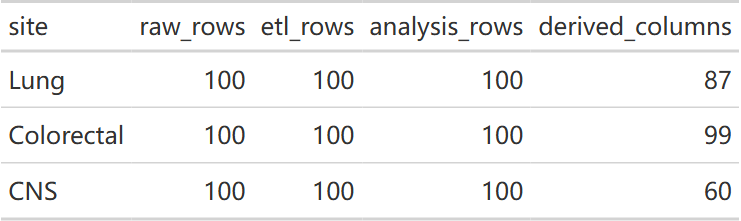
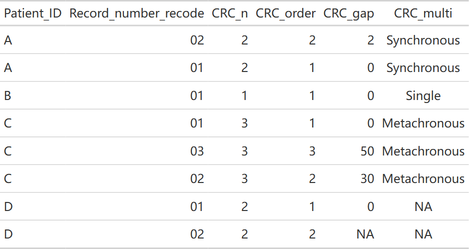
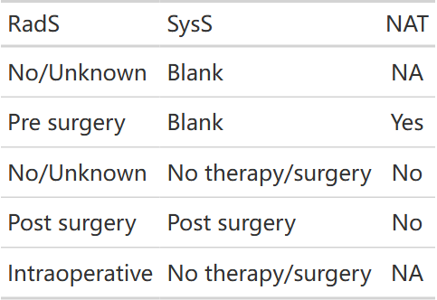
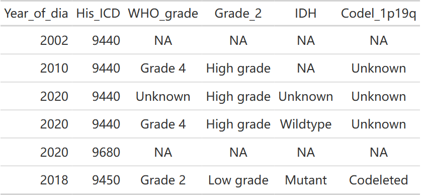
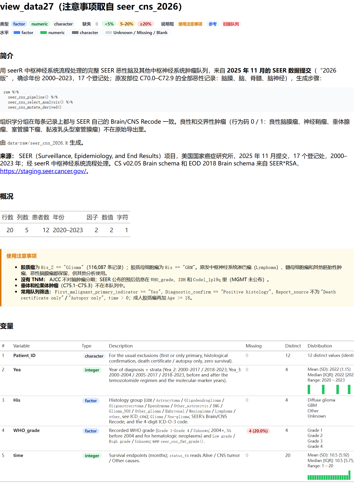

# seerR 笔记

seerR 把 SEER 导出字段整理为分析变量。先按文件实际 schema 选择入口，再检查输出编码、缺失及分析单位；同名列或成功返回并不说明两个年度的导出文件可以混用。

2026-10-17 按已推送 seerR `82b0960`、UtilsR `f426bc0`，在 Windows / WSL R 4.4.3 实际执行本页两套包内样例及合成边界例。包内样例用于接口演示，不代表本文建立了研究队列；原有 [功能模块图](function-modules.qmd) 保持其历史快照。

## 选择流水线与 schema {#pipeline-current}

甲状腺入口为 `seer_thyroid_pipeline(data, schema=...)`；schema 默认 `"2025"`，2026 导出须显式选择 `"2026"`。它依次完成字段选择、组织学、分期与淋巴结、转移、人口学、治疗、结局及复发标记整理。胰腺使用独立的 `seer_pancreas_pipeline()`，不能直接套用甲状腺字段和规则。

```r
library(seerR)
```

::: {.panel-tabset}

### 2025 样例 {.unnumbered}

```r
sample_2025 <- system.file("extdata", "sample_seer_thyroid_2025.csv", package = "seerR")
raw_2025 <- readr::read_csv(sample_2025, show_col_types = FALSE)
selected_2025 <- seer_thyroid_select_2025(raw_2025)
analysis_2025 <- seer_thyroid_pipeline(raw_2025, schema = "2025")
data.frame(step = c("raw", "selected", "analysis"),
  rows = c(nrow(raw_2025), nrow(selected_2025), nrow(analysis_2025)),
  columns = c(ncol(raw_2025), ncol(selected_2025), ncol(analysis_2025)))
head(analysis_2025[, c("Patient_ID", "Age", "His_6", "T_stage", "N_stage",
  "time", "DSS", "RFS", "time.RFS")])
```

::: {.callout-note collapse="true" title="复核代码"}
生成本页时运行的检查，接在上面的代码之后运行；只读教程可以跳过。

```r
stopifnot(nzchar(sample_2025))
```
:::

实际步骤尺寸：

::: {.table-responsive}

|step     | rows| columns|
|:--------|----:|-------:|
|raw      |  100|     246|
|selected |  100|      65|
|analysis |  100|     126|

:::

实际输出前六行：

::: {.table-responsive}

|Patient_ID | Age|His_6 |T_stage |N_stage | time| DSS| RFS| time.RFS|
|:----------|---:|:-----|:-------|:-------|----:|---:|---:|--------:|
|sample_001 |  53|PTC   |T2      |N1a     |  108|   0|   0|      108|
|sample_002 |  45|PTC   |T1      |N0      |   59|   0|   0|       59|
|sample_003 |  75|PTC   |T4a     |N0      |    0|   1|   0|        0|
|sample_004 |  76|PTC   |T1      |N0      |  116|   0|   0|      116|
|sample_005 |  41|FTC   |T3a     |N0      |   27|   0|   0|       27|
|sample_006 |  61|PTC   |T1      |N0      |   66|   0|   0|       66|

:::

### 2026 样例 {.unnumbered}

```r
sample_2026 <- system.file("extdata", "sample_seer_thyroid_2026.csv", package = "seerR")
raw_2026 <- readr::read_csv(sample_2026, show_col_types = FALSE)
selected_2026 <- seer_thyroid_select_2026(raw_2026)
analysis_2026 <- seer_thyroid_pipeline(raw_2026, schema = "2026")
data.frame(step = c("raw", "selected", "analysis"),
  rows = c(nrow(raw_2026), nrow(selected_2026), nrow(analysis_2026)),
  columns = c(ncol(raw_2026), ncol(selected_2026), ncol(analysis_2026)))
head(analysis_2026[, c("Patient_ID", "Age", "His_6", "T_stage", "N_stage",
  "time", "DSS", "RFS", "time.RFS")])
```

::: {.callout-note collapse="true" title="复核代码"}
生成本页时运行的检查，接在上面的代码之后运行；只读教程可以跳过。

```r
stopifnot(nzchar(sample_2026))
```
:::

实际步骤尺寸：

::: {.table-responsive}

|step     | rows| columns|
|:--------|----:|-------:|
|raw      |  100|     247|
|selected |  100|      67|
|analysis |  100|     128|

:::

实际输出前六行：

::: {.table-responsive}

|Patient_ID | Age|His_6 |T_stage |N_stage | time| DSS| RFS| time.RFS|
|:----------|---:|:-----|:-------|:-------|----:|---:|---:|--------:|
|sample_001 |  53|PTC   |T2      |N1a     |  120|   0|   0|      120|
|sample_002 |  45|PTC   |T1      |N0      |  110|   0|   0|      110|
|sample_003 |  75|PTC   |T4a     |N0      |    0|   1|   0|        0|
|sample_004 |  76|PTC   |T1      |N0      |  116|   0|   0|      116|
|sample_005 |  41|FTC   |T3a     |N0      |   39|   0|   0|       39|
|sample_006 |  61|PTC   |T1      |N0      |   66|   0|   0|       66|

:::

:::

两套样例均保留 100 行，字段数随 schema 和派生变量而变。输出的行数不能代替患者数，也不能据此确认结局完整。

### 肺、结直肠与 CNS 的独立入口（2026-10-26） {#site-pipelines-20261026}

<!-- update-20261026: seer_sites -->

按已推送 seerR 0.1.0 `5a0f4f3` 核对，三个新模块应使用各自的选择器和整理规则。下例在 Windows / WSL R 4.4.3 执行包内各 100 行 sample，本站只发布行列计数；原始记录、内置患者队列和个体标识不进入附件或页面。

::: {.table-responsive tabindex="0" role="region" aria-label="按癌种与schema选择SEER流水线"}

| 癌种 | 公共入口 | schema 与后续分析 |
|:--|:--|:--|
| 甲状腺 | `seer_thyroid_pipeline(data,schema=...)` | 2025 / 2026；沿用上方示例 |
| 胰腺 | `seer_pancreas_pipeline(data,schema=...)` | 2025 / 2026，默认 2025，2026 需显式选择 |
| 肺 | `seer_lung_pipeline(data,schema="2026")` | 仅 2026；再接 lung 的 select_analysis / mutate_derived |
| 结直肠 | `seer_colorectal_pipeline(data)` | 仅 2026；保留原发记录与患者的区别 |
| 脑与其他 CNS | `seer_cns_pipeline(data)` | 仅 2026；走 WHO 分级与分子标记字段，不套肺或结直肠 TNM |

:::

2026 CSV 统一按字符读取，避免手术、SSF 等前导零被猜成数值；选择器虽会修复部分码宽，不能代替对导出字典的核对。癌种选择器不会替研究者完成原始队列的纳排条件。

```r
library(seerR)
sample_files26 <- c(Lung = "sample_seer_lung_2026.csv",
  Colorectal = "sample_seer_colorectal_2026.csv", CNS = "sample_seer_cns_2026.csv")
raw_sites26 <- lapply(sample_files26, function(filename) readr::read_csv(
  system.file("extdata", filename, package = "seerR"),
  col_types = readr::cols(.default = "c"), show_col_types = FALSE, progress = FALSE))
etl_sites26 <- list(Lung = seer_lung_pipeline(raw_sites26[["Lung"]], schema = "2026"),
  Colorectal = seer_colorectal_pipeline(raw_sites26[["Colorectal"]]),
  CNS = seer_cns_pipeline(raw_sites26[["CNS"]]))
analysis_sites26 <- list(Lung = seer_lung_select_analysis(etl_sites26[["Lung"]]),
  Colorectal = seer_colorectal_select_analysis(etl_sites26[["Colorectal"]]),
  CNS = seer_cns_select_analysis(etl_sites26[["CNS"]]))
derived_sites26 <- list(Lung = seer_lung_mutate_derived(analysis_sites26[["Lung"]]),
  Colorectal = seer_colorectal_mutate_derived(analysis_sites26[["Colorectal"]]),
  CNS = seer_cns_mutate_derived(analysis_sites26[["CNS"]]))
summary_sites26 <- data.frame(site = names(etl_sites26),
  raw_rows = vapply(raw_sites26, nrow, integer(1)), etl_rows = vapply(etl_sites26, nrow, integer(1)),
  analysis_rows = vapply(analysis_sites26, nrow, integer(1)),
  derived_columns = vapply(derived_sites26, ncol, integer(1)))
summary_sites26
```

::: {.callout-note collapse="true" title="复核代码"}

```r
stopifnot(all(summary_sites26[["raw_rows"]] == 100L),
  identical(summary_sites26[["raw_rows"]], summary_sites26[["etl_rows"]]),
  identical(summary_sites26[["etl_rows"]], summary_sites26[["analysis_rows"]]),
  "Patient_ID" %in% names(analysis_sites26[["Lung"]]),
  all(c("Patient_ID", "Sequence_number", "CRC_n", "CRC_order", "CRC_gap", "CRC_multi") %in%
    names(analysis_sites26[["Colorectal"]])),
  all(c("WHO_grade", "IDH", "Codel_1p19q") %in% names(derived_sites26[["CNS"]])))
gt::gtsave(gt::gt(summary_sites26), file.path(tempdir(), "20261026-update-seer-pipelines.html"))
```

:::

{fig-alt="肺、结直肠和CNS各100条包内样例的原生汇总表，核对raw、ETL和analysis阶段行数；不展示任何样例记录。"}

[原生 HTML 汇总](images/index/20261026-update-seer-pipelines.html)

样例中的非数字生存时间码在数值转换时会提示产生 NA；应检查缺失来源，不改成零，也不能只凭行数相同认为结局已经验证。肺模块的本轮修复涉及年代对应的大小字段回退、EOD/CS 分期与多部位转移计数；大小码 000 表示未见原发，不当成 0 mm，符合回退规则的大小保留到 400 mm。软组织等其他 schema 不套肺 T 分类。以上规则按 `R/seer_lung.R`、帮助与随包回归测试核对；本页没有重建大型发布队列，也没有重新测量压缩或计算速度。

结直肠模块另行处理阑尾代码、节点信息缺失回退、腹膜等多部位转移和大小回退。不要因为函数名相似就把肺、甲状腺或阑尾的分期表相互替换。包还提供 `seer_lung_2026`、`seer_colorectal_2026`、`seer_cns_2026`；上表仅描述小型 sample，不是这些完整队列的维度。

### 结直肠多原发：记录数不等于患者数（2026-10-26） {#crc-primary-unit-20261026}

新增字段以 `Patient_ID` 分组，按 `Record_number_recode` 排序；`CRC_n` 为输入中的结直肠原发记录数，`CRC_order` 为记录顺序，`CRC_gap` 为首条记录的 time 减去当前记录的 time。`CRC_multi` 使用第二条与第一条的 time 差：不超过 6 个月为 Synchronous，超过为 Metachronous，并把该标签复制到该患者所有行；差值未知时保持 NA。这里依赖同一截点下的随访差，不能无条件当作独立记录的准确诊断日期差。

```r
synthetic_crc26 <- tibble::tibble(Year_of_dia = "2015", Race = "White", Tumor_size = 40,
  Tumor_deposits = "Blank(s)", CEA_2010 = "Blank(s)", Perineural_2010 = "Blank(s)",
  Patient_ID = c("A", "A", "B", "C", "C", "C", "D", "D"),
  Record_number_recode = c("02", "01", "01", "01", "03", "02", "01", "02"),
  time = c(98, 100, 50, 60, 10, 30, 40, NA))
multiple_crc26 <- seer_colorectal_fmt_all(synthetic_crc26)
multiple_crc26[c("Patient_ID", "Record_number_recode", "CRC_n", "CRC_order", "CRC_gap", "CRC_multi")]
```

::: {.callout-note collapse="true" title="复核代码"}

```r
stopifnot(nrow(multiple_crc26) == 8L, dplyr::n_distinct(multiple_crc26[["Patient_ID"]]) == 4L,
  identical(multiple_crc26[["CRC_gap"]], c(2, 0, 0, 0, 50, 30, 0, NA)),
  identical(as.character(multiple_crc26[["CRC_multi"]]),
    c("Synchronous", "Synchronous", "Single", "Metachronous", "Metachronous", "Metachronous", NA, NA)))
crc_preview26 <- as.data.frame(multiple_crc26[c("Patient_ID", "Record_number_recode", "CRC_n", "CRC_order", "CRC_gap", "CRC_multi")])
gt::gtsave(gt::gt(crc_preview26), file.path(tempdir(), "20261026-update-seer-primary-unit.html"))
```

:::

{fig-alt="仅含虚构A至D标识的原生表，核对八条记录、患者内原发顺序、间隔及同步或异时多原发标签；未知间隔保留NA。"}

[原生 HTML 表](images/index/20261026-update-seer-primary-unit.html)

这些字段描述多原发，不是复发或 RFS。函数不自动选出每患者一行；需要患者级分析时先明确记录选择规则、核对保留人数，再拟合模型。旧的[甲状腺复发标记示例](#recurrence-current)不应移植为结直肠复发定义。

### 未知治疗顺序不能自动写成 No（2026-10-26） {#crc-nat-20261026}

结直肠 `NAT` 在记录有术前放疗或系统治疗时为 Yes，其余组合按当前非术前代码与缺失规则处理，不能由“没有记录 Yes”一律推断 No。`No/Unknown` 本身是登记合并码，程序输出的 No 不能解释为已确证未接受治疗。下例只改变 5 条 sample 的治疗顺序，公开表仅包含这些人为指定的序列及其标签，不显示其他字段。

```r
nat_input26 <- analysis_sites26[["Colorectal"]][1:5, ]
nat_input26[["RadS"]] <- c("No/Unknown", "Pre surgery", "No/Unknown", "Post surgery", "Intraoperative")
nat_input26[["SysS"]] <- c("Blank", "Blank", "No therapy/surgery", "Post surgery", "No therapy/surgery")
nat_result26 <- seer_colorectal_mutate_derived(nat_input26)
data.frame(RadS = nat_input26[["RadS"]], SysS = nat_input26[["SysS"]], NAT = nat_result26[["NAT"]])
```

::: {.callout-note collapse="true" title="复核代码"}

```r
stopifnot(identical(as.character(nat_result26[["NAT"]]), c(NA, "Yes", "No", "No", NA)))
nat_preview26 <- data.frame(RadS = nat_input26[["RadS"]], SysS = nat_input26[["SysS"]], NAT = nat_result26[["NAT"]])
gt::gtsave(gt::gt(nat_preview26), file.path(tempdir(), "20261026-update-seer-nat.html"))
```

:::

{fig-alt="五种人为指定治疗序列的原生表，未知系统治疗顺序不会自动当作No，而明确术前治疗给出Yes。"}

[原生 HTML 表](images/index/20261026-update-seer-nat.html)

### CNS 的 WHO 分级与缺失来源（2026-10-26） {#cns-grade-20261026}

该模块使用登记字段中的 WHO 分级，不从组织学名称猜分级。2004–2017 对应 CS Brain/CNS Other 的 SSF1；2018 起读相应 schema 的 Derived Summary Grade。`High grade` 只确定高低分组，不自动确定 WHO Grade 3 或 4。未收集、schema 不适用及血液肿瘤等情况与登记了 Unknown 应分开看。这里是该提交的编码合同，不是独立的病理诊断规则。

```r
synthetic_cns26 <- tibble::tibble(Year_of_dia = c("2002", "2010", "2020", "2020", "2020", "2018"),
  His_ICD = c("9440", "9440", "9440", "9440", "9680", "9450"),
  CS_schema = "Brain", Schema_2018 = "Brain", SSF1 = c("999", "040", "999", "999", "999", "999"),
  Grade_2018 = c("Blank(s)", "Blank(s)", "High grade", "Site-specific grade system category (4)",
    "Site-specific grade system category (4)", "Site-specific grade system category (2)"),
  Brain_markers_2018 = c("Blank(s)", "Blank(s)", "Not documented", "Glioblastoma, IDH-wildtype (9440/3)",
    "Blank(s)", "Oligodendroglioma, IDH-mutant and 1 p/19q co-deleted (9450/3)"),
  Chr1p_2010 = c(rep("Not documented", 4), "Not applicable", "Not documented"),
  Chr19q_2010 = c(rep("Not documented", 4), "Not applicable", "Not documented"), Age = "50 years",
  Tumor_size_1988 = "020", Sex = "Female", Race = "White", Race_5 = "Non-Hispanic White",
  SEER_stage_5 = c("Blank(s)", rep("Localized only", 5)))
grade_cns26 <- seer_cns_fmt_grade(synthetic_cns26)
grade_cns26[c("Year_of_dia", "His_ICD", "WHO_grade", "Grade_2", "IDH", "Codel_1p19q")]
```

::: {.callout-note collapse="true" title="复核代码"}

```r
stopifnot(identical(as.character(grade_cns26[["WHO_grade"]]), c(NA, "Grade 4", "Unknown", "Grade 4", NA, "Grade 2")),
  identical(as.character(grade_cns26[["Grade_2"]]), c(NA, "High grade", "High grade", "High grade", NA, "Low grade")),
  !any(c("T_stage", "N_stage", "TNM") %in% names(grade_cns26)))
cns_preview26 <- as.data.frame(grade_cns26[c("Year_of_dia", "His_ICD", "WHO_grade", "Grade_2", "IDH", "Codel_1p19q")])
gt::gtsave(gt::gt(cns_preview26), file.path(tempdir(), "20261026-update-seer-cns-grade.html"))
validation_values <- list(pipelines = summary_sites26, primary_unit = crc_preview26,
  NAT = nat_preview26, WHO_grade = cns_preview26)
```

:::

{fig-alt="六条完全合成CNS编码输入的原生表，明确High grade不等于具体WHO四级，未收集或不适用与Unknown分别保留。"}

[原生 HTML 表](images/index/20261026-update-seer-cns-grade.html)

`IDH` 与 `Codel_1p19q` 也有组织学和年代适用条件，不能把字段缺失统一当作阴性；这些登记编码不能补出未提供的分子检测结果。CNS 流水线没有肺或结直肠的 TNM、节点和转移整理步骤，不应为凑齐通用列而伪造 T/N/M。

<!-- /update-20261026: seer_sites -->

## 从 ETL 到分析变量 {#derived-current}

2026-10-18 按已推送 seerR `4e7afb9`、UtilsR `545bf4b`，在 Windows / WSL R 4.4.3 分别运行以下两套2026包内样例，输出规模与边界归属一致。上面的ETL结果仍是原执行快照；本节追加的是后续分析变量步骤。

`pipeline()` 完成字段整理，**不会自动调用 `select_analysis()` 或 `mutate_derived()`**。前者选择常用分析列，并移除 `Patient_ID` 等上游列；后者派生分组、整理标签并新增 `status_tb`。需要追踪患者时，应在选列前保留经过核对的连接键和行对应关系。

::: {.panel-tabset}

### 甲状腺完整步骤

```r
raw_thy <- readr::read_csv(system.file("extdata", "sample_seer_thyroid_2026.csv",
  package = "seerR"), show_col_types = FALSE)
etl_thy <- seer_thyroid_pipeline(raw_thy, schema = "2026")
selected_thy <- seer_thyroid_select_analysis(etl_thy)
derived_thy <- seer_thyroid_mutate_derived(selected_thy)
levels(derived_thy[["age_55"]])
levels(derived_thy[["Yea_3"]])
```

::: {.callout-note collapse="true" title="复核代码"}
生成本页时运行的检查，接在上面的代码之后运行；只读教程可以跳过。

```r
stopifnot(nrow(derived_thy) == nrow(etl_thy),
  identical(derived_thy[["DSS"]], selected_thy[["DSS"]]),
  identical(derived_thy[["time"]], selected_thy[["time"]]))
```
:::

### 胰腺完整步骤

```r
raw_pan <- readr::read_csv(system.file("extdata", "sample_seer_pancreas_2026.csv",
  package = "seerR"), show_col_types = FALSE)
etl_pan <- seer_pancreas_pipeline(raw_pan, schema = "2026")
selected_pan <- seer_pancreas_select_analysis(etl_pan)
derived_pan <- seer_pancreas_mutate_derived(selected_pan)
levels(derived_pan[["Rad"]])
levels(derived_pan[["Tum_3"]])
```

::: {.callout-note collapse="true" title="复核代码"}
生成本页时运行的检查，接在上面的代码之后运行；只读教程可以跳过。

```r
stopifnot(nrow(derived_pan) == nrow(etl_pan),
  identical(derived_pan[["DSS"]], selected_pan[["DSS"]]),
  identical(derived_pan[["time"]], selected_pan[["time"]]))
```
:::

:::

本轮实际输出：

::: {.table-responsive}

|cancer   |step     | rows| columns|
|:--------|:--------|----:|-------:|
|thyroid  |ETL      |  100|     128|
|thyroid  |selected |  100|      71|
|thyroid  |derived  |  100|      95|
|pancreas |ETL      |  100|     115|
|pancreas |selected |  100|      62|
|pancreas |derived  |  100|      86|

:::

`rows` 是记录行数，不能代替患者数或研究队列人数。运行时仍有数值转换产生NA及对数计算产生NaN的提示，后续派生没有自动解决这些数据质量问题。

### 标签变化与分组规则分开核对

::: {.table-responsive}

| 变量 | 当前行为 | 迁移时检查 |
|:--|:--|:--|
| `age_45/50/55/60` | `<N` / `≥N` | N岁进入上组；不要继续匹配`below_54`等旧字符串 |
| `age_cut3/4/5` | 用N−1作切点 | 边界归属已经改变，分层模型需重新计算，不能只改图中文字 |
| `Yea_2/3` | 标签从派生步骤输入的最早/最晚诊断年生成 | 甲状腺`Yea_3`切于2009/2015，胰腺切于2010/2017；范围不是固定的旧版年份字符串 |
| `Che` | `No` / `Yes` | `No`仍包含原`No/Unknown`，不等于治疗情况全部明确 |
| 胰腺`Rad` | `No` / `Beam` / `Other Radiation` | `No`仍包含原`None/Unknown`，并作为参考水平 |
| `County_2`、`Income_3`、`Grade` | `Urban/Rural`、`Low/Middle/High`及简化分级 | 筛选条件、名称映射和参考水平都要核对大小写及新标签 |
| `status_tb` | `Alive`、癌种死亡、`Other causes` | 仅供显示；不能把它当作改变了`DSS/OS/event`的结局定义 |

:::

若在分组前筛选数据，年份标签会采用筛选后输入的范围；若仅在分组后筛选，已有因子标签不会自动重算。`ToyData::toy_ptc_m1_cnd` 的598人、年龄边界实测及同名MTC数据区别见 [数据概览](../toydata/index.qmd#age-cut-current)。

## 肿瘤大小：甲状腺与胰腺不能共用上界 {#tumor-boundary-current}

单位为毫米。甲状腺 `Tum_3` 的上组只含41–90 mm，超过90 mm归`Unknown`，`Tum_5`则得到NA。胰腺的 `Tum_3` 和 `Tum_5` 上组均为`>40`，包含91–200 mm；不能沿用甲状腺90 mm的上界。

以下以两套已选分析列各取一条模板，仅改写 `Tum` 为边界值，实际调用派生函数。它是接口边界演示，不是患者肿瘤大小分布。

```r
sizes <- c(10, 20, 40, 41, 90, 91, 120, 200, NA_real_)
check_tumor_bins <- function(selected, derive) {
  example <- selected[rep(1L, length(sizes)), ]
  example[["Tum"]] <- sizes
  out <- derive(example)
  data.frame(Tum_mm = sizes, Tum_3 = as.character(out[["Tum_3"]]),
    Tum_5 = as.character(out[["Tum_5"]]))
}
check_tumor_bins(selected_thy, seer_thyroid_mutate_derived)
check_tumor_bins(selected_pan, seer_pancreas_mutate_derived)
```

::: {.table-responsive}

|cancer   | Tum_mm|Tum_3   |Tum_5 |
|:--------|------:|:-------|:-----|
|thyroid  |     10|≤20     |≤10   |
|thyroid  |     20|≤20     |11-20 |
|thyroid  |     40|21-40   |31-40 |
|thyroid  |     41|41-90   |41-90 |
|thyroid  |     90|41-90   |41-90 |
|thyroid  |     91|Unknown |NA    |
|thyroid  |    120|Unknown |NA    |
|thyroid  |    200|Unknown |NA    |
|thyroid  |     NA|Unknown |NA    |
|pancreas |     10|≤20     |≤10   |
|pancreas |     20|≤20     |11-20 |
|pancreas |     40|21-40   |31-40 |
|pancreas |     41|>40     |>40   |
|pancreas |     90|>40     |>40   |
|pancreas |     91|>40     |>40   |
|pancreas |    120|>40     |>40   |
|pancreas |    200|>40     |>40   |
|pancreas |     NA|Unknown |NA    |

:::

### 真实包内胰腺数据的影响

对照旧快照 `82b0960` 与当前 `4e7afb9`：包内 `seer_pancreas_2026` 仍为267,244行，结局与随访时间逐行一致；新增`status_tb`后列数85→86。`Tum_3` 的实际计数为：

::: {.table-responsive}

| 旧组定义 | 旧人数 | 当前组定义 | 当前人数 |
|:--|--:|:--|--:|
| ≤20 | 22936 | ≤20 | 22936 |
| 21-40 | 94650 | 21-40 | 94650 |
| 41-90 | 72906 | >40 | 77015 |
| Unknown | 76752 | Unknown | 72643 |

:::

旧表第3组为41–90 mm，当前第3组为所有`>40` mm。**4,109条大于90 mm的记录从Unknown归入上组**；`Tum_5` 对这些记录也从NA改为`>40`。这是分组归属变化，涉及肿瘤大小分层或完整病例筛选时，应重建队列并重跑相应模型。它不表示新增了4,109名患者。

当前分析变量的派生规则见 seerR 提交 `4e7afb9` 的 `R/seer_select_vars.R`（seerR 仓库不公开，未附链接）。

## 检查输出质量 {#quality-current}

样例运行中会出现数值转换产生 NA 和部分对数计算产生 NaN 的警告，不能把成功完成流水线等同于所有字段均可直接分析。应保留并核对这些提示。下面是 2026 样例实际输出的缺失数：

```r
quality_fields <- c("time", "DSS", "RFS", "time.RFS")
data.frame(field = quality_fields,
  missing = vapply(analysis_2026[quality_fields], function(x) sum(is.na(x)), integer(1)))
```

::: {.table-responsive}

|         |field    | missing|
|:--------|:--------|-------:|
|time     |time     |       1|
|DSS      |DSS      |       0|
|RFS      |RFS      |       0|
|time.RFS |time.RFS |       1|

:::

`time` 来自 SEER 随访月字段，`DSS` 与 `RFS` 是不同的编码结果。实际分析还需核对零随访、状态编码、患者重复记录、因子未知水平及所需协变量。`UtilsR::check_na()` / `lv()` 的当前特殊字符串识别见 [数据检视页](../utilsr/missing-guide.qmd)；函数不会自动把所有 Unknown 字符串改为 NA。

### 用 seer_view 检查队列与变量字典（2026-10-27） {#viewer-20261027}

<!-- update-20261027: seer_view -->

已推送 seerR **0.1.0** `91e9de6` 新增 `seer_view(data=NULL, notes=NULL, max_levels=10)`，导出总数为 **57 项**。它把队列概况、中文说明/注意事项和变量字典组合成 `RegR::fmt_page` 页面；字典保留英文变量名、类型与帮助描述。RegR 经 Suggests 使用，需要显示或保存页面时再安装，不新增反向硬依赖。

`seer_view("seer_cns_2026")` 可查看包内队列；无参数时列出所有队列，并读取每个数据集以汇总规模。筛选后数据框的变量名不再等于原队列名，应显式传 `notes="seer_cns_2026"`。`notes` 借用原队列帮助与字典，**不会筛选、校验或重建该队列**，也不会改变数据的分析单位。

下面仅用 20 行完全合成数据演示页面，不读取或发布真实患者记录。借用 CNS 注意事项用于展示中文说明格式，不表示这 20 行是真实 CNS 队列。

```r
library(seerR)
view_data27 <- data.frame(Patient_ID = sprintf("demo-%02d", rep(1:12, length.out = 20)),
  Yea = rep(2020:2023, 5),
  His = factor(rep(c("GBM", "Diffuse glioma", "Other", "Unknown", "GBM"), 4)),
  WHO_grade = factor(rep(c("Grade 1", "Grade 2", "Grade 3", "Grade 4", NA), 4)),
  time = 1:20)
view_before27 <- view_data27
view27 <- seer_view(view_data27, notes = "seer_cns_2026", max_levels = 3)
RegR::fmt_page(view27, save = list(filename = file.path(tempdir(),
  "20261027-update-seer-view.html")))
```

缺失颜色对应 NA 占比：无缺失不着色，低于 5% 为绿，5% 至不足 20% 为黄，20% 及以上为红；它不同于 Unknown/Missing/Blank 水平的灰色分布条。类型另用因子蓝、数值绿、其他灰。`max_levels` 保留最常见水平，多余的至少两个水平合并为 Other；高基数字符标识仅显示不同值个数，数值测量可显示直方图。颜色是数据检查线索，不能代替研究定义或自动清洗。

::: {.callout-note collapse="true" title="复核代码"}

```r
view_html27 <- as.character(htmltools::renderTags(view27)[["html"]])
stopifnot(inherits(view27, "fmt_page"), identical(view_data27, view_before27),
  nrow(view_data27) == 20L, length(unique(view_data27[["Patient_ID"]])) == 12L,
  sum(is.na(view_data27[["WHO_grade"]])) == 4L,
  grepl("注意事项取自", view_html27, fixed = TRUE),
  grepl("没有 TNM", view_html27, fixed = TRUE),
  grepl("Histology group", view_html27, fixed = TRUE),
  grepl("20.0%", view_html27, fixed = TRUE),
  file.info(file.path(tempdir(), "20261027-update-seer-view.html"))[["size"]] > 0)
validation_values <- list(rows = nrow(view_data27), patients = length(unique(view_data27[["Patient_ID"]])),
  who_missing = sum(is.na(view_data27[["WHO_grade"]])), unchanged = identical(view_data27, view_before27),
  page_class = class(view27), chinese_notes = TRUE)
```
:::

{fig-alt="seer_view 的真实原生 HTML 预览，概况与说明采用中文，变量字典保留英文名称和描述，显示 20 行合成输入的类型、缺失与分布。"}

[打开完整 HTML](images/index/20261027-update-seer-view.html){target="_blank"} · [下载 HTML](images/index/20261027-update-seer-view.html){download="seer-view-demo.html"}

返回页面打印时在 RStudio Viewer（或浏览器）显示，可继续交给 `fmt_page()` 组合/另存，不返回清洗后的数据。中文说明来自包内 `inst/notes/zh/<队列>.md`；缺少该说明的队列回退到英文帮助。更新数据帮助的描述、注意事项或来源时，需同步对应中文说明。本例只核验合成输入与已发布说明，不验证真实队列的字段完整性。

<!-- /update-20261027: seer_view -->

## 同人记录与复发标记 {#recurrence-current}

`seer_fmt_recurrence()` 按现有行顺序读取同一患者的首条、末条记录，用首条 time 减末条 time。只有同人多条记录、时间差至少六个月且所有 His_6 都与首条相同时，才接入 `RFS=1` 与共同的 `time.RFS`；它不会先按 time 自动排序。

这是该函数按记录规则推导的标记，研究中仍须核验它与所需复发定义是否一致。未满足规则的记录得到 `RFS=0`、`time.RFS=time`，不能仅凭这个零值断言临床未复发。

```r
d_rec <- data.frame(Patient_ID = c("A", "A", "B", "B", "C", "C"),
  time = c(60, 24, 20, 30, 50, 10),
  His_6 = c("PTC", "PTC", "PTC", "PTC", "PTC", "MTC"))
seer_fmt_recurrence(d_rec)
```

::: {.table-responsive}

|Patient_ID | time|His_6 | time.RFS| RFS|
|:----------|----:|:-----|--------:|---:|
|A          |   60|PTC   |       36|   1|
|A          |   24|PTC   |       36|   1|
|B          |   20|PTC   |       20|   0|
|B          |   30|PTC   |       30|   0|
|C          |   50|PTC   |       50|   0|
|C          |   10|MTC   |       10|   0|

:::

A 的差值为 36，标记接到该患者的两条原记录；B 的现有顺序给出负差值，C 的组织学不一致，两者均不满足规则。His_6 含 NA 时也不满足全组相同的检查。准备数据时应明确患者记录顺序与分析单位。

### 并列最大随访会增加连接行数

当前向量化实现保留了原来的并列最大值和 left join 行为。同一患者最大 time 出现两次时，该患者原记录会各连接两次。

```r
d_ties <- data.frame(Patient_ID = rep("D", 3), time = c(80, 80, 30),
  His_6 = rep("PTC", 3))
rec_ties <- seer_fmt_recurrence(d_ties)
nrow(d_ties)    # 3
nrow(rec_ties)  # 6
table(rec_ties$Patient_ID)
```

本轮实际核验了 3 → 6 行及 `time.RFS=50`；dplyr 可同时提示 many-to-many 连接。需要患者级结果时，应先确定记录选择与并列处理原则，再核对行数和患者数，不把重复行直接当成新增患者。

## 当前优化与复现范围

`82b0960` 把逐患者筛选改为整列处理，并复用分期整理中重复的 Extension 条件。本文没有重新测量大样本速度，不能把其他环境或旧版本的倍数套到自己的数据。

本页实际执行了两种 schema 的包内样例、基本复发规则、记录顺序与并列连接例；没有用这些结果验证真实数据的分期或复发终点。参数、字段与解释应结合当前帮助和自己的导出字典核对。

- [功能模块图](function-modules.qmd)

## 更新记录 {#page-updates}

::: {.callout-note collapse="true" title="更新记录"}
- 2026-10-27：补充[seer_view 中文队列页与变量字典](#viewer-20261027)的合成示例、原生 HTML 和说明来源。
- 2026-10-26：补充[三个新癌种流水线](#site-pipelines-20261026)、[多原发分析单位](#crc-primary-unit-20261026)、[未知 NAT](#crc-nat-20261026)与[CNS 分级来源](#cns-grade-20261026)。
:::
