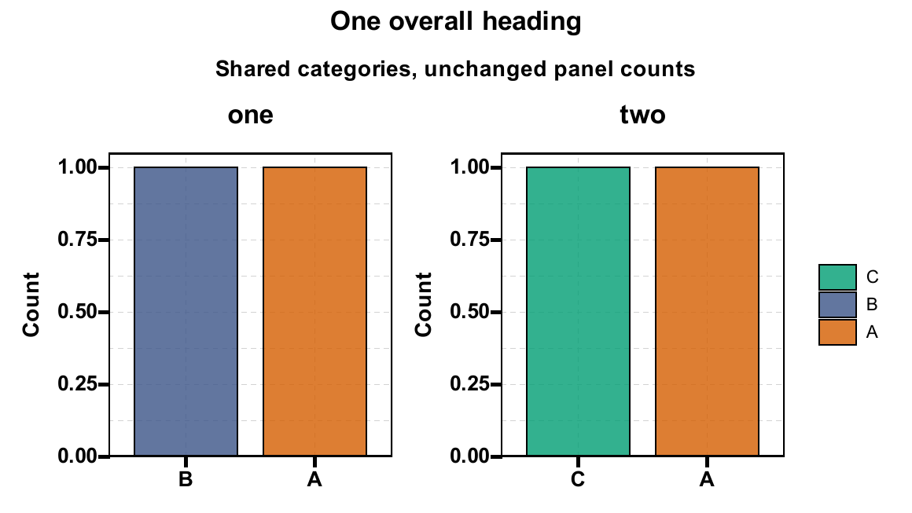
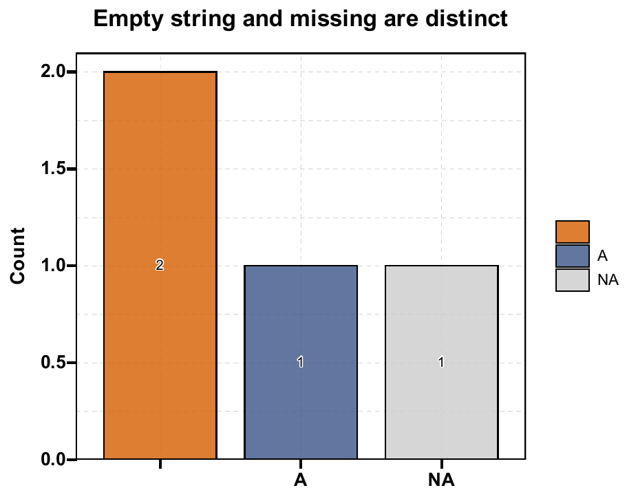
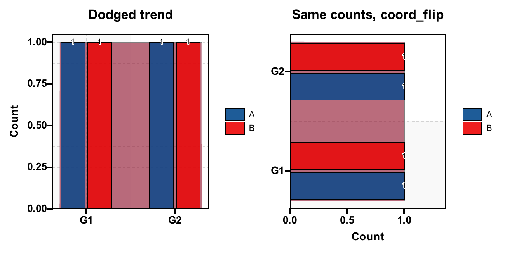
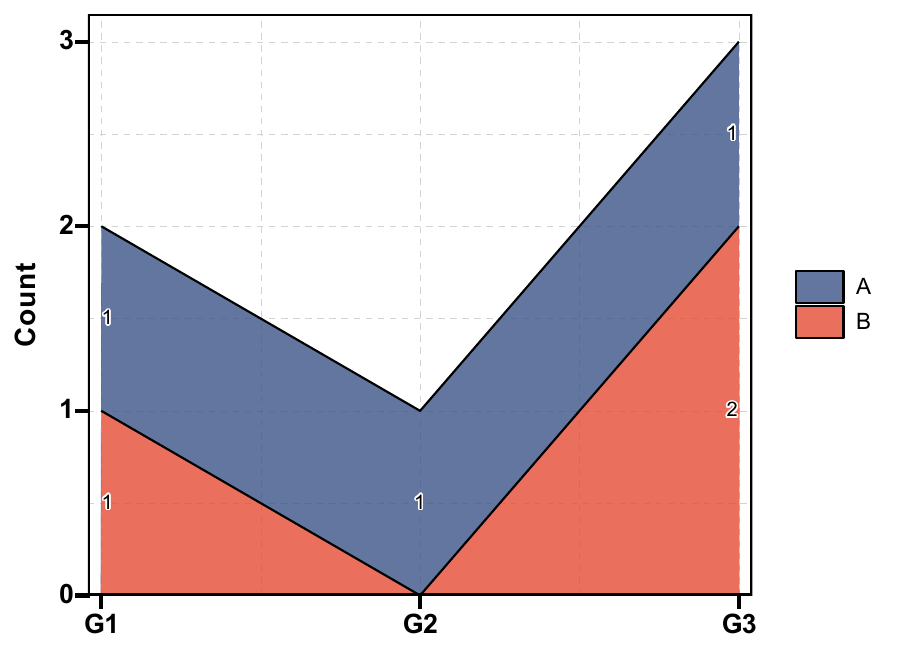
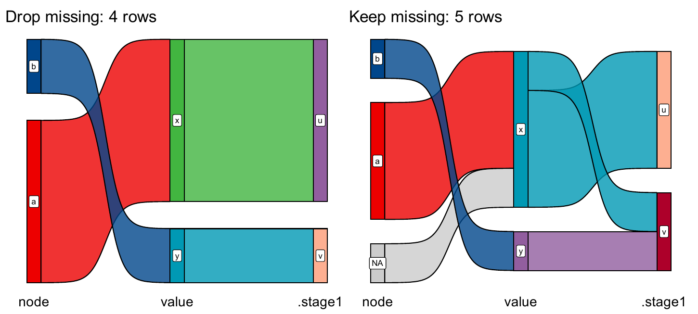
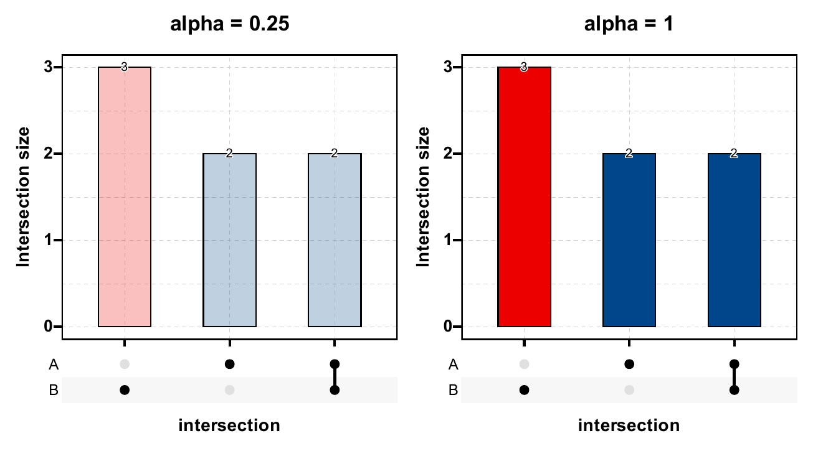
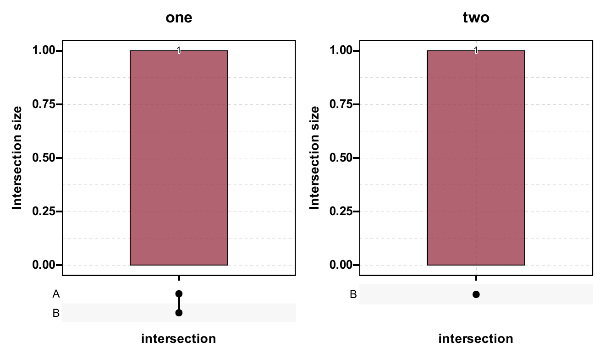
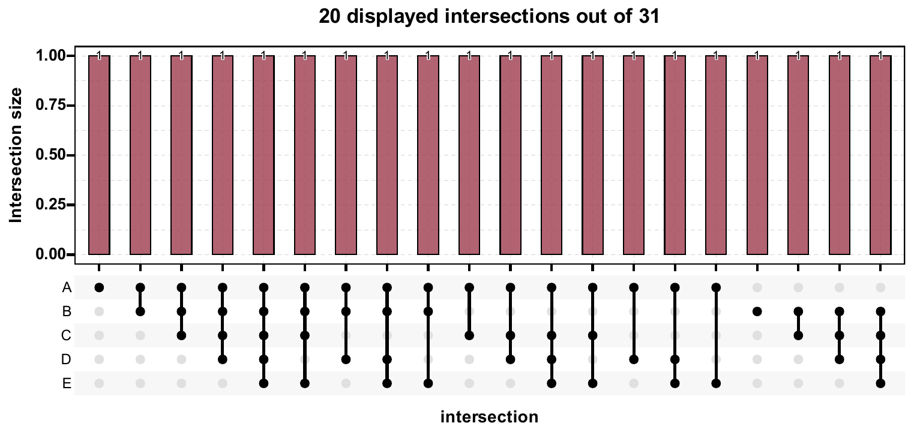
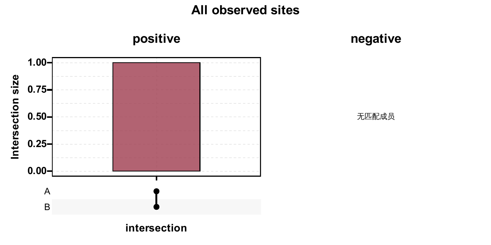
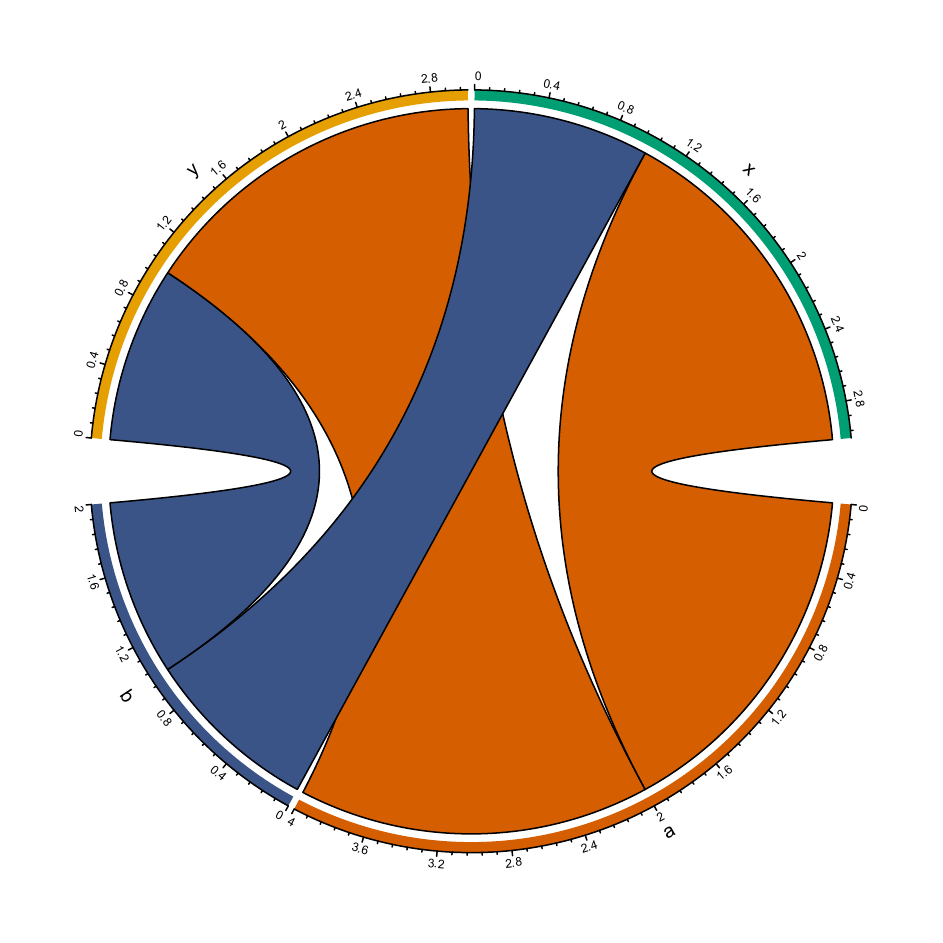

`plt_cat()` 用一个公共入口组织 11 种分类图形。本页先比较同一张频数表的显示方式，再分别展示流向、弦图和集合交集。图形选项放在标签页中，点击结果图可放大。

**历史版本与执行范围：** 以下原有31个参数示例按 UtilsR **0.6.8** 核对；31 个示例已在 WSL R 4.4.3 中实际执行，其中 31 张图已完成构建与 PNG 导出。使用固定随机种子的模拟数据。

::: {.callout-note collapse="true" title="版本与复现记录"}
2026-11-01 追加按已推送 UtilsR `5cab2565`（0.6.19）导出源码；配套依赖固定为 RegR `5067cdf`、UtilsR `5cab2565`，在 Windows / WSL R 4.4.3 独立运行下述合成示例。旧图保留原执行快照；此次没有重跑历史模型或安装包。

2026-11-01 追加按已推送 UtilsR `129c5a71`（0.6.19）导出源码；配套依赖固定为 RegR `5067cdf`、UtilsR `129c5a71`，在 Windows / WSL R 4.4.3 独立运行下述合成示例。旧图保留原执行快照；此次没有重跑历史模型或安装包。

2026-10-31 追加按已推送 UtilsR `dd654ef1`（0.6.19）导出源码；配套依赖固定为 RegR `5067cdf`、UtilsR `dd654ef1`，在 Windows / WSL R 4.4.3 独立运行下述合成示例。旧图保留原执行快照；此次没有重跑历史模型或安装包。

2026-10-31补充按已推送 UtilsR `05f4c963`（0.6.18）导出源码，在 Windows / WSL R4.4.3 独立运行下述合成示例。旧图保留原执行快照；此次没有重跑历史模型或安装包。

:::

## 数据准备与输入约定 {#data}

`stat.by`、`group.by`、`split.by` 使用列名字符串。模拟数据包含 240 行；`stage` 是统计变量，`cohort` 是分组变量，`batch` 用于分层，`region` 用于背景分组。集合图另用 0/1 含义明确的 Yes/No 列。

```r
library(UtilsR)
library(ggplot2)
set.seed(1001)
dat <- data.frame(
  stage = factor(sample(c("I", "II", "III"), 240, TRUE,
                        prob = c(0.5, 0.3, 0.2)), levels = c("I", "II", "III")),
  cohort = factor(rep(c("A", "B", "C"), c(100, 60, 80))),
  batch = factor(sample(c("Batch 1", "Batch 2"), 240, TRUE)))
dat[["region"]] <- factor(ifelse(dat[["cohort"]] == "C", "Region 2", "Region 1"))
binary <- data.frame(
  Surgery = sample(c("Yes", "No"), 240, TRUE, c(0.7, 0.3)),
  Radiation = sample(c("Yes", "No"), 240, TRUE, c(0.4, 0.6)),
  Drug = sample(c("Yes", "No"), 240, TRUE, c(0.55, 0.45)))
dat_na <- dat
dat_na[["stage"]][1:24] <- NA
dat_empty <- dat[dat[["stage"]] != "III", , drop = FALSE]
```

## 函数选择与重要参数 {#parameters}

| 调整目标 | 参数与默认值 | 作用与条件 |
|:--|:--|:--|
| 统计变量 | `stat.by`，必填 | 标准图只用首列；流向/弦/集合图至少两列 |
| 分组与分层 | `group.by = NULL`、`split.by = NULL` | 分组决定标准图百分比分母；分层先拆数据再分别绘图 |
| 图形选择 | `type = "bar"` | 11 种类型；不同类型的适用参数不同 |
| 数量或比例 | `stat = "percent"` | 标准图百分比按当前组内有效行数计算；`"count"` 保留人数 |
| 堆积或并排 | `position = "stack"` | `"dodge"` 并排；不是将百分比分母改为全样本 |
| 颜色 | `palette = NULL`、`alpha = 0.8` | 配色名或颜色向量；因子水平顺序决定颜色对应 |
| 标签 | `label = FALSE`、`label.size = 3.5` | `label.fg`、`label.bg`、`label.bg.r` 控制标签外观 |
| 背景分组 | `bg.by = NULL`、`bg_palette = NULL`、`bg_alpha = 0.15` | 有group.by的bar/trend/dot并排图使用；其他分支在列验证前忽略 |
| 缺失 | `NA_stat = FALSE`、`NA_color = "grey80"` | 默认去除涉及列中的缺失行；开启后把 NA 作为类别 |
| 空水平 | `keep_empty = FALSE` | 保留空因子水平及零计数；旧图有版本差异，当前行为见[修复后实测](#empty-fixed-20261031b) |
| 集合成员 | `stat_level = NULL` | 只用于 Venn/UpSet；显式指定各列的阳性水平更易复核 |
| 布局 | `flip = FALSE`、`aspect.ratio = NULL` | 翻转和面板高宽比；极坐标类型默认等比 |
| 分层排版 | `facet_nrow`、`facet_ncol`、`facet_byrow = TRUE` | 正整数且网格足以容纳全部面板；控制 `split.by` 组合图 |
| 图例与字号 | `legend.position = "right"`、`legend.direction = "vertical"`、`base_size = 14` | 只改变显示 |
| 高基数限制 | `force = FALSE` | 变量超过 100 水平默认拒绝；适宜先整理水平再画图 |

标准类型包括 `bar/rose/ring/pie/trend/area/dot`；`sankey/chord/venn/upset` 则有不同的数据准备。集合类型会忽略 `group.by/bg.by`，不能把标准图的所有参数都按相同含义套用。Venn最多七列；UpSet每层最多显示20种交集，见[显示边界](#upset-bounds-20261101b)。

## 计数、比例与方向

::: {.panel-tabset}

### 组内百分比 {.unnumbered}

每个 cohort 内的 stage 比例合计为 100%；三组人数不同，相同高度不代表相同人数。

```r
plt_cat(dat, "stage", "cohort", type = "bar", label = TRUE)
```

{fig-alt="分类变量：plt_cat 的 11 种图形与重要参数；组内百分比；固定模拟数据的实际参数对照结果。"}

### 原始计数 {.unnumbered}

只改变 stat，保留各组总人数的差异。

```r
plt_cat(dat, "stage", "cohort", type = "bar", stat = "count", label = TRUE)
```

{fig-alt="分类变量：plt_cat 的 11 种图形与重要参数；原始计数；固定模拟数据的实际参数对照结果。"}

### 并排比较 {.unnumbered}

只改变 position，百分比仍为组内比例，便于比较同一 stage 在不同组的构成。

```r
plt_cat(dat, "stage", "cohort", type = "bar", position = "dodge", label = TRUE)
```

{fig-alt="分类变量：plt_cat 的 11 种图形与重要参数；并排比较；固定模拟数据的实际参数对照结果。"}

### 横向排列 {.unnumbered}

横向图适合较长组名；人数没有变化。

```r
plt_cat(dat, "stage", "cohort", type = "bar", stat = "count", flip = TRUE, label = TRUE)
```

{fig-alt="分类变量：plt_cat 的 11 种图形与重要参数；横向排列；固定模拟数据的实际参数对照结果。"}

### 单变量 {.unnumbered}

省略 group.by，直接显示全样本 stage 的频数。

```r
plt_cat(dat, "stage", type = "bar", stat = "count", label = TRUE, legend.position = "none")
```

{fig-alt="分类变量：plt_cat 的 11 种图形与重要参数；单变量；固定模拟数据的实际参数对照结果。"}

:::

## 背景、标签与配色

::: {.panel-tabset}

### 背景分组 {.unnumbered}

A/B 属于 Region 1，C 属于 Region 2；背景表达分组归属，不是额外统计量。

```r
plt_cat(dat, "stage", "cohort", position = "dodge", bg.by = "region", label = TRUE)
```

{fig-alt="分类变量：plt_cat 的 11 种图形与重要参数；背景分组；固定模拟数据的实际参数对照结果。"}

### 背景颜色与透明度 {.unnumbered}

用 bg_palette 与 bg_alpha 单独控制背景，避免和 stage 的填色混淆。

```r
plt_cat(dat, "stage", "cohort", position = "dodge", bg.by = "region",
        bg_palette = c("#DCEEF8", "#FFF0CD"), bg_alpha = 0.35)
```

{fig-alt="分类变量：plt_cat 的 11 种图形与重要参数；背景颜色与透明度；固定模拟数据的实际参数对照结果。"}

### 标签外观 {.unnumbered}

数值标签改变前景、背景和圆角；标签内容仍由 stat 决定。

```r
plt_cat(dat, "stage", "cohort", stat = "count", position = "dodge",
        label = TRUE, label.size = 4, label.fg = "white",
        label.bg = "#263238", label.bg.r = 0.15)
```

{fig-alt="分类变量：plt_cat 的 11 种图形与重要参数；标签外观；固定模拟数据的实际参数对照结果。"}

### 固定颜色 {.unnumbered}

颜色按 I、II、III 的因子水平顺序映射；同一项目应跨图保持这一对应。

```r
plt_cat(dat, "stage", "cohort", palette = c("#0072B2", "#E69F00", "#009E73"),
        alpha = 0.9, legend.position = "bottom", legend.direction = "horizontal")
```

{fig-alt="分类变量：plt_cat 的 11 种图形与重要参数；固定颜色；固定模拟数据的实际参数对照结果。"}

### 面板比例与标题 {.unnumbered}

调整字号、标题和面板比例；纵轴标签明确写出百分比分母。

```r
plt_cat(dat, "stage", "cohort", aspect.ratio = 0.5, base_size = 16,
        title = "Stage composition", subtitle = "Simulated data, n = 240",
        xlab = "Cohort", ylab = "Within-cohort percentage")
```

{fig-alt="分类变量：plt_cat 的 11 种图形与重要参数；面板比例与标题；固定模拟数据的实际参数对照结果。"}

:::

### 背景条带与空水平复核（2026-10-31） {#bands-20261031}

<!-- update-20261031: utils_cat_bands -->

下面9行合成数据的输入因子顺序为C、空位、B、A；每个观测组都只有3行。按已推送 `05f4c963` 实跑，`keep_empty=FALSE/TRUE` 都只显示C、B、A，背景与这三个实际显示组对齐。该快照准备数据时再次 `factor()` 丢弃未观测水平，属于该历史快照的包缺陷；修复现已推送，见[0.6.19重新实测](#empty-fixed-20261031b)。原始对象、计数和组内百分比保持不变。

```r
cat_bands31 <- data.frame(category = factor(rep(c("Yes", "No", "Yes"), 3)),
  group = factor(rep(c("C", "B", "A"), each = 3), levels = c("C", "unused", "B", "A")),
  region = rep(c("R3", "R2", "R1"), each = 3))
cat_plain31 <- UtilsR::plt_cat(cat_bands31, "category", "group", position = "dodge",
  bg.by = "region", bg_palette = c("#DDEBF7", "#FCE4D6", "#E2F0D9"),
  keep_empty = FALSE, label = TRUE,
  save = list(filename = file.path(tempdir(), "20261031-update-cat-bands-observed.pdf")))
cat_empty31 <- UtilsR::plt_cat(cat_bands31, "category", "group", position = "dodge",
  bg.by = "region", bg_palette = c("#DDEBF7", "#FCE4D6", "#E2F0D9"),
  keep_empty = TRUE, label = TRUE,
  save = list(filename = file.path(tempdir(), "20261031-update-cat-bands-empty.pdf")))
```

::: {.panel-tabset}
#### 仅观测组 {.unnumbered}

{fig-alt="九行输入的并排百分比图，每组Yes为三分之二、No为三分之一，背景跟随C B A。"}

[原生 PDF](images/categorical-guide/20261031-update-cat-bands-observed.pdf)

#### TRUE的当前实测 {.unnumbered}

{fig-alt="已推送快照的TRUE调用横轴仍为C B A，没有补出unused，B保留浅橙背景。"}

[原生 PDF](images/categorical-guide/20261031-update-cat-bands-empty.pdf)
:::

::: {.callout-note collapse="true" title="复核代码"}
```r
cat_builds31 <- lapply(list(observed = cat_plain31, empty = cat_empty31), ggplot2::ggplot_build)
for (b31 in cat_builds31) {
  labels31 <- b31$layout$panel_params[[1]]$x$get_labels()
  rect31 <- Filter(function(z) all(c("xmin", "xmax", "fill") %in% names(z)), b31$data)[[1]]
  x_b31 <- match("B", labels31)
  stopifnot(identical(as.character(rect31$fill[rect31$xmin <= x_b31 & rect31$xmax >= x_b31]), "#FCE4D6"))
}
stopifnot(identical(cat_builds31$observed$layout$panel_params[[1]]$x$get_labels(), c("C", "B", "A")),
  identical(cat_builds31$empty$layout$panel_params[[1]]$x$get_labels(), c("C", "B", "A")),
  identical(as.vector(table(cat_bands31$group)), c(3L, 0L, 3L, 3L)))
validation_values <- list(rows = nrow(cat_bands31), counts = unclass(table(cat_bands31$group, cat_bands31$category)),
  axes = lapply(cat_builds31, function(b) b$layout$panel_params[[1]]$x$get_labels()))
```
:::

同一共享背景处理也用于连续变量图；连续变量的排序和翻转见[独立坐标示例](continuous-guide.qmd#finite-20261031)。背景仅辅助识别分组，不参与百分比分母或统计检验。

<!-- /update-20261031: utils_cat_bands -->

### 空水平修复后的横轴与背景（2026-10-31） {#empty-fixed-20261031b}

<!-- update-20261031b: utils_cat_empty -->

UtilsR `5842c30b` 已修复空因子水平的保留，下面按已推送0.6.19快照重新运行同一9行输入。`keep_empty=FALSE` 显示C、B、A；`TRUE` 显示C、unused、B、A，unused的计数为0。保留空水平不会改变样本数、观测组的百分比分母或因子顺序。

```r
cat_empty31b <- data.frame(category = factor(rep(c("Yes", "No", "Yes"), 3)),
  group = factor(rep(c("C", "B", "A"), each = 3), levels = c("C", "unused", "B", "A")),
  region = rep(c("R3", "R2", "R1"), each = 3))
cat_observed31b <- UtilsR::plt_cat(cat_empty31b, "category", "group", position = "dodge",
  bg.by = "region", bg_palette = c(R3 = "#DDEBF7", R2 = "#FCE4D6", R1 = "#E2F0D9"),
  keep_empty = FALSE, label = TRUE,
  save = list(filename = file.path(tempdir(), "20261031b-update-cat-observed.pdf")))
cat_kept31b <- UtilsR::plt_cat(cat_empty31b, "category", "group", position = "dodge",
  bg.by = "region", bg_palette = c(R3 = "#DDEBF7", R2 = "#FCE4D6", R1 = "#E2F0D9"),
  keep_empty = TRUE, label = TRUE,
  save = list(filename = file.path(tempdir(), "20261031b-update-cat-empty.pdf")))
```

::: {.panel-tabset}
#### 仅观测水平 {.unnumbered}

{fig-alt="九行合成输入的并排百分比图，横轴C B A，Yes各占三分之二，No各占三分之一。"}

[原生 PDF](images/categorical-guide/20261031b-update-cat-observed.pdf)

#### 保留空位 {.unnumbered}

{fig-alt="同一九行输入保留C unused B A，unused为零计数，B的浅橙色背景跟随其新位置。"}

[原生 PDF](images/categorical-guide/20261031b-update-cat-empty.pdf)
:::

::: {.callout-note collapse="true" title="复核代码"}
```r
cat_build31b <- lapply(list(observed = cat_observed31b, kept = cat_kept31b), ggplot2::ggplot_build)
cat_axes31b <- lapply(cat_build31b, function(b) b$layout$panel_params[[1]]$x$get_labels())
for (b31b in cat_build31b) {
  labels31b <- b31b$layout$panel_params[[1]]$x$get_labels()
  rect31b <- Filter(function(z) all(c("xmin", "xmax", "fill") %in% names(z)), b31b$data)[[1]]
  b_index31b <- match("B", labels31b)
  stopifnot(identical(as.character(rect31b$fill[
    rect31b$xmin <= b_index31b & rect31b$xmax >= b_index31b]), "#FCE4D6"))
}
stopifnot(identical(cat_axes31b$observed, c("C", "B", "A")),
  identical(cat_axes31b$kept, c("C", "unused", "B", "A")),
  sum(cat_kept31b$data$n) == 9,
  all(cat_kept31b$data$n[cat_kept31b$data$group_var == "unused"] == 0),
  identical(as.vector(table(cat_empty31b$group)), c(3L, 0L, 3L, 3L)))
validation_values <- list(rows = nrow(cat_empty31b), axes = cat_axes31b,
  counts = as.vector(table(cat_empty31b$group)), plot_counts = cat_kept31b$data$n)
```
:::

unused没有观测行，也没有可推定的region；背景按实际组的映射定位，不应把相邻组颜色当成空组归属。上方 `05f4c963` 与下方0.6.8的旧图保留历史执行结果，当前空水平行为以本节为准。

<!-- /update-20261031b: utils_cat_empty -->

### 分类缺失身份、特殊列名与饼环几何（2026-10-31） {#identity-20261031b}

<!-- update-20261031b: utils_cat_identity -->

SPSS用户缺失值先按原始类判断，再转为分类；文字 `"NA"` 与真正缺失分别保留身份。含空格、加号或斜线的列名直接按字符串选取。下面8行中，99是SPSS用户缺失；默认排除分类或分组缺失的行后剩4行，`NA_stat=TRUE` 保留全部8行，文字NA组不会并入缺失组。

```r
cat_identity31b <- data.frame(check.names = FALSE,
  "Stage / sample" = haven::labelled_spss(c(1, 99, 1, 2, 2, NA, 1, 2),
    labels = c(Early = 1, Late = 2, Missing = 99), na_values = 99),
  "Group + arm" = c("NA", "A", NA, "A", "NA", "B", "B", NA))
cat_drop31b <- UtilsR::plt_cat(cat_identity31b, "Stage / sample", "Group + arm",
  stat = "count", label = TRUE, palette = c("1" = "#3B5488", "2" = "#E64B35"),
  title = "Drop missing: 4 rows")
cat_all31b <- UtilsR::plt_cat(cat_identity31b, "Stage / sample", "Group + arm",
  stat = "count", label = TRUE, NA_stat = TRUE,
  palette = c("1" = "#3B5488", "2" = "#E64B35"), title = "Keep missing: 8 rows")
RegR::save_plt(patchwork::wrap_plots(cat_drop31b, cat_all31b, nrow = 1),
  file.path(tempdir(), "20261031b-update-cat-identity.pdf"), width = 9, height = 4)
cat_geometry31b <- data.frame(Type = factor(c(rep("A", 6), rep("B", 3))))
cat_pie31b <- UtilsR::plt_cat(cat_geometry31b, "Type", type = "pie", label = TRUE, title = "Pie")
cat_ring31b <- UtilsR::plt_cat(cat_geometry31b, "Type", type = "ring", label = TRUE, title = "Ring")
RegR::save_plt(patchwork::wrap_plots(cat_pie31b, cat_ring31b, nrow = 1),
  file.path(tempdir(), "20261031b-update-cat-geometry.pdf"), width = 8, height = 4)
```

{fig-alt="左图排除缺失后合计四行，右图含真实缺失后合计八行，NA文字组与缺失组分别显示。"}

[原生 PDF](images/categorical-guide/20261031b-update-cat-identity.pdf)

{fig-alt="A占三分之二、B占三分之一，饼图同心共半径，环图中心留白不生成缺失类别图例。"}

[原生 PDF](images/categorical-guide/20261031b-update-cat-geometry.pdf)

::: {.callout-note collapse="true" title="复核代码"}
```r
cat_raw31b <- cat_identity31b[["Stage / sample"]]
cat_missing31b <- is.na(cat_raw31b) | is.na(cat_identity31b[["Group + arm"]])
cat_labels31b <- as.character(cat_all31b$data$group_var)
stopifnot(identical(which(cat_missing31b), c(2L, 3L, 6L, 8L)),
  sum(cat_drop31b$data$n) == 4, sum(cat_all31b$data$n) == 8,
  all(c("NA", "<NA>") %in% cat_labels31b),
  !any(as.character(cat_all31b$data$stat_var) == "99"),
  sum(cat_pie31b$data$n) == 9, sum(cat_ring31b$data$n) == 9,
  !anyNA(cat_ring31b$data$stat_var),
  identical(cat_identity31b[["Stage / sample"]], cat_raw31b))
validation_values <- list(rows = nrow(cat_identity31b), removed_rows = which(cat_missing31b),
  totals = c(drop = sum(cat_drop31b$data$n), keep = sum(cat_all31b$data$n)),
  groups = unique(cat_labels31b), categories = unique(as.character(cat_all31b$data$stat_var)),
  geometry_counts = as.vector(table(cat_geometry31b$Type)))
```
:::

这不会自动把SPSS数值代码替换成出版用标签；需要Early、Late等名称时应先明确重标签。日期时间列按其类格式化并保留真实缺失，不能把缺失日期变成文字日期后再统计。饼图/环图在 `6ff8f850` 后修正扇区几何，中心留白不再靠添加伪NA类别构成。并排柱的零计数、比例标签和面积图端点标签也应按本次实际显示位置读取。

<!-- /update-20261031b: utils_cat_identity -->

## 分层、缺失与空水平

::: {.panel-tabset}

### 拆分为两面板 {.unnumbered}

每个 batch 独立计算各 cohort 内比例；分层后的比例不能直接当作全样本比例。

```r
plt_cat(dat, "stage", "cohort", split.by = "batch",
        facet_ncol = 2, label = TRUE)
```

{fig-alt="分类变量：plt_cat 的 11 种图形与重要参数；拆分为两面板；固定模拟数据的实际参数对照结果。"}

### 改为纵向面板 {.unnumbered}

用 facet_ncol 与 facet_byrow 控制组合图布局；这里改用计数以展示各层样本量。

```r
plt_cat(dat, "stage", "cohort", split.by = "batch",
        facet_ncol = 1, facet_byrow = FALSE, stat = "count", label = TRUE)
```

{fig-alt="分类变量：plt_cat 的 11 种图形与重要参数；改为纵向面板；固定模拟数据的实际参数对照结果。"}

### 默认去掉 NA {.unnumbered}

24 个 stage 缺失行被排除，组内百分比分母随有效行数改变。

```r
plt_cat(dat_na, "stage", "cohort", label = TRUE)
```

{fig-alt="分类变量：plt_cat 的 11 种图形与重要参数；默认去掉 NA；固定模拟数据的实际参数对照结果。"}

### 把 NA 画为类别 {.unnumbered}

NA_stat 开启后把缺失纳入分母，用单独灰色显示；不等于完成缺失值填补。

```r
plt_cat(dat_na, "stage", "cohort", NA_stat = TRUE,
        NA_color = "#777777", label = TRUE)
```

{fig-alt="分类变量：plt_cat 的 11 种图形与重要参数；把 NA 画为类别；固定模拟数据的实际参数对照结果。"}

### 删除空水平 {.unnumbered}

示例删去全部 III 期观测，默认不显示其空条目。

```r
plt_cat(dat_empty, "stage", type = "bar", stat = "count", keep_empty = FALSE, label = TRUE)
```

{fig-alt="分类变量：plt_cat 的 11 种图形与重要参数；删除空水平；固定模拟数据的实际参数对照结果。"}

### 开启空水平选项 {.unnumbered}

下面保留0.6.8历史截图，III未显示。旧快照再核验见[较早示例](#bands-20261031)，已发布修复见[0.6.19新实测](#empty-fixed-20261031b)；实际轴标签和原始计数分别核对。

```r
plt_cat(dat_empty, "stage", type = "bar", stat = "count", keep_empty = TRUE, label = TRUE)
```

，已发布修复见[0.6.19新实测](#empty-fixed-20261031b)；实际轴标签和原始计数分别核对。](images/categorical-guide/empty-keep.png){fig-alt="分类变量：plt_cat 的 11 种图形与重要参数；开启空水平选项；固定模拟数据的实际参数对照结果。"}

:::

### 分层总标题、共享图例与空字符串配色（2026-11-01） {#layout-20261101b}

<!-- update-20261101: utils_cat_latest_layout -->

UtilsR `5cab2565` 将 `title/subtitle` 放在分层整图上各一次，层名仍保留为面板标题。分类图的共享图例按全图实际类别统一，不用给各层补造零计数行。命名色板的空名称可以匹配真实空字符串类别；真正缺失仍由 `NA_stat/NA_color` 单独处理。

```r
cat_layoutB01 <- data.frame(category = factor(c("A", "B", "A", "C"),
  levels = c("C", "B", "A", "unused")), site = c("one", "one", "two", "two"))
cat_layout_plotB01 <- UtilsR::plt_cat(cat_layoutB01, "category", split.by = "site", stat = "count",
  palette = c(C = "#009E73", B = "#3B5488", A = "#D55E00"), facet_ncol = 2,
  title = "One overall heading", subtitle = "Shared categories, unchanged panel counts",
  save = list(filename = file.path(tempdir(), "20261101-update-cat-latest-layout.pdf"), width = 8, height = 4.5))
cat_emptyB01 <- data.frame(category = c("", "A", "", NA))
cat_empty_colorsB01 <- stats::setNames(c("#D55E00", "#3B5488"), c("", "A"))
cat_empty_plotB01 <- UtilsR::plt_cat(cat_emptyB01, "category", stat = "count", NA_stat = TRUE,
  palette = cat_empty_colorsB01, label = TRUE, title = "Empty string and missing are distinct",
  save = list(filename = file.path(tempdir(), "20261101-update-cat-latest-empty-colour.pdf")))
```

::: {.panel-tabset}
#### 分层整图 {.unnumbered}

{fig-alt="四行数据按one和two分层，每层仍只有两个计数行；共享图例按原全局因子顺序显示C B A。"}

[原生 PDF](images/categorical-guide/20261101-update-cat-latest-layout.pdf)

#### 空字符串与真实缺失 {.unnumbered}

{fig-alt="四行合成输入保留空字符串二行、A一行和真正缺失一行；命名色板中的空名称只匹配空字符串。"}

[原生 PDF](images/categorical-guide/20261101-update-cat-latest-empty-colour.pdf)
:::

::: {.callout-note collapse="true" title="复核代码"}
```r
cat_textB01 <- function(g) c(if (inherits(g, "text")) as.character(g$label),
  unlist(lapply(g$grobs, cat_textB01), use.names = FALSE),
  unlist(lapply(g$children, cat_textB01), use.names = FALSE))
cat_grobB01 <- patchwork::patchworkGrob(cat_layout_plotB01)
cat_labelsB01 <- cat_textB01(cat_grobB01)
cat_guideB01 <- cat_textB01(cat_grobB01$grobs[[which(cat_grobB01$layout$name == "guide-box")]])
cat_empty_buildB01 <- ggplot2::ggplot_build(cat_empty_plotB01)$data[[1]]
cat_layout_errorsB01 <- list(
  tryCatch(UtilsR::plt_cat(cat_layoutB01, "category", split.by = "site", facet_nrow = 0), error = identity),
  tryCatch(UtilsR::plt_cat(cat_layoutB01, "category", split.by = "site", facet_ncol = 1.5), error = identity),
  tryCatch(UtilsR::plt_cat(cat_layoutB01, "category", split.by = "site", facet_nrow = 1, facet_ncol = 1), error = identity))
cat_ignored_bgB01 <- UtilsR::plt_cat(cat_emptyB01, "category", stat = "count", NA_stat = TRUE,
  palette = cat_empty_colorsB01, label = TRUE, title = "Empty string and missing are distinct", bg.by = "absent")
stopifnot(sum(cat_labelsB01 == "One overall heading") == 1L,
  sum(cat_labelsB01 == "Shared categories, unchanged panel counts") == 1L,
  identical(cat_guideB01[cat_guideB01 %in% c("A", "B", "C", "unused")], c("C", "B", "A")),
  all(vapply(seq_len(2), function(i) nrow(cat_layout_plotB01[[i]]$data) == 2L, FALSE)),
  sum(cat_empty_plotB01$data$n) == 4,
  cat_empty_buildB01$fill[as.character(cat_empty_plotB01$data$stat_var) == ""] == "#D55E00",
  sum(cat_empty_buildB01$fill == "grey80") == 1L,
  all(vapply(cat_layout_errorsB01, inherits, FALSE, "error")),
  isTRUE(all.equal(ggplot2::ggplot_build(cat_empty_plotB01)$data, ggplot2::ggplot_build(cat_ignored_bgB01)$data)))
validation_values <- list(panel_rows = vapply(seq_len(2), function(i) nrow(cat_layout_plotB01[[i]]$data), 1L),
  legend = cat_guideB01[cat_guideB01 %in% c("A", "B", "C")], empty_counts = cat_empty_plotB01$data$n,
  rejected_layouts = vapply(cat_layout_errorsB01, conditionMessage, ""))
```
:::

`facet_nrow/facet_ncol` 需为正整数，同时填写时须能容纳全部面板；无效值在绘图前报错。`bg.by` 仅在有group.by的bar/trend/dot并排图中生效，其他分支会警告并在列验证前忽略，所以上面不存在的背景列不影响结果；在真正启用背景的分支，列名仍必须存在。

<!-- /update-20261101: utils_cat_latest_layout -->

## 极坐标：玫瑰、环形与饼图

::: {.panel-tabset}

### 玫瑰图 {.unnumbered}

玫瑰图把条形高度放到半径方向；极坐标面积会放大视觉差异。

```r
plt_cat(dat, "stage", "cohort", type = "rose", stat = "count")
```

{fig-alt="分类变量：plt_cat 的 11 种图形与重要参数；玫瑰图；固定模拟数据的实际参数对照结果。"}

### 并排玫瑰图 {.unnumbered}

并排方式展示同一 cohort 的各 stage，读数仍应以人数和图例为准。

```r
plt_cat(dat, "stage", "cohort", type = "rose", stat = "count", position = "dodge")
```

{fig-alt="分类变量：plt_cat 的 11 种图形与重要参数；并排玫瑰图；固定模拟数据的实际参数对照结果。"}

### 环形图 {.unnumbered}

单变量环形图展示全样本构成，三个类别比例合计为 100%。

```r
plt_cat(dat, "stage", type = "ring", label = TRUE)
```

{fig-alt="分类变量：plt_cat 的 11 种图形与重要参数；环形图；固定模拟数据的实际参数对照结果。"}

### 分组环形 {.unnumbered}

当前实现的分组环形为并排极坐标显示；比较数值可回看普通柱形图。

```r
plt_cat(dat, "stage", "cohort", type = "ring", position = "dodge", stat = "count")
```

{fig-alt="分类变量：plt_cat 的 11 种图形与重要参数；分组环形；固定模拟数据的实际参数对照结果。"}

### 饼图 {.unnumbered}

饼图适合较少类别的构成展示；颜色与图例按因子水平对应。

```r
plt_cat(dat, "stage", type = "pie", label = TRUE,
        palette = "Set2", legend.position = "bottom")
```

{fig-alt="分类变量：plt_cat 的 11 种图形与重要参数；饼图；固定模拟数据的实际参数对照结果。"}

:::

## 趋势、面积与点图

::: {.panel-tabset}

### 趋势叠加 {.unnumbered}

按 A/B/C 的既定水平顺序连接显示；cohort 没有时间含义，图形也不会创造时间趋势。

```r
plt_cat(dat, "stage", "cohort", type = "trend", stat = "count", label = TRUE)
```

{fig-alt="分类变量：plt_cat 的 11 种图形与重要参数；趋势叠加；固定模拟数据的实际参数对照结果。"}

### 堆积面积 {.unnumbered}

堆积面积展示类别数量随分组顺序的变化；换顺序会改变连线外观。

```r
plt_cat(dat, "stage", "cohort", type = "area", stat = "count")
```

{fig-alt="分类变量：plt_cat 的 11 种图形与重要参数；堆积面积；固定模拟数据的实际参数对照结果。"}

### 分开展示面积 {.unnumbered}

position 改变面积组织方式；各组的频数表没有改变。

```r
plt_cat(dat, "stage", "cohort", type = "area", stat = "count", position = "dodge")
```

{fig-alt="分类变量：plt_cat 的 11 种图形与重要参数；分开展示面积；固定模拟数据的实际参数对照结果。"}

### 气泡点图 {.unnumbered}

点的大小编码组内比例；用标签辅助读值，避免把点直径当作比例。

```r
plt_cat(dat, "stage", "cohort", type = "dot", stat = "percent", label = TRUE)
```

{fig-alt="分类变量：plt_cat 的 11 种图形与重要参数；气泡点图；固定模拟数据的实际参数对照结果。"}

:::

### 并排趋势图的面积与计数（2026-11-01） {#trend-20261101b}

<!-- update-20261101: utils_cat_latest_trend -->

并排趋势图的底部面积使用已经计算好的类别位置，不再重复dodge。下面4行每组各有A、B一行：两类高度均为1，标签对齐各自柱形。`flip` 参数按帮助只用于bar；右图通过 `coord_flip(ylim=c(0, 1.3))` 显式翻转，并为计数标签保留观察窗空间。堆积模式仍按两类合计到2。

```r
cat_trendB01 <- data.frame(category = c("A", "B", "A", "B"),
  group = c("G1", "G1", "G2", "G2"), region = c("North", "North", "South", "South"))
cat_trend_plotB01 <- UtilsR::plt_cat(cat_trendB01, "category", "group", type = "trend", stat = "count",
  position = "dodge", label = TRUE, bg.by = "region", title = "Dodged trend")
cat_trend_flipB01 <- cat_trend_plotB01 + ggplot2::coord_flip(ylim = c(0, 1.3)) +
  ggplot2::labs(title = "Same counts, coord_flip")
RegR::save_plt(patchwork::wrap_plots(cat_trend_plotB01, cat_trend_flipB01, nrow = 1),
  file.path(tempdir(), "20261101-update-cat-latest-trend.pdf"), width = 9, height = 4.5)
```

{fig-alt="四行数据的两幅趋势图，右图通过coord_flip显式翻转；A B分别位于组内并排位置，标签对齐柱形，类别计数不变。"}

[原生 PDF](images/categorical-guide/20261101-update-cat-latest-trend.pdf)

::: {.callout-note collapse="true" title="复核代码"}
```r
cat_trend_buildsB01 <- lapply(list(cat_trend_plotB01, cat_trend_flipB01), ggplot2::ggplot_build)
for (builtB01 in cat_trend_buildsB01) {
  stopifnot(all(builtB01$data[[2]]$x >= 0.69 & builtB01$data[[2]]$x <= 2.31),
    identical(range(builtB01$data[[2]]$ymax), c(0, 1)),
    identical(as.numeric(builtB01$data[[3]]$x), as.numeric(builtB01$data[[4]]$x)))
}
cat_trend_stackB01 <- UtilsR::plt_cat(cat_trendB01, "category", "group", type = "trend", stat = "count")
stopifnot(max(ggplot2::ggplot_build(cat_trend_stackB01)$data[[1]]$ymax) == 2,
  sum(cat_trend_plotB01$data$n) == 4, identical(cat_trend_plotB01$data, cat_trend_flipB01$data),
  inherits(cat_trend_flipB01$coordinates, "CoordFlip"), !inherits(cat_trend_plotB01$coordinates, "CoordFlip"),
  max(cat_trend_buildsB01[[2]]$layout$panel_params[[1]]$x.range) > 1.25)
validation_values <- list(rows = nrow(cat_trendB01), counts = cat_trend_plotB01$data$n,
  dodged_height = 1, stacked_height = 2,
  area_x_range = range(cat_trend_buildsB01[[1]]$data[[2]]$x))
```
:::

<!-- /update-20261101: utils_cat_latest_trend -->

### 面积图的显示位置与选列（2026-11-01） {#area-20261101}

<!-- update-20261101: utils_cat_area -->

面积图要连接不同分组位置，各面板至少需要两个**显示的**分组水平。未提供 `group.by`、只显示一个组或拆分后某层仅一个显示组时，函数现在明确报错；需要保留空因子位置时可显式用 `keep_empty=TRUE`。下面6行用G1、G2、G3三个位置，G2的B计数为0，仍保留该顶点。

```r
cat_area01 <- data.frame(category = factor(c("A", "B", "A", "A", "B", "B")),
  group = factor(c("G1", "G1", "G2", "G3", "G3", "G3")))
cat_area_plot01 <- UtilsR::plt_cat(cat_area01, "category", "group", type = "area", stat = "count",
  palette = c(A = "#3B5488", B = "#E64B35"), label = TRUE,
  save = list(filename = file.path(tempdir(), "20261101-update-cat-area.pdf")))
```

{fig-alt="六行合成数据在G1 G2 G3的计数依次为二、一、三，B在G2为零，面积图没有跳过这个位置。"}

[原生 PDF](images/categorical-guide/20261101-update-cat-area.pdf)

::: {.callout-note collapse="true" title="复核代码"}
```r
cat_area_errors01 <- list(
  tryCatch(UtilsR::plt_cat(cat_area01, "category", type = "area"), error = identity),
  tryCatch(UtilsR::plt_cat(cat_area01[1:2, ], "category", "group", type = "area"), error = identity),
  tryCatch(UtilsR::plt_cat(cat_area01, "category", "group", type = "area", split.by = "group"), error = identity))
cat_first_only01 <- UtilsR::plt_cat(cat_area01, c("category", "absent"), stat = "count")
cat_with_unused01 <- cat_area01
cat_with_unused01$unused <- I(lapply(seq_len(6), function(i) rep(i, 500)))
cat_plain01 <- UtilsR::plt_cat(cat_area01, "category", "group")
cat_trimmed01 <- UtilsR::plt_cat(cat_with_unused01, "category", "group")
stopifnot(all(vapply(cat_area_errors01, inherits, FALSE, "error")),
  all(vapply(cat_area_errors01, function(e) grepl("at least two displayed", conditionMessage(e)), FALSE)),
  sum(cat_first_only01$data$n) == 6, sum(cat_area_plot01$data$n) == 6,
  cat_area_plot01$data$n[cat_area_plot01$data$group_var == "G2" & cat_area_plot01$data$stat_var == "B"] == 0,
  isTRUE(all.equal(ggplot2::ggplot_build(cat_plain01)$data, ggplot2::ggplot_build(cat_trimmed01)$data)))
validation_values <- list(rows = nrow(cat_area01), counts = cat_area_plot01$data$n,
  rejected_layouts = vapply(cat_area_errors01, conditionMessage, ""), unused_columns_change_plot = FALSE)
```
:::

未使用的输入列不进入分类统计与绘图；上面额外加入一列list后，图层数据与未加列时一致。源码中的百分比刻度函数使用精简环境，减少保留未使用输入的闭包引用；这条只按固定源码核对，未把ggplot2包装后的函数环境当成稳定接口。此处没有另作文件体积或速度倍数声明。

<!-- /update-20261101: utils_cat_area -->

## 流向、弦图与集合

::: {.panel-tabset}

### 两个分类变量 {.unnumbered}

stat.by 的两个变量变成两列节点，连接表示同一行观测的类别组合。

```r
plt_cat(dat, c("stage", "cohort"), type = "sankey")
```

{fig-alt="分类变量：plt_cat 的 11 种图形与重要参数；两个分类变量；固定模拟数据的实际参数对照结果。"}

### 增加第三列 {.unnumbered}

三列节点按 stat.by 的顺序排列；节点列顺序不同，路径图的叙述也不同。

```r
plt_cat(dat, c("stage", "cohort", "batch"), type = "sankey", alpha = 0.45)
```

{fig-alt="分类变量：plt_cat 的 11 种图形与重要参数；增加第三列；固定模拟数据的实际参数对照结果。"}

### 弦图 {.unnumbered}

弦图使用两个变量的交叉计数，直接在图形设备绘制，返回 recordedplot。

```r
plt_cat(dat, c("stage", "cohort"), type = "chord", alpha = 0.6)
```

{fig-alt="分类变量：plt_cat 的 11 种图形与重要参数；弦图；固定模拟数据的实际参数对照结果。"}

### 明确阳性水平 {.unnumbered}

三列各自的 Yes 构成集合，重叠区域表示同一行同时属于多个集合。

```r
plt_cat(binary, c("Surgery", "Radiation", "Drug"), type = "venn",
        stat_level = "Yes")
```

{fig-alt="分类变量：plt_cat 的 11 种图形与重要参数；明确阳性水平；固定模拟数据的实际参数对照结果。"}

### 交集柱形 {.unnumbered}

每根柱子对应一个精确成员组合；完全不属于任何集合的行在当前 UpSet 分支中被排除。

```r
plt_cat(binary, c("Surgery", "Radiation", "Drug"), type = "upset",
        stat_level = "Yes", label.size = 3)
```

{fig-alt="分类变量：plt_cat 的 11 种图形与重要参数；交集柱形；固定模拟数据的实际参数对照结果。"}

### 各列选择不同成员 {.unnumbered}

用命名 list 指定每列的成员条件；一个集合是 II/III 期，另一个是 cohort A。

```r
plt_cat(dat, c("stage", "cohort"), type = "venn",
        stat_level = list(stage = c("II", "III"), cohort = "A"))
```

{fig-alt="分类变量：plt_cat 的 11 种图形与重要参数；各列选择不同成员；固定模拟数据的实际参数对照结果。"}

:::

### Sankey的列名与重复路径（2026-11-01） {#sankey-20261101b}

<!-- update-20261101: utils_cat_latest_sankey -->

当前 `plt_cat(type="sankey")` 将用户的阶段名与后端临时字段分开，`node/value/.stage1` 等名字可以直接使用。同一完整路径先合并为频数，再生成阶段长表；表的行数减少，路径权重和原始人数不减少。

```r
cat_sankeyB01 <- data.frame(node = factor(c("a", "b", "a", "a", NA), levels = c("b", "a", "unused")),
  value = c("x", "y", "x", "x", "x"), .stage1 = c("u", "v", "u", "u", "v"))
cat_sankey_originalB01 <- cat_sankeyB01
cat_sankey_dropB01 <- UtilsR::plt_cat(cat_sankeyB01, names(cat_sankeyB01), type = "sankey",
  label = TRUE, title = "Drop missing: 4 rows")
cat_sankey_keepB01 <- UtilsR::plt_cat(cat_sankeyB01, names(cat_sankeyB01), type = "sankey",
  label = TRUE, NA_stat = TRUE, title = "Keep missing: 5 rows")
RegR::save_plt(patchwork::wrap_plots(cat_sankey_dropB01, cat_sankey_keepB01, nrow = 1),
  file.path(tempdir(), "20261101-update-cat-latest-sankey.pdf"), width = 10, height = 4.5)
```

{fig-alt="三阶段Sankey横轴显示用户列名node value .stage1；重复的a x u路径权重为三，另一区别是是否保留一条真正缺失路径。"}

[原生 PDF](images/categorical-guide/20261101-update-cat-latest-sankey.pdf)

::: {.callout-note collapse="true" title="复核代码"}
```r
for (plotB01 in list(cat_sankey_dropB01, cat_sankey_keepB01)) {
  expandedB01 <- plotB01
  expandedB01$data <- plotB01$data[rep(seq_len(nrow(plotB01$data)), plotB01$data$value), , drop = FALSE]
  expandedB01$data$value <- 1L
  stopifnot(isTRUE(all.equal(ggplot2::ggplot_build(plotB01)$data, ggplot2::ggplot_build(expandedB01)$data)))
}
stopifnot(identical(cat_sankeyB01, cat_sankey_originalB01),
  nrow(cat_sankey_dropB01$data) == 6L, nrow(cat_sankey_keepB01$data) == 9L,
  sum(cat_sankey_dropB01$data$value[cat_sankey_dropB01$data$x == "node"]) == 4,
  sum(cat_sankey_keepB01$data$value[cat_sankey_keepB01$data$x == "node"]) == 5,
  identical(ggplot2::ggplot_build(cat_sankey_keepB01)$layout$panel_params[[1]]$x$get_labels(), names(cat_sankeyB01)))
validation_values <- list(input_rows = nrow(cat_sankeyB01), long_rows = c(6L, 9L),
  first_stage_weights = c(4, 5), compressed_and_expanded_flows_equal = TRUE)
```
:::

复核框将权重展开回逐行形式，与压缩路径的实际图层逐项比较；这不是新增输入权重参数。三阶段表的6或9行不是患者数，应在某一阶段合计value，而不能将全部阶段的权重重复相加。这里只验证结果一致，没有另报性能倍数。

<!-- /update-20261101: utils_cat_latest_sankey -->

### 单行UpSet、透明度与被忽略列（2026-11-01） {#upset-20261101}

<!-- update-20261101: utils_cat_upset -->

UtilsR `129c5a71` 的 `plt_cat(type="upset")` 可处理单行输入及每层只有一行的分层图；`alpha` 传给交集柱，不改变成员定义和计数。下面8行中，第8行不属于任何集合，按这一入口原有规则排除，柱高合计7；两种透明度使用完全相同的数据。

```r
cat_sets01 <- data.frame(A = c(TRUE, TRUE, TRUE, TRUE, FALSE, FALSE, FALSE, FALSE),
  B = c(TRUE, TRUE, FALSE, FALSE, TRUE, TRUE, TRUE, FALSE))
cat_faint01 <- UtilsR::plt_cat(cat_sets01, c("A", "B"), type = "upset", stat_level = TRUE,
  alpha = 0.25, label = TRUE, title = "alpha = 0.25")
cat_opaque01 <- UtilsR::plt_cat(cat_sets01, c("A", "B"), type = "upset", stat_level = TRUE,
  alpha = 1, label = TRUE, title = "alpha = 1")
RegR::save_plt(patchwork::wrap_plots(cat_faint01, cat_opaque01, nrow = 1),
  file.path(tempdir(), "20261101-update-cat-upset-alpha.pdf"), width = 9, height = 5)
cat_singletons01 <- data.frame(A = c(TRUE, FALSE), B = TRUE, site = c("one", "two"))
cat_single_split01 <- UtilsR::plt_cat(cat_singletons01, c("A", "B"), type = "upset",
  stat_level = TRUE, split.by = "site", label = TRUE,
  save = list(filename = file.path(tempdir(), "20261101-update-cat-upset-singletons.pdf")))
```

::: {.panel-tabset}
#### 透明度只改变柱形 {.unnumbered}

{fig-alt="两幅UpSet仅交集柱透明度不同，三根柱的计数为二、二、三，完全不属于集合的第八行不计入柱高。"}

[原生 PDF](images/categorical-guide/20261101-update-cat-upset-alpha.pdf)

#### 每层一行 {.unnumbered}

{fig-alt="两行合成数据分成两个单行面板，one保留AB交集、two保留B，均正常生成交集矩阵及一根计数柱。"}

[原生 PDF](images/categorical-guide/20261101-update-cat-upset-singletons.pdf)
:::

::: {.callout-note collapse="true" title="复核代码"}
```r
cat_bar_low01 <- ggplot2::ggplot_build(cat_faint01)$data[[1]]
cat_bar_high01 <- ggplot2::ggplot_build(cat_opaque01)$data[[1]]
cat_one01 <- data.frame(A = TRUE, B = TRUE, ignored = I(list(1:2)))
cat_one_plot01 <- UtilsR::plt_cat(cat_one01, c("A", "B"), group.by = "ignored",
  type = "upset", stat_level = TRUE)
stopifnot(identical(cat_bar_low01$count, cat_bar_high01$count),
  identical(sort(cat_bar_low01$count), c(2, 2, 3)),
  all(cat_bar_low01$alpha == 0.25), all(cat_bar_high01$alpha == 1),
  identical(cat_one_plot01$data$intersection, list(c("A", "B"))),
  !"ignored" %in% names(cat_one_plot01$data),
  identical(cat_single_split01[[1]]$data$intersection, list(c("A", "B"))),
  identical(cat_single_split01[[2]]$data$intersection, list("B")))
validation_values <- list(input_rows = nrow(cat_sets01), represented_rows = sum(cat_bar_low01$count),
  counts = cat_bar_low01$count, alpha = c(0.25, 1), singleton_rows = c(1L, 1L), ignored_column_retained = FALSE)
```
:::

集合类型先移除被忽略的 `group.by/bg.by`，再检查实际用到的列，不会因为被忽略列是list或含缺失而拒绝数据。标准图只使用 `stat.by` 的第一列；弦图只使用前两列，忽略项会警告，但不应参与高基数检查或缺失行筛选。`plt_upset()` 是另一入口，其返回数据及分母规则见[集合教程](sets-guide.qmd#cat-upset-20261101)，不要混用两者的约定。

<!-- /update-20261101: utils_cat_upset -->

### UpSet截断提示与空分层（2026-11-01） {#upset-bounds-20261101b}

<!-- update-20261101: utils_cat_latest_upset -->

这一入口每个面板最多画最常见的20个非空交集；超过时现在警告报告显示数、总交集数和省略数。31种交集各出现一次的例子只显示20根柱，不能把柱高合计20当成完整输入人数31。同频交集的入选顺序不作额外约定。空层的中文占位在Windows默认PDF字体中可能缺字，下面只为该文字层指定本机已安装的中文字体；其他机器需换成当地可用字体，不改成员或计数。

```r
cat_manyB01 <- expand.grid(A = c(FALSE, TRUE), B = c(FALSE, TRUE), C = c(FALSE, TRUE),
  D = c(FALSE, TRUE), E = c(FALSE, TRUE))[-1, ]
cat_many_plotB01 <- UtilsR::plt_cat(cat_manyB01, names(cat_manyB01), type = "upset",
  stat_level = TRUE, label = TRUE, title = "20 displayed intersections out of 31",
  save = list(filename = file.path(tempdir(), "20261101-update-cat-latest-upset-limit.pdf"), width = 10.5, height = 5))
cat_sitesB01 <- data.frame(A = c(TRUE, FALSE), B = c(TRUE, FALSE), site = c("positive", "negative"))
cat_sites_plotB01 <- UtilsR::plt_cat(cat_sitesB01, c("A", "B"), type = "upset", stat_level = TRUE,
  split.by = "site", title = "All observed sites", facet_ncol = 2)
cat_site_fontB01 <- if (.Platform[["OS.type"]] == "windows") "Microsoft YaHei" else "WenQuanYi Zen Hei"
cat_sites_plotB01[[2]]$layers[[1]]$aes_params$family <- cat_site_fontB01
RegR::save_plt(cat_sites_plotB01, file.path(tempdir(), "20261101-update-cat-latest-upset-empty.pdf"),
  width = 9, height = 4.5)
```

::: {.panel-tabset}
#### 31种交集中的20种 {.unnumbered}

{fig-alt="五集合合成输入含31行互不相同的非空交集，图上20根柱高均为一，另11种由警告提示省略。"}

[原生 PDF](images/categorical-guide/20261101-update-cat-latest-upset-limit.pdf)

#### 无匹配成员的层 {.unnumbered}

{fig-alt="两行分层输入中的negative行不属于任何集合，其面板仍显示无匹配成员；positive显示一个AB交集，不伪造negative的零交集柱。"}

[原生 PDF](images/categorical-guide/20261101-update-cat-latest-upset-empty.pdf)
:::

::: {.callout-note collapse="true" title="复核代码"}
```r
cat_many_buildB01 <- ggplot2::ggplot_build(cat_many_plotB01)
cat_empty_panelB01 <- ggplot2::ggplot_build(cat_sites_plotB01[[2]])$data[[1]]
cat_single_emptyB01 <- tryCatch(UtilsR::plt_cat(cat_sitesB01[2, ], c("A", "B"),
  type = "upset", stat_level = TRUE), error = identity)
cat_eightB01 <- as.data.frame(stats::setNames(rep(list(c(TRUE, FALSE, TRUE)), 8), LETTERS[1:8]))
cat_venn_errorB01 <- tryCatch(UtilsR::plt_cat(cat_eightB01, names(cat_eightB01), type = "venn"), error = identity)
stopifnot(nrow(cat_manyB01) == 31L, nrow(cat_many_plotB01$data) == 31L,
  nrow(cat_many_buildB01$data[[1]]) == 20L, sum(cat_many_buildB01$data[[1]]$count) == 20L,
  nrow(cat_sites_plotB01[[2]]$data) == 0L, identical(cat_empty_panelB01$label, "无匹配成员"),
  identical(cat_sites_plotB01[[2]]$layers[[1]]$aes_params$family, cat_site_fontB01),
  inherits(cat_single_emptyB01, "error"), grepl("No rows match", conditionMessage(cat_single_emptyB01)),
  inherits(cat_venn_errorB01, "error"), grepl("seven.*upset", conditionMessage(cat_venn_errorB01)))
validation_values <- list(input_rows = 31L, displayed_intersections = 20L, omitted_intersections = 11L,
  empty_panel_rows = nrow(cat_sites_plotB01[[2]]$data), empty_panel_label = cat_empty_panelB01$label,
  unsupported_venn_message = conditionMessage(cat_venn_errorB01))
```
:::

无匹配成员的占位仅用于保留分层图中的该层，不代表产生一个新的空集成员；单独输入全无成员时仍明确报错。Venn最多支持七列集合，超过时提示改用UpSet；七集合的形状复杂度和UpSet的20交集显示上限是两件不同的事，`force=TRUE` 不会改变这两个规则。

<!-- /update-20261101: utils_cat_latest_upset -->

### 弦图的命名颜色、保存与回放（2026-11-01） {#chord-20261101}

<!-- update-20261101: utils_cat_chord -->

弦图属于base图形，返回 `recordedplot`。当前快照在绘制前启用显示列表，因此在文件设备上生成后，也能通过 `save` 保存及再次回放，不能只看“文件存在”就认定输出非空。颜色按扇区名字匹配，下面色板顺序刻意与因子水平不同；额外第三列含NA，但弦图只使用前两列，不应据此少计行。

```r
cat_chord_data01 <- data.frame(A = factor(c("a", "b", "a", "a", "b", "a"),
  levels = c("a", "unused", "b")), B = factor(c("x", "y", "x", "y", "x", "y"), levels = c("y", "x")),
  ignored = c("z", NA, "z", NA, "z", NA))
cat_chord_colors01 <- c(y = "#E69F00", b = "#3B5488", a = "#D55E00", x = "#009E73")
cat_chord_plot01 <- UtilsR::plt_cat(cat_chord_data01, c("A", "B", "ignored"), type = "chord",
  palette = cat_chord_colors01, alpha = 1,
  save = list(filename = file.path(tempdir(), "20261101-update-cat-chord.pdf"), width = 6.5, height = 6.5))
RegR::save_plt(cat_chord_plot01, file.path(tempdir(), "20261101-update-cat-chord-replay.pdf"), width = 6.5, height = 6.5)
```

{fig-alt="六行合成数据的弦图，a为深橙、b为蓝、x为绿、y为金色，颜色不随色板向量顺序错位。"}

[直接保存的 PDF](images/categorical-guide/20261101-update-cat-chord.pdf) · [返回对象再次回放的 PDF](images/categorical-guide/20261101-update-cat-chord-replay.pdf)

::: {.callout-note collapse="true" title="复核代码"}
```r
cat_chord_pixels01 <- local({
  capture01 <- ragg::agg_capture(width = 400, height = 400, units = "px")
  on.exit(grDevices::dev.off())
  grDevices::replayPlot(cat_chord_plot01)
  capture01()
})
cat_chord_rgb01 <- grDevices::col2rgb(as.vector(cat_chord_pixels01))
cat_chord_present01 <- vapply(cat_chord_colors01, function(col)
  any(colSums(abs(sweep(cat_chord_rgb01, 1, as.numeric(grDevices::col2rgb(col)), "-"))) <= 3), FALSE)
stopifnot(inherits(cat_chord_plot01, "recordedplot"),
  sum(table(cat_chord_data01$A, cat_chord_data01$B)) == 6,
  length(unique(as.vector(cat_chord_pixels01))) > 10, all(cat_chord_present01))
validation_values <- list(rows = nrow(cat_chord_data01), cross_count = unclass(table(cat_chord_data01$A, cat_chord_data01$B)),
  plot_class = class(cat_chord_plot01), rendered_colours = as.list(cat_chord_present01),
  unique_replay_colours = length(unique(as.vector(cat_chord_pixels01))))
```
:::

弦图用交叉计数表示类别共现，不是因果流向。`ggsave()` 面向ggplot，保存这个对象应使用当前 `save` 或 `RegR::save_plt()`；不再依赖RStudio图形窗口恰好开启显示列表。两个PDF均由实际运行生成，并另以像素回放检查四种扇区颜色及非空输出。

<!-- /update-20261101: utils_cat_chord -->

## 返回对象、保存与使用边界 {#output}

标准类型返回 ggplot；`split.by` 通常返回 patchwork。弦图分支返回 recordedplot，并已经在当前设备绘制，不能将它直接传给 `ggsave()`。

```r
p <- plt_cat(dat, "stage", "cohort", stat = "count")
# ggplot2::ggsave("stage-count.pdf", p, width = 8, height = 5)

# 弦图：在设备内重新执行绘图调用。
# grDevices::pdf("stage-chord.pdf", width = 7, height = 7)
# plt_cat(dat, c("stage", "cohort"), type = "chord")
# grDevices::dev.off()
```

当前统一保存方式见下节；旧版可使用上面的手动设备写法。绘图类型、标签、配色和布局不会给频数图添加统计推断；筛选、缺失处理与分层会改变实际参与计算的观测。

## 当前按内容保存 PDF {#save-20261020}

2026-10-20 按已推送 UtilsR `cea978f4`（保存接口自 `0f7fe0b`）与 RegR `da6157be`，在 Windows / WSL R 4.4.3 实际执行本节。上方历史参数图保留原执行快照。这里另用固定输入演示保存，不重新选择统计模型或分组。

`save = list()` 或 `NULL` 不写文件；非空列表给 `filename`，可再给英寸单位的 `width` / `height`。文件仅支持 PDF，没有扩展名时补 `.pdf`。省略的尺寸取当前图按内容估算的画布，控制台会打印尺寸及可复制保存语句，图对象可读取 `attr(p, "plot_size")`。显式给尺寸只覆盖该维度。

<!-- refresh-20261020: cat_save -->
```r
library(UtilsR)
set.seed(20261020)
d_save <- expand.grid(id = 1:6, stage = factor(c("I", "II", "III")),
  sex = factor(c("Female", "Male")), site = factor(c("A", "B")))
d_save[["score"]] <- rnorm(nrow(d_save)) + as.integer(d_save[["stage"]])
d_save[["marker"]] <- rnorm(nrow(d_save))
p_saved <- plt_cat(d_save, "stage", group.by = "sex", split.by = "site",
  label = FALSE, save = list(filename = file.path(tempdir(), "20261020-refresh-cat.pdf")))
size <- attr(p_saved, "plot_size")
size
```

::: {.callout-note collapse="true" title="复核代码"}
生成本页时运行的检查，接在上面的代码之后运行；只读教程可以跳过。

```r
stopifnot(length(size) == 2L, all(is.finite(size)), all(size > 0))
```
:::

<!-- /refresh-20261020: cat_save -->

{fig-alt="categorical教程的固定输入保存示例，预览由实际导出的PDF转换，展示按内容估算的画布。"}

[下载本图 PDF](images/categorical-guide/20261020-refresh-cat.pdf)

分类图仍返回 ggplot / patchwork，`save` 只是额外写 PDF。`split.by` 的尺寸按组合后的所有面板估算；弦图仍返回 recordedplot，不能传给 `ggsave()`。

UtilsR 的绘图本身不以 RegR 为硬依赖；当前 RegR 可用时才会提供尺寸提示和 `plot_size`，非空保存配置也需要它。缺少兼容 RegR 时，空保存配置仍可画图；此时不要假定图一定有 `plot_size`。本节使用的两包提交已一起验证，版本号相同不代表旧安装含有这些更新。

## 当前完整接口 {#interfaces}

点击展开查看本次实际执行版本的参数及默认值。

<details>
<summary>公共函数签名</summary>

```r
plt_cat <-
function (data, stat.by, group.by = NULL, split.by = NULL, type = c("bar", "rose", "ring",
    "pie", "trend", "area", "dot", "sankey", "chord", "venn", "upset"), stat = c("percent",
    "count"), position = c("stack", "dodge"), palette = NULL, alpha = 0.8, label = FALSE, label.size = 3.5,
    label.fg = "black", label.bg = "white", label.bg.r = 0.1, bg.by = NULL, bg_palette = NULL,
    bg_alpha = 0.15, flip = FALSE, NA_color = "grey80", NA_stat = FALSE, keep_empty = FALSE,
    stat_level = NULL, title = NULL, subtitle = NULL, xlab = NULL, ylab = NULL, legend.position = "right",
    legend.direction = "vertical", aspect.ratio = NULL, facet_nrow = NULL, facet_ncol = NULL,
    facet_byrow = TRUE, base_size = 14, force = FALSE, ..., save = list())
NULL

```

</details>

## 验证范围与参考 {#references}

本页实际执行了全部列出的图形类型及参数对照，并核对标准百分比图组内合计为 100%、计数图总数等于输入行数。流向/集合分支按自己的数据规则解释，不将标准分支的百分比规则推广到所有类型。

本次绘制出现的提示记录如下；对应示例仍通过实际构建和导出检查。

<details>
<summary>绘图提示</summary>

- `attributes are not identical across measure variables; they will be dropped`

</details>

- [UtilsR 函数参考](https://hui950319.github.io/UtilsR/reference/index.html)
- [UtilsR 源码](https://github.com/HUI950319/UtilsR/tree/master/R)
- [专题目录](index.qmd)

<details>
<summary>执行环境</summary>

```text
R version 4.4.3 (2025-02-28)
Platform: x86_64-pc-linux-gnu
Running under: Ubuntu 22.04.2 LTS

Matrix products: default
BLAS:   /usr/lib/x86_64-linux-gnu/openblas-pthread/libblas.so.3
LAPACK: /usr/lib/x86_64-linux-gnu/openblas-pthread/libopenblasp-r0.3.20.so;  LAPACK version 3.10.0

locale:
 [1] LC_CTYPE=C.UTF-8       LC_NUMERIC=C           LC_TIME=C.UTF-8        LC_COLLATE=C.UTF-8
 [5] LC_MONETARY=C.UTF-8    LC_MESSAGES=C.UTF-8    LC_PAPER=C.UTF-8       LC_NAME=C
 [9] LC_ADDRESS=C           LC_TELEPHONE=C         LC_MEASUREMENT=C.UTF-8 LC_IDENTIFICATION=C

time zone: Asia/Shanghai
tzcode source: system (glibc)

attached base packages:
[1] stats     graphics  grDevices utils     datasets  methods   base

other attached packages:
[1] ggplot2_4.0.3 UtilsR_0.6.8

loaded via a namespace (and not attached):
 [1] gtable_0.3.6        jsonlite_2.0.0      dplyr_1.2.0         compiler_4.4.3
 [5] tidyselect_1.2.1    Rcpp_1.1.1          stringr_1.6.0       dichromat_2.0-0.1
 [9] tidyr_1.3.2         systemfonts_1.1.0   scales_1.4.0        textshaping_0.4.0
[13] ggVennDiagram_1.5.4 R6_2.6.1            labeling_0.4.3      generics_0.1.4
[17] patchwork_1.3.2     shape_1.4.6.1       ggsankey_0.0.99999  httr2_1.2.2
[21] ggrepel_0.9.8       circlize_0.4.16     tibble_3.3.1        ellmer_0.4.0
[25] ggupset_0.4.0       pillar_1.11.1       RColorBrewer_1.1-3  rlang_1.3.0
[29] stringi_1.8.7       GlobalOptions_0.1.2 S7_0.2.2            otel_0.2.0
[33] cli_3.6.6           withr_3.0.3         magrittr_2.0.4      digest_0.6.39
[37] grid_4.4.3          rappdirs_0.3.4      lifecycle_1.0.5     coro_1.1.0
[41] vctrs_0.7.3         ggprism_1.0.7       glue_1.8.1          farver_2.1.2
[45] ragg_1.5.2          geomtextpath_0.1.4  colorspace_2.1-2    purrr_1.2.1
[49] tools_4.4.3         pkgconfig_2.0.3     mcptools_0.2.1
```

</details>

## 更新记录 {#page-updates}

::: {.callout-note collapse="true" title="本页更新记录"}
- 2026-11-01：[说明UpSet截断和空分层](#upset-bounds-20261101b)，明确Venn七集合上限。
- 2026-11-01：[补充Sankey的保留列名与重复路径](#sankey-20261101b)，压缩权重与逐行图层一致。
- 2026-11-01：[核对并排趋势面积位置](#trend-20261101b)，保留原始计数并显式翻转返回图。
- 2026-11-01：[补充分层标题、共享图例与空名称配色](#layout-20261101b)，核对布局预检和忽略背景列。
- 2026-11-01：[核对弦图命名颜色、文件保存和回放](#chord-20261101)，分别检查原生PDF和像素内容。
- 2026-11-01：[补充单行UpSet和透明度](#upset-20261101)，忽略列不参与验证和筛选。
- 2026-11-01：[补充面积图预检与有效选列](#area-20261101)，核对零计数和未使用输入列。
- 2026-10-31：[核对分类身份与几何](#identity-20261031b)，补充SPSS缺失、文字NA、特殊列名和饼环图。
- 2026-10-31：[验证空水平修复](#empty-fixed-20261031b)，保留零计数及原因子位置。
- 2026-10-31：[核对较早快照的背景、计数及空水平待修状态](#bands-20261031)。
:::
