plt_con 的四种图形、箱线与原始点叠加、统计标注、纵轴观察窗和多变量布局。各节用固定输入比较重要参数，标签页中展示可复制代码与实际结果。

**历史版本与执行范围：** 以下原有23个参数示例按 UtilsR **0.6.8** 核对；23 个示例已在 WSL R 4.4.3 中实际执行，其中 23 张图已完成构建与 PNG 导出。使用固定随机种子的模拟数据。

::: {.callout-note collapse="true" title="版本与复现记录"}
2026-11-01 追加按已推送 UtilsR `129c5a71`（0.6.19）导出源码；配套依赖固定为 RegR `5067cdf`、UtilsR `129c5a71`，在 Windows / WSL R 4.4.3 独立运行下述合成示例。旧图保留原执行快照；此次没有重跑历史模型或安装包。

2026-10-31 追加按已推送 UtilsR `dd654ef1`（0.6.19）导出源码；配套依赖固定为 RegR `5067cdf`、UtilsR `dd654ef1`，在 Windows / WSL R 4.4.3 独立运行下述合成示例。旧图保留原执行快照；此次没有重跑历史模型或安装包。

2026-10-31补充按已推送 UtilsR `05f4c963`（0.6.18）导出源码，在 Windows / WSL R4.4.3 独立运行下述合成示例。旧图保留原执行快照；此次没有重跑历史模型或安装包。

:::

## 数据准备与输入约定 {#data}

所有示例使用下列模拟数据，因子水平显式固定，重复执行可得到相同输入。

```r
library(UtilsR)
library(ggplot2)
library(patchwork)
set.seed(1002)
dat <- data.frame(group = factor(rep(c("A", "B", "C"), each = 60)),
                  batch = factor(rep(c("Batch 1", "Batch 2"), 90)))
dat[["marker1"]] <- rnorm(180, rep(c(5, 6.5, 8), each = 60), 1.4)
dat[["marker2"]] <- rnorm(180, rep(c(12, 15, 13), each = 60), 2.5)
dat[["region"]] <- factor(ifelse(dat[["group"]] == "C", "R2", "R1"))
```

### 原始数值、参考组与独立坐标（2026-10-31） {#finite-20261031}

<!-- update-20261031: utils_continuous -->

当前 `jitter.height=0`，原始点只作横向抖动。SPSS用户缺失先排除，分组中实际观测到的NA层仍保留；矩阵、integer64、日期或时间跨度等存储要先明确转换，不能悄悄当作普通测量值。下面12行的score有效11个值，scaled有效12个值。

```r
con31 <- data.frame(group = factor(rep(c("A", "B", "C"), each = 4)),
  score = haven::labelled_spss(c(1, 2, 3, 99, 3, 4, 5, 6, 7, 8, 9, 10), na_values = 99),
  scaled = 100 * c(1, 2, 3, 4, 3, 4, 5, 6, 7, 8, 9, 10))
con_before31 <- con31
con_ref31 <- UtilsR::plt_con(con31, c("score", "scaled"), group.by = "group",
  type = "box", stack = TRUE, same.y.lims = FALSE, add_point = TRUE,
  ref_group = "A", pairwise_method = "t.test", sig_label = "p.format", bg.by = "group",
  save = list(filename = file.path(tempdir(), "20261031-update-continuous-reference.pdf")))
con_zoom31 <- UtilsR::plt_con(con31, c("score", "scaled"), group.by = "group",
  type = "box", stack = TRUE, flip = TRUE, same.y.lims = FALSE,
  y.min = "q10", y.max = "q90", add_point = TRUE,
  save = list(filename = file.path(tempdir(), "20261031-update-continuous-zoom.pdf")))
```

::: {.panel-tabset}
#### 按特征比较参考组 {.unnumbered}

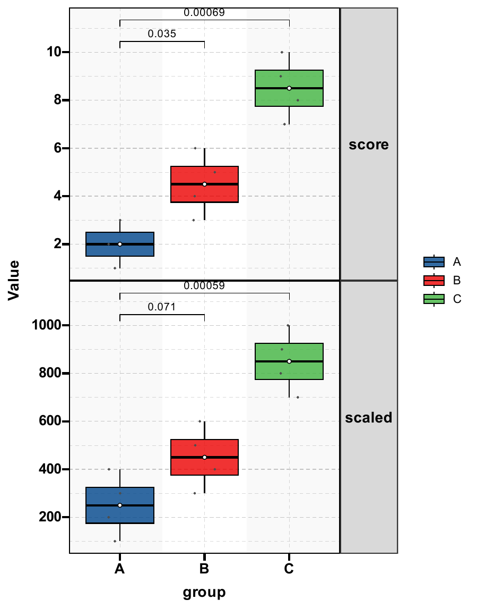{fig-alt="独立坐标的两个箱线面板，参考组A生成两组比较，数值点没有纵向抖动。"}

[原生 PDF](images/continuous-guide/20261031-update-continuous-reference.pdf)

#### 翻转后的分位数观察窗 {.unnumbered}

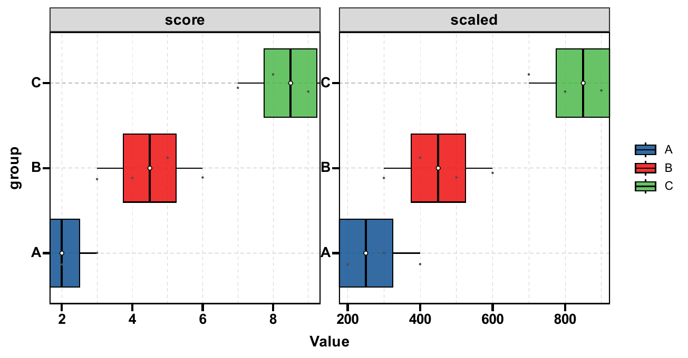{fig-alt="横向的score和scaled面板分别使用自身分位数范围，坐标量级独立。"}

[原生 PDF](images/continuous-guide/20261031-update-continuous-zoom.pdf)
:::

`ref_group` 对观测到的参考组生成比较；显式 `comparisons` 优先。某个特征缺少一组时，只跳过该特征中无法检验的比较并提示，其余比较保留。`y.min/y.max` 是观察窗，分位数按各特征原始有限值计算，不先删除窗外数据再求摘要或P值；显式观察窗也不会为括号自动放大。要比较同一单位的特征才适合 `same.y.lims=TRUE`。

::: {.callout-note collapse="true" title="复核代码"}
```r
con_points31 <- Filter(function(layer) inherits(layer$position, "PositionJitterdodge"), con_ref31$layers)
point_build31 <- ggplot2::ggplot_build(con_ref31)
point_indices31 <- which(vapply(con_ref31$layers, function(layer) inherits(layer$position, "PositionJitterdodge"), FALSE))
stopifnot(identical(con31, con_before31), identical(formals(UtilsR::plt_con)$jitter.height, 0),
  length(con_points31) > 0L,
  isTRUE(all.equal(sort(unlist(lapply(point_build31$data[point_indices31], `[[`, "y"))),
    sort(con_ref31$data$value), check.attributes = FALSE)),
  sum(vapply(point_build31$data[point_indices31], nrow, 0L)) == 23L,
  length(point_build31$layout$panel_scales_y) == 2L)
```
:::

柱形图仍是均值加减SD，自动观察窗容纳完整SD和零基线。dot图按数值边界分箱，多特征各自分箱；点的大小是计数，额外 `add_point=TRUE` 才叠加原始点。缺失组也参与实际计数。

```r
bar31 <- data.frame(group = factor(rep(c("A", "B"), each = 4)),
  value = c(-12, -4, 4, 12, -6, 0, 6, 12))
con_bar31 <- UtilsR::plt_con(bar31, "value", group.by = "group", type = "bar",
  save = list(filename = file.path(tempdir(), "20261031-update-continuous-sd.pdf")))
dot31 <- con31
dot31$group[c(1, 5)] <- NA
con_dot31 <- UtilsR::plt_con(dot31, c("score", "scaled"), group.by = "group",
  type = "dot", stack = TRUE, same.y.lims = FALSE, add_point = TRUE,
  save = list(filename = file.path(tempdir(), "20261031-update-continuous-dots.pdf")))
```

::: {.panel-tabset}
#### 完整均值加减SD {.unnumbered}

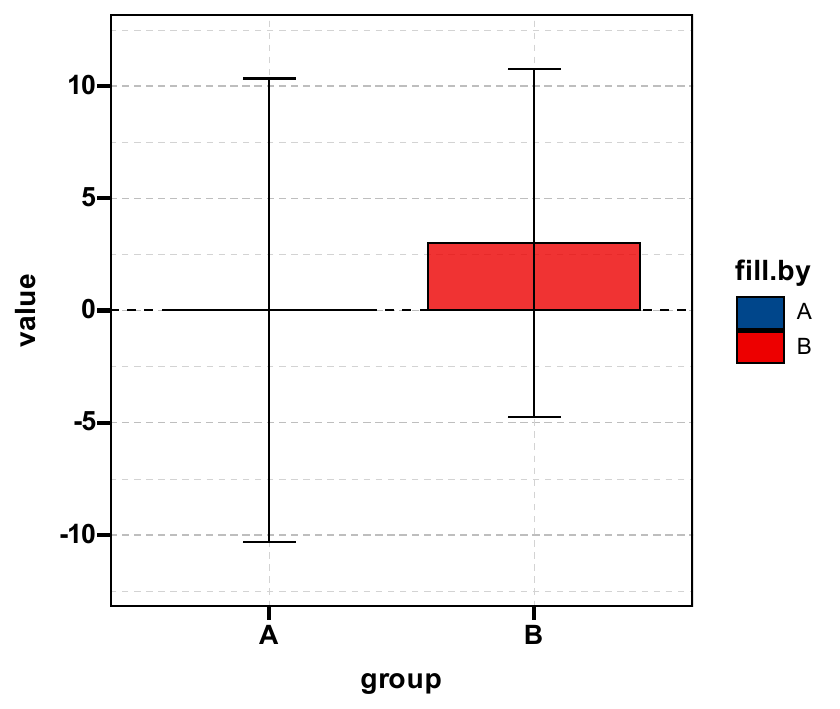{fig-alt="两个合成组的柱形均值及SD误差线均完整显示，包含负值端点和零基线。"}

[原生 PDF](images/continuous-guide/20261031-update-continuous-sd.pdf)

#### 多特征点计数与缺失组 {.unnumbered}

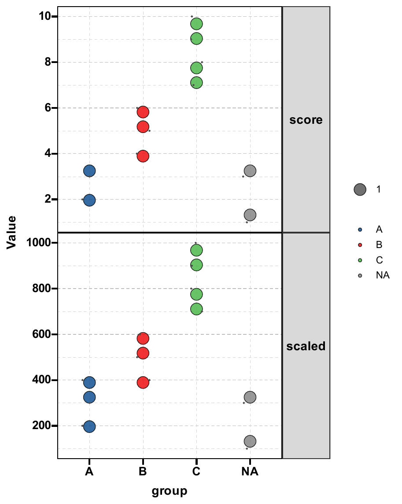{fig-alt="score及scaled独立坐标点计数图包含NA分组，并叠加全部23个有效原始点。"}

[原生 PDF](images/continuous-guide/20261031-update-continuous-dots.pdf)
:::

::: {.callout-note collapse="true" title="复核代码"}
```r
bar_build31 <- ggplot2::ggplot_build(con_bar31)
bar_errors31 <- Filter(function(z) all(c("ymin", "ymax") %in% names(z)), bar_build31$data)[[1]]
bar_range31 <- bar_build31$layout$panel_params[[1]]$y.range
dot_counts31 <- Filter(function(layer) is.data.frame(layer$data) && "n" %in% names(layer$data), con_dot31$layers)[[1]]$data
stopifnot(min(bar_range31) <= min(bar_errors31$ymin), max(bar_range31) >= max(bar_errors31$ymax),
  sum(dot_counts31$n) == 23L, anyNA(dot_counts31$group.by))
bad_axis31 <- tryCatch(UtilsR::plt_con(con31, "score", y.min = "q10.5"), error = conditionMessage)
stopifnot(grepl("y.min", bad_axis31, fixed = TRUE))
validation_values <- list(input_rows = nrow(con31), valid_points = 23L,
  dot_total = sum(dot_counts31$n), mean_sd_range = range(bar_errors31[c("ymin", "ymax")]),
  invalid_axis = bad_axis31)
```
:::

分组排序只用有限值，不让Inf改变中位数顺序；无有限观测的特征或分层会提示并跳过，全部不可画时明确报错。单例组保留原始点和摘要层，省略无法估计的密度。`combine=FALSE` 返回按分层命名的图列表，各图有自己的尺寸；这种列表不能直接经同一个 `save` 写成一张图。

<!-- /update-20261031: utils_continuous -->

### 空字符串、缺失层与独立比较（2026-10-31） {#groups-20261031b}

<!-- update-20261031b: utils_con_groups -->

0.6.19保留空字符串组的颜色映射，也把真实缺失组的背景条带对齐到实际坐标。空字符串 `""` 是观测值，和缺失NA分开处理；下面12行在两个batch各6行，空字符串组和B组使用同一份命名色板，背景也按名称对应。空名字用 `setNames()` 明确写入，不把它删成不存在的组。

```r
con_empty31b <- data.frame(value = seq_len(12),
  group = factor(rep(c("", "B"), each = 6)),
  region = rep(c("", "South"), each = 6), batch = rep(c("One", "Two"), each = 3, length.out = 12))
con_empty_panels31b <- UtilsR::plt_con(con_empty31b, "value", "group", type = "box",
  split.by = "batch", bg.by = "region", combine = FALSE,
  palette = setNames(c("#3B5488", "#E64B35"), c("", "B")),
  bg_palette = setNames(c("grey85", "transparent"), c("", "South")))
RegR::save_plt(patchwork::wrap_plots(con_empty_panels31b, nrow = 1),
  file.path(tempdir(), "20261031b-update-con-empty.pdf"), width = 8, height = 4)
con_missing31b <- data.frame(value = seq_len(18), group = rep(c("A", "B", NA), each = 6),
  region = rep(c("North", "South", "Unknown"), each = 6))
con_missing_plot31b <- UtilsR::plt_con(con_missing31b, "value", "group", type = "box", flip = TRUE,
  bg.by = "region", bg_palette = c(North = "#DDEBF7", South = "#FCE4D6", Unknown = "#E2F0D9"),
  save = list(filename = file.path(tempdir(), "20261031b-update-con-missing.pdf")))
con_split31b <- data.frame(value = seq_len(18), group = rep(c("A", "B"), 9),
  batch = factor(rep(c("<NA>", "<NA>.1", NA), each = 6), exclude = NULL))
con_split_panels31b <- UtilsR::plt_con(con_split31b, "value", "group", split.by = "batch",
  type = "box", combine = FALSE)
RegR::save_plt(patchwork::wrap_plots(con_split_panels31b, nrow = 1),
  file.path(tempdir(), "20261031b-update-con-split.pdf"), width = 9, height = 3.5)
con_compare31b <- data.frame(x = c(rep(1, 6), 2:7, rep(1, 6)), z = 11:28,
  group = factor(rep(c("A", "B", "C"), each = 6)))
con_compare_plot31b <- UtilsR::plt_con(con_compare31b, c("x", "z"), "group", type = "box",
  stack = TRUE, comparisons = list(c("A", "B"), c("A", "C")), sig_label = "p.format",
  save = list(filename = file.path(tempdir(), "20261031b-update-con-comparisons.pdf")))
```

::: {.panel-tabset}
#### 空字符串组 {.unnumbered}

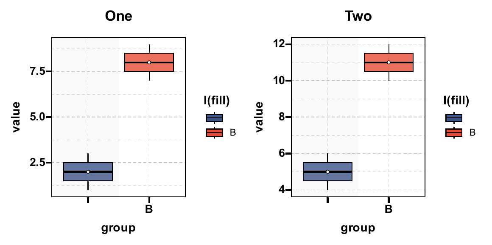{fig-alt="各六行的两个batch面板，空白横轴标签是实际空字符串组，颜色与背景映射保持一致。"}

[原生 PDF](images/continuous-guide/20261031b-update-con-empty.pdf)

#### 真实缺失组 {.unnumbered}

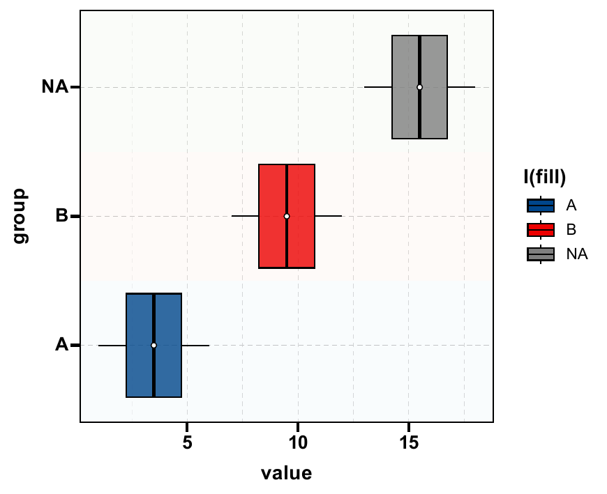{fig-alt="十八行合成值按A B和NA分组，翻转坐标后真实缺失组的背景没有被相邻组覆盖。"}

[原生 PDF](images/continuous-guide/20261031b-update-con-missing.pdf)

#### 缺失分层名称 {.unnumbered}

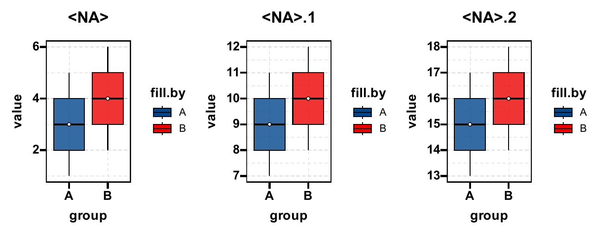{fig-alt="三个六行分层分别命名为文字NA、文字NA点一和真实缺失NA点二，各自保留原始数值范围。"}

[原生 PDF](images/continuous-guide/20261031b-update-con-split.pdf)

#### 有效比较独立保留 {.unnumbered}

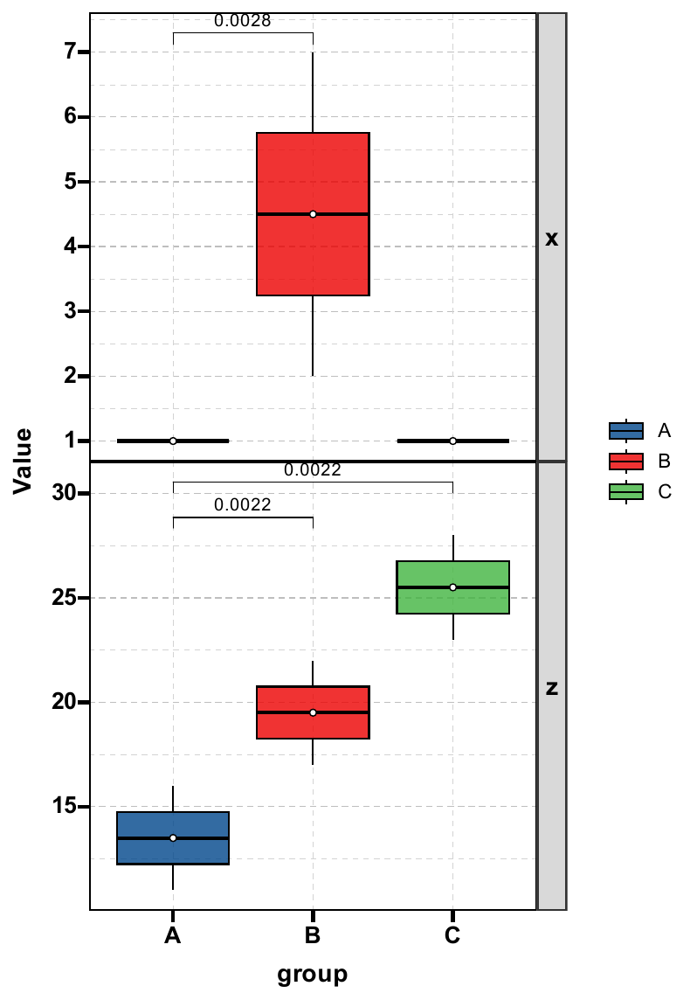{fig-alt="十八行两个特征，x的A和C全为常数一导致非有限P值，x保留A对B，z保留两条比较。"}

[原生 PDF](images/continuous-guide/20261031b-update-con-comparisons.pdf)
:::

最后一例中，x的A、C全为1，Wilcoxon比较不能给出有效的有限P值，函数明确警告并跳过这一条；x的A对B和z的两条有效比较独立保留。跳过不表示不显著，更不能把缺失P值补成1。每个比较仍使用该特征的有限观测，既有多重比较设置没有被改写。

::: {.callout-note collapse="true" title="复核代码"}
```r
for (p31b in con_empty_panels31b) {
  b31b <- ggplot2::ggplot_build(p31b)
  stopifnot(nrow(p31b$data) == 6L,
    identical(unname(b31b$plot$scales$get_scales("fill")$map(c("", "B"))), c("#3B5488", "#E64B35")),
    identical(unname(p31b$layers[[1L]]$data$fill), c("grey85", "transparent")))
}
con_build31b <- ggplot2::ggplot_build(con_missing_plot31b)
con_na_position31b <- which(is.na(con_build31b$layout$panel_scales_x[[1]]$get_limits()))
con_rect31b <- con_build31b$data[[1]]
con_tests_build31b <- ggplot2::ggplot_build(con_compare_plot31b)
con_kind31b <- vapply(con_compare_plot31b$layers, function(z) class(z$geom)[1], "")
con_brackets31b <- do.call(rbind, con_tests_build31b$data[which(con_kind31b == "GeomSignif")])
stopifnot(identical(as.character(con_rect31b$fill[
    con_rect31b$xmin <= con_na_position31b & con_rect31b$xmax >= con_na_position31b]), "#E2F0D9"),
  setequal(names(con_split_panels31b), c("<NA>", "<NA>.1", "<NA>.2")),
  identical(con_split_panels31b[["<NA>"]]$data$value, 1:6),
  identical(con_split_panels31b[["<NA>.1"]]$data$value, 7:12),
  identical(con_split_panels31b[["<NA>.2"]]$data$value, 13:18),
  nrow(con_brackets31b) == 9L)
validation_values <- list(rows = c(empty = 12, missing = 18, split = 18, comparison = 18),
  split_names = names(con_split_panels31b), missing_background = "#E2F0D9",
  annotation_rows = as.list(table(con_brackets31b$PANEL)))
```
:::

排序、翻转与拆分时颜色继续按全图类别身份分配。逻辑开关必须是单个TRUE/FALSE；`sort` 仅接受帮助页列出的选择，不能靠长度大于1的逻辑向量决定行为。点图计数和图构建环境的优化保持数据含义不变，此处没有宣称未经配对计时证实的加速倍数。

<!-- /update-20261031b: utils_con_groups -->

## 函数选择与重要参数 {#parameters}

| 目标 | 参数及默认值 | 作用与适用范围 |
|:--|:--|:--|
| 图形 | `type = "violin"` | `violin/box/bar/dot`；柱形为均值及 SD，不是完整分布 |
| 统计和分组 | `stat.by`、`group.by = NULL` | 多个数值变量可共同输入；列名用字符向量 |
| 分层与填色 | `split.by = NULL`、`fill.by = "group"` | 可改按 `"feature"` 填色；分层后各层独立作图 |
| 箱线叠加 | `add_box = FALSE`、`box_width = 0.1` | 配合小提琴展示分位数；`box_color` 控制边框 |
| 点叠加 | `add_point = FALSE` | `pt.size/pt.alpha/pt.color`、`jitter.width=0.4`、`jitter.height=0` 和 `seed=11` 控制点层 |
| 趋势 | `add_trend = FALSE` | 小提琴/箱线连接中位数；柱形连接均值，点图分支不使用 |
| 两两比较 | `comparisons = NULL`、`ref_group = NULL`、`pairwise_method = "wilcox.test"` | 长度为 2 的组名向量 list；可改 `"t.test"` |
| 整体比较 | `multiplegroup_comparisons = FALSE`、`multiple_method = "kruskal.test"` | 展示整体检验；不等于两两比较 |
| 标签 | `sig_label = "p.signif"`、`sig_labelsize = 3.5` | 可用 `"p.format"` 显示数值 |
| 纵轴 | `same.y.lims = FALSE`、`y.min/y.max = NULL` | 数字或 `"qN"` 百分位控制观察窗，`y.nbreaks = 5` 控制刻度 |
| 水平顺序 | `sort = FALSE` | `TRUE/"decreasing"` 降序中位数，`"increasing"` 升序；从当前数据计算 |
| 布局 | `stack = FALSE`、`flip = FALSE`、`facet_nrow/ncol` | 多变量叠放、横向及组合排版 |
| 返回结构 | `combine = TRUE` | `FALSE` 返回命名图列表，适合外部自行排版 |
| 背景和主题 | `bg.by`、`bg_palette`、`bg_alpha = 0.15`、`base_size = 14` | 背景归属必须与分组兼容；主题和配色不改变检验数据 |

## 四种基础图形

::: {.panel-tabset}

### 小提琴 {.unnumbered}

小提琴展示平滑分布；宽度被标准化，不代表组内人数。

```r
plt_con(dat, "marker1", "group")
```

{fig-alt="连续变量：分布、统计比较与多面板布局；小提琴；固定模拟数据的实际参数对照结果。"}

### 箱线 {.unnumbered}

箱线展示中位数和分位数，离群点仍来自原始输入。

```r
plt_con(dat, "marker1", "group", type = "box")
```

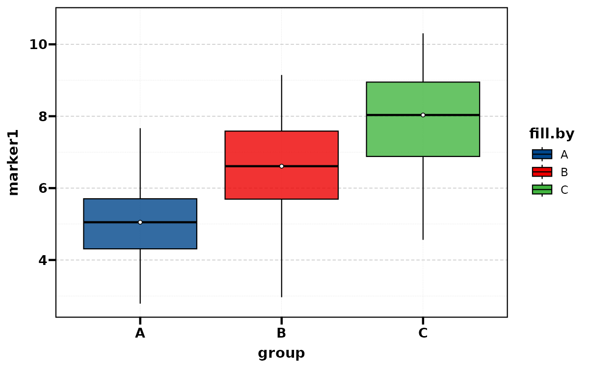{fig-alt="连续变量：分布、统计比较与多面板布局；箱线；固定模拟数据的实际参数对照结果。"}

### 均值与 SD {.unnumbered}

柱形为均值，误差线来自 mean_sdl(mult=1)，为均值加减一个 SD；不是 SE 或 95% CI。

```r
plt_con(dat, "marker1", "group", type = "bar")
```

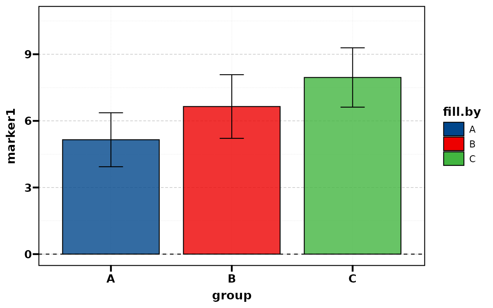{fig-alt="连续变量：分布、统计比较与多面板布局；均值与 SD；固定模拟数据的实际参数对照结果。"}

### 点图 {.unnumbered}

当前点图按数值分箱后，以箱中点定位气泡、大小表达箱内频数；不能把气泡位置当作未经分箱的原始观测值。

```r
plt_con(dat, "marker1", "group", type = "dot", pt.size = 1.5, pt.alpha = 0.65)
```

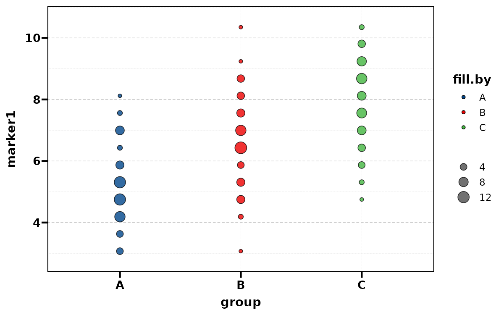{fig-alt="连续变量：分布、统计比较与多面板布局；点图；固定模拟数据的实际参数对照结果。"}

:::

## 分布叠加与趋势

::: {.panel-tabset}

### 叠加箱线 {.unnumbered}

同一份数据叠加分位数摘要，箱线宽度单独控制。

```r
plt_con(dat, "marker1", "group", add_box = TRUE,
        box_width = 0.16, box_color = "#333333")
```

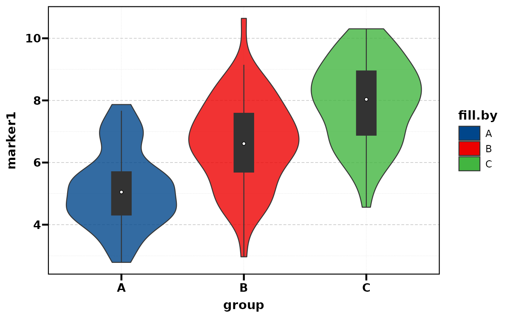{fig-alt="连续变量：分布、统计比较与多面板布局；叠加箱线；固定模拟数据的实际参数对照结果。"}

### 叠加原始点 {.unnumbered}

纵向抖动设为零，保持真实纵轴数值；横向抖动只减少遮挡。

```r
plt_con(dat, "marker1", "group", add_point = TRUE,
        pt.size = 1.5, pt.alpha = 0.4, pt.color = "#333333",
        jitter.width = 0.18, jitter.height = 0, seed = 24)
```

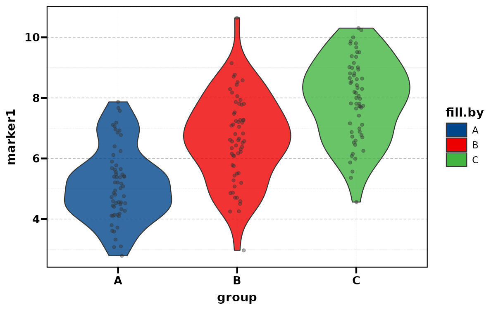{fig-alt="连续变量：分布、统计比较与多面板布局；叠加原始点；固定模拟数据的实际参数对照结果。"}

### 箱线、点与小提琴 {.unnumbered}

三个图层分别提供平滑分布、分位数和原始观测信息。

```r
plt_con(dat, "marker1", "group", add_box = TRUE, add_point = TRUE,
        box_width = 0.15, pt.alpha = 0.35, jitter.width = 0.15, jitter.height = 0)
```

{fig-alt="连续变量：分布、统计比较与多面板布局；箱线、点与小提琴；固定模拟数据的实际参数对照结果。"}

### 连接中位数 {.unnumbered}

箱线分支连接各组中位数；A/B/C 为分组顺序，不自动具有时间含义。

```r
plt_con(dat, "marker1", "group", type = "box", add_trend = TRUE,
        trend_color = "#111111", trend_linewidth = 0.8, trend_ptsize = 3)
```

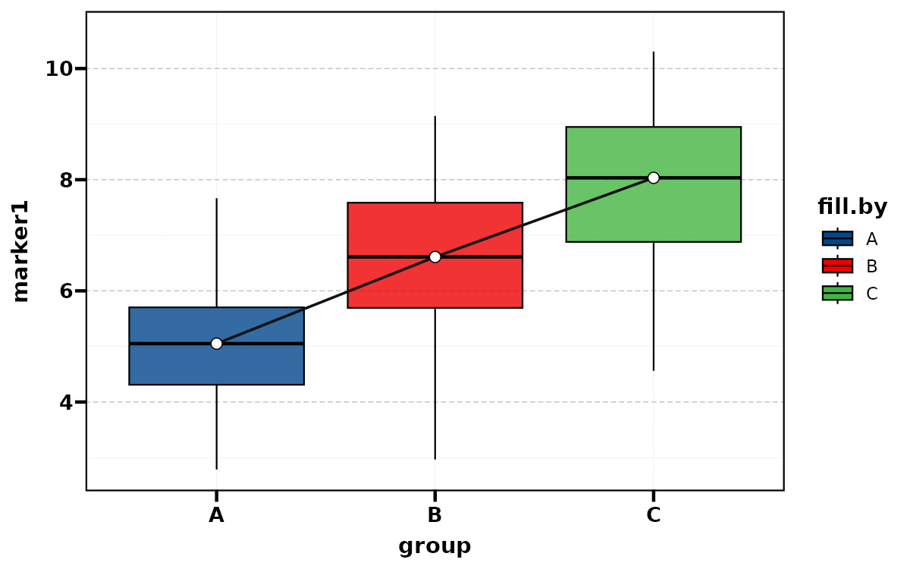{fig-alt="连续变量：分布、统计比较与多面板布局；连接中位数；固定模拟数据的实际参数对照结果。"}

### 连接均值 {.unnumbered}

柱形分支连接均值，与上一标签页的中位数不是同一统计量。

```r
plt_con(dat, "marker1", "group", type = "bar", add_trend = TRUE)
```

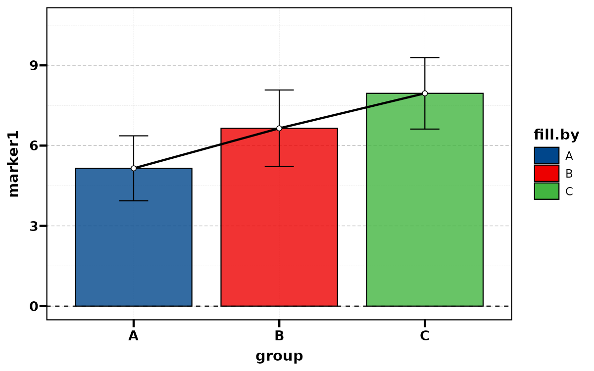{fig-alt="连续变量：分布、统计比较与多面板布局；连接均值；固定模拟数据的实际参数对照结果。"}

:::

## 统计比较

::: {.panel-tabset}

### 指定比较组 {.unnumbered}

明确列出两个比较，展示数值 P 值；本页未声称这些标注经过多重性校正。

```r
plt_con(dat, "marker1", "group", type = "box",
        comparisons = list(c("A", "B"), c("A", "C")),
        pairwise_method = "wilcox.test", sig_label = "p.format")
```

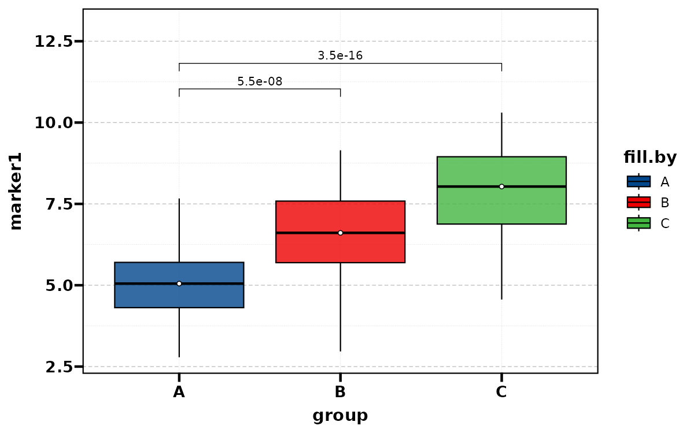{fig-alt="连续变量：分布、统计比较与多面板布局；指定比较组；固定模拟数据的实际参数对照结果。"}

### 更换两样本检验 {.unnumbered}

相同模拟数据改用 t 检验；当前接口没有配对标识，应按独立组示例理解。

```r
plt_con(dat, "marker1", "group", type = "box",
        comparisons = list(c("A", "B")), pairwise_method = "t.test",
        sig_label = "p.format", sig_labelsize = 4)
```

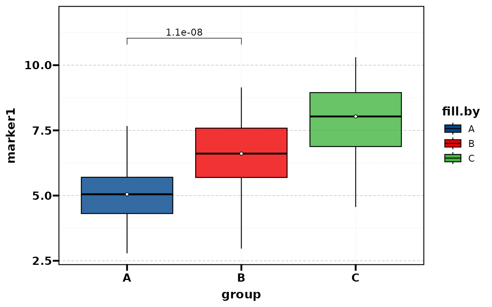{fig-alt="连续变量：分布、统计比较与多面板布局；更换两样本检验；固定模拟数据的实际参数对照结果。"}

### 整体 Kruskal 检验 {.unnumbered}

整体检验回答三组是否有总体差异，不能据此认定每对组都不同。

```r
plt_con(dat, "marker1", "group", type = "box",
        multiplegroup_comparisons = TRUE, multiple_method = "kruskal.test",
        sig_label = "p.format")
```

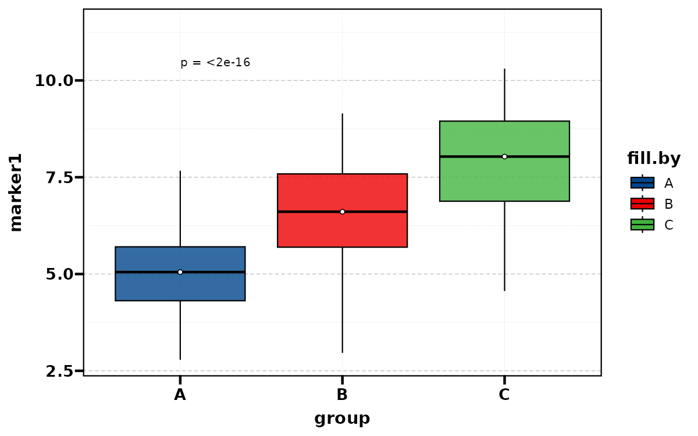{fig-alt="连续变量：分布、统计比较与多面板布局；整体 Kruskal 检验；固定模拟数据的实际参数对照结果。"}

### 星号标签 {.unnumbered}

星号表达当前检验阈值；需要精确读值时使用 p.format。

```r
plt_con(dat, "marker1", "group", type = "box",
        comparisons = list(c("A", "B"), c("B", "C")), sig_label = "p.signif")
```

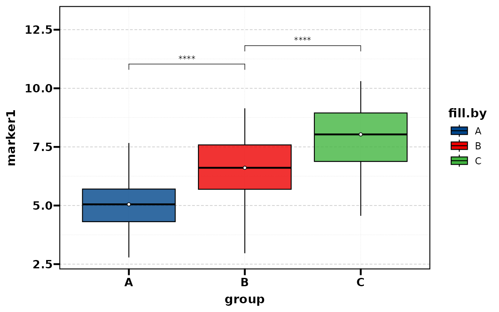{fig-alt="连续变量：分布、统计比较与多面板布局；星号标签；固定模拟数据的实际参数对照结果。"}

:::

### 完整SD区间与退化整体检验（2026-11-01） {#statistics-20261101}

<!-- update-20261101: utils_con_statistics -->

UtilsR `129c5a71` 的堆叠柱图把比较标注放在完整mean±SD区间上方，整体检验再放到成对比较之上。下面4行合成数据中，x和z有很大的SD，constant全为1。各特征独立检验：constant的无效成对和整体检验会警告并跳过，x、z的有效标注保留。

```r
con_sd01 <- data.frame(x = c(1, 100, 2, 200), z = c(10, 1000, 20, 2000),
  constant = 1, group = factor(rep(c("A", "B"), each = 2)))
con_sd_plot01 <- UtilsR::plt_con(con_sd01, c("x", "z", "constant"), "group",
  type = "bar", stack = TRUE, same.y.lims = FALSE,
  comparisons = list(c("A", "B")), multiplegroup_comparisons = TRUE,
  multiple_method = "kruskal.test", sig_label = "p.format",
  save = list(filename = file.path(tempdir(), "20261101-update-con-sd-global.pdf")))
```

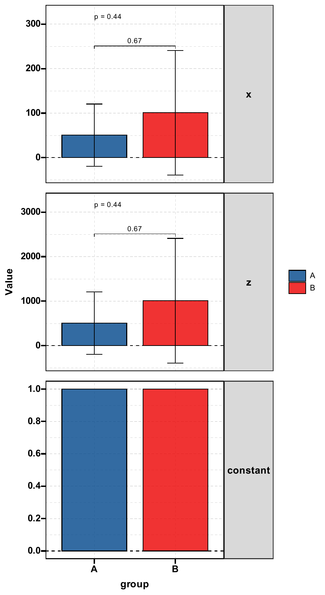{fig-alt="四行三个特征的合成柱图，x与z各保留完整SD、成对比较和整体检验，constant只显示均值与零SD。"}

[原生 PDF](images/continuous-guide/20261101-update-con-sd-global.pdf)

::: {.callout-note collapse="true" title="复核代码"}
```r
con_sd_build01 <- ggplot2::ggplot_build(con_sd_plot01)
con_sd_kinds01 <- vapply(con_sd_plot01$layers, function(z) class(z$geom)[1], "")
con_errors01 <- con_sd_build01$data[[which(con_sd_kinds01 == "GeomErrorbar")]]
con_brackets01 <- do.call(rbind, con_sd_build01$data[which(con_sd_kinds01 == "GeomSignif")])
con_global01 <- do.call(rbind, con_sd_build01$data[which(con_sd_kinds01 == "GeomText")])
for (panel01 in 1:2) {
  upper01 <- max(con_errors01$ymax[as.integer(con_errors01$PANEL) == panel01])
  bracket01 <- max(con_brackets01$y[as.integer(con_brackets01$PANEL) == panel01])
  stopifnot(bracket01 > upper01, con_global01$y[as.integer(con_global01$PANEL) == panel01] > bracket01)
}
stopifnot(!any(as.integer(con_brackets01$PANEL) == 3L),
  !any(as.integer(con_global01$PANEL) == 3L), nrow(con_global01) == 2L,
  isTRUE(all.equal(con_global01$p, c(stats::kruskal.test(x ~ group, data = con_sd01)$p.value,
    stats::kruskal.test(z ~ group, data = con_sd01)$p.value))))
validation_values <- list(rows = nrow(con_sd01), global_p = con_global01$p,
  global_panels = as.integer(con_global01$PANEL), sd_upper = con_errors01$ymax,
  pairwise_panels = unique(as.integer(con_brackets01$PANEL)))
```
:::

常量特征、失败的整体检验或非有限P值只影响该特征的标注；跳过不是“不显著”，也不能补成P=1。独立坐标的成对比较留白只计实际有效的比较；显式 `y.min/y.max` 仍作为观察窗保留，不会为了标签自动扩宽。

<!-- /update-20261101: utils_con_statistics -->

### 重复绘制与转换后的重新检验（2026-11-01） {#reuse-20261101}

<!-- update-20261101: utils_con_reuse -->

在同一个返回图上重复build或导出，成对检验的输入和参数未变时复用已有结果，原检验警告仍在绘制时保留。修改了传入检验的值或参数则重新计算。尤其 `scale_y_log10()` 在统计层之前转换数据，会让检验接收到log10值；这不能称作“只改外观、P值应不变”。

```r
con_reuse01 <- data.frame(value = c(1, 1.2, 1.5, 1.8, 2.1, 2.3, 2, 4, 8, 16, 32, 64),
  group = factor(rep(c("A", "B"), each = 6)))
con_linear01 <- UtilsR::plt_con(con_reuse01, "value", "group", type = "box",
  comparisons = list(c("A", "B")), pairwise_method = "t.test", sig_label = "p.format",
  title = "Welch test on original values")
con_log_data01 <- transform(con_reuse01, value = log10(value))
con_log01 <- UtilsR::plt_con(con_log_data01, "value", "group", type = "box",
  comparisons = list(c("A", "B")), pairwise_method = "t.test", sig_label = "p.format",
  title = "Welch test on log10 values", ylab = "log10(value)")
RegR::save_plt(patchwork::wrap_plots(con_linear01, con_log01, nrow = 1),
  file.path(tempdir(), "20261101-update-con-reuse.pdf"), width = 9, height = 4.5)
```

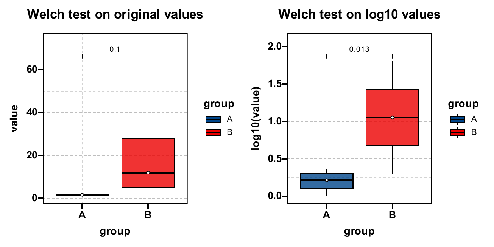{fig-alt="左图使用原值的Welch比较，右图显式使用log10后的数值重新调用绘图，P值和标注位置均按转换值计算。"}

[原生 PDF](images/continuous-guide/20261101-update-con-reuse.pdf)

::: {.callout-note collapse="true" title="复核代码"}
```r
con_first01 <- ggplot2::ggplot_build(con_linear01)
con_second01 <- ggplot2::ggplot_build(con_linear01)
con_signif01 <- which(vapply(con_linear01$layers, function(z) inherits(z$geom, "GeomSignif"), FALSE))
con_layer01 <- con_linear01$layers[[con_signif01]]
con_callback01 <- con_layer01$stat_params[["test"]]
con_args01 <- con_layer01$stat_params[["test.args"]]
con_a01 <- con_reuse01$value[con_reuse01$group == "A"]
con_b01 <- con_reuse01$value[con_reuse01$group == "B"]
con_raw_p01 <- do.call(con_callback01, c(list(con_a01, con_b01), con_args01))$p.value
con_log_p01 <- do.call(con_callback01, c(list(log10(con_a01), log10(con_b01)), con_args01))$p.value
con_mixed01 <- UtilsR::plt_con(con_reuse01, "value", "group", type = "box",
  comparisons = list(c("A", "B"), c("A", "absent")), pairwise_method = "t.test", sig_label = "p.format")
stopifnot(isTRUE(all.equal(con_first01$data, con_second01$data)),
  isTRUE(all.equal(con_raw_p01, stats::t.test(con_a01, con_b01)$p.value)),
  isTRUE(all.equal(con_log_p01, stats::t.test(log10(con_a01), log10(con_b01))$p.value)),
  abs(con_raw_p01 - con_log_p01) > 1e-6,
  identical(con_linear01$coordinates$limits$y, con_mixed01$coordinates$limits$y))
validation_values <- list(rows = nrow(con_reuse01), raw_p = con_raw_p01, log10_p = con_log_p01,
  repeated_build_equal = TRUE, effective_pair_count = 1L,
  axis_limits = con_linear01$coordinates$limits$y)
```
:::

本例先显式转换输入再重新调用，让标注位置也按转换后的范围计算。在已有图上添加非线性scale时，还须复核原有标注位置。复核框另取原图回调，核对相同输入与改变输入的两条路径。沿用默认的非配对Welch检验，未新增多重比较或缓存参数。`absent` 这条不存在组的比较被跳过，独立坐标不再为它预留额外空间；有效A对B的统计和坐标范围不变。这里只核对结果复用与回退合同，没有给出未经配对计时验证的加速倍数。

<!-- /update-20261101: utils_con_reuse -->

## 纵轴、排序与背景

::: {.panel-tabset}

### 百分位观察窗 {.unnumbered}

这里使用坐标观察窗，窗外数据仍参与箱线计算；图上不可见不等于被删除。

```r
plt_con(dat, "marker1", "group", type = "box", add_point = TRUE,
        y.min = "q5", y.max = "q95", y.nbreaks = 4, jitter.height = 0)
```

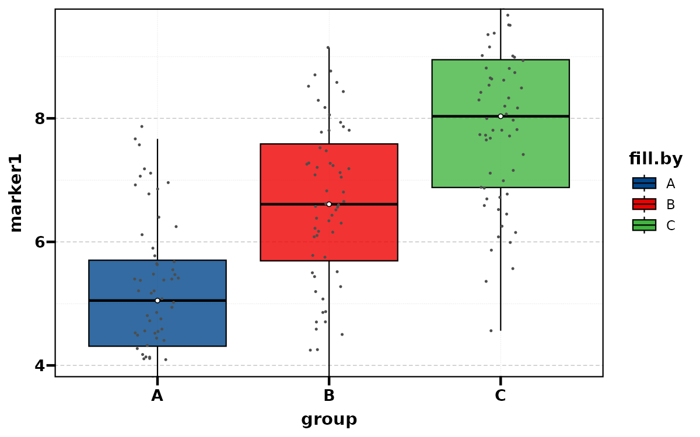{fig-alt="连续变量：分布、统计比较与多面板布局；百分位观察窗；固定模拟数据的实际参数对照结果。"}

### 固定范围 {.unnumbered}

固定刻度范围适合多张图间比较；范围应与变量单位一致。

```r
plt_con(dat, "marker1", "group", type = "box", y.min = 0, y.max = 12, y.nbreaks = 7)
```

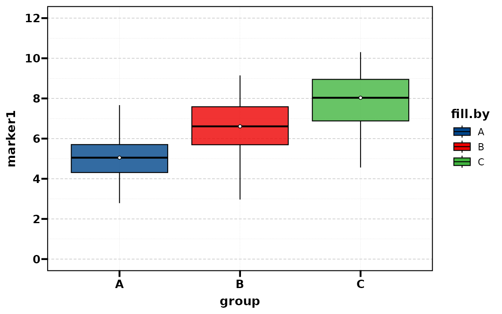{fig-alt="连续变量：分布、统计比较与多面板布局；固定范围；固定模拟数据的实际参数对照结果。"}

### 按中位数排序 {.unnumbered}

组别按当前中位数降序排列，横向展示；并未改变组内数值。

```r
plt_con(dat, "marker1", "group", type = "box", sort = "decreasing", flip = TRUE)
```

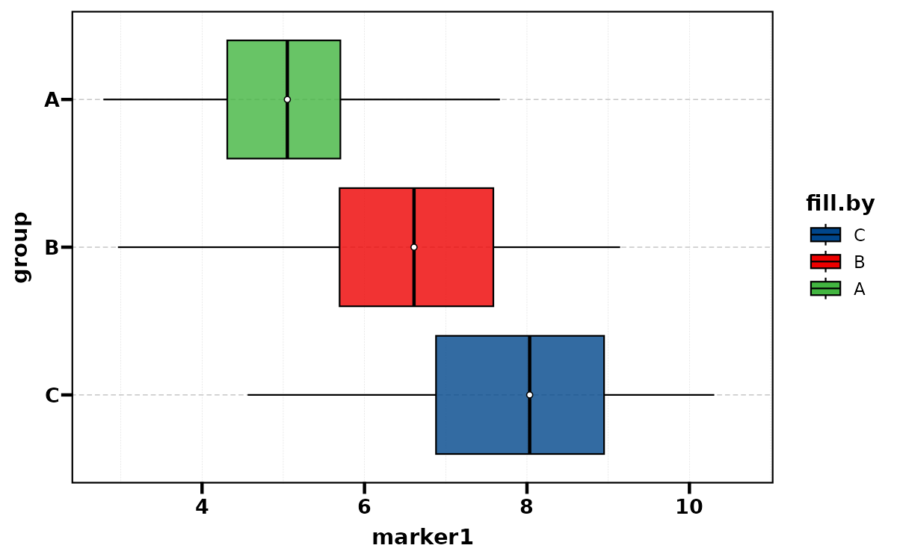{fig-alt="连续变量：分布、统计比较与多面板布局；按中位数排序；固定模拟数据的实际参数对照结果。"}

### 背景归属 {.unnumbered}

A/B 和 C 的背景归属不同；背景分组和观测值填色分别控制。

```r
plt_con(dat, "marker1", "group", type = "box", bg.by = "region",
        bg_palette = c("#EEF3FA", "#FFF4DC"), bg_alpha = 0.4)
```

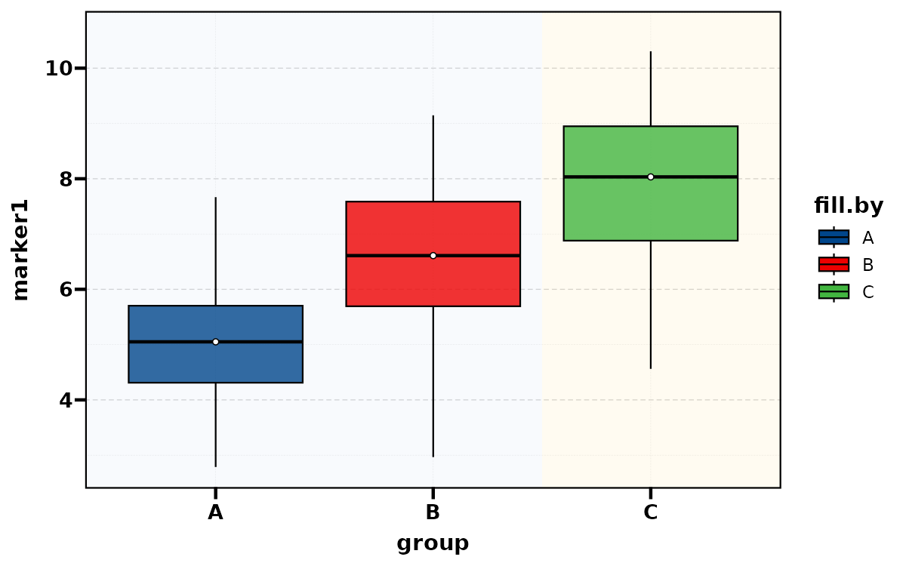{fig-alt="连续变量：分布、统计比较与多面板布局；背景归属；固定模拟数据的实际参数对照结果。"}

:::

## 多变量与分层布局

::: {.panel-tabset}

### 各自纵轴 {.unnumbered}

不同面板各自定标，有利于观察各变量内部差异，不能直接比较图上高度。

```r
plt_con(dat, c("marker1", "marker2"), "group", type = "box",
        same.y.lims = FALSE, facet_ncol = 2)
```

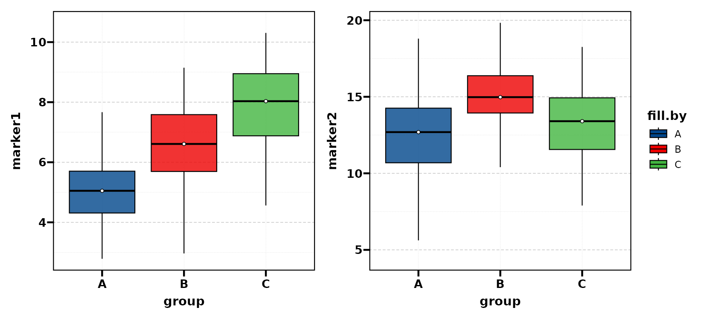{fig-alt="连续变量：分布、统计比较与多面板布局；各自纵轴；固定模拟数据的实际参数对照结果。"}

### 共享纵轴 {.unnumbered}

同样数值在两面板使用同一纵轴范围；真实项目还须确认两个变量的单位可比。

```r
plt_con(dat, c("marker1", "marker2"), "group", type = "box",
        same.y.lims = TRUE, facet_ncol = 2)
```

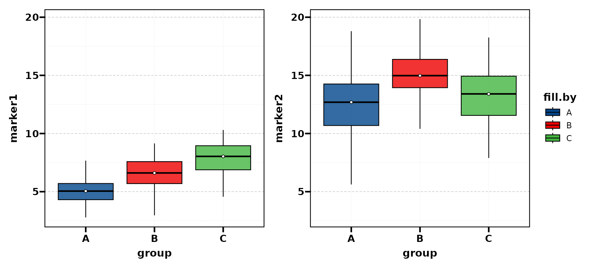{fig-alt="连续变量：分布、统计比较与多面板布局；共享纵轴；固定模拟数据的实际参数对照结果。"}

### 按变量填色 {.unnumbered}

fill.by 改为 feature 后颜色识别变量，分组仍由横轴给出。

```r
plt_con(dat, c("marker1", "marker2"), "group", type = "box",
        fill.by = "feature", facet_ncol = 2, palette = c("#0072B2", "#E69F00"))
```

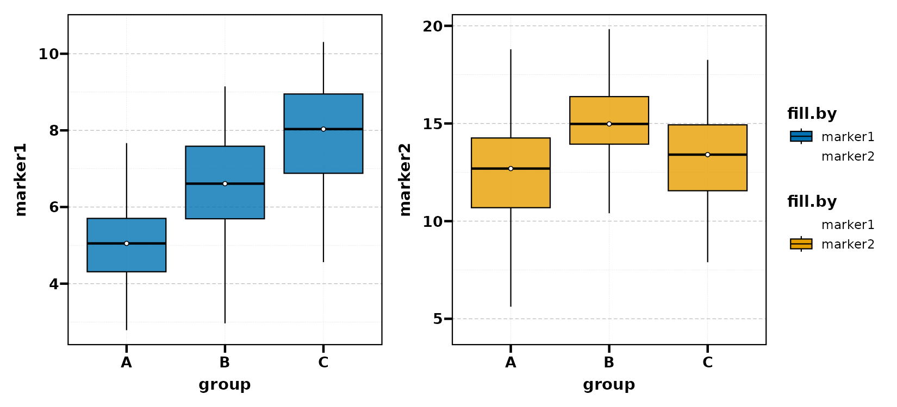{fig-alt="连续变量：分布、统计比较与多面板布局；按变量填色；固定模拟数据的实际参数对照结果。"}

### 叠放面板 {.unnumbered}

stack 将多个变量组织为上下分面；纵轴规则按当前实现与结果图核对。

```r
plt_con(dat, c("marker1", "marker2"), "group", type = "box",
        stack = TRUE, fill.by = "feature")
```

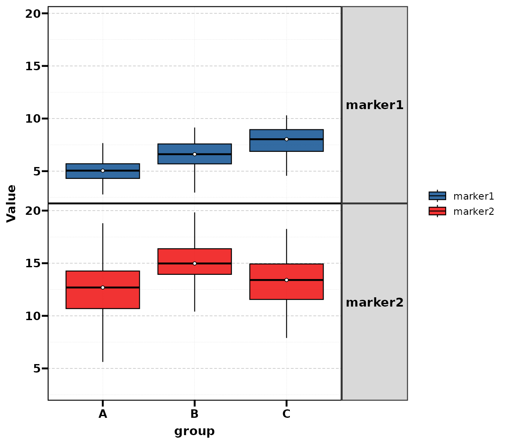{fig-alt="连续变量：分布、统计比较与多面板布局；叠放面板；固定模拟数据的实际参数对照结果。"}

### 按批次分层 {.unnumbered}

每层只使用对应 batch 的观测；共享范围方便比较分层图。

```r
plt_con(dat, "marker1", "group", split.by = "batch", type = "box",
        same.y.lims = TRUE, facet_ncol = 2)
```

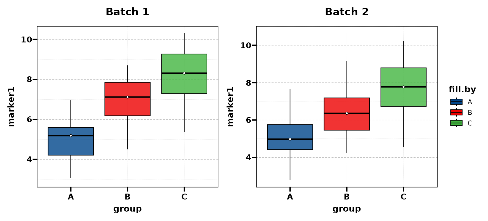{fig-alt="连续变量：分布、统计比较与多面板布局；按批次分层；固定模拟数据的实际参数对照结果。"}

### 返回列表再排版 {.unnumbered}

combine=FALSE 返回命名图列表；可以用 wrap_plots 独立控制最终排版。

```r
plots <- plt_con(dat, c("marker1", "marker2"), "group", type = "box", combine = FALSE)
patchwork::wrap_plots(plots, ncol = 1)
```

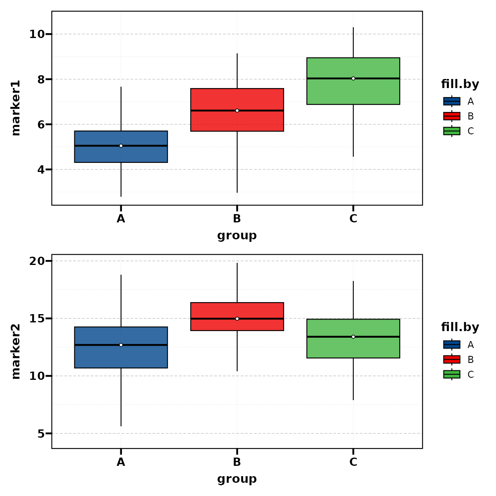{fig-alt="连续变量：分布、统计比较与多面板布局；返回列表再排版；固定模拟数据的实际参数对照结果。"}

:::

### 分层总标题、图例名与独立纵轴间距（2026-11-01） {#layout-20261101}

<!-- update-20261101: utils_con_layout -->

组合分层图的 `title/subtitle` 现在只在整图上出现一次，S1、S2仍作为各面板标题；`combine=FALSE` 则每个返回面板保留其subtitle。`fill.by="feature"` 的图例标题为Feature，按组填色时使用真实分组列名；背景条带不应把标题改成 `I(fill)`。主题仍可隐藏标题，下面显式显示它。

```r
con_layout01 <- expand.grid(Treatment = c("A", "B"), batch = c("S1", "S2"),
  replicate = 1:3, KEEP.OUT.ATTRS = FALSE)
con_layout01$x <- seq(-500, 600, length.out = 12)
con_layout01$large <- 1e6 + seq_len(12) * 1000
con_layout01$region <- ifelse(con_layout01$Treatment == "A", "North", "South")
con_layout_plot01 <- UtilsR::plt_con(con_layout01, c("x", "large"), "Treatment", type = "box",
  split.by = "batch", bg.by = "region", stack = TRUE, same.y.lims = FALSE, fill.by = "feature",
  title = "One overall heading", subtitle = "Two batches, independent feature axes", facet_ncol = 2)
con_layout_plot01 <- con_layout_plot01 & ggplot2::theme(legend.title = ggplot2::element_text(face = "bold"))
RegR::save_plt(con_layout_plot01, file.path(tempdir(), "20261101-update-con-layout.pdf"), width = 10, height = 7)
```

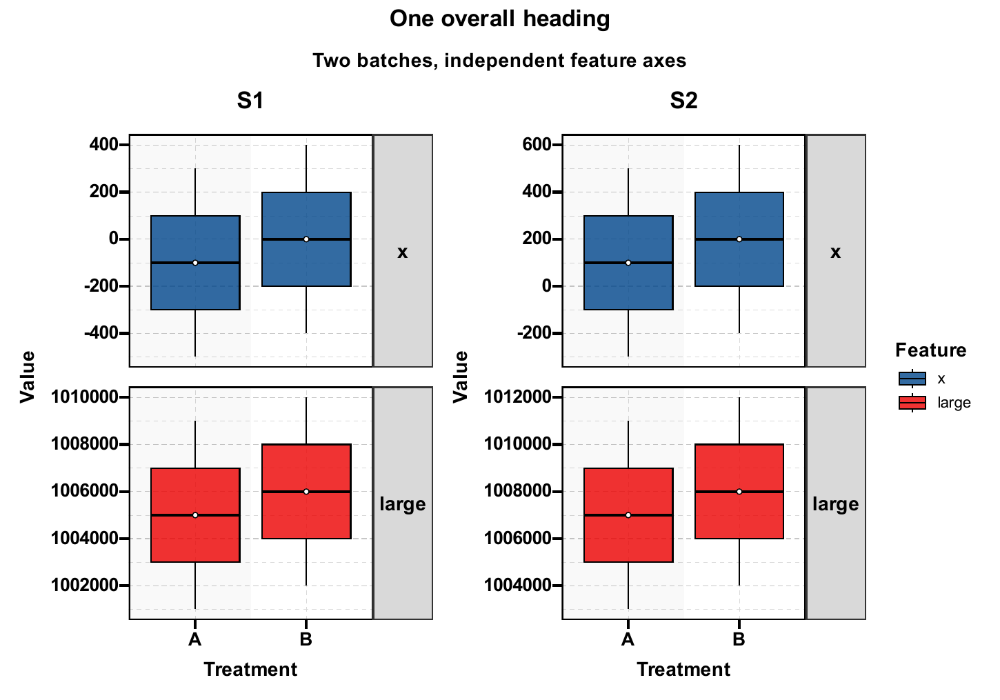{fig-alt="十二行两组两层输入，整图标题和副标题各一次，S1 S2保留，x与百万量级large分别使用纵轴，共享Feature图例。"}

[原生 PDF](images/continuous-guide/20261101-update-con-layout.pdf)

::: {.callout-note collapse="true" title="复核代码"}
```r
con_text01 <- function(g) c(if (inherits(g, "text")) as.character(g$label),
  unlist(lapply(g$grobs, con_text01), use.names = FALSE),
  unlist(lapply(g$children, con_text01), use.names = FALSE))
con_labels01 <- con_text01(patchwork::patchworkGrob(con_layout_plot01))
con_separate01 <- UtilsR::plt_con(con_layout01, "x", "Treatment", type = "box", split.by = "batch",
  subtitle = "Panel subtitle", combine = FALSE)
con_group01 <- UtilsR::plt_con(con_layout01, "x", "Treatment", type = "box", bg.by = "region")
con_ungrouped01 <- UtilsR::plt_con(con_layout01, "x", type = "box")
con_grob01 <- ggplot2::ggplotGrob(con_layout_plot01[[1]])
con_panels01 <- con_grob01$layout[grepl("^panel-", con_grob01$layout$name), , drop = FALSE]
con_panels01 <- con_panels01[order(con_panels01$t), , drop = FALSE]
con_gap01 <- sum(con_grob01$heights[seq.int(con_panels01$b[1] + 1L, con_panels01$t[2] - 1L)])
con_tick01 <- grid::textGrob("-500", gp = grid::gpar(fontsize = 14, fontface = "bold"))
stopifnot(sum(con_labels01 == "One overall heading") == 1L,
  sum(con_labels01 == "Two batches, independent feature axes") == 1L,
  all(c("S1", "S2", "Feature") %in% con_labels01), !"I(fill)" %in% con_labels01,
  identical(unname(vapply(con_separate01, function(z) z$labels$subtitle, "")), rep("Panel subtitle", 2)),
  identical(con_group01$labels$fill, "Treatment"), is.null(con_ungrouped01$labels$fill),
  grid::convertHeight(con_gap01, "pt", valueOnly = TRUE) >=
    grid::convertHeight(grid::grobHeight(con_tick01), "pt", valueOnly = TRUE))
validation_values <- list(rows = nrow(con_layout01), split_rows = as.list(table(con_layout01$batch)),
  title_count = sum(con_labels01 == "One overall heading"), subtitle_count = sum(con_labels01 == "Two batches, independent feature axes"),
  group_legend_title = con_group01$labels$fill, independent_axis_gap_pt = grid::convertHeight(con_gap01, "pt", valueOnly = TRUE))
```
:::

独立竖排坐标为相邻刻度文字预留间距；共用纵轴和翻转分支仍按各自布局处理。本次只改呈现，不把量级不同的特征强行放到同一纵轴，也不改变每层的样本或统计。背景在返回图重排离散轴后跟随类别，详见[背景与类别位置](format-guide.qmd#background-legend-current)。

<!-- /update-20261101: utils_con_layout -->

## 返回对象、保存与使用边界 {#output}

`combine = TRUE` 返回 ggplot/patchwork；`FALSE` 返回命名图列表。当前组合图支持[内置 PDF 保存](#save-20261020)；也可显式使用外部导出：

```r
p <- plt_con(dat, "marker1", "group", type = "box")
# ggplot2::ggsave("marker-box.pdf", p, width = 8, height = 5)
```

当前标注调用ggpubr，展示层不能替代研究设计、模型调整或多重检验处理。`ref_group`自动生成参考组比较，显式`comparisons`优先；新增实测见[参考组与独立坐标](#finite-20261031)。测量值的缺失或非有限值按特征排除，实际观测的缺失分组保留。

## 当前按内容保存 PDF {#save-20261020}

2026-10-20 按已推送 UtilsR `cea978f4`（保存接口自 `0f7fe0b`）与 RegR `da6157be`，在 Windows / WSL R 4.4.3 实际执行本节。上方历史参数图保留原执行快照。这里另用固定输入演示保存，不重新选择统计模型或分组。

`save = list()` 或 `NULL` 不写文件；非空列表给 `filename`，可再给英寸单位的 `width` / `height`。文件仅支持 PDF，没有扩展名时补 `.pdf`。省略的尺寸取当前图按内容估算的画布，控制台会打印尺寸及可复制保存语句，图对象可读取 `attr(p, "plot_size")`。显式给尺寸只覆盖该维度。

<!-- refresh-20261020: con_save -->
```r
library(UtilsR)
set.seed(20261020)
d_save <- expand.grid(id = 1:6, stage = factor(c("I", "II", "III")),
  sex = factor(c("Female", "Male")), site = factor(c("A", "B")))
d_save[["score"]] <- rnorm(nrow(d_save)) + as.integer(d_save[["stage"]])
d_save[["marker"]] <- rnorm(nrow(d_save))
p_saved <- plt_con(d_save, c("score", "marker"), group.by = "sex", type = "box",
  combine = TRUE, save = list(filename = file.path(tempdir(), "20261020-refresh-con.pdf")))
size <- attr(p_saved, "plot_size")
size
```

::: {.callout-note collapse="true" title="复核代码"}
生成本页时运行的检查，接在上面的代码之后运行；只读教程可以跳过。

```r
stopifnot(length(size) == 2L, all(is.finite(size)), all(size > 0))
```
:::

<!-- /refresh-20261020: con_save -->

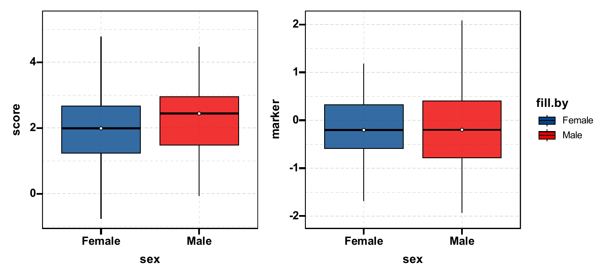{fig-alt="continuous教程的固定输入保存示例，预览由实际导出的PDF转换，展示按内容估算的画布。"}

[下载本图 PDF](images/continuous-guide/20261020-refresh-con.pdf)

多变量用 `combine = TRUE` 才是可整体保存的组合图。`combine = FALSE` 返回具名图列表，不能给整个列表传非空 `save`；需要分别保存时，对每个元素调用 `RegR::save_plt()` 并显式给尺寸。

UtilsR 的绘图本身不以 RegR 为硬依赖；当前 RegR 可用时才会提供尺寸提示和 `plot_size`，非空保存配置也需要它。缺少兼容 RegR 时，空保存配置仍可画图；此时不要假定图一定有 `plot_size`。本节使用的两包提交已一起验证，版本号相同不代表旧安装含有这些更新。

## 当前完整接口 {#interfaces}

下方签名按本轮UtilsR0.6.18固定源码核对；历史图片的执行环境保留在版本记录。

<details>
<summary>公共函数签名</summary>

```r
plt_con <-
function (data, stat.by, group.by = NULL, split.by = NULL, bg.by = NULL,
    type = c("violin", "box", "bar", "dot"), fill.by = c("group",
        "feature"), palette = NULL, alpha = 0.8, add_box = FALSE,
    box_color = "black", box_width = 0.1, add_point = FALSE,
    pt.color = "grey30", pt.size = NULL, pt.alpha = 1, jitter.width = 0.4,
    jitter.height = 0, add_trend = FALSE, trend_color = "black",
    trend_linewidth = 1, trend_ptsize = 2, comparisons = NULL,
    ref_group = NULL, pairwise_method = "wilcox.test", multiplegroup_comparisons = FALSE,
    multiple_method = "kruskal.test", sig_label = c("p.signif",
        "p.format"), sig_labelsize = 3.5, same.y.lims = FALSE,
    y.min = NULL, y.max = NULL, y.nbreaks = 5, sort = FALSE,
    stack = FALSE, flip = FALSE, title = NULL, subtitle = NULL,
    xlab = NULL, ylab = NULL, legend.position = "right", legend.direction = "vertical",
    aspect.ratio = NULL, base_size = 14, bg_palette = NULL, bg_alpha = 0.15,
    facet_nrow = NULL, facet_ncol = NULL, combine = TRUE, force = FALSE,
    seed = 11, save = list())
NULL

```

</details>

## 验证范围与参考 {#references}

本页列出的调用均已实际执行；所有展示的 ggplot/patchwork 图通过 `ggplot_build()` 和 PNG 导出，表格来自同一组代码的实际返回。未修改 UtilsR 源码或重新运行全包测试。

- [UtilsR 函数参考](https://hui950319.github.io/UtilsR/reference/index.html)
- [UtilsR 源码](https://github.com/HUI950319/UtilsR/tree/master/R)
- [专题目录](index.qmd)

<details>
<summary>执行环境</summary>

```text
R version 4.4.3 (2025-02-28)
Platform: x86_64-pc-linux-gnu
Running under: Ubuntu 22.04.2 LTS

Matrix products: default
BLAS:   /usr/lib/x86_64-linux-gnu/openblas-pthread/libblas.so.3
LAPACK: /usr/lib/x86_64-linux-gnu/openblas-pthread/libopenblasp-r0.3.20.so;  LAPACK version 3.10.0

locale:
 [1] LC_CTYPE=C.UTF-8       LC_NUMERIC=C           LC_TIME=C.UTF-8        LC_COLLATE=C.UTF-8
 [5] LC_MONETARY=C.UTF-8    LC_MESSAGES=C.UTF-8    LC_PAPER=C.UTF-8       LC_NAME=C
 [9] LC_ADDRESS=C           LC_TELEPHONE=C         LC_MEASUREMENT=C.UTF-8 LC_IDENTIFICATION=C

time zone: Asia/Shanghai
tzcode source: system (glibc)

attached base packages:
[1] stats     graphics  grDevices utils     datasets  methods   base

other attached packages:
[1] patchwork_1.3.2 ggplot2_4.0.3   UtilsR_0.6.8

loaded via a namespace (and not attached):
 [1] gtable_0.3.6       jsonlite_2.0.0     dplyr_1.2.0        compiler_4.4.3     tidyselect_1.2.1
 [6] Rcpp_1.1.1         dichromat_2.0-0.1  systemfonts_1.1.0  scales_1.4.0       textshaping_0.4.0
[11] R6_2.6.1           labeling_0.4.3     generics_0.1.4     httr2_1.2.2        ggrepel_0.9.8
[16] tibble_3.3.1       ellmer_0.4.0       pillar_1.11.1      RColorBrewer_1.1-3 rlang_1.3.0
[21] S7_0.2.2           otel_0.2.0         cli_3.6.6          withr_3.0.3        magrittr_2.0.4
[26] digest_0.6.39      grid_4.4.3         rappdirs_0.3.4     lifecycle_1.0.5    coro_1.1.0
[31] vctrs_0.7.3        ggprism_1.0.7      glue_1.8.1         farver_2.1.2       ragg_1.5.2
[36] tools_4.4.3        pkgconfig_2.0.3    mcptools_0.2.1
```

</details>

## 更新记录 {#page-updates}

::: {.callout-note collapse="true" title="本页更新记录"}
- 2026-11-01：[补充分层总标题与独立纵轴间距](#layout-20261101)，图例使用真实映射名称。
- 2026-11-01：[核对重复绘制与转换后重算](#reuse-20261101)，按有效比较数预留空间。
- 2026-11-01：[核对SD和退化整体检验](#statistics-20261101)，只跳过无效标注并保留其他特征。
- 2026-10-31：[复核分组边界与独立比较](#groups-20261031b)，保留空字符串、真实缺失层、背景颜色和有效P值标注。
- 2026-10-31：[补充原始数值、参考组比较、独立观察窗、SD端点及缺失组点计数](#finite-20261031)。
:::
