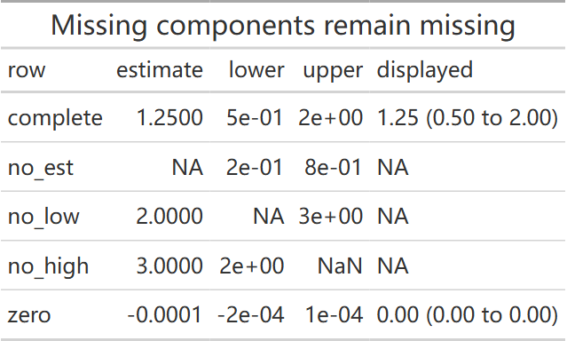
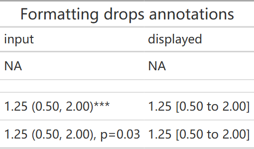
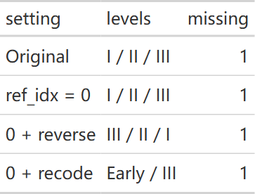
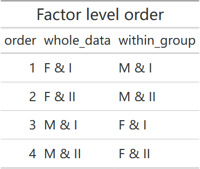
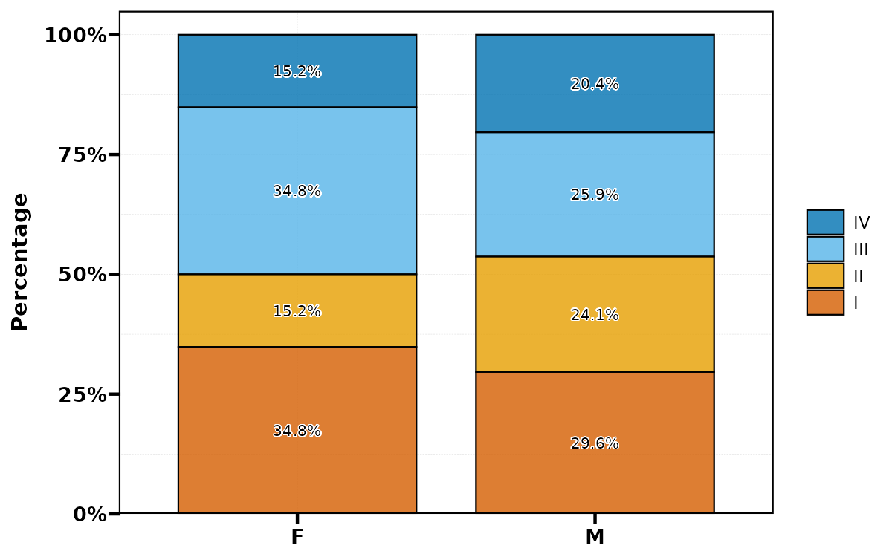
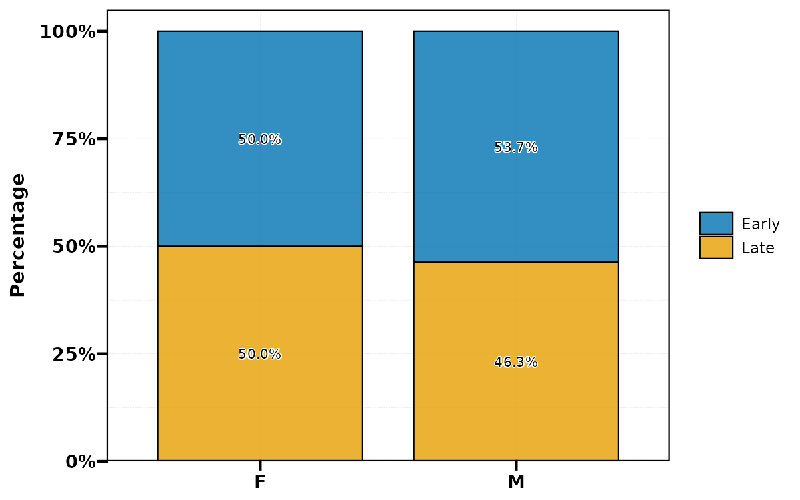
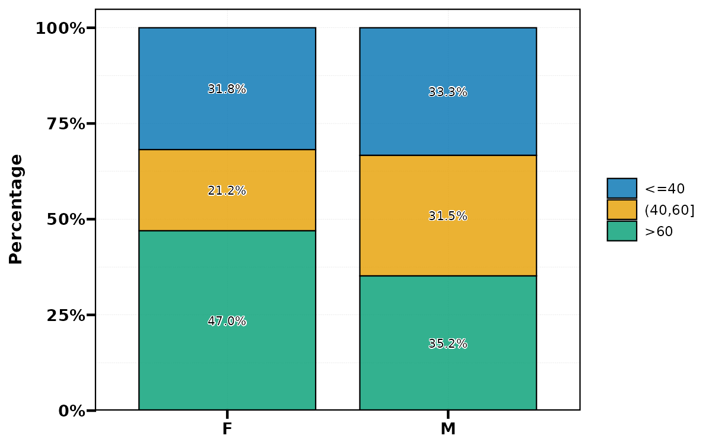
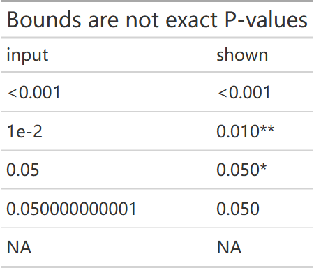

fct_cat 的互斥模式、临床水平顺序、固定与自动分箱、列组合与缺失，以及 CI/P 值的格式和边界。各节用固定输入比较重要参数，标签页中展示可复制代码与实际结果。

::: {.callout-note collapse="true" title="版本与复现记录"}
**版本与执行范围：** 原有 33 个参数示例按 UtilsR **0.6.8** 执行，3 张预览保留原次导出。2026-10-20 按已推送 `cea978f4` 补充下方数据边界，并在 Windows / WSL R 4.4.3 执行新旧示例；本轮未重新导出原有图片。使用固定随机种子的模拟数据。
:::

## 数据准备与输入约定 {#data}

stage 和 boundary 专门包含临床顺序、切点及 NA；dat 用固定随机种子模拟年龄、性别和分期。fct_show 是本页局部的水平计数展示 helper，不属于 UtilsR 接口。

```r
library(UtilsR)
library(ggplot2)
set.seed(1011)
stage <- factor(c("I", "II", "III", "IV", "I", "II", "III", "I", "III", "IV", "II", NA),
                levels = c("I", "II", "III", "IV"))
dat <- data.frame(stage = factor(sample(c("I", "II", "III", "IV"), 120, TRUE),
                                levels = c("I", "II", "III", "IV")),
                  sex = factor(sample(c("F", "M"), 120, TRUE), levels = c("F", "M")),
                  age = round(runif(120, 18, 80)))
boundary <- c(30, 40, 49.9, 50, 50.1, 60, 70, NA)
fct_show <- function(x) {
  data.frame(order = seq_along(levels(x)), level = levels(x), n = as.integer(table(x)))
}
pvals <- c(0.00003, 0.001, 0.01, 0.05, 0.1, 0.6, NA)
est <- c(1.2, 0.7, 1.5)
lo <- c(0.8, 0.4, 1.1)
hi <- c(1.6, 1, 1.9)
```

## 函数选择与重要参数 {#parameters}

| 目标 | 重要参数 | 语义与边界 |
|:--|:--|:--|
| 重排水平 | `fct_cat(x, ...)`，... 无名 | 名称或 1-based 整数位置，指定的先排，其余水平依原顺序追加 |
| 重编码或合并 | ... 全部命名，如 `Early=c("I","II")` | 名称是新水平，值是原水平名或原位置；未匹配水平保留 |
| 互斥模式 | `reverse=FALSE/ref_idx=NULL/groups=NULL/new_labels=NULL` | 一次只选其中一种；不同时命名和不命名 ... |
| 二分类 | `ref_idx` 为整数位置或水平名称 | 参考水平合为原名称的下划线连接；其他水平统一 Oth |
| 分组列表 | `groups` 或 `fct_to_group(g_lis)` | groups 必须有名字；g_lis 可自动命名，name_prefix/name_sep 定义显示名 |
| 单纯换名 | `new_labels` 或 `fct_label(labels)` | 与当前水平数和顺序对应；不会根据字面意义推断临床顺序 |
| 数据框换名 | `fct_label(data,var,labels)` | var 支持裸列名或字符串，返回整个修改后的数据框，须接收返回值 |
| 固定分箱 | `fct_num(breaks,labels)` | 自动补 ±Inf，cut 采用右闭区间，切点属于下方那组；labels 数为切点数+1 |
| 自动分箱 | `nbins`、`type="quantile"/"equal"` | 与 breaks 互斥；quantile 等人数倾向、equal 等宽；重复分位点会减少实际组数 |
| 多列组合 | `fct_to_combine(vars,var_name=NULL,sep=" & ")` | 至少两列；默认新列名由原列名用下划线连接；水平遵循各输入因子顺序 |
| 缺失组合 | 任一输入 `is.na()` 为真 | 当前自动保留为缺失；文字 `"NA"` 仍是类别，组合水平只包含实际完整观测 |
| CI 与 SD | `stat_ci(x,y,z=NULL,digits,bracket,sep)` | 三个数值向量为估计和上下界，两个为均值与 SD；只格式化，未计算区间 |
| P 值显示 | `stat_pval(mode="stars"/"pvalue"/"plain",digits,map_signif)` | 阈值星号包含等于边界；digits 控制显示，不调整原始检验结果 |
| 外部星号 | `add_star_p` | 根据已有 P 值给任意字符追加星号；此时 digits 和 mode 不参与数字重格式化 |
| 区间解析 | `stat_ci_parse(output,exp,level,digits,map_signif)` | 默认把输入当 95% CI，exp=TRUE 采用 log 比值尺度；推算 P 值是正态近似 |

## 水平顺序与分类合并

::: {.panel-tabset}

### 原始顺序和人数 {.unnumbered}

顺序明确为 I→IV；汇总 table 不计 NA，下方缺失示例另行核对。

```r
fct_show(stage)
```

| order|level |  n|
|-----:|:-----|--:|
|     1|I     |  3|
|     2|II    |  3|
|     3|III   |  3|
|     4|IV    |  2|

### 字符默认顺序 {.unnumbered}

字符转因子默认字母顺序，High 会排在 Low 前；有临床含义时应先显式给水平。

```r
x <- c("Low", "High", "Middle", "Low")
data.frame(default = levels(fct_cat(x)),
           specified = levels(fct_cat(factor(x, levels = c("Low", "Middle", "High")))))
```

|default |specified |
|:-------|:---------|
|High    |Low       |
|Low     |Middle    |
|Middle  |High      |

### 按名称部分重排 {.unnumbered}

先 IV、I，未提到的 II、III 追加，原始观测值和人数不变。

```r
fct_show(fct_cat(stage, "IV", "I"))
```

| order|level |  n|
|-----:|:-----|--:|
|     1|IV    |  2|
|     2|I     |  3|
|     3|II    |  3|
|     4|III   |  3|

### 按位置重排 {.unnumbered}

1-based 位置对应当前 levels(stage)，与上一个名称调用一致。

```r
fct_show(fct_cat(stage, 4, 1))
```

| order|level |  n|
|-----:|:-----|--:|
|     1|IV    |  2|
|     2|I     |  3|
|     3|II    |  3|
|     4|III   |  3|

### 反转水平 {.unnumbered}

只反转水平順序，不倒置观测行顺序。

```r
fct_show(fct_cat(stage, reverse = TRUE))
```

| order|level |  n|
|-----:|:-----|--:|
|     1|IV    |  2|
|     2|III   |  3|
|     3|II    |  3|
|     4|I     |  3|

### 按名称合并 {.unnumbered}

命名 ... 表示新水平=原水平；合并是分类定义的改变，不是显示排序。

```r
fct_show(fct_cat(stage, Early = c("I", "II"), Late = c("III", "IV")))
```

| order|level |  n|
|-----:|:-----|--:|
|     1|Early |  6|
|     2|Late  |  5|

### 指定参考位置 {.unnumbered}

I 和 II 合为 I_II，III/IV 合为 Oth；先核对当前水平位置，避免参考组错选。

```r
fct_show(fct_cat(stage, ref_idx = 1:2))
```

| order|level |  n|
|-----:|:-----|--:|
|     1|I_II  |  6|
|     2|Oth   |  5|

### 命名 list 和未分组水平 {.unnumbered}

只合并 I/II，未列出的 III/IV 保留，并非被排除。

```r
fct_show(fct_cat(stage, groups = list(Early = 1:2)))
```

| order|level |  n|
|-----:|:-----|--:|
|     1|Early |  6|
|     2|III   |  3|
|     3|IV    |  2|

### 全部换名 {.unnumbered}

新名称逐一对应当前水平，长度必须为四；可以含未出现但保留的水平。

```r
fct_show(fct_cat(stage, new_labels = c("Stage I", "Stage II", "Stage III", "Stage IV")))
```

| order|level     |  n|
|-----:|:---------|--:|
|     1|Stage I   |  3|
|     2|Stage II  |  3|
|     3|Stage III |  3|
|     4|Stage IV  |  2|

:::

### 参考组与区间文本合同（2026-10-24） {#ref-ci-20261024}

<!-- update-20261024: factor_ci -->

2026-10-24 按已推送 UtilsR `875c710` 在 Windows / WSL R 4.4.3 执行。本页 `fct_cat()` 主示例统一使用新参数 `ref_idx`；旧名 `binary_ref` 仍可用，但会警告，不能与新名同时给。

```r
library(UtilsR)
st <- factor(c("I", "III", "II", "IV", NA), levels = c("I", "II", "III", "IV"))
by_name <- fct_cat(st, ref_idx = c("I", "II"))
by_index <- fct_cat(st, ref_idx = 1:2)
compat_notes <- character()
compat <- withCallingHandlers(fct_cat(st, binary_ref = 1:2), warning = function(w) {
  compat_notes <<- c(compat_notes, conditionMessage(w)); invokeRestart("muffleWarning")
})
reject_ref <- function(expr) inherits(tryCatch(force(expr), error = identity), "error")
data.frame(original = st, combined = by_name)
```

::: {.callout-note collapse="true" title="复核代码"}
生成本页时运行的检查，接在上面的代码之后运行；只读教程可以跳过。

```r
stopifnot(identical(by_name, by_index), identical(levels(by_name), c("I_II", "Oth")),
          identical(is.na(by_name), is.na(st)))
stopifnot(identical(compat, by_name), length(compat_notes) == 1L,
  reject_ref(fct_cat(st, ref_idx = "missing")),
  reject_ref(fct_cat(st, ref_idx = 1, binary_ref = 1)))
```
:::

名称按当前 `levels()` 精确匹配；位置按当前水平顺序计数。重排后按名称选择更容易保持同一研究对比。合并参考水平仍会改变分类定义，不只是改显示；其他水平归为 `Oth`，真正缺失保持缺失。

#### 缺失组件、名字与负零

```r
est_ci <- c(complete = 1.25, no_est = NA_real_, no_low = 2, no_high = 3, zero = -.0001)
lo_ci <- c(.5, .2, NA_real_, 2, -.0002)
hi_ci <- c(2, .8, 3, NaN, .0001)
shown_ci <- stat_ci(est_ci, lo_ci, hi_ci, digits = 2, sep = " to ")
ci_preview <- data.frame(row = names(shown_ci), estimate = unname(est_ci),
  lower = lo_ci, upper = hi_ci, displayed = unname(shown_ci))
gt::gtsave(gt::tab_header(gt::gt(ci_preview), title = "Missing components remain missing"),
  file.path(tempdir(), "20261024-update-ci-missing.html"))
```

::: {.callout-note collapse="true" title="复核代码"}
生成本页时运行的检查，接在上面的代码之后运行；只读教程可以跳过。

```r
stopifnot(identical(names(shown_ci), names(est_ci)),
  identical(unname(is.na(shown_ci)), c(FALSE, TRUE, TRUE, TRUE, FALSE)),
  identical(unname(shown_ci[["zero"]]), "0.00 (0.00 to 0.00)"),
  identical(stat_ci(numeric(), numeric()), character()),
  identical(stat_ci(c(NA, NA), c(NA, NA)), c(NA_character_, NA_character_)))
```
:::

{fig-alt="五行原生表。完整区间正常显示；估计、下界或上界缺失的三行结果均为NA；微小负数舍入为0.00而非负零。"}

[原生 HTML 表](images/factor-guide/20261024-update-ci-missing.html)

SPSS 用户缺失也沿用输入的 `is.na()` 方法。这里只整理已有数值；不计算置信区间，也不改变 `sprintf()` 的其他舍入规则。日期、时间跨度、integer64 与矩阵/数组不能当作普通数值直接格式化。

#### 字符区间的注释不会悄悄保留

```r
ci_text <- c(missing = NA_character_, blank = " ", stars = "1.25 (0.50, 2.00)***",
             annotated = "1.25 (0.50, 2.00), p=0.03")
ci_notes <- character()
reformatted <- withCallingHandlers(stat_ci(ci_text, digits = 2, bracket = "[", sep = " to "),
  warning = function(w) { ci_notes <<- c(ci_notes, conditionMessage(w)); invokeRestart("muffleWarning") })
text_preview <- data.frame(input = unname(ci_text), displayed = unname(reformatted))
gt::gtsave(gt::tab_header(gt::gt(text_preview), title = "Formatting drops annotations"),
  file.path(tempdir(), "20261024-update-ci-text.html"))
```

::: {.callout-note collapse="true" title="复核代码"}
生成本页时运行的检查，接在上面的代码之后运行；只读教程可以跳过。

```r
stopifnot(identical(names(reformatted), names(ci_text)), is.na(reformatted[["missing"]]),
  identical(reformatted[["blank"]], " "),
  identical(unname(reformatted[c("stars", "annotated")]), rep("1.25 [0.50 to 2.00]", 2)),
  length(ci_notes) == 1L, grepl("trailing text", ci_notes[[1]], fixed = TRUE),
  reject_ref(stat_ci(1, 2, digits = 1.5)), reject_ref(stat_ci(1, 2, digits = 8191)),
  reject_ref(stat_ci(as.Date("2026-01-01"), 1)))
validation_values <- list(reference = as.character(by_name), numeric = ci_preview,
  text = text_preview, compatibility_warnings = length(compat_notes), annotation_warnings = length(ci_notes))
```
:::

{fig-alt="缺失与空白字符串原样保留。带三颗星的区间、带p等于0.03尾注的区间均显示为不带注释的新格式，后者产生一条警告。"}

[原生 HTML 表](images/factor-guide/20261024-update-ci-text.html)

星号与末尾句点是已知尾缀，会忽略；P 值等其他尾注被丢弃时会警告。不能把格式化后的字符串当成仍含原检验信息的结果。`digits` 为 0–8190 的单个整数，并受每个格式化数字 8192 字节的上限限制。

<!-- /update-20261024: factor_ci -->

### ref_idx=0：保持多水平（2026-10-25） {#zero-reference-20261025}

<!-- update-20261025: factor_zero -->

2026-10-25 按已推送 UtilsR 0.6.10 `0e4cffe` 在 Windows / WSL R 4.4.3 执行。**单个数值 `ref_idx=0` 与 `NULL` 相同**，不合并参考组，也不占用互斥模式；因此可与 `reverse=TRUE` 或命名重编码一起使用。普通正整数仍是 1-based 水平位置。

```r
library(UtilsR)
stage_zero25 <- factor(c("I", "II", "III", NA), levels = c("I", "II", "III"))
keep_zero25 <- fct_cat(stage_zero25, ref_idx = 0)
reverse_zero25 <- fct_cat(stage_zero25, ref_idx = 0, reverse = TRUE)
renamed_zero25 <- fct_cat(stage_zero25, Early = c("I", "II"), ref_idx = 0)
bad_zero25 <- tryCatch(fct_cat(stage_zero25, ref_idx = c(0, 1)), error = identity)
names_zero25 <- factor(c("0", "1", "2"), levels = c("0", "1", "2"))
named_zero25 <- fct_cat(names_zero25, ref_idx = "0")
zero_preview25 <- data.frame(setting = c("Original", "ref_idx = 0", "0 + reverse", "0 + recode"),
  levels = vapply(list(stage_zero25, keep_zero25, reverse_zero25, renamed_zero25),
    function(x) paste(levels(x), collapse = " / "), character(1)), missing = 1L)
gt::gtsave(gt::gt(zero_preview25), file.path(tempdir(), "20261025-update-reference-zero.html"))
```

::: {.callout-note collapse="true" title="复核代码"}
生成本页时运行的检查，接在上面的代码之后运行；只读教程可以跳过。

```r
stopifnot(identical(keep_zero25, stage_zero25),
  identical(reverse_zero25, fct_cat(stage_zero25, reverse = TRUE)),
  identical(renamed_zero25, fct_cat(stage_zero25, Early = c("I", "II"))))
stopifnot(inherits(bad_zero25, "error"), identical(levels(named_zero25), c("0", "Oth")))
validation_values <- list(preview = zero_preview25, named_zero = as.character(named_zero25),
  missing = is.na(keep_zero25))
```
:::

{fig-alt="原生因子核对表：原始与ref_idx为0均保留I、II、III；加reverse改变水平顺序；加命名重编码合并Early。缺失均保持一项。"}

[原生 HTML 表](images/factor-guide/20261025-update-reference-zero.html)

`c(0,1)` 不是“关闭再选第一项”，仍属非法位置向量。字符 `"0"` 则按**水平名称**匹配，可以把名为 0 的水平作为参考；它不等同于数值 0。缺失不因关闭合并而变成一个类别。此前的[名称与位置对照](#ref-ci-20261024)继续适用；RegR 交互入口也接受数值 0 表示不合并。

<!-- /update-20261025: factor_zero -->

## 换名与再分组

::: {.panel-tabset}

### 向量 S3 入口 {.unnumbered}

公开通用入口按向量派发，返回因子。

```r
fct_show(fct_label(stage, labels = c("One", "Two", "Three", "Four")))
```

| order|level |  n|
|-----:|:-----|--:|
|     1|One   |  3|
|     2|Two   |  3|
|     3|Three |  3|
|     4|Four  |  2|

### 数据框裸名和字符串 {.unnumbered}

两种列名写法均已执行；原 dat 保持原值，须接收新的返回数据框。

```r
renamed1 <- fct_label(dat, stage, c("S1", "S2", "S3", "S4"))
renamed2 <- fct_label(renamed1, "sex", c("Female", "Male"))
head(renamed2)
```

|stage |sex    | age|
|:-----|:------|---:|
|S3    |Male   |  24|
|S4    |Male   |  19|
|S1    |Male   |  61|
|S2    |Female |  64|
|S1    |Male   |  68|
|S1    |Female |  69|

### 自动组名 {.unnumbered}

默认 name_prefix=g、name_sep=/，得到 g1/3 和 g2/4。

```r
fct_show(fct_to_group(stage, list(c(1, 3), c(2, 4))))
```

| order|level |  n|
|-----:|:-----|--:|
|     1|g1/3  |  6|
|     2|g2/4  |  5|

### 自定义名称与连接符 {.unnumbered}

已给名称的 Early 优先；未给名称的第二组自动命名 Stage3+4。

```r
fct_show(fct_to_group(stage, list(Early = 1:2, 3:4), name_prefix = "Stage", name_sep = "+"))
```

| order|level    |  n|
|-----:|:--------|--:|
|     1|Early    |  6|
|     2|Stage3+4 |  5|

:::

## 数值分箱和边界

::: {.panel-tabset}

### 核对切点归属 {.unnumbered}

50 被放入下方组，尽管自动标签为 below_50；本例用 <=50 明确右闭边界。

```r
data.frame(age = boundary, auto_label = fct_num(boundary, breaks = 50),
           explicit_label = fct_num(boundary, breaks = 50, labels = c("<=50", ">50")))
```

|  age|auto_label |explicit_label |
|----:|:----------|:--------------|
| 30.0|below_50   |<=50           |
| 40.0|below_50   |<=50           |
| 49.9|below_50   |<=50           |
| 50.0|below_50   |<=50           |
| 50.1|above_50   |>50            |
| 60.0|above_50   |>50            |
| 70.0|above_50   |>50            |
|   NA|NA         |NA             |

### 两个切点和标签 {.unnumbered}

40 属于第一组，60 属于第二组；NA 仍是 NA。

```r
data.frame(age = boundary, age_group = fct_num(boundary, breaks = c(40, 60),
           labels = c("<=40", "(40,60]", ">60")))
```

|  age|age_group |
|----:|:---------|
| 30.0|<=40      |
| 40.0|<=40      |
| 49.9|(40,60]   |
| 50.0|(40,60]   |
| 50.1|(40,60]   |
| 60.0|(40,60]   |
| 70.0|>60       |
|   NA|NA        |

### 四分位分组 {.unnumbered}

切点来自当前输入年龄，目标为约等人数；年龄取整和并列会让各组人数不完全相等。

```r
fct_show(fct_num(dat[["age"]], nbins = 4, type = "quantile"))
```

| order|level     |  n|
|-----:|:---------|--:|
|     1|low       | 30|
|     2|medium    | 30|
|     3|high      | 32|
|     4|very_high | 28|

### 等宽分组 {.unnumbered}

同一年龄改为等宽四组，组内人数可不同；自动标签不能替代具体区间定义。

```r
fct_show(fct_num(dat[["age"]], nbins = 4, type = "equal"))
```

| order|level     |  n|
|-----:|:---------|--:|
|     1|low       | 29|
|     2|medium    | 24|
|     3|high      | 24|
|     4|very_high | 43|

### 重复分位点 {.unnumbered}

当前数据的重复分位点使组数少于请求的四组，并产生明确提示；不能硬配四个标签。

```r
tied <- c(rep(1, 12), rep(2, 4), rep(3, 4))
fct_show(fct_num(tied, nbins = 4))
```

| order|level |  n|
|-----:|:-----|--:|
|     1|low   | 16|
|     2|high  |  4|

:::

## 当前重编码与分箱边界 {#data-boundaries-current}

已推送版本加强了输入校验。重排只改水平顺序；命名重编码会合并到同名的现有水平，并去掉未使用水平。`new_labels` 中的重复标签也会合并，`NA` 标签会移除对应水平；它不一定只是改显示文字。

::: {.panel-tabset}

### 合并到已有水平 {.unnumbered}

<!-- refresh-20261020: factor -->
```r
x <- factor(c("I", "II", "III", "II", NA), levels = c("I", "II", "III", "IV"))
y <- fct_cat(x, II = "I")
data.frame(level = levels(y), n = as.integer(table(y)))
```

::: {.callout-note collapse="true" title="复核代码"}
生成本页时运行的检查，接在上面的代码之后运行；只读教程可以跳过。

```r
stopifnot(identical(levels(y), c("II", "III")),
          identical(as.integer(table(y)), c(3L, 1L)), sum(is.na(y)) == 1L,
          identical(levels(x), c("I", "II", "III", "IV")))
```
:::

| level | n |
|:--|--:|
| II | 3 |
| III | 1 |

新名称 II 与未匹配的原 II 汇合；原始 `x` 和缺失人数保持不变。若这些水平参与模型，需重新核对参考水平。

### NA 水平与真正缺失 {.unnumbered}

```r
x_na <- factor(c("A", NA, "B", "A"),
               levels = c("A", "B", "unused", NA), exclude = NULL, ordered = TRUE)
is.na(x_na) <- c(FALSE, FALSE, FALSE, TRUE)
names(x_na) <- paste0("r", 1:4)
attr(x_na, "label") <- "Clinical grade"
y_na <- fct_cat(x_na, reverse = TRUE)
data.frame(value = as.character(y_na), code = as.integer(y_na), missing = is.na(y_na))
```

::: {.callout-note collapse="true" title="复核代码"}
生成本页时运行的检查，接在上面的代码之后运行；只读教程可以跳过。

```r
stopifnot(identical(is.na(y_na), is.na(x_na)),
          identical(names(y_na), names(x_na)), is.ordered(y_na),
          identical(attr(y_na, "label"), "Clinical grade"))
```
:::

| 行 | value | code | missing |
|:--|:--|--:|:--|
| r1 | A | 4 | FALSE |
| r2 | NA | 1 | FALSE |
| r3 | B | 3 | FALSE |
| r4 | NA | NA | TRUE |

第 2 行是显式 NA 水平，第 4 行才是缺失编码；不能只看打印出的 NA 字样。重排保留未使用水平、行名和 ordered 类；重编码仅保留实际使用的水平。

### 修改水平后重新核对模型编码 {.unnumbered}

```r
x_ctr <- factor(rep(c("I", "II", "III"), 2))
contrasts(x_ctr) <- contr.sum(3)
y_ctr <- fct_cat(x_ctr, Early = 1:2)
data.frame(original_levels = nlevels(x_ctr), grouped_levels = nlevels(y_ctr),
           design_columns = ncol(model.matrix(~ y_ctr)))
```

::: {.callout-note collapse="true" title="复核代码"}
生成本页时运行的检查，接在上面的代码之后运行；只读教程可以跳过。

```r
stopifnot(is.null(attr(y_ctr, "contrasts")),
          ncol(model.matrix(~ y_ctr)) == 2L,
          identical(attr(fct_cat(x_ctr, "I"), "contrasts"), attr(x_ctr, "contrasts")))
```
:::

旧 contrasts 矩阵不再适合改变后的水平，函数会清除它；以函数名保存的 contrasts 仍保留。`stats::reorder()` 附带的 `scores` 在水平或映射改变后也会清除，无变化的调用保留原属性。用于回归前应按新分组重新指定所需 contrasts。

### 相邻切点仍是不同区间 {.unnumbered}

```r
cuts <- c(1, 1 + 1e-14)
values <- c(0.9, cuts, 1.1)
binned <- fct_num(values, breaks = cuts)
data.frame(value = sprintf("%.17g", values), bin = as.character(binned))
```

::: {.callout-note collapse="true" title="复核代码"}
生成本页时运行的检查，接在上面的代码之后运行；只读教程可以跳过。

```r
stopifnot(nlevels(binned) == 3L, !anyDuplicated(levels(binned)),
          identical(as.integer(binned), c(1L, 1L, 2L, 3L)))
```
:::

两个切点的常规打印都可能显示为 1；当前自动标签会增加有效位数，仍保留三个不同区间。标签中的 `below` 包含切点；需要发表时，仍建议显式写 `<=`、`(a,b]` 等右闭区间。

### 不可用输入会直接报错 {.unnumbered}

下面用本页局部 helper 把预期错误转成布尔值，便于一次检查。实际分析直接调用相应函数即可读取错误说明。

```r
rejected <- function(expr) inherits(tryCatch(force(expr), error = identity), "error")
invalid <- c(
  mixed_modes = rejected(fct_cat(stage, "I", reverse = TRUE)),
  mixed_reorder = rejected(fct_cat(stage, "I", 2L)),
  empty_reference = rejected(fct_cat(stage, ref_idx = integer())),
  repeated_membership = rejected(fct_to_group(stage, list(A = 1:2, B = 2:3))),
  non_atomic_labels = rejected(fct_cat(stage, new_labels = as.list(1:4))),
  duplicate_cuts = rejected(fct_num(boundary, breaks = c(40, 40))),
  missing_cuts = rejected(fct_num(boundary, breaks = c(40, NA))),
  infinite_cuts = rejected(fct_num(boundary, breaks = Inf)),
  fractional_bins = rejected(fct_num(boundary, nbins = 2.5)),
  huge_bins = rejected(fct_num(boundary, nbins = .Machine$integer.max)),
  constant_quantiles = rejected(fct_num(rep(5, 6), nbins = 3)),
  constant_equal = rejected(fct_num(rep(5, 6), nbins = 3, type = "equal"))
)
data.frame(case = names(invalid), rejected = unname(invalid))
```

::: {.callout-note collapse="true" title="复核代码"}
生成本页时运行的检查，接在上面的代码之后运行；只读教程可以跳过。

```r
stopifnot(all(invalid))
```
:::

<!-- /refresh-20261020: factor -->

本例 12 项均为 TRUE。除单个数值 `ref_idx=0` 作为关闭开关外，索引还必须有限、非缺失、为整数且在当前水平范围内；空分组不新增水平。`ref_idx` 的新名称不能在仍有其他水平时与 `Oth` 冲突。`fct_num()` 的 `x` 和 `breaks` 不支持 `bit64::integer64` 存储；这与因子工具接受经校验并转为原生整数的索引是两种合同，不应混用。

自动分箱不能把常量拆成多组；含并列但不恒定的数据仍可能减少实际分位组数，须按返回的 `nlevels()` 核对标签数量。固定切点会先排序，标签应按从低到高的区间提供。

:::

## 数字分组新增边界：缺失编码、单位和稳定标签 {#numeric-inputs-20261020}

2026-10-20 按已推送 UtilsR `3a786ab` 在 Windows / WSL R 4.4.3 核对。此次优化减少分组中的复制和标签构造开销，保留右闭区间与缺失归属；这里验证输入合同，不提供新的加速倍数。

<!-- latest-20261020: numeric_inputs -->
::: {.panel-tabset}

### 先处理用户缺失编码 {.unnumbered}

```r
library(UtilsR)
spss <- haven::labelled_spss(c(10, 20, 99, NA_real_), na_values = 99)
normalized <- haven::zap_missing(spss)
grouped <- fct_num(normalized, breaks = 15, labels = c("<=15", ">15"))
data.frame(value = as.numeric(normalized), group = as.character(grouped))
```

::: {.callout-note collapse="true" title="复核代码"}
生成本页时运行的检查，接在上面的代码之后运行；只读教程可以跳过。

```r
stopifnot(identical(as.integer(grouped), c(1L, 2L, NA_integer_, NA_integer_)))
```
:::

| 原值 | 规范化后的值 | 分组 |
|--:|--:|:--|
| 10 | 10 | <=15 |
| 20 | 20 | >15 |
| 99（用户缺失） | NA | NA |
| NA | NA | NA |

带 `haven_labelled_spss` 的数据及切点现直接报错，避免 99 等用户缺失码进入有效分组。先规范缺失，再按研究定义分组；不要直接去掉类而保留缺失码。

### 时间量先选单位 {.unnumbered}

```r
elapsed <- lubridate::ddays(c(1, 7, 14, NA))
days <- as.numeric(elapsed, units = "days")
day_group <- fct_num(days, breaks = 7, labels = c("<=7 days", ">7 days"))
data.frame(days = days, group = as.character(day_group))
```

::: {.callout-note collapse="true" title="复核代码"}
生成本页时运行的检查，接在上面的代码之后运行；只读教程可以跳过。

```r
stopifnot(identical(as.integer(day_group), c(1L, 1L, 2L, NA_integer_)))
```
:::

`Duration`、`Period`、`Interval` 不能直接用作数据或切点，`nbins` 也不能是时间量。上例把固定时长明确换成天，切点也用天。日历月份、年份或有起止日期的区间应先决定实际换算规则，不能把内部秒数当成年龄或随访月份。

### 标签固定，边界不随显示变化 {.unnumbered}

```r
format_check <- local({
  old <- options(scipen = -10)
  on.exit(options(old))
  x <- c(50000, 100000, 150000, NA_real_)
  auto_scientific <- fct_num(x, breaks = 100000)
  fixed_scientific <- fct_num(x, breaks = 100000, labels = c("Lower", "Higher"))
  options(scipen = 999)
  auto_plain <- fct_num(x, breaks = 100000)
  fixed_plain <- fct_num(x, breaks = 100000, labels = c("Lower", "Higher"))
  stopifnot(identical(as.integer(auto_scientific), as.integer(auto_plain)),
            identical(fixed_scientific, fixed_plain),
            identical(as.integer(fixed_plain), c(1L, 1L, 2L, NA_integer_)))
  data.frame(setting = c("scipen=-10", "scipen=999"),
    lower_label = c(levels(auto_scientific)[1], levels(auto_plain)[1]),
    fixed_label = levels(fixed_plain)[1])
})
format_check
```

自动标签可随 `scipen` 变成 `below_1e+05` 或 `below_100000`，组别编码和切点归属不变。需要跨脚本连接、建模参考水平或稳定发表名称时，显式提供 `labels`。100000 本身仍归入较低组。

### 错误输入与精度不足 {.unnumbered}

```r
rejects <- function(expr) inherits(tryCatch(force(expr), error = identity), "error")
guards <- c(
  spss_data = rejects(fct_num(spss, breaks = 15)),
  spss_cuts = rejects(fct_num(1:4, breaks = haven::labelled_spss(2, na_values = 99))),
  duration_data = rejects(fct_num(elapsed, breaks = 7)),
  duration_cuts = rejects(fct_num(1:4, breaks = lubridate::ddays(2))),
  duration_bins = rejects(fct_num(1:4, nbins = lubridate::dseconds(2))),
  matrix_data = rejects(fct_num(matrix(1:4, 2), breaks = 2)),
  array_data = rejects(fct_num(array(1:8, c(2, 2, 2)), breaks = 4)),
  logical_labels = rejects(fct_num(1:4, breaks = 2, labels = FALSE)),
  repeated_equal_cuts = rejects(fct_num(c(1, 1 + .Machine$double.eps),
                                      nbins = 4, type = "equal"))
)
data.frame(case = names(guards), rejected = unname(guards))
```

::: {.callout-note collapse="true" title="复核代码"}
生成本页时运行的检查，接在上面的代码之后运行；只读教程可以跳过。

```r
stopifnot(all(guards))
```
:::

9 项均应为 TRUE。等宽分组遇到数值精度无法区分的切点会报错，不会擅自合并区间或移动边界；应减少组数或明确指定可表示的切点。`labels=FALSE` 不作为返回整数编码的开关，函数保持返回 factor；需要编码时对有效结果调用 `as.integer()`。

:::
<!-- /latest-20261020: numeric_inputs -->

## 组合列：缺失传播与分组水平 {#combine-current-20261023}

<!-- update-20261023: factor_stats -->

本节与下方 P 值补充按已推送 UtilsR `23ba378` 在 Windows / WSL R 4.4.3 执行。`fct_to_combine()` 已修复旧版把缺失拼成文字的问题；这里替换旧示例，避免继续建议事后恢复 NA。

::: {.panel-tabset}

### 真正缺失和文字 NA {.unnumbered}

```r
library(UtilsR)
s <- factor(c("F", "M", NA, "NA"), levels = c("F", "M", "NA"))
t <- factor(c("I", NA, "II", "I"), levels = c("I", "II"))
g <- fct_to_combine(s, t)
data.frame(sex = s, stage = t, combined = g, is_na = is.na(g))
```

::: {.callout-note collapse="true" title="复核代码"}
生成本页时运行的检查，接在上面的代码之后运行；只读教程可以跳过。

```r
stopifnot(identical(is.na(g), c(FALSE, TRUE, TRUE, FALSE)),
          identical(levels(g), c("F & I", "NA & I")))
```
:::

| sex | stage | combined | is_na |
|:--|:--|:--|:--|
| F | I | F & I | FALSE |
| M | NA | NA | TRUE |
| NA | II | NA | TRUE |
| NA（文字） | I | NA & I | FALSE |

缺失判断沿用输入的 `is.na()` 方法，包括 NaN、SPSS 用户缺失值及范围。不会创建缺失组合水平，也不会补齐未观测的水平笛卡尔积。

### 分组前固定全队列顺序 {.unnumbered}

```r
d_combo <- data.frame(center = c("A", "A", "B", "B"),
  sex = factor(c("M", "M", "F", "F"), levels = c("F", "M")),
  stage = factor(c("II", "I", "I", "II"), levels = c("I", "II")))
grouped <- dplyr::group_by(d_combo, center)
within <- dplyr::mutate(grouped, joint = fct_to_combine(sex, stage))
whole <- fct_to_combine(grouped, c("sex", "stage"), var_name = "joint")
orders <- data.frame(order = 1:4,
  whole_data = levels(whole[["joint"]]), within_group = levels(within[["joint"]]))
gt::gtsave(gt::tab_header(gt::gt(orders), title = "Factor level order"),
  file.path(tempdir(), "20261023-update-factor-order.html"))
orders
```

::: {.callout-note collapse="true" title="复核代码"}
生成本页时运行的检查，接在上面的代码之后运行；只读教程可以跳过。

```r
stopifnot(identical(dplyr::group_vars(whole), "center"),
  identical(levels(whole[["joint"]]), c("F & I", "F & II", "M & I", "M & II")),
  identical(levels(within[["joint"]]), c("M & I", "M & II", "F & I", "F & II")))
```
:::

{fig-alt="四行水平顺序对照。整队列先F后M，组内计算再合并则先M后F，首水平由F和I变成M和I。"}

[查看原生表格](images/factor-guide/20261023-update-factor-order.html)

组内 `mutate()` / `rowwise()` 分别计算，再由 dplyr 合并水平，可能改变默认模型参考组。要统一顺序，用整个数据框的方法；它保留分组信息。最终仍应核对 `levels()`、contrasts 和模型参考水平。

### 选择器、重名与源数据保护 {.unnumbered}

```r
masked <- dplyr::mutate(d_combo, joint = fct_to_combine(c("sex", "stage")))
named_args <- fct_to_combine(sep = " / ", vars = c("sex", "stage"),
                            x = d_combo, var_name = "joint")
rejected <- function(expr) inherits(tryCatch(force(expr), error = identity), "error")
dt <- data.table::as.data.table(d_combo)
data.table::setkeyv(dt, "sex")
before <- data.table::copy(dt)
dt_out <- fct_to_combine(dt, c("sex", "stage"), var_name = "joint")
```

::: {.callout-note collapse="true" title="复核代码"}
生成本页时运行的检查，接在上面的代码之后运行；只读教程可以跳过。

```r
stopifnot(identical(masked[["joint"]], whole[["joint"]]),
  identical(as.character(named_args[["joint"]]),
            as.character(fct_to_combine(d_combo[["sex"]], d_combo[["stage"]], sep = " / "))))
stopifnot(rejected(fct_to_combine(d_combo, c("sex", "sex"))),
  rejected(fct_to_combine(c("A & B", "A"), c("C", "B & C"))),
  rejected(fct_to_combine(as.raw(1:2), 1:2)))
stopifnot(identical(dt, before), !"joint" %in% names(dt), "joint" %in% names(dt_out))
```
:::

单个长度至少为 2 的字符向量始终表示列名；在数据掩码外组合一列字符值时，先用 `factor(x)`。分组列不能由 `pick()` 选取，可直接传向量或改用数据框方法。`vars` 必须唯一、非空且不含 NA；重复列名造成的歧义、不同组合拼成同一个标签都会报错。列名 `sep` 与控制参数同名时，用数据框方法。data.table 会先复制再写入，覆盖键或索引列时相关元数据会被清理。

<!-- /update-20261023: factor_stats -->

## 绘图前整理分类

::: {.panel-tabset}

### 调整顺序再画图 {.unnumbered}

因子顺序进入绘图和图例，比例按 sex 内计算；重排不改变原始人数。

```r
d <- dat
d[["stage"]] <- fct_cat(d[["stage"]], reverse = TRUE)
plt_cat(d, "stage", "sex", label = TRUE, palette = c("#0072B2", "#56B4E9", "#E69F00", "#D55E00"))
```

{fig-alt="因子与统计文本：排序、合并、分箱和区间格式化；调整顺序再画图；固定模拟数据的实际参数对照结果。"}

### 合并后再画图 {.unnumbered}

合并四类为两类改变了分类摘要，颜色也只需要两个；该操作没有自动改变任何回归参考组。

```r
d <- dat
d[["stage"]] <- fct_cat(d[["stage"]], Early = 1:2, Late = 3:4)
plt_cat(d, "stage", "sex", label = TRUE, palette = c("#0072B2", "#E69F00"))
```

{fig-alt="因子与统计文本：排序、合并、分箱和区间格式化；合并后再画图；固定模拟数据的实际参数对照结果。"}

### 固定切点的分类图 {.unnumbered}

显示预设切点分组；分箱会损失连续年龄信息，不能把图形便利当作选择最佳切点的证据。

```r
d <- dat
d[["age_group"]] <- fct_num(d[["age"]], breaks = c(40, 60), labels = c("<=40", "(40,60]", ">60"))
plt_cat(d, "age_group", "sex", label = TRUE, palette = c("#0072B2", "#E69F00", "#009E73"))
```

{fig-alt="因子与统计文本：排序、合并、分箱和区间格式化；固定切点的分类图；固定模拟数据的实际参数对照结果。"}

:::

## 区间与 P 值文本

::: {.panel-tabset}

### CI 的位数和分隔符 {.unnumbered}

三个输入依次为估计、下界、上界；函数只按已有数值格式化，不估计或校验统计模型。

```r
data.frame(default = stat_ci(est, lo, hi),
           custom = stat_ci(est, lo, hi, digits = 3, bracket = "[", sep = " to "))
```

|default          |custom                 |
|:----------------|:----------------------|
|1.20 (0.80–1.60) |1.200 [0.800 to 1.600] |
|0.70 (0.40–1.00) |0.700 [0.400 to 1.000] |
|1.50 (1.10–1.90) |1.500 [1.100 to 1.900] |

### 均值和 SD 模式 {.unnumbered}

只给两个数值向量会进入均值(SD)格式，第二个数字不是 CI 下界；字符区间可仅更换显示格式。

```r
data.frame(mean_sd = stat_ci(c(5.22, 6.48), c(0.73, 1.15), digits = 2),
           ci_reformat = stat_ci(c("1.2 (0.8, 1.6)", "0.7 [0.4, 1.0]"), bracket = "[", sep = " to "))
```

|mean_sd    |ci_reformat      |
|:----------|:----------------|
|5.22(0.73) |1.2 [0.8 to 1.6] |
|6.48(1.15) |0.7 [0.4 to 1.0] |

### P 值三种格式 {.unnumbered}

相同原始 P 值分别显示星号、小值阈值、普通小数；plain 会把极小值显示成 0.000。

```r
data.frame(p = pvals, stars = stat_pval(pvals),
           pvalue = stat_pval(pvals, mode = "pvalue", digits = 4),
           plain = stat_pval(pvals, mode = "plain", digits = 3))
```

|     p|stars     |pvalue  |plain |
|-----:|:---------|:-------|:-----|
| 0.000|<0.001*** |<0.0001 |0.000 |
| 0.001|0.001***  |0.0010  |0.001 |
| 0.010|0.010**   |0.0100  |0.010 |
| 0.050|0.050*    |0.0500  |0.050 |
| 0.100|0.100.    |0.1000  |0.100 |
| 0.600|0.600     |0.6000  |0.600 |
|    NA|NA        |NA      |NA    |

### 给区间追加原始检验星号 {.unnumbered}

优先使用模型已有 P 值；给 add_star_p 后不会自动重格式化区间中的数字。阈值包括恰好等于。

```r
data.frame(ci = stat_ci(est, lo, hi),
           annotated = stat_pval(stat_ci(est, lo, hi), add_star_p = c(0.001, 0.05, 0.6),
                                 map_signif = c("***" = 0.001, "*" = 0.05)))
```

|ci               |annotated           |
|:----------------|:-------------------|
|1.20 (0.80–1.60) |1.20 (0.80–1.60)*** |
|0.70 (0.40–1.00) |0.70 (0.40–1.00)*   |
|1.50 (1.10–1.90) |1.50 (1.10–1.90)    |

### 明确工作尺度的近似解析 {.unnumbered}

输入按 95% CI 处理；差值尺度和 log 比值尺度明确指定，P 值只是区间宽度推出的正态近似。

```r
difference <- "0.50 (0.10, 0.90)"
ratio <- "1.49 (1.00, 2.23)"
data.frame(scale = c("Difference: null=0", "Ratio: null=1"),
           ci_and_approx_p = c(stat_ci_parse(difference, output = "ci_p", exp = FALSE),
                               stat_ci_parse(ratio, output = "ci_p", exp = TRUE)))
```

|scale              |ci_and_approx_p            |
|:------------------|:--------------------------|
|Difference: null=0 |0.50 (0.10, 0.90), p=0.014 |
|Ratio: null=1      |1.49 (1.00, 2.23), p=0.051 |

### 改变显示置信水平的边界 {.unnumbered}

当前函数在 level 改变后把新区间再次当作 95% CI 推出 P，因此这里的 P 会改变；不能把它报告为原模型检验 P 值。

```r
x <- "0.50 (0.10, 0.90)"
data.frame(shown_95 = stat_ci_parse(x, output = "ci_p", exp = FALSE),
           shown_90 = stat_ci_parse(x, output = "ci_p", exp = FALSE, level = 0.90, digits = 3))
```

|shown_95                   |shown_90                      |
|:--------------------------|:-----------------------------|
|0.50 (0.10, 0.90), p=0.014 |0.500 (0.164, 0.836), p=0.004 |

:::

## 当前 P 值文本：界限、缺失与星号 {#pvalue-current-20261023}

<!-- update-20261023: pvalue_stats -->

`stat_pval()` 保留 `<0.001`、`≤0.05` 等界限文本，只修剪首尾空白，不把界限当成确切 P 值追加星号。数字可使用科学记数法和外围 Unicode 空白；数字内部空格仍无效。

```r
library(UtilsR)
pv <- c(bound = "  <0.001  ", exact = "1e-2", equal = "0.05",
        above = "0.050000000001", missing = NA_character_)
shown <- stat_pval(pv, map_signif = c("***" = .001, "**" = .01, "*" = .05))
p_table <- data.frame(input = unname(pv), shown = unname(shown))
gt::gtsave(gt::tab_header(gt::gt(p_table), title = "Bounds are not exact P-values"),
  file.path(tempdir(), "20261023-update-pvalue-bounds.html"))
p_table
```

::: {.callout-note collapse="true" title="复核代码"}
生成本页时运行的检查，接在上面的代码之后运行；只读教程可以跳过。

```r
stopifnot(identical(shown, c(bound = "<0.001", exact = "0.010**", equal = "0.050*",
  above = "0.050", missing = NA_character_)))
```
:::

{fig-alt="小于0.001保留原界限，0.01显示两星，0.05显示一星，略大于0.05虽同样显示0.050却无星，缺失保持NA。"}

[查看原生表格](images/factor-guide/20261023-update-pvalue-bounds.html)

```r
annotated <- stat_pval(c(a = NA_character_, b = "HR", c = "OR"),
                      add_star_p = c(.001, NA, .05))
reject_p <- function(expr) inherits(tryCatch(force(expr), error = identity), "error")
```

::: {.callout-note collapse="true" title="复核代码"}
生成本页时运行的检查，接在上面的代码之后运行；只读教程可以跳过。

```r
stopifnot(identical(annotated, c(a = NA_character_, b = "HR", c = "OR*")),
  identical(stat_pval(c(NA, NA)), c(NA_character_, NA_character_)),
  identical(stat_pval(numeric()), character()),
  identical(stat_pval(.01, map_signif = c(first = .05, second = .05)), "0.010first"),
  identical(stat_pval(.01, map_signif = numeric()), "0.010"))
stopifnot(reject_p(stat_pval(-.01)), reject_p(stat_pval(Inf)),
  reject_p(stat_pval("<0")), reject_p(stat_pval(">1")),
  reject_p(stat_pval("0 .05")), reject_p(stat_pval(as.Date("2026-01-01"))),
  reject_p(stat_pval(.05, map_signif = c(bad = 2))),
  reject_p(stat_ci_parse("1.5 (1.1, 2.0)", output = "ci_star", map_signif = c(bad = 2))))
validation_values <- list(order = orders, p = p_table,
  missing = is.na(g), annotated = annotated, source_unchanged = identical(dt, before))
```
:::

普通 P 值和界限端点必须有限且在 `[0,1]`；严格 `<0`、`>1` 无法表示合法 P 值，会报错。`plain` 可格式化此范围以外的普通数值。`add_star_p` 缺失时不追加星号，原文本缺失仍为 NA；名字和空字符向量合同保留。使用星号时，`map_signif` 的阈值须为有限的 0–1 数值，重复阈值取第一个符号，空数值映射禁用星号；`stat_ci_parse(output = "ci_star")` 使用相同校验，但区间逆推 P 值仍是其原有近似方法，不等于原模型检验。

<!-- /update-20261023: pvalue_stats -->

## 输入合同与错误

::: {.panel-tabset}

### 实际错误示例 {.unnumbered}

捕获并展示互斥模式、混合 ...、两种分箱输入冲突及标签长度错误；适合定位调用合同。

```r
messages <- c(
  tryCatch(fct_cat(stage, reverse = TRUE, ref_idx = 1), error = conditionMessage),
  tryCatch(fct_cat(stage, "I", Late = "IV"), error = conditionMessage),
  tryCatch(fct_num(boundary, breaks = 50, nbins = 2), error = conditionMessage),
  tryCatch(fct_label(stage, c("A", "B")), error = conditionMessage))
cat(paste(seq_along(messages), messages, sep = ". ", collapse = "\n"))
```

```text
1. Only one mode at a time: `ref_idx`, `groups`, `new_labels`, or `reverse`.
2. `...` must be ALL named (recode) or ALL unnamed (reorder). Mixed named/unnamed args are not
allowed.
3. Use `breaks` or `nbins`, not both.
4. `new_labels` must have length 4 (same as number of levels), got 2.
```

:::

## 分箱后的实际组数与无限值 {#bin-counts}

<!-- refresh-20261021: factor_bins -->

以下按已推送 UtilsR `6536207`（`fct_num()` 文档补充 `8030995`）在 Windows / WSL R 4.4.3 核对。`nbins` 是请求的区间数；重复分位点会被移除，所以传入自定义标签前应先确认实际区间数。

```r
library(UtilsR)
warnings_seen <- character()
q <- withCallingHandlers(
  fct_num(c(1, 1, 1, 2), nbins = 4, labels = c("Lower", "Higher")),
  warning = function(w) {
    warnings_seen <<- c(warnings_seen, conditionMessage(w))
    invokeRestart("muffleWarning")
  }
)
table(q)
```

::: {.callout-note collapse="true" title="复核代码"}
生成本页时运行的检查，接在上面的代码之后运行；只读教程可以跳过。

```r
stopifnot(nlevels(q) == 2L, identical(as.integer(table(q)), c(3L, 1L)),
          any(grepl("4 bins to 2", warnings_seen)))
```
:::

实际输出为 `Lower = 3`、`Higher = 1`，并收到从 4 个区间减至 2 个的警告；若仍给 4 个标签会报长度不符。**重复标签会合并区间**，并非只改变显示名称：

```r
merged <- fct_num(c(1, 5, 9), breaks = c(3, 7),
                  labels = c("Lower", "Lower", "Higher"))
fixed <- fct_num(c(-Inf, 50, Inf, NA_real_), breaks = 50)
data.frame(value = c(-Inf, 50, Inf, NA_real_), group = fixed)
```

::: {.callout-note collapse="true" title="复核代码"}
生成本页时运行的检查，接在上面的代码之后运行；只读教程可以跳过。

```r
stopifnot(identical(levels(merged), c("Lower", "Higher")),
          identical(as.integer(table(merged)), c(2L, 1L)),
          identical(as.character(fixed), c("below_50", "below_50", "above_50", NA_character_)))
```
:::

固定切点会把 `-Inf` / `Inf` 纳入首尾区间，50 仍归右闭区间的下组。自动等宽分箱需要有限的最小值和最大值；自动分位数会直接把无限值交给 `stats::quantile()`，可能减少区间或报错，不会先替你剔除这些观测。应先判断无限值的来源，再明确决定保留、排除或修正。

```r
equal_error <- tryCatch(fct_num(c(1, 2, Inf), nbins = 2, type = "equal"),
                        error = identity)
```

::: {.callout-note collapse="true" title="复核代码"}
生成本页时运行的检查，接在上面的代码之后运行；只读教程可以跳过。

```r
stopifnot(inherits(equal_error, "error"))
```
:::

<!-- /refresh-20261021: factor_bins -->

## 返回对象、保存与使用边界 {#output}

fct_cat/fct_num/fct_to_group 和向量方法返回因子；fct_label/fct_to_combine 的数据框方法返回整个新数据框，必须赋值或在管道中接续。换水平、合并和分箱是不同操作：重排不会改计数，合并会改分类；用于模型的参考水平还要核对模型 contrasts 和建模代码。

stat_ci/stat_pval 返回字符向量，只负责已有结果的显示。stat_ci_parse 的 p 返回 numeric，其它 output 返回 character；近似推算假定输入为 95% CI、可用正态/Wald近似，不能恢复 profile likelihood、bootstrap、离散精确检验或调整后的原始 P 值。exp=auto 可能误判效果尺度，应显式写 TRUE/FALSE。

当前 level 改变会同时改变推算 P 值，示例已把该行为展示出来。论文表格应优先传入模型的原始 P 值并使用 add_star_p，仅需美化 CI 时使用 stat_ci；统计格式函数不做多重检验校正。所有字符结果都适合加入数据框再交给表格工具，本页无需另存文件。

## 当前完整接口 {#interfaces}

点击展开查看本次实际执行版本的参数及默认值。

<details>
<summary>公共函数签名</summary>

```r
fct_cat <-
function (x, ..., reverse = FALSE, ref_idx = NULL, groups = NULL, new_labels = NULL, binary_ref = NULL)
NULL

fct_num <-
function (x, breaks = NULL, labels = NULL, nbins = NULL, type = c("quantile", "equal"))
NULL

fct_label <-
function (x, ...)
NULL

fct_label.default <-
function (x, labels, ...)
NULL

fct_label.data.frame <-
function (x, var, labels, ...)
NULL

fct_to_combine <-
function (...)
NULL

fct_to_combine.default <-
function (..., sep = " & ")
NULL

fct_to_combine.data.frame <-
function (x, vars, var_name = NULL, sep = " & ", ...)
NULL

fct_to_group <-
function (x, g_lis, name_prefix = "g", name_sep = "/")
NULL

stat_ci <-
function (x, y = NULL, z = NULL, digits = NULL, bracket = c("(", "["), sep = c("–", ", ",
    " to "))
NULL

stat_pval <-
function (x, add_star_p = NULL, digits = NULL, mode = c("stars", "pvalue", "plain"), map_signif = c(`***` = 0.001,
    `**` = 0.01, `*` = 0.05, . = 0.1))
NULL

stat_ci_parse <-
function (x, output = c("ci", "p", "ci_p", "ci_star", "p_star"), level = NULL, exp = "auto",
    digits = NULL, map_signif = c(`***` = 0.001, `**` = 0.01, `*` = 0.05))
NULL

```

</details>

## 验证范围与参考 {#references}

本页列出的调用均已实际执行；所有展示的 ggplot/patchwork 图通过 `ggplot_build()` 和 PNG 导出，表格来自同一组代码的实际返回。未修改 UtilsR 源码或重新运行全包测试。

本次绘制出现的提示记录如下；对应示例仍通过实际构建和导出检查。

<details>
<summary>绘图提示</summary>

- `Ties in quantiles reduced 4 bins to 2.`

</details>

- [UtilsR 函数参考](https://hui950319.github.io/UtilsR/reference/index.html)
- [UtilsR 源码](https://github.com/HUI950319/UtilsR/tree/master/R)
- [专题目录](index.qmd)

<details>
<summary>执行环境</summary>

```text
R version 4.4.3 (2025-02-28)
Platform: x86_64-pc-linux-gnu
Running under: Ubuntu 22.04.2 LTS

Matrix products: default
BLAS:   /usr/lib/x86_64-linux-gnu/openblas-pthread/libblas.so.3
LAPACK: /usr/lib/x86_64-linux-gnu/openblas-pthread/libopenblasp-r0.3.20.so;  LAPACK version 3.10.0

locale:
 [1] LC_CTYPE=C.UTF-8       LC_NUMERIC=C           LC_TIME=C.UTF-8        LC_COLLATE=C.UTF-8
 [5] LC_MONETARY=C.UTF-8    LC_MESSAGES=C.UTF-8    LC_PAPER=C.UTF-8       LC_NAME=C
 [9] LC_ADDRESS=C           LC_TELEPHONE=C         LC_MEASUREMENT=C.UTF-8 LC_IDENTIFICATION=C

time zone: Asia/Shanghai
tzcode source: system (glibc)

attached base packages:
[1] stats     graphics  grDevices utils     datasets  methods   base

other attached packages:
[1] ggplot2_4.0.3 UtilsR_0.6.8

loaded via a namespace (and not attached):
 [1] gtable_0.3.6       jsonlite_2.0.0     dplyr_1.2.0        compiler_4.4.3     tidyselect_1.2.1
 [6] Rcpp_1.1.1         dichromat_2.0-0.1  textshaping_0.4.0  systemfonts_1.1.0  scales_1.4.0
[11] R6_2.6.1           labeling_0.4.3     generics_0.1.4     patchwork_1.3.2    httr2_1.2.2
[16] knitr_1.51         ggrepel_0.9.8      tibble_3.3.1       ellmer_0.4.0       pillar_1.11.1
[21] RColorBrewer_1.1-3 rlang_1.3.0        xfun_0.57          S7_0.2.2           otel_0.2.0
[26] cli_3.6.6          withr_3.0.3        magrittr_2.0.4     digest_0.6.39      grid_4.4.3
[31] rappdirs_0.3.4     lifecycle_1.0.5    coro_1.1.0         vctrs_0.7.3        evaluate_1.0.5
[36] ggprism_1.0.7      glue_1.8.1         farver_2.1.2       ragg_1.5.2         tools_4.4.3
[41] pkgconfig_2.0.3    mcptools_0.2.1
```

</details>

## 更新记录 {#page-updates}

::: {.callout-note collapse="true" title="本页更新记录"}
- 2026-10-25：[ref_idx=0：保持多水平](#zero-reference-20261025)
- 2026-10-24：[参考组与区间文本合同](#ref-ci-20261024)
:::
