plt_dist 的分派，plt_alluvial 的比例、间隔和命名 list，plt_sankey 的节点次序与标签。各节用固定输入比较重要参数，标签页中展示可复制代码与实际结果。

::: {.callout-note collapse="true" title="版本与复现记录"}
**核对记录：** 2026-10-12 按已推送 UtilsR `fc078ec` 执行的 26 张历史图保留；下方当前示例已于 2026-10-25 按 UtilsR 0.6.10 `0e4cffe` 重绘。全页调用迁到 list 参数；历史图片仍按各自标明的执行日期阅读。
:::

## 数据准备与输入约定 {#data}

每行是一条模拟观测，stage、regimen、response 是同一行的分类属性。tile_dat 专用于每格唯一的类别矩阵，与行级流向数据分别准备。

```r
library(UtilsR)
library(ggplot2)
set.seed(1007)
dat <- data.frame(stage = factor(sample(c("I", "II", "III"), 240, TRUE,
                                         c(0.5, 0.3, 0.2)), levels = c("I", "II", "III")),
                  response = factor(sample(c("CR", "PR", "SD"), 240, TRUE,
                                            c(0.5, 0.35, 0.15)), levels = c("CR", "PR", "SD")),
                  regimen = factor(sample(c("R1", "R2"), 240, TRUE)),
                  cohort = factor(sample(c("Training", "Validation"), 240, TRUE, c(0.65, 0.35))))
cols <- c("#0072B2", "#E69F00", "#009E73")
tile_dat <- expand.grid(stage = c("I", "II", "III"), response = c("CR", "PR", "SD"))
tile_dat[["label"]] <- factor(c("Low", "Medium", "High", "Medium", "Low", "High", "High", "Medium", "Low"))
```

## 函数选择与重要参数 {#parameters}

:::: {.table-responsive tabindex="0" role="region" aria-label="表格，可横向滚动"}

| 入口 | 重要参数与默认值 | 作用 |
|:--|:--|:--|
| `plt_dist()` | `dis_vars`、`type="alluvial"` | 两列为分布 Alluvial 或 bar；三列进入类别矩阵分支，不能理解成三步流向 |
| `plt_dist()` | `facet/color/alpha` 与五个 `*_args` list | 两列 alluvial 转发给 plt_alluvial；三列分支不使用分面和流向设置 |
| `plt_alluvial()` | `cat_var/group/facet`、`y_type="percent"` | group 在每个 cat_var×facet 内的比例或计数 |
| 流带 | `flow_args=list(alpha=0.4,curve_type="linear")` | alpha 0–1；linear/cubic/quintic/sine/arctangent/sigmoid/xspline |
| 节点与间隔 | `stratum_args=list(width=0.5,color="gray50",linewidth=0.3,gap=0.01)` | percent 模式为每段总高度比例；count 模式按分面最大类别总数缩放 |
| 标签 | `label_args` 的 `style/min_pct/size/color/box/fill/alpha` | style 可 count_percent/count/percent/name/none；min_pct 0–1，按原始比例筛标签 |
| 分面 | `facet_args=list(nrow=NULL,ncol=NULL,scales="fixed")` | 分面独立归一化；count 图使用 free_y 时不能直接比较面板高度 |
| 图例 | `legend_args=list(ncol=1,position="right")` | right/left/top/bottom/none，颜色映射 group |
| PDF 保存 | `save=list()` | plt_alluvial 非空 list 允许 filename/width/height，转交 RegR::save_plt |
| `plt_sankey()` | `vars`、`reverse_levels=TRUE` | 至少两列，按 vars 从左到右；反转每列因子水平顺序 |
| Sankey 标签 | `show_text="all"`、`label_args=list(size=3,lineheight=1.2,hjust=0.5,...)` | all/n/pct/name/all_wrap/none；百分比分母是输入总行数 |
| Sankey 外观 | `node_args` 控制宽度和间隔；`flow_args` 控制颜色与透明度 | palette 只控制节点填色；各 list 支持部分覆盖，未知或重复字段报错 |

::::

### list 参数与值标签（2026-10-25） {#distribution-lists-20261025}

<!-- update-20261025: distribution_lists -->

2026-10-25 按 UtilsR 0.6.10 已推送 `0e4cffe` 在 Windows / WSL R 4.4.3 执行。`plt_dist()` 已移除顶层 `label`、`gap`、`curve_type`，本页可复制代码统一迁到以下 list；不再使用旧参数名。下面以及后面的四张当前图都由该提交重绘，历史 Sankey / Alluvial 参数图保留原执行记录。

::: {.table-responsive tabindex="0" role="region" aria-label="分布图参数迁移"}

| 原调用或任务 | 当前写法 |
|:--|:--|
| `label="percent"` | `label_args=list(style="percent")` |
| `gap=.02` | `stratum_args=list(gap=.02)` |
| `curve_type="sigmoid"` | `flow_args=list(curve_type="sigmoid")` |
| 标签换行、阈值与百分比精度 | `label_args=list(style="count_percent_wrap", min_pct=.2, pct_accuracy=1)` |
| 分面与图例 | `facet_args=list(ncol=2)`、`legend_args=list(position="bottom", ncol=2)` |

:::

各 list 支持部分覆盖，未给字段保留默认；未知和重复字段报错。`alpha` 仍是顶层填色/流带透明度，标签底色透明度另由 `label_args$alpha` 控制。`pct_accuracy=1` 表示百分比按 1 个百分点显示，并非保留一位小数。

#### labelled 输入显示值标签

```r
library(UtilsR)
library(ggplot2)
d_labels25 <- expand.grid(visit = c(1, 2, 10), response = c(1, 2), cohort = c(1, 2), id = 1:2)
d_labels25[["visit"]] <- haven::labelled(d_labels25[["visit"]], c(Baseline = 1, "Month 6" = 2, "Month 12" = 10))
d_labels25[["response"]] <- haven::labelled(d_labels25[["response"]], c(CR = 1, PR = 2))
d_labels25[["cohort"]] <- haven::labelled(d_labels25[["cohort"]], c(Training = 1, Validation = 2))
copy_labels25 <- d_labels25
colors_labels25 <- c(CR = "#0072B2", PR = "#D55E00")
p_labels25 <- plt_dist(d_labels25, c("visit", "response"), type = "bar", facet = "cohort",
  color = colors_labels25, alpha = 1,
  label_args = list(style = "count_percent_wrap", min_pct = .2, pct_accuracy = 1, box = FALSE, size = 3),
  facet_args = list(ncol = 2), legend_args = list(position = "bottom", ncol = 2))
build_labels25 <- ggplot_build(p_labels25)
segments_labels25 <- build_labels25[["data"]][[1]]
ggsave(file.path(tempdir(), "20261025-update-dist-labelled.pdf"), p_labels25, width = 8, height = 4.5)
```

::: {.callout-note collapse="true" title="复核代码"}
生成本页时运行的检查，接在上面的代码之后运行；只读教程可以跳过。

```r
stopifnot(identical(d_labels25, copy_labels25),
  identical(build_labels25[["layout"]][["panel_params"]][[1]][["x"]][["get_labels"]](), c("Baseline", "Month 6", "Month 12")),
  setequal(as.character(build_labels25[["layout"]][["layout"]][["cohort"]]), c("Training", "Validation")))
stopifnot(all(segments_labels25[["ymax"]][segments_labels25[["fill"]] == colors_labels25[["CR"]]] == 1),
  all(grepl("\n", p_labels25[["data"]][[".lab"]], fixed = TRUE)))
```
:::

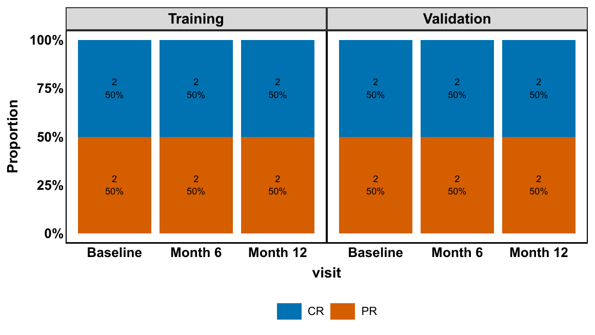{fig-alt="Training与Validation两个分面，横轴Baseline、Month 6、Month 12；CR蓝色在堆积上部且位于图例首项，PR橙色在下部，标签显示计数和换行百分比。"}

[下载 PDF](images/flow-guide/20261025-update-dist-labelled.pdf)

`haven_labelled` 的分类列和分面列通过 `labelled::to_factor()` 显示值标签；普通无标签数值仍按数值升序作为类别。命名颜色应写 CR / PR 这些**显示后的类别名**。堆积柱现在把第一 fill 水平放在顶端，与图例和 Alluvial 一致，纵轴显示百分比；这改变呈现顺序，不改变计数和分母。

#### Alluvial 共用换行与布局设置

```r
p_wrap25 <- plt_dist(d_labels25, c("visit", "response"), facet = "cohort", color = colors_labels25,
  label_args = list(style = "count_percent_wrap", pct_accuracy = 1, size = 3),
  flow_args = list(curve_type = "sigmoid"), stratum_args = list(gap = .025),
  facet_args = list(ncol = 2), legend_args = list(position = "bottom", ncol = 2))
real_wrap25 <- p_wrap25[["data"]][!p_wrap25[["data"]][[".is_gap"]], ]
ggsave(file.path(tempdir(), "20261025-update-dist-wrap.pdf"), p_wrap25, width = 8, height = 4.5)
label_validation25 <- list(bar = as.data.frame(p_labels25[["data"]]), alluvial = as.data.frame(real_wrap25),
  first_fill_ymax = segments_labels25[["ymax"]][segments_labels25[["fill"]] == colors_labels25[["CR"]]])
```

::: {.callout-note collapse="true" title="复核代码"}
生成本页时运行的检查，接在上面的代码之后运行；只读教程可以跳过。

```r
stopifnot(sum(real_wrap25[["count"]]) == 24, all(grepl("\n", real_wrap25[[".label"]], fixed = TRUE)))
```
:::

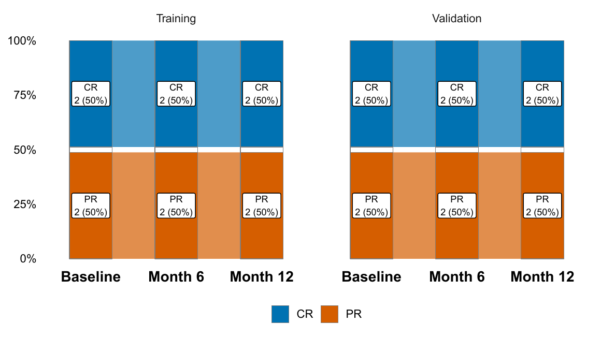{fig-alt="两分面Alluvial采用sigmoid流带、较宽节点间隔及两行计数百分比标签；CR和PR与柱形图保持相同命名配色。"}

[下载 PDF](images/flow-guide/20261025-update-dist-wrap.pdf)

`min_pct` 按每个 facet×x 内的原始比例筛选标签；样本和流带不因隐藏标签而删除。三列矩阵仍用第三列类别名作格内文字，`style="none"` 时显示图例；流带和节点设置只作用 Alluvial。

## 选择分布入口

::: {.panel-tabset}

### 两列分布流带 {.unnumbered}

两列默认转发到 plt_alluvial：比较各 stage 内的 response 构成，不追踪单个受试者迁移。

```r
plt_dist(dat, c("stage", "response"))
```

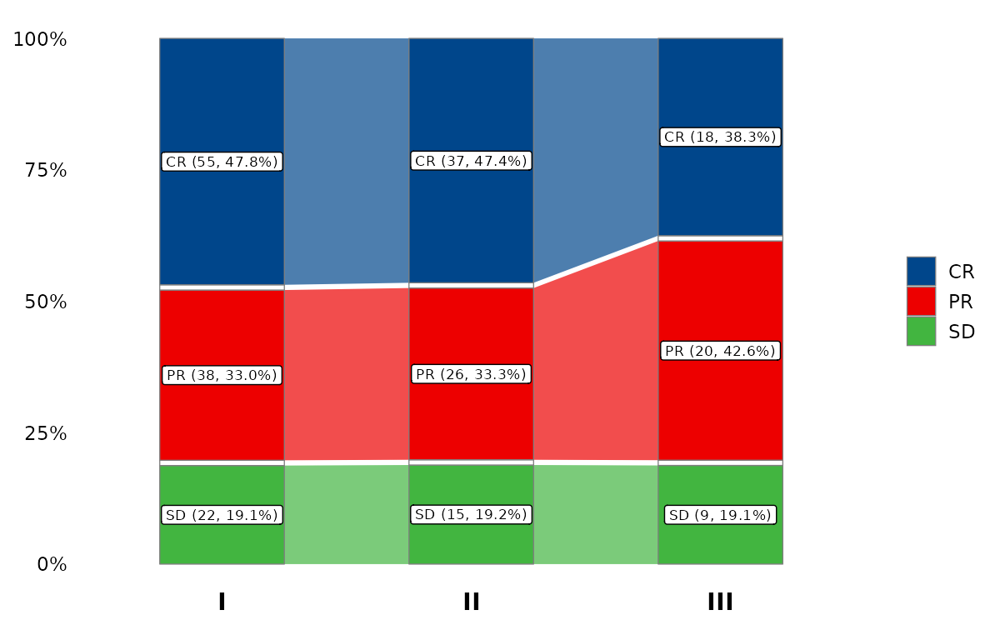{fig-alt="分类分布与流向：堆积柱、Alluvial 和 Sankey；两列分布流带；固定模拟数据的实际参数对照结果。"}

### 同一分布的堆积柱 {.unnumbered}

每个 stage 内比例为 100%；同一数据与流带图对照。

```r
plt_dist(dat, c("stage", "response"), type = "bar", label_args = list(style = "count_percent"), color = cols)
```

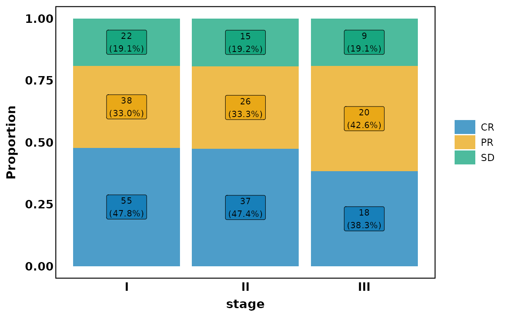{fig-alt="分类分布与流向：堆积柱、Alluvial 和 Sankey；同一分布的堆积柱；固定模拟数据的实际参数对照结果。"}

### 分层堆积柱 {.unnumbered}

分母在每个 cohort×stage 内确定，不是整个输入的总行数。

```r
plt_dist(dat, c("stage", "response"), type = "bar", facet = "cohort",
         color = cols, label_args = list(style = "percent"))
```

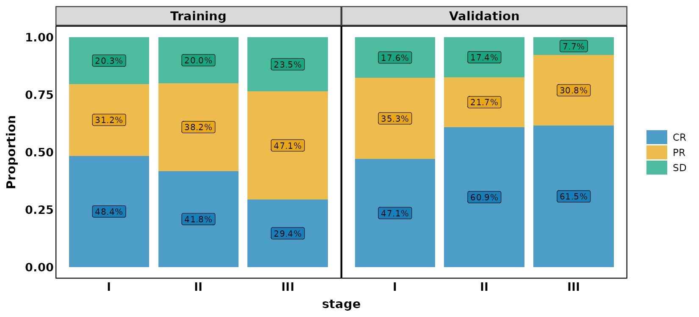{fig-alt="分类分布与流向：堆积柱、Alluvial 和 Sankey；分层堆积柱；固定模拟数据的实际参数对照结果。"}

### 三列类别矩阵 {.unnumbered}

前两列给网格位置，第三列给颜色和名称；这里确保每格只有一个第三列类别，避免多个类别的矩形互相覆盖。

```r
plt_dist(tile_dat, c("stage", "response", "label"), type = "bar", color = cols)
```

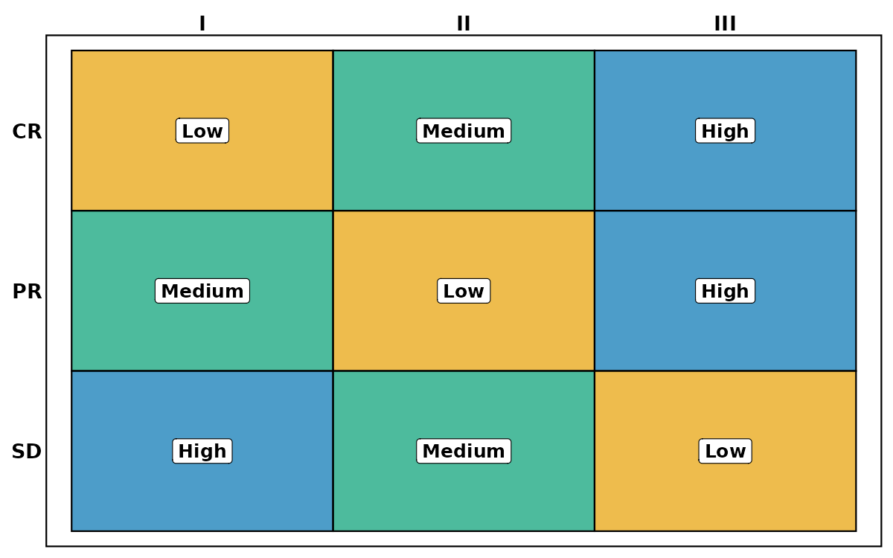{fig-alt="分类分布与流向：堆积柱、Alluvial 和 Sankey；三列类别矩阵；固定模拟数据的实际参数对照结果。"}

:::

### 分布：样本、颜色与标签位置（2026-10-24） {#distribution-20261024}


2026-10-25 按已推送 UtilsR 0.6.10 `0e4cffe` 在 Windows / WSL R 4.4.3 执行。两列 bar / alluvial 与三列类别矩阵统一按**所需列**的完整行统计；输入已有 dplyr 分组不会改变分母。下面比较同一批 36 行，并用原生 PDF 检查标签与布局。

#### 缺失筛选与命名颜色

```r
library(UtilsR)
library(ggplot2)
d_dist <- expand.grid(n = c(10, 2, 1), group = factor(c("F", "M"), levels = c("F", "M", "Unused")),
  panel = c("P1", "P2"), id = 1:3)
names(d_dist)[names(d_dist) == "panel"] <- "cohort label"
d_dist[["unrelated"]] <- NA_real_
bad_dist <- d_dist[1:3, ]; bad_dist[["n"]][1] <- NA
bad_dist[["group"]][2] <- NA; bad_dist[["cohort label"]][3] <- NA
d_dist <- rbind(d_dist, bad_dist); original_dist <- d_dist
colors_dist <- c(M = "#D55E00", Extra = "#009E73", F = "#0072B2")
bar_dist <- plt_dist(dplyr::group_by(d_dist, id), c("n", "group"), type = "bar",
  facet = "cohort label", color = colors_dist, label_args = list(style = "percent"))
alluv_dist <- plt_dist(d_dist, c("n", "group"), facet = "cohort label",
  color = colors_dist, label_args = list(style = "count_percent"))
count_name_dist <- setdiff(names(bar_dist[["data"]]), c("n", "group", "cohort label", "prop", ".lab"))
real_dist <- alluv_dist[["data"]][!alluv_dist[["data"]][[".is_gap"]], ]
for (p_dist in list(bar_dist, alluv_dist)) {
  build_dist <- ggplot_build(p_dist)
  stopifnot(identical(build_dist[["layout"]][["panel_params"]][[1]][["x"]][["get_labels"]](), c("1", "2", "10")))
  fill_dist <- build_dist[["plot"]][["scales"]][["get_scales"]]("fill")
  stopifnot(identical(unname(grDevices::col2rgb(fill_dist[["map"]](c("F", "M")))),
    unname(grDevices::col2rgb(colors_dist[c("F", "M")]))))
}
ggsave(file.path(tempdir(), "20261025-update-dist-bar.pdf"), bar_dist, width = 7, height = 6)
ggsave(file.path(tempdir(), "20261025-update-dist-alluvial.pdf"), alluv_dist, width = 8, height = 4.5)
```

::: {.callout-note collapse="true" title="复核代码"}
生成本页时运行的检查，接在上面的代码之后运行；只读教程可以跳过。

```r
stopifnot(length(count_name_dist) == 1L, sum(bar_dist[["data"]][[count_name_dist]]) == 36,
  sum(real_dist[["count"]]) == 36, identical(d_dist, original_dist))
```
:::

::: {.panel-tabset}

#### 堆积柱 {.unnumbered}

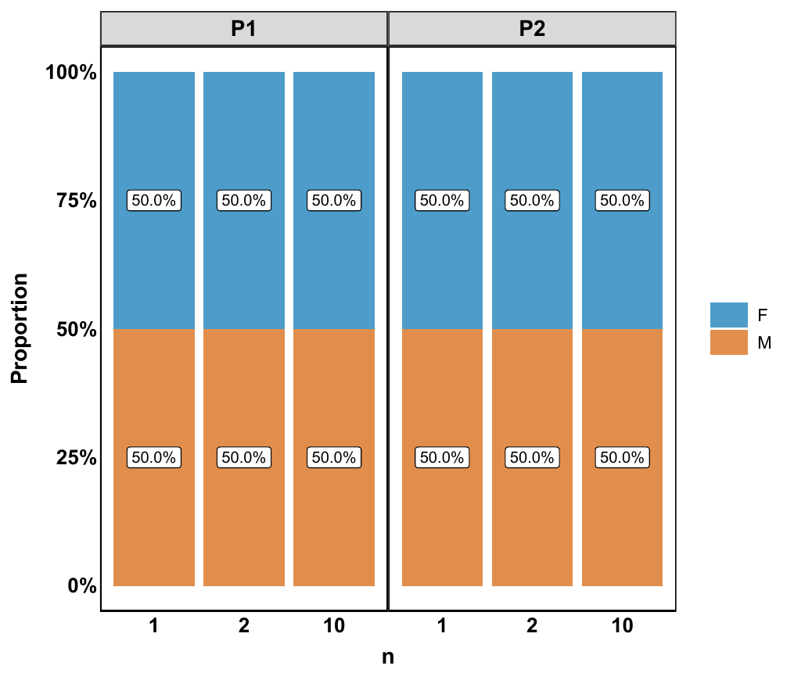{fig-alt="两个分面内的堆积柱，x为1、2、10，F蓝色、M橙色，各类别内构成为50%对50%。"}

[下载 PDF](images/flow-guide/20261025-update-dist-bar.pdf)

#### 同样样本的 Alluvial {.unnumbered}

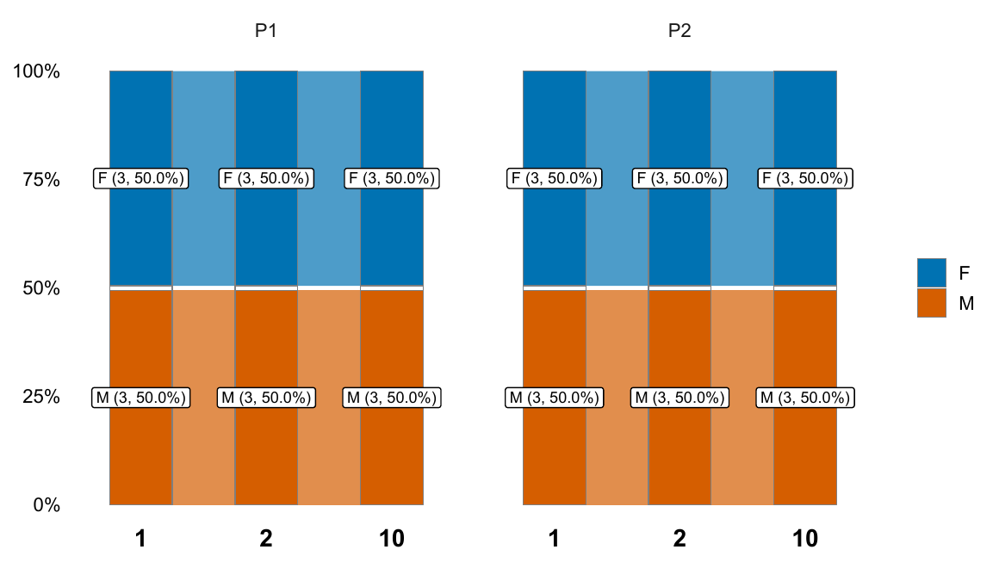{fig-alt="两分面Alluvial分布，F蓝色、M橙色，各类别有3个F和3个M；不是个体迁移路径。"}

[下载 PDF](images/flow-guide/20261025-update-dist-alluvial.pdf)

:::

39 行输入中，三行分别缺少 x、fill 或 facet，两个模式均剔除这三行；未参与统计的全缺失列不影响纳入。普通数值列按数值升序作为**类别**，不自动分箱；因子保留水平顺序。命名 `color` 按类别匹配，必须覆盖所有观察类别，允许多给未观察类别；无名颜色依水平顺序，删组后容易错位。

#### 类别矩阵：每格唯一，隐藏标签仍保留图例

```r
heat_dist <- expand.grid(x = c(1, 2, 10), y = c(1, 2))
heat_dist[["category"]] <- rep(c("F", "M", "F"), 2)
heat_plot <- plt_dist(heat_dist, c("x", "y", "category"), label_args = list(style = "none"),
  color = colors_dist, facet = "ignored")
ambiguous_dist <- rbind(heat_dist, transform(heat_dist[1, ], category = "M"))
bad_heat <- tryCatch(plt_dist(ambiguous_dist, c("x", "y", "category")), error = identity)
ggsave(file.path(tempdir(), "20261025-update-dist-heatmap.pdf"), heat_plot, width = 6, height = 3.5)
```

::: {.callout-note collapse="true" title="复核代码"}
生成本页时运行的检查，接在上面的代码之后运行；只读教程可以跳过。

```r
stopifnot(inherits(bad_heat, "error"), heat_plot[["theme"]][["legend.position"]] != "none")
```
:::

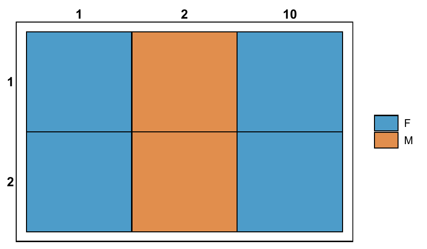{fig-alt="数值坐标1、2、10的六格类别矩阵，没有格内文字，右侧F与M图例仍可见。"}

[下载 PDF](images/flow-guide/20261025-update-dist-heatmap.pdf)

三列模式忽略 `type` 和 `facet`；同一 (x,y) 只能有一个 fill 类别，多类别现在明确报错。`label_args=list(style="none")` 隐藏格内名称但显示类别图例，其他 label 设置显示第三列的类别名，不是频数或百分比。

#### 间隔名称与最终标签中心

```r
d_gap <- data.frame(category = rep(c("A", "B"), each = 4),
  group = c(rep(".gap_1", 3), ".gap_clinical", ".gap_1", rep(".gap_clinical", 3)))
gap_plot <- plt_alluvial(d_gap, "category", "group",
  color = c(".gap_1" = "#0072B2", ".gap_clinical" = "#D55E00"),
  stratum_args = list(gap = .04)) + scale_x_discrete(limits = rev)
gap_real <- gap_plot[["data"]][!gap_plot[["data"]][[".is_gap"]], ]
gap_build <- ggplot_build(gap_plot)
gap_labels <- gap_build[["data"]][[3]]; gap_labels <- gap_labels[!is.na(gap_labels[["label"]]), ]
gap_source <- gap_real[match(gap_labels[["label"]], gap_real[[".label"]]), ]
gap_x <- match(as.character(gap_source[[".cat_var"]]), c("B", "A"))
gap_strata <- gap_build[["data"]][[2]]
gap_idx <- match(paste(gap_x, gap_source[[".group"]]), paste(gap_strata[["x"]], gap_strata[["stratum"]]))
ggsave(file.path(tempdir(), "20261025-update-dist-gap-labels.pdf"), gap_plot, width = 7, height = 4)
```

::: {.callout-note collapse="true" title="复核代码"}
生成本页时运行的检查，接在上面的代码之后运行；只读教程可以跳过。

```r
stopifnot(setequal(as.character(gap_real[[".group"]]), unique(d_gap[["group"]])),
  isTRUE(all.equal(as.numeric(gap_labels[["x"]]), as.numeric(gap_x))),
  isTRUE(all.equal(gap_labels[["y"]], (gap_strata[["ymin"]][gap_idx] + gap_strata[["ymax"]][gap_idx]) / 2)))
validation_values <- list(bar = as.data.frame(bar_dist[["data"]]), alluvial = as.data.frame(real_dist),
  heat = as.data.frame(heat_plot[["data"]]), label_x = as.numeric(gap_labels[["x"]]), label_y = gap_labels[["y"]])
```
:::

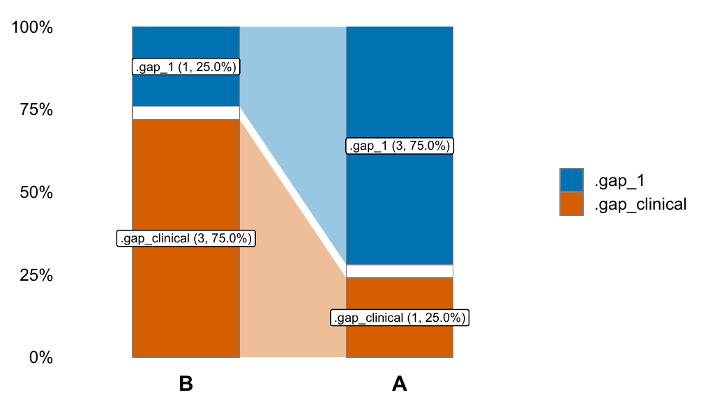{fig-alt="横轴B后A，两类真实名称gap_1与gap_clinical都有流带和标签，节点间隔不与真实类别混淆。"}

[下载 PDF](images/flow-guide/20261025-update-dist-gap-labels.pdf)

带 `.gap_` 前缀的真实类别不会被当成人工间隔。标签跟随最终轴位置与节点中心；分面 `free_x` 时也只标本面板出现的类别。小比例仍由 `min_pct` 按原始构成筛选，不能把间隔占的空白算进人数或比例。参数不合法（如分面行列数非正整数、总间隔挤满面板）会报错。


::: {.callout-note collapse="true" title="复核代码"}
生成本页时运行的检查，接在上面的代码之后运行；只读教程可以跳过。

```r
validation_values <- c(validation_values, list(labelled = label_validation25))
```
:::

<!-- /update-20261025: distribution_lists -->

## 比例、计数与分面

::: {.panel-tabset}

### 比例模式 {.unnumbered}

组内真实比例先归一化，再为 gap 让出空间；标签仍显示原始比例。

```r
plt_alluvial(dat, "stage", "response", y_type = "percent", color = cols)
```

{fig-alt="分类分布与流向：堆积柱、Alluvial 和 Sankey；比例模式；固定模拟数据的实际参数对照结果。"}

### 计数模式 {.unnumbered}

改为人数尺度，stage 总人数不同会形成不同总高度。

```r
plt_alluvial(dat, "stage", "response", y_type = "count", color = cols)
```

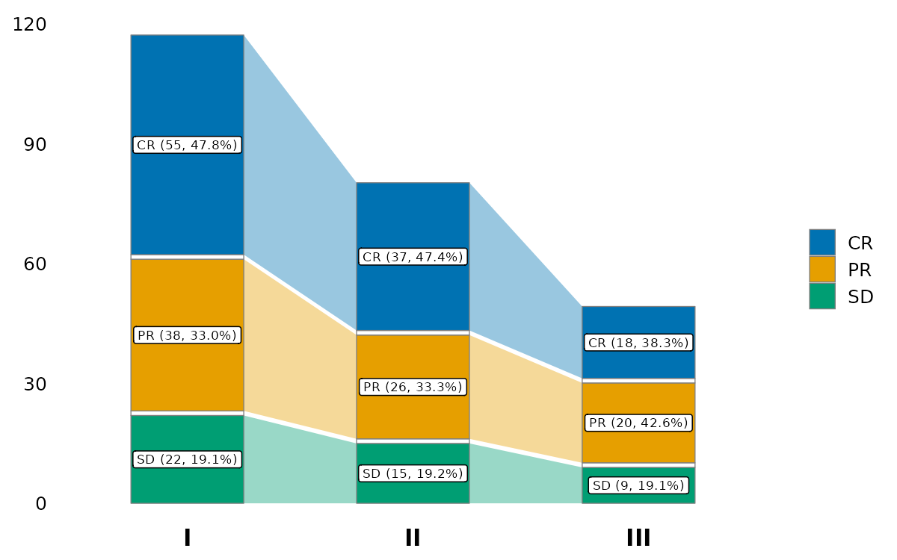{fig-alt="分类分布与流向：堆积柱、Alluvial 和 Sankey；计数模式；固定模拟数据的实际参数对照结果。"}

### 分面独立归一化 {.unnumbered}

两个 cohort 分别计算各 stage 内的构成。

```r
plt_alluvial(dat, "stage", "response", facet = "cohort", color = cols,
             facet_args = list(ncol = 2, scales = "fixed"))
```

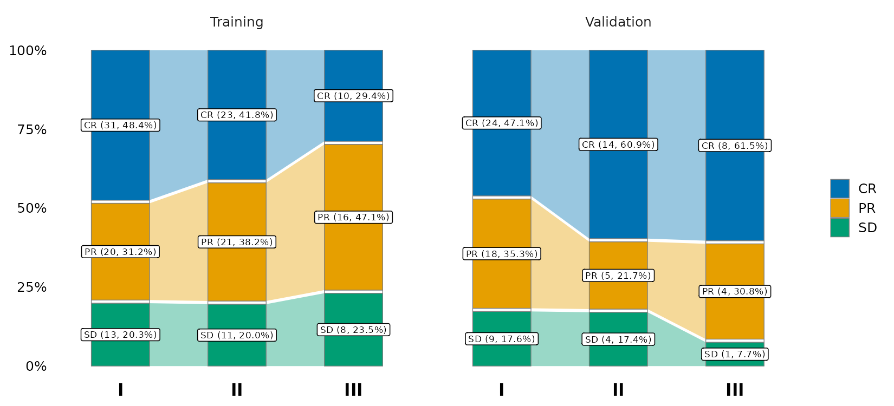{fig-alt="分类分布与流向：堆积柱、Alluvial 和 Sankey；分面独立归一化；固定模拟数据的实际参数对照结果。"}

### 分面计数与自由纵轴 {.unnumbered}

自由纵轴帮助看小样本层内部构成；跨层不能凭图形高度直接比较人数。

```r
plt_alluvial(dat, "stage", "response", facet = "cohort", y_type = "count",
             color = cols, facet_args = list(ncol = 2, scales = "free_y"))
```

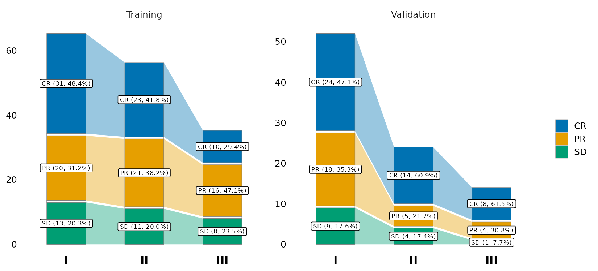{fig-alt="分类分布与流向：堆积柱、Alluvial 和 Sankey；分面计数与自由纵轴；固定模拟数据的实际参数对照结果。"}

:::

## 流带、节点与间隔

::: {.panel-tabset}

### 平滑流带 {.unnumbered}

只调整连带透明度与曲线，分类频数和比例不变。

```r
plt_alluvial(dat, "stage", "response", color = cols,
             flow_args = list(alpha = 0.65, curve_type = "sigmoid"))
```

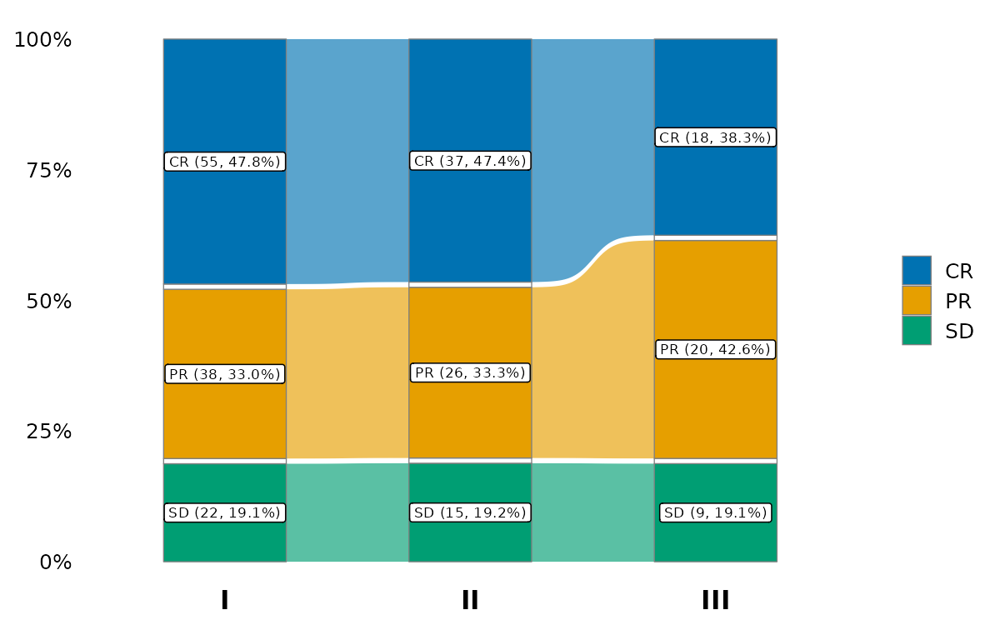{fig-alt="分类分布与流向：堆积柱、Alluvial 和 Sankey；平滑流带；固定模拟数据的实际参数对照结果。"}

### 无间隔 {.unnumbered}

去掉透明间隔，比例堆积总高度为 1。

```r
plt_alluvial(dat, "stage", "response", color = cols,
             stratum_args = list(gap = 0, width = 0.35))
```

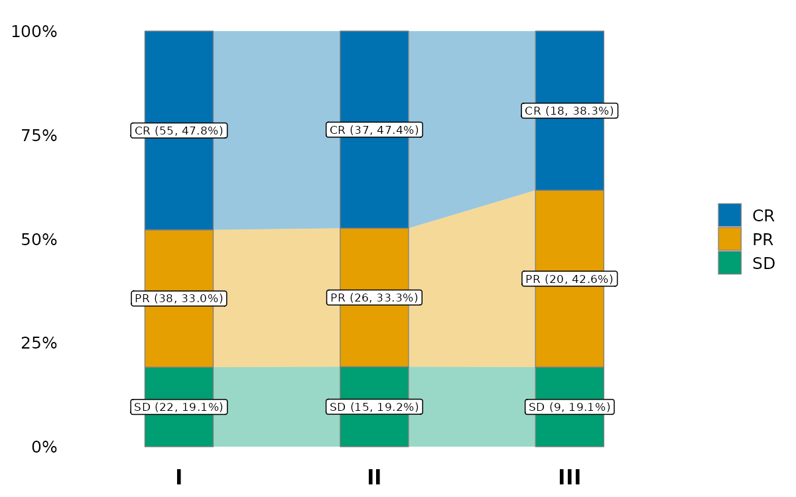{fig-alt="分类分布与流向：堆积柱、Alluvial 和 Sankey；无间隔；固定模拟数据的实际参数对照结果。"}

### 较大间隔和边框 {.unnumbered}

三组间共有两处间隔，各占 4%；真实 strata 总高度压缩到 92%。

```r
plt_alluvial(dat, "stage", "response", color = cols,
             stratum_args = list(gap = 0.04, width = 0.6, color = "white", linewidth = 0.8))
```

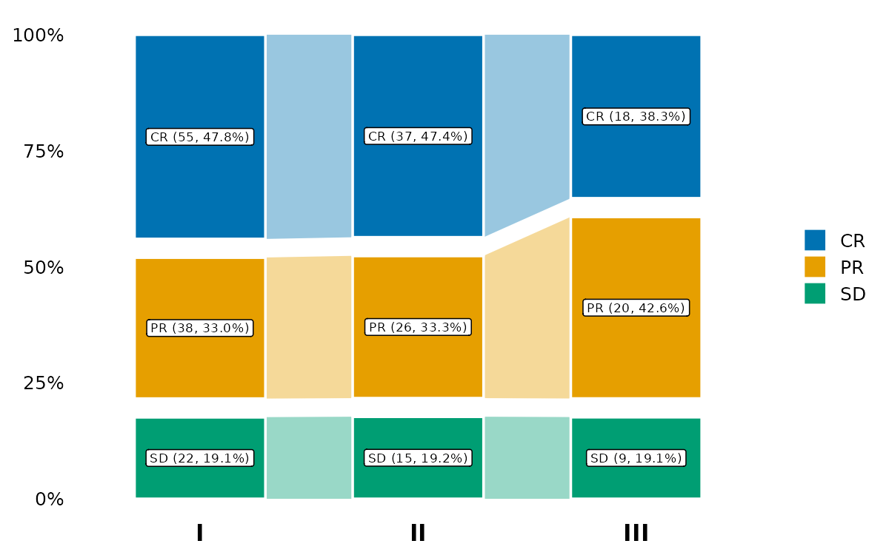{fig-alt="分类分布与流向：堆积柱、Alluvial 和 Sankey；较大间隔和边框；固定模拟数据的实际参数对照结果。"}

:::

## 标签内容与筛选

::: {.panel-tabset}

### 比例与最小标签阈值 {.unnumbered}

只隐藏小于 20% 的标签，不删除相应组或改变分母。

```r
plt_alluvial(dat, "stage", "response", color = cols,
             label_args = list(style = "percent", min_pct = 0.2, size = 3.5))
```

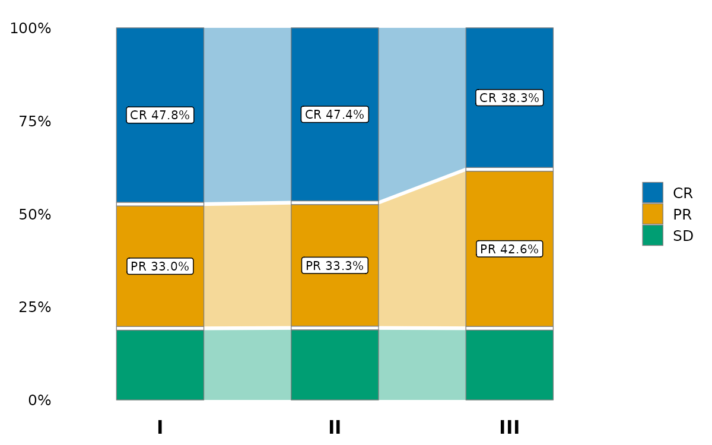{fig-alt="分类分布与流向：堆积柱、Alluvial 和 Sankey；比例与最小标签阈值；固定模拟数据的实际参数对照结果。"}

### 计数标签 {.unnumbered}

显示组名与计数，使用纯文本而非标签框。

```r
plt_alluvial(dat, "stage", "response", color = cols,
             label_args = list(style = "count", box = FALSE, color = "#222222", size = 3.5))
```

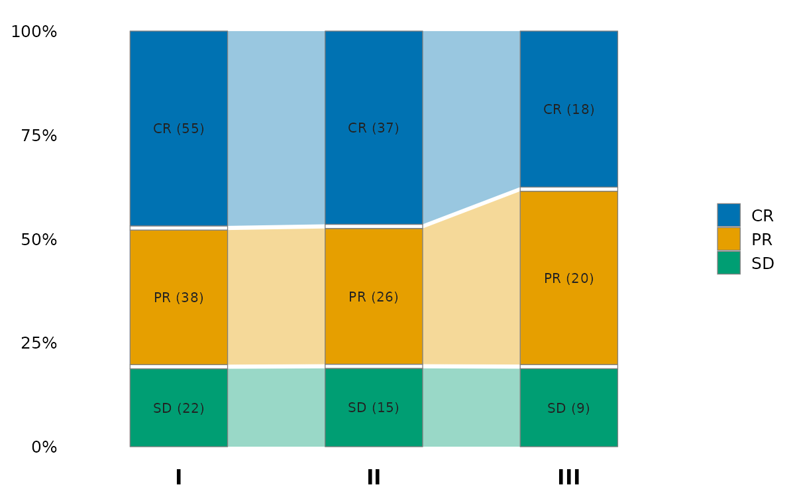{fig-alt="分类分布与流向：堆积柱、Alluvial 和 Sankey；计数标签；固定模拟数据的实际参数对照结果。"}

### 只显示组名 {.unnumbered}

保留组名标签，标签框背景独立于节点填色。

```r
plt_alluvial(dat, "stage", "response", color = cols,
             label_args = list(style = "name", fill = "#F4F7FB", alpha = 0.8))
```

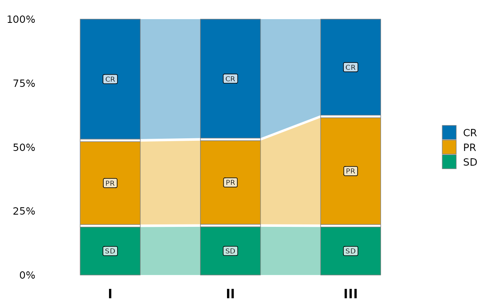{fig-alt="分类分布与流向：堆积柱、Alluvial 和 Sankey；只显示组名；固定模拟数据的实际参数对照结果。"}

### 关闭标签并保留图例 {.unnumbered}

数据标签关闭后，用共用颜色图例识别 response。

```r
plt_alluvial(dat, "stage", "response", color = cols,
             label_args = list(style = "none"), legend_args = list(position = "bottom", ncol = 3))
```

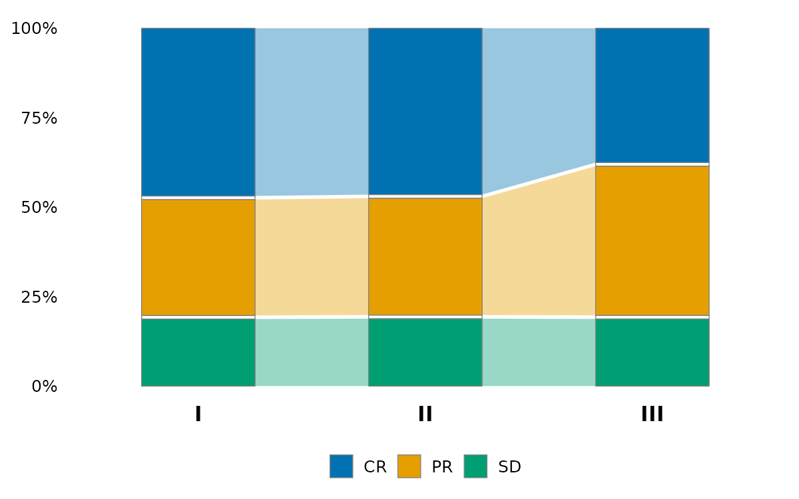{fig-alt="分类分布与流向：堆积柱、Alluvial 和 Sankey；关闭标签并保留图例；固定模拟数据的实际参数对照结果。"}

:::

## 节点路径与标签

::: {.panel-tabset}

### 两列节点路径 {.unnumbered}

每一行在两列变量之间形成连接；节点人数和比例使用全体输入行。

```r
plt_sankey(dat, c("stage", "response"))
```

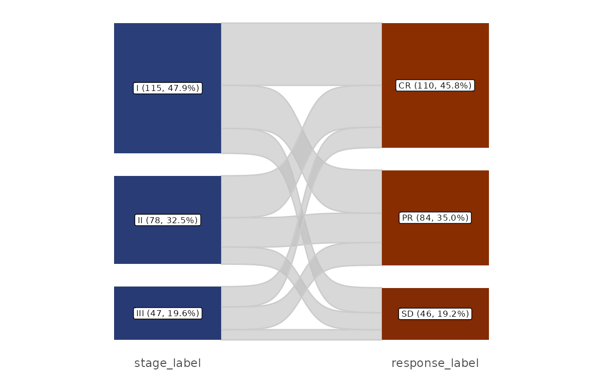{fig-alt="分类分布与流向：堆积柱、Alluvial 和 Sankey；两列节点路径；固定模拟数据的实际参数对照结果。"}

### 三列节点路径 {.unnumbered}

三个变量按顺序显示，同一行的组合形成完整路径；不自动产生时间或因果含义。

```r
plt_sankey(dat, c("stage", "regimen", "response"), show_text = "all")
```

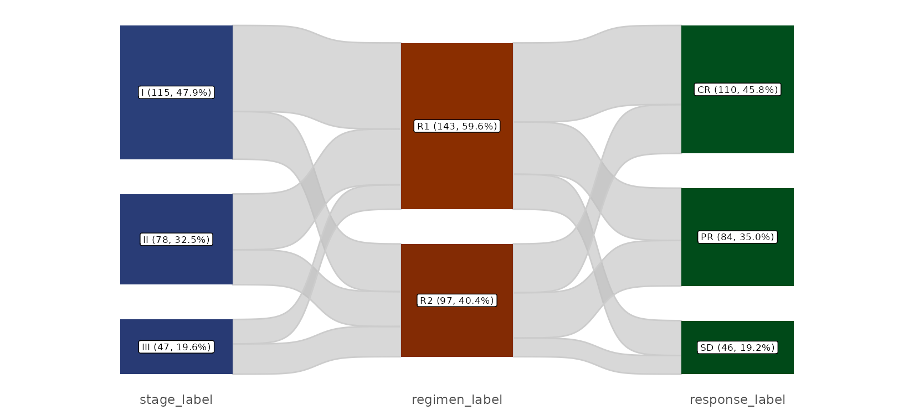{fig-alt="分类分布与流向：堆积柱、Alluvial 和 Sankey；三列节点路径；固定模拟数据的实际参数对照结果。"}

### 保留原因子顺序 {.unnumbered}

关闭反转后按既定因子水平排列；show_text=name 只显示名称。

```r
plt_sankey(dat, c("stage", "regimen", "response"), reverse_levels = FALSE, show_text = "name")
```

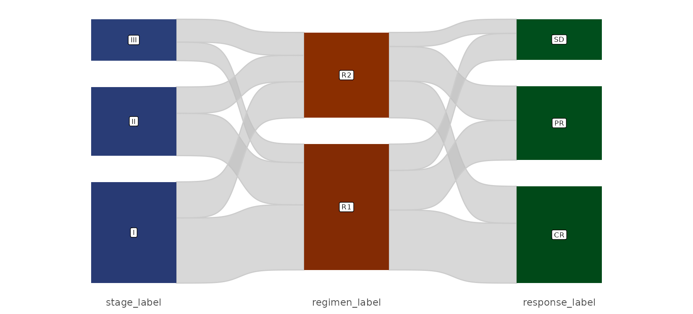{fig-alt="分类分布与流向：堆积柱、Alluvial 和 Sankey；保留原因子顺序；固定模拟数据的实际参数对照结果。"}

### 百分比标签 {.unnumbered}

palette 改节点色，流带仍为灰色；百分比是节点在输入总行数中的比例。

```r
plt_sankey(dat, c("stage", "response"), show_text = "pct",
           palette = "Paired", label_args = list(size = 3.5))
```

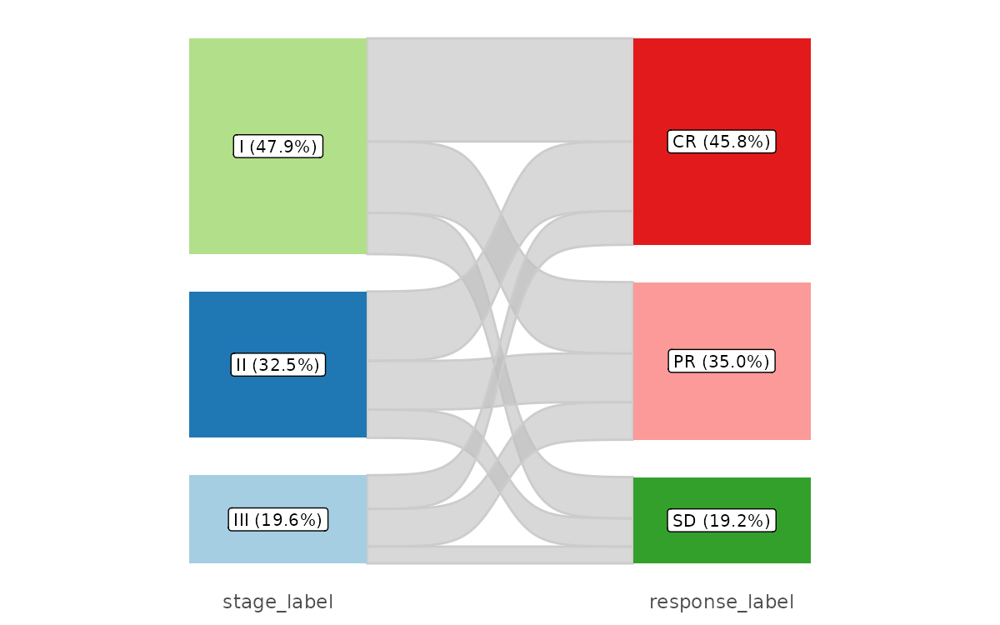{fig-alt="分类分布与流向：堆积柱、Alluvial 和 Sankey；百分比标签；固定模拟数据的实际参数对照结果。"}

### 宽度、间隔和透明度 {.unnumbered}

space=0 移除节点间隔，width 控制节点和端点宽度；标签显示名称与人数。

```r
plt_sankey(dat, c("stage", "regimen", "response"),
  node_args = list(width = 0.25, space = 0), flow_args = list(alpha = 0.35),
  show_text = "n", label_args = list(size = 3), base_size = 13)
```

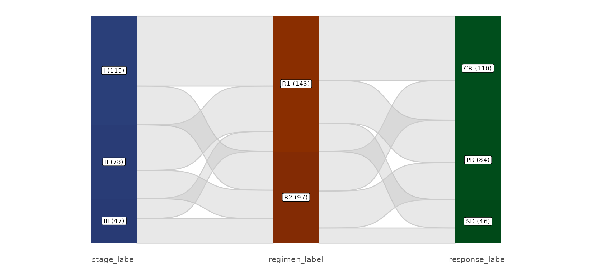{fig-alt="分类分布与流向：堆积柱、Alluvial 和 Sankey；宽度、间隔和透明度；固定模拟数据的实际参数对照结果。"}

:::

## 真实保存示例

::: {.panel-tabset}

### 保存到临时目录 {.unnumbered}

本例实际调用非空 save，核对临时 PDF 已生成；工作目录不产生输出文件。

```r
pdf_path <- file.path(tempdir(), "utilsr-alluvial-demo.pdf")
p <- plt_alluvial(dat, "stage", "response", color = cols,
                  save = list(filename = pdf_path, width = 8, height = 5))
p
```

::: {.callout-note collapse="true" title="复核代码"}
生成本页时运行的检查，接在上面的代码之后运行；只读教程可以跳过。

```r
stopifnot(file.exists(pdf_path), file.info(pdf_path)[["size"]] > 1000)
```
:::

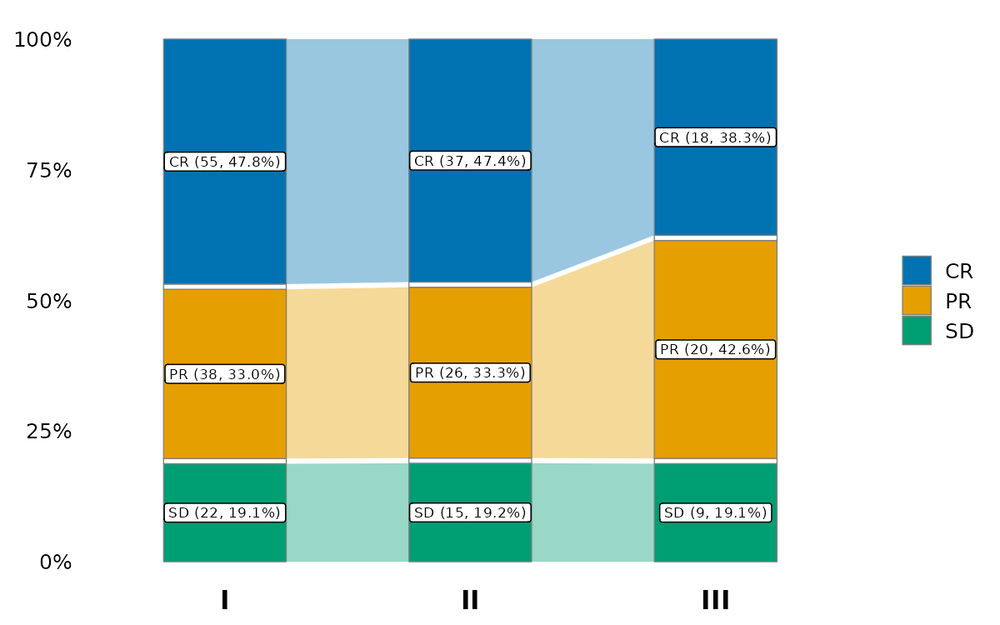{fig-alt="分类分布与流向：堆积柱、Alluvial 和 Sankey；保存到临时目录；固定模拟数据的实际参数对照结果。"}

:::

### Sankey 标签换行

`show_text = "all_wrap"` 把组名放在第一行，把人数和百分比放在第二行，适合窄节点或较长名称。默认 `"all"` 仍为单行，两个设置的节点计数、流量和百分比分母相同。本例沿用前文同一份 240 行模拟数据，没有因换行筛掉任何观察。

<!-- sankey-wrap:start -->
```r
p_wrap <- plt_sankey(dat, c("stage", "regimen", "response"),
  show_text = "all_wrap", label_args = list(size = 3, hjust = 0.5))
p_wrap
```
<!-- sankey-wrap:end -->

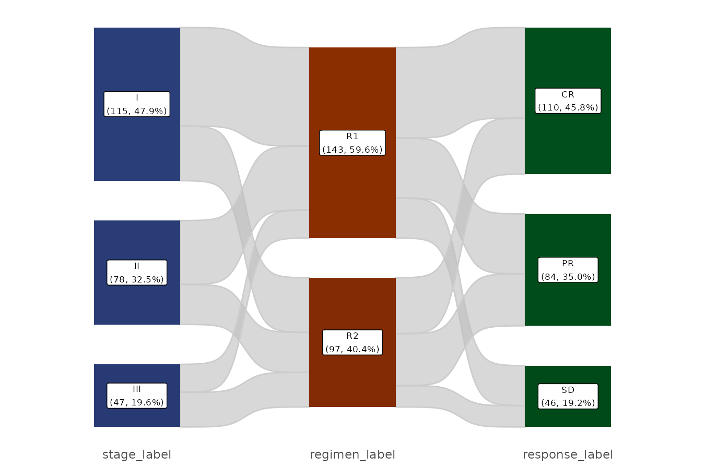{fig-alt="三列 Sankey 图使用两行节点标签，第一行为组名，第二行为人数和占 240 人的百分比。"}

源码：[当前 Sankey 接口](https://github.com/HUI950319/UtilsR/blob/fc078ec/R/plt_sankey.R)。旧 `alpha` 改为 `flow_args$alpha`，`width/space` 改入 `node_args`，`label_size/label_hjust` 改为 `label_args$size/hjust`。长标签结合设备尺寸、节点间距及行距调整。

## 标签映射、显示与保存 {#sankey-controls}

`vars` 的命名向量将真实列名映射为显示标题；空标题隐藏该轴标签，换行保留。重复类别名在不同变量中仍为独立节点，不会错误合并流量。`min_pct` 只隐藏小类别的文字，不删除观察、节点或流带。

::: {.panel-tabset}

### 标题映射与紧凑行距

```r
p_mapped <- plt_sankey(dat, c(stage = "Disease stage", regimen = "Treatment", response = "Response"),
  show_text = "all_wrap", label_args = list(lineheight = 0.9))
p_mapped
```

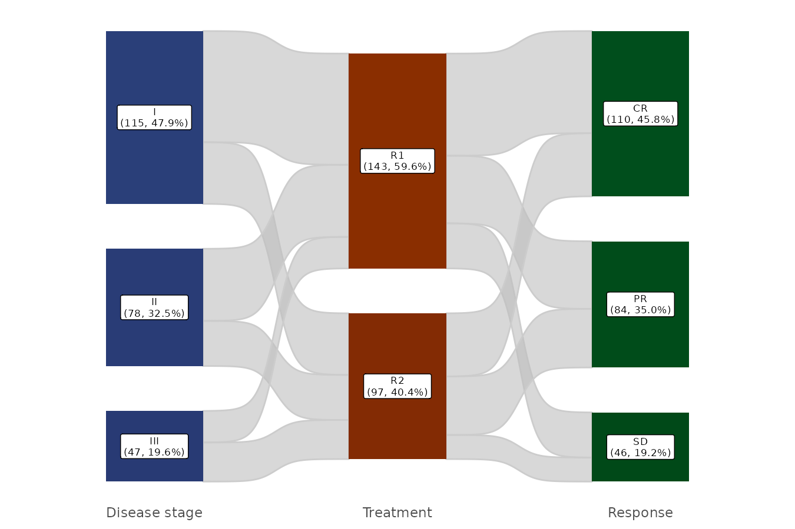{fig-alt="三列 Sankey 使用映射后的英文轴标题，两行节点标签保持计数和百分比，行距为0.9。"}

### 纯文字与小类别阈值

```r
p_plain <- plt_sankey(dat, c("stage", "regimen", "response"),
  label_args = list(box = FALSE, min_pct = 0.2, color = "#263238"))
p_plain
```

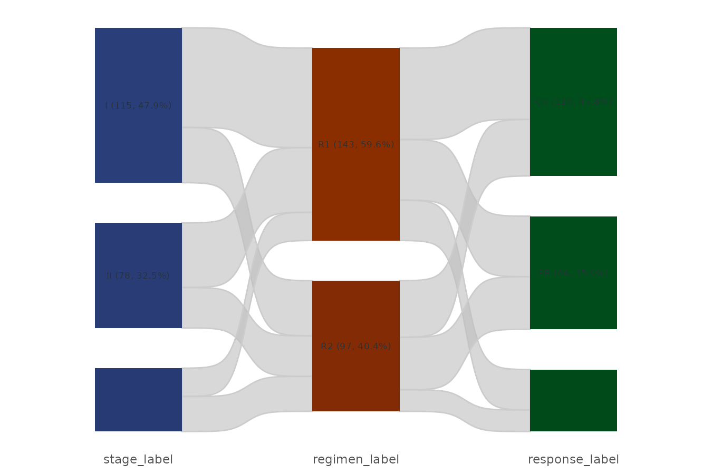{fig-alt="Sankey保留全部节点和连接，小类别不显示标签，较大类别显示没有白框的名称人数百分比。"}

### 流带与节点边界

```r
p_flow <- plt_sankey(dat, c("stage", "regimen", "response"),
  flow_args = list(fill = "#81B1C6", color = NA, alpha = 0.35, smooth = 12),
  node_args = list(width = 0.3, space = 3, color = "#37474F", linewidth = 0.4))
p_flow
```

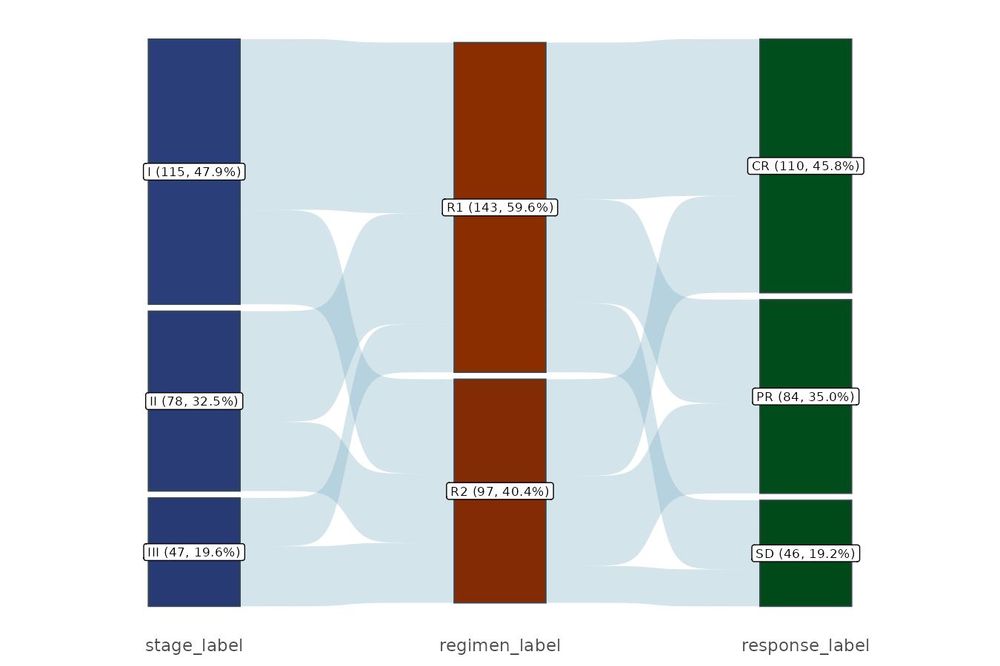{fig-alt="三列Sankey流带为蓝灰色且透明，节点有细边框，节点间隔为3个计数单位。"}

### 隐藏标签并直接保存

```r
pdf_sankey <- file.path(tempdir(), "sankey-no-labels.pdf")
p_none <- plt_sankey(dat, c("stage", "regimen", "response"), show_text = "none",
  save = list(filename = pdf_sankey, width = 9, height = 6))
p_none
```

::: {.callout-note collapse="true" title="复核代码"}
生成本页时运行的检查，接在上面的代码之后运行；只读教程可以跳过。

```r
stopifnot(file.exists(pdf_sankey))
```
:::

{fig-alt="三列Sankey隐藏节点标签，所有节点和流带仍可见，对应PDF已验证。"}

:::

`label_args$size` 为 mm，`base_size` 为 pt，`node_args$space` 为计数单位，`min_pct` 为0–1比例。`lineheight` 是相对文字字号的倍数，不是标签框内边距。保存只接受 filename、width、height，后两者为英寸；空 list 或 NULL 不保存。

## 返回对象、保存与使用边界 {#output}

三个入口返回 ggplot，当前均支持非空 `save` 转交 `RegR::save_plt()` 保存 PDF；省略尺寸时按内容估算，见[当前保存示例](#save-20261020)。上方历史保存示例显式给出宽高，其输出保留原记录。

`plt_alluvial()` 连接的是同一 group 在不同类别中的边际分布，每个 facet×cat_var 独立归一化；不能据此读出某个个体从一类别流向另一类别。`plt_sankey()` 使用行内多变量组合建立路径。三列 `plt_dist()` 则是类别矩阵，当前输入若一个格子有多个第三列类别会报错，避免图层相互覆盖；本页用每格唯一的数据演示。

流带的方向与宽度来自输入结构和频数，不构成因果作用估计。NA 行的处理按所选分支核对；plt_alluvial 会移除必要变量中的不完整行并报告。

## 当前按内容保存 PDF {#save-20261020}

2026-10-20 按已推送 UtilsR `cea978f4`（保存接口自 `0f7fe0b`）与 RegR `da6157be`，在 Windows / WSL R 4.4.3 实际执行本节。上方历史参数图保留原执行快照。这里另用固定输入演示保存，不重新选择统计模型或分组。

`save = list()` 或 `NULL` 不写文件；非空列表给 `filename`，可再给英寸单位的 `width` / `height`。文件仅支持 PDF，没有扩展名时补 `.pdf`。省略的尺寸取当前图按内容估算的画布，控制台会打印尺寸及可复制保存语句，图对象可读取 `attr(p, "plot_size")`。显式给尺寸只覆盖该维度。

<!-- refresh-20261020: flow_save -->
```r
library(UtilsR)
set.seed(20261020)
d_save <- expand.grid(id = 1:6, stage = factor(c("I", "II", "III")),
  sex = factor(c("Female", "Male")), site = factor(c("A", "B")))
d_save[["score"]] <- rnorm(nrow(d_save)) + as.integer(d_save[["stage"]])
d_save[["marker"]] <- rnorm(nrow(d_save))
p_sankey <- plt_sankey(d_save, vars = c("sex", "stage", "site"),
  save = list(filename = file.path(tempdir(), "20261020-refresh-sankey.pdf")))
p_alluvial <- plt_alluvial(d_save, cat_var = "stage", group = "sex",
  save = list(filename = file.path(tempdir(), "20261020-refresh-alluvial.pdf")))
p_dist <- plt_dist(d_save, dis_vars = c("sex", "stage"), type = "bar",
  save = list(filename = file.path(tempdir(), "20261020-refresh-dist.pdf")))
sizes <- lapply(list(Sankey = p_sankey, Alluvial = p_alluvial, Distribution = p_dist),
  function(p) attr(p, "plot_size"))
sizes
```

::: {.callout-note collapse="true" title="复核代码"}
生成本页时运行的检查，接在上面的代码之后运行；只读教程可以跳过。

```r
stopifnot(all(vapply(sizes, function(z) length(z) == 2L && all(is.finite(z)) && all(z > 0), logical(1))))
```
:::

<!-- /refresh-20261020: flow_save -->

::: {.panel-tabset}

### Sankey {.unnumbered}

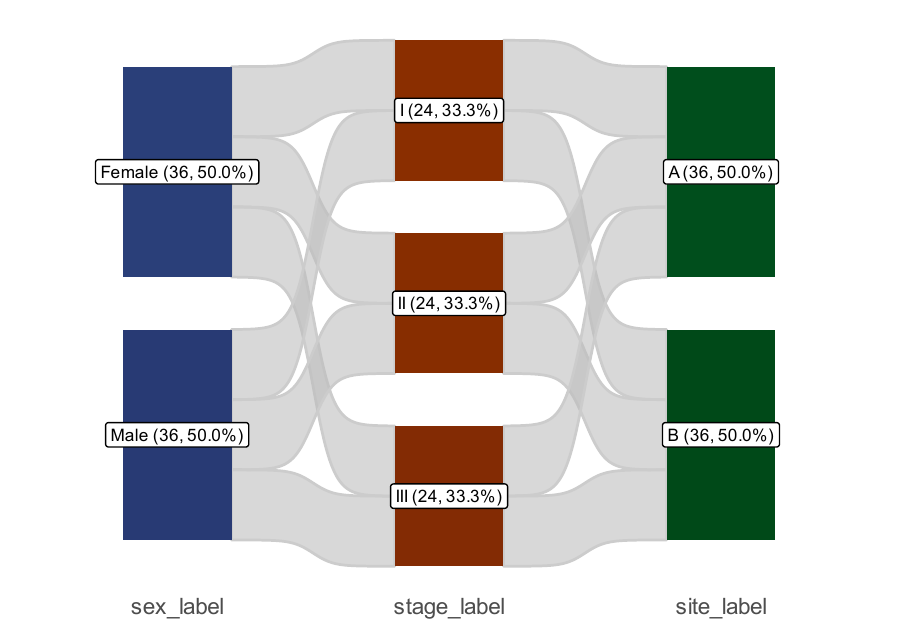{fig-alt="固定模拟记录的sex、stage和site三列Sankey，使用按内容估算的画布，标签与流带完整显示。"}

[下载本图 PDF](images/flow-guide/20261020-refresh-sankey.pdf)

### Alluvial {.unnumbered}

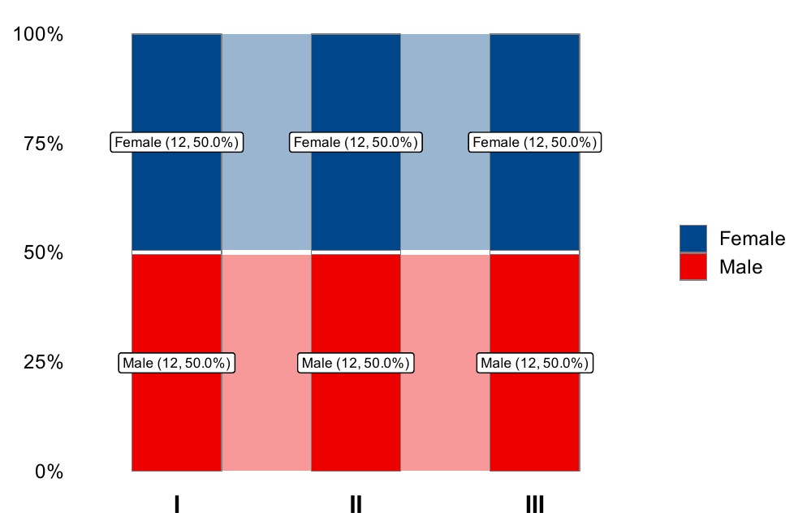{fig-alt="固定模拟记录中每个stage内sex的比例流向，使用函数估算的画布，图例与组内比例标签可见。"}

[下载 PDF](images/flow-guide/20261020-refresh-alluvial.pdf)

### 分类分布 {.unnumbered}

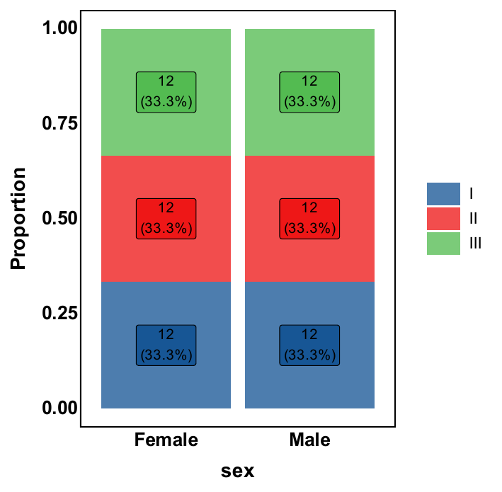{fig-alt="plt_dist的bar分派显示各sex内三个stage的比例和计数，使用内置save保存PDF。"}

[下载 PDF](images/flow-guide/20261020-refresh-dist.pdf)

:::

`plt_sankey()` 与 `plt_alluvial()` 原有的 `save` 仍使用同一写法，但省略尺寸现在按内容估算；`plt_dist()` 新增统一保存入口。Sankey 按变量数、最大水平数与文字估算，Alluvial 还考虑分面，不能假定所有函数都是相同的 10 × 11 英寸。

UtilsR 的绘图本身不以 RegR 为硬依赖；当前 RegR 可用时才会提供尺寸提示和 `plot_size`，非空保存配置也需要它。缺少兼容 RegR 时，空保存配置仍可画图；此时不要假定图一定有 `plot_size`。本节使用的两包提交已一起验证，版本号相同不代表旧安装含有这些更新。

三条保存路径均已实际执行；Alluvial 的边际比例与 Sankey 的行内路径仍按上节的数据语义区分。

## 当前完整接口 {#interfaces}

点击展开查看本次实际执行版本的参数及默认值。

<details>
<summary>公共函数签名</summary>

```r
plt_dist <-
function (data, dis_vars, type = c("alluvial", "bar"), facet = NULL, color = NULL, alpha = 0.7,
    label_args = list(style = "count_percent", min_pct = 0, size = NULL, color = "black",
        box = TRUE, fill = "white", alpha = 1, pct_accuracy = 0.1),
    flow_args = list(curve_type = "linear"),
    stratum_args = list(width = 0.5, color = "gray50", linewidth = 0.3, gap = 0.01),
    facet_args = list(nrow = NULL, ncol = NULL, scales = "fixed"),
    legend_args = list(position = NULL, ncol = 1), theme_use = theme_heat(14), save = list())
NULL

plt_alluvial <-
function (data, cat_var, group, facet = NULL, y_type = c("percent", "count"), color = pal_lancet,
    flow_args = list(alpha = 0.4, curve_type = "linear"), stratum_args = list(width = 0.5,
        color = "gray50", linewidth = 0.3, gap = 0.01), label_args = list(style = "count_percent",
        min_pct = 0, size = 3, color = "black", box = TRUE, fill = "white", alpha = 1, pct_accuracy = 0.1), facet_args = list(nrow = NULL,
        ncol = NULL, scales = "fixed"), legend_args = list(ncol = 1, position = "right"), theme_use = theme_alluvia(15),
    save = list())
NULL

plt_sankey <-
function(data, vars, palette = NULL, reverse_levels = TRUE,
  show_text = c("all", "n", "pct", "name", "all_wrap", "none"),
  flow_args = list(alpha = 0.6, fill = "grey", color = "grey80", smooth = 8),
  node_args = list(width = 0.4, space = NULL, color = NA, linewidth = NULL),
  label_args = list(size = 3, lineheight = 1.2, hjust = 0.5, color = "black",
    box = TRUE, fill = "white", alpha = 1, min_pct = 0, pct_accuracy = 0.1),
  base_size = 14, theme_use = NULL, save = list())
NULL

```

</details>

## 验证范围与参考 {#references}

原有 Alluvial / bar 图保留历史执行记录；本次实际执行所有 Sankey 调用并完成构建、PNG 导出及 PDF 保存。格式和标签控制不改变节点计数；未修改 UtilsR 源码。

本次绘制出现的提示记录如下；对应示例仍通过实际构建和导出检查。

<details>
<summary>绘图提示</summary>

- `attributes are not identical across measure variables; they will be dropped`
- `The 'size' argument of 'element_rect()' is deprecated as of ggplot2 3.4.0. ℹ Please use the 'linewidth' argument instead. ℹ The deprecated feature was likely used in the ggsankey package.   Please report the issue at <https://github.com/davidsjoberg/ggsankey/issues>.`

</details>

- [UtilsR 函数参考](https://hui950319.github.io/UtilsR/reference/index.html)
- [UtilsR 源码](https://github.com/HUI950319/UtilsR/tree/master/R)
- [专题目录](index.qmd)

<details>
<summary>执行环境</summary>

```text
R version 4.4.3 (2025-02-28)
Platform: x86_64-pc-linux-gnu
Running under: Ubuntu 22.04.2 LTS

Matrix products: default
BLAS:   /usr/lib/x86_64-linux-gnu/openblas-pthread/libblas.so.3
LAPACK: /usr/lib/x86_64-linux-gnu/openblas-pthread/libopenblasp-r0.3.20.so;  LAPACK version 3.10.0

locale:
 [1] LC_CTYPE=C.UTF-8       LC_NUMERIC=C           LC_TIME=C.UTF-8        LC_COLLATE=C.UTF-8
 [5] LC_MONETARY=C.UTF-8    LC_MESSAGES=C.UTF-8    LC_PAPER=C.UTF-8       LC_NAME=C
 [9] LC_ADDRESS=C           LC_TELEPHONE=C         LC_MEASUREMENT=C.UTF-8 LC_IDENTIFICATION=C

time zone: Asia/Shanghai
tzcode source: system (glibc)

attached base packages:
[1] stats     graphics  grDevices utils     datasets  methods   base

other attached packages:
[1] ggplot2_4.0.3 UtilsR_0.6.8

loaded via a namespace (and not attached):
 [1] gtable_0.3.6       jsonlite_2.0.0     dplyr_1.2.0        compiler_4.4.3     tidyselect_1.2.1
 [6] Rcpp_1.1.1         stringr_1.6.0      dichromat_2.0-0.1  tidyr_1.3.2        textshaping_0.4.0
[11] systemfonts_1.1.0  scales_1.4.0       R6_2.6.1           labeling_0.4.3     generics_0.1.4
[16] patchwork_1.3.2    ggsankey_0.0.99999 httr2_1.2.2        forcats_1.0.1      ggrepel_0.9.8
[21] tibble_3.3.1       ellmer_0.4.0       pillar_1.11.1      RColorBrewer_1.1-3 rlang_1.3.0
[26] stringi_1.8.7      RegR_0.1.3         S7_0.2.2           ggalluvial_0.12.5  otel_0.2.0
[31] cli_3.6.6          withr_3.0.3        magrittr_2.0.4     digest_0.6.39      grid_4.4.3
[36] rappdirs_0.3.4     lifecycle_1.0.5    coro_1.1.0         vctrs_0.7.3        ggprism_1.0.7
[41] glue_1.8.1         farver_2.1.2       ragg_1.5.2         purrr_1.2.1        tools_4.4.3
[46] pkgconfig_2.0.3    mcptools_0.2.1
```

</details>

## 更新记录 {#page-updates}

::: {.callout-note collapse="true" title="本页更新记录"}
- 2026-10-25：[list 参数与值标签](#distribution-lists-20261025)
- 2026-10-24：[分布：样本、颜色与标签位置](#distribution-20261024)
:::
