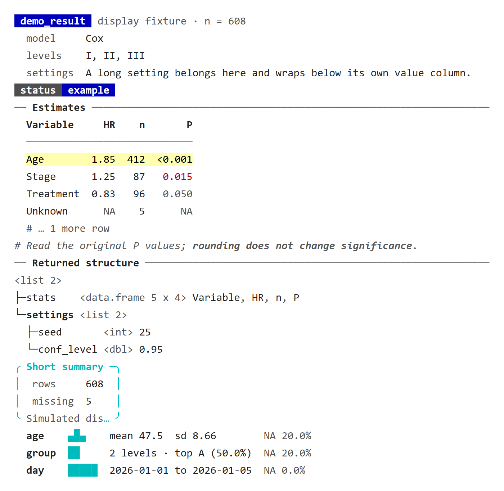
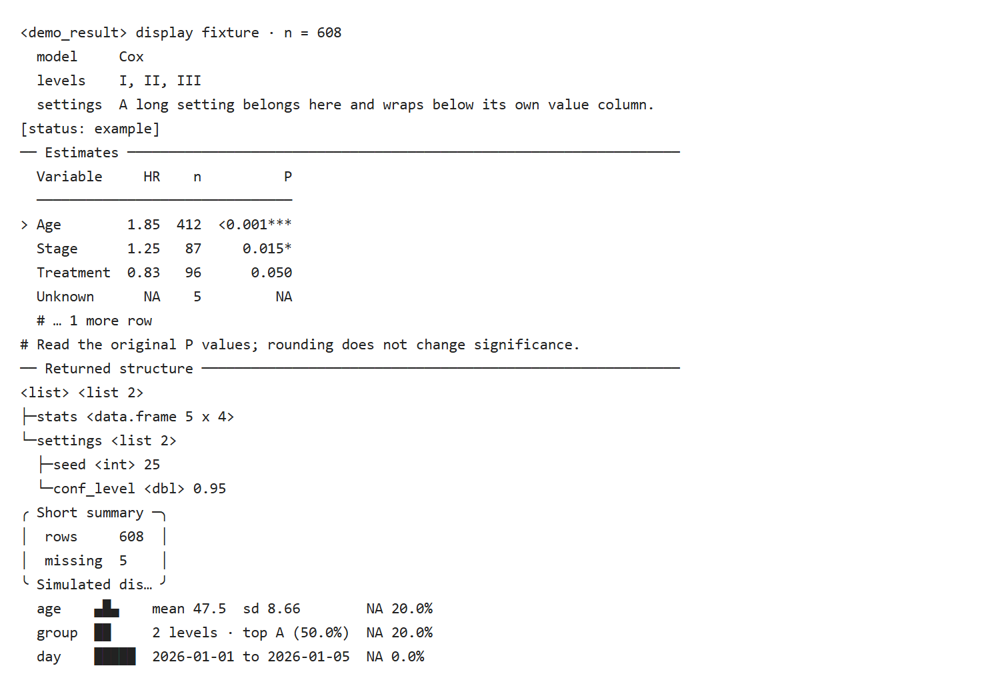
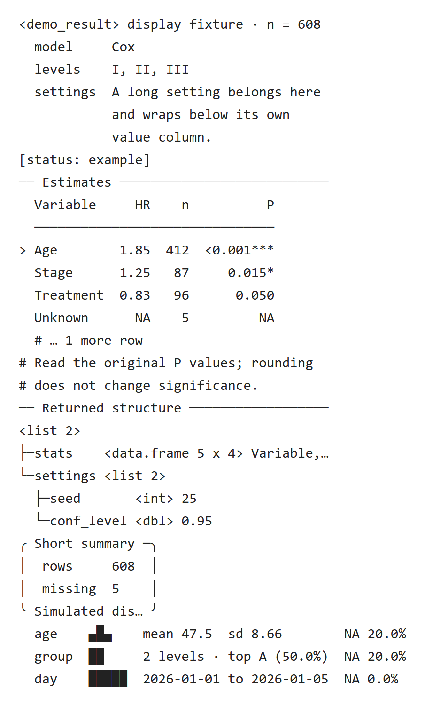

通用数据与绘图工具：数据检视、因子整理、格式化、配色、主题和图形加工。

本页集中展示三张图：先看功能总览，再查接口索引，最后看处理流程与返回对象。**点击图片可放大查看**，也可下载图源继续编辑。

[下载 draw.io 图源](../assets/module-maps/utilsr/utilsr-package-mindmap.drawio){.btn .btn-outline-primary download="utilsr-package-mindmap.drawio"}
[下载三页 PDF](../assets/module-maps/utilsr/utilsr-package-mindmap.drawio.pdf){.btn .btn-outline-secondary download="utilsr-package-mindmap.drawio.pdf"}

| 当前入口 | 与原图的对应关系 | 用法与行为 |
|:--|:--|:--|
| [`fmt_flatten()`](https://hui950319.github.io/UtilsR/reference/fmt_flatten.html) | 图中 `flatten_patchwork()` 的首选新名称；旧名保留 | [普通嵌套 list、命名设计与轴标题](composition-guide.qmd#current-20261019) |
| `fmt_raster()` | 图形加工模块的既有入口 | [点/tile 选择性栅格化与整张 grob 图片](composition-guide.qmd#current-20261019) |
| `fmt_plot/fmt_panel/fmt_strip/fmt_strip2()` | 既有格式化模块，导出数量不变 | [普通 list、保留网格及自动条带颜色](format-guide.qmd#style-20261019) |

最近更新的阅读入口：

- [格式化：嵌套布局、标签、条带与坐标轴](format-guide.qmd)。
- [组合与导出：嵌套图形、命名 list 和三种栅格化后端](composition-guide.qmd)。
- [fmt_* 优化总结：行为变化与逐函数明细](fmt-optimization-20261018.qmd#behavior-changes)。

::: {.callout-note collapse="true" title="版本与复现记录"}
**核对记录：** 2026-10-19 按已推送 UtilsR **0.6.8** 源码 `0bb52b5` 核对 `NAMESPACE`，当前有 **93 个导出名称**（包含 4 个运算符，不重复计入 S3 注册方法）。三张图保留 **2026-09-13** 的 92 个导出名称快照；新增的 `fmt_flatten()` 在下表补齐，它与图中的 `flatten_patchwork()` 是同一函数的两个名称，不代表新增一种算法。参数行为以当前帮助页及具体教程为准。
:::

## 功能总览

{width=100% fig-alt="UtilsR 的功能总览；点击图片可放大阅读。"}

[查看原尺寸 PNG](../assets/module-maps/utilsr/utilsr-package-mindmap-p1.drawio.png)

## 完整函数索引

{width=100% fig-alt="UtilsR 的完整函数索引；点击图片可放大阅读。"}

[查看原尺寸 PNG](../assets/module-maps/utilsr/utilsr-package-mindmap-p2.drawio.png)

## 加工链路与产出物

{width=100% fig-alt="UtilsR 的加工链路与产出物；点击图片可放大阅读。"}

[查看原尺寸 PNG](../assets/module-maps/utilsr/utilsr-package-mindmap-p3.drawio.png)

三页分别用于了解模块分工、定位公共接口和衔接输入输出。图中的流程分支按具体任务选择。

## 接口变化记录 {#interface-changes}

各轮接口核对的说明，按日期从新到旧排列；模块图保留各自注明的历史快照。

### 数据检视报告的两种输出路径（2026-10-27） {#updates-20261027}

已推送 UtilsR **0.6.12** `45a162d` 仍为 **104 项显式导出**。`lv()` 的控制台路径新增数据总览、逐变量连续分布、可复制筛选语句和合并二向表；非交互式 Rscript 不再打印原生表的 HTML 源码。编织路径保留原生表，分组标题包含分组列及 n；缺失百分比、特殊值阴影与色彩图例分别说明分母和含义。[16 行实跑示例](missing-guide.qmd#lv-report-20261027)核对了向量选列、日期时间与时间差，以及返回完整原输入。

`fmt_tag()` 的图内标签层还修正了多面板对象的闭包持有关系：[图形格式页](format-guide.qmd#tag-isolation-20261027)说明它保留当前面板、避免额外持有其他面板，参数和原图不变。`pr_table()` 的非 Unicode 窄表首列及 `pr_spark()` 对带类数值的摘要也有兼容修正；数值显示与原始存储单位仍需区分，不据此增加性能倍数。

### 104 项导出与当前报告入口（2026-10-26） {#updates-20261026}

2026-10-26 按已推送 UtilsR **0.6.12** `0b59c82` 核对，现在为 **104 项显式导出**，新增 `.cat_saved()`；下节 103 项和三张模块图分别保留其注明日期的快照。打印构件的 0.6.12 规则已整理在[打印信息](../console-print/index.qmd)，结构树页及下方三张控制台截图已按新版本生成，其余旧截图仍按原运行版本阅读。

- `lv()` 在控制台把标题、变量和分组信息写到 stdout，[8 行频数表](missing-guide.qmd#lv-stdout-20261026)验证捕获报告与不可见返回原输入；编织行为另见同页历史原生报告。
- `.cat_saved()` 统一文件路径、尺寸及 new / replaced 提示；它只报告保存状态，不写文件，也不授予覆盖许可。调用方须在实际写入前检查是否已存在，见[保存提示](../console-print/runtime-messages.qmd#saved-20261026)。
- `PlotRankCor()` 现在用 `pr_table()` 显示每组相关系数和 P 值，秩相关显示 `rho`、原始分数相关显示 `r`。计算与缺失边界仍按[排名教程](rank-guide.qmd#rank-missing-20261024)说明；这次打印整理没有重新验证旧速度表或改估计方法。

### 控制台构件与运行提示（2026-10-25） {#console-helpers-20261025}

<!-- update-20261025: console_helpers -->

2026-10-25 按已推送 UtilsR **0.6.10** `0e4cffe` 核对 `NAMESPACE`，当前为 **103 项显式导出**：增加 9 个 `pr_*` 与 `.cat_step()`；`check_packages()` 替换已移除的 `count_packages_in_libpaths()`，改名本身不增加数量。以下示例在 Windows / WSL R 4.4.3 实际执行。原三张模块图保留其注明日期的历史快照，新增入口以本节为准。结果打印的三张截图已按 UtilsR 0.6.12（`0b59c82`）重新生成，两边的无色输出逐行一致；结构树的写法见[结构树、摘要框与分布](../console-print/structure-summary.qmd#pr-tree)。

#### 结果打印：标题、参数、表格与结构

`pr_*` 写入标准输出，通常不可见返回打印行；**`pr_badge()` 只返回字符串，需要显式 `cat()`**。下例是人为构造的显示样本，HR/P 仅用于检验排版，没有拟合临床模型。

```r
library(UtilsR)
demo_print25 <- data.frame(Variable = c("Age", "Stage", "Treatment", "Unknown", "Marker"),
  HR = c(1.853, 1.25, .83, NA, .000004), n = c(412L, 87L, 96L, 5L, 8L),
  P = c(.0004, .015, .05, NA, .9))
original_print25 <- demo_print25
show_print25 <- function() {
  pr_head("demo_result", "display fixture", "n = 608")
  pr_kv(list(model = "Cox", levels = c("I", "II", "III"),
    settings = "A long setting belongs here and wraps below its own value column.", absent = NULL))
  cat(pr_badge("status", "example"), "\n")
  pr_section("Estimates")
  pr_table(demo_print25, p_col = "P", highlight = 1, n = 4, digits = 2)
  pr_note("Read the original P values; {.strong rounding does not change significance}.")
  pr_section("Returned structure")
  pr_tree(list(stats = demo_print25, settings = list(seed = 25L, conf_level = .95)), max_depth = 2)
  pr_box(list(rows = 608L, missing = 5L), header = "Short summary", footer = "Simulated display")
  pr_spark(data.frame(age = c(40, 45, 45, 60, NA),
    group = c("A", "A", "B", "B", NA), day = as.Date("2026-01-01") + 0:4), bins = 8)
}
capture_print25 <- function(colors, width) withr::with_options(
  list(cli.num_colors = colors, cli.width = width, width = width,
    cli.unicode = TRUE, cli.hyperlink = FALSE), capture.output(show_print25()))
colored_print25 <- capture_print25(256, 80)
plain_print25 <- capture_print25(1, 80)
narrow_print25 <- capture_print25(1, 40)
```

::: {.callout-note collapse="true" title="复核代码"}
生成本页时运行的检查，接在上面的代码之后运行；只读教程可以跳过。

```r
stopifnot(identical(demo_print25, original_print25),
  any(grepl("\033[", colored_print25, fixed = TRUE)),
  !any(grepl("\033[", plain_print25, fixed = TRUE)),
  any(grepl("<demo_result>", plain_print25, fixed = TRUE)),
  length(capture.output({ badge_silent25 <- pr_badge("silent", "string"); invisible(NULL) })) == 0L,
  !withVisible(pr_head("visibility"))[["visible"]])
# non-ASCII characters outside box drawing (spark bars, ellipses) pinned to
# their terminal width, so fallback fonts do not shift the columns
pin25 <- function(line) {
  ch <- strsplit(line, "")[[1]]
  for (k in which(vapply(ch, function(z) {
    u <- utf8ToInt(z)[1]; u > 127L && !(u >= 0x2500L && u <= 0x257FL)
  }, logical(1)))) {
    w <- cli::ansi_nchar(ch[k], type = "width")
    if (w %in% 1:2) ch[k] <- sprintf('<span class="w%d">%s</span>', w, ch[k])
  }
  paste(ch, collapse = "")
}
save_console25 <- function(lines, name) {
  body <- paste(fansi::sgr_to_html(vapply(htmltools::htmlEscape(lines), pin25, "",
                                          USE.NAMES = FALSE)), collapse = "\n")
  writeLines(paste0('<!doctype html><meta charset="utf-8"><style>',
    'body{margin:0;background:white;color:#222}pre{margin:0;padding:20px;',
    'font:15px/1.6 Consolas,"DejaVu Sans Mono",monospace;white-space:pre}',
    '.w1,.w2{display:inline-block;vertical-align:top}.w1{width:1ch}.w2{width:2ch}',
    '</style><pre data-native-console>', body, '</pre>'),
    file.path(tempdir(), paste0("20261025-update-", name, ".html")), useBytes = TRUE)
}
save_console25(colored_print25, "console-color")
save_console25(plain_print25, "console-plain")
save_console25(narrow_print25, "console-narrow")
```
:::

::: {.panel-tabset}

#### 彩色终端 {.unnumbered}

{fig-alt="实际R标准输出包含类标签、键值、徽章、分节表、注释、结构树、短摘要框及迷你分布。"}

[原生 HTML](images/function-modules/20261025-update-console-color.html)

#### 无色日志 {.unnumbered}

{fig-alt="无色R输出用尖括号类名、星号及行首大于号保留打印语义，不输出ANSI转义码。"}

[原生 HTML](images/function-modules/20261025-update-console-plain.html)

#### 40 列窄屏 {.unnumbered}

{fig-alt="40列的实际R输出示例，长参数续行对齐，省略行列有提示，树与摘要保持独立层级。"}

[原生 HTML](images/function-modules/20261025-update-console-narrow.html)

:::

`pr_head()` 只放类名和简短状态，过长会截断；公式与详细设置放 `pr_kv()`。`pr_table()` 默认最多 20 行，按终端宽度保留首列和指定 P 列，省略项有提示；完整结果仍从对象取。无色输出用 `*** / ** / *` 表示 P<0.001 / 0.01 / 0.05，P=0.05 无星号；彩色输出的阈值也按原数值判断。`pr_tree()` 受深度、项目数和总行数限制；`pr_box()` 适合短摘要；`pr_spark()` 的分类频率以非缺失值为分母，直方图不替代正式分布图。

#### 运行提示：消息通道与步骤生命周期

`UtilsR::.cat_message()` 使用 cli 消息条件，可用 `suppressMessages()` 关闭；不要只重定向 stdout 就认定提示已关闭。`style="chip"` 采用紧凑标签，默认 `"full"` 整条着色，两种样式都带时间戳。下例用 `timestamp_format = ""` 去掉时间戳：UtilsR 0.6.12 起 `NULL` 或空字符串都不加时间戳，此前空格式会被 R 的 `format()` 退回默认的“年-月-日 时:分:秒”。`.cat_step()` 的结束状态跟随**调用函数退出或下一步骤开始**，包装函数应把 `.envir` 传给真实调用层。

```r
notice25 <- character()
stdout25 <- capture.output(withCallingHandlers(
  UtilsR::.cat_message("Literal {braces} are retained", style = "chip", timestamp_format = ""),
  message = function(cnd) { notice25 <<- c(notice25, conditionMessage(cnd)); invokeRestart("muffleMessage") }))
muted25 <- character()
withCallingHandlers(suppressMessages(
  UtilsR::.cat_message("Hidden", style = "chip", timestamp_format = "")),
  message = function(cnd) { muted25 <<- c(muted25, conditionMessage(cnd)); invokeRestart("muffleMessage") })
silent_step25 <- function() UtilsR::.cat_step("Hidden step", verbose = FALSE)
```

::: {.callout-note collapse="true" title="复核代码"}
生成本页时运行的检查，接在上面的代码之后运行；只读教程可以跳过。

```r
stopifnot(length(stdout25) == 0L, length(notice25) > 0L,
  grepl("Literal {braces}", paste(notice25, collapse = ""), fixed = TRUE),
  length(muted25) == 0L, length(capture.output(silent_step25())) == 0L)
validation_values <- list(plain = plain_print25, narrow = narrow_print25,
  unchanged = identical(demo_print25, original_print25), message_channel = length(stdout25) == 0L,
  muted = length(muted25) == 0L)
```
:::

打印样式不改变返回对象、拟合或置信区间。RegR、MLR、causalR 的结果类已陆续采用这些构件，具体输出仍看对应类的方法；RegR 自 2026-10-25 起也改用 UtilsR 的 `.cat_message()`；更早安装的 RegR 仍用自己写标准输出的旧版，不能把 UtilsR 的消息通道规则直接套用。

分布接口迁移见[五组 list 控制](flow-guide.qmd#distribution-lists-20261025)，参考组合并开关见[单个数值零](factor-guide.qmd#zero-reference-20261025)，包计数与内存诊断见[当前环境诊断](missing-guide.qmd#environment-20261025)。

各函数的完整说明、更多示例和常见问题已整理为[打印信息](../console-print/index.qmd)栏目。

<!-- /update-20261025: console_helpers -->

### 检视、分布与统计文本（2026-10-24） {#updates-20261024}

2026-10-24 按已推送 UtilsR `875c710` 核对，显式导出仍为 **93 项**。本轮更新既有接口，以下新例在 Windows / WSL R 4.4.3 执行；原模块图继续保留历史快照。

| 变化 | 当前教程 |
|:--|:--|
| `fct_cat(ref_idx=...)` 按位置/名称合并参考组，旧名警告兼容 | [参考组与区间文本](factor-guide.qmd#ref-ci-20261024) |
| `stat_ci()` 缺失组件整项缺失、负零、名字与字符尾注 | [原生区间文本对照表](factor-guide.qmd#ref-ci-20261024) |
| `lv()` 原生报告不重复，缺失组保留，空类别与计数列不碰撞 | [实际编织与分组计数](missing-guide.qmd#lv-report-20261024) |
| 高基数/空选择、向量矩阵、Seurat 控制及环境计数口径 | [检视与诊断边界](missing-guide.qmd#lv-report-20261024) |
| 分布图按所需列剔除缺失；命名颜色、数值类别、唯一网格和标签中心 | [bar、Alluvial 与类别矩阵 PDF](flow-guide.qmd#distribution-20261024) |
| Jaccard 不把缺失算共有成员；空集合为零，超过 16 组条带循环 | [矩阵核对与 17 组预览](sets-guide.qmd#jaccard-20261024) |
| `PlotRankCor()` 保留缺失秩，常量与单个观察值缩放不同 | [完整配对与稀疏缩放](rank-guide.qmd#rank-missing-20261024) |

缺失检视、区间格式化和图形缩放都不会自动插补。命名配色固定类别对应；条带循环颜色不能替代组名。内部计算复用不等于固定速度倍数，本轮只报告实际验证的数值和输入边界。

### 因子组合与 P 值文本（2026-10-23） {#updates-20261023}

2026-10-23 按已推送 UtilsR `23ba378` 核对，显式导出仍为 93 项。本轮更新既有接口，没有新增函数；示例已在 Windows / WSL R 4.4.3 执行。

| 变化 | 当前教程 |
|:--|:--|
| `fct_to_combine()` 任一输入缺失则结果缺失，文字 NA 仍为类别 | [缺失、列选择器与标签碰撞](factor-guide.qmd#combine-current-20261023) |
| 组内计算可能改变首水平；整队列方法保留分组并统一顺序 | [参考水平原生对照表](factor-guide.qmd#combine-current-20261023) |
| data.table 复制后写入，非法存储、重复选择器和输出重名检查 | [源数据保护与明确拒绝](factor-guide.qmd#combine-current-20261023) |
| `stat_pval()` 保留界限文本，缺失不拼成文字，名字与空输出保留 | [界限与确切 P 值对照](factor-guide.qmd#pvalue-current-20261023) |
| 星号按未舍入 P 值比较；与 `stat_ci_parse()` 共用映射校验 | [阈值、重复映射及推算限制](factor-guide.qmd#pvalue-current-20261023) |

### gt 返回、环境与共享存储（2026-10-22） {#updates-20261022}

2026-10-22 按已推送 UtilsR `3269981` 核对，导出名称仍为 93 项。`check_na()` 的返回值与特殊值更新继续保留；新增 `check_size()` 的环境、计量方法和显示示例已在 Windows / WSL R 4.4.3 执行，四张预览来自实际 gt HTML。

| 变化 | 当前教程 |
|:--|:--|
| `check_na()` 可见返回 gt 表，无表时不可见返回 NULL；旧数据管道需要分成两步 | [返回、渲染与保存](missing-guide.qmd#output) |
| 新增 `special` 替换内置词表，空字符向量关闭特殊值计数 | [默认词表、自定义与关闭](missing-guide.qmd#special-20261022) |
| `pattern` 覆盖选列时警告，非法正则明确报错；颜色脚注列出比例阈值 | [检视范围、颜色及分母](missing-guide.qmd#inspection-20261021) |
| `check_size()` 只排序匹配名称，全零大小使用白色 | [零大小原生表](missing-guide.qmd#size-causes-20261022) |
| 对象读取失败的合并警告保留原始原因，不重复读取绑定 | [一次读取与失败原因](missing-guide.qmd#size-causes-20261022) |
| `envir` 检查指定环境自身的绑定；同大小按名称排序，裸数字仍作下标 | [局部环境、筛选覆盖与下标提醒](missing-guide.qmd#size-environment-20261022) |
| `method="lobstr"` 按共享存储联合计量总计 | [同一组对象的两种原生大小表](missing-guide.qmd#size-environment-20261022) |
| 背景用对数尺度，单个/同大小为红、全零为白，标签避免舍入到 1024 | [大小显示与计量边界](missing-guide.qmd#size-environment-20261022) |

`lv()` 继续打印摘要并返回完整输入，不能把 `check_na()` 的新返回合同套用给它。大小表默认用 `object.size()` 逐行估算求和，lobstr 总计可小于各行之和；两者都不能解释为进程内存或可释放量。active binding 与 promise 的读取仍会执行其计算。

### 数据检视与分箱边界（2026-10-21） {#inspection-20261021}

2026-10-21 按已推送 UtilsR `6536207` 核对，显式导出仍为 93 项；本轮更新既有函数的计数、返回与显示合同，原图谱保留历史快照。2026-10-22 按 `cdfdfec` 更新：`check_na()` 改为返回 gt 报告表，特殊值词表扩充并新增 `special` 参数。

| 任务 | 当前教程 |
|:--|:--|
| 返回 gt 报告表、选列与分组的检视范围 | [`check_na()` 返回值与检视范围](missing-guide.qmd#inspection-20261021) |
| 扩充的特殊值词表与自定义 `special` | [特殊值词表与 special](missing-guide.qmd#special-20261022) |
| Unicode 空白与整词、SPSS 用户缺失、integer64、未用因子水平 | [缺失与特殊值计数](missing-guide.qmd#inspection-20261021) |
| 小比例显示与变量数/单元格数 | [`<0.1%`、`<0.01%` 的原生报告](missing-guide.qmd#inspection-20261021) |
| 全局对象大小、选择器、单位与 HTML 条形 | [`check_size()` 的返回表和估算边界](missing-guide.qmd#inspection-20261021) |
| 重复分位点、重复标签与无限值 | [`fct_num()` 的实际区间数](factor-guide.qmd#bin-counts) |

新增示例已在 Windows / WSL R 4.4.3 执行；三张表格预览来自实际 gt HTML。`lv()` 复用缺失与特殊值计数，不把未观察的因子水平计成问题值。对象大小是 `object.size()` 估计，不能直接解释为进程内存或删除后的可释放量。

### 数据边界与按内容保存（2026-10-20） {#updates-20261020}

2026-10-20 按已推送 UtilsR `3a786ab` 核对，导出名称仍为93个。本轮是既有函数的重编码、分箱及保存更新，图谱保留原快照。

| 任务 | 已验证教程 |
|:--|:--|
| 合并到已有水平、NA 水平、contrasts 和 scores | [因子与模型编码边界](factor-guide.qmd#data-boundaries-current) |
| 相邻切点、无效切点、常量及分箱数量 | [数值分箱边界](factor-guide.qmd#data-boundaries-current) |
| SPSS用户缺失、时间单位、矩阵输入与稳定标签 | [新增数值输入合同与9项验证](factor-guide.qmd#numeric-inputs-20261020) |
| `plt_cat()` / `plt_con()` 保存 | [分类图](categorical-guide.qmd#save-20261020) · [连续图](continuous-guide.qmd#save-20261020) |
| `plt_na()` / `plt_upset()` 保存及空结果 | [缺失模式](missing-guide.qmd#save-20261020) · [集合结果](sets-guide.qmd#save-20261020) |
| `plt_dist()` / `plt_alluvial()` / `plt_sankey()` 保存 | [分布与流向](flow-guide.qmd#save-20261020) |

数据边界和七个保存入口均在 Windows / WSL R 4.4.3 执行；非空保存及尺寸提示需要兼容的可选依赖 RegR，原有保存示例与已推送 `da6157be` 一起验证。无图、返回列表和实际组合图的保存合同在对应页面分别说明。

后续 `fct_num()` 的复制与标签构造优化保留分组边界；自动切点若因浮点精度重合会报错，自动标签则可能随 `scipen` 改变。教程提供规范缺失、显式换算天数、固定标签及错误输入的两端实跑对照，不把内部优化直接表述为新的加速倍数。
