lv 和 check_na 的选择与分组，plt_na 四种布局，联合缺失及 impute_na_knn 的 k 对照。各节用固定输入比较重要参数，标签页中展示可复制代码与实际结果。

**版本与执行范围：** 本页按 UtilsR **0.6.8** 的公共接口核对；23 个示例已在 WSL R 4.4.3 中实际执行，其中 9 张图已完成构建与 PNG 导出。使用固定随机种子的模拟数据。数据质量报告的四张表与 [当前检视](#inspection-20261021) 一节于 2026-10-22 按已推送 UtilsR `cdfdfec` 在 Windows / WSL R 4.4.3 重新执行，两边结果一致。

## 数据准备与输入约定 {#data}

人为设置联合 NA 模式，并保留 unknown、空串和 n/a 字符串供检视；插补输入不含 note，避免将特殊编码当作正常类别。

```r
library(UtilsR)
library(ggplot2)
set.seed(1005)
dat <- data.frame(group = factor(rep(c("A", "B"), each = 60)),
                  age = round(rnorm(120, 55, 10)),
                  marker1 = rnorm(120, 5, 1), marker2 = rnorm(120, 12, 3),
                  stage = factor(sample(c("I", "II", "III"), 120, TRUE)),
                  note = rep(c("known", "unknown", "", "n/a"), 30))
dat[["marker1"]] <- dat[["marker1"]] + dat[["age"]] / 20
dat[["age"]][1:20] <- NA
dat[["marker1"]][1:30] <- NA
dat[["marker2"]][c(1:15, 60:72)] <- NA
dat[["stage"]][85:94] <- NA
impute_input <- dat[c("group", "age", "marker1", "marker2", "stage")]
set.seed(1005)
filled1 <- impute_na_knn(impute_input, k = 1, verbose = FALSE)
set.seed(1005)
filled5 <- impute_na_knn(impute_input, k = 5, verbose = FALSE)
```

## 函数选择与重要参数 {#parameters}

::: {.table-responsive}

| 函数 | 重要参数 | 当前行为 |
|:--|:--|:--|
| `lv()` | `...`、`pattern=NULL` | tidyselect 选择列或正则选择；教程显式给 data，避免依赖全局 data/data_all |
| `lv()` | `group=NULL`、`count=NULL` | group 是分组摘要；count 是一个或多个交叉计数变量，优先走交叉表模式 |
| `lv()` | `cat_args=list()` | 非空时额外调用 RegR::get_gt_cat；依赖 RegR，结果并不替代基础检视表 |
| `check_na()` | `.../pattern`、`special=NULL`、`show_all=FALSE` | 返回 gt 报告表；默认只列问题变量，show_all 包括无缺失变量；pattern 优先于列选择，两者同时给出时警告；special 替换内置特殊值词表 |
| `plt_na()` | `output="both"` | both/both_reverse/matrix/percentage 四种布局 |
| `plt_na()` | `sort="desc"`、`name.map=NULL` | 按缺失率排序；命名字符向量替换显示名称 |
| `plt_na()` | `miss_palette` | 前三色依次为存在、缺失和 30% 参考线；只显示存在 NA 的列 |
| `plt_upset()` | `vars`、`levels=NA`、`output`、`label` | 把每列缺失行当作一个集合，查看联合缺失 |
| `impute_na_knn()` | `k=5`、`verbose=TRUE` | k 为邻居数，不超过每个待插补变量的观察供体数；数字用距离加权均值 |
| `check_size()` | `...`、`pattern=NULL` | 仅检查 `.GlobalEnv`；返回 gt，数值大小为 MB，HTML 显示大小条形 |
| `check_system()` | `return_result=FALSE`、`show_warnings=FALSE` | 返回系统与 R 环境 list；WSL 结果描述 WSL 进程所在环境 |

:::
## 变量选择和分组检视

::: {.panel-tabset}

### 明确选择列 {.unnumbered}

实际打印的分类变量摘要；lv 不把报告表当作返回值。

```r
lv(dat, group, stage)
```



### 正则选择 {.unnumbered}

选择两个 marker 列；显示当前调用打印的最后一张摘要表。

```r
lv(dat, pattern = "^marker")
```



### 按组摘要 {.unnumbered}

group 分组统计与列选择独立；本例捕获实际打印的分组摘要 gt 表。

```r
lv(dat, age, marker1, marker2, group = "group")
```



### 两变量交叉表 {.unnumbered}

count 计算 group×stage 交叉频数；有缺失时也须核对分母。

```r
lv(dat, count = c("group", "stage"))
```



:::

## 数据质量报告

::: {.panel-tabset}

### 只显示问题变量 {.unnumbered}

NA 与特殊字符串分开列示；unknown 和空字符串不会自动转为 NA。

```r
check_na(dat)
```



### 包括完整变量 {.unnumbered}

显示 group 等无缺失变量，方便核对整个输入范围。

```r
check_na(dat, show_all = TRUE)
```



### 指定缺失列 {.unnumbered}

正则选择年龄和 marker 列，不包括 note 的特殊字符串。

```r
check_na(dat, pattern = "^(age|marker)")
```



### 字符串识别的边界 {.unnumbered}

2026-10-17 按已推送 UtilsR `f426bc0` 在 Windows / WSL R 4.4.3 核验：特殊字符串按整词识别，每个值最多计一次。`banana`、`Canada` 和 `Regional` 不会因含有子串 na 而被计入；`unknown missing` 同时命中两个词仍只计一次。真正的 `NA` 另计为缺失，不进入特殊值数；函数不会自动清洗这些字符串。下面三行中只有一行属于特殊值，即 1 / 3（33.3%）。本节表格于 2026-10-22 按 `cdfdfec` 重新生成，结果不变；当前内置词表见 [特殊值词表与 special](#special-20261022)。

```r
check_na(data.frame(note = c("banana", "unknown missing", "known")), show_all = TRUE)
```



:::

## 缺失图的四种布局

::: {.panel-tabset}

### 矩阵与比例 {.unnumbered}

左侧按输入行号显示缺失分布，右侧展示每列 NA 比例；30% 虚线是固定参考，不是删除阈值。外层右留白避免最右刻度在导出时被裁切。

```r
p <- plt_na(dat, output = "both")
p + patchwork::plot_annotation(theme = theme(plot.margin = margin(5, 18, 5, 5)))
```

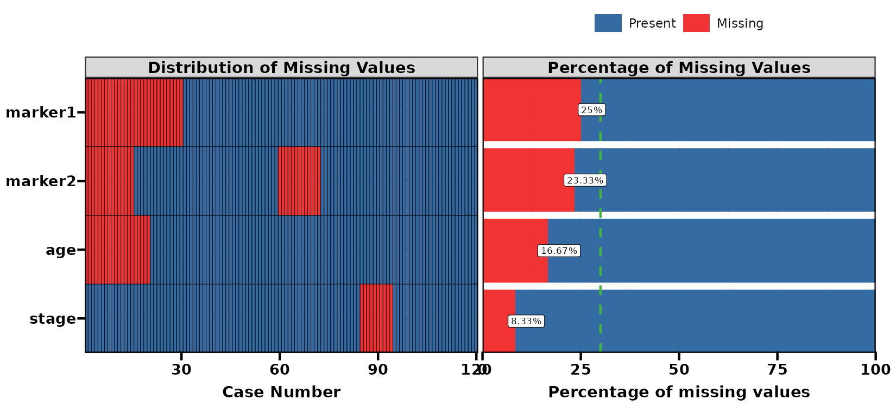{fig-alt="数据检视与缺失：摘要、缺失模式和 KNN 插补；矩阵与比例；固定模拟数据的实际参数对照结果。"}

### 比例放左侧 {.unnumbered}

比例轴反向配合左侧布局；缺失值本身没有改变。外层留白适配当前导出画布。

```r
p <- plt_na(dat, output = "both_reverse")
p + patchwork::plot_annotation(theme = theme(plot.margin = margin(5, 18, 5, 5)))
```

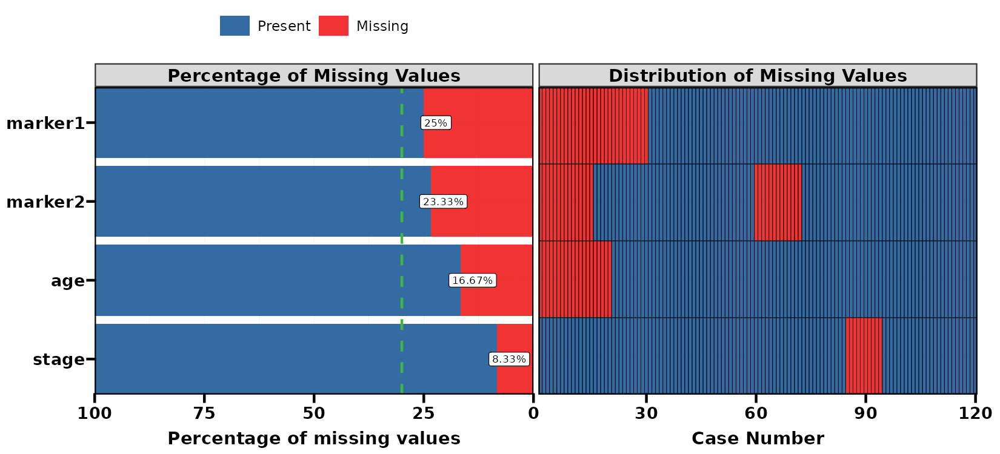{fig-alt="数据检视与缺失：摘要、缺失模式和 KNN 插补；比例放左侧；固定模拟数据的实际参数对照结果。"}

### 仅矩阵 {.unnumbered}

每个色块是一行一列的 NA 指示，不包含完整无缺失的 group 列。

```r
plt_na(dat, output = "matrix")
```

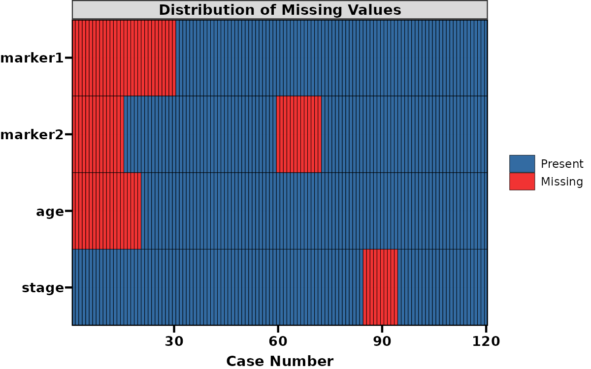{fig-alt="数据检视与缺失：摘要、缺失模式和 KNN 插补；仅矩阵；固定模拟数据的实际参数对照结果。"}

### 仅比例 {.unnumbered}

只保留各变量的 NA 比例，方便放在汇报图中。

```r
plt_na(dat, output = "percentage")
```

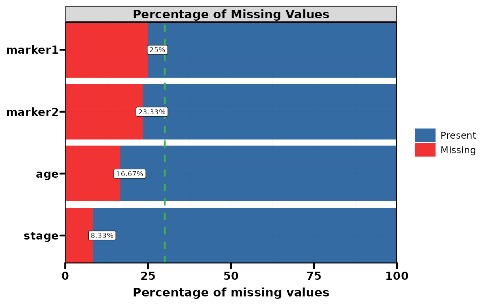{fig-alt="数据检视与缺失：摘要、缺失模式和 KNN 插补；仅比例；固定模拟数据的实际参数对照结果。"}

:::

## 排序、名称和颜色

::: {.panel-tabset}

### 缺失率升序 {.unnumbered}

换成升序后，缺失较少的变量优先显示。

```r
plt_na(dat, output = "percentage", sort = "asc")
```

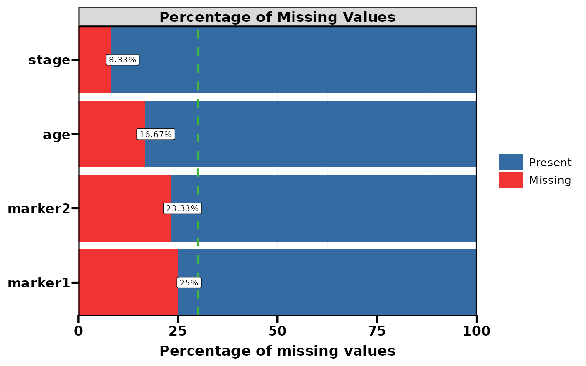{fig-alt="数据检视与缺失：摘要、缺失模式和 KNN 插补；缺失率升序；固定模拟数据的实际参数对照结果。"}

### 替换显示名称 {.unnumbered}

映射键是原列名，值是显示名称；原始数据列名保持不变。

```r
p <- plt_na(dat, name.map = c(age = "Age", marker1 = "Marker A",
                              marker2 = "Marker B", stage = "Stage"))
p + patchwork::plot_annotation(theme = theme(plot.margin = margin(5, 18, 5, 5)))
```

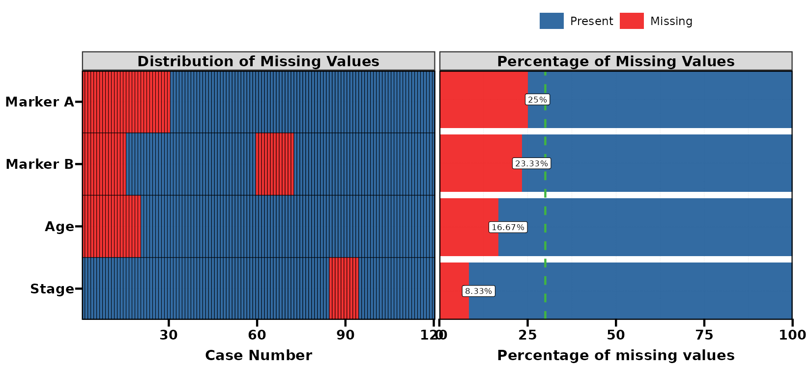{fig-alt="数据检视与缺失：摘要、缺失模式和 KNN 插补；替换显示名称；固定模拟数据的实际参数对照结果。"}

### 自定义缺失配色 {.unnumbered}

存在值浅色、缺失值深红，第三色仅用于比例图参考线。

```r
plt_na(dat, output = "matrix",
       miss_palette = c("#E7EEF5", "#B2182B", "#E69F00"))
```

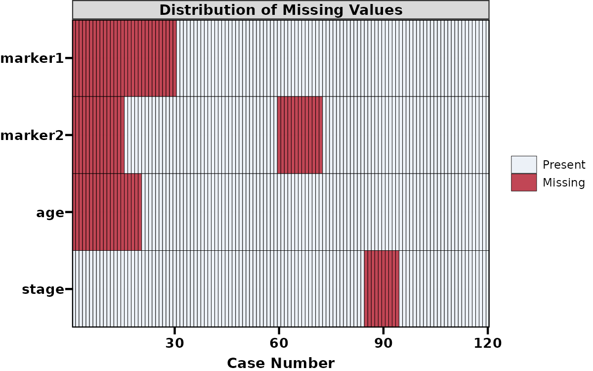{fig-alt="数据检视与缺失：摘要、缺失模式和 KNN 插补；自定义缺失配色；固定模拟数据的实际参数对照结果。"}

:::

## 联合缺失

::: {.panel-tabset}

### UpSet 缺失组合 {.unnumbered}

每根柱表示选中三列中的一个精确缺失组合；完全没有选中缺失的行不构成集合交集柱。当前返回 upset_plot/aplot，示例用 print 绘制。

```r
print(plt_upset(dat, vars = c("age", "marker1", "marker2"),
                levels = NA, output = "upset", label = "count"))
```

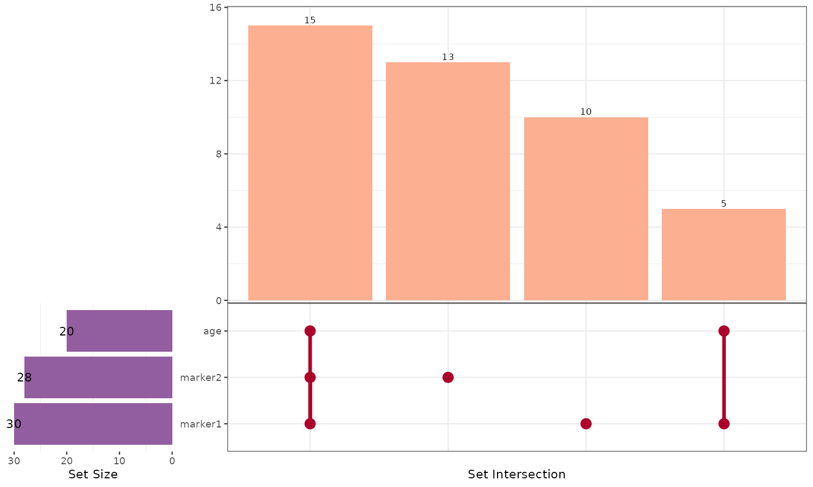{fig-alt="数据检视与缺失：摘要、缺失模式和 KNN 插补；UpSet 缺失组合；固定模拟数据的实际参数对照结果。"}

:::

## KNN 邻居数对照

::: {.panel-tabset}

### 一个邻居 {.unnumbered}

k=1 从近邻取值；本页只使用预先准备的五列，避免把行号当作距离特征。

```r
data.frame(row = 1:8, age_before = impute_input[["age"]][1:8],
           age_after = filled1[["age"]][1:8],
           marker_after = filled1[["marker1"]][1:8])
```

::: {.table-responsive}

| row| age_before| age_after| marker_after|
|---:|----------:|---------:|------------:|
|   1|         NA|        37|       6.9050|
|   2|         NA|        37|       6.9050|
|   3|         NA|        57|      11.3521|
|   4|         NA|        37|       6.9050|
|   5|         NA|        37|       6.9050|
|   6|         NA|        57|      11.3521|
|   7|         NA|        49|       9.6522|
|   8|         NA|        49|       9.6522|

:::
### 五个邻居 {.unnumbered}

数字变量使用距离加权均值；年龄插补可能出现小数。k 不决定插补不确定性区间。

```r
data.frame(row = 1:8, age_k1 = filled1[["age"]][1:8],
           age_k5 = filled5[["age"]][1:8],
           marker_k1 = filled1[["marker1"]][1:8], marker_k5 = filled5[["marker1"]][1:8])
```

::: {.table-responsive}

| row| age_k1|  age_k5| marker_k1| marker_k5|
|---:|------:|-------:|---------:|---------:|
|   1|     37| 50.9142|    6.9050|    7.5842|
|   2|     37| 50.9142|    6.9050|    7.5842|
|   3|     57| 55.6589|   11.3521|    8.0358|
|   4|     37| 50.9142|    6.9050|    7.5842|
|   5|     37| 50.9142|    6.9050|    7.5842|
|   6|     57| 55.6589|   11.3521|    8.0358|
|   7|     49| 50.8606|    9.6522|    8.3056|
|   8|     49| 50.8606|    9.6522|    8.3056|

:::
### 观察值与填充值 {.unnumbered}

区分原始观察和本次填充值，检查分布；两组人数不同，直方图用计数刻度。

```r
show_dat <- data.frame(age = c(impute_input[["age"]][!is.na(impute_input[["age"]])],
                              filled5[["age"]][is.na(impute_input[["age"]])]),
                       source = c(rep("Observed", sum(!is.na(impute_input[["age"]]))),
                                  rep("Imputed", sum(is.na(impute_input[["age"]])))))
ggplot(show_dat, aes(age, fill = source)) + geom_histogram(binwidth = 5, alpha = 0.6, position = "identity") +
  facet_wrap(vars(source), ncol = 1) + theme_my()
```

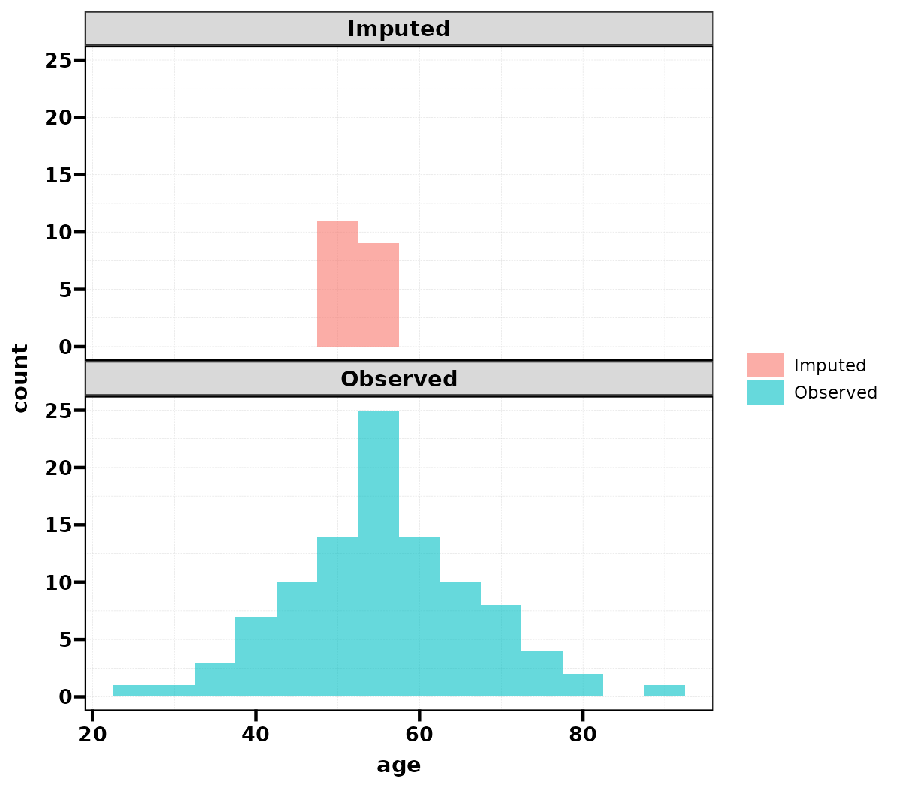{fig-alt="数据检视与缺失：摘要、缺失模式和 KNN 插补；观察值与填充值；固定模拟数据的实际参数对照结果。"}

:::

## 返回结构与边界

::: {.panel-tabset}

### 插补前后 NA 计数 {.unnumbered}

本次所有 NA 均有供体，插补后计数为零；这不是对所有数据都能成功的保证。

```r
data.frame(variable = names(impute_input),
           before = colSums(is.na(impute_input)), after = colSums(is.na(filled5)))
```

::: {.table-responsive}

|        |variable | before| after|
|:-------|:--------|------:|-----:|
|group   |group    |      0|     0|
|age     |age      |     20|     0|
|marker1 |marker1  |     30|     0|
|marker2 |marker2  |     28|     0|
|stage   |stage    |     10|     0|

:::
### 供体数不足 {.unnumbered}

供体不足会明确报错，不静默降低 k；全缺失变量也没有可用供体。

```r
tryCatch(impute_na_knn(data.frame(x = c(1, NA, NA), y = 1:3), k = 5),
         error = function(e) cat(conditionMessage(e), "\n"))
```

```text
Not enough observed donors for `k = 5`.
✖ Insufficient donors: x (1).
ℹ Reduce `k` or provide more observed values.
```

### 无 NA 输入 {.unnumbered}

完整数据会给出提示并返回 NULL；这时不应继续传给 ggsave。

```r
res <- plt_na(filled5)
print(is.null(res))
```

```text
[1] TRUE
```

:::

## 环境诊断附录

::: {.panel-tabset}

### 提取 R 环境结果 {.unnumbered}

只摘录本次执行环境的 OS/R 信息；内存、CPU 和时间等动态字段可从返回 list 读取。

```r
invisible(capture.output(sys <- check_system(return_result = TRUE, show_warnings = FALSE)))
data.frame(field = c("OS", "R version", "R platform"),
           value = c(sys[["system_info"]][["os_name"]], sys[["r_environment"]][["version"]],
                     sys[["r_environment"]][["platform"]]))
```

::: {.table-responsive}

|field      |value               |
|:----------|:-------------------|
|OS         |Linux               |
|R version  |4.4.3               |
|R platform |x86_64-pc-linux-gnu |

:::
:::

## 返回对象、保存与使用边界 {#output}

`lv()` 打印报告并不可见返回完整输入数据。`check_na()` 自 UtilsR `e81b5ab`（2026-10-22）起可见返回 gt 报告表：控制台自动打印，Quarto / R Markdown 中直接渲染成表格，也可以继续用 gt 修改或 `gt::gtsave()` 保存；没有表可出（无匹配列、零行或零列，或 `show_all = FALSE` 时没有问题）时不可见返回 `NULL`。旧写法 `dat %>% check_na() %>% ...` 不再得到数据，需要把检视和后续处理分成两步。`plt_na()` 有缺失时返回 ggplot/patchwork，无缺失时返回 NULL。`impute_na_knn()` 返回插补后的 data.frame/tibble，并保留原始观察值。本页 `lv()` 的表格捕获实际打印的 gt/gtsummary 结果，`check_na()` 的表格就是函数返回的 gt 对象。

KNN 是本次单次插补，缺失率图不能识别 MCAR/MAR/MNAR。预测建模时，供体、距离特征与预处理应在训练数据中确定；本接口示例是数据整理，未演示独立的训练/新数据转换器。未知编码、空串及特殊字符串先清洗，再决定是否纳入插补。

```r
p <- plt_na(dat, output = "percentage")
# ggplot2::ggsave("missing-percentage.pdf", p, width = 8, height = 5)
# gt::gtsave(check_na(dat), "data-quality.html")
```

本次验证保留了原有观察值、因子类型，并核对供体不足时报错。

## 当前按内容保存 PDF {#save-20261020}

2026-10-20 按已推送 UtilsR `cea978f4`（保存接口自 `0f7fe0b`）与 RegR `da6157be`，在 Windows / WSL R 4.4.3 实际执行本节。上方历史参数图保留原执行快照。这里另用固定输入演示保存，不重新选择统计模型或分组。

`save = list()` 或 `NULL` 不写文件；非空列表给 `filename`，可再给英寸单位的 `width` / `height`。文件仅支持 PDF，没有扩展名时补 `.pdf`。省略的尺寸取当前图按内容估算的画布，控制台会打印尺寸及可复制保存语句，图对象可读取 `attr(p, "plot_size")`。显式给尺寸只覆盖该维度。

<!-- refresh-20261020: na_save -->
```r
library(UtilsR)
set.seed(20261020)
d_save <- expand.grid(id = 1:6, stage = factor(c("I", "II", "III")),
  sex = factor(c("Female", "Male")), site = factor(c("A", "B")))
d_save[["score"]] <- rnorm(nrow(d_save)) + as.integer(d_save[["stage"]])
d_save[["marker"]] <- rnorm(nrow(d_save))
d_missing <- d_save[c("score", "marker", "stage")]
d_missing[["score"]][seq(1, nrow(d_missing), 4)] <- NA
d_missing[["marker"]][seq(2, nrow(d_missing), 6)] <- NA
p_saved <- plt_na(d_missing, output = "matrix",
  save = list(filename = file.path(tempdir(), "20261020-refresh-missing.pdf")))
size <- attr(p_saved, "plot_size")
stopifnot(length(size) == 2L, all(is.finite(size)), all(size > 0))
size
```
<!-- /refresh-20261020: na_save -->

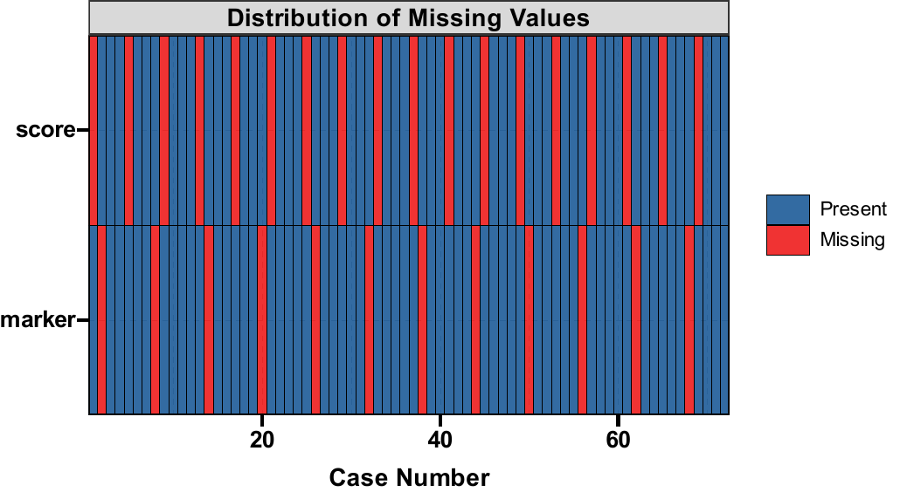{fig-alt="missing教程的固定输入保存示例，预览由实际导出的PDF转换，展示按内容估算的画布。"}

[下载本图 PDF](images/missing-guide/20261020-refresh-missing.pdf)

尺寸随有缺失的变量行数和输出面板估算。完全没有缺失时仍返回 NULL，不生成图或 PDF；保存参数不会把完整数据转换成缺失模式。

UtilsR 的绘图本身不以 RegR 为硬依赖；当前 RegR 可用时才会提供尺寸提示和 `plot_size`，非空保存配置也需要它。缺少兼容 RegR 时，空保存配置仍可画图；此时不要假定图一定有 `plot_size`。本节使用的两包提交已一起验证，版本号相同不代表旧安装含有这些更新。

## 当前检视：选列返回、标签缺失与小比例 {#inspection-20261021}

以下示例最初按已推送 UtilsR `6536207` 执行，2026-10-22 按 `cdfdfec` 在 Windows / WSL R 4.4.3 重新执行：代码改为检查返回的 gt 表，两张报告图与 HTML 随之更新。上方历史插补与绘图示例保留原执行范围。

<!-- refresh-20261021: inspection -->

### 检视范围与返回范围

`check_na()` 的选列只决定检查对象；分组 tibble 仍跨全部行检视，不按组分别计算。下面只展示四列，把 `note` 显示为 `Text`。函数返回这张 gt 表，输入数据本身不变。SPSS 用户缺失、`integer64` 缺失通过各自方法识别；本例需要 haven、labelled 和 bit64。

```r
library(UtilsR)
d_quality <- dplyr::group_by(tibble::tibble(
  group = factor(rep(c("A", "B"), each = 4)),
  note = c("unknown", "not\tavailable", "\u00a0", "éunknown", "Canada", NA,
           "known", "UNKNOWN missing"),
  stage = factor(rep(c("I", "II"), 4), levels = c("I", "II", "Unknown")),
  code = haven::labelled_spss(c(1, 99, 1, NA, 1, 99, 1, 1), na_values = 99),
  score64 = bit64::as.integer64(c("1", NA, "3", "4", "5", "6", "7", "8"))
), group)
report <- check_na(d_quality, Text = note, stage, code, score64, show_all = TRUE)
stopifnot(inherits(report, "gt_tbl"), nrow(report[["_data"]]) == 4L)
gt::gtsave(report, file.path(tempdir(), "20261021-refresh-report-01.html"))
```

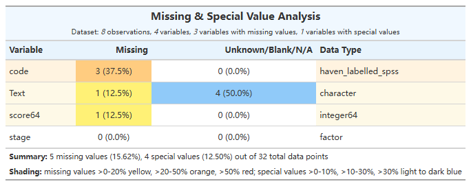{fig-alt="8行4个选中变量的原生质量报告，Text缺失1个、特殊值4个；code缺失3个，score64缺失1个，stage无问题。"}

[查看原生 HTML 表](images/missing-guide/20261021-refresh-report-01.html)

特殊字符串匹配不区分大小写，先合并 Unicode 空白，再识别内置标记（完整列表见下一小节）；空白串计入 blank。`éunknown` 和 `Canada` 不匹配，`UNKNOWN missing` 只计一次。`is.na()` 已识别的值只计缺失，不重复计入特殊值。未使用的因子水平既不计数，也不从返回数据删除。副标题统计有问题的**变量数**；脚注统计选中列的**单元格数**。

### 很小的非零比例

```r
tiny <- data.frame(x = c(NA_real_, rep(1, 100000)), ok = rep(1, 100001))
tiny_report <- check_na(tiny, show_all = TRUE)
stopifnot(inherits(tiny_report, "gt_tbl"))
```

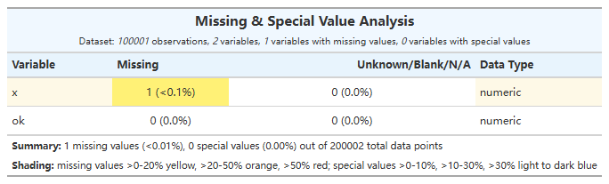{fig-alt="100001行2列中仅一个缺失：单元格显示小于0.1%，总体显示小于0.01%，确实为零的列仍显示0.0%。"}

颜色使用未四舍五入的比例；单元格显示 1 位小数、脚注显示 2 位，低于显示分辨率的正值分别写为 `<0.1%`、`<0.01%`。计数和数据点总数用 double 累加，保持整数显示；本页没有分配超大数据来演示容量上限。表下的 Shading 脚注列出颜色阈值：缺失 >0–20% 黄、>20–50% 橙、>50% 红；特殊值 >0–10%、>10–30%、>30% 由浅到深蓝（UtilsR `e76e4cd` 起最高一档颜色最深）。

```r
none <- check_na(d_quality, pattern = "^no_such_column$")
clean <- check_na(d_quality, stage)
stopifnot(is.null(none), is.null(clean), is.null(check_na(d_quality[0, ])))
```

无匹配列、零行、零列只提示，并不可见返回 `NULL`；`show_all=FALSE` 时没有问题也不出表，同样返回 `NULL`。`pattern=""` 匹配所有列；非空 pattern 仍优先于 `...`，两者同时给出时警告 `` `pattern` takes precedence; the selection in `...` is ignored. ``；无效正则（如 `"("`）直接报错。列名必须非空且唯一；选中列必须是一维，`show_all` 必须是单个非缺失逻辑值。`lv()` 复用同一套缺失和特殊值计数，默认摘要中的唯一值数按实际观察水平计算。

### 特殊值词表与 special {#special-20261022}

UtilsR `cdfdfec` 起，内置标记为整词 unknown(s)、blank(s)、n/a、na、missing、unspecified、not available / applicable / stated / reported、null，只由 `?`、`-`、`.` 组成的值，以及空串和空白串；`lv()` 共用这套词表。`None` 可能是“未治疗”这类真实类别，不在词表里。标记出现在值的任何位置都会计入，所以 `Unknown primary site` 这类类别也算特殊值；需要不同口径时用 `special` 传入正则，它会**替换**内置词表，`character(0)` 表示不计特殊值。

```r
d_marker <- data.frame(value = c("Blanks", "Unknowns", "Not applicable", "not  stated",
                                 "NULL", "?", "None", "Unknown primary site", "ok", NA))
check_na(d_marker, show_all = TRUE)
custom <- check_na(d_marker, special = c("^none$", "^unknowns?$"), show_all = TRUE)
off <- check_na(d_marker, special = character(0), show_all = TRUE)
stopifnot(custom[["_data"]][["special_combined"]] == "2 (20.0%)",
          off[["_data"]][["special_combined"]] == "0 (0.0%)")
```



内置词表计入 7 个值（70.0%）：`None` 和 `ok` 不计，真正的 `NA` 只计缺失。`special` 的正则不区分大小写、匹配合并空白后的值，按需要用 `^...$` 或 `\b` 锚定；空串只有在某个正则能匹配时才计入（如 `"^$"`）。

### 全局对象大小与 HTML 条形

`check_size()` 返回可继续用 gt 格式化的表。下面只创建两个唯一命名的演示对象，结束时清理这两个对象；不会检查整个工作区。

```r
size_table <- (function() {
  nm <- paste0(basename(tempfile("size_demo_")), c("_small", "_large"))
  list2env(stats::setNames(list(raw(64), raw(4096)), nm), .GlobalEnv)
  on.exit(rm(list = nm, envir = .GlobalEnv), add = TRUE)
  result <- check_size(c(nm, nm[[1]]))
  by_index <- check_size(match(nm, ls(envir = .GlobalEnv, all.names = TRUE)))
  empty <- check_size(character())
  stopifnot(inherits(result, "gt_tbl"), nrow(result[["_data"]]) == 3L,
            identical(result[["_data"]], by_index[["_data"]]),
            nrow(empty[["_data"]]) == 0L,
            is.numeric(result[["_data"]][["Size_bar"]]))
  result
})()
gt::gtsave(size_table, file.path(tempdir(), "20261021-refresh-object-size.html"))
stopifnot(!grepl("<div", gt::as_latex(size_table), fixed = TRUE),
          !grepl("<svg", gt::as_raw_html(size_table), fixed = TRUE))
```

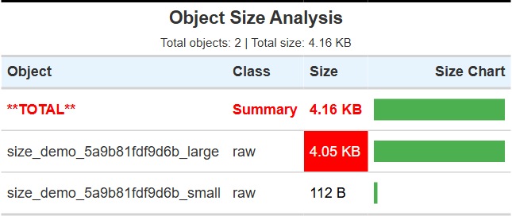{fig-alt="check_size原生表：底层大小保持MB数值，显示自动选择B或KB单位；总计在首行，条形按最大单个对象缩放。"}

[查看原生 HTML 表](images/missing-guide/20261021-refresh-object-size.html)

字符名称不枚举整个工作区；数值下标对应 `ls(.GlobalEnv, all.names=TRUE)` 的排序，容易随工作区变化，通常优先传名称。重复名只读取一次；未匹配或显式空选择返回零行 gt。只查 `.GlobalEnv`，不会到父环境寻找同名对象。缺失或读取失败的对象会警告并跳过。

`Size` / `Size_bar` 保持 MB 数值，显示列和副标题自动选择 B、KB、MB、GB；很小的正值不显示为 0 MB。HTML 条形按最大**单个对象**缩放，总计封顶 100%；其他格式保留大小文字。总计按首行位置识别，普通对象即使叫 `**TOTAL**` 也不套用总计样式。

大小来自 `utils::object.size()`，不是进程占用或删除后能释放的内存；相加可能重复计算共享存储，也不能完整覆盖环境、闭包环境、外部指针及紧凑 ALTREP。每个绑定只读取一次，但读取 active binding 或 promise 仍会执行相应计算。

<!-- /refresh-20261021: inspection -->

## 对象检视：零大小、排序与读取失败原因 {#size-causes-20261022}

<!-- sync-20261022: size_causes -->

2026-10-22 按已推送 UtilsR `9260590` 在 Windows / WSL R 4.4.3 执行。`check_size()` 的正则选择先匹配、再只排序匹配名；结果仍按大小降序，同大小对象保留名称排序。全部估算大小为零时，大小单元格使用中性白色；这表示 `object.size()` 的结果为零，不是进程内存为零。

```r
library(UtilsR)
zero_sizes <- (function() {
  nm <- paste0("rnotes_size_zero_", c("b", "a"))
  stopifnot(!any(vapply(nm, exists, logical(1), envir = .GlobalEnv, inherits = FALSE)))
  on.exit(rm(list = nm, envir = .GlobalEnv), add = TRUE)
  list2env(stats::setNames(list(NULL, NULL), nm), .GlobalEnv)
  result <- check_size(pattern = "^rnotes_size_zero_[ab]$")
  stopifnot(identical(result[["_data"]][["Object"]], c("**TOTAL**", sort(nm))),
    all(result[["_data"]][["Size"]] == 0))
  html <- gt::as_raw_html(result)
  cells <- grep('headers="Size_fmt"', strsplit(html, "\n", fixed = TRUE)[[1]], value = TRUE)
  stopifnot(length(cells) == 3L, all(grepl("background-color: #FFFFFF", cells[2:3], fixed = TRUE)))
  result
})()
gt::gtsave(zero_sizes, file.path(tempdir(), "20261022-sync-size-zero.html"))
```

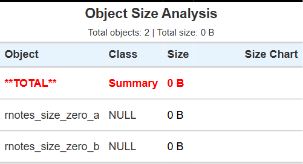{fig-alt="check_size原生gt表，总计与两个NULL对象的大小均为0，普通对象的大小单元格为中性白色，没有零宽色域的误导性中间颜色。"}

[查看原生 HTML 表](images/missing-guide/20261022-sync-size-zero.html)

### 读取失败保留原始错误，且只读取一次

```r
validation_values <- (function() {
  nm <- c("rnotes_size_bad", "rnotes_size_ok")
  stopifnot(!any(vapply(nm, exists, logical(1), envir = .GlobalEnv, inherits = FALSE)))
  on.exit(rm(list = nm, envir = .GlobalEnv), add = TRUE)
  reads <- 0L
  makeActiveBinding(nm[[1]], function(value) {
    reads <<- reads + 1L
    stop("missing backing file")
  }, .GlobalEnv)
  assign(nm[[2]], raw(16), envir = .GlobalEnv)
  notes <- character()
  result <- withCallingHandlers(check_size(nm), warning = function(w) {
    notes <<- c(notes, conditionMessage(w)); invokeRestart("muffleWarning")
  })
  stopifnot(reads == 1L, length(notes) == 1L,
    grepl("rnotes_size_bad (missing backing file)", notes, fixed = TRUE),
    identical(result[["_data"]][["Object"]], c("**TOTAL**", nm[[2]])))
  data.frame(failed_binding_reads = reads, warning_contains_cause = TRUE,
             retained_objects = nrow(result[["_data"]]) - 1L)
})()
validation_values
```

同一次检视会把各失败绑定的名称及原始原因合成一条警告，并跳过失败对象，不为拼警告再次读取；全失败仍返回零行 gt。示例的 active binding 读取一次后报错，另一个对象仍正常显示。仅在独立示例进程或确认没有重名对象的环境运行这种绑定演示；本例为两个演示名检查冲突并在退出时清理。

显式名称选择仍不枚举整个全局环境；数值下标仍依据完整排序名称表。排序范围缩小不改变选择合同，读取 active binding 或 promise 仍可能执行其计算，不能把检视视为无副作用。

<!-- /sync-20261022: size_causes -->

## 当前完整接口 {#interfaces}

点击展开查看本次实际执行版本的参数及默认值。

<details>
<summary>公共函数签名</summary>

```r
lv <-
function (data, ...)
NULL

lv.data.frame <-
function (data, ..., pattern = NULL, group = NULL, count = NULL, cat_args = list())
NULL

check_na <-
function (data, ..., pattern = NULL, special = NULL, show_all = FALSE)
NULL

plt_na <-
function (data, name.map = NULL, miss_palette = as.character(pal_lancet[c(1, 2, 3)]), output = c("both",
    "both_reverse", "matrix", "percentage"), sort = c("desc", "asc"), save = list())
NULL

impute_na_knn <-
function (data, k = 5, verbose = TRUE)
NULL

plt_upset <-
function (data, vars = NULL, levels = c("Yes", "yes"), colors = NULL, output = c("both", "venn",
    "upset", "data", "all"), label = c("both", "count", "percent", "none"), label_geom = c("label",
    "text"), label_color = "black", label_size = 3.5, label_alpha = 0.6, venn.fill = c("gradient",
    "gradient_rev", "category", "none"), venn.alpha = 0.5, edge.color = "grey30", edge.size = 1,
    set.name.size = 4, set.labels = NULL)
NULL

check_size <-
function (..., pattern = NULL)
NULL

check_system <-
function (return_result = FALSE, show_warnings = FALSE)
NULL

```

</details>

## 验证范围与参考 {#references}

本页列出的调用均已实际执行；所有展示的 ggplot/patchwork 图通过 `ggplot_build()` 和 PNG 导出，表格来自同一组代码的实际返回。未修改 UtilsR 源码或重新运行全包测试。

本次绘制出现的提示记录如下；对应示例仍通过实际构建和导出检查。

<details>
<summary>绘图提示</summary>

- `No missing values found in the dataset.`

</details>

- [UtilsR 函数参考](https://hui950319.github.io/UtilsR/reference/index.html)
- [UtilsR 源码](https://github.com/HUI950319/UtilsR/tree/master/R)
- [专题目录](index.qmd)

<details>
<summary>执行环境</summary>

```text
R version 4.4.3 (2025-02-28)
Platform: x86_64-pc-linux-gnu
Running under: Ubuntu 22.04.2 LTS

Matrix products: default
BLAS:   /usr/lib/x86_64-linux-gnu/openblas-pthread/libblas.so.3
LAPACK: /usr/lib/x86_64-linux-gnu/openblas-pthread/libopenblasp-r0.3.20.so;  LAPACK version 3.10.0

locale:
 [1] LC_CTYPE=C.UTF-8       LC_NUMERIC=C           LC_TIME=C.UTF-8        LC_COLLATE=C.UTF-8
 [5] LC_MONETARY=C.UTF-8    LC_MESSAGES=C.UTF-8    LC_PAPER=C.UTF-8       LC_NAME=C
 [9] LC_ADDRESS=C           LC_TELEPHONE=C         LC_MEASUREMENT=C.UTF-8 LC_IDENTIFICATION=C

time zone: Asia/Shanghai
tzcode source: system (glibc)

attached base packages:
[1] stats     graphics  grDevices utils     datasets  methods   base

other attached packages:
[1] ggplot2_4.0.3 UtilsR_0.6.8

loaded via a namespace (and not attached):
 [1] gtable_0.3.6       httr2_1.2.2        ggrepel_0.9.8      VIM_6.2.2          lattice_0.23-1
 [6] vctrs_0.7.3        tools_4.4.3        generics_0.1.4     tibble_3.3.1       proxy_0.4-27
[11] DEoptimR_1.1-3     pkgconfig_2.0.3    Matrix_1.7-6       data.table_1.17.8  RColorBrewer_1.1-3
[16] S7_0.2.2           lifecycle_1.0.5    compiler_4.4.3     farver_2.1.2       textshaping_0.4.0
[21] ggprism_1.0.7      carData_3.0-6      class_7.3-23       Formula_1.2-6      pillar_1.11.1
[26] car_3.1-5          tidyr_1.3.2        MASS_7.3-64        boot_1.3-31        abind_1.4-8
[31] robustbase_0.99-4  tidyselect_1.2.1   ggh4x_0.3.1        digest_0.6.39      dplyr_1.2.0
[36] purrr_1.2.1        labeling_0.4.3     forcats_1.0.1      labelled_2.16.0    grid_4.4.3
[41] colorspace_2.1-2   cli_3.6.6          magrittr_2.0.4     patchwork_1.3.2    dichromat_2.0-0.1
[46] vcd_1.4-12         e1071_1.7-14       withr_3.0.3        scales_1.4.0       rappdirs_0.3.4
[51] sp_2.1-4           otel_0.2.0         nnet_7.3-20        ranger_0.18.0      ragg_1.5.2
[56] mcptools_0.2.1     zoo_1.9-1          hms_1.1.4          haven_2.5.5        laeken_0.5.3
[61] lmtest_0.9-40      rlang_1.3.0        Rcpp_1.1.1         glue_1.8.1         coro_1.1.0
[66] jsonlite_2.0.0     ellmer_0.4.0       R6_2.6.1           systemfonts_1.1.0
```

</details>
