pal_list、pal_get、pal_show 及 Brewer、HCL、ggsci、viridis 色卡，命名映射与热图应用。各节用固定输入比较重要参数，标签页中展示可复制代码与实际结果。

::: {.callout-note collapse="true" title="版本与复现记录"}
2026-11-06 追加按已推送 UtilsR `8ceda1e9`（0.6.23）导出源码，同时固定 RegR `7dad336b` 与 UtilsR `8ceda1e9`，在 Windows / WSL R 4.4.3 独立运行下述合成示例。旧图保留原执行快照；此次没有重跑历史模型或安装包。

2026-11-03 追加按已推送 UtilsR `680ef17d`（0.6.22）导出源码；配套依赖固定为 RegR `f80e0e95`、UtilsR `680ef17d`，在 Windows / WSL R 4.4.3 独立运行下述合成示例。旧图保留原执行快照；此次没有重跑历史模型或安装包。

2026-11-03 追加按已推送 UtilsR `fafe93a3`（0.6.21）导出源码，在 Windows / WSL R 4.4.3 独立运行下述合成示例。旧图保留原执行快照；此次没有重跑历史模型或安装包。

2026-11-02 追加按已推送 UtilsR `4e9d5e95`（0.6.21）导出源码，在 Windows / WSL R 4.4.3 独立运行下述合成示例。旧图保留原执行快照；此次没有重跑历史模型或安装包。

**版本与执行范围：** 本页按 UtilsR **0.6.8** 的公共接口核对；21 个示例已在 WSL R 4.4.3 中实际执行，其中 19 张图已完成构建与 PNG 导出。使用固定随机种子的模拟数据。`pal_get()` 的输入、透明度、`x` 映射和报错按 UtilsR **0.6.19**（`261a7644`）更新，相关示例于 2026-10-31 在 WSL R 4.4.3 重新执行。
:::

## 数据准备与输入约定 {#data}

本页使用三组柱形摘要和围绕零变化的规则数值网格；内置色板对象直接来自安装版 UtilsR。

```r
library(UtilsR)
library(ggplot2)
library(patchwork)
set.seed(1004)
dat <- data.frame(group = factor(c("A", "B", "C"), levels = c("A", "B", "C")),
                  value = c(12, 18, 9))
grid_dat <- expand.grid(x = 1:12, y = 1:8)
grid_dat[["score"]] <- sin(grid_dat[["x"]] / 2) * cos(grid_dat[["y"]] / 2)
p_bar <- ggplot(dat, aes(group, value, fill = group)) + geom_col(width = 0.65) + theme_my()
p_heat <- ggplot(grid_dat, aes(x, y, fill = score)) + geom_tile() + coord_equal() + theme_heat()
```

## 函数选择与重要参数 {#parameters}

::: {.table-responsive tabindex="0" role="region" aria-label="表格，可横向滚动"}

| 目标 | 参数及默认值 | 使用要点 |
|:--|:--|:--|
| 检索色板 | `pal_list(pattern=NULL, type="all", show=TRUE)` | 正则过滤名字；type 为 discrete/continuous；show=FALSE 仍打印名称，返回 list 不可见 |
| 提取颜色 | `pal_get(palette="Paired", n=NULL, x=NULL)` | NULL（`pal_lancet`）、名称、R 能绘制的颜色、颜色向量或完整命名的色板 list；x 与 n 同时给出时优先 x |
| 稳定类别映射 | `x` 为 factor/character/logical | 返回按水平命名的颜色；factor 按 levels，其余按首次出现顺序，缺失值不占颜色 |
| 按数值取色 | `x` 为 numeric | 每个元素按数值在色板上取色；NA、Inf 返回 NA，所有值相同时取中间色 |
| 颜色数量 | `n` | pal_get 的 n 可为0，保留取前缀或插值规则；pal_show/来源查看函数要求正整数；各来源的生成与单色显示遵守下方原生规则 |
| 顺序与透明度 | `reverse=FALSE`、`alpha=1` | 返回颜色顺序反转和透明通道，数值 x 时 reverse 翻转色标、元素位置不变；alpha 范围 0–1，默认 1 保留颜色自带的透明度 |
| 色卡输出 | `pal_show(output="gt")` | 默认 gt 表格；本页图形用 output="gg"；console 输出控制台色卡 |
| 色卡布局 | `max_colors=20`、`index=NULL`、`label=TRUE`、`label_size=3`、`ncol=NULL` | index 为非空唯一正整数索引；ncol/label/label_size用于ggplot，max_colors限制实际预览数 |
| Brewer | `type="all"`、`n=NULL` | qual/seq/div 分类；最大原生颜色数受该色板限制 |
| HCL | `n=8`、`type="all"` | qualitative/sequential/diverging；从指定方案生成 n 色 |
| ggsci | `pattern/index`、`n`、`reverse/alpha` | 使用完整色板名或正则；如 ggsci_npg_nrc，而不是只有期刊缩写 |
| viridis | `n=8`、`begin=0`、`end=1`、`direction=1`、`alpha=1` | begin/end 控制取色域，direction=-1 反向；生成时覆盖指定范围 |
| 已内置对象 | `pal_lancet/pal_bar/pal_paraSC/pal_other/pal_heat` | 是颜色向量或 list；热图 pal_heat 用连续插值，不能当作五个离散等级 |

:::

## 检索与内置色卡

::: {.panel-tabset}

### 按名称检索 {.unnumbered}

实际返回的色板名称、颜色数量和类型；名称必须按当前目录核对。

```r
pals <- pal_list(pattern = "^(lancet|Paired|Blues|viridis)$", show = FALSE)
data.frame(palette = names(pals), colors = lengths(pals),
           type = vapply(pals, function(z) attr(z, "type"), character(1)))
```

|        |palette | colors|type       |
|:-------|:-------|------:|:----------|
|Paired  |Paired  |     12|discrete   |
|Blues   |Blues   |      9|continuous |
|viridis |viridis |    256|continuous |
|lancet  |lancet  |     15|discrete   |

### Lancet 向量 {.unnumbered}

内置向量可直接展示；关闭标签便于快速比较色调。

```r
pal_show(pal_lancet, output = "gg", label = FALSE)
```

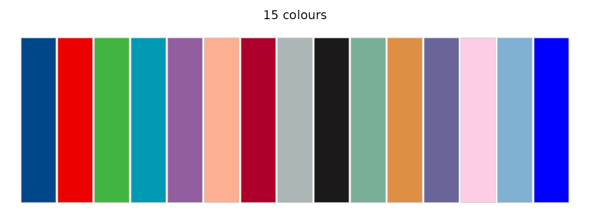{fig-alt="配色系统：检索、颜色映射与离散和连续色阶；Lancet 向量；固定模拟数据的实际参数对照结果。"}

### 柱形色板 {.unnumbered}

每行五个色块，显示当前颜色编码。

```r
pal_show(pal_bar, output = "gg", ncol = 5, label_size = 3)
```

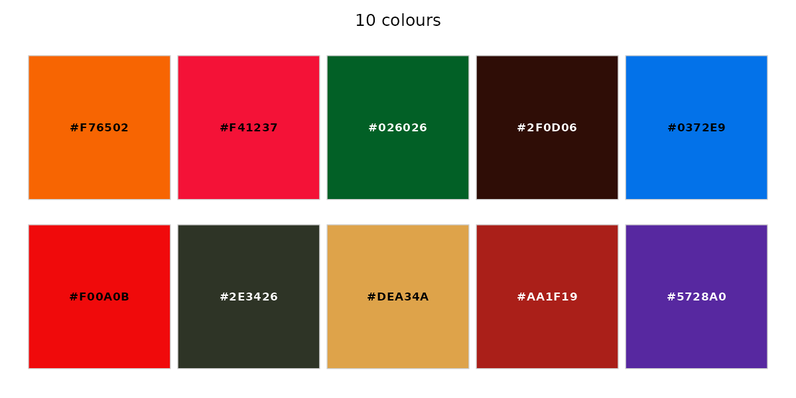{fig-alt="配色系统：检索、颜色映射与离散和连续色阶；柱形色板；固定模拟数据的实际参数对照结果。"}

### 发散色板集合 {.unnumbered}

展示精选三套发散色板，中间颜色为白色。

```r
pal_show(pal_heat[c("blue_red", "purple_teal", "indigo_gold")], output = "gg")
```

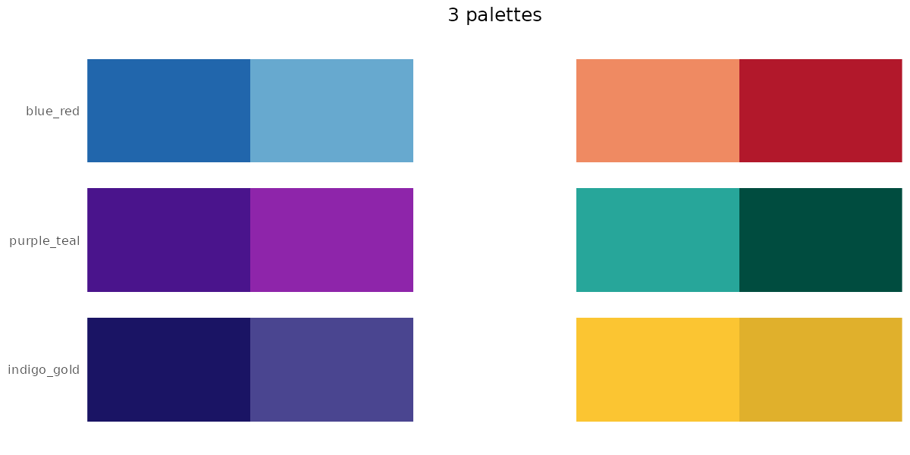{fig-alt="配色系统：检索、颜色映射与离散和连续色阶；发散色板集合；固定模拟数据的实际参数对照结果。"}

:::

### 控制台色卡与注册集合的范围（2026-11-02） {#palette-console-20261102c}

<!-- update-20261102c: utils_palette_console -->

`pal_list()` 仍在控制台打印注册集合的名称与可选色块，不返回Viewer表格；gt预览用 `pal_show()`。窄控制台保留完整色板名，放不下的数量、类型另行换行。`show_color()` 按stdout支持的颜色深度渲染，透明背景合成到白底，但RGBA标签和可复制的原始向量保留；无色日志跳过ANSI样式构建。图形预览与无色/256色/真彩终端的视觉效果不能直接等同。

```r
console_colours <- c("#FF000080", "transparent", "steelblue")
plain_palette <- withr::with_options(list(width = 34, cli.width = 34, cli.num_colors = 1L),
  capture.output(plain_value <- withVisible(show_color(console_colours))))
true_palette <- withr::with_options(list(width = 34, cli.width = 34, cli.num_colors = 16777216L),
  capture.output(true_value <- withVisible(show_color(console_colours))))
catalogue_lines <- withr::with_options(list(width = 34, cli.width = 34, cli.num_colors = 1L),
  capture.output(catalogue_value <- pal_list(pattern = "^ggsci_material_red$", show = FALSE)))
continuous_catalogue <- capture.output(continuous_value <- pal_list(
  pattern = "^ggsci_(gsea|material|bs5|tw3)_", type = "continuous", show = FALSE))
```

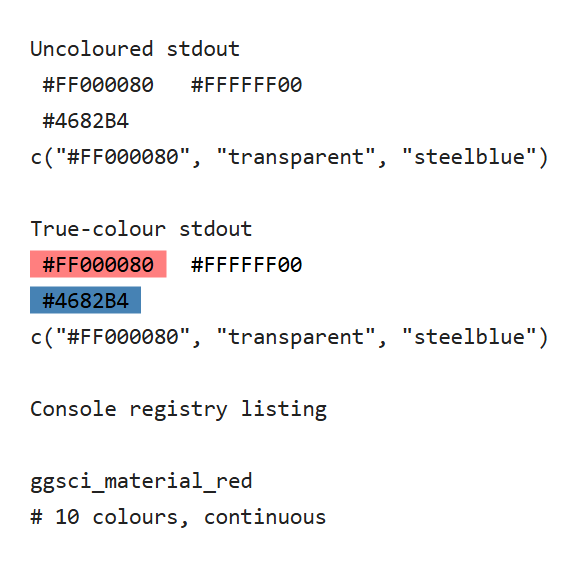{fig-alt="原生控制台输出，无色与真彩色卡的代码一致，透明色块按白底合成，注册色板名称完整显示。"}

[原生控制台 HTML](images/palette-guide/20261102c-update-palette-console.html)

注册表只含 `palette_list` 的条目；`pal_heat` 以及未注册的 `pal_other` 项应直接传入颜色向量或命名列表，不能只传其对象内部的名称字符串。GSEA、Material、Bootstrap与Tailwind顺序色板按连续类型检索，dichromat的Categorical.12按离散类型检索。构建脚本会检查来源集合和条目完整性；本轮只核对固定注册数据与隔离测试，没有重建项目的色板库。

::: {.callout-note collapse="true" title="复核代码"}
HTML复用[打印预览辅助函数](../console-print/result-blocks.qmd#ansi-20261101c)中的 `save_consoleC()`，生成预览前先运行其定义。

```r
stopifnot(identical(plain_value[["value"]], console_colours), !plain_value[["visible"]],
  identical(true_value[["value"]], console_colours), !true_value[["visible"]],
  !any(grepl("\033", plain_palette, fixed = TRUE)),
  any(grepl("#FF000080", plain_palette, fixed = TRUE)),
  any(grepl("ggsci_material_red", catalogue_lines, fixed = TRUE)))
stopifnot(length(continuous_value) > 0L,
  all(vapply(continuous_value, function(p) identical(attr(p, "type"), "continuous"), logical(1))))
save_consoleC(c("Uncoloured stdout", plain_palette, "", "True-colour stdout", true_palette,
  "", "Console registry listing", catalogue_lines), "20261102c-update-palette-console.html")
validation_values <- list(original = plain_value[["value"]],
  plain = cli::ansi_strip(plain_palette), true_colour = cli::ansi_strip(true_palette),
  matched_continuous = names(continuous_value))
```
:::

<!-- /update-20261102c: utils_palette_console -->

### 窄控制台、缺失颜色与可复制属性（2026-11-03） {#console-values-20261103}

<!-- update-20261103: utils_palette_stdout -->

`show_color()`接受无类、无维度的字符颜色向量，`rev`只接受普通逻辑标量。实际`NA_character_`、字面`"NA"`和`"transparent"`按R的透明颜色显示，但返回值与可复制表达式保留它们各自的原值、名称和其他属性；反转时名称随颜色反转。数值属性保留17位精度。环境等特殊属性仍不能保证由`dput()`重建。

色块按stdout能力、可用宽度与渲染器实际支持的颜色深度绘制；索引终端按其发出的颜色选择文字对比度。旧cli版本最多支持256色，用户自定义终端主题仍可能改变观感。HEX标签保持完整，不把窄控制台的色块换行解释成数据变化。

```r
console_values <- structure(c(missing = NA_character_, literal = "NA", clear = "transparent", red = "#FF000080"),
  cutoff = c(1.2345678901234567, pi))
console_plain <- withr::with_options(list(width = 12, cli.width = 12, cli.num_colors = 1L),
  capture.output(console_return <- withVisible(show_color(console_values, rev = TRUE))))
console_true <- withr::with_options(list(width = 12, cli.width = 12, cli.num_colors = 16777216L),
  capture.output(show_color(console_values, rev = TRUE)))
```

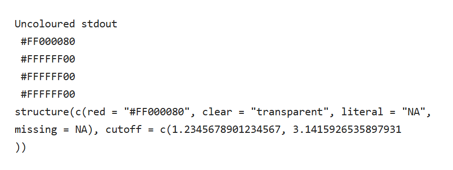{fig-alt="宽度12的无色stdout预览，半透明红色和三个透明颜色标签保留，反转后的名称与cutoff属性仍在复制表达式中。"}

[原生控制台 HTML](images/palette-guide/20261103-update-palette-console-values.html)

::: {.callout-note collapse="true" title="复核代码"}
HTML复用[控制台预览辅助函数](../console-print/result-blocks.qmd#ansi-20261101c)的`save_consoleC()`；先运行其定义。

```r
expected_return <- console_values
expected_return[] <- rev(console_values)
names(expected_return) <- rev(names(console_values))
expression_start <- grep("structure(", console_plain, fixed = TRUE)[1]
restored_values <- eval(parse(text = paste(console_plain[expression_start:length(console_plain)], collapse = "\n")))
stopifnot(!console_return[["visible"]], identical(console_return[["value"]], expected_return),
  identical(restored_values, expected_return), !any(grepl("\033", console_plain)),
  any(grepl("#FFFFFF00", console_plain, fixed = TRUE)),
  identical(cli::ansi_strip(console_true), console_plain))
save_consoleC(c("Uncoloured stdout", console_plain),
  "20261103-update-palette-console-values.html")
validation_values <- list(returned = console_return[["value"]], attributes = attributes(console_return[["value"]]),
  plain = console_plain)
```
:::

<!-- /update-20261103: utils_palette_stdout -->

## 颜色数量、顺序与透明度

::: {.panel-tabset}

### 自定义命名颜色 {.unnumbered}

命名颜色向量保留图例类别含义，不需要登记到色板库。

```r
pal_show(c(Control = "#0072B2", Treatment = "#D55E00", Other = "#009E73"),
         output = "gg", label = TRUE, label_size = 4)
```

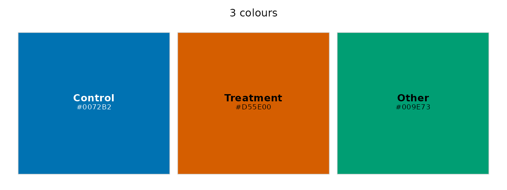{fig-alt="配色系统：检索、颜色映射与离散和连续色阶；自定义命名颜色；固定模拟数据的实际参数对照结果。"}

### 从三色插值到九色 {.unnumbered}

n 超过输入颜色数时插值生成九色；这里把色块当作连续梯度预览。

```r
pal_show(pal_get(c("#2166AC", "#FFFFFF", "#B2182B"), n = 9),
         output = "gg", label = FALSE)
```

{fig-alt="配色系统：检索、颜色映射与离散和连续色阶；从三色插值到九色；固定模拟数据的实际参数对照结果。"}

### 反向颜色 {.unnumbered}

先选择六色，再反转这六色的顺序。

```r
pal_show(pal_get(pal_lancet, n = 6, reverse = TRUE), output = "gg")
```

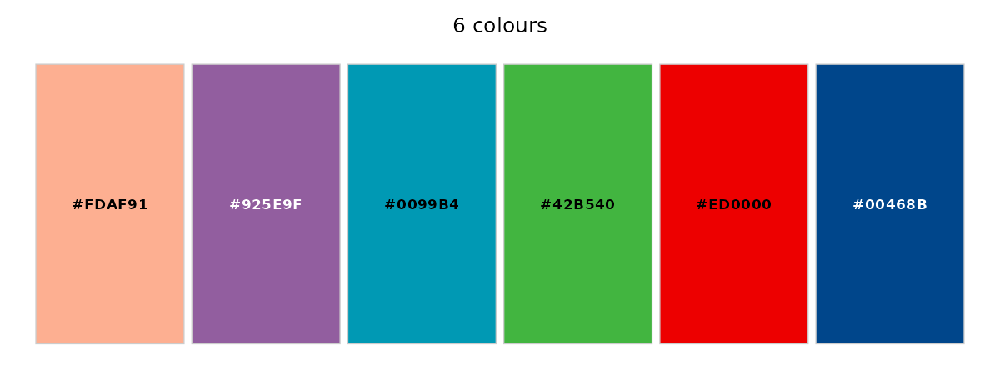{fig-alt="配色系统：检索、颜色映射与离散和连续色阶；反向颜色；固定模拟数据的实际参数对照结果。"}

### 半透明颜色 {.unnumbered}

在白背景显示 alpha=0.4 的颜色；合成后的视觉色会受背景影响。

```r
pal_show(pal_get(pal_lancet, n = 6, alpha = 0.4), output = "gg")
```

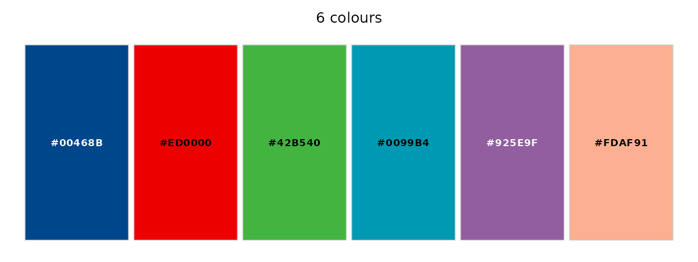{fig-alt="配色系统：检索、颜色映射与离散和连续色阶；半透明颜色；固定模拟数据的实际参数对照结果。"}

### 数值 x 按数值取色 {.unnumbered}

每个元素按数值在色板上取色：x1 的 1 贴近 0，x2 的 50 落在中间。每个向量只按自己的最小值和最大值取色，要让多组数值可比，请用 ggplot 连续 scale 并固定 limits。

```r
x1 <- c(0, 1, 100)
x2 <- c(0, 50, 100)
data.frame(x1, x2, col1 = pal_get("viridis", x = x1),
           col2 = pal_get("viridis", x = x2))
```

|  x1|  x2|col1    |col2    |
|---:|---:|:-------|:-------|
|   0|   0|#440154 |#440154 |
|   1|  50|#450458 |#21908C |
| 100| 100|#FDE725 |#FDE725 |

:::

### pal_get 的输入与报错（2026-10-31） {#pal-get-20261031}

`palette = NULL` 返回绘图函数的默认颜色 `pal_lancet`，函数参数可以直接往下传；完全不写 `palette` 时仍是 `"Paired"`。字面颜色接受 R 能绘制的写法，重复或插值时保留颜色自带的透明度。

```r
pal_get(NULL, n = 3)
pal_get("#FF000080", n = 2)
pal_get(c("#FF000080", "#0000FF80"), n = 3)
pal_get("transparent")
pal_get("light blue", n = 2)
```

```text
[1] "#00468BFF" "#ED0000FF" "#42B540FF"
[1] "#FF000080" "#FF000080"
[1] "#FF000080" "#7F007F80" "#0000FF80"
[1] "transparent"
[1] "#ADD8E6" "#ADD8E6"
```

颜色向量插值的行为没有变：`c("red", "blue"), n = 3` 仍然生成中间色，不会循环使用。

名称写错或参数不合法时当场报错，并指明原因：

| 调用 | 报错内容 |
|:--|:--|
| `pal_get("LANCET")` | 找不到该色板，提示 `"lancet"` 和 `"ggsci_lancet_lanonc"` |
| `pal_get("kelly")` | 找不到该色板，提示改用 `pal_other$kelly`，这个名字不在注册表里 |
| `pal_get("lancet", n = 2.5)` | `n` 必须是单个非负整数或 `NULL` |
| `pal_get("lancet", alpha = 2)` | `alpha` 必须是 0 到 1 之间的单个数字 |

### 极端数值与标签缺失的颜色映射（2026-11-02） {#palette-mapping-20261102c}

<!-- update-20261102c: utils_palette_mapping -->

`pal_get()` 对跨越正负极大数值的有限范围先缩放再作差，避免中间跨度溢出。标签数值向量沿用其缺失定义，SPSS缺失码和缺失区间不会被当作色标端点；缺失位置仍返回 NA。显式NA因子水平不占颜色，普通未观察水平仍按原顺序保留。`integer64` 则先报错，需自行确认精度和类别含义后再转换。

```r
library(UtilsR)
huge_values <- c(-1e308, 0, 1e308, NA, Inf)
huge_colours <- pal_get(c("black", "white"), x = huge_values)
labelled_values <- haven::labelled_spss(c(1, 2, 90, 95, 99, NA),
  na_values = 99, na_range = c(90, 95))
labelled_colours <- pal_get(c("black", "white"), x = labelled_values)
mapping_preview <- data.frame(Input = c("-1e308", "0", "1e308", "NA", "Inf", "SPSS: 1", "SPSS: 2", "SPSS: 90", "SPSS: 95", "SPSS: 99", "SPSS: NA"),
  Colour = c(huge_colours, labelled_colours))
gt::gtsave(gt::gt(mapping_preview), file.path(tempdir(), "20261102c-update-palette-mapping.html"))
```

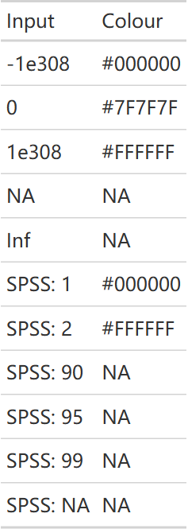{fig-alt="原生映射表，极大有限值依次为黑、灰、白，SPSS有效值1和2为黑白，缺失码90、95、99及NA对应NA颜色。"}

[原生表格 HTML](images/palette-guide/20261102c-update-palette-mapping.html)

颜色列表会在截取或插值前校验每个颜色及完整、唯一的列表名称；`"2"`、`"2.5"`、`"2e0"` 等数字字符串是R可变色板索引，不作为字面颜色接受。直接写颜色或明确的注册色板名，不能依赖当前会话的 `palette()`。本轮另用固定源码测试核对RDS冷启动的标签缺失与integer64拒绝路径，正文创建标签对象本身已加载haven。

::: {.callout-note collapse="true" title="复核代码"}
```r
stopifnot(identical(huge_colours, c("#000000", "#7F7F7F", "#FFFFFF", NA, NA)),
  identical(labelled_colours, c("#000000", "#FFFFFF", rep(NA_character_, 4))))
factor_values <- factor(c("b", NA, "a"), levels = c("b", "a", "unused", NA), exclude = NULL)
factor_colours <- pal_get("lancet", x = factor_values)
stopifnot(identical(names(factor_colours), c("b", "a", "unused")))
palette_error <- function(expr) tryCatch(force(expr), error = conditionMessage)
stopifnot(grepl("integer64", palette_error(pal_get("viridis", x = structure(c(0, 0), class = "integer64")))))
for (index_colour in c("2", "2.5", "2e0")) {
  stopifnot(is.character(palette_error(pal_get(list(custom = c("red", index_colour)), n = 0))))
}
validation_values <- list(huge = huge_colours, labelled = labelled_colours,
  discrete_names = names(factor_colours))
```
:::

<!-- /update-20261102c: utils_palette_mapping -->

### 日期、离散名称与标量控制（2026-11-03） {#mapping-types-20261103}

<!-- update-20261103: utils_palette_mapping -->

`Date/POSIXct/POSIXlt/difftime`按离散字符标签映射；需要连续时间色阶时，显式转为普通数值。离散结果为按水平命名的颜色向量，数值结果则每个输入值对应一个颜色。若不同值转换后出现同名标签，应先构造精确且唯一的标签，避免映射歧义。

`n/alpha`须为无类、无维度的普通数值标量，`reverse`须为同类的逻辑标量；`x`存在时，`n`仍先校验再忽略其数量。矩阵、数组、数据框等容器不作隐式展开。字面字符串`"NA"`是R的透明颜色别名，实际缺失颜色与映射数据缺失应分别处理。

```r
dates <- as.Date(c("2026-01-01", "2026-01-02", "2026-01-10", "2026-01-01"))
date_discrete <- pal_get(c("black", "white"), x = dates)
date_numeric <- pal_get(c("black", "white"), x = as.numeric(dates))
transparent_alias <- pal_get("NA", alpha = .5)
mapping_table <- data.frame(Date = as.character(dates),
  Discrete = unname(date_discrete[as.character(dates)]), Numeric = date_numeric)
gt::gtsave(gt::gt(mapping_table), file.path(tempdir(), "20261103-update-palette-time-mapping.html"))
```

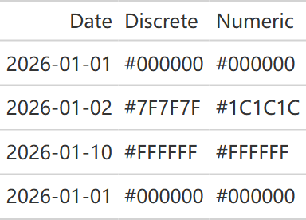{fig-alt="四行原生映射表，三个不同日期在离散模式按水平分色，连续模式按日期间距取色，重复的首日同色。"}

[原生表格 HTML](images/palette-guide/20261103-update-palette-time-mapping.html)

::: {.callout-note collapse="true" title="复核代码"}
```r
stopifnot(length(date_discrete) == 3L, identical(names(date_discrete), unique(as.character(dates))),
  length(date_numeric) == 4L, date_numeric[1] == date_numeric[4],
  identical(transparent_alias, pal_get("transparent", alpha = .5)), !is.na(transparent_alias))
repeated_values <- rep(c(0, .25, 1), 600)
repeated_colours <- pal_get(c("black", "white"), x = repeated_values, alpha = .4)
small_colours <- pal_get(c("black", "white"), x = c(0, .25, 1), alpha = .4)
stopifnot(identical(repeated_colours, rep(small_colours, 600)))
times <- as.POSIXct("2026-01-01", tz = "UTC") + c(1, 1.00000025)
collision_error <- withr::with_options(list(digits.secs = 0),
  tryCatch({pal_get("Paired", x = times); ""}, error = conditionMessage))
time_labels <- sprintf("%.17g", as.numeric(times))
stopifnot(nzchar(collision_error), length(pal_get("Paired", x = time_labels)) == 2L)
control_errors <- list(
  n = tryCatch({pal_get("Paired", n = matrix(1)); ""}, error = conditionMessage),
  alpha = tryCatch({pal_get("Paired", alpha = as.Date("2026-01-01")); ""}, error = conditionMessage),
  x = tryCatch({pal_get("Paired", x = data.frame(a = 1)); ""}, error = conditionMessage))
stopifnot(all(nzchar(unlist(control_errors))))
validation_values <- list(mapping = mapping_table, transparent_alias = transparent_alias,
  repeated = head(repeated_colours, 9), collision_error = collision_error, control_errors = control_errors)
```
:::

重复值路径会复用颜色计算，保持输出顺序、映射和错误定位；本轮没有测量新的速度或内存倍数。注册库构建的路径、来源与替换保护按固定源码核对，未重建项目色板库。

<!-- /update-20261103: utils_palette_mapping -->

## 来源色卡

::: {.panel-tabset}

### Brewer 离散 {.unnumbered}

同一颜色数量比较三个分类色板。

```r
pal_show_brewer(c("Set2", "Dark2", "Paired"), n = 6, output = "gg")
```

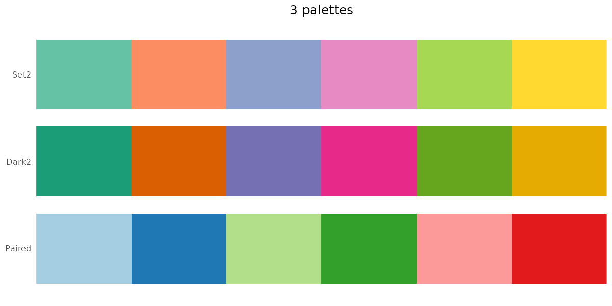{fig-alt="配色系统：检索、颜色映射与离散和连续色阶；Brewer 离散；固定模拟数据的实际参数对照结果。"}

### Brewer 顺序 {.unnumbered}

顺序色板适合从小到大的数值。

```r
pal_show_brewer(c("Blues", "YlGnBu"), n = 8, output = "gg")
```

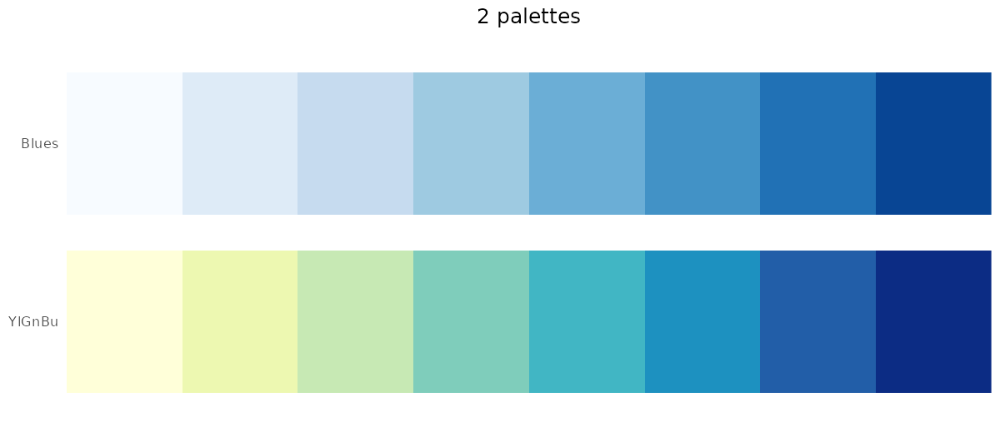{fig-alt="配色系统：检索、颜色映射与离散和连续色阶；Brewer 顺序；固定模拟数据的实际参数对照结果。"}

### Brewer 发散 {.unnumbered}

发散色板适合围绕明确中心的数值。

```r
pal_show_brewer(c("RdBu", "PRGn"), n = 9, output = "gg")
```

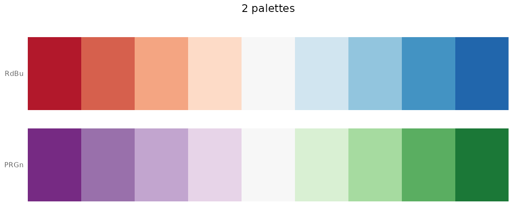{fig-alt="配色系统：检索、颜色映射与离散和连续色阶；Brewer 发散；固定模拟数据的实际参数对照结果。"}

### HCL 方案 {.unnumbered}

从对应 HCL 方案生成九色，覆盖离散、顺序、发散三种用途。

```r
pal_show_hcl(c("Dark 3", "Blues 3", "Blue-Red 3"), n = 9, output = "gg")
```

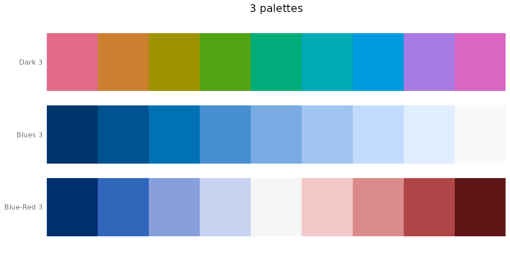{fig-alt="配色系统：检索、颜色映射与离散和连续色阶；HCL 方案；固定模拟数据的实际参数对照结果。"}

### ggsci 名称筛选 {.unnumbered}

用完整名称末尾筛选三套 ggsci 色板，避免缩写造成匹配失败。

```r
pal_show_ggsci(pattern = "(npg_nrc|lancet_lanonc|nejm_default)$", n = 6, output = "gg")
```

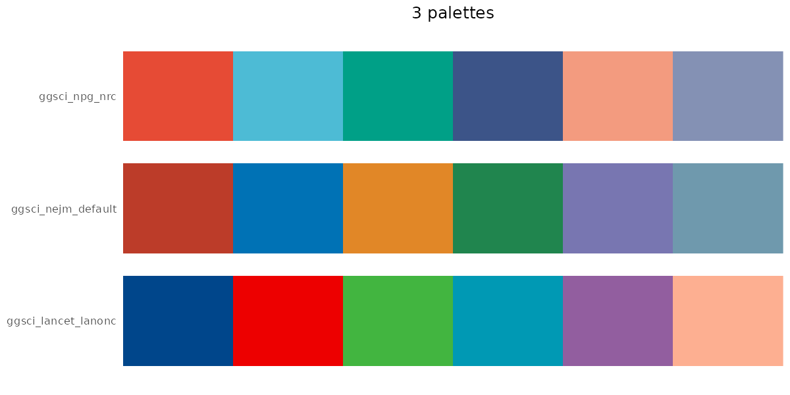{fig-alt="配色系统：检索、颜色映射与离散和连续色阶；ggsci 名称筛选；固定模拟数据的实际参数对照结果。"}

:::

### 可见图表、透明度与预览色域（2026-11-02） {#palette-preview-20261102c}

<!-- update-20261102c: utils_palette_graphics -->

`pal_show()` 及来源查看函数会可见地返回 gt 或 ggplot 对象，不在函数内部另行打印。在Quarto可执行代码块末尾直接放返回对象即可显示；本节保存真实返回的gt表格与图形。R颜色名会转为浏览器可用的hex，RGBA透明通道保留；已有名称逐个保留，缺失或纯空白的标签改用对应hex。

```r
preview_colours <- c(First = "red", " " = "#00FF0080", Last = "#0000FF00")
palette_table <- pal_show(preview_colours, output = "gt")
gt::gtsave(palette_table, file.path(tempdir(), "20261102c-update-palette-rgba.html"))
palette_plot <- pal_show(preview_colours, output = "gg")
ggplot2::ggsave(file.path(tempdir(), "20261102c-update-palette-rgba-plot.pdf"),
  palette_plot, width = 7, height = 2.4, bg = "white")
preview_types <- list(
  Continuous = structure(c("#000000", "#FFFFFF"), type = "continuous"),
  Discrete = structure(c("#000000", "#FFFFFF"), type = "discrete"))
capped_table <- pal_show(preview_types, n = 1000000, max_colors = 3, output = "gt")
gt::gtsave(capped_table, file.path(tempdir(), "20261102c-update-palette-cap.html"))
```

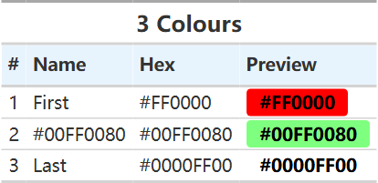{fig-alt="原生三色预览表，First为红色，半透明绿色的空白名称显示为其RGBA hex，Last为全透明蓝色。"}

[原生表格 HTML](images/palette-guide/20261102c-update-palette-rgba.html)

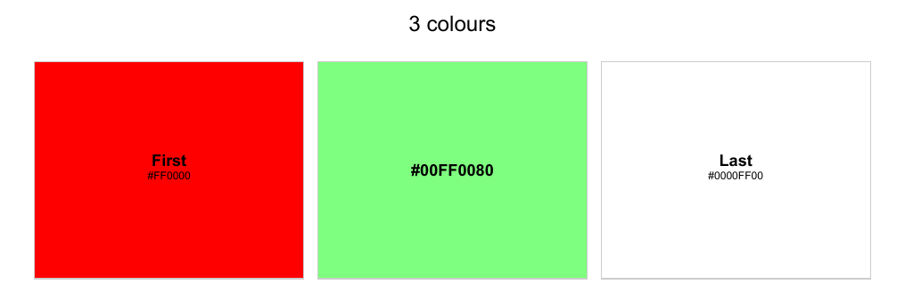{fig-alt="原生ggplot色块，R颜色名red规范为hex，透明通道未被丢弃，First与Last的名称保留。"}

[原生 PDF](images/palette-guide/20261102c-update-palette-rgba-plot.pdf)

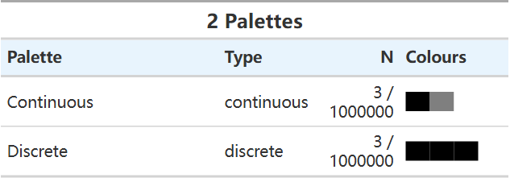{fig-alt="原生两行色卡，N均为3除以1000000，Continuous覆盖黑灰白，Discrete显示所请求插值序列的前三个近黑颜色。"}

[原生表格 HTML](images/palette-guide/20261102c-update-palette-cap.html)

连续预览按完整色域均匀抽样，单色预览取中部；离散扩展保留所请求序列的可见前缀。`max_colors` 限制实际生成和显示的颜色数，不会为了这三格先分配一百万个颜色。它是预览规则；`pal_get(n=...)` 的取色规则见前节，不能混同。`pal_show` 的 `n` 要求正整数，`max_colors=Inf` 可取消显示上限；重复选择的色板只显示一次，字面颜色向量的重复颜色保留。

::: {.callout-note collapse="true" title="复核代码"}
```r
stopifnot(inherits(palette_table, "gt_tbl"),
  identical(palette_table[["_data"]][["hex"]], c("#FF0000", "#00FF0080", "#0000FF00")),
  identical(palette_table[["_data"]][["name"]], c("First", "#00FF0080", "Last")))
internal_print <- capture.output(visible_palette <- withVisible(pal_show(preview_colours, output = "gt")))
stopifnot(isTRUE(visible_palette[["visible"]]), length(internal_print) == 0L)
cap_plot <- pal_show(preview_types, n = 1000000, max_colors = 3, output = "gg")
stopifnot(nrow(cap_plot[["data"]]) == 6L,
  identical(cap_plot[["data"]][["color"]][1:3], c("#000000", "#7F7F7F", "#FFFFFF")),
  all(capped_table[["_data"]][["n_colors"]] == "3 / 1000000"))
once <- pal_show(c("Set1", "Set1"), output = "gt")
stopifnot(nrow(once[["_data"]]) == 1L)
for (expr in list(quote(pal_show("Set1", n = 0)), quote(pal_show("Set1", index = c(1, 1))),
                  quote(pal_show(factor("Set1"))))) {
  stopifnot(inherits(tryCatch(eval(expr), error = identity), "error"))
}
validation_values <- list(hex = palette_table[["_data"]][["hex"]],
  labels = palette_table[["_data"]][["name"]], displayed = cap_plot[["data"]][["color"]])
```
:::

<!-- /update-20261102c: utils_palette_graphics -->

### 来源生成、只显示一色与HEX输出（2026-11-03） {#source-preview-20261103}

<!-- update-20261103: utils_palette_sources -->

来源查看函数按各自原生规则生成颜色，再应用显示上限。**`n=1`不等于`n=8, max_colors=1`**：Brewer会将不足三色的请求调整为三色并提示一次；HCL/viridis保留原生单色生成规则；ggsci的连续色板从原生色序列取中部，离散色板取首色。只显示一色时，连续预览取已保留颜色的中部（偶数个时取较前的一项），离散预览取首色。

下面汇总四个来源函数实际返回的gt对象。gt中的色块用于HTML，非HTML表格提供HEX文字；需要带颜色的PDF/Word图片时用`output="gg"`。色块新加的轮廓不改变填色、透明度或位置，白色和全透明色也能辨认。

```r
library(UtilsR)
one_sources <- list(
  Brewer = pal_show_brewer("Blues", n = 1),
  HCL = pal_show_hcl("grays", n = 1),
  ggsci = pal_show_ggsci("gsea_default", n = 1),
  viridis = pal_show_viridis("viridis", n = 1))
capped_sources <- list(
  Brewer = pal_show_brewer("Blues", n = 8, max_colors = 1),
  HCL = pal_show_hcl("Grays", n = 8, max_colors = 1),
  ggsci = pal_show_ggsci("gsea_default", n = 8, max_colors = 1),
  viridis = pal_show_viridis("viridis", n = 8, max_colors = 1))
long_palette <- setNames(list(c("white", "#FF000080", "transparent")),
  "A long catalogue name that wraps while its swatches keep their width")
capped_sources[["Long catalogue name"]] <- pal_show(long_palette)
border_preview <- pal_show_viridis("viridis", n = 3, alpha = 0, output = "gg")
ggplot2::ggsave(file.path(tempdir(), "20261103-update-palette-outlines.pdf"),
  border_preview, width = 6, height = 1.8, device = grDevices::cairo_pdf)
```

::: {.panel-tabset}
#### 原生n=1 {.unnumbered}

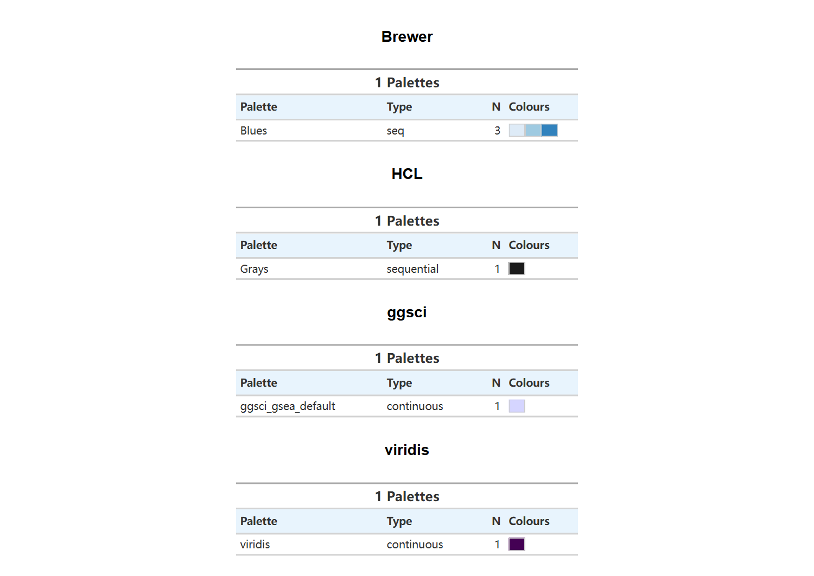{fig-alt="四个真实gt色卡上下汇总，Brewer的N为3，HCL、ggsci和viridis按原生规则生成单色。"}

[原生表格 HTML](images/palette-guide/20261103-update-palette-native-one.html)

#### n=8，只显示一色 {.unnumbered}

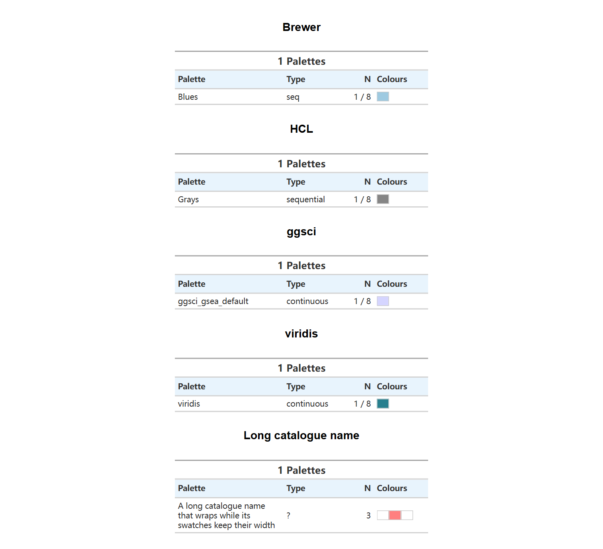{fig-alt="来源色卡分别显示1除以8的数量标记；另一个长目录名色卡换行，色块及HEX保持完整。"}

[原生表格 HTML](images/palette-guide/20261103-update-palette-capped-one.html)

#### 全透明填色的轮廓 {.unnumbered}

{fig-alt="viridis的三个全透明色块在白底上由轮廓定位，填色透明度仍为零。"}

[原生 PDF](images/palette-guide/20261103-update-palette-outlines.pdf)
:::

显式名称优先于`pattern/type`筛选；HCL名称沿用原生匹配规则并诊断歧义。混合有效与未知名称时提示被跳过项，全部无效或索引未选中任何色板时给出诊断。ggsci目录只含固定色板，Gephi生成器预设不进入索引；可先用其原函数生成颜色，再把颜色向量交给查看函数。`reverse=TRUE`反转ggsci最终选出的颜色集，不改变所选集合。

::: {.callout-note collapse="true" title="复核代码"}
```r
write_native_tables <- function(tables, filename) {
  body <- vapply(names(tables), function(name) paste0("<h3>", htmltools::htmlEscape(name),
    "</h3>", gt::as_raw_html(tables[[name]], inline_css = TRUE)), "")
  writeLines(paste0('<!doctype html><meta charset="utf-8"><style>body{margin:0;padding:15px;',
    'background:white;font-family:Arial,sans-serif}h3{text-align:center}</style>',
    paste(body, collapse = "\n")), file.path(tempdir(), filename), useBytes = TRUE)
}
write_native_tables(one_sources, "20261103-update-palette-native-one.html")
write_native_tables(capped_sources, "20261103-update-palette-capped-one.html")
source_hex <- function(x) {
  cells <- x[["_data"]][["preview"]]
  sub("background:", "", unlist(regmatches(cells, gregexpr("background:#[A-Fa-f0-9]+", cells))), fixed = TRUE)
}
native_gsea <- unname(utils::getFromNamespace("ggsci_db", "ggsci")[["gsea"]][["default"]])
gsea_kept <- native_gsea[round(seq.int(1, length(native_gsea), length.out = 8))]
rgb_hex <- function(x) grDevices::rgb(t(grDevices::col2rgb(x)), maxColorValue = 255)
expected_one <- list(Brewer = RColorBrewer::brewer.pal(3, "Blues"),
  HCL = grDevices::hcl.colors(1, "Grays"), ggsci = native_gsea[ceiling(length(native_gsea) / 2)],
  viridis = viridisLite::viridis(1))
expected_cap <- list(Brewer = RColorBrewer::brewer.pal(8, "Blues")[4],
  HCL = grDevices::hcl.colors(8, "Grays")[4], ggsci = gsea_kept[4], viridis = viridisLite::viridis(8)[4])
for (name in names(expected_one)) {
  stopifnot(identical(source_hex(one_sources[[name]]), unname(rgb_hex(expected_one[[name]]))),
    identical(source_hex(capped_sources[[name]]), unname(rgb_hex(expected_cap[[name]]))))
}
reverse_gsea <- pal_show_ggsci("gsea_default", n = 8, max_colors = 3, reverse = TRUE)
forward_gsea <- pal_show_ggsci("gsea_default", n = 8, max_colors = 3)
stopifnot(identical(source_hex(reverse_gsea), rev(source_hex(forward_gsea))))
latex_preview <- as.character(gt::as_latex(one_sources[["Brewer"]]))
stopifnot(grepl("DEEBF7", paste(latex_preview, collapse = ""), fixed = TRUE),
  !grepl("<span", paste(latex_preview, collapse = ""), fixed = TRUE))
source_warnings <- character()
retained_source <- withCallingHandlers(pal_show_hcl(c("Grays", "missing_source_name"), n = 3),
  warning = function(w) {source_warnings <<- c(source_warnings, conditionMessage(w)); invokeRestart("muffleWarning")})
empty_source <- tryCatch({pal_show_viridis(index = 99999L); ""}, error = conditionMessage)
stopifnot(nrow(retained_source[["_data"]]) == 1L, length(source_warnings) == 1L, nzchar(empty_source))
validation_values <- list(one = lapply(one_sources, source_hex), cap = lapply(capped_sources, source_hex),
  reverse = source_hex(reverse_gsea), warnings = source_warnings, empty_selection = empty_source)
```
:::

<!-- /update-20261103: utils_palette_sources -->

### 可读色卡、筛选范围与 LaTeX 列宽（2026-11-06） {#palette_catalogue-20261106}

<!-- update-20261106: palette_catalogue -->

`pal_show()` 的 `pattern`、`type` 和 `index` 用于浏览目录。显式给色板名时，名称选择优先于 `pattern` 和 `type`；颜色向量模式需要先自行取子集。具名颜色向量插值生成更多颜色后，预览改用 HEX 标签。小画布可用 `ncol` 分行，透明色的标签按白底计算对比度。返回的 gt 表可继续用 `cols_width()` 和 `cols_hide()` 加工；双栏 LaTeX 短表需关闭 longtable 和重复表头。

```r
library(UtilsR)
colours <- c(Clear = "transparent", Half = "#33669980", Solid = "#D55E00")
p <- pal_show(colours, output = "gg", ncol = 2) +
  ggplot2::theme(panel.background = ggplot2::element_rect(fill = "white", colour = NA))
ggplot2::ggsave(file.path(tempdir(), "20261106-update-palette-layout.pdf"),
  p, width = 6, height = 4, device = grDevices::cairo_pdf)
catalogue <- pal_show("Set1", max_colors = 3)
custom <- gt::cols_width(catalogue, palette ~ gt::pct(35), n_colors ~ gt::pct(15),
                         preview ~ gt::pct(50))
custom <- gt::cols_hide(custom, columns = type)
custom <- gt::tab_options(custom, table.width = gt::px(720))
gt::gtsave(custom, file.path(tempdir(), "20261106-update-palette-catalogue.html"))
```

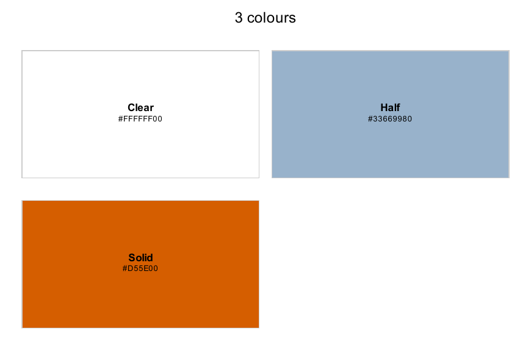{fig-alt="透明色、半透明色与实色在白底上分行显示"}

[原生 PDF](images/palette-guide/20261106-update-palette-layout.pdf)

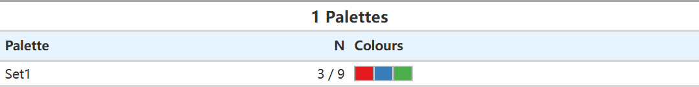{fig-alt="通过 gt 返回对象调整列宽并隐藏类型列后的原生色卡"}

[原生表格 HTML](images/palette-guide/20261106-update-palette-catalogue.html)

::: {.callout-note collapse="true" title="复核代码"}
```r
latex <- gt::tab_options(catalogue, latex.use_longtable = FALSE, latex.header_repeat = FALSE)
latex <- gt::cols_width(latex, palette ~ gt::pct(24), type ~ gt::pct(25),
                        n_colors ~ gt::pct(16), preview ~ gt::pct(35))
tex <- as.character(gt::as_latex(latex))
stopifnot(inherits(p, "ggplot"), inherits(custom, "gt_tbl"),
  !grepl("\\begin{longtable}", tex, fixed = TRUE))
validation_values <- list(requested = names(colours), rows = nrow(custom[["_data"]]),
                          latex_longtable = grepl("\\begin{longtable}", tex, fixed = TRUE))
```
:::

<!-- /update-20261106: palette_catalogue -->

## viridis 的色域控制

::: {.panel-tabset}

### 完整范围 {.unnumbered}

生成的九个颜色覆盖各自完整色域。

```r
pal_show_viridis(c("viridis", "magma", "cividis"), n = 9, output = "gg")
```

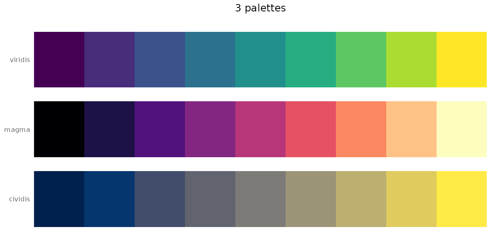{fig-alt="配色系统：检索、颜色映射与离散和连续色阶；完整范围；固定模拟数据的实际参数对照结果。"}

### 截取中间色域 {.unnumbered}

排除最深和最亮的两端，比较中间色域。

```r
pal_show_viridis("viridis", n = 9, begin = 0.2, end = 0.8, output = "gg")
```

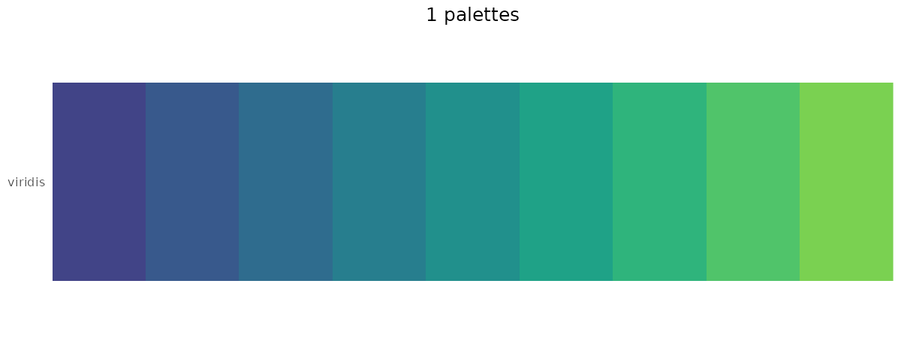{fig-alt="配色系统：检索、颜色映射与离散和连续色阶；截取中间色域；固定模拟数据的实际参数对照结果。"}

### 反向与透明度 {.unnumbered}

方向和透明度是两个独立设置。

```r
pal_show_viridis("viridis", n = 9, direction = -1, alpha = 0.65, output = "gg")
```

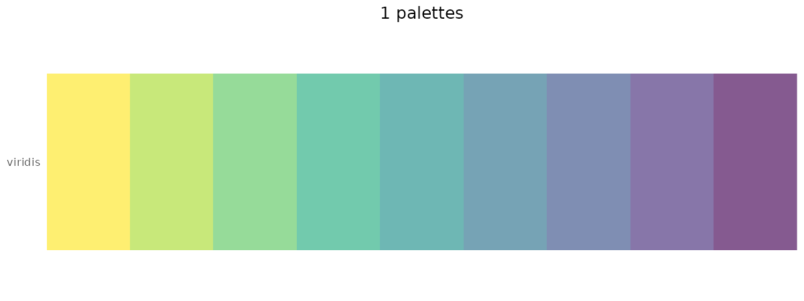{fig-alt="配色系统：检索、颜色映射与离散和连续色阶；反向与透明度；固定模拟数据的实际参数对照结果。"}

:::

## 用于真实图层的映射

::: {.panel-tabset}

### 按因子水平固定颜色 {.unnumbered}

pal_get 按水平给颜色命名；筛选或改顺序后，命名映射仍保持同组同色。

```r
lvls <- levels(dat[["group"]])
named_cols <- pal_get("lancet", x = lvls)
p_bar + scale_fill_manual(values = named_cols)
```

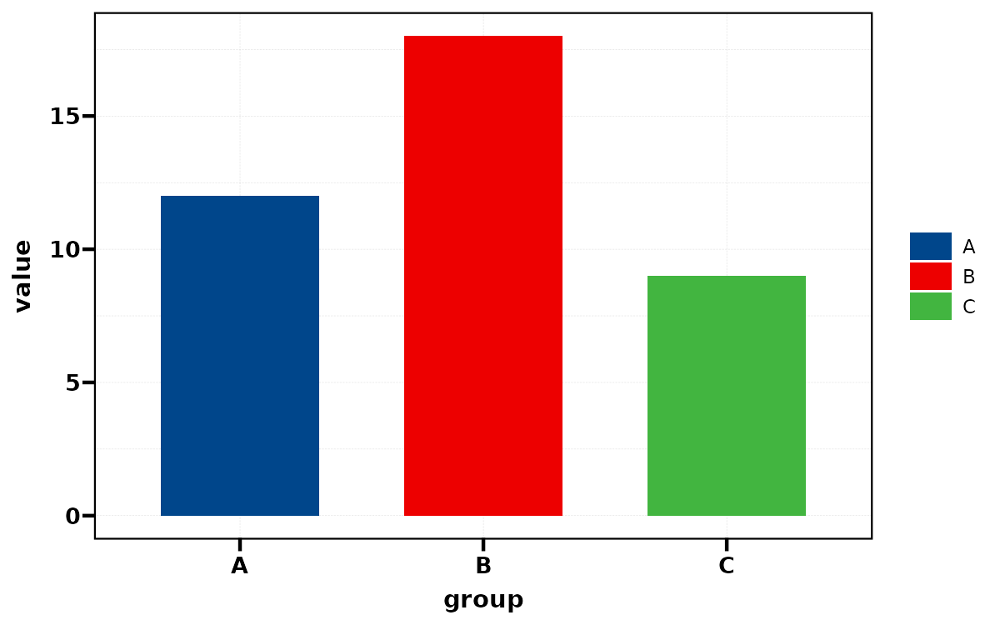{fig-alt="配色系统：检索、颜色映射与离散和连续色阶；按因子水平固定颜色；固定模拟数据的实际参数对照结果。"}

### 连续色阶 {.unnumbered}

提供完整颜色序列，由连续 scale 按实际 score 数值映射。

```r
p_heat + scale_fill_gradientn(colours = pal_get("viridis"), limits = c(-1, 1))
```

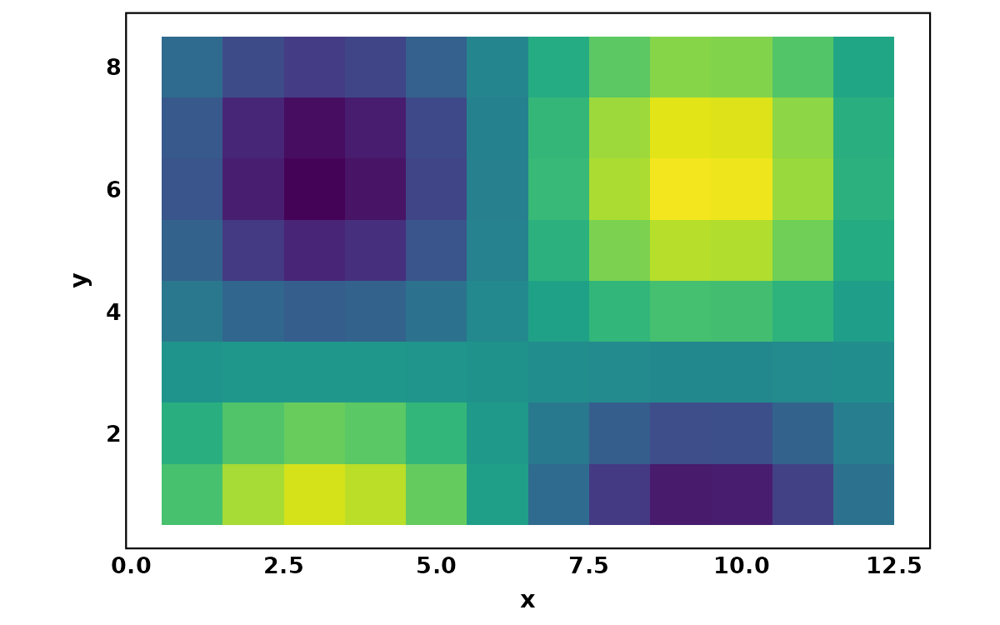{fig-alt="配色系统：检索、颜色映射与离散和连续色阶；连续色阶；固定模拟数据的实际参数对照结果。"}

### 以零为中心的热图 {.unnumbered}

固定 -1 到 1 的对称范围，使白色对应零；不同图必须使用同一范围才方便比较。

```r
p_heat + scale_fill_gradientn(colours = pal_heat[["purple_teal"]],
                             limits = c(-1, 1), breaks = c(-1, 0, 1))
```

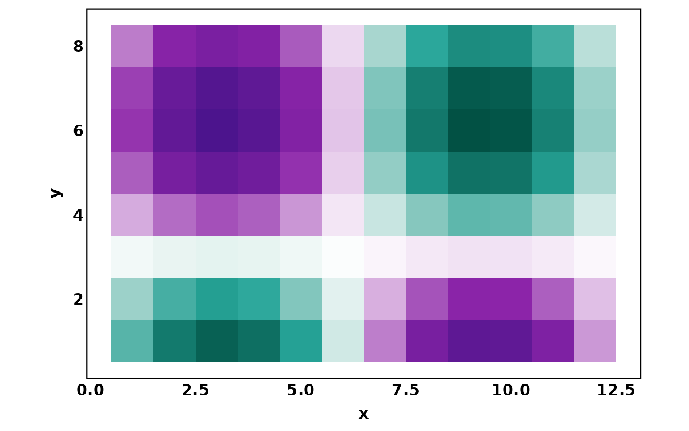{fig-alt="配色系统：检索、颜色映射与离散和连续色阶；以零为中心的热图；固定模拟数据的实际参数对照结果。"}

### 短截取与完整色域对照 {.unnumbered}

当前 pal_get(n=9) 取已有色板前九色，和覆盖完整范围的九色不同；两种行为用实际色卡并排核对。

```r
cols_short <- pal_get("viridis", n = 9)
cols_full <- grDevices::colorRampPalette(pal_get("viridis"))(9)
wrap_plots(pal_show(cols_short, output = "gg", label = FALSE) + labs(title = "First 9 colors"),
           pal_show(cols_full, output = "gg", label = FALSE) + labs(title = "Full range"), ncol = 1)
```

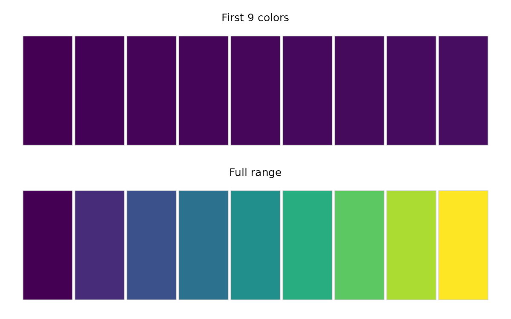{fig-alt="配色系统：检索、颜色映射与离散和连续色阶；短截取与完整色域对照；固定模拟数据的实际参数对照结果。"}

:::

### 数值颜色索引与重复值映射（2026-11-06） {#palette_numeric-20261106}

<!-- update-20261106: palette_numeric -->

共享 `.resolve_color()` 将数值颜色索引固定为 RGBA HEX，保留 double 精度，并在进入绘图前检查截断后的整数范围。目录入口 `pal_get()` 的数字开头字符串须先通过颜色文本校验。重复数值、单色及常数映射继续保留输入位置、缺失位置和透明度。长向量验证的内部优化不改变这些输出合同。

```r
library(UtilsR)
index <- c(first = 1, again = 1, second = 2)
resolved <- UtilsR::.resolve_color(index)
values <- c(low = 0, middle = .5, high = 1, missing = NA)
mapped <- pal_get(c("#33669980", "#D55E00"), x = values, alpha = .5)
shown <- data.frame(position = names(values), value = unname(values), colour = as.character(mapped))
gt::gtsave(gt::sub_missing(gt::gt(shown), missing_text = "NA"),
  file.path(tempdir(), "20261106-update-palette-numeric.html"))
```

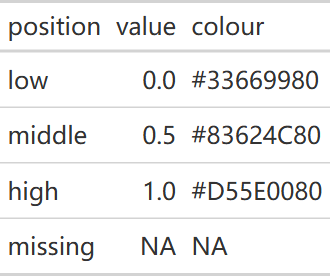{fig-alt="映射保留输入顺序、名字和缺失位置"}

[原生表格 HTML](images/palette-guide/20261106-update-palette-numeric.html)

::: {.callout-note collapse="true" title="复核代码"}
```r
reject <- function(expr) inherits(tryCatch(force(expr), error = identity), "error")
expected <- grDevices::col2rgb(unname(index), alpha = TRUE)
expected <- grDevices::rgb(expected[1, ], expected[2, ], expected[3, ], expected[4, ], maxColorValue = 255)
stopifnot(identical(unname(resolved), expected),
  reject(UtilsR::.resolve_color(2^31)),
  reject(pal_get("2147483648")),
  length(mapped) == length(values))
validation_values <- shown
```
:::

<!-- /update-20261106: palette_numeric -->

## 返回对象、保存与使用边界 {#output}

`pal_get()` 返回颜色向量：`x` 为 factor、character 或 logical 时按水平命名，其余情况不带名称；输入色板 list 时保留外层 list 名称。`pal_list()` 返回不可见 list。`pal_show*()` 的返回类型由 output 决定：gt_tbl、ggplot 或控制台结果。先明确用途，再选择类别颜色或连续 scale。

```r
lvls <- levels(dat[["group"]])
p <- p_bar + scale_fill_manual(values = pal_get("lancet", x = lvls))
# ggplot2::ggsave("palette-bars.pdf", p, width = 7, height = 5)
```

`pal_get()` 的 n 小于已有长度时只是截取前 n 色，numeric x 只按该向量自身的范围取色。连续图层示例使用 ggplot 的连续 scale 完成数值映射。色板名称、颜色对象和各来源生成函数不是同一种输入。

### 绘图解析器的数字颜色与输入校验（2026-11-03） {#literal-colours-20261103b}

UtilsR 0.6.22的共享绘图解析器`.resolve_color()`会把数字颜色索引（包括数字字符串）按调用时的`grDevices::palette()`转成固定RGBA。普通颜色名和缺失颜色保持原值。它服务于绘图入口；日常检索和连续插值仍用`pal_get()`，其颜色向量校验不因此放开数字索引。

下面先指定base颜色索引2为绿色，解析后再把索引2改为金色；已返回的颜色仍为绿色。局部作用域退出时恢复原base palette。

<!-- update-20261103b: utils_colour_literals -->

```r
library(UtilsR)
frozen_colours <- local({
  old <- grDevices::palette(c("black", "#009E73"))
  on.exit(grDevices::palette(old))
  resolved <- UtilsR::.resolve_color(c("2", "red"))
  grDevices::palette(c("black", "gold"))
  resolved
})
gt::gtsave(pal_show(list(Frozen_indices = frozen_colours)),
  file.path(tempdir(), "20261103b-update-fixed-colour-indices.html"))
```

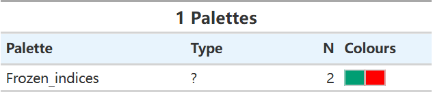{fig-alt="真实pal_show色卡，索引2对应绿色，另一项保留红色，色卡不随之后的base palette改变。"}

[原生色卡 HTML](images/palette-guide/20261103b-update-fixed-colour-indices.html)

::: {.callout-note collapse="true" title="复核代码"}
```r
stopifnot(identical(frozen_colours, c("#009E73FF", "red")))
factor_colours <- UtilsR::.resolve_color(factor(c("red", "blue")))
stopifnot(identical(factor_colours, c("red", "blue")), is.na(UtilsR::.resolve_color(NA)))
colour_errors <- lapply(list(
  quote(UtilsR::.resolve_color("red", n = matrix(1))),
  quote(UtilsR::.resolve_color(as.Date("2026-11-03"))),
  quote(UtilsR::.resolve_color(NULL, n = 0, default = c("badfirst", "badlast"))),
  quote(UtilsR::.resolve_color(NULL, default = "lancet")),
  quote(pal_get(c("2", "red")))), function(call) tryCatch({eval(call); ""}, error = conditionMessage))
stopifnot(all(nzchar(unlist(colour_errors))), length(UtilsR::.resolve_color("red", n = 0)) == 0L)
validation_values <- list(colours = frozen_colours, factor_colours = factor_colours, errors = colour_errors)
```
:::

`n`先按普通非负整数标量校验；fallback `default`必须是非空的真实颜色向量，不展开为注册色板名，即使`n=0`也先检查。因子先转字符；矩阵、带标签数值、integer64和日期等类应显式转换后再选色。多项颜色不足时会循环并提示，不把这些优化换算为未经测量的提速倍数。

<!-- /update-20261103b: utils_colour_literals -->

### 命名映射也按真实颜色校验（2026-11-03） {#named-colours-20261103b}

<!-- update-20261103b: utils_named_colours -->

`plt_cat()`、`plt_con()`和`plt_dist()`选中命名映射中的值后，现在共用同一字面颜色校验。某一类别的值不能写成`"lancet"`等色板名来要求展开；非法颜色在构图阶段报错。数字索引会先固定成RGBA，类别名和顺序仍由命名映射控制。为直接比较颜色，下例把分布柱图的`alpha`显式设为1；其默认值仍为0.7。

```r
library(UtilsR)
mapped_data <- data.frame(group = factor(rep(c("A", "B"), each = 6)),
  stage = rep(c("Early", "Late"), 6), value = seq_len(12))
mapped_plots <- local({
  old <- grDevices::palette(c("black", "#009E73"))
  on.exit(grDevices::palette(old))
  mapping <- c(A = "2", B = "red")
  plots <- list(
    categorical = plt_cat(mapped_data, "group", palette = mapping),
    continuous = plt_con(mapped_data, "value", group.by = "group", type = "box", palette = mapping),
    distribution = plt_dist(mapped_data, c("stage", "group"), type = "bar", color = mapping, alpha = 1))
  grDevices::palette(c("black", "gold"))
  combined <- patchwork::wrap_plots(lapply(names(plots), function(name)
    plots[[name]] + ggplot2::labs(title = name)), nrow = 1)
  ggplot2::ggsave(file.path(tempdir(), "20261103b-update-named-colours.pdf"),
    combined, width = 11, height = 4.2, device = grDevices::cairo_pdf)
  plots
})
```

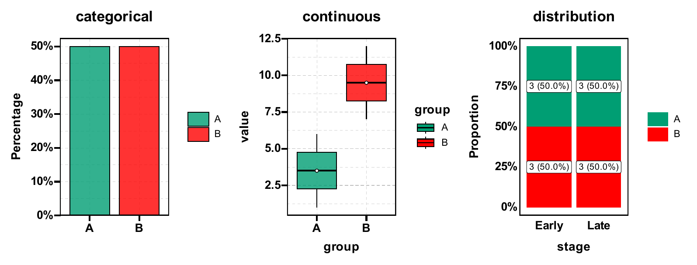{fig-alt="12行合成数据的分类柱图、连续箱线和分布柱图，A绿色与B红色在三个绘图入口一致。"}

[原生 PDF](images/palette-guide/20261103b-update-named-colours.pdf)

::: {.callout-note collapse="true" title="复核代码"}
```r
mapped_fill <- lapply(mapped_plots, function(p) {
  ggplot2::ggplot_build(p)[["plot"]][["scales"]]$get_scales("fill")$map(c("A", "B"))
})
expected_rgb <- unname(grDevices::col2rgb(c("#009E73FF", "red"), alpha = TRUE))
stopifnot(all(vapply(mapped_fill, function(x)
  identical(unname(grDevices::col2rgb(x, alpha = TRUE)), expected_rgb), FALSE)))
invalid_mapping <- c(A = "lancet", B = "red")
named_errors <- list(
  tryCatch({plt_cat(mapped_data, "group", palette = invalid_mapping); ""}, error = conditionMessage),
  tryCatch({plt_con(mapped_data, "value", group.by = "group", type = "box", palette = invalid_mapping); ""}, error = conditionMessage),
  tryCatch({plt_dist(mapped_data, c("stage", "group"), type = "bar", color = invalid_mapping); ""}, error = conditionMessage))
stopifnot(all(nzchar(unlist(named_errors))))
validation_values <- list(n = nrow(mapped_data), groups = as.list(table(mapped_data[["group"]])),
  fill = mapped_fill, errors = named_errors)
```
:::

<!-- /update-20261103b: utils_named_colours -->

## 当前完整接口 {#interfaces}

点击展开查看本次实际执行版本的参数及默认值。

<details>
<summary>公共函数签名</summary>

```r
pal_list <-
function (pattern = NULL, type = c("all", "discrete", "continuous"), show = TRUE)
NULL

pal_get <-
function (palette = "Paired", n = NULL, x = NULL, reverse = FALSE, alpha = 1)
NULL

pal_show <-
function (palette = NULL, n = NULL, pattern = NULL, type = c("all", "discrete", "continuous"),
    max_colors = 20, index = NULL, output = c("gt", "gg", "console"), label = TRUE, label_size = 3,
    ncol = NULL)
NULL

pal_show_brewer <-
function (palette = NULL, n = NULL, type = c("all", "qual", "seq", "div"), pattern = NULL,
    index = NULL, max_colors = 20, output = c("gt", "gg", "console"))
NULL

pal_show_hcl <-
function (palette = NULL, n = 8, type = c("all", "qualitative", "sequential", "diverging"),
    pattern = NULL, index = NULL, max_colors = 20, output = c("gt", "gg", "console"))
NULL

pal_show_ggsci <-
function (palette = NULL, n = NULL, alpha = 1, reverse = FALSE, pattern = NULL, index = NULL,
    max_colors = 20, output = c("gt", "gg", "console"))
NULL

pal_show_viridis <-
function (palette = NULL, n = 8, begin = 0, end = 1, direction = 1, alpha = 1, pattern = NULL,
    index = NULL, max_colors = 20, output = c("gt", "gg", "console"))
NULL

```

</details>

## 验证范围与参考 {#references}

本页列出的调用均已实际执行；所有展示的 ggplot/patchwork 图通过 `ggplot_build()` 和 PNG 导出，表格来自同一组代码的实际返回。未修改 UtilsR 源码或重新运行全包测试。图片沿用 UtilsR 0.6.8 的执行结果，`pal_get()` 的文字输出于 2026-10-31 按 0.6.19 重新执行；按因子水平固定颜色的示例已核对填充色不变。

- [UtilsR 函数参考](https://hui950319.github.io/UtilsR/reference/index.html)
- [UtilsR 源码](https://github.com/HUI950319/UtilsR/tree/master/R)
- [专题目录](index.qmd)

<details>
<summary>执行环境</summary>

```text
R version 4.4.3 (2025-02-28)
Platform: x86_64-pc-linux-gnu
Running under: Ubuntu 22.04.2 LTS

Matrix products: default
BLAS:   /usr/lib/x86_64-linux-gnu/openblas-pthread/libblas.so.3
LAPACK: /usr/lib/x86_64-linux-gnu/openblas-pthread/libopenblasp-r0.3.20.so;  LAPACK version 3.10.0

locale:
 [1] LC_CTYPE=C.UTF-8       LC_NUMERIC=C           LC_TIME=C.UTF-8        LC_COLLATE=C.UTF-8
 [5] LC_MONETARY=C.UTF-8    LC_MESSAGES=C.UTF-8    LC_PAPER=C.UTF-8       LC_NAME=C
 [9] LC_ADDRESS=C           LC_TELEPHONE=C         LC_MEASUREMENT=C.UTF-8 LC_IDENTIFICATION=C

time zone: Asia/Shanghai
tzcode source: system (glibc)

attached base packages:
[1] stats     graphics  grDevices utils     datasets  methods   base

other attached packages:
[1] patchwork_1.3.2 ggplot2_4.0.3   UtilsR_0.6.8

loaded via a namespace (and not attached):
 [1] gtable_0.3.6       jsonlite_2.0.0     dplyr_1.2.0        compiler_4.4.3     tidyselect_1.2.1
 [6] Rcpp_1.1.1         dichromat_2.0-0.1  textshaping_0.4.0  systemfonts_1.1.0  scales_1.4.0
[11] R6_2.6.1           labeling_0.4.3     generics_0.1.4     httr2_1.2.2        knitr_1.51
[16] ggrepel_0.9.8      tibble_3.3.1       ellmer_0.4.0       pillar_1.11.1      RColorBrewer_1.1-3
[21] rlang_1.3.0        ggsci_4.2.0        xfun_0.57          S7_0.2.2           otel_0.2.0
[26] viridisLite_0.4.3  cli_3.6.6          withr_3.0.3        magrittr_2.0.4     digest_0.6.39
[31] grid_4.4.3         rappdirs_0.3.4     lifecycle_1.0.5    coro_1.1.0         vctrs_0.7.3
[36] evaluate_1.0.5     ggprism_1.0.7      glue_1.8.1         farver_2.1.2       ragg_1.5.2
[41] tools_4.4.3        pkgconfig_2.0.3    mcptools_0.2.1
```

</details>

## 更新记录 {#page-updates}

::: {.callout-note collapse="true" title="本页更新记录"}
- 2026-11-06：[数值颜色索引与重复值映射](#palette_numeric-20261106)。
- 2026-11-06：[可读色卡、筛选范围与 LaTeX 列宽](#palette_catalogue-20261106)。
- 2026-11-03：[补充绘图解析器的数字颜色、fallback及命名映射校验](#literal-colours-20261103b)。
- 2026-11-03：[补充缺失颜色、窄控制台与可复制属性](#console-values-20261103)，核对反转和17位精度。
- 2026-11-03：[明确时间输入、离散名称与标量控制](#mapping-types-20261103)，保留重复值与透明别名语义。
- 2026-11-03：[补充来源色卡的原生生成、单色显示与HEX输出](#source-preview-20261103)，核对透明轮廓和名称选择。
- 2026-11-02：[补充stdout色卡与注册范围](#palette-console-20261102c)，保留可复制颜色并区分终端显示能力。
- 2026-11-02：[补充可见返回、RGBA与预览色域](#palette-preview-20261102c)，区分pal_get取色和pal_show显示上限。
- 2026-11-02：[补充极端数值与标签缺失映射](#palette-mapping-20261102c)，保留缺失与普通未使用水平。
- 2026-10-31：[pal_get 接受 NULL 和更多字面颜色，保留透明度，报错给出提示](#pal-get-20261031)；`x` 返回命名向量，数值 `x` 按数值取色。
:::
